# TỔNG QUAN KIẾN TRÚC HỆ THỐNG SIMPLIFEY V2 PRO
## DỰ ÁN: CODEBASE COGNITIVE TWIN — BẢN SAO NHẬN THỨC MÃ NGUỒN CHO SINH VIÊN IT
### *Tài liệu Đặc tả Kiến trúc Cốt lõi & Nguyên tắc Kỹ thuật Bất biến (Phụ trách: NGƯỜI 1 - LEAD)*

---

| **Thuộc tính** | **Thông số kiến trúc chuẩn** |
| :--- | :--- |
| **Phân hệ** | `00_CORE_SPEC/01_TONG_QUAN_KIEN_TRUC.md` |
| **Người phụ trách** | **NGƯỜI 1 (LEAD ARCHITECT & FULLSTACK)** |
| **Trạng thái** | **Khóa Kiến trúc (Documentation Phase — Tuyệt đối không sinh code)** |
| **Tech-Stack** | Next.js 15 (App Router), ReactFlow (Canvas DAG), Monaco Editor, Tree-sitter WASM, Gemini 2.5 Flash, Zustand Client Store |
| **Nguyên tắc Vàng** | **Code thuần chạy trước (0 Token, < 1.5s)** dựng xong toàn bộ đồ thị DAG $\to$ **AI chạy sau (JIT, 1.2s – 1.8s)** phục vụ tương tác nhận thức |
| **Chi phí & Độ trễ** | Cold-start DAG: **< 1.5s (0 Token, $0.00)** • JIT Prompt: **1.2s – 1.8s (~400 tokens, < $0.002 / phiên)** |

---

# 1. BỐI CẢNH & NỖI ĐAU THỜI ĐẠI "VIBE-CODING"

Thời đại bùng nổ của AI coding assistants (Cursor, GitHub Copilot, Claude 3.5 Sonnet, v0) đã tạo ra một thế hệ lập trình viên và sinh viên CNTT "Vibe-coder":
* **Hiện tượng:** Gõ prompt ngắn, AI tự sinh ra hàng trăm dòng code, ứng dụng chạy được rất mượt.
* **Hậu quả nghiêm trọng:** Sinh viên **hoàn toàn mù tịt về luồng thực thi (Execution Flow)**. Khi bảo vệ đồ án trước hội đồng giám khảo hoặc đi phỏng vấn kỹ thuật, sinh viên không giải thích được lý do thiết kế, không hiểu dữ liệu biến đổi qua các hàm ra sao, và không phát hiện được các lỗi ngầm do AI sinh ẩu (N+1 query, race condition, thiếu rollback transaction).
* **Sứ mệnh SimpliFey V2 Pro:** Biến một repository GitHub công khai thành một **Bản đồ Nhận thức Động (Interactive DAG)**, mổ xẻ cấu trúc xuyên file thành các **Lát cắt Nghiệp vụ**, hướng dẫn sinh viên làm chủ mã nguồn và chất vấn phản biện theo **Phương pháp Sư phạm Feynman**.

---

# 2. SƠ ĐỒ KIẾN TRÚC TOÀN TRÌNH 6 TẦNG LIÊN HOÀN (6-TIER PIPELINE)

Hệ thống vận hành theo chuỗi liên hoàn 6 tầng tất định, bóc tách rạch ròi giữa **Code Thuần (Toán học, 0 Token)** và **Trí tuệ Nhân tạo (Gemini Flash JIT)**:

```mermaid
flowchart TD
    subgraph T0 ["TẦNG 0: INGESTION STREAM & PRE-FLIGHT (0.8s - 1.2s - 0 TOKEN)"]
        A0["Link GitHub Repo Công Khai"] --> B0["Pre-Flight HEAD Probe (Kiểm tra Public - 200ms)"]
        B0 --> C0["In-Memory Stream Unzip từ codeload.github.com"]
        C0 --> D0["TreePruner on-the-fly: Lọc rác (.git, node_modules, tests, lockfiles)"]
        D0 --> E0["RAM Code Store: Map<filepath, raw_code> (Max 50 file, < 15MB)"]
    end

    subgraph T1 ["TẦNG 1: TWO-PASS SYMBOL HARVESTING & TARJAN SCC (0.05s - 0 TOKEN)"]
        E0 --> A1["Tree-sitter WASM (tags.scm) quét song song 50 file"]
        A1 --> B1["Lập 3 Bảng Băm: Symbol_Table, Interface_Map, Package_Map"]
        B1 --> C1["Raw Dependency Call-Graph"]
        C1 --> D1["Thuật toán Tarjan SCC (Condensation Graph):<br/>Co cụm chu trình A⇄B thành Super-Node<br/>➔ ĐẢM BẢO 100% DAG KHÔNG CHU TRÌNH"]
    end

    subgraph T2 ["TẦNG 2: BẢO HIỂM 2 LỚP & TRÍCH XUẤT LÁT CẮT (0.15s - 0 TOKEN)"]
        D1 --> A2["PageRank (1998) + Utility Sink Filtering:<br/>Loại bỏ file tiện ích đáy (logger, utils) ➔ Bầu 4-5 File Sếp"]
        D1 --> B2["Cognitive Complexity (SonarQube 2016):<br/>File xoắn não > 15 điểm ➔ CẤP VÉ VIP (VIP Algorithm Node)"]
        A2 --> C2["Scoped Inter-procedural Slicing: Rút 3 hàm hạt nhân (60-100 dòng)"]
        C2 --> D2["Uncle Bob Metrics theo Slice Scope: Đo I, A, D trên toàn cụm"]
        B2 --> E2["Bộ Dung hợp Lát cắt (Slice Merger)"]
        D2 --> E2
        E2 --> F2["Dagre Layout Engine (Phân nhánh & Hội tụ)"]
        F2 --> G2["🖥️ CỘT 1: ReactFlow Canvas 4 Màu (Đồ thị DAG phân nhánh có chiều sâu)"]
    end

    subgraph T3 ["TẦNG 3: BÓC TÁCH CODE VIEWER & CONTEXT SANDWICH (0.01s - 0 TOKEN)"]
        G2 -->|"User Click Node Vàng"| A3["Định vị Cognitive Hotspot (15-30 dòng hạt nhân)"]
        A3 --> B3["🖥️ CỘT 2: Monaco Interactive Code Viewer (Highlight theo Step)"]
        A3 --> C3["Đóng Gói Context Sandwich (3 Lớp Ngữ Cảnh)"]
    end

    subgraph T4 ["TẦNG 4: SÁT HẠCH SƯ PHẠM & CỔNG GÁC NHỊ PHÂN 2 CHỐT (1.2s - 1.8s - GEMINI FLASH)"]
        C3 --> A4["Single-Pass Contrastive CoT Prompting (Gemini 2.5 Flash):<br/>Nhẩm 3 góc độ câu hỏi đối chiếu trong _internal_reasoning"]
        A4 --> B4{"CỔNG GÁC NHỊ PHÂN 2 CHỐT (0.001s)<br/>• Chốt 1: referenced_symbols ∈ Symbol_Table?<br/>• Chốt 2: Có dính từ khóa ngoài repo (Kafka, Redis)?"}
        B4 -- "Vi phạm" --> C4["REJECT ➔ Fallback câu hỏi cú pháp AST an toàn"]
        B4 -- "Hợp lệ 100%" --> D4["🖥️ CỘT 3: Buồng Lái Nhận Thức 2 Pha (Tab X-Ray & Tab Feynman)"]
        C4 --> D4
    end

    subgraph T5 ["TẦNG 5: ĐỘNG CƠ BAYESIAN q-MATRIX & THANG TIẾN HÓA (0.002s - TOÁN HỌC)"]
        D4 --> A5["Sinh viên click dòng nghi vấn & giải thích bằng ví dụ đời thường"]
        A5 --> B5["Gemini Flash chấm điểm Rubric (Accuracy, Simplicity)"]
        B5 --> C5["Động cơ BKT: Cập nhật Xác suất Năng lực P(Mastery) qua q-Matrix"]
        C5 --> D5["Thang Tiến Hóa 3 Bậc (Novice ➔ Practitioner ➔ Architect)"]
        D5 --> E5["Hàm suy giảm Trí nhớ Ebbinghaus: 2^(-Δt/h)"]
        C5 --> F5["Đổi Node sang XANH (GREEN) ➔ Mở khóa Node phân nhánh kế tiếp!"]
    end
```

---

# 3. NGUYÊN TẮC THIẾT KẾ BẤT BIẾN (NON-NEGOTIABLE ARCHITECTURAL INVARIANTS)

1. **Khái niệm Node chuẩn mực:** Một Node trên Canvas **không bao giờ là một file đơn lẻ**. 1 Node = 1 **Lát cắt Nghiệp vụ Xuyên File (Cross-file Architectural Slice)** bao gồm chuỗi liên kết:
   $$\text{Controller Endpoint} \longrightarrow \text{Middleware} \longrightarrow \text{Business Service} \longrightarrow \text{Repository/DB Query}$$
2. **Quy trình 2 Pha (The 2-Phase Mastery Loop):**
   * *Pha 1 (X-Ray Walkthrough):* Cho người học đọc hiểu toàn diện: hiển thị luồng dữ liệu, **Điểm Hay (Design Pattern)** và cảnh báo **Điểm Dở (AI Vibe Smell)** để tiếp thu tri thức.
   * *Pha 2 (Sát hạch Feynman):* Đóng bản X-Ray, AI đưa ra câu hỏi tình huống Socratic để người học chứng minh năng lực bằng ngôn từ của chính mình.
3. **Phòng tuyến Zero-Trust & Zero-Disk:**
   * Không bao giờ dùng `git clone` (tránh đầy ổ đĩa server).
   * Không bao giờ thực thi code của người dùng (`eval` hoặc chạy container) để tránh mã độc. Toàn bộ là **Phân tích Tĩnh (Static Analysis)**.
4. **Cổng Gác Nhị Phân (Binary Guardrail):** Mọi nội dung do AI sinh ra phải vượt qua 2 chốt kiểm tra toán học (AST Symbol Set Matching và Regex Blacklist) trước khi xuất hiện trên giao diện.

---

# 4. MA TRẬN PHÂN CHIA NHIỆM VỤ ĐỘI HÌNH 3 NGƯỜI (24H ROLES)

| Vai trò | Phụ trách Phân hệ | Nhiệm vụ kỹ thuật trọng tâm |
| :--- | :--- | :--- |
| **NGƯỜI 1 (LEAD ARCHITECT)** | `00_CORE_SPEC/` `03_UI_VA_KICH_BAN/` | • Quản lý Data Contracts và luồng dữ liệu toàn hệ thống. • Dựng giao diện 3 Cột (ReactFlow DAG Canvas, Monaco Viewer, Cockpit 2 Pha). • Quản lý Zustand Store, FSM 4 màu, và kịch bản Demo 5 phút cho Ban Giám khảo. |
| **NGƯỜI 2 (STATIC ENGINE DEV)**| `01_ENGINE_THUAT_TOAN/` | • Viết Tầng 0: Stream Unzip vào RAM + TreePruner lọc rác. • Viết Tầng 1: Tree-sitter WASM (`tags.scm`) + Tarjan SCC khử chu trình. • Viết Tầng 2: PageRank lọc file tiện ích + Scoped Def-Use Slicing + Uncle Bob. |
| **NGƯỜI 3 (AI & COGNITIVE DEV)** | `02_AI_VA_BAYES/` | • Viết Tầng 3: Anchor Function Slicing + Đóng gói Context Sandwich. • Viết Tầng 4: Prompt Gemini Flash CoT qua JSON Schema + Cổng gác nhị phân 2 chốt. • Viết Tầng 5: Động cơ Bayesian Knowledge Tracing (BKT) + Ma trận $q$-Matrix + Half-Life Decay. |

---

# 5. NGÂN SÁCH ĐỘ TRỄ (LATENCY BUDGET) & TỐI ƯU HÓA TÀI NGUYÊN

| Hạng mục | Công nghệ thực thi | Độ trễ mục tiêu | Chi phí Token AI |
| :--- | :--- | :---: | :---: |
| **Tải và lọc Repo vào RAM** | Stream Pipe qua Node.js CDN | $0.8\text{s} – 1.2\text{s}$ | $0$ Token |
| **Quét AST & Lập bảng Symbol** | Tree-sitter WASM in-memory | $0.03\text{s}$ | $0$ Token |
| **Khử chu trình Tarjan SCC** | Duyệt DFS tuyến tính | $0.005\text{s}$ | $0$ Token |
| **PageRank & Scoped Slicing** | Power Iteration & Def-Use | $0.035\text{s}$ | $0$ Token |
| **Tính Layout DAG Canvas** | Dagre Hierarchical Engine | $0.01\text{s}$ | $0$ Token |
| **TỔNG PHA DỰNG KHUNG XƯƠNG DAG** | **CODE THUẦN (0 TOKEN)** | **~ 1.1s – 1.5s** | **$0.00** |
| **JIT Socratic Enrichment (Khi click Node)** | Gemini 2.5 Flash Structured Outputs | $1.2\text{s} – 1.8\text{s}$ | ~400 Tokens |
| **Cổng Gác Nhị Phân 2 Chốt** | Regex & Set Intersection | $0.001\text{s}$ | $0$ Token |
| **Cập nhật Điểm Bayes BKT** | Toán xác suất trên Client Store | $0.002\text{s}$ | $0$ Token |
