# TỔNG QUAN KIẾN TRÚC HỆ THỐNG SIMPLIFEY V2 PRO
## DỰ ÁN: CODEBASE COGNITIVE TWIN — BẢN SAO NHẬN THỨC MÃ NGUỒN CHO SINH VIÊN IT
### *Tài liệu Đặc tả Kiến trúc Cốt lõi & Nguyên tắc Kỹ thuật Bất biến (Phụ trách: NGƯỜI 1 - LEAD)*

---

| **Thuộc tính** | **Thông số kiến trúc chuẩn** |
| :--- | :--- |
| **Phân hệ** | `00_CORE_SPEC/01_TONG_QUAN_KIEN_TRUC.md` |
| **Người phụ trách** | **NGƯỜI 1 (LEAD ARCHITECT & FULLSTACK)** |
| **Trạng thái** | **Khóa Kiến trúc (Documentation Phase — Tuyệt đối không sinh code)** |
| **Tech-Stack** | Next.js 15 (App Router), ReactFlow (Canvas DAG), Monaco Editor, Tree-sitter WASM, Gemini 2.5 Flash, Zustand Client Store, Supabase (Postgres + Auth) cho hồ sơ người học |
| **Nguyên tắc Vàng** | **Code thuần chạy trước (0 Token, mục tiêu < 1.5s)** dựng xong toàn bộ đồ thị DAG $\to$ **AI chạy sau (JIT, 1.2s – 1.8s)** phục vụ tương tác nhận thức |
| **Chi phí & Độ trễ** | Cold-start DAG: **< 1.5s (0 Token, $0.00)** • JIT enrich: **1.2s – 1.8s (≤ 2,000 token vào / ≤ 900 token ra)** • Ước lượng **≈ $0.03/phiên (< 1.000đ)** — số liệu chuẩn ở Mục 5 |

---

# 1. BỐI CẢNH & NỖI ĐAU THỜI ĐẠI "VIBE-CODING"

Thời đại bùng nổ của AI coding assistants (Cursor, GitHub Copilot, Claude Code, v0) đã tạo ra một thế hệ lập trình viên và sinh viên CNTT "Vibe-coder":
* **Hiện tượng:** Gõ prompt ngắn, AI tự sinh ra hàng trăm dòng code, ứng dụng chạy được rất mượt.
* **Hậu quả nghiêm trọng:** Sinh viên **hoàn toàn mù tịt về luồng thực thi (Execution Flow)**. Khi bảo vệ đồ án trước hội đồng giám khảo hoặc đi phỏng vấn kỹ thuật, sinh viên không giải thích được lý do thiết kế, không hiểu dữ liệu biến đổi qua các hàm ra sao, và không phát hiện được các lỗi ngầm do AI sinh ẩu (N+1 query, race condition, thiếu rollback transaction).
* **Sứ mệnh SimpliFey V2 Pro:** Biến một repository GitHub công khai (hoặc file `.zip` tải lên) thành một **Bản đồ Nhận thức Động (Interactive DAG)**, mổ xẻ cấu trúc xuyên file thành các **Lát cắt Nghiệp vụ**, hướng dẫn sinh viên làm chủ mã nguồn và chất vấn phản biện theo **Phương pháp Sư phạm Feynman**.

---

# 2. SƠ ĐỒ KIẾN TRÚC TOÀN TRÌNH 6 TẦNG LIÊN HOÀN (6-TIER PIPELINE)

Hệ thống vận hành theo chuỗi liên hoàn 6 tầng tất định, bóc tách rạch ròi giữa **Code Thuần (Toán học, 0 Token)** và **Trí tuệ Nhân tạo (Gemini Flash JIT)**:

```mermaid
flowchart TD
    subgraph T0 ["TẦNG 0: INGESTION STREAM & PRE-FLIGHT (0.8s - 1.2s - 0 TOKEN)"]
        A0["Link GitHub Repo Công Khai<br/>(hoặc upload .zip ≤ 15MB)"] --> B0["Pre-Flight HEAD Probe (≤ 300ms)"]
        B0 --> C0["Tải zip từ codeload.github.com vào RAM (Central-Directory-First)"]
        C0 --> D0["TreePruner neo segment: Lọc rác (.git, node_modules, dist, lockfiles)<br/>Test/spec bị trừ điểm, không bị loại"]
        D0 --> E0["RAMCodeStore: Map&lt;path, code&gt; (≤ 50 file code, ≤ 15MB nén) + ManifestStore"]
    end

    subgraph T1 ["TẦNG 1: TWO-PASS SYMBOL RESOLUTION & TARJAN SCC (0 TOKEN)"]
        E0 --> A1["Tree-sitter WASM + Language Registry<br/>(query .scm theo từng adapter)"]
        A1 --> B1["Lập bảng băm: SymbolTable, NameIndex, ImportMap,<br/>FieldTypeMap, InterfaceImplMap"]
        B1 --> C1["CallGraph liên file (cạnh RESOLVED / INFERRED)"]
        C1 --> D1["Thuật toán Tarjan SCC (Condensation Graph):<br/>Co cụm chu trình A⇄B thành Super-Node<br/>➔ Đồ thị co cụm luôn là DAG"]
    end

    subgraph T2 ["TẦNG 2: BẦU HUB & TRÍCH XUẤT LÁT CẮT (0 TOKEN — Tầng 1 + 2 < 0.25s)"]
        D1 --> A2["PageRank (1998) + Utility Sink Filtering + Ingress Bonus:<br/>Loại file tiện ích khỏi xếp hạng ➔ Bầu 4-5 Hub làm gốc lát cắt"]
        D1 --> B2["Cognitive Complexity (SonarQube 2016):<br/>Hàm xoắn não > 15 điểm ➔ CẤP VÉ VIP (VIP Algorithm Node)"]
        A2 --> C2["Scoped Call-Chain Slicing: ≤ 30 dòng/step, ≤ 100 dòng/node"]
        C2 --> D2["Uncle Bob Metrics theo Slice Scope: Đo I, A, D trên toàn cụm"]
        B2 --> E2["Bộ Dung hợp Lát cắt (Slice Merger) + Display Budget 6–8 node"]
        D2 --> E2
        E2 --> N2["Deterministic Node Naming:<br/>Route ➔ Tên hàm ➔ Từ khóa miền ➔ Thư mục ➔ Tên file"]
        N2 --> F2["Dagre Layout Engine (Phân nhánh & Hội tụ)"]
        F2 --> G2["🖥️ CỘT 1: ReactFlow Canvas 4 Màu (Đồ thị DAG phân nhánh có chiều sâu)"]
    end

    subgraph T3 ["TẦNG 3: BÓC TÁCH CODE VIEWER & CONTEXT SANDWICH (0.01s - 0 TOKEN)"]
        G2 -->|"User Click Node Vàng"| A3["Định vị đoạn code hạt nhân của từng step (≤ 30 dòng)"]
        A3 --> B3["🖥️ CỘT 2: Monaco Interactive Code Viewer (Highlight theo Step)"]
        A3 --> C3["Đóng Gói Context Sandwich (3 Lớp Ngữ Cảnh)"]
    end

    subgraph T4 ["TẦNG 4: SÁT HẠCH SƯ PHẠM & CỔNG GÁC NHỊ PHÂN 2 CHỐT (1.2s - 1.8s - GEMINI FLASH)"]
        C3 --> A4["Single-Pass Contrastive CoT Prompting (Gemini 2.5 Flash):<br/>Nhẩm 3 góc độ câu hỏi đối chiếu trong _internal_reasoning"]
        A4 --> B4{"CỔNG GÁC NHỊ PHÂN 2 CHỐT (0.001s)<br/>• Chốt 1: referenced_symbols ∈ symbol_whitelist?<br/>• Chốt 2: Có dính từ khóa ngoài repo (Kafka, Redis)?"}
        B4 -- "Vi phạm" --> C4["REJECT ➔ Fallback câu hỏi cú pháp AST an toàn"]
        B4 -- "Qua 2 chốt" --> D4["🖥️ CỘT 3: Buồng Lái Nhận Thức 2 Pha (Tab X-Ray & Tab Feynman)<br/>Đáp án (Điểm Dở) khóa trong challenge_token"]
        C4 --> D4
    end

    subgraph T5 ["TẦNG 5: ĐỘNG CƠ BAYESIAN q-MATRIX & THANG TIẾN HÓA (0.002s - TOÁN HỌC)"]
        D4 --> A5["Sinh viên đọc mã nguồn hạt nhân & giải thích bằng lời của mình"]
        A5 --> B5["Gemini Flash chấm điểm Rubric (core_accuracy quyết định Đạt; simplicity là điểm cộng)"]
        B5 --> C5["Động cơ BKT: Cập nhật Xác suất Năng lực P(Mastery) qua q-Matrix"]
        C5 --> D5["Thang Tiến Hóa 3 Bậc (Novice ➔ Practitioner ➔ Architect)"]
        D5 --> E5["Hàm suy giảm Trí nhớ Ebbinghaus: max(0.25, P·2^(-Δt/14))"]
        C5 --> F5["Đổi Node sang XANH (GREEN) ➔ Mở khóa Node phân nhánh kế tiếp!"]
        C5 --> G5[("🗄️ Postgres: skill_states + node_progress<br/>(server ghi trong 1 transaction, KHÔNG lưu code)")]
    end
```

> **Tầng lưu trữ:** hồ sơ năng lực và tiến độ từng node nằm trong Postgres (Supabase), chỉ server được ghi; mã nguồn vẫn chỉ sống trong RAM. Phiên cũ được mở lại bằng commit SHA nhờ engine tất định. Chi tiết: [`04_LUU_TRU_VA_DONG_BO.md`](04_LUU_TRU_VA_DONG_BO.md).

---

# 3. NGUYÊN TẮC THIẾT KẾ BẤT BIẾN (NON-NEGOTIABLE ARCHITECTURAL INVARIANTS)

1. **Khái niệm Node chuẩn mực:** Một Node trên Canvas **không bao giờ là một file đơn lẻ**. 1 Node = 1 **Lát cắt Nghiệp vụ Xuyên File (Cross-file Architectural Slice)** bao gồm chuỗi liên kết (layer `MIDDLEWARE` có khi repo có middleware/guard):
   $$\text{Controller Endpoint} \longrightarrow \text{Middleware} \longrightarrow \text{Business Service} \longrightarrow \text{Repository/DB Query}$$
2. **Quy trình 2 Pha (The 2-Phase Mastery Loop):**
   * *Pha 1 (X-Ray Walkthrough):* Cho người học đọc hiểu: hiển thị luồng dữ liệu theo từng step và **Điểm Hay (Design Pattern)**. **Không** hiển thị Điểm Dở ở pha này (chống lộ đề).
   * *Pha 2 (Sát hạch Feynman):* AI đưa ra câu hỏi tình huống Socratic bám dòng code để người học chứng minh năng lực bằng ngôn từ của chính mình. **Điểm Dở (AI Vibe Smell)** và giải pháp chỉ được mở sau khi đạt, sai đủ 3 lần, hoặc bấm bỏ qua.
3. **Phòng tuyến Không thực thi code & Zero-Disk:**
   * Không bao giờ dùng `git clone` (tránh đầy ổ đĩa server); file `.zip` tải lên cũng chỉ nằm trong RAM.
   * Không bao giờ thực thi code của người dùng (`eval` hoặc chạy container) để tránh mã độc. Toàn bộ là **Phân tích Tĩnh (Static Analysis)**.
   * Zero-Disk áp dụng cho **mã nguồn của người dùng**: code, snippet và `StaticEngineResult` đầy đủ không bao giờ vào ổ đĩa hay cơ sở dữ liệu. Postgres chỉ chứa dữ liệu học tập (điểm kỹ năng, tiến độ node, câu trả lời Feynman) và khung đồ thị không có code (`04_LUU_TRU_VA_DONG_BO.md` Mục 1).
6. **Server là nguồn chân lý của tiến độ học:** chỉ server được gọi `updateBKTState`, đếm số lần thử và quyết định mở đáp án. Client chỉ hiển thị bản sao do server trả về.
4. **Cổng Gác Nhị Phân (Binary Guardrail):** Mọi nội dung do AI sinh ra phải vượt qua 2 chốt kiểm tra (AST Symbol Whitelist và Blacklist công nghệ ngoài repo) trước khi xuất hiện trên giao diện. Cổng gác **chặn được việc bịa tên hàm/biến và công nghệ không có trong repo**; nó không kiểm chứng được ngữ nghĩa của lời giải thích.
5. **Đa ngôn ngữ theo tầng:** mọi ngôn ngữ có grammar Tree-sitter đều dựng được đồ thị; ngôn ngữ có `ImportResolver` riêng (tier `RESOLVED`) cho cạnh chính xác cao, các ngôn ngữ còn lại (tier `STRUCTURAL`) cho cạnh suy luận, gắn nhãn và không đảm bảo 100%.

---

# 4. MA TRẬN PHÂN CHIA NHIỆM VỤ ĐỘI HÌNH 3 NGƯỜI (24H ROLES)

| Vai trò | Phụ trách Phân hệ | Nhiệm vụ kỹ thuật trọng tâm |
| :--- | :--- | :--- |
| **NGƯỜI 1 (LEAD ARCHITECT)** | `00_CORE_SPEC/` `03_UI_VA_KICH_BAN/` | • Quản lý Data Contracts và luồng dữ liệu toàn hệ thống. • Dựng giao diện 3 Cột (ReactFlow DAG Canvas, Monaco Viewer, Cockpit 2 Pha). • Quản lý Zustand Store, FSM 4 màu, và kịch bản Demo 5 phút cho Ban Giám khảo. • Dựng Supabase (5 bảng + RLS, đăng nhập khách/GitHub) và các API phiên học (`04_LUU_TRU_VA_DONG_BO.md`). |
| **NGƯỜI 2 (STATIC ENGINE DEV)**| `01_ENGINE_THUAT_TOAN/` | • Viết Tầng 0: Tải zip vào RAM (URL hoặc upload) + TreePruner lọc rác. • Viết Tầng 1: Tree-sitter WASM + Language Registry + Tarjan SCC khử chu trình. • Viết Tầng 2: PageRank lọc file tiện ích + Scoped Call-Chain Slicing + Uncle Bob + đặt tên node tất định. |
| **NGƯỜI 3 (AI & COGNITIVE DEV)** | `02_AI_VA_BAYES/` | • Viết Tầng 3: Đóng gói Context Sandwich. • Viết Tầng 4: Prompt Gemini Flash CoT qua JSON Schema + Cổng gác nhị phân 2 chốt + `challenge_token`. • Viết Tầng 5: Động cơ Bayesian Knowledge Tracing (BKT) + Ma trận $q$-Matrix + Half-Life Decay, chạy ở server trong transaction `evaluate-feynman`. |

---

# 5. BẢNG SỐ LIỆU CHUẨN DUY NHẤT (LATENCY, TOKEN, NGƯỠNG)

> Mọi file khác **trỏ về bảng này** thay vì tự ghi số. Đổi một con số ⇒ đổi ở đây trước, rồi đồng bộ các nơi trích dẫn. Tất cả là **mục tiêu / ước lượng**, chưa đo trên code thật.

### 5.1. Ngân sách độ trễ

| Hạng mục | Công nghệ thực thi | Độ trễ mục tiêu | Chi phí Token AI |
| :--- | :--- | :---: | :---: |
| **Tải và lọc Repo vào RAM (Tầng 0)** | Fetch codeload + Central-Directory-First | $0.8\text{s} – 1.2\text{s}$ (timeout cứng 5s) | $0$ Token |
| Pre-flight HEAD probe | HTTP `HEAD` | $\le 0.3\text{s}$ | $0$ Token |
| **Parse Tree-sitter (50 file, grammar đã warm)** | Tree-sitter WASM in-memory | $\sim 0.1\text{s} – 0.15\text{s}$ | $0$ Token |
| Two-Pass Symbol Resolution (Pass 1 + Pass 2) | Bảng băm trên RAM | $\sim 0.015\text{s}$ | $0$ Token |
| Khử chu trình Tarjan SCC | Duyệt DFS tuyến tính | $\sim 0.002\text{s}$ | $0$ Token |
| PageRank + Cognitive Complexity | Power Iteration, duyệt AST | $\sim 0.015\text{s}$ | $0$ Token |
| Scoped Call-Chain Slicing + Uncle Bob | Def-Use + Control trên AST | $\sim 0.02\text{s}$ | $0$ Token |
| Đặt tên node | Thang ưu tiên nguồn + TF-IDF | $\sim 0.005\text{s}$ | $0$ Token |
| Display Budget + Dagre Layout | Critical Path + Sugiyama | $\sim 0.01\text{s}$ | $0$ Token |
| **Tầng 1 + Tầng 2** | **Code thuần** | **< 0.25s** (trần cứng `ENGINE_BUDGET_MS = 600`) | **0** |
| **TỔNG PHA DỰNG DAG (cold-start)** | **CODE THUẦN (0 TOKEN)** | **< 1.5s** | **$0.00** |
| **JIT `enrich-node` (khi click Node)** | Gemini 2.5 Flash Structured Outputs | $1.2\text{s} – 1.8\text{s}$ | ≤ 2,000 vào / ≤ 900 ra |
| **JIT `evaluate-feynman` (khi nộp bài)** | Gemini 2.5 Flash Structured Outputs | $0.8\text{s} – 1.2\text{s}$ | ~ 800 vào / ~ 200 ra |
| **Cổng Gác Nhị Phân 2 Chốt** | Set Intersection + so khớp chuỗi | $0.001\text{s}$ | $0$ Token |
| **Cập nhật Điểm Bayes BKT** | Toán xác suất (hàm thuần, chạy ở server) | $< 0.002\text{s}$ | $0$ Token |
| Đọc hồ sơ người học (`GET /api/me`) | Postgres Supabase, cùng vùng với server | $\sim 0.05\text{s} – 0.1\text{s}$ | $0$ Token |
| Transaction ghi tiến độ (attempt + BKT + node + mở khóa) | Postgres Supabase | $\sim 0.03\text{s} – 0.08\text{s}$, cộng vào `evaluate-feynman` | $0$ Token |
| Mở lại phiên cũ (cache đã hết hạn) | Tải lại theo commit SHA + Tầng 0–2 | Như cold-start: **< 1.5s** | $0$ Token |

*Điều kiện của mục tiêu < 1.5s:* repo ≤ 15MB nén, mạng ổn định, grammar Tree-sitter đã warm khi server khởi động. Khi nói với BGK, kèm số đo thật hiển thị trên giao diện. Ghi Postgres không tính vào mục tiêu này vì chạy sau khi đã có đồ thị. Các dòng Postgres là ước lượng khi server và Supabase cùng vùng (VD: Singapore), cần đo lại.

### 5.2. Token & chi phí
* Trần code gửi AI: **≤ 100 dòng/node, ≤ 30 dòng/step, ≤ 1,500 token**.
* Một phiên 7 node ≈ **30,000 token** (≈ 22,000 vào + 8,300 ra) ⇒ ước lượng **≈ $0.03/phiên (< 1.000đ)**. Trần quota **50,000 token/phiên**, đếm ở server. Cách tính: `02_AI_VA_BAYES/01_LLM_PIPELINE_GUARDRAIL.md` Mục 1.4.

### 5.3. Ngưỡng & tham số
| Tham số | Giá trị chuẩn | Nguồn chi tiết |
| :--- | :---: | :--- |
| Số Hub (gốc lát cắt) / Số node hiển thị | 4–5 / **6–8** | `02_AST_SLICING_GRAPH.md` Thuật toán 3, 7 |
| Ngưỡng vé VIP (Cognitive Complexity) | > 15 | `02_AST_SLICING_GRAPH.md` Thuật toán 4 |
| Đạt Feynman | `core_accuracy >= 70` | `01_LLM_PIPELINE_GUARDRAIL.md` Mục 4.2 |
| Số lần thử / FAILED | Gửi khi `retry_count < 3`; sai **đủ 3 lần** ⇒ FAILED | `01_LLM_PIPELINE_GUARDRAIL.md` Mục 1.2 |
| BKT: $P(L_0), P(T\mid C), P(T\mid I), P(G), P(S)$ | 0.25, 0.08, 0.03, 0.25, 0.12 | `02_BAYES_COGNITIVE_BKT.md` Mục 2.1 |
| Tier NOVICE / PRACTITIONER / ARCHITECT | < 0.45 / [0.45, 0.75) / [0.75, 0.92) | `02_BAYES_COGNITIVE_BKT.md` Mục 3.2 |
| Fast-Track Auto-Pass | **≥ 0.92** mọi kỹ năng (trừ node Capstone) | `02_BAYES_COGNITIVE_BKT.md` Mục 3.2–3.3 |
| Decay | $\max(0.25,\, P \cdot 2^{-\Delta t/14})$, cảnh báo viền cam khi $P_{\text{node}} < 0.45$ | `02_BAYES_COGNITIVE_BKT.md` Mục 2.4 |
| Prefetch | Đọc Tab 1 > 5 giây, 1 node con | `01_LLM_PIPELINE_GUARDRAIL.md` Mục 1.3 |
| Debounce / trùng lặp / tối thiểu | 3 giây / ≥ 80% / < 15 ký tự | `01_LLM_PIPELINE_GUARDRAIL.md` Mục 1.2 |
| Giới hạn Tầng 0 | 15MB nén, 8MB giải nén, 50 file code, 1MB/file | `01_INGESTION_STREAM.md` §2.2 |
