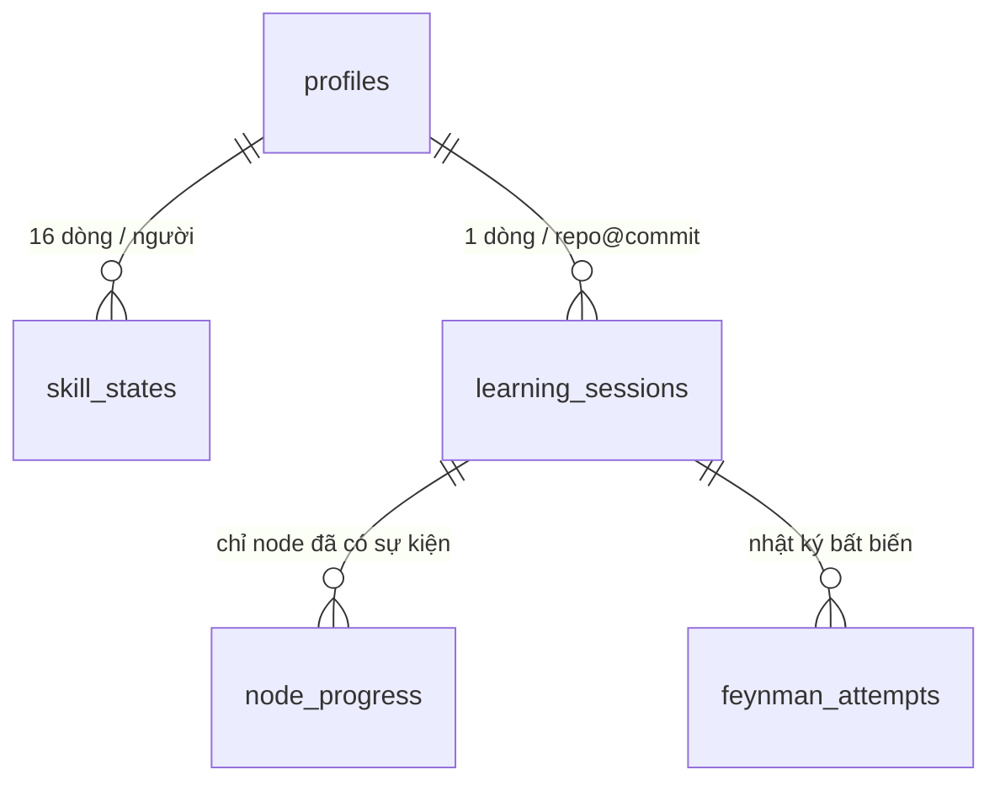
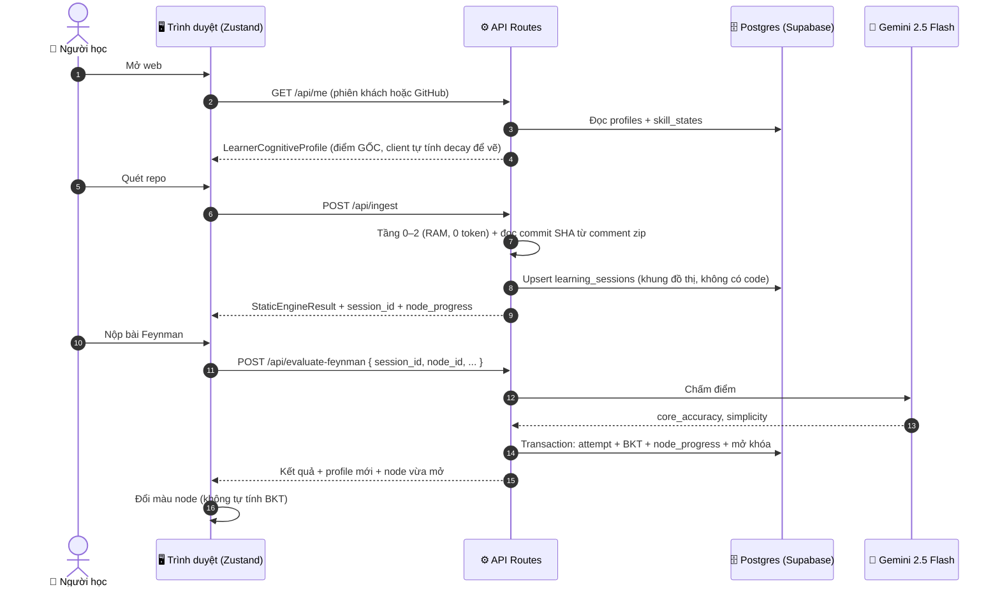

# ĐẶC TẢ TẦNG LƯU TRỮ & ĐỒNG BỘ TIẾN ĐỘ HỌC (PERSISTENCE LAYER)
## DỰ ÁN: SIMPLIFEY V2 PRO — CODEBASE COGNITIVE TWIN
### *Lưu tiến trình học, không lưu mã nguồn (Phụ trách: NGƯỜI 1 - LEAD)*

---

| **Thuộc tính** | **Thông số kỹ thuật** |
| :--- | :--- |
| **Phân hệ** | `00_CORE_SPEC/04_LUU_TRU_VA_DONG_BO.md` |
| **Người phụ trách** | **NGƯỜI 1 (LEAD ARCHITECT & FULLSTACK)** — Người 3 viết phần cập nhật BKT phía server (Mục 6.2) |
| **Công nghệ** | Supabase: Postgres + Supabase Auth (GitHub OAuth + đăng nhập khách ẩn danh) |
| **Phạm vi** | Bản hackathon (MVP chung kết). Phần mở rộng (lớp học, dashboard giảng viên, Redis) ở `04_ROADMAP_KY_THUAT/` |
| **Kiểu dữ liệu** | Định nghĩa duy nhất ở [`02_DATA_CONTRACTS.md`](02_DATA_CONTRACTS.md) Mục 4. File này chỉ mô tả bảng, luồng ghi và quy tắc |

---

# 1. NGUYÊN TẮC: LƯU TIẾN TRÌNH, KHÔNG LƯU MÃ NGUỒN

Hồ sơ năng lực phải sống qua nhiều ngày, nhiều máy, nhiều repo thì Fast-Track, Decay và Thang 3 Tier mới có ý nghĩa. Vì vậy MVP có cơ sở dữ liệu. Nhưng lời hứa **Zero-Disk** với người dùng vẫn giữ nguyên, vì nó áp dụng cho **mã nguồn của họ**, không áp dụng cho dữ liệu học tập:

| Lưu vào Postgres | **Không bao giờ** lưu (chỉ sống trong RAM) |
| :--- | :--- |
| Tài khoản (GitHub hoặc khách) | Mã nguồn, `RAMCodeStore`, `ManifestStore` |
| Điểm 16 kỹ năng BKT (`skill_states`) | `scoped_code_snippet`, `trace_steps[].snippet`, DTO |
| Phiên học: repo nào, commit nào (`learning_sessions`) | `StaticEngineResult` đầy đủ, `symbol_whitelist` |
| **Khung đồ thị** không chứa code: `node_id`, tên node, node cha, `preliminary_skills`, cờ Capstone | `EnrichedSliceResponse`, `challenge_token`, đáp án tham chiếu |
| Trạng thái từng node (`node_progress`) | Secret đã che, `IngestionReport` |
| Nhật ký nộp bài Feynman (điểm + câu trả lời của người học) | File zip tải lên |

> [!IMPORTANT]
> **Vì sao không cần lưu code mà vẫn mở lại được phiên cũ:** Engine là **tất định** (`02_AST_SLICING_GRAPH.md` §2 Quy tắc Deterministic): cùng repo + cùng commit ⇒ cùng đồ thị, cùng `node_id`. Hệ thống chỉ lưu **mã commit SHA**. Khi người học quay lại, server tải lại đúng commit đó từ codeload và dựng lại đồ thị trong < 1.5s (0 token), rồi ghép `node_progress` vào theo `node_id`. Câu chốt khi trình bày: *"Chúng em lưu tiến trình học của bạn, không lưu code của bạn."*

---

# 2. DỮ LIỆU NẰM Ở ĐÂU

| Dữ liệu | Nơi lưu | Thời gian sống | Ai được ghi |
| :--- | :--- | :--- | :--- |
| Mã nguồn repo | RAM server | Trong lúc phân tích | Engine |
| `StaticEngineResult` | LRU cache RAM server (alias `owner/repo@ref` ➔ `snapshot_id`; kết quả theo `snapshot_id` + `subdir`) | 10 phút | Engine |
| `StaticEngineResult` bản client | Zustand (RAM trình duyệt) | Tới khi đổi repo / tải lại trang | Client |
| Tài khoản, `skill_states`, `learning_sessions`, `node_progress`, `feynman_attempts` | **Postgres (Supabase)** | Lâu dài, tới khi người dùng xóa tài khoản | **Chỉ server** |
| `LearnerCognitiveProfile` bản client | Zustand | Bản sao chỉ đọc, làm mới sau mỗi lần server trả về | Server trả về, client không tự tính |
| Đáp án từng node | Trong `challenge_token` (AES-GCM) | Theo `node_cache` | Server |
| Biên nhận chờ đồng bộ (`SyncReceipt`) | `localStorage` | Tới khi gửi lại thành công (Mục 7.1) | Server ký, client chỉ giữ hộ |

`localStorage` **không còn** là nơi lưu hồ sơ người học. Nó chỉ còn giữ: biên nhận chờ đồng bộ khi Postgres gặp sự cố, và tiện ích giao diện (tab đang mở, cỡ chữ).

---

# 3. ĐỊNH DANH PHIÊN BẢN REPO (`RepoSnapshotKey`)

`node_id` chỉ ổn định trong **một phiên bản code cụ thể**. Branch `main` hôm nay và tuần sau có thể khác nhau, nên khóa phiên học không được là tên branch.

| Nguồn | `snapshot_id` | Cách lấy (0 request thêm) |
| :--- | :--- | :--- |
| Link GitHub | **Commit SHA 40 ký tự** | Zip do GitHub sinh bằng `git archive` lưu commit SHA trong **comment của zip** (bản ghi End of Central Directory). Chế độ Central-Directory-First vốn đã đọc EOCD nên lấy được ngay ([`01_INGESTION_STREAM.md`](../01_ENGINE_THUAT_TOAN/01_INGESTION_STREAM.md) Bước 4 Thao tác 2b) |
| Upload `.zip` | SHA-256 của buffer zip | Đã có sẵn vì dùng làm khóa cache LRU |

* **Fallback:** comment zip không phải SHA hợp lệ (`/^[0-9a-f]{40}$/`) ⇒ dùng SHA-256 của buffer, gắn `snapshot_id_kind = "ARCHIVE_HASH"`. Phiên vẫn lưu được nhưng **không** mở lại tự động được (không biết commit để tải lại), UI ghi rõ.
* **Khóa đầy đủ của một phiên:** `(user_id, source, snapshot_id, subdir)`. `subdir` lấy từ link `/tree/<ref>/<thư mục>`, vì cùng commit nhưng khác thư mục con thì đồ thị khác. Repo gốc ⇒ `subdir = ""`.
* **Cùng repo, commit mới:** tạo phiên mới. Điểm kỹ năng (`skill_states`) đi theo **người học**, không theo phiên, nên vẫn được giữ: Fast-Track và Tier ở commit mới dùng đúng điểm cũ. Chỉ `node_progress` là bắt đầu lại.

---

# 4. LƯỢC ĐỒ CƠ SỞ DỮ LIỆU



```sql
create type swe_skill as enum (
  'HTTP_ROUTING','DTO_VALIDATION','AUTH_SECURITY','DEPENDENCY_INJECTION',
  'LAYERED_SEPARATION','DB_OPTIMIZATION','ASYNC_CONCURRENCY','TRANSACTION_INTEGRITY',
  'ERROR_HANDLING','STATE_MANAGEMENT','ALGORITHMIC_COMPLEXITY','MEMORY_MANAGEMENT',
  'API_CONTRACT_DESIGN','CACHING_STRATEGY','RATE_LIMIT_RESILIENCE','DATA_SERIALIZATION'
); -- khớp SWE_SKILLS trong 02_DATA_CONTRACTS.md Mục 3

create table profiles (
  user_id      uuid primary key references auth.users on delete cascade,
  display_name text,
  is_guest     boolean not null default true,   -- false sau khi liên kết GitHub
  created_at   timestamptz not null default now()
);

create table skill_states (                     -- = CognitiveSkillState
  user_id           uuid not null references profiles on delete cascade,
  skill             swe_skill not null,
  p_mastery         real not null check (p_mastery between 0.01 and 0.99), -- giá trị GỐC, không lưu bản đã decay
  last_practiced_at timestamptz not null,
  practice_count    int not null default 0,
  correct_count     int not null default 0,
  primary key (user_id, skill)
);  -- Kỹ năng chưa có dòng ⇒ đọc là P(L0) = 0.25

create table learning_sessions (
  id               uuid primary key default gen_random_uuid(),
  user_id          uuid not null references profiles on delete cascade,
  source           text not null check (source in ('GITHUB','ZIP')),
  repo_key         text not null,               -- "owner/repo" hoặc tên file zip
  snapshot_id      text not null,               -- commit SHA hoặc SHA-256 zip
  snapshot_id_kind text not null check (snapshot_id_kind in ('COMMIT_SHA','ARCHIVE_HASH')),
  subdir           text not null default '',
  ref_label        text,                        -- branch/tag người dùng nhập, chỉ để hiển thị
  repo_name        text not null,
  graph_skeleton   jsonb not null,              -- GraphSkeletonNode[]: KHÔNG chứa code
  created_at       timestamptz not null default now(),
  last_active_at   timestamptz not null default now(),
  unique (user_id, source, snapshot_id, subdir)
);

create table node_progress (                    -- = NodeProgressRecord (trừ has_warning: suy ra khi đọc)
  session_id       uuid not null references learning_sessions on delete cascade,
  node_id          text not null,
  status           text not null check (status in ('AVAILABLE','COMPLETED','FAILED')),
  is_auto_mastered boolean not null default false,
  retry_count      smallint not null default 0 check (retry_count between 0 and 3),
  last_attempt_at  timestamptz,
  primary key (session_id, node_id)
);  -- Node chưa có dòng ⇒ LOCKED/AVAILABLE suy ra từ graph_skeleton

create table feynman_attempts (                 -- chỉ thêm, không sửa
  id                  bigint generated always as identity primary key,
  session_id          uuid not null references learning_sessions on delete cascade,
  node_id             text not null,
  attempt_number      smallint not null check (attempt_number between 1 and 3),
  target_skills       swe_skill[] not null,
  core_accuracy       smallint not null,
  simplicity          smallint not null,
  is_passed           boolean not null,
  is_offline_grading  boolean not null default false, -- true nếu chấm bằng sample_evaluations (hết quota)
  student_answer      text not null check (char_length(student_answer) <= 2000),
  receipt_id          uuid unique,                    -- có giá trị khi ghi qua /api/sync/replay; chống replay 2 lần
  created_at          timestamptz not null default now()
);
create index on feynman_attempts (session_id, node_id);
```

**Quy tắc suy ra trạng thái khi đọc** (hàm thuần `deriveNodeStates(graph_skeleton, node_progress)`, dùng chung client và server):
1. Node có dòng trong `node_progress` ⇒ lấy `status` của dòng đó.
2. Node không có dòng ⇒ `AVAILABLE` nếu mọi node cha ∈ {`COMPLETED`, `FAILED`} (root luôn thỏa), ngược lại `LOCKED`.
3. `has_warning = true` khi node không `LOCKED` và có ít nhất một node cha `FAILED` (soft-bypass).

**Bảo mật hàng (Row Level Security):** bật RLS trên mọi bảng; chính sách `select` chỉ cho `auth.uid() = user_id` (qua `learning_sessions` với 2 bảng con). **Không có chính sách `insert/update/delete` cho client**: mọi lệnh ghi đi qua API Route của Next.js bằng service key. Người học không thể tự sửa `p_mastery` từ DevTools.

---

# 5. ĐĂNG NHẬP

| Cách | Dùng khi | Ghi chú |
| :--- | :--- | :--- |
| **Khách (Supabase Anonymous Sign-in)** | Mặc định khi mở web lần đầu | Giám khảo dùng thử ngay, không cần tài khoản. Vẫn có `user_id` thật, dữ liệu vẫn vào Postgres |
| **GitHub OAuth** | Bấm "Lưu tiến độ bằng GitHub" | `linkIdentity` gắn GitHub vào chính tài khoản khách ⇒ **giữ nguyên** mọi tiến độ đã có, `is_guest = false` |

* Chỉ xin scope mặc định (`read:user`), **không** xin quyền đọc repo private. Repo private vẫn đi đường upload `.zip`.
* Xóa tài khoản: `DELETE /api/me` ⇒ xóa `auth.users`, cascade xóa toàn bộ bảng. Hiển thị ở menu tài khoản.

---

# 6. API & LUỒNG GHI

### 6.1. Danh sách endpoint

Mọi endpoint yêu cầu phiên đăng nhập Supabase (khách cũng được), thiếu ⇒ `ERR_UNAUTHENTICATED`. Kiểu request/response ở `02_DATA_CONTRACTS.md` Mục 4.

| Endpoint | Gọi khi | Ghi Postgres | Gọi AI |
| :--- | :--- | :--- | :---: |
| `GET /api/me` | Mở web | Tạo `profiles` nếu chưa có | Không |
| `GET /api/sessions` | Mở danh sách "Tiếp tục học" | — | Không |
| `POST /api/ingest` | Quét repo mới **hoặc** mở lại phiên cũ (`{ session_id }`) | Upsert `learning_sessions`; ghi Fast-Track cho root | Không |
| `POST /api/enrich-node` | Click node | Cập nhật `last_active_at` | Có |
| `POST /api/evaluate-feynman` | Nộp bài | **Transaction** Mục 6.2 | Có |
| `POST /api/reveal` | Bỏ qua node | `node_progress` = `FAILED` + mở khóa con | Không |
| `POST /api/nodes/review` | "Ôn tập lại" node `FAILED` | `FAILED ➔ AVAILABLE`, `retry_count = 0`; BKT giữ nguyên | Không |
| `POST /api/sync/replay` | Có biên nhận chờ đồng bộ (Mục 7.1) | Ghi lại transaction đã ký | Không |
| `POST /api/demo/persona` | Menu Persona (chỉ khi `DEMO_MODE=true`) | Ghi đè `skill_states` của **tài khoản hiện tại** | Không |
| `DELETE /api/me` | Xóa tài khoản | Cascade xóa | Không |

**Thay đổi so với bản chỉ có client:** `enrich-node` chỉ nhận `{ session_id, node_id }`. Server **tự tính** `learner_persona_tier` từ `skill_states` (đã decay) thay vì tin giá trị client gửi lên. Cách này cũng lấp chỗ trống #1 trong `BAO_CAO_LUONG_HE_THONG.md` Phần 7.

### 6.2. Transaction của `evaluate-feynman` (server là nguồn chân lý)

```typescript
// File: src/server/evaluate.ts — mã giả; các hàm BKT lấy nguyên từ src/lib/bkt-engine.ts (02_BAYES_COGNITIVE_BKT.md Mục 4)
async function evaluateFeynman(req: EvaluateFeynmanRequest, userId: string) {
  const token = decryptChallengeToken(req.challenge_token);          // node_id, reference_answer, target_skills, snippet_hash
  const session = await getOwnedSession(req.session_id, userId);      // sai chủ ⇒ ERR_SESSION_NOT_FOUND
  const graph = await getOrRebuildStaticResult(session);              // cache RAM; hết hạn ⇒ tải lại theo commit SHA (Mục 7.2)

  // 1. Gọi Gemini chấm NGOÀI transaction (0.8–1.2s, không giữ khóa DB lâu)
  const grading = await gradeWithGemini(token, graph, req.student_answer);
  const isPassed = grading.core_accuracy >= 70;                       // tự tính lại, không tin model

  // 2. Một transaction ngắn
  return db.transaction(async (tx) => {
    const progress = await tx.lockNodeProgress(session.id, req.node_id); // SELECT ... FOR UPDATE
    const attemptNumber = progress.retry_count + 1;                      // server tự đếm
    if (req.attempt_number !== attemptNumber) throw ERR_ATTEMPT_OUT_OF_SYNC; // 2 tab nộp cùng lúc
    if (progress.status !== "AVAILABLE") throw ERR_NODE_NOT_AVAILABLE;

    await tx.insertAttempt({ ...grading, is_passed: isPassed, attempt_number: attemptNumber, target_skills: token.target_skills });
    const profile = updateBKTState(token.target_skills, isPassed, await tx.loadProfile(userId), Date.now());
    await tx.upsertSkillStates(userId, profile.skills, token.target_skills);

    if (isPassed) await tx.setNode(req.node_id, "COMPLETED");
    else if (attemptNumber === 3) await tx.setNode(req.node_id, "FAILED", { retry_count: 3 });
    else await tx.setNode(req.node_id, "AVAILABLE", { retry_count: attemptNumber });

    const unlocked = await tx.applyUnlocksAndFastTrack(session, profile); // evaluateNodeTierAndAutoPass cho node vừa đủ điều kiện, Capstone không được miễn
    const revealAllowed = isPassed || attemptNumber === 3;               // quyết định ở server theo retry_count thật
    return { ...grading, is_passed: isPassed, smell_reveal: revealAllowed ? token.reference_answer : undefined,
             profile: await tx.loadClientProfile(userId, session.id), unlocked_node_ids: unlocked };
  });
}
```

> [!IMPORTANT]
> **Lỗ hổng được vá nhờ chuyển sang server:** trước đây client gửi `attempt_number` và tự đếm `retry_count`, nên sửa request thành `attempt_number: 3` là xem được đáp án ngay lần đầu. Bây giờ server đếm lần thử trong `node_progress`, nên `smell_reveal` chỉ mở theo số lần sai **thật**.

### 6.3. Sơ đồ tuần tự



---

# 7. SỰ CỐ & TÌNH HUỐNG BIÊN

### 7.1. Postgres không phản hồi giữa buổi demo
* Server thử lại tối đa 2 lần (backoff 100ms, 300ms). Vẫn lỗi ⇒ vẫn trả kết quả chấm cho người học, kèm `sync_receipt`: bản ghi transaction (attempt + kỹ năng + node) **được server ký HMAC-SHA256**, client cất vào `localStorage`.
* UI hiện nhãn "Chưa đồng bộ — sẽ tự lưu khi kết nối lại". Màu node đổi theo kết quả như bình thường.
* Khi `GET /api/me` thành công trở lại, client gửi `POST /api/sync/replay`. Server kiểm tra chữ ký, bỏ qua `receipt_id` đã ghi, rồi chạy lại transaction Mục 6.2 (từ bước 2) theo thứ tự `issued_at`: biên nhận chỉ chứa **quan sát**, điểm kỹ năng được tính lại trên dữ liệu thật. Client **không** giả được biên nhận vì không có khóa HMAC, và không nhân đôi được vì `receipt_id` là duy nhất.

### 7.2. Cache RAM hết hạn hoặc server khởi động lại
* `getOrRebuildStaticResult(session)`: trượt cache ⇒ nếu `snapshot_id_kind = COMMIT_SHA` thì tải `codeload.github.com/:owner/:repo/zip/<sha>` và chạy lại Tầng 0–2 (< 1.5s, kết quả giống hệt nhờ tính tất định). Cách này lấp chỗ trống #2 trong `BAO_CAO_LUONG_HE_THONG.md` Phần 7.
* Phiên từ `.zip` hoặc `ARCHIVE_HASH` ⇒ `ERR_SESSION_SOURCE_EXPIRED`: UI mời kéo thả lại file zip, server so SHA-256 phải khớp `snapshot_id` rồi mới ghép tiến độ cũ.
* **Triển khai:** chạy **một tiến trình Node.js sống lâu** (VD: Railway / Render / Fly.io, vùng Singapore cùng vùng Supabase), không dùng serverless function, để LRU cache và semaphore `MAX_CONCURRENT_INGESTIONS` có tác dụng.

### 7.3. Các tình huống khác
| Tình huống | Xử lý |
| :--- | :--- |
| Hai tab cùng nộp một node | `SELECT ... FOR UPDATE` + so `attempt_number` ⇒ tab chậm nhận `ERR_ATTEMPT_OUT_OF_SYNC`, tải lại trạng thái |
| Commit đã bị force-push xóa khỏi GitHub | codeload trả 404 ⇒ phiên chỉ còn đọc (xem lịch sử), không học tiếp được; điểm kỹ năng không ảnh hưởng |
| Chế độ Offline (`Ctrl + Shift + D`) | **Không** ghi Postgres. Dùng hồ sơ trong RAM trình duyệt, nhãn "Chế độ Offline — không lưu tiến độ" |
| Persona demo ghi đè điểm | Chỉ khi `DEMO_MODE=true`, chỉ trên tài khoản đang đăng nhập; tài khoản demo riêng cho mỗi persona, không dùng tài khoản thật của thành viên |
| Câu trả lời chứa thông tin cá nhân | Lưu tối đa 2,000 ký tự, chỉ chủ tài khoản đọc được (RLS), xóa theo tài khoản |

---

# 8. SỐ LIỆU

Độ trễ của tầng lưu trữ nằm trong bảng chuẩn [`01_TONG_QUAN_KIEN_TRUC.md`](01_TONG_QUAN_KIEN_TRUC.md) Mục 5.1 (dòng "Đọc hồ sơ" và "Transaction ghi tiến độ"). Đó là **ước lượng** khi server và Supabase cùng vùng, cần đo lại. Ghi Postgres **không** cộng vào mục tiêu cold-start DAG < 1.5s: upsert `learning_sessions` chạy sau khi đã có `StaticEngineResult`, song song với việc trả kết quả.

Dung lượng: mỗi người học ≈ 16 dòng kỹ năng + vài phiên (khung đồ thị ≈ 2–4 KB) + vài chục lần nộp bài ⇒ **dưới 100 KB/người**, nằm thoải mái trong gói miễn phí của Supabase trong suốt cuộc thi.

---

# 9. PHẠM VI 24 GIỜ & NGOÀI PHẠM VI

**Bắt buộc cho chung kết:** 5 bảng + RLS ở Mục 4 · đăng nhập khách + liên kết GitHub · `GET /api/me`, `GET /api/sessions`, mở lại phiên bằng commit SHA · transaction `evaluate-feynman` / `reveal` / `review` · nhãn "Chưa đồng bộ" (Mục 7.1).

**Nên có nếu còn giờ:** `sync_receipt` có chữ ký và `POST /api/sync/replay` (nếu thiếu: hiện lỗi và cho nộp lại) · màn hình "Lịch sử học" đọc `feynman_attempts`.

**Ngoài phạm vi (Roadmap Giai đoạn 1):** lớp học, giảng viên, dashboard tiến độ cả lớp, đăng nhập Google `@sgu.edu.vn`, Redis dùng chung giữa nhiều instance, bảng `llm_calls` đo token, fit lại tham số BKT từ `feynman_attempts`.
