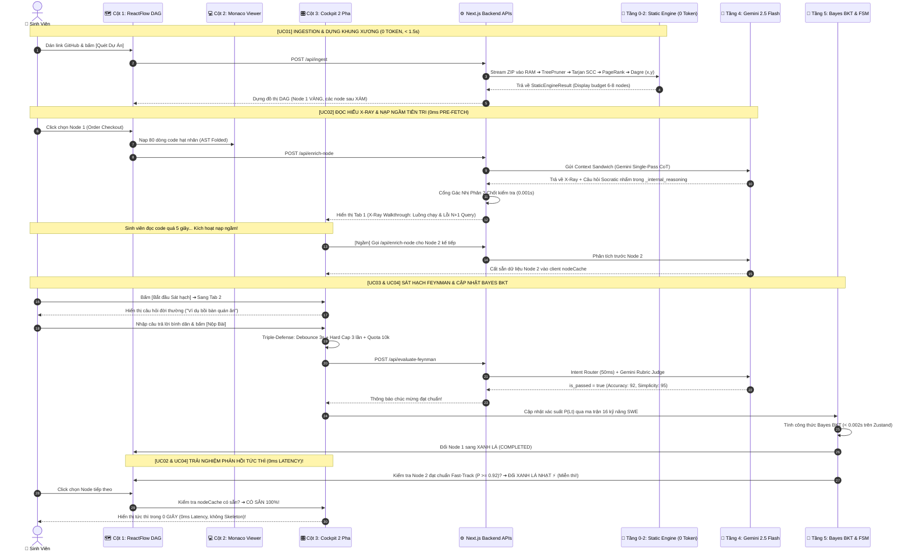

# KỊCH BẢN USE CASE TOÀN DIỆN & ĐẶC TẢ KỸ THUẬT CHI TIẾT (UNDER THE HOOD)
## DỰ ÁN: SIMPLIFEY V2 PRO — CODEBASE COGNITIVE TWIN
### *Hệ Thống Bản Sao Nhận Thức Mã Nguồn Cho Sinh Viên CNTT (Hackathon SGU 2026 - 2027)*

---

| **Thuộc tính** | **Thông số kỹ thuật chuẩn mực** |
| :--- | :--- |
| **Tài liệu** | `00_CORE_SPEC/Kich_Ban_UseCase.md` |
| **Phụ trách** | **Hội đồng Kiến trúc 3 Người (Lead Architect, Static Engine Dev, AI/Cognitive Dev)** |
| **Triết lý thiết kế** | **Người dùng thấy: Cực kỳ dễ hiểu, mượt mà như game nhập vai** ⚔️ **Bên dưới chạy: 14 thuật toán toán học chính xác, Zero-Disk, Zero-Token Ingestion, Compound AI & Mạng Bayes** |
| **Ngân sách vận hành** | Khởi tạo đồ thị: **< 1.5s (0 Token, $0.00)** • JIT Gemini Flash: **0.8s – 1.8s (~350 tokens, < $0.002/phiên)** |

---

# PHẦN 1: BẢN ĐỒ KIẾN TRÚC TOÀN TRÌNH: FRONTEND ➔ BACKEND ➔ STORAGE

Trước khi đi vào từng bước cụ thể, toàn bộ hệ thống phối hợp giữa 3 tầng công nghệ như sau:

```text
┌────────────────────────────────────────────────────────────────────────────────────────────────────────┐
│ 🖥️ TẦNG GIAO DIỆN (FRONTEND COCKPIT - NEXT.JS 15 + REACTFLOW + MONACO + ZUSTAND)                       │
│ • Cột 1 (25%): ReactFlow Canvas hiển thị Đồ thị Phân nhánh DAG 4 màu (Gray, Yellow, Green, Red).       │
│ • Cột 2 (45%): Monaco Code Viewer hiển thị 20 dòng code hạt nhân thật, tự động cuộn highlight.         │
│ • Cột 3 (30%): Buồng lái Nhận thức 2 Pha: Tab 1 (Phim X-Ray) & Tab 2 (Sát hạch Feynman).              │
│ • Client Cache & Hooks: usePreFetchSuccessor (Nạp ngầm 0ms), Semantic Debounce 3s (Chống spam).       │
└───────────────────────────────────────────────────▲────────────────────────────────────────────────────┘
                                                    │ HTTP JSON / API Routes
┌───────────────────────────────────────────────────▼────────────────────────────────────────────────────┐
│ ⚙️ TẦNG XỬ LÝ MÁY CHỦ (BACKEND API ROUTES - NODE.JS STREAMING + WEB-TREE-SITTER WASM + GEMINI FLASH)  │
│ • POST /api/ingest: Nhận link GitHub ➔ Stream RAM ➔ TreePruner ➔ Tarjan ➔ PageRank ➔ Dagre (0 Token)   │
│ • POST /api/enrich-node: Context Sandwich ➔ Gemini 2.5 Flash Single-Pass CoT ➔ Cổng gác nhị phân 2 chốt│
│ • POST /api/evaluate-feynman: Intent Router (50ms) ➔ Gemini Rubric Judge ➔ Obs (Correct/Incorrect)    │
└───────────────────────────────────────────────────▲────────────────────────────────────────────────────┘
                                                    │ In-Memory RAM & Cloud Cache
┌───────────────────────────────────────────────────▼────────────────────────────────────────────────────┐
│ 💾 TẦNG LƯU TRỮ & DỮ LIỆU (DATABASE & STORAGE ARCHITECTURE)                                            │
│ 1. RAM Code Store (Zero-Disk): Map<filepath, raw_code> lưu trong RAM máy chủ (< 15MB, tối đa 50 file).│
│ 2. Gemini Context Caching: Đóng băng mã nguồn trên AI Cloud, giảm 75% chi phí API.                     │
│ 3. Client Zustand Store: nodeCache (lưu kết quả nạp ngầm), LearnerCognitiveProfile (BKT 16 kỹ năng).  │
│ 4. LocalStorage Fallback: File mock_repo_shop.json kích hoạt qua Ctrl + Shift + D phòng mất mạng.     │
└────────────────────────────────────────────────────────────────────────────────────────────────────────┘
```

---

# PHẦN 2: BẢNG MA TRẬN 14 THUẬT TOÁN KỸ THUẬT TRONG TOÀN BỘ HỆ THỐNG

| STT | Tên Thuật Toán / Kỹ Thuật | Thời Điểm Kích Hoạt | Nơi Thực Thi | Thời Gian Chạy (SLA) | Chi Phí Token AI | Mục Đích Cốt Lõi |
| :---: | :--- | :--- | :---: | :---: | :---: | :--- |
| **1** | **TreePruner Regex Stream** | Lúc tải file zip vào RAM | Backend Tầng 0 | $\sim 0.2\text{s}$ | 0 Token | Loại bỏ ngay thư mục rác (`node_modules`, `.git`, `dist`...) |
| **2** | **Two-Pass Symbol Harvesting** | Quét cây cú pháp đa ngôn ngữ | Backend Tầng 1 | $\sim 0.02\text{s}$ | 0 Token | Lập 3 bảng băm `Symbol_Table`, `Interface_Map`, `Package_Map` không cần Compiler |
| **3** | **Tarjan SCC (Condensation)** | Sau khi có Call-Graph thô | Backend Tầng 1 | $\sim 0.005\text{s}$ | 0 Token | Co cụm phụ thuộc vòng tròn ($A \leftrightarrow B$) thành Super-Node, đảm bảo **100% DAG** |
| **4** | **PageRank kèm Sink Filtering** | Sau khi đồ thị sạch chu trình | Backend Tầng 2 | $\sim 0.03\text{s}$ | 0 Token | Lọc file tiện ích đáy ($\text{Out-deg}=0$), bầu ra Top 4-5 File Đầu Não nghiệp vụ |
| **5** | **SonarQube Cognitive Complexity** | Quét toàn bộ hàm trong repo | Backend Tầng 2 | $\sim 0.01\text{s}$ | 0 Token | Phạt cấu trúc lồng cấp, cấp **Vé VIP Đặc Cách** cho file giải thuật $> 15$ điểm |
| **6** | **Scoped Inter-procedural Slicing** | Trích xuất lát cắt 3 hàm | Backend Tầng 2 | $\sim 0.015\text{s}$ | 0 Token | Rút 60–100 dòng code thật theo chuỗi biến DTO (Controller $\to$ Service $\to$ Repo) |
| **7** | **AST Code Folding** | Hàm giải thuật dài $> 100$ dòng | Backend Tầng 2 | $\sim 0.005\text{s}$ | 0 Token | Gập comment, hằng số thừa thành `// [collapsed]` để giữ trần $\le 1,500\text{ tokens}$ |
| **8** | **Display Budget Backbone (6-8 Nodes)**| Trước khi gửi về Frontend | Backend Tầng 2 | $\sim 0.002\text{s}$ | 0 Token | Giữ lại 6–8 Node xương sống kiến trúc, chống biến đồ thị thành "mạng nhện" |
| **9** | **Dagre Hierarchical Layout** | Sắp xếp đồ thị trên Canvas | Backend Tầng 2 | $\sim 0.01\text{s}$ | 0 Token | Tính tọa độ trực giao $(x, y)$ phân nhánh và hội tụ đa tầng |
| **10**| **Single-Pass Contrastive CoT** | Sinh viên click chọn Node vàng | Backend Tầng 4 | $1.2\text{s} – 1.8\text{s}$ | $\sim 400$ Tokens | Gemini Flash nhẩm 3 hướng câu hỏi trong `_internal_reasoning`, chọn câu tối ưu |
| **11**| **Cổng Gác Nhị Phân 2 Chốt** | Ngay khi nhận Output từ AI | Backend Tầng 4 | $\mathbf{0.001\text{s}}$ | 0 Token | Chốt 1 (AST Whitelist) + Chốt 2 (Regex Blacklist), diệt ảo giác 100% |
| **12**| **Speculative Pre-fetching** | Đọc Tab 1 quá 5 giây | Worker ngầm | Chạy ngầm | $\sim 350$ Tokens | Nạp trước Node con kế tiếp vào `nodeCache`, giúp phản hồi tức thì **0ms Latency** |
| **13**| **Triple-Defense Guardrail** | Bấm nút [Nộp Bài Chấm Điểm] | Frontend + API | $\sim 0\text{ms}$ | 0 Token | Vòng 1: Semantic Debounce 3s; Vòng 2: Hard Cap 3 lần thử; Vòng 3: Quota $10,000$ tokens |
| **14**| **Bayes BKT + Ebbinghaus Decay** | Sau khi AI chấm xong | Client Zustand | $\mathbf{< 0.002\text{s}}$ | 0 Token | Cập nhật $P(L_t)$ trên ma trận 16 kỹ năng SWE, kích hoạt **Fast-Track ⚡** hoặc viền Cam |

---

# PHẦN 3: KỊCH BẢN USE CASE CHI TIẾT KÈM "UNDER THE HOOD" TỪNG BƯỚC

---

## [USE CASE 1] NẠP REPO & DỰNG BẢN ĐỒ TRỤC CHÍNH (INGESTION & BACKBONE DAG)

### 1.1. Trải nghiệm Người dùng (Dễ hiểu 100%)
* **Hành động của người học:** Bạn dán link GitHub của dự án (ví dụ: `https://github.com/my-team/shop-backend`) vào ô tìm kiếm và bấm nút **[Quét Dự Án]**.
* **Những gì hiện lên màn hình:** 
  * Chỉ sau **1.2 giây**, Cột 1 bừng sáng lên một Bản đồ các trạm học tập phân nhánh như các ải trong game.
  * Toàn bộ 50 file code phức tạp đã được thu gọn thành **6 đến 8 trạm chính yếu** (Đăng nhập $\to$ Chọn hàng $\to$ Đặt hàng $\to$ Trừ kho $\to$ Thanh toán).
  * Trạm đầu tiên phát sáng **MÀU VÀNG** (sẵn sàng đón bạn vào học), các trạm phía sau mang **MÀU XÁM MỜ** (tạm khóa, phải vượt qua trạm trước mới mở).

---

### 1.2. Phía dưới chạy như thế nào? (Under The Hood)

#### A. Frontend (Trình duyệt)
1. Người dùng bấm nút $\to$ kích hoạt hàm `handleScanRepo(url)`.
2. Giao diện Cột 1 kích hoạt hiệu ứng radar quét nhẹ.
3. Gửi HTTP Request: `POST /api/ingest` với body: `{ "repoUrl": "https://github.com/my-team/shop-backend" }`.

#### B. Backend (API Máy chủ) & Thuật toán thực thi
1. **Pre-Flight HEAD Probe (200ms):** Backend gửi 1 request `HEAD` siêu nhẹ đến GitHub API để xác nhận repository là **Public** và tồn tại. Nếu nhánh `main` bị 404, tự động fallback sang kiểm tra nhánh `master`.
2. **In-Memory Streaming (Tầng 0):** Kết nối stream trực tiếp tới `https://codeload.github.com/.../zip/refs/heads/main`. Dùng thư viện `unzipper` giải nén trực tiếp vào RAM (Cam kết **Zero-Disk**, không chạy `git clone`, không tốn 1 byte ổ cứng máy chủ).
3. **Thuật toán 1 - TreePruner on-the-fly:** Trong lúc stream dữ liệu qua RAM, mảng Regex chặn đứng và vứt bỏ toàn bộ file rác:
   ```typescript
   const IGNORE_PATTERNS = [/node_modules/, /\.git/, /dist/, /build/, /\.next/, /tests/, /coverage/, /package-lock\.json/];
   ```
   Chỉ giữ lại tối đa 50 file mã nguồn sạch (`.ts`, `.tsx`, `.js`, `.py`, `.dart`) có dung lượng $< 15\text{MB}$.
4. **BƯỚC 1.5 - Multi-Manifest Priority Scanner & Project Archetype Fingerprinting (5ms - 0 Token):**
   * Quét các file cấu hình tại độ sâu 2 cấp: `package.json`, `pubspec.yaml`, `requirements.txt`, `pom.xml`, `go.mod`.
   * **Phát hiện Monorepo:** Dùng Regex nhận diện cặp đối ngẫu `client|frontend|web|ui` và `server|backend|api|core`. Nếu có cả 2 $\implies$ Gán `is_monorepo = true`, ưu tiên phân tích `server/` trước và kích hoạt nút gạt `[Phân tích: Server | Client]` trên UI.
   * **Nhận diện 6 Hình thái (`ProjectArchetype`):** `WEB_BACKEND`, `MOBILE_APP` (React Native, Flutter), `DESKTOP_APP` (Electron, Tauri), `WEB_FRONTEND`, `CLI_TOOL`, `ALGORITHM_CORE`.
   * **Kiểm soát Scope an toàn 24h:** Dùng Native Tree-sitter WASM cho TS/JS & Python; dùng Heuristic Regex Fallback cho Dart/Flutter và Java/Android.
5. **Thuật toán 2 - Two-Pass Symbol Harvesting (Tầng 1 - 20ms):**
   * *Chặng 1:* Nạp `tree-sitter.wasm` phân tích AST song song trên RAM, lập 3 bảng băm:
     - `Symbol_Table`: Lưu vị trí `{ file, line_start, line_end }` của mọi hàm/class.
     - `Interface_Map`: Ánh xạ interface sang class hiện thực.
     - `Package_Map`: Gom cụm các package đa ngôn ngữ.
   * *Chặng 2:* Quét các nút `CallExpression` (hàm A gọi hàm B) đối chiếu bảng băm để dựng đồ thị phụ thuộc Call-Graph thô.
6. **Thuật toán 3 - Tarjan SCC (Condensation Graph - 5ms):** 
   Duyệt DFS $\mathcal{O}(V+E)$ tìm các chu trình phụ thuộc vòng tròn ($A \to B \to A$). Co cụm các file liên đới thành 1 **Super-Node** duy nhất. **Bảo đảm 100% đầu ra là Directed Acyclic Graph (DAG) không chu trình!**
7. **Thuật toán 4 - PageRank với Utility Sink Filtering (Tầng 2 - 30ms):**
   * *Bước 1 (Sink Filter):* Xóa bỏ các đỉnh có $\text{Out-degree} = 0$ thuộc nhóm tiện ích đáy (`logger.ts`, `db.ts`, `config.ts`).
   * *Bước 2 (Power Iteration):* Chạy lặp PageRank với hệ số suy giảm $d = 0.85$ để tìm ra 4-5 file có điểm trung tâm uy tín cao nhất (Hubs - thường là các Controller tiếp nhận API).
8. **Thuật toán 5 - Cognitive Complexity & Vé VIP Thuật Toán (Tầng 2 - 10ms):**
   Quét AST tính điểm xoắn não SonarQube cho từng hàm (phạt lồng cấp: `if` ngoài $+1$, `for` lồng trong $+2$, vòng lặp trong $+3$). Hàm nào có điểm $> 15$ (như thuật toán tìm đường Dijkstra, giải thuật mã hóa) được **Cấp Vé VIP Đặc Cách (`ALGORITHMIC_CORE`)**, tự động biến thành 1 Node nổi bật trên đồ thị dù không có Controller nào gọi tới!
9. **Thuật toán 7 - AST Code Folding (Tầng 2 - 5ms):**
   Nếu file giải thuật dài $> 100$ dòng, Tree-sitter tự động gập các dòng log, comment dài, khai báo hằng số thành `// ... [collapsed 15 lines]`. Bảo đảm lát cắt code gửi AI luôn $\le 1,500\text{ tokens}$.
10. **Thuật toán 8 - Display Budget (Ngân sách hiển thị 6-8 Nodes):**
    Chỉ chọn Top 6–8 Node trục xương sống (`Architectural Backbone`), các hàm râu ria được thu gọn vào Node cha để đồ thị không bị rối.
11. **Thuật toán 9 - Dagre Hierarchical Layout (Tầng 2 - 10ms):**
    Thư viện `@dagrejs/dagre` tính toán tọa độ trực giao $(x, y)$ phân nhánh và hội tụ, cấm tuyệt đối đồ thị xếp thành một hàng dọc đơn điệu.

#### C. Database / Lưu trữ dữ liệu
* **RAM Máy chủ:** Lưu `RAM Code Store = Map<filepath, raw_code>` (được dọn sạch sau khi phiên làm việc kết thúc).
* **Kết quả trả về:** JSON `StaticEngineResult` (chứa `fingerprint: ProjectFingerprint`) chuẩn theo `00_CORE_SPEC/02_DATA_CONTRACTS.md`.
* **Client Store (Zustand):** Nhận mảng `nodes` và `edges`, gán Node 0 thành `status: "AVAILABLE"`, các Node còn lại là `status: "LOCKED"`. Render lên ReactFlow Canvas Cột 1.

---

## [USE CASE 2] ĐỌC HIỂU LÁT CẮT ĐA CHỦNG LOẠI & NẠP NGẦM TIÊN TRI (PHASE 1: DUAL-MODE X-RAY & PRE-FETCH)

### 2.1. Trải nghiệm Người dùng (Dễ hiểu 100%)
* **Hành động của người học:** Bạn click chuột vào trạm màu Vàng: **"Quy trình Đặt hàng (Order Checkout Flow)"**.
* **Những gì hiện lên màn hình:** 
  * **Cột 2 (Kính lúp soi code):** Tự động mở đúng file code và chiếu sáng 20 dòng hạt nhân quan trọng nhất (không cần bạn phải đi lục lọi trong 50 thư mục).
  * **Cột 3 (Tab 1 - Phim X-Quang):** Giống như bác sĩ phân tích bệnh án:
    * *Đường đi dữ liệu:* Bấm chọn **Step 1 (Controller)** $\to$ Cột 2 cuộn đến chỗ nhận dữ liệu; Bấm **Step 2 (Service)** $\to$ Cột 2 nhảy sang file xử lý tiền.
    * *Điểm Hay kiến trúc:* Khen code biết tách riêng các tầng, giúp dễ bảo trì và dễ mở rộng.
    * *Điểm Dở (AI Vibe Smell):* Cảnh báo nguy hiểm: *"Dòng 45 đang dính lỗi gọi Database lắt nhắt từng món (N+1 Query). 100 người cùng bấm mua là sập server!"*.
  * Bạn được tự do đọc ngẫm, không bị giới hạn thời gian và chưa bị chấm điểm.

---

### 2.2. Phía dưới chạy như thế nào? (Under The Hood)

#### A. Frontend (Trình duyệt)
1. Sự kiện `onNodeClick(nodeId)` kích hoạt.
2. Kiểm tra bộ nhớ đệm: `nodeCache[nodeId]` có sẵn dữ liệu chưa?
   - **Nếu Cache Hit:** Hiển thị tức thì trong **0ms** (không hiển thị Skeleton Scanner).
   - **Nếu Cache Miss:** Hiển thị hiệu ứng quét Skeleton nhẹ và gửi `POST /api/enrich-node`.

#### B. Backend (API Máy chủ) & Thuật toán thực thi
1. **Thuật toán 6 - Scoped Slicing & Cầu Nối Định Danh Sự Kiện (Nominal Event Bridge - 15ms):**
   * *Với Web Backend:* Lần theo chuỗi biến số: $\text{req.body} \to \text{dto} \to \text{processCheckout(dto)} \to \text{updateStock()}$.
   * *Với Mobile App & Frontend (Kiến trúc Reactive / Event-Driven):* Nối cầu nối định danh từ UI `dispatch(CheckoutEvent)` $\to$ hàm xử lý `on<CheckoutEvent>` trong BLoC/Redux $\to$ gọi API Client / Local DB. Rút đúng 60–100 dòng code thật liền mạch.
2. **Đóng gói Context Sandwich Payload:**
   Tạo payload 3 lớp chuẩn theo hợp đồng `00_CORE_SPEC/02_DATA_CONTRACTS.md`:
   * *Lớp Vĩ mô (Macro):* Tên repo, `archetype` (`WEB_BACKEND`, `MOBILE_APP`...), `primary_language`, `is_monorepo`, Tech-stack.
   * *Lớp Vi mô (Micro):* 80 dòng code sạch bóc tách kèm interface DTO/State.
   * *Lớp Bất biến (Invariants):* Trình độ người học (`NOVICE`), Blacklist công nghệ ngoài repo (`["kafka", "redis"]`).
3. **Thuật toán 10 - Single-Pass Contrastive CoT với Gemini 2.5 Flash (1.2s - 1.8s):**
   Gọi Gemini 2.5 Flash qua Google Gen AI SDK với Structured Outputs JSON Schema. AI bắt buộc tự nhẩm trong trường ẩn `_internal_reasoning`:
   * Đọc hiểu luồng thực thi $\to$ Bóc tách Design Pattern (Điểm Hay).
   * Soi lỗi lập trình ẩu $\to$ Bắt chính xác lỗi N+1 Query tại dòng 45 (Điểm Dở).
   * Tự nhẩm 3 góc độ câu hỏi sát hạch, loại bỏ câu học vẹt sách vở, chọn duy nhất 01 câu hỏi Socratic phù hợp với trình độ người học.
4. **Thuật toán 11 - Cổng Gác Nhị Phân 2 Chốt (Two-Gate Binary Verification - 0.001s):**
   Trước khi trả dữ liệu về máy khách, hàm code thuần kiểm tra tính toàn vẹn:
   * **Chốt 1 (Set Intersection):** `aiOutput.referenced_symbols` có thuộc `Symbol_Table` của AST không? Nếu ngôn ngữ là Dart/Java chạy Heuristic Regex $\implies$ kích hoạt chế độ *Relaxed Whitelist* chỉ kiểm tra tên Class/Method để không reject oan.
   * **Chốt 2 (Regex Blacklist):** Câu hỏi của AI có chứa từ khóa ngoài repo (như Kafka, Redis khi dự án chỉ dùng MySQL) không? Nếu có $\implies$ **REJECT**.
   * *Cơ chế Fallback:* Nếu vi phạm, hủy bỏ kết quả của AI và nạp câu hỏi AST cú pháp an toàn chuẩn mực.
5. **Ba Tầng Chuẩn Hóa Đại Diện (Canonical 3-Tier Display Stepper):**
   * Nếu `node_type === "ARCHITECTURAL_DATA_FLOW"`:
     - **Web Backend:** Step 1: Controller $\to$ Step 2: Service $\to$ Step 3: Database.
     - **Mobile App:** Step 1: Màn hình Widget (UI Screen) $\to$ Step 2: ViewModel / BLoC $\to$ Step 3: API Client / Local DB.
     - **Desktop App:** Step 1: Renderer Window $\to$ Step 2: IPC Bridge $\to$ Step 3: Native Service.
     - **CLI Tool:** Step 1: CLI Command $\to$ Step 2: Handler $\to$ Step 3: Output.
   * Nếu `node_type === "ALGORITHMIC_CORE"`: Step 1: Khởi tạo State & Heap $\to$ Step 2: Vòng lặp biến đổi thư giãn cạnh $\to$ Step 3: Điều kiện dừng & Trả kết quả.
6. **Quy Tắc Miễn Trừ Lỗi Giả Uncle Bob cho Tầng UI (UI False-Positive Exemption):**
   Tự động miễn trừ tính chỉ số $D = |A + I - 1|$ cho tầng giao diện màn hình (`ENTRY_POINT` thuộc nhóm UI Screen), chỉ tính toán trên các tầng Logic (`BUSINESS_LOGIC`, `DATA_ACCESS`) để không bao giờ kết tội oan đồ án Mobile/Frontend của sinh viên!

#### C. Kích hoạt Thuật toán 12 - Speculative Background Pre-fetching (Nạp ngầm 0ms)
* Tại Frontend, hook `usePreFetchSuccessor` theo dõi: Nếu người học ở Tab 1 quá **5 giây**:
* Âm thầm gửi request ngầm `/api/enrich-node` cho **duy nhất 01 Node con trực tiếp kế tiếp** có độ ưu tiên cao nhất trên đồ thị.
* Kết quả phân tích của Node con được lưu sẵn vào `nodeCache[successorId]` của Zustand Store.
* **Hiệu quả:** Khi người học hoàn thành bài này và bấm sang bài tiếp theo, bài tiếp theo sẽ **hiển thị tức thì trong 0 giây (0ms Latency)**!

---

## [USE CASE 3] SÁT HẠCH BẢN CHẤT KỸ THUẬT & PHÒNG THỦ 3 VÒNG (PHASE 2: SOCRATIC FEYNMAN & TRIPLE-DEFENSE)

### 3.1. Trải nghiệm Người dùng (Dễ hiểu 100%)
* **Hành động của người học:** Sau khi đọc hiểu bản X-Quang, bạn bấm nút **[Tôi đã hiểu ➔ Bắt đầu Sát hạch]**.
* **Những gì hiện lên màn hình:** 
  * Tab 1 đóng lại, Tab 2 mở ra. Gia sư AI đưa ra một thử thách đời thường cực kỳ thú vị:  
    > *"Bạn hãy tưởng tượng mình đang kể chuyện cho người không biết IT. Dùng ví dụ quán ăn hoặc đi chợ, hãy giải thích tại sao đoạn code dòng 45 lại làm chậm hệ thống khi quán đông khách?"*
* **Bạn trả lời:** Bạn gõ vào ô phản biện (hoặc bấm biểu tượng Micro để nói):  
  > *"Dạ giống như bồi bàn trong quán ăn: Khách gọi 10 món nhưng bồi bàn cứ chạy bộ vào bếp 10 chuyến riêng lẻ để báo từng món một, thay vì ghi hết vào một tờ giấy rồi đem vào bếp 1 lần, làm kẹt cứng cửa ra vào của nhà bếp ạ!"*
* **Gia sư phản hồi:** ĐẠT CHUẨN (PASS)! Gia sư khen ví dụ bồi bàn quán ăn rất thông minh và trạm lập tức **ĐỔI SANG MÀU XANH LÁ**!

---

### 3.2. Phía dưới chạy như thế nào? (Under The Hood)

#### A. Frontend & Thuật toán 13 - Hệ Thống Phòng Thủ 3 Vòng (Triple-Defense Guardrail)
Khi người dùng bấm nút **[Nộp Bài Chấm Điểm]**, dữ liệu phải vượt qua 3 chốt chặn để chống hao phí Token AI:
1. **VÒNG 1: Semantic Debounce (Chặn tại Trình duyệt - 0 Token):**
   * Nút [Nộp bài] tự động chuyển trạng thái `disabled` trong **3 giây**.
   * Thuật toán Levenshtein so sánh chuỗi câu trả lời mới với câu trả lời vừa bị từ chối trước đó. Nếu độ tương đồng $\ge 80\% \implies$ Chặn đứng ngay tại trình duyệt, hiện thông báo đỏ: *"Bạn chưa bổ sung ý mới, hãy diễn giải chi tiết hơn!"* (Tuyệt đối không gửi request lên backend).
2. **VÒNG 2: Hard Cap Retry Limit (Khóa cứng 3 lần thử):**
   * Kiểm tra biến `retry_count < 3`. Nếu người dùng đã trả lời sai đến lần thứ 3 $\implies$ Khóa form chat, đổi Node sang **MÀU ĐỎ (FAILED)**, tự động mở đáp án giải thích chuẩn của hệ thống và bắt buộc người học đi tiếp sang Node khác. Cấm chat vô tận!
3. **VÒNG 3: Session Quota (Hạn mức an toàn 10,000 tokens/phiên):**
   * Kiểm tra tổng token tiêu thụ của phiên học. Nếu vượt trần an toàn $\implies$ Tự động chuyển sang chế độ **Offline Mock Evaluation**, không gọi ra ngoài API.
* Nếu vượt qua cả 3 vòng $\implies$ Gửi HTTP Request: `POST /api/evaluate-feynman`.

#### B. Backend (API Máy chủ) & Thuật toán thực thi
1. **AI Intent Router (50ms):**
   Gemini Flash với cấu hình siêu nhẹ (`max_tokens: 20`) phân loại ý định người dùng thành 4 nhánh:
   * `ELABORATION` (Người dùng nói: *"Khoan anh ơi em nói thêm ý này..."*): Không tăng biến sai, giữ nguyên màu vàng, chờ người dùng nói tiếp.
   * `SURRENDER` (Người dùng nói: *"Khó quá em chịu thua, cho em qua"*): Chuyển Node sang màu Đỏ nhẹ nhàng, mở Soft-Bypass cho qua bài tiếp theo.
   * `OFF_TOPIC` (Nói nhảm, chửi thề): Nhắc nhở quay lại bài học.
   * `EVALUATION`: Chuyển tiếp vào bộ chấm điểm chính thức.
2. **Feynman Rubric Judge (Gemini 2.5 Flash Structured Outputs - 0.8s):**
   Chấm điểm câu trả lời độc lập theo 3 thước đo Rubric chuẩn:
   * `core_accuracy` (0 - 100): Tính chính xác kỹ thuật (Đạt $92/100$ - hiểu đúng bản chất I/O Overhead và Network Round-trip).
   * `simplicity` (0 - 100): Độ bình dân trong sáng (Đạt $95/100$ - ví dụ bồi bàn quán ăn rất sinh động, không dùng từ ngữ cao đạo).
   * `repo_grounding` (0 - 100): Mức độ bám sát mã nguồn ($85/100$).
3. **Jargon Detector:** Quét kiểm tra xem người học có nói vẹt các từ chuyên môn như *"tính đa hình"*, *"idempotent"* mà không giải thích bản chất không.
4. **Quy tắc Đạt chuẩn (Pass Rule):**
   $$\text{is\_passed} = \text{true} \iff (\text{core\_accuracy} \ge 70 \text{ VÀ } \text{simplicity} \ge 70)$$
5. Backend trả về kết quả JSON `FeynmanEvaluationResult`.

---

## [USE CASE 4] CẬP NHẬT NĂNG LỰC BAYES BKT & MIỄN THI TỰ ĐỘNG (BKT UPDATE & FAST-TRACK)

### 4.1. Trải nghiệm Người dùng (Dễ hiểu 100%)
* **Những gì hiện lên màn hình:** 
  * Trạm bạn vừa học bừng sáng **MÀU XANH LÁ (ĐÃ LÀM CHỦ)**, đường dây nối sang các trạm sau chạy hiệu ứng ánh sáng kích hoạt.
  * **Hiện tượng Miễn thi thần tốc (Fast-Track ⚡):** Nếu trạm kế tiếp là một kiến thức bạn đã quá thành thạo ở đồ án trước, trạm đó sẽ **TỰ ĐỘNG BIẾN THÀNH MÀU XANH LÁ NHẠT** kèm biểu tượng tia sét ⚡ mà không bắt bạn làm bài thi, giúp bạn tiết kiệm thời gian!
  * **Nếu lỡ bị điểm Đỏ thì sao?** Hệ thống hiện biểu tượng tam giác vàng: *"Mắt xích trước chưa vững"* nhưng **vẫn mở cửa cho bạn đi tiếp** (không bao giờ bắt bạn kẹt lại một chỗ).

---

### 4.2. Phía dưới chạy như thế nào? (Under The Hood)

#### A. Frontend & Thuật toán 14 - Động cơ Bayesian Knowledge Tracing (Tầng 5 - Client Store)
Toàn bộ thuật toán BKT chạy trực tiếp trên trình duyệt qua Zustand Store trong thời gian **$< 0.002\text{ giây}$ (0 Token)**:
1. **Ánh xạ Quan sát nhị phân:**
   $$\text{Obs} = \begin{cases} \text{Correct} & \text{nếu } \text{is\_passed} = \text{true} \\ \text{Incorrect} & \text{ngược lại} \end{cases}$$
2. **Kích hoạt vector kỹ năng $q_j$ (16 chiều):**
   Bài tập Checkout kích hoạt 2 kỹ năng: $k_5$ (`DB_OPTIMIZATION`) và $k_7$ (`ASYNC_CONCURRENCY`).
3. **Công thức Cập nhật Xác suất Bản thể $P(L_t)$:**
   Áp dụng 4 tham số chuẩn: Prior $P(L_0) = 0.20$, Transit $P(T) = 0.20$, Guess $P(G) = 0.15$, Slip $P(S) = 0.05$:
   $$P(L_{t-1} \mid \text{Correct}) = \frac{P(L_{t-1}) \cdot (1 - P(S))}{P(L_{t-1}) \cdot (1 - P(S)) + (1 - P(L_{t-1})) \cdot P(G)}$$
   $$P(L_t) = P(L_{t-1} \mid \text{Correct}) + \big(1 - P(L_{t-1} \mid \text{Correct})\big) \times P(T)$$
   Điểm năng lực của 2 kỹ năng tăng vọt từ $0.20 \to 0.72$. Ghi nhận mốc thời gian: `last_practiced_at = Date.now()`.
4. **Máy trạng thái FSM 4 Màu chuyển đổi trạng thái:**
   * Node hiện tại chuyển sang: `status = "COMPLETED"` (Xanh ngọc).
5. **Cơ chế Miễn Thi Tự Động (Fast-Track Auto-Pass):**
   * Duyệt qua các Node con kế tiếp. Với mỗi Node con $u$, đối chiếu vector kỹ năng $q_u$:
     $$\text{Điều kiện Miễn thi: } \forall k \in \mathcal{K}_u, \quad P(L_t, k) \ge 0.85$$
   * **Nếu thỏa mãn:** Node con lập tức chuyển thành `status = "COMPLETED"`, bật cờ `is_auto_mastered = true` (Xanh lá nhạt Mint Green ⚡), tự động mở khóa tiếp các Node phía sau mà **không cần gọi AI, không tốn 1 token ($0.00)**.
   * **Nếu chưa thỏa mãn:** Node con chuyển từ `LOCKED` (Xám) sang `AVAILABLE` (Vàng có hào quang Pulse sáng).
6. **Cơ chế Soft-Bypass khi Node bị ĐỎ (`FAILED`):**
   Nếu người học thất bại 3 lần, Node chuyển thành màu ĐỎ nhưng hệ thống vẫn mở khóa Node con sang màu VÀNG kèm cờ `has_warning = true`, đảm bảo đồ thị không bao giờ bị Deadlock.

---

## [USE CASE 5] TỰ ĐỘNG HAO MÒN TRÍ NHỚ & ÔN TẬP ĐIỂM MÙ (HALF-LIFE DECAY)

### 5.1. Trải nghiệm Người dùng (Dễ hiểu 100%)
* **Tình huống:** Sau 30 ngày nghỉ hè, bạn mở lại dự án để chuẩn bị đi phỏng vấn.
* **Những gì hiện lên màn hình:** 
  * Một số trạm ngày xưa màu Xanh lá giờ đã **CHUYỂN SANG VIỀN VÀNG CAM**.
  * Hệ thống cảnh báo: *"Trạm này đã 30 ngày bạn không đụng đến, kiến thức đang bị phai mờ!"*.
  * Bạn click vào trạm viền Cam, AI không hỏi câu hỏi cũ mà mồi lại đúng **Lỗ hổng kiến thức ngày xưa bạn từng mắc phải** để bạn ôn tập. Trả lời xong, trạm lại xanh tươi trở lại!

---

### 5.2. Phía dưới chạy như thế nào? (Under The Hood)

1. **Thuật toán Suy giảm Trí nhớ Ebbinghaus (1885):**
   Mỗi khi người dùng mở ứng dụng, Client Zustand Store tính số ngày không tương tác:
   $$\Delta t = \frac{\text{Date.now()} - \text{last\_practiced\_at}}{86,400,000 \text{ ms}}$$
   Áp dụng công thức bán rã theo chu kỳ $h = 14\text{ ngày}$:
   $$P(L_{\text{current}}) = P(L_{\text{last}}) \times 2^{-\frac{\Delta t}{14}}$$
2. Khi $\Delta t = 30\text{ ngày}$, điểm năng lực sụt giảm: $0.95 \times 2^{-\frac{30}{14}} \approx 0.215 < 0.50$.
3. FSM chuyển trạng thái Node: Đổi viền sang màu **Vàng Cam (Decayed)**.
4. Khi người dùng click vào, Backend đọc mảng `uncovered_blindspots` trong lịch sử học tập, sinh câu hỏi **Blindspot Retrieval Question** để củng cố vùng nhớ dài hạn.

---

## [USE CASE 6] GIẢ LẬP PERSONA & KHẮC PHỤC SỰ CỐ PHÒNG THI (PERSONA & FAIL-SAFE)

### 6.1. Trải nghiệm Người dùng (Dễ hiểu 100%)
* **Trình diễn trước Ban Giám khảo (Persona Simulator):** Bạn bấm nút chuyển sang cấu hình *"Sinh viên sau 30 ngày nghỉ"*, toàn bộ đồ thị ngay lập tức tụt điểm và đổi sang viền Cam trước mắt Ban Giám khảo mà không cần chờ 30 ngày thật!
* **Cứu nguy khi rớt mạng Wi-Fi:** Đang thuyết trình thì mạng hội trường bị sập $\to$ Bạn bình tĩnh bấm tổ hợp phím **`Ctrl + Shift + D`** $\to$ Mọi thứ chạy trơn tru $100\%$ từ bộ nhớ máy tính mà không cần Internet!

---

### 6.2. Phía dưới chạy như thế nào? (Under The Hood)

1. **Bộ Giả Lập Persona Simulator:**
   Menu Persona trên thanh Header cập nhật trực tiếp `user_profile` trong Zustand Store:
   * *Persona 1 (Newbie):* Ép $P(L_0) = 0.20 \implies$ AI chỉ sinh câu hỏi Tier 1 (Truy vết biến).
   * *Persona 2 (Mid-Level):* Ép $P(L_0) = 0.65 \implies$ AI sinh câu hỏi Tier 2 (Bắt lỗi N+1 Query).
   * *Persona 3 (Senior Rusty):* Ép `simulated_days_idle = 30` $\implies$ Kích hoạt công thức Ebbinghaus tức thì.
2. **Cơ chế Dự phòng Ngoại tuyến (Fail-Safe Offline Mode):**
   * Bấm `Ctrl + Shift + D` $\implies$ Kích hoạt Event Listener bắt phím tắt ở Frontend.
   * Chuyển cờ `isOfflineMode = true`.
   * Thay vì gọi fetch ra các API ngoài, toàn bộ dữ liệu được nạp trực tiếp từ file tĩnh: `public/demo/mock_repo_shop.json` vào Zustand Store.
   * Mọi thao tác đổi màu Node, hiển thị code Monaco và chấm điểm Feynman đều sử dụng bộ dữ liệu Mock dựng sẵn với độ trễ $0.01\text{s}$, hoàn toàn miễn nhiễm với sự cố mất mạng!

---

# PHẦN 4: SƠ ĐỒ TUẦN TỰ TOÀN CẢNH (END-TO-END SEQUENCE FLOW)



---

# PHẦN 5: TỔNG KẾT NGUYÊN TẮC BẤT BIẾN CHO TOÀN BỘ ĐỘI THI

1. **Nguyên tắc Phân tách Tuyệt đối giữa Code Thuần và AI:**
   * Dựng khung xương đồ thị (Tầng 0 $\to$ 2): **100% Code thuần toán học chạy trong 1.5s, tiêu tốn đúng 0 Token AI ($0.00)**.
   * AI chỉ xuất hiện đúng **2 thời điểm JIT (Just-In-Time)**: Khi click Node vàng (`/api/enrich-node`) và khi nộp bài sát hạch (`/api/evaluate-feynman`).
2. **Nguyên tắc An Toàn Zero-Disk & Zero-Eval:**
   * Không bao giờ dùng `git clone` làm đầy ổ đĩa máy chủ $\to$ Dùng Stream Unzip trực tiếp vào RAM.
   * Không bao giờ thực thi code người dùng (`eval` hay chạy container) $\to$ Phân tích tĩnh 100% qua AST.
3. **Nguyên tắc Diệt Ảo Giác Bằng Toán Học:**
   * Mọi nội dung AI sinh ra phải vượt qua Cổng Gác Nhị Phân 2 Chốt (AST Whitelist và Regex Blacklist) trong **$0.001\text{ giây}$**. Nếu AI bịa biến hoặc công nghệ ngoài lề, lập tức kích hoạt Fallback an toàn.
4. **Nguyên tắc Trải Nghiệm Người Dùng Đỉnh Cao:**
   * Nhờ cơ chế Nạp Ngầm Tiên Tri (`Speculative Pre-fetching`), người học trải nghiệm cảm giác **phản hồi tức thì (0ms Latency)**.
   * Nhờ cơ chế Miễn Thi (`Fast-Track Auto-Pass ⚡`), người học không bị bắt làm lại những gì mình đã quá giỏi.
   * Nhờ phím tắt bí mật `Ctrl + Shift + D`, nhóm tự tin làm chủ sân khấu và thuyết phục hoàn toàn Ban Giám khảo ngay cả khi phòng thi mất mạng!
