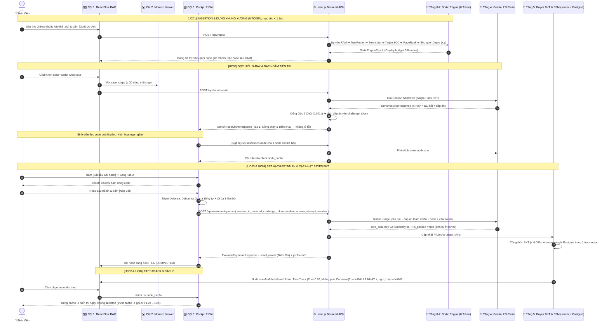

# KỊCH BẢN USE CASE TOÀN DIỆN & ĐẶC TẢ KỸ THUẬT CHI TIẾT (UNDER THE HOOD)
## DỰ ÁN: SIMPLIFEY V2 PRO — CODEBASE COGNITIVE TWIN
### *Hệ Thống Bản Sao Nhận Thức Mã Nguồn Cho Sinh Viên CNTT (Hackathon SGU 2026 - 2027)*

---

| **Thuộc tính** | **Thông số kỹ thuật chuẩn mực** |
| :--- | :--- |
| **Tài liệu** | `00_CORE_SPEC/Kich_Ban_UseCase.md` |
| **Phụ trách** | **Hội đồng Kiến trúc 3 Người (Lead Architect, Static Engine Dev, AI/Cognitive Dev)** |
| **Vai trò của file** | **File tổng hợp, không phải nguồn chân lý.** Mọi chi tiết kỹ thuật được đồng bộ từ: `01_INGESTION_STREAM.md`, `02_AST_SLICING_GRAPH.md`, `01_LLM_PIPELINE_GUARDRAIL.md`, `02_BAYES_COGNITIVE_BKT.md`, `01_UI_TRI_PANE_FSM.md`, `02_DATA_CONTRACTS.md` và bảng số liệu chuẩn ở `01_TONG_QUAN_KIEN_TRUC.md` Mục 5. Khi lệch nhau, **file nguồn đúng, file này sai** |
| **Triết lý thiết kế** | **Người dùng thấy: dễ hiểu, mượt như game nhập vai** ⚔️ **Bên dưới chạy: phân tích tĩnh 0 token, Zero-Disk, AI chỉ ở 2 thời điểm JIT & Mạng Bayes** |
| **Ngân sách vận hành** | Dựng đồ thị: **< 1.5s (0 Token, $0.00)** • JIT `enrich-node` **1.2s – 1.8s**, `evaluate-feynman` **0.8s – 1.2s** • Ước lượng **≈ $0.03/phiên (< 1.000đ)** |

---

# PHẦN 1: BẢN ĐỒ KIẾN TRÚC TOÀN TRÌNH: FRONTEND ➔ BACKEND ➔ STORAGE

```text
┌────────────────────────────────────────────────────────────────────────────────────────────────────────┐
│ 🖥️ TẦNG GIAO DIỆN (FRONTEND COCKPIT - NEXT.JS 15 + REACTFLOW + MONACO + ZUSTAND)                       │
│ • Cột 1 (25%): ReactFlow Canvas, DAG 6–8 node, FSM 4 màu (Xám, Vàng, Xanh, Đỏ) + lớp ⚡/⚠️/viền cam.   │
│ • Cột 2 (45%): Monaco Code Viewer, ≤ 30 dòng code thật mỗi step, tự động cuộn highlight.               │
│ • Cột 3 (30%): Buồng lái 2 Pha: Tab 1 (X-Ray: luồng + Điểm Hay) & Tab 2 (Sát hạch Feynman).          │
│ • Client Cache & Hooks: usePreFetchSuccessor (nạp ngầm 1 node con), Debounce 3s (chống spam).        │
└───────────────────────────────────────────────────▲────────────────────────────────────────────────────┘
                                                    │ HTTP JSON / API Routes
┌───────────────────────────────────────────────────▼────────────────────────────────────────────────────┐
│ ⚙️ TẦNG XỬ LÝ MÁY CHỦ (BACKEND API ROUTES - NODE.JS + WEB-TREE-SITTER WASM + GEMINI FLASH)            │
│ • POST /api/ingest: Link GitHub hoặc .zip ➔ RAM ➔ TreePruner ➔ Tree-sitter ➔ Tarjan ➔ PageRank ➔ Dagre │
│ • POST /api/enrich-node: Context Sandwich ➔ Gemini 2.5 Flash Single-Pass CoT ➔ Cổng gác 2 chốt        │
│   ➔ trả câu hỏi + challenge_token (đáp án mã hóa, client không đọc được)                              │
│ • POST /api/evaluate-feynman: giải mã challenge_token ➔ Gemini Rubric Judge ➔ Obs (Correct/Incorrect)│
│ • POST /api/reveal: mở đáp án khi bấm "Bỏ qua node" (không gọi AI)                                    │
│ • BKT + đếm lần thử + mở khóa chạy ở server, ghi Postgres trong 1 transaction                         │
└───────────────────────────────────────────────────▲────────────────────────────────────────────────────┘
                                                    │ In-Memory RAM + Postgres
┌───────────────────────────────────────────────────▼────────────────────────────────────────────────────┐
│ 💾 TẦNG LƯU TRỮ & DỮ LIỆU                                                                              │
│ 1. RAMCodeStore + ManifestStore (Zero-Disk): ≤ 50 file code, ≤ 15MB nén; LRU cache 10 phút.           │
│ 2. Postgres (Supabase): skill_states, learning_sessions (commit SHA + khung đồ thị), node_progress,   │
│    feynman_attempts. KHÔNG lưu code. Đăng nhập khách hoặc GitHub. (04_LUU_TRU_VA_DONG_BO.md)          │
│ 3. Client Zustand Store: node_cache + bản sao chỉ đọc của LearnerCognitiveProfile do server trả về.   │
│ 4. Response Cache ở tầng ứng dụng (lộ trình) — KHÔNG dùng Explicit Context Caching (Roadmap D5).      │
│ 5. Demo Offline: public/demo/mock_repo_shop.json (OfflineMockBundle, ghi lại từ output thật).         │
└────────────────────────────────────────────────────────────────────────────────────────────────────────┘
```

---

# PHẦN 2: BẢNG MA TRẬN 15 THUẬT TOÁN KỸ THUẬT TRONG TOÀN BỘ HỆ THỐNG

Thời gian lấy từ bảng số liệu chuẩn (`01_TONG_QUAN_KIEN_TRUC.md` Mục 5) — đều là mục tiêu/ước lượng, chưa đo trên code thật.

| STT | Tên Thuật Toán / Kỹ Thuật | Thời Điểm Kích Hoạt | Nơi Thực Thi | Thời Gian (mục tiêu) | Chi Phí Token AI | Mục Đích Cốt Lõi | Đặc tả gốc |
| :---: | :--- | :--- | :---: | :---: | :---: | :--- | :--- |
| **1** | **Central-Directory-First + TreePruner** | Lúc tải zip vào RAM | Backend Tầng 0 | $0.8\text{s} – 1.2\text{s}$ (cả tải) | 0 Token | Đọc mục lục zip, lọc rác neo segment, chọn Top-50 file theo `FilePriorityScore` | Ingestion Bước 4 |
| **2** | **Two-Pass Symbol Resolution** | Sau khi parse Tree-sitter | Backend Tầng 1 | $\sim 0.015\text{s}$ (+ parse $\sim 0.1–0.15\text{s}$) | 0 Token | Lập `SymbolTable`, `NameIndex`, `ImportMap`, `FieldTypeMap`, `InterfaceImplMap`; nối cạnh RESOLVED/INFERRED | AST Thuật toán 1 |
| **3** | **Tarjan SCC (Condensation)** | Sau khi có CallGraph | Backend Tầng 1 | $\sim 0.002\text{s}$ | 0 Token | Co cụm phụ thuộc vòng tròn ($A \leftrightarrow B$) thành Super-Node, đồ thị co cụm luôn là DAG | AST Thuật toán 2 |
| **4** | **PageRank + Utility Sink Filter + Ingress Bonus** | Trên đồ thị co cụm | Backend Tầng 2 | $\sim 0.005\text{s}$ | 0 Token | Loại file tiện ích khỏi xếp hạng, cộng điểm cửa vào, bầu 4–5 Hub làm gốc lát cắt | AST Thuật toán 3 |
| **5** | **Cognitive Complexity (SonarQube)** | Quét mọi hàm | Backend Tầng 2 | $\sim 0.01\text{s}$ | 0 Token | Phạt lồng cấp theo độ sâu AST, cấp **Vé VIP** cho hàm $> 15$ điểm | AST Thuật toán 4 |
| **6** | **Scoped Call-Chain Slicing (Def-Use + Control)** | Từ mỗi Hub/VIP | Backend Tầng 2 | $\sim 0.015\text{s}$ | 0 Token | Lần theo dữ liệu & điều khiển tới DATA_SINK, ghép Controller ➔ Middleware ➔ Service ➔ Repository | AST Thuật toán 5 |
| **7** | **Elision & Hard Clamp** | Khi lát cắt vượt trần | Backend Tầng 2 | $\sim 0.005\text{s}$ | 0 Token | Giữ code đọc được, ≤ 30 dòng/step, ≤ 100 dòng/node, ≤ 1,500 token | AST Thuật toán 5 Thao tác 5–6 |
| **8** | **Display Budget (6–8 Node)** | Trước khi gửi về Frontend | Backend Tầng 2 | $\sim 0.002\text{s}$ | 0 Token | Critical Path + Rank Score giữ 6–8 node, chống biến đồ thị thành "mạng nhện" | AST Thuật toán 7 Thao tác 0 |
| **9** | **Deterministic Node Naming** | Sau Display Budget, trước Dagre | Backend Tầng 2 | $\sim 0.005\text{s}$ | 0 Token | Đặt tên node theo thang 5 bậc: Route ➔ tên hàm entry ➔ từ khóa miền TF-IDF ➔ thư mục ➔ tên file; khử trùng tên; tên suy ra có dấu `~` | AST Thuật toán 8 |
| **10** | **Dagre Hierarchical Layout** | Sắp xếp đồ thị trên Canvas | Backend Tầng 2 | $\sim 0.01\text{s}$ | 0 Token | Tính tọa độ $(x, y)$ phân nhánh và hội tụ; mọi root = AVAILABLE | AST Thuật toán 7 |
| **11**| **Single-Pass Contrastive CoT** | Sinh viên click Node | Backend Tầng 4 | $1.2\text{s} – 1.8\text{s}$ | ≤ 2,000 vào / ≤ 900 ra | Gemini nhẩm 3 hướng câu hỏi trong `_internal_reasoning`, chọn 1 câu bám code | Guardrail Mục 2 |
| **12**| **Cổng Gác Nhị Phân 2 Chốt (v2)** | Ngay khi nhận Output từ AI | Backend Tầng 4 | $0.001\text{s}$ | 0 Token | Chặn bịa tên hàm/biến (Chốt 1) và công nghệ ngoài repo (Chốt 2) | Guardrail Mục 3 |
| **13**| **Speculative Pre-fetching** | Đọc Tab 1 quá 5 giây | Client + Backend | Chạy ngầm | Như dòng 11 (1 lần) | Nạp trước 1 Node con vào `node_cache`; trúng cache thì mở ngay không skeleton | Guardrail Mục 1.3 |
| **14**| **Triple-Defense Guardrail** | Bấm nút [Nộp Bài] | Frontend + API | $\sim 0\text{ms}$ | 0 Token | Vòng 1: Debounce 3s, ≥ 15 ký tự, trùng ≥ 80%; Vòng 2: tối đa 3 lần thử; Vòng 3: quota 50,000 token/phiên ở server | Guardrail Mục 1.2 |
| **15**| **Bayes BKT + Ebbinghaus Decay** | Sau khi AI chấm xong | Backend (ghi Postgres) | $< 0.002\text{s}$ | 0 Token | Cập nhật $P(L_t)$ trên 16 kỹ năng SWE, xét **Fast-Track ⚡**, tính viền cam khi đọc | BKT Mục 2–4 |

---

# PHẦN 3: KỊCH BẢN USE CASE CHI TIẾT KÈM "UNDER THE HOOD" TỪNG BƯỚC

---

## [USE CASE 1] NẠP REPO & DỰNG BẢN ĐỒ TRỤC CHÍNH (INGESTION & BACKBONE DAG)

### 1.1. Trải nghiệm Người dùng
* **Hành động của người học:** Bạn dán link GitHub của dự án (ví dụ: `https://github.com/my-team/shop-backend`) vào ô tìm kiếm và bấm **[Quét Dự Án]**. Repo private thì bạn kéo thả file `.zip` (≤ 15MB) vào cùng ô đó.
* **Những gì hiện lên màn hình:** 
  * Sau vài giây (mục tiêu < 1.5s), Cột 1 hiện một Bản đồ các trạm học tập phân nhánh như các ải trong game.
  * Repo được thu gọn thành **6 đến 8 trạm**, mỗi trạm là một luồng nghiệp vụ đi qua nhiều file (Controller ➔ Middleware ➔ Service ➔ Repository). Thứ tự trạm suy ra từ quan hệ gọi hàm, không phải từ thứ tự nghiệp vụ.
  * Mọi trạm gốc (không phụ thuộc trạm nào) phát sáng **MÀU VÀNG**; các trạm phía sau mang **MÀU XÁM MỜ**.
  * Nếu repo viết bằng ngôn ngữ chưa có bộ phân giải riêng, thanh trên cùng hiện huy hiệu *"Đồ thị độ tin cậy thấp"* và các cạnh suy luận vẽ nét đứt.

---

### 1.2. Phía dưới chạy như thế nào? (Under The Hood)

#### A. Frontend (Trình duyệt)
1. Người dùng bấm nút $\to$ kích hoạt hàm `handleScanRepo(url | file)`.
2. Giao diện Cột 1 kích hoạt hiệu ứng radar quét nhẹ.
3. Gửi `POST /api/ingest` với body `{ "repoUrl": "https://github.com/my-team/shop-backend" }` hoặc `multipart/form-data` (trường `archive`).

#### B. Backend (API Máy chủ) & Thuật toán thực thi — đồng bộ từ `01_INGESTION_STREAM.md` và `02_AST_SLICING_GRAPH.md`
1. **Chuẩn hóa link (Ingestion Bước 1):** gọt `?tab=...`, `#...`, chuyển SSH ➔ HTTPS, bỏ `www.` và `/` cuối, tách `owner`, `repo`, `refPath`. Host khác `github.com` ⇒ `ERR_INVALID_GITHUB_URL`.
2. **Pre-Flight HEAD Probe (Ingestion Bước 2, ≤ 300ms):** `HEAD https://github.com/:owner/:repo` (không gọi REST API), trả enum `OK / REDIRECTED / NOT_FOUND_OR_PRIVATE / UNAVAILABLE / RATE_LIMITED / TIMEOUT`. Timeout là lỗi mạng (`ERR_NETWORK_TIMEOUT`), **không** kết luận repo không tồn tại.
3. **Phân giải ref (Ingestion Bước 3):** link có `/tree/<rest>` ⇒ Longest-Prefix Ref; link gốc ⇒ `archive/HEAD.zip` để lấy nhánh mặc định thật, dự phòng `main ➔ master ➔ dev`. URL tải duy nhất: `https://codeload.github.com/:owner/:repo/zip/:ref`.
4. **Tải & giải nén chọn lọc trên RAM (Ingestion Bước 4):** đếm byte nén (trần 15MB) và byte giải nén (trần 8MB), đọc Central Directory trước để biết toàn bộ danh sách file, rồi lọc rác bằng regex **neo theo segment thư mục**:
   ```typescript
   const IGNORE_DIR_SEGMENTS = /(^|\/)(node_modules|\.git|\.github|dist|build|out|\.next|\.nuxt|\.turbo|coverage|vendor|venv|\.venv|env|__pycache__|\.pytest_cache|\.mypy_cache|target|bin|obj|\.gradle|\.idea|\.vscode|Pods|\.dart_tool)(\/|$)/;
   ```
   Thư mục `test/`, `tests/`, `spec/` **không bị loại**, chỉ bị trừ điểm. Đuôi file hợp lệ sinh từ **Language Registry** (không gõ cứng). Chọn **Top-50 file** theo `FilePriorityScore` (ưu tiên thư mục server, tên vai trò `controller|service|repository|...`), manifest vào `ManifestStore` riêng không tính quota.
   * Luồng `.zip` tải lên (Ingestion Bước 0) đi thẳng vào bước này, bỏ qua bước 1–3.
5. **Tiền xử lý định dạng đặc biệt (Ingestion Bước 4.5):** `.ipynb` ⇒ trích cell code thành `.ipynb.py`; `.vue/.svelte` ⇒ lấy khối `<script>`; `SecretRedactor` che secret trước khi code rời Tầng 0; gắn cờ comment nghi prompt-injection.
6. **Vân tay dự án (Ingestion Bước 5):** quét manifest ở độ sâu ≤ 3 (`package.json`, `requirements.txt`, `pyproject.toml`, `pom.xml`, `build.gradle`, `go.mod`, `pubspec.yaml`, `Cargo.toml`, `composer.json`...). Phát hiện monorepo bằng regex neo segment `client|frontend|web|ui|app-web|mobile` và `server|backend|api|service|services` (không dùng `core`), ưu tiên thư mục server và cho phép chọn lại thư mục trên UI. Tính `primary_language`, `language_breakdown`, `graph_confidence`, phân loại 6 archetype.
7. **Tree-sitter + Language Registry (AST §3.0):** grammar tier `RESOLVED` (TS/TSX/JS, Python, Java, Go, Dart) nạp sẵn khi server khởi động; grammar tier `STRUCTURAL` đóng gói sẵn trong bundle và nạp khi repo có đuôi tương ứng. File có > 30% byte nằm trong node `ERROR` bị loại.
8. **Two-Pass Symbol Resolution (AST Thuật toán 1):** Pass 1 thu khai báo vào `SymbolTable` (khóa `file#Class.method`), `FieldTypeMap`, `InterfaceImplMap`, `ImportMap`; Pass 2 nối cạnh trên node gọi hàm của AST (không regex văn bản), qua `ImportResolver` riêng (cạnh `RESOLVED`) hoặc Universal Resolver (cạnh `INFERRED`), cộng cạnh Interface ➔ Implementation, Route/Middleware. Đồ thị 0 cạnh ⇒ chế độ suy biến `PROCEDURAL` (≤ 2 file) hoặc `ALGORITHM_COLLECTION` (> 2 file).
9. **Tarjan SCC (AST Thuật toán 2):** co cụm chu trình thành SuperNode; SCC > 40% số đỉnh ⇒ bỏ cạnh chỉ dùng kiểu rồi tối đa 3 cạnh yếu nhất.
10. **PageRank + Utility Sink Filter + Ingress Bonus (AST Thuật toán 3):** đỉnh có out-degree = 0 **và** basename đúng `logger|utils|db|config|...` bị loại khỏi **xếp hạng** (vẫn nằm trong đồ thị và lát cắt); cửa vào được +0.50; bầu 4–5 Hub làm gốc lát cắt.
11. **Cognitive Complexity (AST Thuật toán 4):** tính theo độ sâu node AST (đúng cho cả Python); hàm $> 15$ điểm được **Vé VIP** (`ALGORITHMIC_CORE`), không có hàm nào vượt ngưỡng thì lấy Top-K tương đối.
12. **Scoped Call-Chain Slicing + Elision & Hard Clamp (AST Thuật toán 5):** từ mỗi gốc, lần ngược chuỗi dữ liệu và điều khiển tới điểm đích (DATA_SINK), ghép `ENTRY_POINT ➔ MIDDLEWARE ➔ BUSINESS_LOGIC ➔ DATA_ACCESS`, ép trần ≤ 30 dòng/step, ≤ 100 dòng/node.
13. **Uncle Bob (AST Thuật toán 6):** đo $I, A, D$ trên cụm lát cắt; miễn trừ cho UI Screen, JS thuần, mẫu số 0.
14. **Display Budget 6–8 node + Đặt tên + Dagre (AST Thuật toán 7, 8):** giữ node trên Critical Path rồi bổ sung theo Rank Score/VIP; node bị cắt gộp file vào node kề; đặt tên node tất định (route ➔ tên hàm ➔ từ khóa miền ➔ thư mục ➔ tên file, kèm `title_source`/`title_evidence`); Dagre tính tọa độ; **mọi** node có in-degree = 0 là `AVAILABLE`.

#### C. Database / Lưu trữ dữ liệu
* **RAM Máy chủ:** `RAMCodeStore`, `ManifestStore`, `SourceMapStore` — giải phóng ngay sau khi xử lý; kết quả cache LRU 10 phút theo `snapshot_id` (commit SHA đọc từ comment zip, hoặc SHA-256 file zip) + `subdir`.
* **Postgres:** upsert `learning_sessions` với commit SHA và khung đồ thị (không có code); xét Fast-Track cho các root bằng `skill_states` của người học (`04_LUU_TRU_VA_DONG_BO.md`).
* **Kết quả trả về:** `IngestResponse { result: StaticEngineResult, session_id, profile }` (`StaticEngineResult` chứa `snapshot`, `fingerprint`, `nodes`, `edges` có `confidence`, `symbol_whitelist`, `ingestion_report`) theo `00_CORE_SPEC/02_DATA_CONTRACTS.md`.
* **Client Store (Zustand):** nhận `nodes`, `edges` và `profile.node_history` do server ghép sẵn (mở lại phiên cũ thì các trạm đã học vẫn giữ màu). Render lên ReactFlow Canvas Cột 1.

---

## [USE CASE 2] ĐỌC HIỂU LÁT CẮT & NẠP NGẦM TIÊN TRI (PHASE 1: X-RAY & PRE-FETCH)

### 2.1. Trải nghiệm Người dùng
* **Hành động của người học:** Bạn click vào trạm màu Vàng: **"Order Checkout"** (tên do Engine rút từ route `POST /orders/checkout`, tooltip hiện route này).
* **Những gì hiện lên màn hình:** 
  * **Cột 2 (Kính lúp soi code):** Tự động mở đúng file code và chiếu sáng đoạn code của bước đang chọn (≤ 30 dòng).
  * **Cột 3 (Tab 1 - Phim X-Quang):**
    * *Đường đi dữ liệu:* Bấm **Step 1 (Controller)** $\to$ Cột 2 cuộn đến chỗ nhận dữ liệu; Bấm **Step 2 (Service)** $\to$ Cột 2 nhảy sang file xử lý nghiệp vụ.
    * *Điểm Hay kiến trúc:* Giải thích vì sao code tách riêng các tầng, giúp dễ kiểm thử và mở rộng.
    * *Điểm Dở:* **chưa hiển thị** ở Tab 1 — sẽ được mở sau khi bạn trả lời ở Pha 2.
  * Bạn được tự do đọc ngẫm, không bị giới hạn thời gian và chưa bị chấm điểm.

---

### 2.2. Phía dưới chạy như thế nào? (Under The Hood)

#### A. Frontend (Trình duyệt)
1. Sự kiện `onNodeClick(nodeId)` kích hoạt.
2. Kiểm tra bộ nhớ đệm: `node_cache[nodeId]` có sẵn dữ liệu chưa?
   - **Nếu Cache Hit:** Hiển thị ngay, không hiển thị Skeleton Scanner.
   - **Nếu Cache Miss:** Hiển thị hiệu ứng quét Skeleton nhẹ và gửi `POST /api/enrich-node` (1.2s – 1.8s).

#### B. Backend (API Máy chủ) & Thuật toán thực thi — đồng bộ từ `01_LLM_PIPELINE_GUARDRAIL.md`
1. **Đóng gói Context Sandwich Payload** (`ContextSandwichPayload` trong contract):
   * *Lớp Vĩ mô (`macro_context`):* tên repo, `archetype`, `primary_language`, `graph_confidence`, `is_monorepo`, `tech_stack`, `node_type`, `degraded_mode`, các node đứng trước/sau trên DAG.
   * *Lớp Vi mô (`micro_trace`):* đoạn code lát cắt (≤ 100 dòng, ≤ 1,500 token, đã che secret) kèm DTO và `hidden_challenge` (nếu Engine phát hiện).
   * *Lớp Bất biến (`invariants`):* `learner_persona_tier` (tính từ kỹ năng yếu nhất), `allowed_skills` (= `preliminary_skills`), Blacklist công nghệ ngoài repo.
2. **Single-Pass Contrastive CoT với Gemini 2.5 Flash (1.2s – 1.8s):** 1 lần gọi duy nhất, Structured Outputs JSON Schema. Chế độ A (luồng nghiệp vụ) hoặc Chế độ B (node thuật toán hoặc repo suy biến). AI tự nhẩm 3 góc độ câu hỏi trong `_internal_reasoning`, loại câu học vẹt, chọn 01 câu Socratic bám dòng code; Điểm Dở được viết vào `smell_reveal_after_attempt`.
3. **Cổng Gác Nhị Phân 2 Chốt v2 (0.001s):**
   * **Chốt 1:** `referenced_symbols` không rỗng và thuộc `symbol_whitelist` (so khớp sau khi chuẩn hóa `_`, `-`, hoa/thường). Node có `support_tier === "STRUCTURAL"` ⇒ *Relaxed Mode* (chỉ cần ít nhất 1 symbol hợp lệ). `target_skills` phải ⊆ `preliminary_skills`.
   * **Chốt 2:** mọi trường văn bản hiển thị không chứa từ khóa công nghệ ngoài repo (Kafka, Redis khi dự án chỉ dùng MySQL).
   * *Fallback:* vi phạm, JSON hỏng hoặc Gemini lỗi ⇒ nạp câu hỏi AST cú pháp tĩnh (`is_fallback = true`).
4. **Chống lộ đề (Anti-Spoiler):** server ghi đè `highlight_lines` bằng dòng của `trace_steps`, tách `smell_reveal_after_attempt` ra, mã hóa vào `challenge_token` và trả `EnrichNodeClientResponse` (X-Ray + câu hỏi, không có đáp án).
5. **Stepper hiển thị theo archetype (Canonical Layers):**
   * Nếu `node_type === "ARCHITECTURAL_DATA_FLOW"`:
     - **Web Backend:** Controller $\to$ Middleware (nếu có) $\to$ Service $\to$ Repository.
     - **Mobile App:** Màn hình Widget (UI Screen) $\to$ ViewModel / BLoC $\to$ API Client / Local DB.
     - **Desktop App:** Renderer Window $\to$ IPC Bridge $\to$ Native Service.
     - **CLI Tool:** CLI Command $\to$ Handler $\to$ Output.
   * Nếu `node_type === "ALGORITHMIC_CORE"`: `ALGO_SETUP` (khởi tạo State & Heap) $\to$ `ALGO_EXECUTION` (vòng lặp biến đổi) $\to$ `ALGO_TERMINATION` (điều kiện dừng & trả kết quả).
   * Luồng đứt tại `dispatch(Event)` của BLoC/Redux (Nominal Event Bridge) **thuộc lộ trình sau cuộc thi**, chưa có trong MVP.
6. **Miễn trừ Uncle Bob (AST Thuật toán 6):** lát cắt là UI Screen, JS thuần không có cú pháp interface, hoặc mẫu số bằng 0 ⇒ `is_exempt = true`, không chẩn đoán Zone of Pain giả.

#### C. Speculative Background Pre-fetching (Guardrail Mục 1.3)
* Hook `usePreFetchSuccessor` theo dõi: Nếu người học ở Tab 1 quá **5 giây**, âm thầm gọi `/api/enrich-node` cho **duy nhất 01 Node con trực tiếp** có độ ưu tiên cao nhất và lưu vào `node_cache[successorId]`.
* **Hiệu quả:** khi người học bấm sang đúng node đó, bài tiếp theo hiện ngay; lần click đầu tiên hoặc khi đoán sai node vẫn mất 1.2s – 1.8s.

---

## [USE CASE 3] SÁT HẠCH BẢN CHẤT KỸ THUẬT & PHÒNG THỦ 3 VÒNG (PHASE 2: SOCRATIC FEYNMAN & TRIPLE-DEFENSE)

### 3.1. Trải nghiệm Người dùng
* **Hành động của người học:** Sau khi đọc hiểu bản X-Quang, bạn bấm nút **[Tôi đã hiểu ➔ Bắt đầu Sát hạch]**.
* **Những gì hiện lên màn hình:** 
  * Tab 2 mở ra. Gia sư AI đưa ra một thử thách bám dòng code:  
    > *"Hãy giải thích vì sao vòng lặp ở dòng 44–45 được viết như vậy, và chuyện gì xảy ra khi quán đông khách? Bạn có thể dùng ví dụ quán ăn hoặc đi chợ."*
* **Bạn trả lời** (gõ vào ô phản biện):  
  > *"Dạ giống như bồi bàn trong quán ăn: Khách gọi 10 món nhưng bồi bàn cứ chạy vào bếp 10 chuyến riêng lẻ, thay vì ghi hết vào một tờ giấy rồi đem vào bếp 1 lần — ở đây `updateStock` bị gọi trong vòng `for` nên mỗi món là một truy vấn DB."*
* **Gia sư phản hồi:** ĐẠT! Trạm lập tức **ĐỔI SANG MÀU XANH LÁ**, và lúc này mới hiện phần Điểm Dở (lỗi N+1 query) kèm cách sửa.
* **Nếu khó quá:** bạn bấm **[Tôi chịu, bỏ qua node này]** — trạm chuyển Đỏ, hiện lời giải và bạn vẫn đi tiếp được.

---

### 3.2. Phía dưới chạy như thế nào? (Under The Hood)

#### A. Frontend & Hệ Thống Phòng Thủ 3 Vòng (Guardrail Mục 1.2, UI Mục 4.3)
1. **VÒNG 1: Client Semantic Debounce (0 Token):**
   * Nút [Nộp Bài] tự động `disabled` trong **3 giây**.
   * Câu trả lời < 15 ký tự (sau khi bỏ khoảng trắng) bị chặn tại form.
   * Levenshtein so sánh với câu trả lời vừa trượt; tương đồng $\ge 80\% \implies$ chặn tại trình duyệt: *"Bạn chưa bổ sung ý mới, hãy diễn giải chi tiết hơn!"*.
2. **VÒNG 2: Hard Cap Retry Limit:**
   * Chỉ cho gửi khi `retry_count < 3`. Sai **đủ 3 lần** (`retry_count === 3`) $\implies$ khóa form, đổi Node sang **MÀU ĐỎ (FAILED)**, hiển thị đáp án chuẩn và mở khóa node con theo soft-bypass.
3. **VÒNG 3: Session Quota (50,000 tokens/phiên, đếm ở server):**
   * Vượt trần $\implies$ ngừng gọi Gemini, dùng câu hỏi AST tĩnh và chấm offline từ `OfflineMockBundle`, có thông báo rõ.
* Vượt qua cả 3 vòng $\implies$ `POST /api/evaluate-feynman` với `{ node_id, challenge_token, student_answer, attempt_number }`.
* Nút **[Bỏ qua node này]** $\implies$ `POST /api/reveal` (không gọi AI, không tạo quan sát BKT). **Không có Intent Router** — hệ thống không dùng thêm lần gọi LLM để phân loại ý định.

#### B. Backend (API Máy chủ) & Thuật toán thực thi (Guardrail Mục 4)
1. **Giải mã `challenge_token`:** lấy câu hỏi, đáp án tham chiếu, `target_skills`, `snippet_hash` — client không sửa được câu hỏi và không đọc được đáp án trước khi chấm.
2. **Feynman Rubric Judge (Gemini 2.5 Flash Structured Outputs, 0.8s – 1.2s):**
   * `core_accuracy` (0 - 100): Hiểu đúng vì sao code viết như vậy VÀ bám đúng code thật (nhắc đúng hàm/biến/luồng trong snippet). Tiêu chí duy nhất quyết định Đạt/Trượt.
   * `simplicity` (0 - 100): Điểm cộng diễn đạt đời thường / ẩn dụ dễ hiểu. Không ảnh hưởng Đạt/Trượt. Dùng thuật ngữ chuyên ngành không bị trừ điểm.
3. **`detected_jargons`:** chỉ để gợi ý giải nghĩa cho người học, không dùng để trừ điểm. Chống học vẹt bằng tiêu chí bám code trong `core_accuracy`.
4. **Quy tắc Đạt chuẩn (Pass Rule):**
   $$\text{is\_passed} = \text{true} \iff \text{core\_accuracy} \ge 70$$
   (Backend tự tính lại `is_passed` từ `core_accuracy`, không tin trường do model trả về.)
5. Backend trả `FeynmanEvaluationResult`; trường `smell_reveal` chỉ có khi đạt hoặc ở lần thử thứ 3.

---

## [USE CASE 4] CẬP NHẬT NĂNG LỰC BAYES BKT & MIỄN THI TỰ ĐỘNG (BKT UPDATE & FAST-TRACK)

### 4.1. Trải nghiệm Người dùng
* **Những gì hiện lên màn hình:** 
  * Trạm bạn vừa học chuyển **MÀU XANH LÁ**, đường nối sang các trạm sau chạy hiệu ứng ánh sáng kích hoạt.
  * **Miễn thi (Fast-Track ⚡):** Nếu trạm kế tiếp dùng các kỹ năng bạn đã rất vững (từ đồ án trước), trạm đó **TỰ ĐỘNG CHUYỂN XANH LÁ NHẠT** kèm tia sét ⚡ mà không bắt bạn làm bài. Trạm khó nhất của repo (Capstone) thì luôn phải làm.
  * **Nếu lỡ bị Đỏ?** Trạm sau vẫn mở cho bạn đi tiếp, kèm tam giác vàng *"Mắt xích trước chưa vững"* (không bao giờ kẹt lại một chỗ).

---

### 4.2. Phía dưới chạy như thế nào? (Under The Hood) — đồng bộ từ `02_BAYES_COGNITIVE_BKT.md`

#### A. Động cơ Bayesian Knowledge Tracing (Tầng 5 - Server + Postgres)
Toàn bộ thuật toán BKT chạy ở server trong transaction của `evaluate-feynman`, **$< 0.002\text{ giây}$ (0 Token)**, rồi ghi `skill_states` và `node_progress` vào Postgres. Trình duyệt chỉ nhận hồ sơ mới và đổi màu:
1. **Ánh xạ Quan sát nhị phân:**
   $$\text{Obs} = \begin{cases} \text{Correct} & \text{nếu } \text{is\_passed} = \text{true}\ (\text{core\_accuracy} \ge 70) \\ \text{Incorrect} & \text{ngược lại} \end{cases}$$
2. **Kích hoạt vector kỹ năng $q_j$ (16 chiều):** bài Checkout dùng `target_skills` = $k_6$ (`DB_OPTIMIZATION`) và $k_7$ (`ASYNC_CONCURRENCY`) — luôn là tập con của `preliminary_skills` của node.
3. **Công thức Cập nhật $P(L_t)$** với bộ tham số chuẩn: Prior $P(L_0) = 0.25$, $P(T \mid \text{Correct}) = 0.08$, $P(T \mid \text{Incorrect}) = 0.03$, $P(G) = 0.25$, $P(S) = 0.12$. Prior của mỗi lần cập nhật là điểm **đã decay** tại thời điểm nộp:
   $$P(L_{t-1} \mid \text{Correct}) = \frac{P(L_{t-1}) \cdot (1 - P(S))}{P(L_{t-1}) \cdot (1 - P(S)) + (1 - P(L_{t-1})) \cdot P(G)} = \frac{0.25 \times 0.88}{0.25 \times 0.88 + 0.75 \times 0.25} = \frac{0.2200}{0.4075} \approx 0.5399$$
   $$P(L_1) = 0.5399 + (1 - 0.5399) \times 0.08 = \mathbf{0.5767}$$
   Điểm của 2 kỹ năng tăng từ $0.25 \to 0.5767$ (lên Tier 2: Practitioner). Ghi `last_practiced_at = Date.now()`. Hành trình đúng liên tiếp: $0.25 \to 0.5767 \to 0.8413 \to 0.9532$ (mỗi lần đúng lên đúng 1 bậc).
4. **Cập nhật FSM:** node hiện tại `status = "COMPLETED"` (Xanh ngọc) trong `node_history`.
5. **Fast-Track Auto-Pass:** với mỗi node con vừa đủ điều kiện mở khóa (mọi node cha ∈ {COMPLETED, FAILED}):
   $$\text{Điều kiện Miễn thi: } \forall k \in \mathcal{K}_u, \quad P_{\text{decayed}}(L_t, k) \ge 0.92 \quad \text{và } u \text{ không phải node Capstone}$$
   * **Thỏa mãn:** node con chuyển `COMPLETED`, `is_auto_mastered = true` (Xanh lá nhạt ⚡), không gọi AI.
   * **Chưa thỏa mãn:** node con chuyển `LOCKED` ➔ `AVAILABLE`, Tier câu hỏi chọn theo kỹ năng yếu nhất: NOVICE (< 0.45), PRACTITIONER ([0.45, 0.75)), ARCHITECT ([0.75, 0.92)).
6. **Soft-bypass khi Node ĐỎ (`FAILED`):** node con vẫn được mở với `has_warning = true` trong `node_history`, đồ thị không bao giờ bị Deadlock.

---

## [USE CASE 5] HAO MÒN TRÍ NHỚ & ÔN TẬP (HALF-LIFE DECAY)

### 5.1. Trải nghiệm Người dùng
* **Tình huống:** Sau 30 ngày nghỉ hè, bạn mở lại dự án để chuẩn bị đi phỏng vấn.
* **Những gì hiện lên màn hình:** 
  * Một số trạm Xanh lá giờ có **VIỀN VÀNG CAM** (trạm vẫn được tính là đã học).
  * Hệ thống cảnh báo: *"Kiến thức ở trạm này đang phai mờ, ôn lại nhé!"*.
  * Bạn click vào trạm viền Cam, AI đặt câu hỏi ôn tập theo đúng kỹ năng bạn đang yếu nhất. Trả lời đạt, điểm kỹ năng được cập nhật lại và viền cam biến mất.

---

### 5.2. Phía dưới chạy như thế nào? (Under The Hood) — đồng bộ từ BKT Mục 2.4
1. **Thuật toán Suy giảm Trí nhớ Ebbinghaus**, tính **khi đọc**, không ghi đè `p_mastery` gốc:
   $$\Delta t = \frac{\text{Date.now()} - \text{last\_practiced\_at}}{86,400,000 \text{ ms}}, \qquad P(L_{\text{current}}) = \max\Big(0.25,\; P(L_{\text{last}}) \times 2^{-\frac{\Delta t}{14}}\Big)$$
2. Khi $\Delta t = 30\text{ ngày}$: $\max(0.25,\; 0.9532 \times 2^{-30/14}) = \max(0.25,\; 0.216) = 0.25 < 0.45$.
3. Node vẫn `COMPLETED`, UI chỉ đổi viền **Vàng Cam (Decay Warning)** khi $P_{\text{node}}$ đã decay < 0.45.
4. Khi người dùng click vào, `enrich-node` được gọi với `learner_persona_tier` tính từ điểm đã decay của kỹ năng yếu nhất, để ôn lại đúng chỗ hổng.

---

## [USE CASE 6] GIẢ LẬP PERSONA & KHẮC PHỤC SỰ CỐ PHÒNG THI (PERSONA & FAIL-SAFE)

### 6.1. Trải nghiệm Người dùng
* **Trình diễn trước Ban Giám khảo (Persona Simulator):** Bạn bấm nút chuyển sang cấu hình *"Sinh viên sau 30 ngày nghỉ"* — đồ thị tụt điểm và đổi sang viền Cam ngay (người trình bày nói rõ đây là mô phỏng thời gian).
* **Khi rớt mạng Wi-Fi:** bấm **`Ctrl + Shift + D`** $\to$ hệ thống chuyển sang dữ liệu đã ghi lại từ lần chạy thật, header hiện nhãn *"Chế độ Offline — dữ liệu ghi lại"*.

---

### 6.2. Phía dưới chạy như thế nào? (Under The Hood)
1. **Bộ Giả Lập Persona Simulator** (`PersonaConfig` trong contract): menu Persona trên Header gọi `POST /api/demo/persona` (chỉ bật khi `DEMO_MODE=true`), ghi đè `skill_states` của tài khoản demo đang đăng nhập:
   * *NEWBIE:* `initial_p_mastery = 0.25` $\implies$ câu hỏi Tier 1 (Truy vết dữ liệu).
   * *MID_LEVEL:* `initial_p_mastery = 0.65` $\implies$ câu hỏi Tier 2 (Bắt lỗi thiết kế).
   * *SENIOR_RUSTY:* `initial_p_mastery = 0.95`, `simulated_days_idle = 30` $\implies$ đẩy `last_practiced_at` lùi 30 ngày, hàm decay cho thấy viền cam ngay.
2. **Chế độ Demo Offline** (UI Mục 4.5):
   * `Ctrl + Shift + D` $\implies$ Event Listener ở Frontend đặt `is_offline_mode = true`.
   * Nạp `public/demo/mock_repo_shop.json` (kiểu `OfflineMockBundle`, **ghi lại từ output thật** của engine và AI) vào Zustand Store.
   * Đổi màu Node, hiển thị code Monaco và chấm điểm Feynman đều dùng bộ dữ liệu này, không cần mạng. Chế độ này **không ghi Postgres** (nhãn ghi rõ "không lưu tiến độ").
   * Nhóm vẫn chuẩn bị thêm video demo quay từ bản chạy thật.

---

# PHẦN 4: SƠ ĐỒ TUẦN TỰ TOÀN CẢNH (END-TO-END SEQUENCE FLOW)



---

# PHẦN 5: TỔNG KẾT NGUYÊN TẮC BẤT BIẾN CHO TOÀN BỘ ĐỘI THI

1. **Nguyên tắc Phân tách Tuyệt đối giữa Code Thuần và AI:**
   * Dựng khung xương đồ thị (Tầng 0 $\to$ 2): **100% code thuần, mục tiêu < 1.5s, 0 Token AI ($0.00)**.
   * AI chỉ xuất hiện đúng **2 thời điểm JIT**: khi click Node (`/api/enrich-node`) và khi nộp bài sát hạch (`/api/evaluate-feynman`). Không có lần gọi thứ 3.
2. **Nguyên tắc An Toàn Zero-Disk & Không thực thi code:**
   * Không bao giờ dùng `git clone` $\to$ tải zip từ codeload (hoặc nhận `.zip` tải lên) và giải nén trực tiếp trong RAM.
   * Không bao giờ thực thi code người dùng (`eval` hay chạy container) $\to$ Phân tích tĩnh 100% qua AST.
3. **Nguyên tắc Chống bịa bằng kiểm tra tĩnh:**
   * Mọi nội dung AI sinh ra phải vượt qua Cổng Gác Nhị Phân 2 Chốt trong **$0.001\text{ giây}$**. Cổng gác chặn việc bịa tên hàm/biến và công nghệ ngoài repo; nếu vi phạm, kích hoạt câu hỏi AST an toàn. Cổng gác **không** kiểm chứng được ngữ nghĩa — không tuyên bố "diệt ảo giác 100%".
4. **Nguyên tắc Chống lộ đề:** Điểm Dở không có ở Tab 1 và không có trong dữ liệu gửi về trình duyệt cho tới khi đạt, sai đủ 3 lần hoặc bỏ qua (`challenge_token`).
5. **Nguyên tắc Trải Nghiệm Người Dùng:**
   * Nạp ngầm 1 node con giúp node kế tiếp thường mở ngay khi người học đi đúng hướng.
   * Fast-Track ⚡ giúp người học không bị bắt làm lại những gì đã vững (trừ node Capstone).
   * Phím tắt `Ctrl + Shift + D` dùng dữ liệu ghi lại từ lần chạy thật và luôn được nói rõ khi chuyển chế độ.
