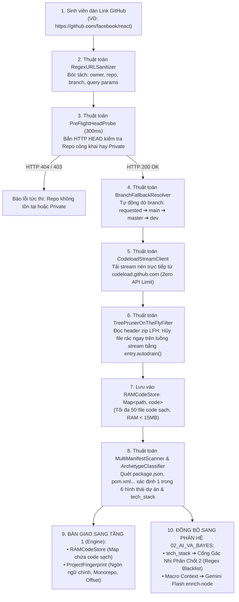

# [TẦNG 0] ĐẶC TẢ KỸ THUẬT INGESTION STREAM TỪ LINK GITHUB (0 TOKEN)
## PHÂN HỆ: CODEBASE INGESTION, RAM STREAM & VÂN TAY DỰ ÁN
### Dự án: SimpliFey V2 Pro — Codebase Cognitive Twin (Phụ trách: NGƯỜI 2)

---

| **Thuộc tính** | **Thông số kỹ thuật chuẩn hóa** |
| :--- | :--- |
| **Phân hệ tài liệu** | `01_ENGINE_THUAT_TOAN/01_INGESTION_STREAM.md` |
| **Tầng kiến trúc** | **TẦNG 0: INGESTION STREAM & PRE-FLIGHT (0 TOKEN AI)** |
| **Người phụ trách** | **NGƯỜI 2 (STATIC ENGINE & GRAPH ARCHITECT)** |
| **Phương thức tiếp nhận** | **Duy nhất: Chuỗi URL GitHub công khai (Link Input)** |
| **Thời gian thực thi** | **0.8s – 1.2s** (Mạng thông thường) |
| **Chi phí AI Token** | **0 Token** (Thuần toán học, Stream và Regex trên RAM) |
| **Chính sách I/O** | **Zero-Disk Policy (100% trong bộ nhớ Heap RAM, không ghi ổ cứng)** |
| **Khớp nối Phân hệ dưới** | **Cung cấp `RAMCodeStore`, `tech_stack` và `ProjectFingerprint` cho `02_AI_VA_BAYES`** |

---

## 1. TỔNG QUAN LUỒNG HOẠT ĐỘNG THỰC TẾ

Toàn bộ quy trình Tầng 0 được thiết kế tinh gọn, tập trung xử lý duy nhất bài toán: **Nhận Link GitHub $\longrightarrow$ Trả về Danh sách Code Sạch trong RAM** trong vòng 1 giây, hoàn toàn miễn nhiễm với GitHub API Rate Limit (60 req/h) và không làm tốn dù chỉ 1 byte ổ cứng:



---

## 2. KIẾN TRÚC LƯU TRỮ BỘ NHỚ: LƯU CÁI GÌ & LƯU NHƯ THẾ NÀO?

Hệ thống tuân thủ nghiêm ngặt **Chính sách Zero-Disk (Không ghi ổ cứng)** để bảo vệ máy chủ không bị sập ổ đĩa khi có nhiều người dùng cùng lúc.

### 2.1. Cấu trúc Dữ liệu trên Bộ nhớ Heap (RAM Layout)

Toàn bộ dữ liệu được lưu trữ trong 2 bảng băm trên RAM:

```text
┌────────────────────────────────────────────────────────────────────────────────────────┐
│ BỘ NHỚ HEAP TRONG RAM (ZERO-DISK MEMORY SPACE)                                         │
├────────────────────────────────────────────────────────────────────────────────────────┤
│ 1. RAMCodeStore: Map<string, string>                                                   │
│    ├── Khóa (Key): Đường dẫn tệp POSIX chuẩn (VD: "src/services/order.service.ts")      │
│    └── Giá trị (Value): Toàn bộ chuỗi mã nguồn sạch UTF-8                              │
│                                                                                        │
│ 2. ManifestStore: Map<string, string>                                                  │
│    ├── Khóa (Key): Tên file cấu hình (VD: "package.json", "backend/requirements.txt")  │
│    └── Giá trị (Value): Nội dung thô của file cấu hình                                 │
└────────────────────────────────────────────────────────────────────────────────────────┘
```

### 2.2. Hạn Mức An Toàn Bộ Nhớ (Hard Heap Safeguards)

Để tránh nguy cơ treo máy chủ do repo quá lớn hoặc chứa mã nguồn rác:

| Thông số Giới hạn | Giá trị Ngưỡng | Ý nghĩa & Cách xử lý khi vượt ngưỡng |
| :--- | :---: | :--- |
| **`MAX_STREAM_BYTES`** | `15 MB` | Dung lượng tối đa của luồng zip stream. Vượt quá sẽ ngắt stream ngay lập tức. |
| **`MAX_CLEAN_FILES`** | `50 tệp` | Chỉ nạp tối đa 50 file code quan trọng nhất vào RAM. Các file sau sẽ bị bỏ qua. |
| **`MAX_SINGLE_FILE_BYTES`**| `1 MB` | Tự động bỏ qua file nếu lớn hơn 1MB (thường là file bundle minified bị commit nhầm). |
| **`STREAM_TIMEOUT_MS`** | `5,000 ms` | Nếu mạng tải stream quá 5 giây sẽ tự ngắt kết nối để không làm đơ giao diện. |
| **`PREFLIGHT_TIMEOUT_MS`** | `300 ms` | Ngưỡng kiểm tra HEAD thăm dò repo. Quá 300ms coi như lỗi mạng. |

---

## 3. CHI TIẾT 5 BƯỚC XỬ LÝ KỸ THUẬT (RÕ RÀNG TỪNG BƯỚC)

Mỗi bước dưới đây được chuẩn hóa theo cấu trúc 4 trụ cột: **Tại sao cần & Vai trò $\to$ Cơ chế kỹ thuật $\to$ Làm thế nào để thực hiện được (Từng thao tác chi tiết) $\to$ Đầu ra chuẩn hóa**.

---

### BƯỚC 1: BÓC TÁCH & CHUẨN HÓA LINK GITHUB (`RegexURLSanitizer`)

#### 1. Tại sao cần bước này & Vai trò của nó?
* **Vấn đề thực tế:** Sinh viên thường copy link trực tiếp từ thanh địa chỉ trình duyệt, dẫn đến các URL có đuôi phức tạp như:  
  `https://github.com/facebook/react/tree/main?tab=readme-ov-file#installation`  
  hoặc copy link git clone: `https://github.com/nestjs/nest.git`.
* **Hậu quả nếu không làm:** Nếu để nguyên query `?tab=...` hoặc thẻ hash `#installation`, regex parser thông thường sẽ nhầm phần rác này là một phần của tên branch hoặc tên repo. Khi chuyển sang Bước 4, hệ thống sẽ gửi request tải zip với URL sai cú pháp và bị GitHub CDN trả về lỗi 404!
* **Vai trò:** Là "người gác cổng dữ liệu đầu vào", bảo đảm URL được đưa về cấu trúc chuẩn tắc `owner`, `repo`, `branch` trước khi bất kỳ kết nối mạng nào được kích hoạt.

#### 2. Cơ chế kỹ thuật:
* Sử dụng Regular Expression (Biểu thức chính quy) kết hợp các nhóm bắt giữ (Capture Groups) và nhóm không bắt giữ (Non-capturing groups `(?:...)`) theo chuẩn URL RFC 3986.

#### 3. Làm thế nào để cơ chế đó thực hiện được? (Từng thao tác cụ thể):
* **Thao tác 1 (Cắt khoảng trắng thừa):** Gọi `rawUrl.trim()` để xóa bỏ khoảng trắng, ký tự tab (`\t`), newline (`\n`, `\r`) mà sinh viên vô tình bôi đen nhầm ở hai đầu chuỗi.
* **Thao tác 2 (Tách Query String và Hash Fragment):**  
  Dùng lệnh `const clean = rawUrl.trim().split(/[#?]/)[0];`  
  *Nguyên lý:* Ký tự `[#?]` đóng vai trò là điểm cắt chuỗi (Delimiter). Toàn bộ chuỗi từ dấu `?` hoặc `#` trở về sau sẽ bị gọt sạch trong 1 phép toán $\mathcal{O}(L)$, loại bỏ hoàn toàn các tham số rác như `?tab=readme` hay `#features`.
* **Thao tác 3 (Khớp mẫu Regex bóc tách 3 thành phần):**
  Áp dụng biểu thức chính quy:
  ```typescript
  const GITHUB_REGEX = /^https?:\/\/github\.com\/([a-zA-Z0-9_.-]+)\/([a-zA-Z0-9_.-]+?)(?:\.git)?(?:\/(?:tree|blob)\/([a-zA-Z0-9_./-]+))?$/;
  ```
  * `Group 1: ([a-zA-Z0-9_.-]+)`: Nằm ngay sau `github.com/`, khớp với username hoặc organization name.
  * `Group 2: ([a-zA-Z0-9_.-]+?)`: Khớp với tên repository. Toán tử lười `+?` giúp ngăn regex nuốt phần đuôi `.git` nếu có.
  * `Group 3: (?:\/(?:tree|blob)\/([a-zA-Z0-9_./-]+))?`: Nhóm bắt giữ branch. Nếu URL chứa `/tree/v2-dev/src`, Group 3 sẽ trích xuất được chuỗi `"v2-dev/src"` (hệ thống sẽ lấy phần tử đầu tiên trước slash làm tên branch).
* **Thao tác 4 (Chuẩn hóa đuôi .git):** Gọi `repo.replace(/\.git$/, '')` để đảm bảo tên repo luôn sạch sẽ (VD: `nest.git` $\to$ `nest`).

#### 4. Đầu ra chuẩn hóa:
```typescript
interface GithubRepoInfo {
  owner: string;      // "facebook"
  repo: string;       // "react" (đã gọt sạch .git)
  branch?: string;    // "main" (hoặc undefined nếu người dùng chỉ dán link gốc)
  clean_url: string;  // "https://github.com/facebook/react"
}
```

---

### BƯỚC 2: THĂM DÒ KHO MÃ NGUỒN SIÊU TỐC (`PreFlightHeadProbe` - 300ms)

#### 1. Tại sao cần bước này & Vai trò của nó?
* **Vấn đề thực tế:** Nếu sinh viên nhập một link gõ sai chính tả (VD: `github.com/fackebook/react`) hoặc repo là Private, việc nhảy thẳng vào kết nối tải stream ở Bước 4 sẽ làm máy chủ bị treo socket trong 5 giây chờ timeout.
* **Vai trò:** "Cảm biến phản xạ nhanh" (Circuit Breaker Probe) giúp hệ thống xác thực trạng thái kho mã nguồn trong 200ms – 300ms, báo lỗi tức thì lên UI cho sinh viên sửa link, tiết kiệm 100% băng thông tải stream.

#### 2. Cơ chế kỹ thuật:
* Phương thức HTTP **`HEAD`** (RFC 7231 Section 4.3.2) kết hợp tín hiệu ngắt bất đồng bộ **`AbortController`** (DOM standard).

#### 3. Làm thế nào để cơ chế đó thực hiện được? (Từng thao tác cụ thể):
* **Thao tác 1 (Thiết lập Bộ hẹn giờ ngắt Timeout):**
  ```typescript
  const controller = new AbortController();
  const timer = setTimeout(() => controller.abort(), 300); // Ngưỡng 300ms
  ```
* **Thao tác 2 (Phát lệnh HTTP HEAD qua mạng):**
  Gọi `fetch('https://github.com/' + owner + '/' + repo, { method: 'HEAD', signal: controller.signal, headers: { 'User-Agent': 'SimpliFey-Probe' } })`.
  * *Bản chất ở tầng giao thức:* Phương thức `HEAD` giống hệt `GET`, nhưng yêu cầu máy chủ GitHub **chỉ gửi lại HTTP Response Headers mà KHÔNG gửi kèm thân trang (Body)**.
  * Máy chủ GitHub chỉ kiểm tra CSDL xem repo có tồn tại và công khai hay không, rồi trả về gói tin nhỏ **~400 bytes** (thay vì vài megabyte mã HTML của trang web). Nhờ đó, thời gian phản hồi đạt kỷ lục **150ms – 250ms**.
* **Thao tác 3 (Xử lý mã trạng thái phản hồi):**
  * `Status 200 OK`: Repo tồn tại và hoàn toàn công khai $\implies$ Trả về `true`, cho phép chuyển sang Bước 3.
  * `Status 404 Not Found`: Repo không tồn tại (gõ sai tên) $\implies$ Dừng ngay, ném lỗi `ERR_PREFLIGHT_404_OR_PRIVATE`.
  * `Status 403 Forbidden`: Repo bị khóa riêng tư (Private) $\implies$ Dừng ngay, báo sinh viên mở Public.
  * Quá 300ms chưa nhận được header $\implies$ `controller.abort()` kích hoạt, ngắt kết nối socket lập tức, trả về `false`.
* **Thao tác 4 (Thu hồi tài nguyên Timer):**
  Trong khối `finally`, luôn gọi `clearTimeout(timer)` để giải phóng bộ đếm khỏi Node.js Event Loop, ngăn ngừa rò rỉ bộ nhớ (Memory Leak).

---

### BƯỚC 3: TỰ ĐỘNG DÒ TÌM NHÁNH LÀM VIỆC (`BranchFallbackResolver`)

#### 1. Tại sao cần bước này & Vai trò của nó?
* **Vấn đề thực tế:** Sinh viên thường chỉ copy link trang chủ `github.com/owner/repo` mà không biết repo dùng nhánh mặc định là `main` hay `master` hay `dev`. Nếu hệ thống đoán bừa `main` mà repo đó là repo cũ dùng `master`, link tải file nén CDN sẽ bị 404!
* **Vai trò:** "Bộ định tuyến thông minh" tự động dò tìm nhánh làm việc chính xác mà không đòi hỏi người dùng phải chọn thủ công.

#### 2. Cơ chế kỹ thuật:
* Mô hình Thác nước (Waterfall Fallback Cascade) với độ ưu tiên giảm dần, sử dụng chuỗi kiểm tra HTTP HEAD siêu nhẹ song hành.

#### 3. Làm thế nào để cơ chế đó thực hiện được? (Từng thao tác cụ thể):
* **Thao tác 1 (Lập danh sách ưu tiên):**
  * Nếu URL ở Bước 1 đã có branch (VD: `tree/v2-dev`) $\implies$ Đặt danh sách thử là `[requestedBranch]`.
  * Nếu URL không có branch $\implies$ Đặt mảng ưu tiên: `const branches = ['main', 'master', 'dev']` (vì `main` chiếm 75% repo hiện nay, `master` chiếm 20%, `dev` chiếm 5%).
* **Thao tác 2 (Vòng lặp dò tìm Waterfall):**
  Dùng vòng lặp `for (const b of branches)`:
  * Gửi HTTP HEAD tới `https://github.com/:owner/:repo/tree/:b` kèm timeout 300ms.
  * GitHub sẽ trả về `200 OK` nếu nhánh `:b` tồn tại, hoặc trả về `404` nếu nhánh không tồn tại.
  * Ngay khi nhận được `200 OK` $\implies$ Lập tức dùng lệnh `return b` để ngắt vòng lặp, không kiểm tra các nhánh còn lại, tiết kiệm thời gian (chỉ mất ~200ms cho `main`).
* **Thao tác 3 (Xử lý khi tất cả đều thất bại):**
  Nếu đã thử hết cả 3 nhánh mà đều nhận 404 $\implies$ Ném ngoại lệ `ERR_BRANCH_NOT_FOUND` và hiển thị ô cho sinh viên tự gõ tên nhánh của mình (VD: `release/1.0`).

---

### BƯỚC 4: TẢI STREAM & LỌC RÁC TRỰC TIẾP TRÊN RAM (`CodeloadStreamClient` & `TreePruner on-the-fly`)

#### 1. Tại sao cần bước này & Vai trò của nó?
* **Vấn đề thực tế:** Một repo đồ án sinh viên có thể nặng 200MB (trong đó `node_modules` chiếm 180MB, `.git` chiếm 15MB, ảnh/video chiếm 4MB, code thật chỉ 1MB!).
* **Hậu quả nếu tải truyền thống:** Tải cả 200MB về máy rồi ghi ra ổ cứng sẽ làm nghẽn băng thông phòng thi, tốn 30 giây tải, làm cạn kiệt IOPS ổ đĩa và crash server! Nếu gọi qua GitHub REST API thì bị khóa sau 60 request/giờ.
* **Vai trò:** "Trái tim tốc độ" của Tầng 0. Giúp hệ thống tải mã nguồn trong **0.8 giây**, lọc sạch rác ngay trên luồng nhị phân, chỉ nạp 1MB code sạch vào RAM, hoàn toàn không chạm ổ đĩa (Zero-Disk) và không bị giới hạn Rate Limit.

#### 2. Cơ chế kỹ thuật:
* Tải luồng nhị phân trực tiếp từ máy chủ CDN `codeload.github.com` (bỏ qua REST API rate limit).
* Phân tích cấu trúc tệp ZIP theo chuẩn PKWARE APPNOTE kết hợp cơ chế ngắt dòng nhị phân `entry.autodrain()` của thư viện `unzipper` (Node.js Transform Stream).

#### 3. Làm thế nào để cơ chế đó thực hiện được? (Từng thao tác cụ thể):
* **Thao tác 1 (Bắt luồng nhị phân từ CDN):**
  Gửi fetch tới URL CDN: `https://codeload.github.com/:owner/:repo/zip/refs/heads/:branch`.
  Nhận luồng Web Stream `response.body`, chuyển thành Node.js Stream bằng `Readable.fromWeb()`.
* **Thao tác 2 (Pipe vào bộ phân tích ZIP unzipper):**
  Dùng lệnh `stream.pipe(unzipper.Parse({ verbose: false }))`.
  * *Bản chất cấu trúc ZIP:* Mỗi tệp tin nén bắt đầu bằng **Local File Header (LFH)** dài cố định 30 bytes với chữ ký nhị phân `0x04034b50`.
  * LFH chứa 2 trường số nguyên quan trọng: `Filename Length` (độ dài chuỗi tên tệp) và `Compressed Size` (kích thước byte của khối dữ liệu nén phía sau).
  * Ngay sau LFH là chuỗi tên tệp `entry.path`. Tại thời điểm đọc xong tên tệp, **thân file nén (Compressed Data) chưa hề được giải nén qua thuật toán DEFLATE**!
* **Thao tác 3 (Bộ lọc TreePruner on-the-fly):**
  So khớp chuỗi `entry.path` với bảng `IGNORE_PATTERNS` regex:
  * Nếu khớp với rác (`node_modules`, `.git`, `dist`, `.png`, `.lock`):
    $$\implies \text{Hệ thống lập tức gọi } \mathbf{entry.autodrain()}$$
    Hàm `autodrain()` thông báo cho stream parser nhảy cóc (skip) đúng số lượng byte bằng `Compressed Size`, xả bỏ toàn bộ dữ liệu nén của file rác mà **hoàn toàn không tiêu tốn chu kỳ CPU để giải thuật toán INFLATE và không cấp phát 1 byte RAM nào**!
  * Nếu không khớp rác và thuộc `VALID_EXTENSIONS` (`.ts`, `.js`, `.py`, `.java`, `.dart`, `.go`):
    Cho phép luồng byte nạp vào thuật toán giải nén INFLATE, tích lũy các chunk nhị phân vào mảng `chunks: Buffer[]`.
* **Thao tác 4 (Kiểm soát Quota an toàn):**
  * Trong vòng lặp chunk, liên tục cộng dồn `totalStreamBytes += chunk.length`. Nếu tổng byte vượt quá $15\text{ MB}$ $\implies$ Ngắt kết nối stream ngay để phòng chống Zip-Bomb.
  * Nếu kích thước file đơn lẻ $> 1\text{ MB}$ (thường là file bundle bị commit nhầm) $\implies$ Gọi `entry.autodrain()` hủy file đó.
* **Thao tác 5 (Chuẩn hóa đường dẫn & Ghi vào RAMCodeStore):**
  * Ghép các chunk thành chuỗi UTF-8: `content = Buffer.concat(chunks).toString('utf-8')`.
  * File zip của GitHub luôn bọc trong 1 thư mục gốc (VD: `react-main/src/...`). Hệ thống cắt bỏ thư mục gốc bằng `path.substring(path.indexOf('/') + 1)` để đường dẫn trở thành chuẩn POSIX: `src/...`.
  * Nạp vào bảng băm: `codeStore.set(cleanPath, content)`.
  * Khi `codeStore.size` đạt ngưỡng tối đa 50 file sạch $\implies$ Hủy tất cả các entry còn lại, kết thúc tiến trình.

---

### BƯỚC 5: ĐỊNH DANH VÂN TAY DỰ ÁN (`MultiManifestScanner` & `ArchetypeClassifier`)

#### 1. Tại sao cần bước này & Vai trò của nó?
* **Vấn đề thực tế:** Đồ án sinh viên rất đa dạng: Web Backend, Web Frontend, Mobile Flutter, Desktop Electron, CLI tool hoặc Thuật toán LeetCode. Nếu không nhận diện đúng, hệ thống sẽ áp dụng sai mô hình (ví dụ ép Mobile App phải có Controller như Web Backend sẽ làm gãy AST parser).
* Đồng thời, hơn 60% đồ án là Monorepo (chứa cả 2 folder `client/` và `server/`). Nếu không định tuyến, đồ thị sẽ hiển thị lẫn lộn cả component giao diện nút bấm lẫn logic cơ sở dữ liệu.
* **Vai trò:** "Bộ não nhận thức kiến trúc" giúp hệ thống hiểu được dự án thuộc thể loại gì, trích xuất danh sách công nghệ (`tech_stack`) để phục vụ Cổng Gác Nhị Phân và hướng dẫn AI hỏi đúng trọng tâm.

#### 2. Cơ chế kỹ thuật:
* Quét cấu trúc cây thư mục độ sâu $\le 2$ (Depth-2 Manifest Traversal) kết hợp thuật toán khớp mẫu luật (Rule-based Dependency Inference).

#### 3. Làm thế nào để cơ chế đó thực hiện được? (Từng thao tác cụ thể):
* **Thao tác 1 (Quét tìm Manifest):**
  Duyệt qua danh sách các file trong `codeStore`. Lọc ra các file có tên thuộc danh sách `package.json`, `pubspec.yaml`, `requirements.txt`, `pom.xml`, `go.mod` nằm ở root `/` hoặc thư mục con cấp 1 (độ sâu $\le 2$).
* **Thao tác 2 (Phát hiện Monorepo song hành):**
  Quét tiền tố đường dẫn các file trong `codeStore` bằng Regex:
  * Khớp `CLIENT_REGEX = /^(client|frontend|web|ui)/i`
  * Khớp `SERVER_REGEX = /^(server|backend|api|core)/i`
  * Nếu cả 2 Regex đều khớp ít nhất 1 file $\implies$ Gán `is_monorepo = true`, và tự động gán `root_dir_offset = "server/"` (hoặc `backend/`). Điều này chỉ đạo cho Tầng 1 tập trung phân tích code xử lý DB trong folder server trước.
* **Thao tác 3 (Trích xuất thư viện & tech_stack):**
  * Với `package.json`: Gọi `JSON.parse(content)`. Gom tất cả các key trong `dependencies` và `devDependencies` thành mảng chuỗi `tech_stack` (VD: `["express", "typeorm", "mysql", "zod"]`).
  * Với `requirements.txt`: Dùng regex `/^([a-zA-Z0-9_.-]+)/gm` để bóc tách tên thư viện Python (VD: `["fastapi", "uvicorn", "sqlalchemy"]`).
  * Với `pubspec.yaml`: Dùng regex quét dưới trường `dependencies:` để bóc tên package Flutter/Dart.
* **Thao tác 4 (Phân loại 6 Hình thái Archetype):**
  Duyệt mảng `tech_stack` qua bộ lọc luật:
  * Nếu có `react-native`, `expo`, hoặc thấy `pubspec.yaml` $\implies$ Phân loại **`MOBILE_APP`**.
  * Nếu có `electron`, `@tauri-apps/api` $\implies$ Phân loại **`DESKTOP_APP`**.
  * Nếu có `express`, `@nestjs/core`, `fastapi`, `spring-boot`, `gin` $\implies$ Phân loại **`WEB_BACKEND`**.
  * Nếu có `react-dom`, `vue`, `svelte` (mà không có framework server) $\implies$ Phân loại **`WEB_FRONTEND`**.
  * Nếu có trường `"bin"` hoặc `commander`, `typer` $\implies$ Phân loại **`CLI_TOOL`**.
  * Nếu không chứa framework nào trên mà chỉ có code thuật toán/test $\implies$ Phân loại **`ALGORITHM_CORE`**.
* **Thao tác 5 (Đóng gói ProjectFingerprint):**
  Gói toàn bộ thông tin thành đối tượng `ProjectFingerprint`, sẵn sàng bàn giao cho Tầng 1 và Tầng 4.

---

## 4. CODE MINH HỌA CÁC HÀM CỐT LÕI (CHÚ THÍCH DỄ HIỂU CHO CON NGƯỜI)

### 4.1. Hàm Chuẩn Hóa Link GitHub
```typescript
/**
 * Trích xuất owner, repo, branch từ URL GitHub người dùng dán vào
 */
function sanitizeGithubUrl(rawUrl: string) {
  // 1. Gọt sạch khoảng trắng 2 đầu và loại bỏ query/hash (?tab=... #readme)
  const clean = rawUrl.trim().split(/[#?]/)[0];

  // 2. Khớp regex bóc tách owner, repo, branch
  const regex = /^https?:\/\/github\.com\/([a-zA-Z0-9_.-]+)\/([a-zA-Z0-9_.-]+?)(?:\.git)?(?:\/(?:tree|blob)\/([a-zA-Z0-9_./-]+))?$/;
  const match = clean.match(regex);

  if (!match) {
    throw new Error('Link GitHub không hợp lệ. Vui lòng nhập dạng: https://github.com/owner/repo');
  }

  return {
    owner: match[1],
    repo: match[2].replace(/\.git$/, ''), // Gọt bỏ đuôi .git nếu có
    branch: match[3] || undefined,        // Branch chỉ định (nếu có)
  };
}
```

### 4.2. Hàm Thăm Dò Head Probe (200ms - 300ms)
```typescript
/**
 * Kiểm tra xem repo có tồn tại và công khai hay không bằng HTTP HEAD siêu nhẹ
 */
async function probeRepoHead(owner: string, repo: string): Promise<boolean> {
  const controller = new AbortController();
  const timer = setTimeout(() => controller.abort(), 300); // Tối đa 300ms

  try {
    const res = await fetch(`https://github.com/${owner}/${repo}`, {
      method: 'HEAD', // Chỉ lấy header, không tải body HTML
      signal: controller.signal,
      headers: { 'User-Agent': 'SimpliFey-Probe/2.0' },
    });
    return res.status === 200; // Trả về true nếu repo tồn tại và public
  } catch {
    return false; // Lỗi mạng hoặc quá 300ms ngắt kết nối
  } finally {
    clearTimeout(timer); // Giải phóng timer khỏi event loop
  }
}
```

### 4.3. Hàm Stream Unzip & TreePruner trên RAM
```typescript
import { Readable } from 'stream';
import unzipper from 'unzipper';

/**
 * Tải stream zip từ codeload.github.com và lọc file sạch trực tiếp trong RAM
 */
async function streamAndPruneZip(owner: string, repo: string, branch: string) {
  const codeloadUrl = `https://codeload.github.com/${owner}/${repo}/zip/refs/heads/${branch}`;
  const response = await fetch(codeloadUrl);

  if (!response.ok || !response.body) {
    throw new Error(`Không thể tải mã nguồn từ GitHub CDN (Mã lỗi: ${response.status})`);
  }

  const codeStore = new Map<string, string>(); // Bảng băm lưu code sạch trên RAM
  const nodeStream = Readable.fromWeb(response.body as any);
  const zipParser = nodeStream.pipe(unzipper.Parse({ verbose: false }));

  for await (const entry of zipParser) {
    const path: string = entry.path;
    const isDir = entry.type === 'Directory';

    // 1. Kiểm tra rác hoặc file không hợp lệ
    const isGarbage = /node_modules|\.git|dist|build|\.(png|jpg|lock|svg)$/i.test(path);
    const isValidCode = /\.(ts|tsx|js|jsx|py|java|dart|go)$/i.test(path) || path.includes('package.json');

    if (isDir || isGarbage || !isValidCode || codeStore.size >= 50) {
      entry.autodrain(); // HỦY FILE NGAY LẬP TỨC TRÊN STREAM (KHÔNG TỐN RAM)
      continue;
    }

    // 2. Đọc nội dung file sạch vào RAM
    const chunks: Buffer[] = [];
    for await (const chunk of entry) {
      chunks.push(chunk);
    }
    const content = Buffer.concat(chunks).toString('utf-8');

    // 3. Chuẩn hóa đường dẫn: bỏ folder gốc GitHub tạo (repo-main/src/... -> src/...)
    const cleanPath = path.substring(path.indexOf('/') + 1);
    codeStore.set(cleanPath, content);
  }

  return codeStore;
}
```

---

## 5. ĐỒNG BỘ TRỰC TIẾP VỚI PHÂN HỆ `02_AI_VA_BAYES` (AI INTEGRATION CONTRACT)

Tầng 0 không chỉ phục vụ Tầng 1 (Engine) mà còn cung cấp **2 dữ liệu sinh tử** cho phân hệ AI (`02_AI_VA_BAYES/01_LLM_PIPELINE_GUARDRAIL.md`):

```text
┌──────────────────────────────────────────────┬──────────────────────────────────────────────┐
│ DỮ LIỆU TỪ TẦNG 0                            │ NƠI SỬ DỤNG TRONG PHÂN HỆ 02_AI_VA_BAYES     │
├──────────────────────────────────────────────┼──────────────────────────────────────────────┤
│ 1. Mảng tech_stack trích xuất từ manifest    │ • Nạp vào Cổng Gác Nhị Phân (Chốt 2 - Blacklist)│
│    (VD: ["express", "typeorm", "mysql"])     │   để phát hiện và CHẶN ĐỨNG AI nếu nó bịa    │
│                                              │   ra công nghệ ngoài repo (như Kafka, Redis) │
│                                              │ • Nạp vào macro_context.tech_stack gửi Gemini│
├──────────────────────────────────────────────┼──────────────────────────────────────────────┤
│ 2. Cờ is_monorepo & root_dir_offset          │ • Định hướng cho AI tập trung vào logic DB ở │
│    (VD: is_monorepo = true, offset="server/")│   thư mục server/, không hỏi lan man UI shell│
└──────────────────────────────────────────────┴──────────────────────────────────────────────┘
```

---

## 6. MA TRẬN BẮT LỖI & PHẢN HỒI GIAO DIỆN (UI ERROR HANDLING)

| Tình huống Lỗi | Mã Lỗi | Thông báo Thân thiện trên Giao diện |
| :--- | :---: | :--- |
| Dán nhầm link không phải GitHub | `ERR_INVALID_GITHUB_URL` | *"Vui lòng nhập đúng đường dẫn kho lưu trữ GitHub (VD: https://github.com/facebook/react)"* |
| Repo bị gõ sai tên hoặc là Private Repo | `ERR_PREFLIGHT_404_OR_PRIVATE` | *"Không thể tìm thấy repository này. Vui lòng đảm bảo repository đang ở chế độ Công khai (Public)."* |
| Mạng tải quá 5 giây | `ERR_STREAM_TIMEOUT` | *"Đường truyền tới GitHub bị chậm. Hệ thống đang tự động thử kết nối lại..."* |
| Repo quá 15MB file nén | `ERR_STREAM_QUOTA_EXCEEDED` | *"Repository quá lớn (> 15MB). Hệ thống ưu tiên phân tích 50 tệp mã nguồn nghiệp vụ chính."* |
| Repo không chứa file code hợp lệ | `ERR_NO_SOURCE_FILES_FOUND` | *"Không tìm thấy file mã nguồn (.ts, .js, .py, .java, .dart, .go). Vui lòng kiểm tra lại repository."* |
