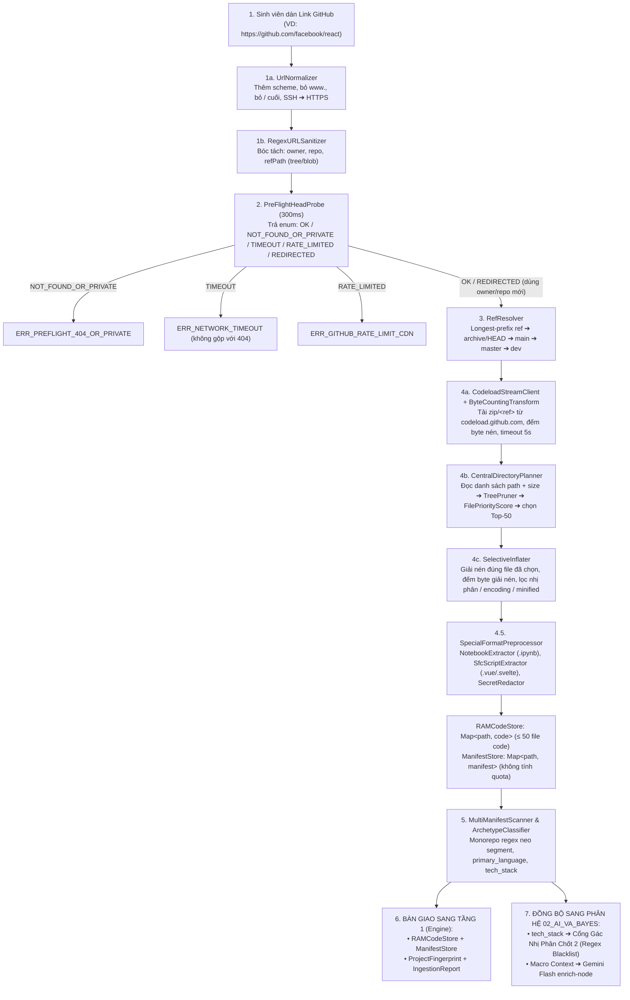

# [TẦNG 0] ĐẶC TẢ KỸ THUẬT INGESTION STREAM TỪ LINK GITHUB (0 TOKEN)
## PHÂN HỆ: CODEBASE INGESTION, RAM STREAM & VÂN TAY DỰ ÁN
### Dự án: SimpliFey V2 Pro — Codebase Cognitive Twin (Phụ trách: NGƯỜI 2)

---

| **Thuộc tính** | **Thông số kỹ thuật chuẩn hóa** |
| :--- | :--- |
| **Phân hệ tài liệu** | `01_ENGINE_THUAT_TOAN/01_INGESTION_STREAM.md` |
| **Tầng kiến trúc** | **TẦNG 0: INGESTION STREAM & PRE-FLIGHT (0 TOKEN AI)** |
| **Người phụ trách** | **NGƯỜI 2 (STATIC ENGINE & GRAPH ARCHITECT)** |
| **Phương thức tiếp nhận** | **Duy nhất: Chuỗi URL GitHub công khai (Link Input)** |
| **Thời gian thực thi** | **0.8s – 1.2s** (Mạng thông thường) |
| **Chi phí AI Token** | **0 Token** (Thuần toán học, Stream và Regex trên RAM) |
| **Chính sách I/O** | **Zero-Disk Policy (100% trong bộ nhớ Heap RAM, không ghi ổ cứng)** |
| **Khớp nối Phân hệ dưới** | **Cung cấp `RAMCodeStore`, `ManifestStore`, `tech_stack`, `ProjectFingerprint` và `IngestionReport` cho Tầng 1 và `02_AI_VA_BAYES`** |
| **Mã lỗi chuẩn** | `IngestionErrorCode` trong [`00_CORE_SPEC/02_DATA_CONTRACTS.md`](../00_CORE_SPEC/02_DATA_CONTRACTS.md) — không tự đặt mã mới ngoài bảng đó |

---

## 1. TỔNG QUAN LUỒNG HOẠT ĐỘNG THỰC TẾ

Toàn bộ quy trình Tầng 0 được thiết kế tinh gọn, tập trung xử lý duy nhất bài toán: **Nhận Link GitHub $\longrightarrow$ Trả về Danh sách Code Sạch trong RAM** trong vòng 1 giây, hoàn toàn miễn nhiễm với GitHub API Rate Limit (60 req/h) và không làm tốn dù chỉ 1 byte ổ cứng:



---

## 2. KIẾN TRÚC LƯU TRỮ BỘ NHỚ: LƯU CÁI GÌ & LƯU NHƯ THẾ NÀO?

Hệ thống tuân thủ nghiêm ngặt **Chính sách Zero-Disk (Không ghi ổ cứng)** để bảo vệ máy chủ không bị sập ổ đĩa khi có nhiều người dùng cùng lúc.

### 2.1. Cấu trúc Dữ liệu trên Bộ nhớ Heap (RAM Layout)

Toàn bộ dữ liệu được lưu trữ trong 3 bảng băm trên RAM:

```text
┌────────────────────────────────────────────────────────────────────────────────────────┐
│ BỘ NHỚ HEAP TRONG RAM (ZERO-DISK MEMORY SPACE)                                         │
├────────────────────────────────────────────────────────────────────────────────────────┤
│ 1. RAMCodeStore: Map<string, string>                                                   │
│    ├── Khóa (Key): Đường dẫn tệp POSIX chuẩn (VD: "src/services/order.service.ts")      │
│    └── Giá trị (Value): Mã nguồn UTF-8 đã bỏ BOM, chuẩn hóa \r\n ➔ \n, đã che secret    │
│                                                                                        │
│ 2. ManifestStore: Map<string, string>                                                  │
│    ├── Khóa (Key): Đường dẫn manifest (VD: "package.json", "server/tsconfig.json")     │
│    └── Giá trị (Value): Nội dung thô — KHÔNG tính vào quota 50 file code               │
│                                                                                        │
│ 3. SourceMapStore: Map<string, Array<{ virtualLine: number; origin: string }>>         │
│    ├── Khóa (Key): File ảo sinh từ .ipynb / .vue / .svelte                             │
│    └── Giá trị (Value): Ánh xạ dòng ảo ➔ vị trí gốc (VD: "cell 4, dòng 2")             │
└────────────────────────────────────────────────────────────────────────────────────────┘
```

### 2.2. Hạn Mức An Toàn Bộ Nhớ (Hard Heap Safeguards)

Để tránh nguy cơ treo máy chủ do repo quá lớn hoặc chứa mã nguồn rác:

| Thông số Giới hạn | Giá trị Ngưỡng | Ý nghĩa & Cách xử lý khi vượt ngưỡng |
| :--- | :---: | :--- |
| **`MAX_STREAM_BYTES`** | `15 MB` | Byte **nén** thực nhận qua mạng (đếm bằng `ByteCountingTransform`, không dựa vào header `Content-Length`). Vượt ⇒ `stream.destroy()`. |
| **`MAX_INFLATED_BYTES`** | `8 MB` | Tổng byte **sau giải nén** của mọi file được giữ. Chống Zip Bomb (12MB nén ➔ 600MB giải nén). |
| **`MAX_COMPRESSION_RATIO`** | `100×` | Nếu Central Directory cho biết `uncompressedSize / compressedSize > 100` ⇒ bỏ entry đó trước khi giải nén. |
| **`MAX_CLEAN_FILES`** | `50 tệp` | Tối đa 50 file **code** — chọn theo `FilePriorityScore`, không theo thứ tự trong zip. |
| **`MAX_SINGLE_FILE_BYTES`**| `1 MB` | Bỏ file code > 1MB (bundle minified bị commit nhầm). Cắt ngay khi đếm vượt ngưỡng giữa chừng. |
| **`MAX_NOTEBOOK_BYTES`** | `5 MB` | Hạn mức riêng cho `.ipynb` (output base64 làm file phình to; output bị bỏ khi trích xuất). |
| **`MAX_MANIFEST_BYTES`** | `256 KB` | Mỗi manifest. Vượt ⇒ bỏ qua + warning. |
| **`MAX_LINE_LENGTH`** | `1,000 ký tự` | Có dòng dài hơn hoặc độ dài dòng trung bình > 200 ⇒ coi là minified/generated, loại. |
| **`STREAM_TIMEOUT_MS`** | `5,000 ms` | Một `AbortController` phủ **toàn bộ** vòng đời stream (kết nối + tải + giải nén). |
| **`PREFLIGHT_TIMEOUT_MS`** | `300 ms` | Ngưỡng HEAD probe. Quá ngưỡng ⇒ `TIMEOUT` (lỗi mạng), **không** kết luận repo không tồn tại. |
| **`MAX_CONCURRENT_INGESTIONS`** | `4` | Semaphore toàn server; request thứ 5 vào hàng đợi FIFO. Trần heap lý thuyết: $4 \times (15 + 8)\text{ MB} \approx 92\text{ MB}$. |
| **`INGESTION_CACHE_TTL`** | `10 phút` | LRU cache kết quả theo khóa `owner/repo@ref` — demo nạp lại cùng repo không tải lại. |

---

## 3. CHI TIẾT CÁC BƯỚC XỬ LÝ KỸ THUẬT (RÕ RÀNG TỪNG BƯỚC)

Mỗi bước dưới đây được chuẩn hóa theo cấu trúc 4 trụ cột: **Tại sao cần & Vai trò $\to$ Cơ chế kỹ thuật $\to$ Làm thế nào để thực hiện được (Từng thao tác chi tiết) $\to$ Đầu ra chuẩn hóa**.

---

### BƯỚC 1: BÓC TÁCH & CHUẨN HÓA LINK GITHUB (`UrlNormalizer` + `RegexURLSanitizer`)

#### 1. Tại sao cần bước này & Vai trò của nó?
* **Vấn đề thực tế:** Sinh viên thường copy link trực tiếp từ thanh địa chỉ trình duyệt, dẫn đến các URL có đuôi phức tạp như:  
  `https://github.com/facebook/react/tree/main?tab=readme-ov-file#installation`  
  hoặc copy link git clone: `https://github.com/nestjs/nest.git`, link SSH `git@github.com:nestjs/nest.git`, link thiếu scheme `github.com/a/b`, link có dấu `/` cuối `https://github.com/a/b/`, hoặc link trang con `/pulls`, `/issues`, `/blob/main/src/app.ts`.
* **Hậu quả nếu không làm:** Nếu để nguyên query `?tab=...` hoặc thẻ hash `#installation`, regex parser thông thường sẽ nhầm phần rác này là một phần của tên branch hoặc tên repo. Riêng dấu `/` cuối khiến regex neo `$` **không khớp** và báo sai "link không hợp lệ".
* **Vai trò:** Là "người gác cổng dữ liệu đầu vào", bảo đảm URL được đưa về cấu trúc chuẩn tắc `owner`, `repo`, `refPath` trước khi bất kỳ kết nối mạng nào được kích hoạt.

#### 2. Cơ chế kỹ thuật:
* Chuẩn hóa chuỗi (String Normalization) theo trình tự cố định, sau đó dùng Regular Expression với nhóm bắt giữ (Capture Groups) và nhóm không bắt giữ (Non-capturing groups `(?:...)`) theo chuẩn URL RFC 3986.

#### 3. Làm thế nào để cơ chế đó thực hiện được? (Từng thao tác cụ thể):
* **Thao tác 1 (Cắt khoảng trắng thừa):** Gọi `rawUrl.trim()` để xóa bỏ khoảng trắng, ký tự tab (`\t`), newline (`\n`, `\r`) mà sinh viên vô tình bôi đen nhầm ở hai đầu chuỗi.
* **Thao tác 2 (Tách Query String và Hash Fragment):**  
  Dùng lệnh `const clean = rawUrl.trim().split(/[#?]/)[0];`  
  *Nguyên lý:* Ký tự `[#?]` đóng vai trò là điểm cắt chuỗi (Delimiter). Toàn bộ chuỗi từ dấu `?` hoặc `#` trở về sau sẽ bị gọt sạch trong 1 phép toán $\mathcal{O}(L)$.
* **Thao tác 3 (Chuẩn hóa hình thức — `UrlNormalizer`):** Thực hiện tuần tự:
  1. SSH ➔ HTTPS: `git@github.com:owner/repo.git` $\to$ `https://github.com/owner/repo.git`.
  2. Thiếu scheme: chuỗi bắt đầu bằng `github.com/` $\to$ thêm `https://`.
  3. Bỏ `www.`: `https://www.github.com/` $\to$ `https://github.com/`.
  4. Bỏ mọi dấu `/` ở cuối: `clean.replace(/\/+$/, '')`.
  5. Host khác `github.com` (GitLab, Bitbucket, `gist.github.com`) $\to$ dừng ngay, ném `ERR_INVALID_GITHUB_URL` kèm gợi ý *"Hiện chỉ hỗ trợ repository trên github.com"*.
* **Thao tác 4 (Khớp mẫu Regex bóc tách 3 thành phần):**
  ```typescript
  const GITHUB_REGEX = /^https:\/\/github\.com\/([a-zA-Z0-9_.-]+)\/([a-zA-Z0-9_.-]+?)(?:\.git)?(?:\/(tree|blob)\/(.+)|\/[a-z]+(?:\/.*)?)?$/;
  ```
  * `Group 1`: owner (username hoặc organization).
  * `Group 2`: tên repository. Toán tử lười `+?` giúp ngăn regex nuốt phần đuôi `.git`.
  * `Group 3 + 4`: nếu URL chứa `/tree/<rest>` hoặc `/blob/<rest>` $\implies$ giữ **nguyên** chuỗi `<rest>` thành `refPath` (VD: `"release/v2/src"`). **Không** cắt ở dấu `/` đầu tiên — vì tên branch được phép chứa `/` (`release/v2`, `feature/login`). Việc tách đâu là ref, đâu là thư mục con do Bước 3 (Longest-Prefix Ref Resolution) quyết định.
  * Nhánh `\/[a-z]+(?:\/.*)?`: các trang con khác (`/pulls`, `/issues`, `/actions`, `/wiki`) bị bỏ qua, chỉ giữ owner/repo.
* **Thao tác 5 (Chuẩn hóa đuôi .git):** Gọi `repo.replace(/\.git$/, '')` (VD: `nest.git` $\to$ `nest`).

#### 4. Đầu ra chuẩn hóa:
```typescript
interface GithubRepoInfo {
  owner: string;      // "facebook"
  repo: string;       // "react" (đã gọt sạch .git)
  refPath?: string;   // "release/v2/src" — chưa tách ref/subdir (undefined nếu chỉ dán link gốc)
  isBlobLink: boolean;// true nếu link trỏ vào 1 file (/blob/...) ➔ Bước 5 dùng thư mục chứa file làm gợi ý phạm vi
  clean_url: string;  // "https://github.com/facebook/react"
}
```

---

### BƯỚC 2: THĂM DÒ KHO MÃ NGUỒN SIÊU TỐC (`PreFlightHeadProbe` - 300ms)

#### 1. Tại sao cần bước này & Vai trò của nó?
* **Vấn đề thực tế:** Nếu sinh viên nhập một link gõ sai chính tả (VD: `github.com/fackebook/react`) hoặc repo là Private, việc nhảy thẳng vào kết nối tải stream ở Bước 4 sẽ làm máy chủ bị treo socket trong 5 giây chờ timeout.
* **Vai trò:** "Cảm biến phản xạ nhanh" (Circuit Breaker Probe) giúp hệ thống xác thực trạng thái kho mã nguồn trong 200ms – 300ms, báo lỗi tức thì lên UI cho sinh viên sửa link, tiết kiệm 100% băng thông tải stream.
* **Nguyên tắc trung thực của lỗi:** Probe phải phân biệt **"repo không tồn tại"** với **"mạng chậm"**. Gộp hai trường hợp (trả `boolean`) sẽ khiến Wi-Fi phòng thi chậm bị báo nhầm thành "repo không tồn tại" — sinh viên đi sửa link vô ích.

#### 2. Cơ chế kỹ thuật:
* Phương thức HTTP **`HEAD`** (RFC 7231 Section 4.3.2) kết hợp tín hiệu ngắt bất đồng bộ **`AbortController`** (DOM standard), trả về một **enum trạng thái** thay vì `boolean`.

#### 3. Làm thế nào để cơ chế đó thực hiện được? (Từng thao tác cụ thể):
* **Thao tác 1 (Thiết lập Bộ hẹn giờ ngắt Timeout):**
  ```typescript
  const controller = new AbortController();
  const timer = setTimeout(() => controller.abort(), 300); // Ngưỡng 300ms
  ```
* **Thao tác 2 (Phát lệnh HTTP HEAD qua mạng):**
  Gọi `fetch('https://github.com/' + owner + '/' + repo, { method: 'HEAD', redirect: 'follow', signal: controller.signal, headers: { 'User-Agent': 'SimpliFey-Probe' } })`.
  * *Bản chất ở tầng giao thức:* Phương thức `HEAD` giống hệt `GET`, nhưng máy chủ **chỉ gửi lại HTTP Response Headers mà KHÔNG gửi kèm thân trang (Body)** — gói tin nhỏ ~400 bytes, phản hồi 150ms – 250ms.
* **Thao tác 3 (Ánh xạ mã trạng thái ➔ enum `ProbeResult`):**

  | Phản hồi | `ProbeResult` | Hành động |
  | :--- | :--- | :--- |
  | `200 OK`, URL cuối trùng URL gửi | `OK` | Sang Bước 3 |
  | `200 OK`, `res.redirected === true` (repo đã đổi tên / chuyển owner) | `REDIRECTED` | Bóc owner/repo **mới** từ `res.url`, dùng cho mọi bước sau |
  | `404 Not Found` | `NOT_FOUND_OR_PRIVATE` | `ERR_PREFLIGHT_404_OR_PRIVATE`. *Lưu ý:* GitHub trả **404 cho cả repo private** (để không tiết lộ sự tồn tại) — không bao giờ nhận được 403 cho trường hợp này |
  | `451 Unavailable For Legal Reasons` | `UNAVAILABLE` | `ERR_REPO_UNAVAILABLE_451` |
  | `429 Too Many Requests` | `RATE_LIMITED` | `ERR_GITHUB_RATE_LIMIT_CDN` |
  | `AbortError` (quá 300ms) / lỗi DNS / `ECONNRESET` | `TIMEOUT` | Thử lại **1 lần** với ngưỡng 1,000ms; vẫn lỗi ⇒ `ERR_NETWORK_TIMEOUT` |

* **Thao tác 4 (Thu hồi tài nguyên Timer):**
  Trong khối `finally`, luôn gọi `clearTimeout(timer)` để giải phóng bộ đếm khỏi Node.js Event Loop, ngăn ngừa rò rỉ bộ nhớ (Memory Leak).

---

### BƯỚC 3: PHÂN GIẢI REF LÀM VIỆC (`RefResolver` — branch / tag / commit SHA)

#### 1. Tại sao cần bước này & Vai trò của nó?
* **Vấn đề thực tế:**
  * Sinh viên thường chỉ copy link trang chủ `github.com/owner/repo` mà không biết nhánh mặc định là `main`, `master`, `develop` hay `v1.x`.
  * Link `/tree/release/v2/src` không cho biết ref là `release`, `release/v2` hay `release/v2/src` — vì tên branch được phép chứa `/`.
  * Link có thể trỏ tới **tag** (`/tree/v1.0.0`) hoặc **commit SHA** (`/tree/a1b2c3d`) — đường dẫn `zip/refs/heads/...` chỉ đúng với branch.
* **Vai trò:** "Bộ định tuyến thông minh" xác định chính xác ref cần tải và thư mục con (`subdir`) người dùng muốn phân tích, không đòi hỏi người dùng chọn thủ công.

#### 2. Cơ chế kỹ thuật:
* **Longest-Prefix Ref Resolution** cho link có `refPath`, và **Waterfall Fallback Cascade** cho link gốc. Mọi kiểm tra dùng HTTP `HEAD` tới codeload (không tốn quota REST API).
* Tải bằng dạng URL tổng quát **`https://codeload.github.com/:owner/:repo/zip/:ref`** — codeload chấp nhận branch, tag lẫn SHA ở cùng một vị trí. Đây là dạng URL **duy nhất** được dùng trong toàn bộ tài liệu.

#### 3. Làm thế nào để cơ chế đó thực hiện được? (Từng thao tác cụ thể):
* **Thao tác 1 (Link có `refPath` — Longest-Prefix):**
  Tách `refPath` theo `/` thành các đoạn $s_1/s_2/\dots/s_k$. Thử lần lượt các tiền tố **từ dài đến ngắn**: $s_1..s_k$, $s_1..s_{k-1}$, …, $s_1$. Với mỗi ứng viên gửi `HEAD https://codeload.github.com/:owner/:repo/zip/<ứng viên>`:
  * Ứng viên đầu tiên trả `200` là `ref`; phần còn lại của `refPath` trở thành `subdir` (VD: `release/v2/src` ⇒ `ref = "release/v2"`, `subdir = "src"`).
  * Giới hạn tối đa 4 lần thử (đa số tên branch có ≤ 3 đoạn). Hết lượt ⇒ `ERR_BRANCH_NOT_FOUND`.
* **Thao tác 2 (Link gốc — Default Branch không cần REST API):**
  Thử `HEAD https://github.com/:owner/:repo/archive/HEAD.zip` — GitHub chuyển hướng (302) tới codeload với **nhánh mặc định thật** của repo, bất kể tên là gì (`develop`, `v1.x`…). Đọc ref từ URL chuyển hướng.
  > ⚠️ **Cần kiểm chứng bằng thực nghiệm** (`curl -I https://github.com/<o>/<r>/archive/HEAD.zip`) trước khi chốt cài đặt. Nếu hành vi không như mô tả, dùng Thao tác 3.
* **Thao tác 3 (Waterfall dự phòng):**
  Nếu Thao tác 2 thất bại ⇒ thử tuần tự `['main', 'master', 'dev']` với HEAD tới `codeload.../zip/:b` (timeout 300ms mỗi lần), dừng ngay khi gặp `200`.
* **Thao tác 4 (Repo rỗng — chưa có commit):**
  Nếu probe Bước 2 trả `OK` nhưng **mọi** ref đều 404 ⇒ nhiều khả năng repo chưa có commit nào. Trả `ERR_EMPTY_REPOSITORY` (thay vì `ERR_BRANCH_NOT_FOUND`) khi link là link gốc; trả `ERR_BRANCH_NOT_FOUND` kèm ô nhập tay tên nhánh khi người dùng đã chỉ định `refPath`.

#### 4. Đầu ra chuẩn hóa:
```typescript
interface ResolvedRef {
  ref: string;        // "release/v2" | "v1.0.0" | "a1b2c3d" | "main"
  subdir?: string;    // "src" — Bước 5 dùng làm root_dir_offset ưu tiên cao nhất
}
```

---

### BƯỚC 4: TẢI STREAM, LẬP KẾ HOẠCH & GIẢI NÉN CHỌN LỌC TRÊN RAM

#### 1. Tại sao cần bước này & Vai trò của nó?
* **Vấn đề thực tế:** Một repo đồ án sinh viên có thể nặng 200MB (trong đó `node_modules` chiếm 180MB, `.git` chiếm 15MB, ảnh/video chiếm 4MB, code thật chỉ 1MB!).
* **Hậu quả nếu tải truyền thống:** Tải cả 200MB về máy rồi ghi ra ổ đĩa sẽ làm nghẽn băng thông phòng thi, tốn 30 giây tải, làm cạn kiệt IOPS ổ đĩa và crash server! Nếu gọi qua GitHub REST API thì bị khóa sau 60 request/giờ.
* **Hậu quả nếu lấy 50 file đầu tiên theo thứ tự trong zip:** Thứ tự entry trong zip gần như theo bảng chữ cái của cây thư mục ⇒ với Monorepo, `client/` (chữ **c**) được duyệt trước `server/` (chữ **s**) — 50 slot bị file frontend và test lấp đầy, **backend không bao giờ được nạp**.
* **Vai trò:** "Trái tim tốc độ" của Tầng 0. Tải mã nguồn từ CDN, lọc rác, **chọn đúng 50 file quan trọng nhất** và chỉ giải nén chúng, hoàn toàn không chạm ổ đĩa (Zero-Disk) và không bị giới hạn Rate Limit.

#### 2. Cơ chế kỹ thuật:
* Tải luồng nhị phân trực tiếp từ máy chủ CDN `codeload.github.com` (bỏ qua REST API rate limit).
* **Central-Directory-First (chế độ mặc định):** Zip lưu bảng mục lục **Central Directory** ở *cuối* file (chuẩn PKWARE APPNOTE §4.3.12) chứa path, `compressedSize`, `uncompressedSize` của mọi entry. Vì đã chặn trần 15MB, hệ thống gom toàn bộ byte nén vào **một Buffer trên RAM** (vẫn Zero-Disk), đọc Central Directory bằng `unzipper.Open.buffer(buf)` để biết **toàn bộ danh sách file trước khi giải nén bất kỳ byte nào**, rồi chỉ giải nén các file được chọn.
* **Streaming Mode (dự phòng):** Nếu Central Directory hỏng/không đọc được, quay về `unzipper.Parse()` đọc tuần tự Local File Header như thiết kế cũ, chấp nhận chọn file theo thứ tự xuất hiện và gắn cờ `warnings`.
* **Phòng thủ Bảo mật & Tài nguyên:**
  * Chuẩn hóa đường dẫn chống Path Traversal / va chạm khóa.
  * Đếm byte 2 lớp: byte nén (mạng) và byte giải nén (RAM).
  * Lọc nhị phân, symlink, Git LFS pointer, file minified.

> **Ghi chú trung thực về `autodrain()`:** Ở Streaming Mode, `entry.autodrain()` bỏ qua dữ liệu mà không cấp phát buffer, nhưng nếu entry dùng *data descriptor* (cờ bit 3 — kích thước không có sẵn trong Local File Header) thì parser vẫn phải chạy INFLATE để tìm điểm kết thúc. Zip của codeload có dùng data descriptor hay không **cần kiểm chứng thực nghiệm**; Central-Directory-First không phụ thuộc vào điều này vì kích thước đã có trong mục lục.

#### 3. Làm thế nào để cơ chế đó thực hiện được? (Từng thao tác cụ thể):
* **Thao tác 1 (Bắt luồng nhị phân từ CDN, có trần thời gian):**
  Tạo **một** `AbortController` với timer `STREAM_TIMEOUT_MS = 5000` phủ toàn bộ Bước 4. Gửi `fetch('https://codeload.github.com/:owner/:repo/zip/:ref', { signal })`. Chuyển `response.body` thành Node.js Stream bằng `Readable.fromWeb()`.
  * **Không dựa vào header `Content-Length`**: codeload sinh zip on-the-fly và có thể trả `Transfer-Encoding: chunked` không kèm kích thước (cần kiểm chứng; dù có hay không, bộ đếm bên dưới vẫn là nguồn sự thật).
* **Thao tác 2 (`ByteCountingTransform` — chặn trần byte nén):**
  Chèn một `Transform` stream đếm `receivedBytes += chunk.length`. Nếu `receivedBytes > MAX_STREAM_BYTES (15MB)` ⇒ `controller.abort()` + `stream.destroy()`, chuyển sang **chính sách cắt cụt**:
  * Ở Central-Directory-First, buffer chưa đủ thì không đọc được mục lục ⇒ chuyển sang **Streaming Mode** trên phần byte đã nhận (các entry hoàn chỉnh đầu tiên vẫn dùng được), gắn `ingestion_report.truncated = true`.
  * Nếu không thu được file code nào ⇒ `ERR_STREAM_QUOTA_EXCEEDED`.
  * Mọi stream được nối bằng `stream.pipeline()` để lỗi ở bất kỳ mắt xích nào cũng hủy toàn bộ chuỗi.
* **Thao tác 3 (Chuẩn hóa đường dẫn — chống Path Traversal & va chạm khóa):**
  1. Đổi `\` thành `/`.
  2. Cắt thư mục gốc GitHub tạo (`react-main/src/...` ⇒ `src/...`) bằng `p.substring(p.indexOf('/') + 1)`.
  3. `path.posix.normalize()`; nếu kết quả bắt đầu bằng `../` hoặc `/` ⇒ **loại entry** (không "gọt" `../` vì `a/../../x` vẫn lọt qua cách gọt đầu chuỗi).
  4. Tên file không giải mã được UTF-8 (cờ bit 11 tắt và chứa byte ngoài ASCII) ⇒ loại, tăng `skipped.binary`.
  * *Vì sao vẫn cần dù Zero-Disk:* không có ghi đĩa nên không có Zip Slip ghi đè file hệ thống, nhưng path bẩn sẽ làm sai khóa `RAMCodeStore` và hỏng phân giải import ở Tầng 1.
* **Thao tác 4 (`TreePruner` — bảng lọc neo theo segment thư mục):**
  Regex rác phải **neo theo ranh giới segment** để không bắt nhầm `distance.ts`, `distributed/`, `builder.ts`, `rebuild.py`:
  ```typescript
  const IGNORE_DIR_SEGMENTS = /(^|\/)(node_modules|\.git|\.github|dist|build|out|\.next|\.nuxt|\.turbo|coverage|vendor|venv|\.venv|env|__pycache__|\.pytest_cache|\.mypy_cache|target|bin|obj|\.gradle|\.idea|\.vscode|Pods|\.dart_tool)(\/|$)/;
  const IGNORE_FILE_PATTERNS = /(\.min\.(js|css)|\.d\.ts|\.map|\.lock|-lock\.json|\.pb\.go|_pb2\.py|\.generated\.\w+|\.g\.dart|\.freezed\.dart)$/i;
  const MEDIA_BINARY_EXT = /\.(png|jpe?g|gif|webp|ico|svg|mp4|mov|mp3|wav|pdf|zip|gz|jar|exe|dll|so|woff2?|ttf|psd)$/i;
  ```
  Thư mục `migrations/` và `__tests__/`, `test/`, `tests/`, `spec/` **không bị loại** nhưng bị trừ điểm ở Thao tác 5.
* **Thao tác 5 (`CentralDirectoryPlanner` — phân loại & chấm điểm ưu tiên):**
  Duyệt mục lục, phân mỗi entry vào 1 trong 5 nhóm:

  | Nhóm | Điều kiện | Xử lý |
  | :--- | :--- | :--- |
  | **Rác** | Khớp `IGNORE_DIR_SEGMENTS` / `IGNORE_FILE_PATTERNS` / `MEDIA_BINARY_EXT`, hoặc entry là `Directory` / `SymbolicLink` | Bỏ, `skipped.garbage++` |
  | **Manifest** | Basename thuộc `MANIFEST_FILES` (xem Bước 5) và ở độ sâu ≤ 3 | Vào `ManifestStore`, **không tính quota** |
  | **Code** | Đuôi có trong `LanguageRegistry.extensionMap` (tra ngược ra `LanguageId`). Danh sách **sinh từ registry**, không còn gõ cứng. Tier `RESOLVED` khởi điểm: `.ts .tsx .mts .cts .js .jsx .mjs .cjs .py .java .dart .go`. Tier `STRUCTURAL` (có grammar, chưa có resolver riêng) gồm ví dụ `.cs .php .kt .kts .cpp .cc .c .h .hpp .rs .rb .swift .scala .lua .ex .exs .hs .zig ...` và mọi ngôn ngữ khác được thêm vào registry | Ứng viên chấm điểm; gắn `LanguageId` cho từng file |
  | **Đặc biệt** | `.ipynb`, `.vue`, `.svelte` | Ứng viên chấm điểm, xử lý ở Bước 4.5 |
  | **Không có grammar** | Đuôi không có trong `extensionMap` nhưng là mã nguồn/DSL đã biết (VD `.sol`, `.v`, `.vhd` khi chưa có grammar) | Bỏ, `skipped.unsupported_lang++`, **đếm byte theo ngôn ngữ** cho Thao tác 8 |

  **Language Registry (nguồn chân lý duy nhất về ngôn ngữ):** mỗi ngôn ngữ là một *adapter* dạng dữ liệu `{ id, extensions[], wasmGrammar, queryFile(.scm), importResolver?, ingressPatterns?, abstractionKinds? }`. Có `importResolver` ⇒ tier `RESOLVED`; thiếu ⇒ tier `STRUCTURAL` (dùng **Universal Resolver**, xem `02_AST_SLICING_GRAPH.md` Thao tác 2b). Thêm một ngôn ngữ mới ở mức `STRUCTURAL` chỉ cần thêm file `.wasm` + file truy vấn `.scm`, **không viết thêm code thuật toán**.

  Chấm `FilePriorityScore` cho ứng viên rồi lấy **Top-50**:
  $$\text{Score}(f) = 3\cdot\mathbf{1}_{\text{trong scope}} + 2\cdot\mathbf{1}_{\text{tên vai trò}} + \frac{1}{\text{depth}(f)} - 2\cdot\mathbf{1}_{\text{test/spec/example/demo}} - 1\cdot\mathbf{1}_{\text{size} < 200\text{B}}$$
  * *Trong scope:* nằm dưới `subdir` của Bước 3, hoặc dưới thư mục server khi phát hiện monorepo (xem Bước 5 Thao tác 2 — chạy **ngay trên danh sách path** ở bước này, trước khi cấp quota).
  * *Tên vai trò:* path chứa segment/basename khớp `controller|route|router|handler|service|usecase|repository|repo|model|entity|schema|middleware|api|main|app|server|index`.
  * Hòa điểm ⇒ sắp xếp theo path tăng dần (đảm bảo **deterministic**: cùng repo ⇒ cùng 50 file).
  * Entry có `uncompressedSize > MAX_SINGLE_FILE_BYTES` (hoặc `> MAX_NOTEBOOK_BYTES` với `.ipynb`) hay tỉ lệ nén `> MAX_COMPRESSION_RATIO` ⇒ loại **trước khi giải nén**, `skipped.oversized++`.
  * Ứng viên ngoài Top-50 ⇒ `skipped.quota++`, `truncated = true`.
* **Thao tác 6 (`SelectiveInflater` — giải nén file đã chọn, đếm byte giải nén):**
  Với mỗi file được chọn, đọc stream giải nén theo chunk:
  * Cộng dồn `inflatedTotal` và `inflatedThisFile`. Nếu `inflatedThisFile > MAX_SINGLE_FILE_BYTES` (kích thước khai báo trong mục lục có thể bị làm giả) ⇒ dừng file đó. Nếu `inflatedTotal > MAX_INFLATED_BYTES` ⇒ dừng **toàn bộ** giải nén, giữ các file đã xong, `truncated = true`.
  * **Không `break` khỏi vòng `for await` rồi mới gọi `autodrain()`** — `break` sẽ hủy entry stream giữa chừng và có thể làm hỏng parser ở Streaming Mode. Thay vào đó dùng cờ `discard = true` và **tiếp tục đọc hết** (bỏ chunk) để parser đến đúng entry kế tiếp.
* **Thao tác 7 (Lọc nội dung: encoding, nhị phân, LFS, minified):**
  Áp dụng trên 512 byte đầu và trên toàn nội dung đã gom:
  1. **BOM UTF-16** (`FF FE` / `FE FF`) ⇒ giải mã bằng `TextDecoder('utf-16le' | 'utf-16be')` **trước** khi kiểm tra null byte (file UTF-16 hợp lệ chứa rất nhiều `0x00` và sẽ bị loại oan).
  2. Còn chứa `0x00` trong 512 byte đầu ⇒ nhị phân đổi đuôi, loại, `skipped.binary++`.
  3. BOM UTF-8 (`EF BB BF`) ⇒ cắt bỏ.
  4. Dòng đầu là `version https://git-lfs.github.com/spec/v1` ⇒ Git LFS pointer, loại, `skipped.binary++`.
  5. Có dòng dài > `MAX_LINE_LENGTH` hoặc độ dài dòng trung bình > 200 ⇒ minified/generated, loại, `skipped.oversized++`.
  6. Chuẩn hóa `\r\n` và `\r` ⇒ `\n` để số dòng trong Monaco, `trace_steps.line_start/line_end` và Tree-sitter khớp nhau.
* **Thao tác 8 (Kiểm tra kết quả rỗng — chọn đúng mã lỗi):**
  Sau Bước 4.5, nếu `code_file_count === 0` (manifest **không** được tính):
  * Byte của ngôn ngữ **không có grammar** trong Language Registry chiếm > 50% tổng byte code thô ⇒ `ERR_UNSUPPORTED_LANGUAGE`, thông điệp nêu tên ngôn ngữ (VD: *"Repository chủ yếu viết bằng Solidity — SimpliFey chưa có bộ phân tích cú pháp cho ngôn ngữ này"*). Ngôn ngữ có grammar nhưng chưa có resolver (VD C#, Rust, PHP) **không** vào nhánh này: chúng được nạp ở tier `STRUCTURAL`.
  * Có file `.gitmodules` ⇒ `ERR_NO_SOURCE_FILES_FOUND` kèm gợi ý *"Mã nguồn có thể nằm trong git submodule (zip của GitHub không chứa submodule) — hãy dán link repository con"*.
  * Còn lại ⇒ `ERR_NO_SOURCE_FILES_FOUND`.
* **Thao tác 9 (Dọn tài nguyên):** Trong `finally`: `clearTimeout`, `stream.destroy()`, gán buffer zip `= null` để GC thu hồi ngay; nhả semaphore `MAX_CONCURRENT_INGESTIONS`.
* **Thao tác 10 (Stream đứt / zip hỏng):**
  `ECONNRESET`, `AbortError` giữa chừng hoặc `unzipper` ném lỗi chữ ký (`invalid signature`) ⇒ thử lại **1 lần** sau $500\text{ms}$ (chỉ với lỗi mạng/hỏng, **không** thử lại với 404/451). Vẫn lỗi ⇒ `ERR_STREAM_CORRUPTED` (lỗi hỏng) hoặc `ERR_STREAM_TIMEOUT` (quá 5s).

---

### BƯỚC 4.5: TIỀN XỬ LÝ ĐỊNH DẠNG ĐẶC BIỆT (`SpecialFormatPreprocessor`)

#### 1. Tại sao cần bước này & Vai trò của nó?
* **Vấn đề thực tế:**
  * Repo AI/Data Science của sinh viên thường chỉ có file `.ipynb`. Đây là **JSON**, không phải Python — nếu đưa thẳng vào Tree-sitter Python, parser (vốn chịu lỗi) sẽ sinh cây đầy node `ERROR`, không thu được hàm nào. Nếu không có bước này, `.ipynb` thậm chí không nằm trong `VALID_EXTENSIONS` ⇒ repo bị báo oan `ERR_NO_SOURCE_FILES_FOUND`.
  * File `.vue`/`.svelte` (Single File Component) trộn HTML + CSS + `<script>` — chỉ khối `<script>` là code phân tích được.
  * Code sinh viên hay hardcode secret (`AWS_SECRET`, mật khẩu DB). Gửi nguyên văn sang Gemini là **rò rỉ bí mật ra dịch vụ ngoài**.
* **Vai trò:** "Bộ chuyển đổi định dạng" biến mọi đầu vào đặc biệt thành code thuần mà Tree-sitter hiểu được, đồng thời là **lớp vệ sinh dữ liệu cuối cùng** trước khi code rời Tầng 0.

#### 2. Cơ chế kỹ thuật:
* Trích xuất cấu trúc (JSON parse / regex khối) kèm **Source Map dòng ảo ➔ vị trí gốc**, và Regex Secret Scanning.

#### 3. Làm thế nào để cơ chế đó thực hiện được? (Từng thao tác cụ thể):
* **Thao tác 1 (`NotebookExtractor` cho `.ipynb`):**
  1. `JSON.parse(content)` trong `try-catch`; lỗi ⇒ bỏ file, thêm warning *"Notebook X bị hỏng định dạng"*.
  2. Kiểm tra `metadata.kernelspec.language` (hoặc `metadata.language_info.name`); khác `python` (R, Julia, Scala) ⇒ bỏ file, `skipped.unsupported_lang++`.
  3. Lấy danh sách cell: nbformat 4 ⇒ `nb.cells`; nbformat 3 ⇒ `nb.worksheets[0].cells`.
  4. Chỉ giữ cell `cell_type === "code"`; nội dung là `cell.source` (nbformat 4) hoặc `cell.input` (nbformat 3), có thể là `string` **hoặc** `string[]` ⇒ chuẩn hóa `Array.isArray(s) ? s.join('') : s`. **Bỏ hoàn toàn `outputs`** (ảnh base64, bảng dữ liệu).
  5. Dòng bắt đầu bằng `%` (magic: `%matplotlib inline`) hoặc `!` (shell: `!pip install`) ⇒ đổi thành comment `# [magic] ...` để không sinh lỗi cú pháp Python.
  6. Ghép các cell, mỗi cell mở đầu bằng dòng phân cách `# %% [cell N]`; ghi `SourceMapStore` cho từng dòng ảo.
  7. Lưu vào `RAMCodeStore` dưới khóa `<path>.ipynb.py` (giữ đường dẫn gốc để UI hiển thị tên notebook; đuôi `.py` để Tầng 1 chọn grammar Python).
* **Thao tác 2 (`SfcScriptExtractor` cho `.vue` / `.svelte`):**
  Regex `/<script\b[^>]*>([\s\S]*?)<\/script>/gi` lấy nội dung các khối `<script>`; thuộc tính `lang="ts"` ⇒ đuôi ảo `.ts`, ngược lại `.js`. Giữ nguyên số dòng gốc bằng cách thay phần ngoài `<script>` bằng dòng trống (không cần SourceMap riêng). Không có khối `<script>` ⇒ bỏ file.
* **Thao tác 3 (`SecretRedactor`):**
  Quét bằng bảng regex:
  ```typescript
  const SECRET_PATTERNS = [
    /AKIA[0-9A-Z]{16}/g,                                   // AWS Access Key
    /-----BEGIN (RSA |EC |OPENSSH )?PRIVATE KEY-----[\s\S]*?-----END \1?PRIVATE KEY-----/g,
    /\b(ghp|gho|ghs)_[A-Za-z0-9]{36}\b/g,                  // GitHub token
    /\bAIza[0-9A-Za-z_-]{35}\b/g,                          // Google API key
    /(password|passwd|pwd|secret|api_?key|token)\s*[:=]\s*["'][^"'\s]{6,}["']/gi, // gán chuỗi nhạy cảm
    /(mongodb(\+srv)?|postgres(ql)?|mysql):\/\/[^:\s]+:[^@\s]+@/gi,              // connection string có mật khẩu
  ];
  ```
  Thay phần giá trị bằng `"<REDACTED_SECRET>"` (giữ tên biến, giữ số dòng). Ghi `redacted_secret_count` và vị trí `{file, line}` để **Tầng 2 dùng làm ứng viên `hidden_challenge` Mức 1 — Security Fatal** (khớp Case 7.2 của audit). Bản đã che là bản duy nhất được lưu và gửi đi.
* **Thao tác 4 (Gắn cờ nội dung nghi prompt-injection):**
  Comment/string khớp `/(ignore|disregard)\s+(all\s+)?(previous|above)\s+instructions|you are now|system prompt/i` ⇒ ghi warning nội bộ `suspicious_instruction_comment` (không sửa code). Việc phòng thủ thuộc phân hệ `02_AI_VA_BAYES` (đóng khung code trong thẻ dữ liệu + Cổng Gác Nhị Phân).

---

### BƯỚC 5: ĐỊNH DANH VÂN TAY DỰ ÁN (`MultiManifestScanner` & `ArchetypeClassifier`)

#### 1. Tại sao cần bước này & Vai trò của nó?
* **Vấn đề thực tế:** Đồ án sinh viên rất đa dạng: Web Backend, Web Frontend, Mobile Flutter, Desktop Electron, CLI tool hoặc Thuật toán LeetCode. Nếu không nhận diện đúng, hệ thống sẽ áp dụng sai mô hình (ví dụ ép Mobile App phải có Controller như Web Backend sẽ làm gãy AST parser).
* Đồng thời, hơn 60% đồ án là Monorepo (chứa cả 2 folder `client/` và `server/`, hoặc dạng `apps/web` + `apps/api`). Trong Monorepo, file `package.json` ở root thường chỉ là lerna/workspaces rỗng; toàn bộ framework chính (`express`, `nestjs`, `typeorm`) lại nằm trong `server/package.json`!
* **Vai trò:** "Bộ não nhận thức kiến trúc" giúp hệ thống hiểu được dự án thuộc thể loại gì, trích xuất chính xác `tech_stack` ưu tiên từ thư mục server để phục vụ Cổng Gác Nhị Phân và hướng dẫn AI hỏi đúng trọng tâm.

#### 2. Cơ chế kỹ thuật:
* Quét `ManifestStore` ở độ sâu $\le 3$ kết hợp **Ưu tiên Manifest Monorepo (Monorepo Manifest Priority)** và khớp mẫu luật (Rule-based Dependency Inference). Phát hiện monorepo chạy **2 lần**: lần đầu trên danh sách path ở Bước 4 Thao tác 5 (để cấp quota đúng chỗ), lần hai ở đây để đóng gói `ProjectFingerprint`.

#### 3. Làm thế nào để cơ chế đó thực hiện được? (Từng thao tác cụ thể):
* **Thao tác 1 (Danh sách Manifest):**
  ```typescript
  const MANIFEST_FILES = ['package.json', 'tsconfig.json', 'jsconfig.json', 'pom.xml', 'build.gradle',
    'requirements.txt', 'pyproject.toml', 'setup.py', 'Pipfile', 'go.mod', 'pubspec.yaml',
    // Manifest của các ngôn ngữ tier STRUCTURAL (chỉ dùng để lấy tech_stack/archetype, chưa có resolver riêng):
    'Cargo.toml', 'composer.json', 'Gemfile', 'build.gradle.kts', 'mix.exs', 'Package.swift', 'CMakeLists.txt'];
  ```
  Mỗi adapter trong Language Registry có thể khai báo thêm `manifestFiles[]` của riêng nó; danh sách trên chỉ là tập khởi điểm. Manifest lạ không parse được ⇒ `tech_stack` để rỗng cho ngôn ngữ đó (không báo lỗi).
  `tsconfig.json`/`jsconfig.json` được giữ để **Tầng 1 đọc `compilerOptions.paths`** khi phân giải alias `@/`. `JSON.parse` lỗi (package.json có comment, BOM, dấu phẩy thừa) ⇒ thử bỏ comment `//`, `/* */` và BOM rồi parse lại; vẫn lỗi ⇒ bỏ qua + warning.
* **Thao tác 2 (Phát hiện Monorepo & Xác định Offset — regex neo segment):**
  ```typescript
  const CLIENT_REGEX = /^(?:apps\/|packages\/)?(client|frontend|web|ui|app-web|mobile)(\/|$)/i;
  const SERVER_REGEX = /^(?:apps\/|packages\/)?(server|backend|api|service|services)(\/|$)/i;
  ```
  * Neo `(\/|$)` để `api-docs/`, `apiClient/` **không** bị nhận nhầm là backend; bỏ `core` khỏi danh sách (quá chung — nhiều frontend có `core/`).
  * Thứ tự quyết định `root_dir_offset`:
    1. `subdir` từ Bước 3 (người dùng đã chỉ định qua link `/tree/<ref>/<subdir>`) ⇒ dùng luôn.
    2. Cả `CLIENT_REGEX` và `SERVER_REGEX` khớp ⇒ `is_monorepo = true`, `root_dir_offset` = thư mục server (VD: `"server/"`, `"apps/api/"`).
    3. Chỉ `SERVER_REGEX` khớp và > 70% file code nằm trong đó ⇒ `root_dir_offset` = thư mục đó, `is_monorepo = false`.
    4. Nhiều ứng viên server ngang nhau (VD: `services/order/`, `services/user/`) ⇒ chọn thư mục có nhiều byte code nhất, ghi warning *"Phát hiện nhiều backend — đang phân tích X, có thể chọn thư mục khác trên giao diện"* (UI cho phép chọn lại — Người 1).
    5. Không khớp ⇒ `root_dir_offset = ""`.
* **Thao tác 3 (Monorepo Manifest Priority - Ưu tiên Manifest Server):**
  Nếu `root_dir_offset !== ""`, đọc manifest **trong** thư mục đó trước (VD: `server/package.json`, `apps/api/requirements.txt`), sau đó mới gộp thêm manifest root. Nhờ vậy các thư viện backend (`typeorm`, `nestjs`, `fastapi`) không bị bỏ sót.
* **Thao tác 4 (Trích xuất thư viện & tech_stack):**
  * `package.json`: gom key trong `dependencies` và `devDependencies`.
  * `requirements.txt`: regex `/^([a-zA-Z0-9_.-]+)/gm`, bỏ dòng bắt đầu bằng `#` hoặc `-r`.
  * `pyproject.toml`: regex dưới `[project] dependencies` hoặc `[tool.poetry.dependencies]`.
  * `pom.xml`: regex `<artifactId>([^<]+)</artifactId>` trong khối `<dependencies>`.
  * `build.gradle`: regex `(implementation|api|compile)\s*\(?["']([^"':]+):([^"':]+)`.
  * `go.mod`: dòng `module <path>` (lưu `go_module_path` cho Tầng 1 phân giải import Go) và các dòng trong `require (...)`.
  * `pubspec.yaml`: regex quét dưới trường `dependencies:`.
* **Thao tác 5 (Tính `primary_language`):**
  Đếm **byte code** theo `LanguageId` (tra từ `LanguageRegistry.extensionMap`) trong phạm vi `root_dir_offset` (nếu rỗng thì toàn repo): `.ts/.tsx/.mts/.cts` ⇒ `TYPESCRIPT`; `.js/.jsx/.mjs/.cjs` ⇒ `JAVASCRIPT`; `.py` (gồm notebook đã trích xuất) ⇒ `PYTHON`; `.java` ⇒ `JAVA`; `.dart` ⇒ `DART`; `.go` ⇒ `GO`; `.rs` ⇒ `RUST`; `.cs` ⇒ `CSHARP`; ... (mọi ngôn ngữ trong registry đều có `LanguageId` riêng, **không còn gộp vào `OTHER`**). Ngôn ngữ có nhiều byte nhất thắng ⇒ `primary_language`; hòa ⇒ ưu tiên ngôn ngữ của manifest trong `root_dir_offset`.
  Đồng thời lập `language_breakdown[]` (mọi ngôn ngữ có mặt + `tier` + `code_bytes`) và tính `graph_confidence`: `HIGH` nếu ≥ 80% byte thuộc tier `RESOLVED`; `LOW` nếu ≥ 50% byte thuộc tier `STRUCTURAL`; còn lại `MIXED`. UI dùng giá trị này để hiện huy hiệu *"Đồ thị độ tin cậy cao / trung bình / thấp"*.
* **Thao tác 6 (Phân loại 6 Hình thái Archetype):**
  Duyệt mảng `tech_stack` qua bộ lọc luật:
  * Nếu có `react-native`, `expo`, hoặc thấy `pubspec.yaml` $\implies$ Phân loại **`MOBILE_APP`**.
  * Nếu có `electron`, `@tauri-apps/api` $\implies$ Phân loại **`DESKTOP_APP`**.
  * Nếu có `express`, `@nestjs/core`, `fastapi`, `flask`, `django`, `spring-boot-starter-web`, `gin` $\implies$ Phân loại **`WEB_BACKEND`**.
  * Nếu có `react-dom`, `vue`, `svelte` (mà không có framework server) $\implies$ Phân loại **`WEB_FRONTEND`**.
  * Nếu có trường `"bin"` hoặc `commander`, `typer`, `click` $\implies$ Phân loại **`CLI_TOOL`**.
  * Không có manifest hoặc không chứa framework nào trên $\implies$ Phân loại **`ALGORITHM_CORE`**.
* **Thao tác 7 (Đóng gói ProjectFingerprint & IngestionReport):**
  Gói thông tin thành `ProjectFingerprint` và `IngestionReport` (kiểu chuẩn trong `02_DATA_CONTRACTS.md`), bàn giao cho Tầng 1 và Tầng 4.

---

## 4. CODE MINH HỌA CÁC HÀM CỐT LÕI (CHÚ THÍCH DỄ HIỂU CHO CON NGƯỜI)

### 4.1. Hàm Chuẩn Hóa Link GitHub
```typescript
/**
 * Trích xuất owner, repo, refPath từ URL GitHub người dùng dán vào
 */
function sanitizeGithubUrl(rawUrl: string) {
  // 1. Gọt khoảng trắng 2 đầu và loại bỏ query/hash (?tab=... #readme)
  let clean = rawUrl.trim().split(/[#?]/)[0];

  // 2. Chuẩn hóa hình thức: SSH -> HTTPS, thêm scheme, bỏ www., bỏ / cuối
  clean = clean
    .replace(/^git@github\.com:/, 'https://github.com/')
    .replace(/^(?!https?:\/\/)/, 'https://')
    .replace(/^http:\/\//, 'https://')
    .replace(/^https:\/\/www\./, 'https://')
    .replace(/\/+$/, '');

  // 3. Khớp regex bóc tách owner, repo, refPath (giữ nguyên dấu / trong refPath)
  const regex = /^https:\/\/github\.com\/([a-zA-Z0-9_.-]+)\/([a-zA-Z0-9_.-]+?)(?:\.git)?(?:\/(tree|blob)\/(.+)|\/[a-z]+(?:\/.*)?)?$/;
  const match = clean.match(regex);

  if (!match) {
    throw new IngestionError('ERR_INVALID_GITHUB_URL'); // Thông điệp tra trong ma trận §6
  }

  return {
    owner: match[1],
    repo: match[2].replace(/\.git$/, ''), // Gọt bỏ đuôi .git nếu có
    refPath: match[4] || undefined,       // "release/v2/src" — Bước 3 tách ref/subdir
    isBlobLink: match[3] === 'blob',
  };
}
```

### 4.2. Hàm Thăm Dò Head Probe (200ms - 300ms)
```typescript
type ProbeResult = 'OK' | 'REDIRECTED' | 'NOT_FOUND_OR_PRIVATE' | 'UNAVAILABLE' | 'RATE_LIMITED' | 'TIMEOUT';

/**
 * Kiểm tra repo bằng HTTP HEAD siêu nhẹ — phân biệt rõ "không tồn tại" và "mạng chậm"
 */
async function probeRepoHead(owner: string, repo: string, timeoutMs = 300): Promise<{ result: ProbeResult; finalUrl?: string }> {
  const controller = new AbortController();
  const timer = setTimeout(() => controller.abort(), timeoutMs);

  try {
    const res = await fetch(`https://github.com/${owner}/${repo}`, {
      method: 'HEAD',      // Chỉ lấy header, không tải body HTML
      redirect: 'follow',  // Repo đổi tên -> theo chuyển hướng
      signal: controller.signal,
      headers: { 'User-Agent': 'SimpliFey-Probe/2.0' },
    });
    if (res.status === 200) return { result: res.redirected ? 'REDIRECTED' : 'OK', finalUrl: res.url };
    if (res.status === 404) return { result: 'NOT_FOUND_OR_PRIVATE' }; // GitHub trả 404 cho cả repo private
    if (res.status === 451) return { result: 'UNAVAILABLE' };
    if (res.status === 429) return { result: 'RATE_LIMITED' };
    return { result: 'TIMEOUT' }; // 5xx: coi như lỗi hạ tầng tạm thời
  } catch {
    return { result: 'TIMEOUT' }; // Quá ngưỡng hoặc lỗi mạng — KHÔNG kết luận repo không tồn tại
  } finally {
    clearTimeout(timer); // Giải phóng timer khỏi event loop
  }
}
```

### 4.3. Hàm Giải Nén Chọn Lọc trên RAM (Central-Directory-First)
```typescript
import { Readable, Transform } from 'stream';
import { pipeline } from 'stream/promises';
import unzipper from 'unzipper';

/**
 * Tải zip từ codeload, đọc mục lục, chọn Top-50 file và chỉ giải nén chúng — 100% trên RAM
 */
async function ingestZip(owner: string, repo: string, ref: string, scope: string | undefined) {
  const controller = new AbortController();
  const timer = setTimeout(() => controller.abort(), STREAM_TIMEOUT_MS); // 1 timer cho toàn bộ Bước 4
  const report = newIngestionReport();

  try {
    const res = await fetch(`https://codeload.github.com/${owner}/${repo}/zip/${ref}`, { signal: controller.signal });
    if (!res.ok || !res.body) throw new IngestionError(res.status === 429 ? 'ERR_GITHUB_RATE_LIMIT_CDN' : 'ERR_BRANCH_NOT_FOUND');

    // 1. Gom byte nén vào RAM, đếm từng chunk — không tin header Content-Length
    const chunks: Buffer[] = [];
    let receivedBytes = 0;
    const counter = new Transform({
      transform(chunk, _enc, cb) {
        receivedBytes += chunk.length;
        if (receivedBytes > MAX_STREAM_BYTES) return cb(new IngestionError('ERR_STREAM_QUOTA_EXCEEDED'));
        chunks.push(chunk);
        cb();
      },
    });
    await pipeline(Readable.fromWeb(res.body as any), counter); // lỗi ở bất kỳ mắt xích nào đều hủy cả chuỗi

    // 2. Đọc Central Directory: biết toàn bộ path + size TRƯỚC khi giải nén
    const zip = await unzipper.Open.buffer(Buffer.concat(chunks));
    const plan = planEntries(zip.files, scope, report); // TreePruner + FilePriorityScore -> Top-50 + manifest

    const codeStore = new Map<string, string>();
    const manifestStore = new Map<string, string>();
    let inflatedTotal = 0;

    // 3. Chỉ giải nén file đã chọn, đếm byte giải nén thực tế
    for (const item of plan.selected) {
      const limit = item.kind === 'notebook' ? MAX_NOTEBOOK_BYTES : MAX_SINGLE_FILE_BYTES;
      const parts: Buffer[] = [];
      let size = 0;
      let discard = false;
      for await (const part of item.entry.stream()) {
        if (discard) continue;              // đọc tiếp để đóng stream gọn gàng, KHÔNG break
        size += part.length;
        inflatedTotal += part.length;
        if (size > limit) { discard = true; report.skipped.oversized++; continue; }
        parts.push(part);
      }
      if (discard) continue;
      if (inflatedTotal > MAX_INFLATED_BYTES) { report.truncated = true; break; }

      const text = decodeAndClean(Buffer.concat(parts), report); // BOM UTF-16/8, null byte, LFS, minified, \r\n
      if (text === null) continue;
      (item.kind === 'manifest' ? manifestStore : codeStore).set(item.cleanPath, text);
    }

    return { codeStore: preprocessSpecialFormats(codeStore, report), manifestStore, report }; // Bước 4.5
  } finally {
    clearTimeout(timer);
  }
}
```

---

## 5. ĐỒNG BỘ TRỰC TIẾP VỚI PHÂN HỆ `02_AI_VA_BAYES` (AI INTEGRATION CONTRACT)

Tầng 0 không chỉ phục vụ Tầng 1 (Engine) mà còn cung cấp **dữ liệu sinh tử** cho phân hệ AI (`02_AI_VA_BAYES/01_LLM_PIPELINE_GUARDRAIL.md`):

```text
┌──────────────────────────────────────────────┬──────────────────────────────────────────────┐
│ DỮ LIỆU TỪ TẦNG 0                            │ NƠI SỬ DỤNG TRONG PHÂN HỆ 02_AI_VA_BAYES     │
├──────────────────────────────────────────────┼──────────────────────────────────────────────┤
│ 1. Mảng tech_stack trích xuất từ manifest    │ • Nạp vào Cổng Gác Nhị Phân (Chốt 2 - Blacklist)│
│    (VD: ["express", "typeorm", "mysql"])     │   để phát hiện và CHẶN ĐỨNG AI nếu nó bịa    │
│                                              │   ra công nghệ ngoài repo (như Kafka, Redis) │
│                                              │ • Nạp vào macro_context.tech_stack gửi Gemini│
├──────────────────────────────────────────────┼──────────────────────────────────────────────┤
│ 2. Cờ is_monorepo & root_dir_offset          │ • Định hướng cho AI tập trung vào logic DB ở │
│    (VD: is_monorepo = true, offset="server/")│   thư mục server/, không hỏi lan man UI shell│
├──────────────────────────────────────────────┼──────────────────────────────────────────────┤
│ 3. Code đã qua SecretRedactor                │ • Không bao giờ gửi secret thật ra Gemini    │
│    + vị trí secret bị che                    │ • Ứng viên hidden_challenge "Security Fatal" │
├──────────────────────────────────────────────┼──────────────────────────────────────────────┤
│ 4. Cờ suspicious_instruction_comment         │ • Tăng cường đóng khung code trong prompt    │
└──────────────────────────────────────────────┴──────────────────────────────────────────────┘
```

---

## 6. MA TRẬN BẮT LỖI & PHẢN HỒI GIAO DIỆN (UI ERROR HANDLING)

Mọi mã dưới đây thuộc `IngestionErrorCode` trong `02_DATA_CONTRACTS.md`.

| Tình huống Lỗi | Mã Lỗi | Thông báo Thân thiện trên Giao diện |
| :--- | :---: | :--- |
| Dán nhầm link không phải GitHub / sai cú pháp | `ERR_INVALID_GITHUB_URL` | *"Vui lòng nhập đúng đường dẫn kho lưu trữ GitHub (VD: https://github.com/facebook/react)"* |
| Repo gõ sai tên hoặc là Private Repo | `ERR_PREFLIGHT_404_OR_PRIVATE` | *"Không thể tìm thấy repository này. Vui lòng kiểm tra chính tả và đảm bảo repository đang ở chế độ Công khai (Public)."* |
| Probe quá thời gian / lỗi mạng | `ERR_NETWORK_TIMEOUT` | *"Kết nối tới GitHub đang chậm. Repository có thể vẫn tồn tại — vui lòng thử lại sau vài giây."* |
| Không tìm thấy branch/tag/commit đã chỉ định | `ERR_BRANCH_NOT_FOUND` | *"Không tìm thấy nhánh hoặc phiên bản này. Hãy nhập tên nhánh chính xác (VD: release/1.0)."* |
| Repo chưa có commit nào | `ERR_EMPTY_REPOSITORY` | *"Repository này đang trống (chưa có commit). Hãy đẩy mã nguồn lên rồi thử lại."* |
| Repo bị gỡ vì lý do pháp lý | `ERR_REPO_UNAVAILABLE_451` | *"Repository này đã bị GitHub hạn chế truy cập."* |
| Quá tải GitHub (HTTP 429) | `ERR_GITHUB_RATE_LIMIT_CDN` | *"GitHub đang hạn chế lưu lượng tạm thời. Vui lòng đợi 30 giây rồi thử lại."* |
| Tải stream quá 5 giây (sau 1 lần thử lại) | `ERR_STREAM_TIMEOUT` | *"Đường truyền tới GitHub bị chậm. Vui lòng thử lại hoặc dùng chế độ Demo Offline."* |
| Stream đứt / zip hỏng (sau 1 lần thử lại) | `ERR_STREAM_CORRUPTED` | *"Dữ liệu tải về bị gián đoạn. Vui lòng thử lại."* |
| Vượt 15MB **và** chưa nạp được file code nào | `ERR_STREAM_QUOTA_EXCEEDED` | *"Repository quá lớn (> 15MB nén). Hãy dán link tới thư mục backend (VD: .../tree/main/server)."* |
| Vượt quota nhưng đã có file (không phải lỗi) | *(warning, `truncated = true`)* | *"Repository lớn — hệ thống ưu tiên phân tích 50 tệp mã nguồn nghiệp vụ quan trọng nhất."* |
| Phần lớn code thuộc ngôn ngữ không có grammar Tree-sitter | `ERR_UNSUPPORTED_LANGUAGE` | *"Repository chủ yếu viết bằng {ngôn ngữ}. SimpliFey chưa có bộ phân tích cú pháp cho ngôn ngữ này nên chưa dựng được đồ thị."* |
| Phần lớn code thuộc ngôn ngữ tier `STRUCTURAL` (không lỗi, chỉ cảnh báo) | *(không có mã lỗi — ghi `ingestion_report.warnings`)* | *"Đồ thị của {ngôn ngữ} được suy luận bằng bộ phân giải phổ quát. Các cạnh nét đứt có thể chưa chính xác 100%."* |
| Không có file code hợp lệ | `ERR_NO_SOURCE_FILES_FOUND` | *"Không tìm thấy file mã nguồn (.ts, .js, .py, .java, .dart, .go, .ipynb). {gợi ý submodule nếu có}"* |

---

## 7. MA TRẬN EDGE CASE TẦNG 0 (TRA CHÉO VỚI `00_CORE_SPEC/03_SYSTEM_EDGE_CASES_AUDIT.md`)

| Case Audit | Tình huống | Xử lý tại | Mã lỗi / Cờ |
| :---: | :--- | :--- | :--- |
| 1.2 | Repo lớn, zip bomb, `node_modules`, nhị phân | Bước 4 Thao tác 2, 4, 5, 6, 7 | `ERR_STREAM_QUOTA_EXCEEDED` / `truncated` |
| 1.3 | Branch lạ, branch có `/`, tag/SHA, repo đổi tên | Bước 2 Thao tác 3, Bước 3 | `ERR_BRANCH_NOT_FOUND` |
| 1.5 | Jupyter Notebook `.ipynb` | Bước 4 Thao tác 5, Bước 4.5 Thao tác 1 | warning nếu notebook hỏng |
| 1.7 | Polyglot / Monorepo / nhiều backend | Bước 4 Thao tác 5, Bước 5 Thao tác 2, 5 | warning chọn thư mục |
| 1.8 | Repo rỗng / chỉ README / chỉ manifest | Bước 3 Thao tác 4, Bước 4 Thao tác 8 | `ERR_EMPTY_REPOSITORY` / `ERR_NO_SOURCE_FILES_FOUND` |
| 1.9 | URL dị dạng (SSH, thiếu scheme, `/` cuối, trang con) | Bước 1 Thao tác 3, 4 | `ERR_INVALID_GITHUB_URL` |
| 1.10 | Probe sai nghĩa (404 private, timeout, 301, 429) | Bước 2 Thao tác 3 | `ERR_NETWORK_TIMEOUT` / `ERR_GITHUB_RATE_LIMIT_CDN` |
| 1.11 | Repo trống, bị gỡ 451, code trong submodule | Bước 2, Bước 3 Thao tác 4, Bước 4 Thao tác 8 | `ERR_EMPTY_REPOSITORY` / `ERR_REPO_UNAVAILABLE_451` |
| 1.12 | Stream đứt / zip hỏng / timeout | Bước 4 Thao tác 1, 10 | `ERR_STREAM_CORRUPTED` / `ERR_STREAM_TIMEOUT` |
| 1.13 | Lọc rác bắt nhầm / thiếu thư mục rác | Bước 4 Thao tác 4 | `skipped.garbage` |
| 1.14 | Quota 50 file chọn sai file | Bước 4 Thao tác 5 (Central-Directory-First) | `skipped.quota` / `truncated` |
| 1.15 | Manifest bị lọc mất / chiếm quota | Bước 4 Thao tác 5, Bước 5 Thao tác 1 | — |
| 1.16 | Ngôn ngữ chưa hỗ trợ, `.mjs`, `.vue`, `.svelte` | Bước 4 Thao tác 5, 8, Bước 4.5 Thao tác 2 | `ERR_UNSUPPORTED_LANGUAGE` |
| 1.17 | UTF-16, BOM, CRLF, tên file non-UTF8 | Bước 4 Thao tác 3, 7 | `skipped.binary` |
| 1.18 | Symlink, Git LFS pointer, minified < 1MB | Bước 4 Thao tác 5, 7 | `skipped.binary` / `skipped.oversized` |
| 1.19 | Nhiều người dùng đồng thời / nạp lại cùng repo | §2.2 `MAX_CONCURRENT_INGESTIONS`, `INGESTION_CACHE_TTL` | — |
| 1.20 | Secret hardcode bị gửi sang AI | Bước 4.5 Thao tác 3 | `redacted_secret_count` |
| 1.21 | Prompt injection nhúng trong comment | Bước 4.5 Thao tác 4 (gắn cờ) | `suspicious_instruction_comment` |
