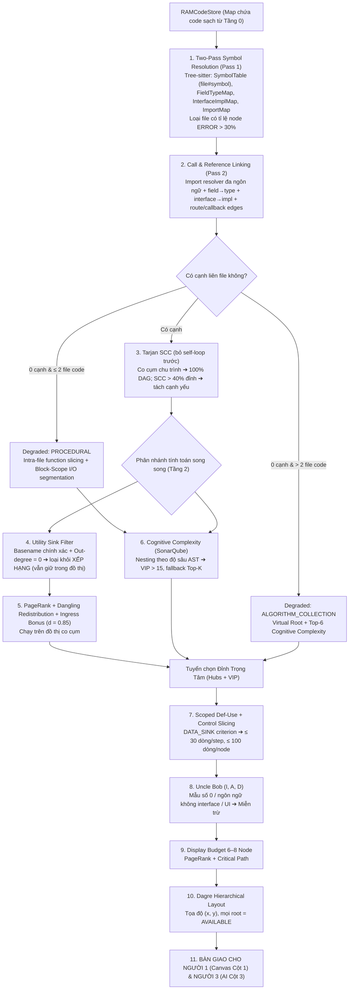

# [TẦNG 1 & 2] ĐẶC TẢ KỸ THUẬT ĐỘNG CƠ CÚ PHÁP AST, ĐỒ THỊ TARJAN & LÁT CẮT NGHIỆP VỤ (0 TOKEN)
## PHÂN HỆ: TWO-PASS SYMBOL RESOLUTION, TARJAN SCC, PAGERANK, SLICING & UNCLE BOB
### Dự án: SimpliFey V2 Pro — Codebase Cognitive Twin (Phụ trách: NGƯỜI 2)

---

| **Thuộc tính** | **Thông số kỹ thuật chuẩn hóa** |
| :--- | :--- |
| **Phân hệ tài liệu** | `01_ENGINE_THUAT_TOAN/02_AST_SLICING_GRAPH.md` |
| **Tầng kiến trúc** | **TẦNG 1 (Cú pháp & Khử chu trình) & TẦNG 2 (Bầu chọn Hubs, Lát cắt & Đo lường)** |
| **Kỹ sư chịu trách nhiệm** | **NGƯỜI 2 (STATIC ENGINE & GRAPH ARCHITECT)** |
| **Đầu vào nhận từ Tầng 0** | `RAMCodeStore`, `ManifestStore`, `SourceMapStore`, `ProjectFingerprint`, `IngestionReport` |
| **Thời gian thực thi** | **< 0.25 giây cho toàn bộ quy trình** (Trên tập 50 files, với grammar Tree-sitter đã được warm-up — xem §3.0) |
| **Chi phí AI Token** | **0 Token (Toán học giải thuật & Cấu trúc dữ liệu thuần túy trên RAM)** |
| **Đầu ra bàn giao** | `StaticEngineResult`: `HybridArchitecturalNode[]` (Có tọa độ Dagre, 4 màu, trace code), `edges`, `symbol_whitelist`, `ingestion_report` |
| **Khớp nối Phân hệ dưới** | **Cung cấp `scoped_code_snippet`, `symbol_whitelist` và `trace_steps` cho `02_AI_VA_BAYES`** |

---

## 1. TỔNG QUAN LUỒNG HOẠT ĐỘNG TẦNG 1 & TẦNG 2

Sau khi Tầng 0 hoàn tất tải mã nguồn từ link GitHub vào `RAMCodeStore`, Tầng 1 và Tầng 2 thực hiện chuỗi giải thuật liên hoàn để biến hàng nghìn dòng code thô thành **Đồ thị Lát cắt Kiến trúc Trực quan 4 Màu** trên ReactFlow:



---

## 2. BỘ NHỚ LƯU TRỮ TRÊN RAM: LƯU CÁI GÌ & LƯU NHƯ THẾ NÀO?

Toàn bộ quá trình chạy hoàn toàn trên bộ nhớ Heap của RAM, không dùng Database tạm thời, giải phóng ngay khi hoàn tất:

```text
┌────────────────────────────────────────────────────────────────────────────────────────┐
│ BỘ NHỚ HEAP TRONG RAM CHO STATIC ENGINE (TẦNG 1 & 2)                                   │
├────────────────────────────────────────────────────────────────────────────────────────┤
│ 1. SymbolTable: Map<string, SymbolDefinition>                                          │
│    ├── Khóa (Key): "filePath#Class.method" (VD: "src/order.controller.ts#OrderController│
│    │   .postCheckout") — có filePath để 2 class trùng tên ở 2 module không ghi đè nhau │
│    └── Giá trị (Value): { kind, name, filePath, lineStart, lineEnd, isExported }       │
│                                                                                        │
│ 2. NameIndex: Map<string, string[]>                                                    │
│    └── Tên ngắn ("postCheckout", "OrderController.postCheckout") ➔ danh sách khóa đầy │
│        đủ — dùng để tra cứu nhanh và dựng symbol_whitelist                             │
│                                                                                        │
│ 3. ImportMap: Map<string, Map<string, string>>                                         │
│    ├── Khóa (Key): File đang đứng (VD: "src/controllers/order.controller.ts")          │
│    └── Giá trị (Value): Map<Tên Symbol cục bộ -> khóa SymbolTable của định nghĩa gốc>  │
│                                                                                        │
│ 4. FieldTypeMap: Map<string, Map<string, string>>                                      │
│    └── File ➔ { tên field/biến instance ➔ tên kiểu } (VD: "svc" ➔ "OrderService")      │
│                                                                                        │
│ 5. InterfaceImplMap: Map<string, string[]>                                             │
│    └── Interface/abstract ➔ danh sách class hiện thực                                  │
│                                                                                        │
│ 6. CallGraph: Map<string, Set<string>> (Danh sách kề, đã sort khóa)                    │
│    ├── Khóa (Key): File gọi (Caller File)                                              │
│    └── Giá trị (Value): Tập hợp các File bị gọi (Callee Files)                         │
│                                                                                        │
│ 7. TarjanCondensationGraph: Object                                                     │
│    ├── scc_components: string[][] (Danh sách các file bị lặp chu trình A <-> B)       │
│    └── dag_edges: Array<{ source: string, target: string }> (Đồ thị sạch 100% DAG)   │
│                                                                                        │
│ 8. HubRanking: Map<string, number>                                                     │
│    ├── Khóa (Key): Đỉnh của đồ thị co cụm (file hoặc SuperNode)                         │
│    └── Giá trị (Value): Điểm số trung tâm Rank Score                                   │
└────────────────────────────────────────────────────────────────────────────────────────┘
```

**Quy tắc Deterministic:** mọi vòng lặp trên `RAMCodeStore`, `SymbolTable`, `CallGraph` đều duyệt theo **path đã sort tăng dần**. Cùng repo + cùng ref ⇒ cùng đồ thị, cùng tọa độ, cùng thứ tự node (quan trọng cho cache và cho demo lặp lại trước giám khảo).

---

## 3. CHI TIẾT CÁC THUẬT TOÁN CỐT LÕI (RÕ RÀNG TỪNG BƯỚC)

Mỗi thuật toán dưới đây được chuẩn hóa theo cấu trúc 4 trụ cột: **Tại sao cần & Vai trò $\to$ Cơ chế kỹ thuật $\to$ Làm thế nào để thực hiện được (Từng thao tác chi tiết) $\to$ Minh họa / Bảng trace**.

---

### 3.0. KHỞI TẠO PARSER & NGÂN SÁCH THỜI GIAN

* **Language Registry & phân tầng hỗ trợ:** Engine không gắn cứng vào một danh sách ngôn ngữ. Mọi ngôn ngữ là một *adapter* trong `LanguageRegistry` (xem `01_INGESTION_STREAM.md` Bước 4). Hai tầng chính:
  * **`RESOLVED`** — có `importResolver` riêng (khởi điểm: TS/JS, Python, Java, Go, Dart). Cạnh nối bằng bảng phân giải chính xác ở Thao tác 2 ⇒ lát cắt chính xác cao.
  * **`STRUCTURAL`** — có grammar Tree-sitter (hơn 100 ngôn ngữ có sẵn grammar công khai) nhưng chưa có resolver riêng. Symbol vẫn lấy **từ AST thật** (chính xác như `RESOLVED`); cạnh nối bằng **Universal Resolver** (Thao tác 2b) và gắn `confidence: "INFERRED"` ⇒ vẫn bóc tách được lát cắt nhưng **không đảm bảo 100% chính xác**.
  * Ngôn ngữ **không có grammar** ⇒ tier `UNSUPPORTED`: không dựng DAG (xem `ERR_UNSUPPORTED_LANGUAGE`).
  Thuật toán phía sau (Tarjan SCC, PageRank, Scoped Slicing, Uncle Bob, Dagre) chỉ làm việc trên đỉnh/cạnh trừu tượng nên **giữ nguyên** cho mọi tầng; thứ duy nhất thay đổi theo tầng là *độ tin cậy của cạnh*.
* **Warm-up grammar:** `web-tree-sitter` và các grammar WASM của tier `RESOLVED` (TypeScript, TSX, JavaScript, Python, Java, Go, Dart) được nạp **một lần khi server khởi động**, không nạp theo request. Con số "< 0.25 giây" chỉ đúng với grammar đã warm; lần nạp đầu không tính vào cold-start DAG < 1.5s.
* **Nạp theo nhu cầu (grammar tier `STRUCTURAL`):** các grammar còn lại (Rust, C#, PHP, Kotlin, C/C++, Ruby, Swift...) được **đóng gói sẵn trong bundle** nhưng chỉ nạp vào RAM khi `RAMCodeStore` thực sự có đuôi file tương ứng. Không tải grammar từ mạng lúc chạy (giữ Zero-Trust và SLA). Lần nạp đầu của một grammar tier `STRUCTURAL` cộng thêm vào cold-start và phải được ghi trong `ENGINE_BUDGET_MS`.
* **Ngân sách cứng của Engine:** `ENGINE_BUDGET_MS = 600`. Sau Pass 1, nếu thời gian đã vượt 60% ngân sách ⇒ bỏ các file có `FilePriorityScore` thấp nhất (giữ tối thiểu 20 file) rồi chạy tiếp; ghi warning vào `ingestion_report.warnings`.
* **File lỗi cú pháp:** Tree-sitter **chịu lỗi** (không crash) — gặp cú pháp hỏng hoặc cú pháp mới mà grammar chưa hỗ trợ, nó sinh node `ERROR`/`MISSING` và vẫn parse phần còn lại. Đo $\rho = \frac{\text{byte nằm trong node ERROR}}{\text{tổng byte file}}$:
  * $\rho > 0.30$ ⇒ loại file khỏi SymbolTable, `skipped.parse_error++`, warning *"File X có cú pháp không phân tích được"*.
  * $\rho \le 0.30$ ⇒ vẫn dùng các khai báo nằm ngoài vùng `ERROR`.

---

### THUẬT TOÁN 1: TWO-PASS GLOBAL SYMBOL RESOLUTION (15ms - 0 Token)

#### 1. Tại sao cần bước này & Vai trò của nó?
* **Vấn đề thực tế:** Trong mọi ngôn ngữ hiện đại (TypeScript, Java, Go, Python, Rust, C#, PHP, Kotlin...), hàm A gọi hàm B xuyên tệp. Để biết hàm `orderService.processCheckout()` nằm ở file nào, các IDE thông thường phải cài đặt Language Server Protocol (LSP) hoặc Compiler nặng hàng Gigabytes (như `tsc`, `javac`), khởi động mất 30 giây!
* **Hậu quả nếu không có:** Không thể cài compiler nặng hàng GB trên máy chủ thi 24h. Nếu không có thuật toán giải quyết liên kết hàm, đồ thị sẽ là các file rời rạc không có cạnh nối.
* **Hậu quả nếu làm bằng regex chuỗi:** Khớp nhầm trong comment/string, khớp substring (`Order` khớp `orderItemRepo`) sinh cạnh giả, và bỏ sót cạnh khi biến được đặt tên khác kiểu (`private readonly svc: OrderService`). Vì vậy **toàn bộ Pass 1 và Pass 2 chạy trên cây AST của Tree-sitter**, không chạy regex trên văn bản thô.
* **Vai trò:** "Bản đồ nối dây liên kết", giúp hệ thống xác định quan hệ gọi hàm xuyên tệp chỉ trong **15ms** chạy thuần trên RAM mà không cần bất kỳ compiler nào.

#### 2. Cơ chế kỹ thuật:
* Duyệt cây cú pháp trừu tượng 2 chặng (Two-Pass AST Traversal) với Tree-sitter Query (`.scm`) lấy từ adapter của từng ngôn ngữ trong `LanguageRegistry` (ngôn ngữ chưa có query riêng dùng bộ truy vấn `tags.scm` chuẩn của grammar), kết hợp Bảng Băm Ký hiệu Toàn cục (Global Symbol Table) trên RAM.
* Đây là **phân giải gần đúng theo tên và kiểu khai báo** (không phải type-checker đầy đủ): đủ chính xác cho đồ thị kiến trúc, và mọi trường hợp mơ hồ đều được đánh dấu thay vì đoán bừa.

#### 3. Làm thế nào để cơ chế đó thực hiện được? (Từng thao tác cụ thể):
* **Thao tác 1 (Pass 1 - Thu hoạch Khai báo):**
  Duyệt các file trong `codeStore` (theo path đã sort). Với mỗi file, bóc tách:
  * Class / Interface / abstract class / Python `ABC`, `Protocol` / Go `interface` ⇒ SymbolTable (`kind` tương ứng).
  * Method / function declaration ⇒ khóa `filePath#Class.method` hoặc `filePath#function`.
  * **Hàm khai báo dạng biến:** `export const handler = async (req, res) => {...}`, `const fn = function() {...}` ⇒ ghi như function (node `variable_declarator` có giá trị `arrow_function`/`function_expression`).
  * **`export default`**: ghi thêm alias `filePath#default` trỏ tới symbol thật (hoặc tới hàm/class ẩn danh với tên `default`).
  * **Code top-level** (script Python, file Go `main` không có hàm phụ): gom thành hàm ảo `filePath#<module>` để Cognitive Complexity và Slicing không bỏ sót.
  * **Field & kiểu:** tham số constructor có modifier (`private readonly svc: OrderService`), khai báo field (`private svc: OrderService;`, Java `@Autowired private OrderService svc;`), Python `self.svc = OrderService(...)` hoặc type hint `svc: OrderService`, FastAPI `svc: OrderService = Depends(...)` ⇒ `FieldTypeMap[file][svc] = "OrderService"`.
  * `implements IOrderService` / `extends BaseRepo` / class Python kế thừa `ABC` ⇒ `InterfaceImplMap`.
  * Câu lệnh import ⇒ `ImportMap[currentFile]` (sau khi phân giải ở Thao tác 2).
  * **Ký hiệu cho Whitelist:** thu thêm tên tham số hàm, tên field/property của class/DTO/interface, tên biến cục bộ — lưu riêng trong `LocalSymbolIndex[filePath#function]` (không vào SymbolTable để không làm nhiễu linking).
* **Thao tác 2 (Phân giải Import đa ngôn ngữ — `ImportResolver`):**

  | Ngôn ngữ | Dạng import | Quy tắc phân giải |
  | :--- | :--- | :--- |
  | TS/JS | `./order.service`, `../x` | Ghép với thư mục file hiện tại; thử lần lượt: nguyên văn ➔ `.ts` ➔ `.tsx` ➔ `.js` ➔ `.jsx` ➔ `.mjs` ➔ `/index.ts` ➔ `/index.tsx` ➔ `/index.js` |
  | TS/JS (ESM) | `./order.service.js` trong file `.ts` | Nếu `.js` không tồn tại, thử thay đuôi thành `.ts`/`.tsx` |
  | TS/JS | `@/services/x`, `~/x` | Đọc `compilerOptions.baseUrl` + `paths` từ `tsconfig.json`/`jsconfig.json` trong `ManifestStore` (ưu tiên file gần nhất phía trên file hiện tại). Không có tsconfig ⇒ mặc định `@/` ➔ `src/` |
  | TS/JS | Barrel `export * from './x'`, `export { A } from './a'` | Đi theo chuỗi re-export (tối đa 5 bước, có tập `visited` chống vòng) tới **định nghĩa gốc**; cạnh nối thẳng tới file gốc, **không** nối vào `index.ts` (tránh barrel thành hub giả và tránh chu trình giả qua barrel) |
  | Python | `from services.order import Order` | Thay `.` bằng `/` ➔ thử `services/order.py`, `services/order/__init__.py`; nếu không có, thử lại với tiền tố `src/` và tiền tố `root_dir_offset` (src-layout) |
  | Python | `from .order import X`, `from ..x import Y` | Mỗi dấu `.` đầu = đi lên 1 cấp từ **package của file hiện tại** |
  | Java | `import com.shop.service.OrderService;` | **Không** suy ra path trực tiếp: lập bảng `fqcn ➔ file` từ câu lệnh `package com.shop.service;` + tên class ở Pass 1; tra `com.shop.service.OrderService`. Class cùng package dùng không cần import ⇒ tra trong cùng `package` |
  | Go | `import "github.com/me/shop/internal/order"` | Bỏ tiền tố `go_module_path` (từ `go.mod`, Tầng 0) ➔ thư mục `internal/order/`; mọi file `.go` trong thư mục đó là cùng package |
  | Dart | `import 'package:shop/services/order.dart'` | `package:<tên app trong pubspec>/` ➔ `lib/` |

  Import **không phân giải được** về file trong `codeStore` ⇒ coi là thư viện ngoài (`express`, `typeorm`), không sinh cạnh nội bộ (nhưng được ghi nhận cho DATA_SINK ở Thuật toán 5).

  Bảng trên là các adapter **tier `RESOLVED`**. Muốn nâng một ngôn ngữ từ `STRUCTURAL` lên `RESOLVED`, chỉ cần thêm một dòng vào bảng này (kèm hàm `importResolver` của adapter); không cần sửa Pass 2 hay các thuật toán phía sau.
* **Thao tác 2b (Universal Resolver — cho ngôn ngữ tier `STRUCTURAL`, không có resolver riêng):**
  Áp dụng cho **mọi** ngôn ngữ có grammar Tree-sitter mà bảng Thao tác 2 chưa có dòng. Không dùng regex trên văn bản thô, chạy hoàn toàn trên AST, 0 token:
  1. **Bắt import không cần biết ngôn ngữ:** một truy vấn chung bắt các node có kiểu chứa `import`, `include`, `use`, `require`, `using`, `from` kèm một literal chuỗi hoặc một chuỗi định danh có dấu phân cách (`.`, `::`, `/`, `\`).
  2. **Nối import với file trong repo bằng khớp hậu tố đường dẫn:** chuẩn hóa chuỗi import (đổi `.`/`::`/`\` thành `/`, bỏ tiền tố tương đối, bỏ đuôi file) rồi so khớp **hậu tố dài nhất** với chỉ mục đường dẫn của `codeStore` (đã có sau Tầng 0). Khớp đúng 1 file ⇒ chọn; khớp nhiều file ⇒ ưu tiên file cùng thư mục / gần nhất, và gắn `ambiguous: true`; không khớp ⇒ thư viện ngoài.
  3. **Điều kiện sinh cạnh (hai điều kiện đồng thời — đây là chỗ khác biệt với regex toàn cục):** cạnh `A ➔ B` chỉ được tạo khi (a) A có import trỏ tới B **và** (b) A thực sự tham chiếu (qua node `call`/`identifier` trên AST) ít nhất một symbol mà B định nghĩa. Thiếu một trong hai ⇒ không nối. Nhờ đó cạnh sai (gọi hàm thư viện trùng tên, khớp substring) giảm mạnh so với quét chuỗi toàn cục.
  4. **Gắn nhãn tin cậy:** mọi cạnh sinh bởi Thao tác 2b mang `confidence: "INFERRED"` (UI vẽ nét đứt, tooltip *"Cạnh suy luận — chưa kiểm chứng bằng bộ phân giải riêng"*). Cạnh sinh bởi bảng Thao tác 2 mang `confidence: "RESOLVED"`.
  5. **Giới hạn đã biết (không đảm bảo 100%):** macro (C/C++, Rust `macro_rules!`), import động (`require(var)`, `importlib`, reflection), DI qua file cấu hình/annotation chưa có adapter, namespace/package khai báo tách khỏi đường dẫn thư mục (C#, Kotlin). Những trường hợp này có thể **sót cạnh** hoặc **thiếu một lớp** trong lát cắt; hệ thống không bịa cạnh để bù.
* **Thao tác 3 (Pass 2 - Nối Cạnh Cuộc Gọi trên AST):**
  Duyệt node gọi hàm — tên node do truy vấn `.scm` của adapter khai báo (`call_expression` / `method_invocation` / `call` / `invocation_expression` / `function_call_expression`...; ngôn ngữ tier `STRUCTURAL` dùng capture `@reference.call` của `tags.scm`):
  1. **Gọi hàm import trực tiếp** — `processCheckout(dto)`: tra tên trong `ImportMap[file]` ⇒ khóa định nghĩa ⇒ file đích.
  2. **Gọi qua field/biến instance** — `this.svc.processCheckout()`, `self.svc.process()`, `svc.process()`: lấy tên đối tượng `svc`, tra `FieldTypeMap[file][svc]` ⇒ kiểu `OrderService` ⇒ `ImportMap` ⇒ file đích. Biến cục bộ `const svc = new OrderService()` cũng được ghi vào `FieldTypeMap` phạm vi hàm.
  3. **Gọi static / qua package** — `OrderService.create()`, Go `order.Process()`: tên đối tượng chính là tên class/package đã import.
  4. **Xác nhận method tồn tại** trong SymbolTable của file đích (hoặc của class cha theo `extends`). Không tồn tại ⇒ không nối.
  5. **So khớp tên chính xác** (phân biệt hoa thường theo ngôn ngữ) — **không** dùng `includes()`/substring.
  6. Bỏ cạnh `A ➔ A` (gọi nội bộ cùng file) khỏi CallGraph liên file; giữ lại trong đồ thị nội bộ cho chế độ PROCEDURAL.
* **Thao tác 4 (Interface ➔ Implementation & Dependency Injection):**
  Controller thường phụ thuộc vào `IOrderService` chứ không phải `OrderService`; NestJS/Spring/FastAPI tiêm phụ thuộc theo kiểu. Khi file đích là interface/abstract:
  * Đúng **1** implementor trong `InterfaceImplMap` ⇒ chuyển cạnh sang file hiện thực.
  * **Nhiều** implementor ⇒ nối tới tất cả, gắn cờ `ambiguous: true` trên cạnh (UI vẽ nét đứt).
  * **0** implementor ⇒ giữ cạnh tới file interface.
  * NestJS `{ provide: TOKEN, useClass: X }` trong `@Module({ providers })` và `@Inject(TOKEN)` ⇒ ghi `TOKEN ➔ X` vào `InterfaceImplMap`.
* **Thao tác 5 (Cạnh tham chiếu Route / Middleware / Callback):**
  Trong web framework, hàm xử lý được **truyền vào** chứ không được **gọi**: `router.post('/checkout', authMiddleware, validate(dto), orderController.checkout)`. Nếu chỉ đếm `call_expression`, tầng **Middleware** biến mất — vi phạm bất biến lát cắt *Controller ➔ Middleware ➔ Service ➔ Repository*.
  * Với call có tên phương thức thuộc `ROUTE_REGISTRARS = get|post|put|patch|delete|all|use|route|handle|HandleFunc|GET|POST` trên đối tượng `app`/`router`/`r`/`e`/`mux`: mỗi đối số là identifier/member expression (hoặc call trả về middleware như `validate(dto)`) ⇒ phân giải như Thao tác 3 và sinh cạnh `route-file ➔ handler-file`.
  * **Thứ tự đối số = thứ tự Middleware**: lưu `middleware_chain: string[]` cho route, Thuật toán 5 dùng để ghép step `MIDDLEWARE` vào lát cắt.
  * Decorator route (`@Get()`, `@app.post()`, `@GetMapping`) ⇒ hàm được trang trí là handler; decorator `@UseGuards(AuthGuard)`, `@UseInterceptors(...)` ⇒ middleware của handler đó.
* **Thao tác 6 (Phân loại kết quả liên kết):**
  Sau Pass 2, đếm số cạnh liên file $|E|$ và số file code $n$:
  * $|E| > 0$ ⇒ sang Thuật toán 2 (Tarjan).
  * $|E| = 0$ và $n \le 2$ ⇒ **Degraded PROCEDURAL** (§3.8.1).
  * $|E| = 0$ và $n > 2$ ⇒ **Degraded ALGORITHM_COLLECTION** (§3.8.2). Không dùng Intra-file Slicing cho từng file ở trường hợp này (50 file × N hàm sẽ làm bùng nổ số node).

#### 4. Minh họa Code súc tích có chú thích:
```typescript
/**
 * Pass 2: nối cạnh từ các call_expression trên cây AST (KHÔNG regex trên văn bản)
 */
function linkCallEdges(file: string, tree: Tree, ctx: LinkContext) {
  for (const call of ctx.query(tree, 'call_expression')) {
    const target = resolveCallee(call, file, ctx); // field->type, import trực tiếp, static, package
    if (!target || target.file === file) continue;  // không phân giải được hoặc gọi nội bộ

    // Interface -> Implementation (DI): 1 impl thì chuyển hẳn, nhiều impl thì nối tất cả + ambiguous
    const impls = ctx.interfaceImplMap.get(target.symbolKey) ?? [];
    const targets = impls.length > 0 ? impls.map(k => ctx.fileOf(k)) : [target.file];
    for (const t of targets) ctx.addEdge(file, t, { ambiguous: impls.length > 1 });
  }

  // Route/Middleware: handler được TRUYỀN vào chứ không được GỌI
  for (const reg of ctx.query(tree, 'route_registration')) {
    const chain = reg.args.map(arg => resolveReference(arg, file, ctx)).filter(Boolean);
    chain.forEach(h => ctx.addEdge(file, h.file, { kind: 'route' }));
    ctx.middlewareChains.set(reg.routeKey, chain.map(h => h.symbolKey));
  }
}
```

---

### THUẬT TOÁN 2: TARJAN SCC — KHỬ CHU TRÌNH ĐỒ THỊ (2ms)

#### 1. Tại sao cần bước này & Vai trò của nó?
* **Vấn đề thực tế (Bài toán Con gà - Quả trứng):** Sinh viên thường viết code có chu trình phụ thuộc chéo: File $A$ gọi $B$, nhưng $B$ lại gọi ngược lại $A$ ($A \rightleftarrows B$).
* **Hậu quả nếu không làm:** Nếu đưa đồ thị có chu trình vào ReactFlow để làm lộ trình học tập, thuật toán sắp xếp tô-pô (Topological Sort) sẽ bị sập vì deadlock (vòng lặp vô tận, không biết học cái nào trước!).
* **Vai trò:** "Bảo hiểm kiến trúc 100% DAG", triệt tiêu toàn bộ chu trình phụ thuộc bằng cách co cụm các file xoắn ốc thành 1 SuperNode duy nhất, đảm bảo đồ thị không bao giờ bị lặp.

#### 2. Cơ chế kỹ thuật:
* Thuật toán Thành phần Liên thông Mạnh (Strongly Connected Components - SCC) của Robert Tarjan (1972) với độ phức tạp $\mathcal{O}(V + E)$ kết hợp kỹ thuật Co Cụm Đồ Thị (Condensation Graph).

#### 3. Làm thế nào để cơ chế đó thực hiện được? (Từng thao tác cụ thể):
* **Thao tác 0 (Tiền xử lý):** Xóa mọi self-loop $u \to u$ (đã lọc ở Pass 2 Thao tác 3 bước 6, kiểm tra lại cho chắc). Với $V \le 50$, DFS đệ quy an toàn về độ sâu stack.
* **Thao tác 1 (Khởi tạo biến trạng thái DFS):**
  Tạo ngăn xếp `stack = []`, mảng `dfn` (thời điểm khám phá đỉnh), `lowlink` (chỉ số khám phá nhỏ nhất mà đỉnh có thể vươn tới), và tập hợp `inStack`.
* **Thao tác 2 (Duyệt DFS & Cập nhật Lowlink):**
  Khi ghé thăm đỉnh $u$, gán `dfn[u] = lowlink[u] = ++index`. Đẩy $u$ vào `stack` và đánh dấu `inStack.add(u)`.
  * Duyệt các đỉnh kề $v$ của $u$ (theo thứ tự path đã sort):
    * Nếu $v$ chưa duyệt $\implies$ Gọi đệ quy `DFS(v)`, sau đó cập nhật $lowlink[u] = \min(lowlink[u], lowlink[v])$.
    * Nếu $v$ đã được duyệt và đang nằm trong `stack` (cạnh ngược) $\implies$ Cập nhật $lowlink[u] = \min(lowlink[u], dfn[v])$.
* **Thao tác 3 (Phát hiện Gốc Chu Trình & Co Cụm SuperNode):**
  Khi quay lui về $u$, nếu $lowlink[u] == dfn[u]$, toàn bộ các đỉnh từ đỉnh stack tới $u$ tạo thành một SCC:
  * Pop lần lượt các đỉnh ra khỏi stack cho tới khi gặp $u$.
  * Nếu cụm có từ 2 file trở lên $\implies$ Gộp chung thành 1 **SuperNode duy nhất** (VD: `SuperNode_Service_Repo`).
* **Thao tác 4 (Tái cấu trúc cạnh đồ thị Condensation Graph):**
  Mọi cạnh nội bộ giữa các đỉnh trong cùng 1 cụm bị triệt tiêu; các cạnh từ bên ngoài trỏ vào bất kỳ đỉnh nào trong cụm được chuyển thành trỏ vào SuperNode. Đồ thị sau co cụm đạt chuẩn **100% Directed Acyclic Graph (DAG)**. Mọi thuật toán Tầng 2 phía sau (PageRank, Critical Path, Dagre) chạy trên **đồ thị co cụm này**.
* **Thao tác 5 (Chọn file hiển thị mặc định của SuperNode):**
  Trong `HybridArchitecturalNode.files`, phần tử `files[0]` là file Monaco mở khi sinh viên click SuperNode. Chọn theo thứ tự: (1) in-degree **từ ngoài cụm** cao nhất; (2) hòa ⇒ file chứa ingress (route/controller); (3) hòa ⇒ path nhỏ nhất theo thứ tự từ điển.
* **Thao tác 6 (SCC khổng lồ):**
  Nếu một SCC chứa > 40% số đỉnh (thường do barrel file hoặc `utils` gọi ngược nghiệp vụ), đồ thị co lại còn 1–2 node — mất bản đồ kiến trúc. Xử lý:
  1. Bỏ các cạnh **chỉ phục vụ kiểu** (`import type`, import chỉ dùng trong chú thích kiểu) rồi chạy lại Tarjan trên cụm đó.
  2. Vẫn > 40% ⇒ bỏ dần cạnh có **số lời gọi thực tế ít nhất** trong cụm (cạnh yếu), tối đa 3 cạnh, mỗi lần chạy lại.
  3. Vẫn không tách được ⇒ giữ SuperNode và áp **Degraded PROCEDURAL** bên trong nó (phân đoạn theo hàm/khối I/O như repo 1 file), ghi warning *"Phát hiện cụm phụ thuộc vòng lớn (N file) — đây cũng là một điểm cần cải thiện kiến trúc"* và đưa vào ứng viên `hidden_challenge` Mức 2 (Circular Dependency).

#### 4. Bảng Trace Khi Có Chu Trình Thật ($2 \rightleftarrows 3$):
```text
Đồ thị mẫu: Controller (1) ---> Service (2) <===> Repo (3)
```

| Bước | Đỉnh $u$ | Hành động chi tiết | `dfn` | `lowlink` | Ngăn xếp (Stack) | Kết luận |
| :---: | :---: | :--- | :---: | :---: | :--- | :--- |
| **1** | $1$ | Thăm Controller. Gán time = 1. | $dfn[1]=1$ | $lowlink[1]=1$ | `[1]` | Đi sang $2$ |
| **2** | $2$ | Thăm Service. Gán time = 2. | $dfn[2]=2$ | $lowlink[2]=2$ | `[1, 2]` | Đi sang $3$ |
| **3** | $3$ | Thăm Repo. Gán time = 3. | $dfn[3]=3$ | $lowlink[3]=3$ | `[1, 2, 3]` | Đỉnh $3$ có cạnh ngược trỏ về $2$ |
| **4** | $3 \to 2$| Đỉnh $2$ đã nằm trong Stack $\implies$ Cạnh ngược! | $dfn[3]=3$ | $lowlink[3] = \min(3, dfn[2]) = 2$ | `[1, 2, 3]` | Quay lui về $2$ |
| **5** | $2$ | Cập nhật từ con: $lowlink[2] = \min(2, lowlink[3]) = 2$. | $dfn[2]=2$ | $lowlink[2]=2$ | `[1, 2, 3]` | Hết nhánh con của $2$! |
| **6** | $2$ | $lowlink[2] == dfn[2] == 2$ $\implies$ Pop: `3`, `2`! | — | — | `[1]` | **PHÁT HIỆN SCC: `{Service, Repo}`** |
| **7** | $1$ | $lowlink[1] == dfn[1] == 1$ $\implies$ Pop: `1`! | — | — | `[]` | **SCC Độc lập: `{Controller}`** |

*Áp dụng Thao tác 5:* SuperNode `{Service, Repo}` có cạnh từ ngoài vào `Service` (từ Controller), `Repo` không có ⇒ `files[0] = "order.service.ts"`.

---

### THUẬT TOÁN 3: PAGERANK KÈM UTILITY SINK FILTERING & TRỌNG SỐ INGRESS (5ms)

#### 1. Tại sao cần bước này & Vai trò của nó?
* **Nghịch lý PageRank trên mã nguồn:** Nếu chạy PageRank thuần túy ($d=0.85$), các file tiện ích ở tầng đáy (`logger.ts`, `db.ts`) có nhiều file gọi tới (In-degree rất cao) sẽ tích lũy điểm cao nhất, trong khi Controller tiếp nhận API request có In-degree = 0 sẽ bị điểm thấp nhất. Hậu quả là đồ thị sẽ bầu chọn file ghi log làm bài học số 1!
* **Vai trò:** "Ban giám khảo bầu chọn Hubs", lọc bỏ các file phụ trợ hạ tầng khỏi bảng xếp hạng và tôn vinh đúng các file tiếp nhận luồng chính làm điểm bắt đầu học tập.

#### 2. Cơ chế kỹ thuật:
* Lọc đỉnh lá tiện ích (Utility Sink Filtering) kết hợp Trọng số Định tuyến Cửa vào (Ingress Routing Bonus) trên thuật toán lặp Power Iteration có **phân phối lại khối dangling**.

#### 3. Làm thế nào để cơ chế đó thực hiện được? (Từng thao tác cụ thể):
* **Thao tác 1 (Lọc đỉnh lá tiện ích — chỉ khỏi XẾP HẠNG):**
  Đỉnh bị loại khỏi tập tính PageRank khi **đồng thời**: $\text{Out-degree} = 0$ **và** basename (bỏ đuôi, bỏ hậu tố `.util/.helper`) khớp **chính xác** danh sách `UTILITY_BASENAMES = logger|log|utils|util|helpers|helper|config|constants|db|database|prisma|client|env`.
  * So khớp **basename chính xác**, không substring: `db.ts` bị lọc, nhưng `dbOrderRepository.ts`, `order.repository.ts` **không** bị lọc.
  * Tầng Repository thường có out-degree nội bộ = 0 (chỉ gọi ORM bên ngoài) — chính vì vậy điều kiện tên là bắt buộc, không lọc chỉ dựa trên out-degree.
  * Đỉnh bị lọc **vẫn nằm trong đồ thị, trong cạnh, và trong lát cắt** (Thuật toán 5 vẫn đi xuống `db.ts` nếu đó là nơi thực thi truy vấn); chỉ là không được bầu làm Hub.
* **Thao tác 2 (Power Iteration trên đồ thị nghiệp vụ):**
  Với $N$ đỉnh còn lại (trên đồ thị co cụm), khởi tạo $PR_0(u) = 1/N$. Chạy tối đa 20 vòng (dừng sớm khi $\sum_u |PR_{k+1}(u) - PR_k(u)| < 10^{-6}$):
  $$PR_{k+1}(u) = \frac{1-d}{N} + d \left( \sum_{v \in \mathcal{B}_u} \frac{PR_k(v)}{L(v)} + \frac{1}{N}\sum_{w : L(w) = 0} PR_k(w) \right) \quad (d = 0.85)$$
  Số hạng thứ hai phân phối đều điểm của các đỉnh **dangling** (out-degree 0 trong tập đang xét) để tổng điểm luôn bằng 1 — thiếu số hạng này, điểm sẽ "rò" mất qua tầng Repository và bảng xếp hạng bị méo.
* **Thao tác 3 (Trường hợp suy biến):**
  * $N = 0$ (mọi file đều là tiện ích) ⇒ bỏ Thao tác 1, chạy lại trên toàn bộ đỉnh.
  * $N = 1$ ⇒ không chạy PageRank, đỉnh đó là Hub duy nhất; các Hub còn lại lấy từ Cognitive Complexity.
* **Thao tác 4 (Cộng Trọng số Ingress Routing Bonus — đa ngôn ngữ & theo archetype):**
  $$\text{Rank Score}(u) = PR(u) + \mathbf{1}_{\{u \in \text{Ingress}\}} \times 0.50$$
  Đỉnh là Ingress khi khớp `INGRESS_PATTERNS` (trên AST, không phải chuỗi):

  | Archetype / Ngôn ngữ | Dấu hiệu Ingress |
  | :--- | :--- |
  | Express / Koa / Fastify | `app.get/post/...(...)`, `router.<verb>(...)`, `app.use('/path', router)` |
  | NestJS | `@Controller()` trên class; `@Get/@Post/...` trên method |
  | Flask / FastAPI | `@app.route`, `@bp.route`, `@app.get/post`, `@router.get/post` (`APIRouter`) |
  | Django | file `views.py` được tham chiếu từ `urls.py` (`path(..., views.x)`) |
  | Spring | `@RestController`, `@Controller`, `@RequestMapping`, `@GetMapping/@PostMapping` |
  | Go (net/http, gin, echo) | `http.HandleFunc`, `mux.Handle`, `r.GET/POST`, `e.GET/POST` |
  | `WEB_FRONTEND` | Page/route component: file trong `pages/`, `app/**/page.tsx`, component được tham chiếu trong `<Route element=...>` |
  | `MOBILE_APP` | Screen/Widget đăng ký trong navigator/router (`Stack.Screen`, `MaterialPageRoute`, `GoRoute`) |
  | `CLI_TOOL` | Command handler (`program.command(...).action(fn)`, `@app.command()` của Typer, `@click.command`) |
  | Ngôn ngữ tier `STRUCTURAL` (Rust/Axum/Actix, C#/ASP.NET, PHP/Laravel, Kotlin/Ktor, Ruby/Rails...) | Chưa có `ingressPatterns` riêng ⇒ dùng quy tắc chung: file/thư mục tên `controller|route|router|handler|api|main|app|server` (cùng bảng tên vai trò ở Ingestion Thao tác 5) và đỉnh có `in-degree = 0` trong CallGraph. Adapter có thể khai báo thêm `ingressPatterns` để nâng độ chính xác |

  Ingress ánh xạ sang `ArchitecturalLayer = "ENTRY_POINT"` trong contract.
* **Thao tác 5 (Bầu chọn Top Hubs):**
  Sắp xếp theo Rank Score giảm dần (hòa ⇒ path tăng dần), chọn Top 4-5 đỉnh làm các Hub của đồ thị.

#### 4. Kết quả xếp hạng trên Benchmark:
* `order.controller.ts`: $PR = 0.05 + 0.50 = \mathbf{0.550} \implies$ **HUB SỐ 1 (Đầu não tiếp nhận Request)**.
* `order.service.ts`: $PR = \mathbf{0.333} \implies$ **HUB SỐ 2 (Xử lý nghiệp vụ)**.
* `logger.ts`: Bị loại khỏi xếp hạng từ Thao tác 1 $\implies$ **Không bao giờ bị nhầm làm Hub!** (vẫn hiển thị là đích của cạnh nếu nằm trong lát cắt).

---

### THUẬT TOÁN 4: COGNITIVE COMPLEXITY (SONARQUBE 2016) & VÉ VIP THUẬT TOÁN

#### 1. Tại sao cần bước này & Vai trò của nó?
* **Vấn đề thực tế:** Tránh việc bỏ sót các hàm giải thuật tinh hoa (như `dijkstra.ts`, `ai_matcher.py`). Vì các hàm này thường là hàm nội bộ ít người gọi, điểm PageRank sẽ rất thấp. Nếu chỉ dựa vào PageRank thì các thuật toán lõi này sẽ bị biến mất khỏi đồ thị học tập!
* **Vai trò:** "Máy quét xoắn não vi mô", phát hiện các thuật toán phức tạp và cấp **Vé VIP** đưa thẳng lên vị trí trung tâm đồ thị để sinh viên được thử thách sát hạch logic.

#### 2. Cơ chế kỹ thuật:
* Thang đo độ phức tạp nhận thức Cognitive Complexity (SonarQube 2016) dựa trên nguyên lý Phạt Lồng Cấp (Nesting Penalty) khi duyệt cây AST.
* **Cấp lồng được tính theo độ sâu node AST**, không phải bằng cách đếm dấu `{ }` — Python dùng thụt lề, không có ngoặc nhọn; đếm ngoặc còn bị nhiễu bởi object literal và chuỗi.

#### 3. Làm thế nào để cơ chế đó thực hiện được? (Từng thao tác cụ thể):
* **Thao tác 1 (Khởi tạo):** Với mỗi hàm (gồm hàm ảo `<module>` và hàm khai báo dạng biến), đặt `nestingLevel = 0`, `score = 0`.
* **Thao tác 2 (Cộng điểm cấu trúc — tăng tuyến tính):**
  * `if`, `else if` / `elif`, `switch` / `match`, `for`, `for-in/of`, `while`, `do-while`, `catch` / `except`, toán tử ba ngôi `?:`: cộng `+1` (điểm cơ bản) `+ nestingLevel` (điểm phạt lồng cấp).
  * `else` / `else` của Python: cộng `+1` (không phạt lồng cấp).
  * Mỗi **chuỗi** toán tử logic cùng loại liên tiếp (`a && b && c` tính 1; `a && b || c` tính 2): cộng `+1`.
  * `break`/`continue` có nhãn, `goto`: `+1`.
  * **Đệ quy** (hàm gọi chính nó): `+1`.
* **Thao tác 3 (Tăng giảm Nesting Level theo AST):**
  Khi bước vào **phần thân** của node `if_statement`, `for_statement`, `while_statement`, `switch_statement`, `catch_clause`, `conditional_expression`, lambda/hàm lồng nhau $\implies$ `nestingLevel++`; ra khỏi node $\implies$ `nestingLevel--`. Python/Go/Java/TS dùng cùng quy tắc vì đều dựa trên loại node, không dựa trên ký tự.
* **Thao tác 4 (Cấp vé VIP):**
  Nếu tổng điểm hàm $> 15$ $\implies$ Đánh dấu `is_vip_algorithm = true`, tự động cấp **Vé VIP** đưa thẳng lên đồ thị ReactFlow thành Node nổi bật, không bị PageRank bỏ sót.
* **Thao tác 5 (Fallback khi không ai vượt ngưỡng):**
  Ở chế độ `ALGORITHM_COLLECTION` hoặc khi đồ thị kiến trúc có ít hơn 3 Hub, nếu **không** hàm nào $> 15$ ⇒ lấy **Top-K tương đối** (K = 6, chỉ lấy hàm có điểm $\ge 5$) làm ứng viên VIP. Nếu cả repo không có hàm nào $\ge 5$ ⇒ lấy Top-3 bất kể điểm và gắn warning *"Repository có độ phức tạp thấp"*.

#### 4. Bảng chấm điểm mẫu theo chuẩn SonarQube:
| Dòng code | Cú pháp AST | Cấp độ lồng (Nesting) | Điểm cơ bản | Điểm phạt | Tổng điểm dòng |
| :---: | :--- | :---: | :---: | :---: | :---: |
| Dòng 2 | `if (!graph \|\| !start)` | Cấp 0 | $+1$ (`if`) $+1$ (chuỗi `\|\|`) | $+0$ | **$+2$** |
| Dòng 5 | `for (const node of graph.nodes)` | Cấp 0 | $+1$ | $+0$ | **$+1$** |
| Dòng 6 | `if (node.id === start)` | Cấp 1 (trong `for`) | $+1$ | $+1$ | **$+2$** |
| Dòng 7 | `for (const neighbor of node.edges)` | Cấp 2 (trong `if` trong `for`) | $+1$ | $+2$ | **$+3$** |
| Dòng 8 | `if (neighbor.cost > 0)` | Cấp 3 (lồng 3 cấp) | $+1$ | $+3$ | **$+4$** |
| **TỔNG** | **HÀM TÌM ĐƯỜNG** | — | — | — | **$12$ ĐIỂM** |

---

### THUẬT TOÁN 5: SCOPED DEF-USE SLICING (RÚT SỢI CHỈ DỮ LIỆU)

#### 1. Tại sao cần bước này & Vai trò của nó?
* **Vấn đề thực tế:** Một file Service dài 300 dòng chứa nhiều code đo thời gian (`startTime = Date.now()`), log màn hình (`console.log`), biến tạm thừa. Nếu quăng cả 300 dòng cho AI sẽ làm tràn token, tăng độ trễ lên $> 5$ giây và làm AI hỏi lan man.
* **Vai trò:** "Kéo phẫu thuật mã nguồn", cắt bỏ toàn bộ code rác, chỉ giữ lại đúng chuỗi biến số truyền từ Controller $\to$ Middleware $\to$ Service $\to$ Database dài **60 – 100 dòng code thật**.

#### 2. Cơ chế kỹ thuật:
* Lát cắt chương trình lùi có phạm vi giới hạn (Scoped Backward Program Slicing) dựa trên chuỗi gán và sử dụng biến (Def-Use Chains) **cộng phụ thuộc điều khiển (Control Dependence)** trên AST.

#### 3. Làm thế nào để cơ chế đó thực hiện được? (Từng thao tác cụ thể):
* **Thao tác 1 (Xác định Điểm Đích — Slicing Criterion):**
  Duyệt các lời gọi trong phạm vi lát cắt, đối chiếu bảng `DATA_SINK_PATTERNS`:

  | Nhóm | Mẫu nhận diện (trên AST) |
  | :--- | :--- |
  | ORM / Repository | method `save`, `insert*`, `update*`, `delete*`, `remove`, `find*`, `create`, `upsert`, `query`, `execute`, `exec` trên đối tượng có kiểu/tên kết thúc bằng `Repository`, `Repo`, `Model`, `Dao`, `Entity` |
  | Prisma / Mongoose / Sequelize / TypeORM | `prisma.<model>.<op>`, `Model.find/create/updateOne`, `getRepository(X).<op>`, `dataSource.query` |
  | SQL thô | `cursor.execute`, `conn.query`, `db.query`, `jdbcTemplate.*`, `session.add/commit` (SQLAlchemy), `db.Exec/Query` (Go) |
  | Thư viện ngoài đã ghi nhận ở Pass 1 | lời gọi tới module ngoài thuộc `tech_stack` nhóm DB (`mysql2`, `pg`, `mongodb`, `sqlite3`, `redis`) |

  * **Không có DATA_SINK** (frontend, CLI, mobile, thuật toán) ⇒ fallback criterion theo thứ tự: (1) side-effect đầu ra cuối cùng (`fetch`/`axios`, `res.send/json`, `setState`, `print`, ghi file); (2) câu lệnh `return` của hàm entry.
  * **Nhiều criterion trong cùng phạm vi** ⇒ chọn **1** criterion chính theo *Smell Severity Priority Matrix* (Mức 1 Security > Mức 2 Bottleneck > còn lại theo vị trí cuối cùng) — khớp quy tắc "1 Node = 1 Thử Thách Trọng Tâm" của audit Case 7.2; các criterion còn lại có thể sinh lát cắt riêng nếu Display Budget còn chỗ.
* **Thao tác 2 (Lần ngược chuỗi phụ thuộc dữ liệu — trong hàm và xuyên hàm):**
  * Trong hàm: `itemId` và `quantity` (dòng 9, 10) $\longleftarrow$ `item.id`, `item.qty`; `item` (dòng 8) $\longleftarrow$ vòng `for (const item of items)`; `items` (dòng 5) $\longleftarrow$ `dto.items`; `dto` (dòng 1) $\longleftarrow$ tham số `processCheckout(dto)`.
  * **Xuyên hàm (arg ↔ param):** khi chạm tới tham số của hàm, tìm call-site trong file gọi (cạnh đã nối ở Pass 2), ánh xạ **đối số thứ $i$ ↔ tham số thứ $i$** (hoặc theo tên với keyword argument Python / object destructuring), rồi tiếp tục lần ngược ở caller. Dừng khi tới Ingress hoặc vượt 4 tầng hàm.
  * **Biến module-level / toàn cục** được coi là một định nghĩa hợp lệ (quan trọng cho repo spaghetti dùng biến toàn cục).
  * Gán qua mutation (`items.push(x)`, `obj.field = v`) được coi là định nghĩa lại của `items` / `obj`.
* **Thao tác 3 (Phụ thuộc điều khiển):**
  Giữ lại mọi câu lệnh **điều khiển việc criterion có chạy hay không**: `if`/`else`, vòng lặp, `try` bao quanh, `return`/`throw` sớm trước criterion (guard clause). Thiếu bước này, lát cắt sẽ mất đúng cái `if (!user) throw` hay vòng `for` gây N+1 — vốn là thứ AI cần hỏi.
* **Thao tác 4 (Loại bỏ câu lệnh không liên quan):**
  Câu lệnh không nằm trên chuỗi dữ liệu (Thao tác 2) cũng không nằm trên chuỗi điều khiển (Thao tác 3) bị loại: `startTime = Date.now()`, `console.log(...)`, biến tạm `totalCost` không truyền xuống DB.
* **Thao tác 5 (Elision — đầu ra phải đọc được):**
  Lát cắt hiển thị trên Monaco và gửi cho AI phải là code **đọc được**: giữ chữ ký hàm, giữ dấu mở/đóng khối của mọi câu lệnh điều khiển được giữ; mỗi đoạn liên tiếp bị loại thay bằng **một** dòng marker theo cú pháp comment của ngôn ngữ (`// …` hoặc `# …`) với cùng mức thụt lề. Số dòng gốc được bảo toàn trong `line_start`/`line_end` (file ảo từ `.ipynb` tra `SourceMapStore` để hiển thị "cell N").
* **Thao tác 6 (Ghép lát cắt Canonical & ép trần kích thước):**
  Ghép theo thứ tự layer: `ENTRY_POINT` (Controller) ➔ `MIDDLEWARE` (từ `middleware_chain` ở Pass 2 Thao tác 5, nếu có) ➔ `BUSINESS_LOGIC` (Service) ➔ `DATA_ACCESS` (Repository). Trần cứng:
  * **≤ 30 dòng mỗi `ExecutionTraceStep.snippet`** (contract: 15–30 dòng).
  * **≤ 100 dòng mỗi node**, ước lượng **≤ 1,500 token** (≈ 4 ký tự/token) cho phần code gửi AI.
  * Vượt trần ⇒ **Hard Clamp**: giữ cửa sổ quanh criterion (tối đa 50 dòng), giữ chữ ký hàm và guard clause, thay phần giữa bằng `// [Collapsed procedural logic: N dòng]`.

#### 4. Kết quả rút gọn:
Đoạn code 15 dòng được rút gọn thành đúng **7 dòng hạt nhân**: `{ 1, 5, 8, 9, 10, 12, 13 }` (dòng 8 là vòng `for` — được giữ đồng thời bởi chuỗi dữ liệu và phụ thuộc điều khiển).

---

### THUẬT TOÁN 6: BỘ CHỈ SỐ UNCLE BOB & MIỄN TRỪ LỖI GIẢ

#### 1. Tại sao cần bước này & Vai trò của nó?
* **Vấn đề thực tế:** Đánh giá chất lượng thiết kế kiến trúc phần mềm theo tiêu chuẩn Robert C. Martin. Nếu tính trên từng file đơn lẻ hoặc tính cho file màn hình UI, giao diện sẽ bị quy kết oan vào "Vùng Đau Khổ (Zone of Pain)" vì UI import nhiều component con ($C_e$ cao) nhưng không ai viết Interface cho UI ($A = 0$). Tương tự, JavaScript thuần **không có cú pháp interface** ⇒ $A = 0$ với mọi backend Express JS — nếu không miễn trừ, toàn bộ repo JS bị báo Zone of Pain giả.
* **Vai trò:** "Bác sĩ chẩn đoán kiến trúc", đo đạc độ cân bằng của hệ thống và kích hoạt cơ chế miễn trừ lỗi giả để không báo sai trước Ban Giám khảo.

#### 2. Cơ chế kỹ thuật:
* Package Metrics trên phạm vi Cụm Lát Cắt $\mathcal{S}$ (Slice Scope) kết hợp Cơ chế Miễn trừ Lỗi giả.

#### 3. Làm thế nào để cơ chế đó thực hiện được? (Từng thao tác cụ thể):
* **Thao tác 1 (Kiểm tra miễn trừ):** Bật `is_exempt = true`, gán $D = 0.0$ (`BALANCED`), không tính toán khi **một trong** các điều kiện sau đúng:
  1. **UI Screen** (`isUiScreen`): file đuôi `.tsx/.jsx/.vue/.svelte/.dart` **và** import `react`/`vue`/`svelte`/`flutter/material` **và** không phải Ingress server.
  2. **Ngôn ngữ không có trừu tượng tường minh**: lát cắt toàn file `.js/.jsx/.mjs/.cjs` (không có TypeScript, không có JSDoc `@interface`).
  3. **Mẫu số bằng 0**: $C_a + C_e = 0$ (cụm cô lập) hoặc $N_a + N_c = 0$ (cụm chỉ có hàm tự do, không có class/kiểu).
* **Thao tác 2 (Đếm phụ thuộc ngoại vi):**
  Với các tầng Logic, đếm $C_e$ (số import từ module ngoài cụm $\mathcal{S}$) và $C_a$ (số module ngoài gọi vào cụm $\mathcal{S}$). Tính $I = C_e / (C_a + C_e)$.
* **Thao tác 3 (Đếm trừu tượng theo ngôn ngữ):**
  $N_a$ = số kiểu trừu tượng: TS `interface`/`type` đối tượng/`abstract class`; Java `interface`/`abstract class`; Python class kế thừa `ABC`/`Protocol`; Go `interface`; Dart `abstract class`. Ngôn ngữ khác (tier `STRUCTURAL`) khai báo `abstractionKinds` trong adapter (Rust `trait`, C#/Kotlin/Swift `interface`/`abstract class`/`protocol`, PHP `interface`/`abstract class`...); thiếu khai báo ⇒ coi $N_a = 0$ và **miễn trừ** chỉ số (như Case 1.34) thay vì chẩn đoán sai. $N_c$ = số class/struct cụ thể. Tính $A = N_a / (N_a + N_c)$.
* **Thao tác 4 (Tính khoảng cách):**
  $D = |A + I - 1|$. Nếu $D < 0.30 \implies \text{BALANCED}$. Nếu $D \ge 0.50$ và $A, I < 0.5 \implies \text{ZONE\_OF\_PAIN}$. Nếu $D \ge 0.50$ và $A, I > 0.5 \implies \text{ZONE\_OF\_USELESSNESS}$. Các trường hợp còn lại ⇒ `BALANCED` (không báo khi chưa đủ chắc chắn).

#### 4. Ví dụ Chạy Tay Bằng Số (Cụm Checkout gồm 3 Classes + 2 DTO Interfaces):
* $N_{\text{Abstract}} = 2$ (2 interfaces trong `order.dto.ts`), $N_{\text{Concrete}} = 3 \implies A = \frac{2}{3 + 2} = \mathbf{0.40}$.
* Gọi ra ngoài: `logger.ts` ($C_e = 1$), được gọi từ Router ngoài ($C_a = 1$) $\implies I = \frac{1}{1 + 1} = \mathbf{0.50}$.
* Khoảng cách: $D = |0.40 + 0.50 - 1| = |0.90 - 1| = \mathbf{0.10}$.
* **Chẩn đoán:** Vì $D = 0.10 < 0.30 \implies$ **`BALANCED` (Cân bằng hoàn hảo!)**.

---

### THUẬT TOÁN 7: DISPLAY BUDGET & DAGRE HIERARCHICAL LAYOUT ENGINE (10ms)

#### 1. Tại sao cần bước này & Vai trò của nó?
* **Vấn đề thực tế:** Đồ thị học tập phải thể hiện rõ các nhánh song song và điểm hội tụ (Branched & Merging DAG). Nếu không tính toán tọa độ tự động, các node sẽ bị đè lên nhau hoặc xếp thành 1 hàng dọc đơn điệu. Nếu không giới hạn số node, repo "siêu đẳng" sinh 40–50 node gây quá tải nhận thức (audit Case 7.1); repo 50 bài LeetCode rời rạc xếp thành một hàng ngang vô tận (audit Case 1.4).
* **Vai trò:** "Kiến trúc sư quy hoạch mặt bằng", chọn đúng số node vừa sức và sắp xếp theo tầng bậc rõ ràng, không giao cắt rối mắt.

#### 2. Cơ chế kỹ thuật:
* Display Budget dựa trên PageRank + Critical Path (đường dài nhất trên DAG), sau đó thuật toán bố cục phân tầng Sugiyama Framework tích hợp trong thư viện Dagre.

#### 3. Làm thế nào để cơ chế đó thực hiện được? (Từng thao tác cụ thể):
* **Thao tác 0 (Display Budget 6–8 Node):**
  1. Tính **Critical Path** trên DAG co cụm bằng quy hoạch động theo thứ tự tô-pô ($\mathcal{O}(V+E)$); mọi node trên đường dài nhất được giữ (tối đa 4).
  2. Bổ sung theo Rank Score giảm dần và các VIP cho tới khi đủ **tối đa 8 node** (tối thiểu 6 nếu repo có đủ).
  3. Node bị cắt khỏi canvas không mất: file của chúng được gộp vào `files` của node kề gần nhất được giữ.
  4. Cạnh giữa các node được giữ = **bao đóng bắc cầu** của đồ thị gốc thu hẹp về tập được giữ (giữ đúng thứ tự tiền đề).
* **Thao tác 1 (Khởi tạo đồ thị layout):**
  Khởi tạo `const g = new dagre.graphlib.Graph()`.  
  Cấu hình đồ thị: `rankdir: 'TB'` (Top to Bottom), khoảng cách hàng `ranksep: 100`, khoảng cách cột `nodesep: 80`.
* **Thao tác 2 (Thêm kích thước node):**
  Duyệt qua danh sách node (theo id đã sort), gán kích thước cố định cho mỗi hộp: `g.setNode(node.id, { width: 240, height: 90 })`. Tiêu đề dài hơn 32 ký tự được cắt và thêm `…` (tooltip hiện đủ).
* **Thao tác 3 (Thêm cạnh nối):**
  Duyệt qua danh sách cạnh: `g.setEdge(edge.source, edge.target)`.
* **Thao tác 4 (Tính toán Sugiyama):**
  Gọi `dagre.layout(g)`: Thuật toán Sugiyama chia đồ thị thành các tầng (Ranks), tối thiểu hóa số giao cắt của các cạnh (Edge Crossings), và tính toán tọa độ tâm $(x, y)$.
  * **Nhiều thành phần rời nhau** (đồ thị không liên thông): Dagre xếp cạnh nhau theo chiều ngang; nếu có > 3 thành phần ⇒ thêm Virtual Root (xem §3.8.2) để gom thành một cây.
* **Thao tác 5 (Ánh xạ về ReactFlow):**
  Lấy tọa độ góc trên bên trái: `position: { x: pos.x - 120, y: pos.y - 45 }`.
* **Thao tác 6 (Trạng thái khởi đầu):**
  **Mọi** node có in-degree = 0 (root) ⇒ `AVAILABLE` (màu Vàng `#F59E0B`); các node còn lại ⇒ `LOCKED`. Không có khái niệm "Node 1" duy nhất — repo có 2 router độc lập thì cả 2 root đều mở.

---

### 3.8. CƠ CHẾ SUY BIẾN CÓ KIỂM SOÁT (DEGRADED MODES)

Khi repo không có hình dạng kiến trúc phân tầng, Engine **không** trả trang trắng và **không** ép mô hình Controller ➔ Service ➔ Repository lên code không có cấu trúc đó. Chế độ đang dùng được ghi vào `ingestion_report.degraded_mode`.

#### 3.8.1. `PROCEDURAL` — Repo "Spaghetti" (audit Case 1.1)
* **Điều kiện kích hoạt:** $|E| = 0$ và $n \le 2$ file code (Pass 2 Thao tác 6), **hoặc** SCC khổng lồ không tách được (Thuật toán 2 Thao tác 6).
* **Bước 1 — Intra-file Function Slicing:** mỗi hàm cấp cao (gồm `<module>`) là 1 node; cạnh = lời gọi nội bộ giữa các hàm (đồ thị đã giữ ở Pass 2 Thao tác 3 bước 6). Nếu cho ra ≥ 3 node có cạnh ⇒ dùng luôn, đi tiếp Tarjan/PageRank trên đồ thị hàm.
* **Bước 2 — Block-Scope I/O Segmentation** (khi một hàm > 300 dòng hoặc Bước 1 ra < 3 node): chia thân hàm dài thành các chặng theo **mốc câu lệnh cấp 1** trong AST:

  | Chặng | Mốc nhận diện | `ArchitecturalLayer` |
  | :--- | :--- | :--- |
  | Input Parse | đọc `req.body/params/query`, `input()`, `sys.argv`, `process.argv`, `request.json` | `ENTRY_POINT` |
  | Validate | `if (...) { throw / return res.status(4xx) }`, `assert`, schema `.parse/.validate` | `MIDDLEWARE` |
  | Data | câu lệnh khớp `DATA_SINK_PATTERNS` (Thuật toán 5) | `DATA_ACCESS` |
  | Compute & Output | đoạn tính toán giữa Validate và Data, cùng `res.send/json/render`, `return` cuối, `print` | `BUSINESS_LOGIC` |

  Mỗi chặng thành 1 **Virtual Node** id `vnode-<basename>-<k>` (3–4 node), cạnh nối theo thứ tự xuất hiện. Chặng không tìm thấy mốc thì bỏ, không bịa.
* **Bước 3 — Hard Clamp:** mỗi Virtual Node giữ tối đa 50 dòng quanh mốc, phần còn lại thay bằng `// [Collapsed procedural logic: N dòng]`.
* Biến toàn cục được coi là định nghĩa hợp lệ khi slicing (Thuật toán 5 Thao tác 2).

#### 3.8.2. `ALGORITHM_COLLECTION` — Repo bài tập rời rạc (audit Case 1.4)
* **Điều kiện kích hoạt:** $|E| = 0$ và $n > 2$, **hoặc** archetype `ALGORITHM_CORE` mà không tìm thấy Ingress nào.
* Chấm Cognitive Complexity cho mọi hàm; chọn **Top-6** hàm (áp fallback Thuật toán 4 Thao tác 5), mỗi hàm là 1 node `node_type: "ALGORITHMIC_CORE"`, `is_vip_algorithm = true`, trace dùng layer `ALGO_SETUP ➔ ALGO_EXECUTION ➔ ALGO_TERMINATION`.
* Thêm 1 **Virtual Root** "Algorithm Collection" (id `vroot-algorithms`, không có code, tự động `COMPLETED` khi mở) với cạnh tới 6 node, xếp theo độ phức tạp tăng dần từ trái sang phải — Dagre cho ra một cây 2 tầng thay vì 50 node xếp hàng ngang.
* *Lưu ý thuật ngữ:* `ALGORITHM_CORE` là giá trị `ProjectArchetype` (vân tay dự án), còn `ALGORITHMIC_CORE` là giá trị `node_type` (loại node) — cả hai đều đúng contract, không gộp.

#### 3.8.3. Không dựng được lát cắt nào
Sau mọi fallback mà danh sách node vẫn rỗng (VD: toàn bộ file bị loại do lỗi cú pháp) ⇒ `ERR_NO_ARCHITECTURAL_SLICE`, UI gợi ý dùng chế độ Demo Offline.

---

## 4. TỔNG KẾT TRACE CHẠY TAY BẰNG SỐ TRÊN BENCHMARK 4 FILE

```text
========================================================================================
1. PASS 1 & PASS 2: Thu hoạch SymbolTable & Nối dây CallGraph
   • E1: order.controller.ts ---> order.service.ts   (qua FieldTypeMap: orderService ➔ OrderService)
   • E2: order.service.ts    ---> inventory.repo.ts
   • E3, E4, E5              ---> logger.ts

2. TARJAN SCC:
   • 0 chu trình lặp chéo ---> Giữ nguyên 100% DAG.

3. PAGERANK + UTILITY SINK FILTERING:
   • logger.ts có Out-degree = 0 & basename "logger" ---> LOẠI KHỎI XẾP HẠNG (vẫn trong đồ thị).
   • inventory.repo.ts có Out-degree = 0 nhưng basename không thuộc UTILITY_BASENAMES ---> GIỮ.
   • order.controller.ts nhận thêm Ingress Bonus (+0.50) ---> Rank Score = 0.550 (HUB SỐ 1).
   • order.service.ts: Rank Score = 0.333 (HUB SỐ 2).

4. COGNITIVE COMPLEXITY:
   • order.service.ts có for-of lồng await ---> 2 điểm (< 15) ---> Luồng nghiệp vụ tiêu chuẩn.

5. SLICING:
   • Criterion: inventoryRepo.updateStock(...) (khớp DATA_SINK: *Repo.update*)
   • Giữ vòng for (phụ thuộc điều khiển) ---> 7 dòng hạt nhân.

6. UNCLE BOB METRICS (Kèm DTO Interfaces):
   • Ce = 1, Ca = 1 ---> I = 0.50
   • Na = 2, Nc = 3 ---> A = 0.40
   • D = |0.40 + 0.50 - 1| = 0.10 ---> BALANCED (Cân bằng hoàn hảo).

7. DISPLAY BUDGET & DAGRE:
   • 3 node nghiệp vụ ≤ 8 ---> giữ toàn bộ; root duy nhất order.controller.ts ---> AVAILABLE.
========================================================================================
```

---

## 5. ĐỒNG BỘ TOÀN DIỆN VỚI PHÂN HỆ `02_AI_VA_BAYES` (AI HANDOFF CONTRACT)

Tầng 1 & 2 của Engine đóng vai trò là **"nguồn cấp dữ liệu chuẩn mực"** cho toàn bộ phân hệ AI (`02_AI_VA_BAYES`):

```text
┌──────────────────────────────────────────────┬──────────────────────────────────────────────┐
│ DỮ LIỆU TỪ STATIC ENGINE (TẦNG 1 & 2)       │ NƠI SỬ DỤNG TRONG PHÂN HỆ 02_AI_VA_BAYES     │
├──────────────────────────────────────────────┼──────────────────────────────────────────────┤
│ 1. scoped_code_snippet (≤ 100 dòng thật,     │ • Truyền thẳng vào micro_trace trong         │
│    ≤ 1,500 token, đã che secret)             │   POST /api/enrich-node của Gemini Flash     │
│                                              │ • Giúp AI trả lời tức thì (1.2s - 1.8s),      │
│                                              │   không bao giờ bị quá tải token (0.002$)    │
├──────────────────────────────────────────────┼──────────────────────────────────────────────┤
│ 2. symbol_whitelist: string[]                │ • Nạp vào CỔNG GÁC NHỊ PHÂN (CHỐT 1 - AST)  │
│    (xem quy tắc dựng bên dưới)               │   để kiểm tra referenced_symbols.            │
│                                              │ • NẾU AI BỊA RA HÀM LẠ ➔ LẬP TỨC REJECT!     │
├──────────────────────────────────────────────┼──────────────────────────────────────────────┤
│ 3. uncle_bob.diagnosis                       │ • Làm gợi ý cho AI phát hiện "AI Smell"      │
│    ("ZONE_OF_PAIN", "BALANCED")              │   để đưa vào Tab 1: X-Ray Walkthrough        │
├──────────────────────────────────────────────┼──────────────────────────────────────────────┤
│ 4. hybrid_nodes.id & prerequisites           │ • Cung cấp cấu trúc đồ thị cho Động cơ Bayes │
│    (Đồ thị 100% DAG từ Tarjan)               │   (BKT & q-Matrix) để mở khóa Node tuần tự, │
│                                              │   kích hoạt cơ chế Fast-Track Auto-Pass      │
├──────────────────────────────────────────────┼──────────────────────────────────────────────┤
│ 5. ingestion_report.degraded_mode            │ • PROCEDURAL / ALGORITHM_COLLECTION ➔ AI     │
│                                              │   chuyển sang Mode B (hỏi Big-O / tách hàm)  │
└──────────────────────────────────────────────┴──────────────────────────────────────────────┘
```

**Quy tắc dựng `symbol_whitelist`** (giảm reject oan ở Chốt 1 — audit Case 5.2):
1. Mọi tên trong `NameIndex`: cả dạng ngắn (`postCheckout`, `OrderController`) và dạng có class (`OrderController.postCheckout`).
2. Field/property của class, DTO, interface có mặt trong lát cắt (`items`, `qty`, `dto.items`).
3. Tham số và biến cục bộ của các hàm **nằm trong lát cắt** (từ `LocalSymbolIndex`) — không lấy biến cục bộ của toàn repo để whitelist không phình to vô nghĩa.
4. Tên thư viện trong `tech_stack`.
5. Chốt 1 so khớp sau chuẩn hóa `s.replace(/[_\-]/g, '').toLowerCase()` (Case 5.2), nên chỉ cần lưu dạng gốc.

---

## 6. DỮ LIỆU ĐẦU RA BÀN GIAO CHO NGƯỜI 1 VÀ NGƯỜI 3

Kết thúc Tầng 1 và Tầng 2 (< 0.25 giây), kết quả trả về đúng hợp đồng dữ liệu `StaticEngineResult`:

1. **Bàn giao cho NGƯỜI 1 (Frontend Lead - Cột 1 ReactFlow Canvas):**
   * Mảng `nodes: HybridArchitecturalNode[]` (6–8 node) đã có sẵn tọa độ `position: { x, y }`, tên nhãn, và trạng thái màu ban đầu (mọi root = `AVAILABLE` màu Vàng, các node sau = `LOCKED` màu Xám). `files[0]` là file Monaco mở mặc định.
   * Mảng `edges` nối các Node theo trật tự phân nhánh (cạnh `ambiguous` vẽ nét đứt).
   * `ingestion_report.warnings` để hiển thị thông báo cắt giảm / chế độ suy biến.
2. **Bàn giao cho NGƯỜI 3 (AI Architect - Cột 3 Sát Hạch Feynman):**
   * Mảng `trace_steps` gồm các bước code hạt nhân (≤ 30 dòng/step, ≤ 100 dòng/node) trích xuất bằng Scoped Def-Use + Control Slicing để đưa vào prompt Gemini Flash.
   * `symbol_whitelist`: dựng theo quy tắc §5 để nạp vào **Cổng Gác Nhị Phân 2 Chốt**.

---

## 7. MA TRẬN EDGE CASE TẦNG 1–2 (TRA CHÉO VỚI `00_CORE_SPEC/03_SYSTEM_EDGE_CASES_AUDIT.md`)

| Case Audit | Tình huống | Xử lý tại |
| :---: | :--- | :--- |
| 1.1 | Repo spaghetti 1 file / 1 hàm khổng lồ | §3.8.1 PROCEDURAL, Thuật toán 5 Thao tác 6 (Hard Clamp) |
| 1.4 | Repo bài tập rời rạc, 0 cạnh | §3.8.2 ALGORITHM_COLLECTION, Thuật toán 4 Thao tác 5 |
| 1.5 | Notebook đã trích xuất thành `.ipynb.py` | Tầng 0 Bước 4.5; Thuật toán 5 Thao tác 5 (SourceMap) |
| 1.6 | Chu trình phụ thuộc, file mặc định của SuperNode | Thuật toán 2 Thao tác 4, 5 |
| 1.22 | Tree-sitter sinh node `ERROR` | §3.0 |
| 1.23 | Liên kết cạnh sai / thiếu do regex substring | Thuật toán 1 Thao tác 1, 3 |
| 1.24 | Interface ➔ Implementation, DI framework | Thuật toán 1 Thao tác 4 |
| 1.25 | Phân giải import đa ngôn ngữ, alias, barrel | Thuật toán 1 Thao tác 2 |
| 1.26 | Route / Middleware / callback bị mất cạnh | Thuật toán 1 Thao tác 5, Thuật toán 5 Thao tác 6 |
| 1.27 | Trùng tên symbol, arrow function, default export | §2 SymbolTable, Thuật toán 1 Thao tác 1 |
| 1.28 | SCC khổng lồ, self-loop | Thuật toán 2 Thao tác 0, 6 |
| 1.29 | PageRank dangling, N ≤ 1, lọc nhầm Repository | Thuật toán 3 Thao tác 1, 2, 3 |
| 1.30 | Ingress đa ngôn ngữ / không có ingress | Thuật toán 3 Thao tác 4, §3.8.2 |
| 1.31 | 0 cạnh nhưng nhiều file | Thuật toán 1 Thao tác 6, §3.8.2 |
| 1.32 | Cognitive Complexity với Python, code top-level, không có VIP | Thuật toán 1 Thao tác 1 (`<module>`), Thuật toán 4 Thao tác 3, 5 |
| 1.33 | Slicing: không có DB, nhiều criterion, điều khiển, xuyên hàm, trần token | Thuật toán 5 Thao tác 1–6 |
| 1.34 | Uncle Bob chia 0, ngôn ngữ không interface, UI | Thuật toán 6 Thao tác 1, 3 |
| 1.35 | Nhiều root, đồ thị rỗng, quá nhiều node, không deterministic | §2 Quy tắc Deterministic, Thuật toán 7 Thao tác 0, 6, §3.8.3 |
| 1.36 | Ngân sách thời gian, warm-up grammar | §3.0 |
| 1.37 | `symbol_whitelist` thiếu biến/field/tham số | Thuật toán 1 Thao tác 1, §5 Quy tắc dựng whitelist |
