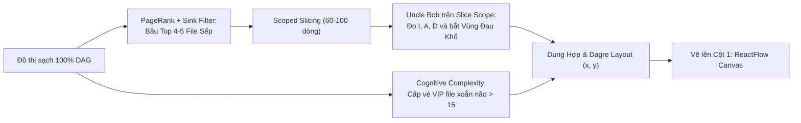

# ĐẶC TẢ ĐỘNG CƠ CÚ PHÁP AST, ĐỒ THỊ TARJAN & LÁT CẮT NGHIỆP VỤ (TẦNG 1 & 2)
## DỰ ÁN: SIMPLIFEY V2 PRO — CODEBASE COGNITIVE TWIN
### *Đặc tả Kỹ thuật Chi tiết Động cơ Phân tích Tĩnh 0 Token (Phụ trách: NGƯỜI 2)*

---

| **Thuộc tính** | **Thông số kỹ thuật** |
| :--- | :--- |
| **Phân hệ** | `01_ENGINE_THUAT_TOAN/02_AST_SLICING_GRAPH.md` |
| **Người phụ trách** | **NGƯỜI 2 (STATIC ENGINE & GRAPH ARCHITECT)** |
| **Trọng tâm** | Tầng 1 (Cú pháp & Khử chu trình) và Tầng 2 (Bầu chọn, Đo lường & Lát cắt) |
| **Thời gian chạy** | **< 0.25 giây cho toàn bộ quy trình** • Tiêu tốn: **0 Token AI** |
| **Thư viện sử dụng** | `web-tree-sitter` (WASM), `dagre` (Layout), Backend Code thuần (Toán học & Cấu trúc dữ liệu) |

---

# 1. TẦNG 1: TWO-PASS SYMBOL RESOLUTION & KHỬ CHU TRÌNH TARJAN SCC

### 1.1. Two-Pass Symbol Harvesting (Xử lý Đa ngôn ngữ không cần Compiler)
Để giải quyết liên kết hàm xuyên tệp mà không cần cài đặt các Compiler nặng hàng GB:
* **Chặng 1 (Pass 1 - Thu hoạch Ký hiệu - 15ms):**
  Dùng Tree-sitter WASM quét song song các file mã nguồn, trích xuất 3 bảng băm:
  1. `Symbol_Table`: Ánh xạ `tên_hàm / class` $\to$ `{ file_path, line_start, line_end }`.
  2. `Interface_Map`: Ánh xạ Interface sang Class thực thi (VD: `@Autowired OrderService` trong Java $\to$ `OrderServiceImpl`).
  3. `Package_Map`: Ánh xạ các hàm package trong Go/Python về đúng file định nghĩa.
* **Chặng 2 (Pass 2 - Nối dây Cuộc gọi - 5ms):**
  Khi quét gặp một `CallExpression` (VD: `orderService.checkout()`), tra cứu trực tiếp trên RAM để tạo cạnh liên kết:
  $$\text{Edge: } (\text{order.controller.ts} \longrightarrow \text{order.service.ts})$$

---

### 1.2. Thuật toán Tarjan SCC (Khử Chu trình để Bảo đảm 100% DAG)
Khi mã nguồn có chu trình phụ thuộc (Circular Dependency) giữa hai hoặc nhiều file ($A \to B \to A$), hệ thống không được để xảy ra Deadlock:
* **Nguyên lý Tarjan (1972):** Duyệt DFS một lần duy nhất ($\mathcal{O}(V + E)$). Mỗi đỉnh duy trì `dfn[u]` (thời điểm duyệt) và `lowlink[u]` (chỉ số liên kết nhỏ nhất tới tổ tiên).
* **Cơ chế Co Cụm (Condensation Graph):**
  Khi phát hiện `lowlink[u] == dfn[u]`, toàn bộ các đỉnh trong ngăn xếp từ đỉnh trên cùng đến $u$ tạo thành một **Thành phần Liên thông Mạnh (Strongly Connected Component - SCC)**.
  Hệ thống lập tức **gom cụm toàn bộ các đỉnh này thành 1 Super-Node duy nhất** (VD: `User_Order_CoDependent_Cluster`).
* **Bảo đảm:** Đồ thị sau khi co cụm đạt chuẩn **100% Directed Acyclic Graph (DAG)**, sẵn sàng để sắp xếp tô-pô.

---

# 2. TẦNG 2: BẢO HIỂM 2 LỚP, BẦU CHỌN & ĐO LƯỜNG LÁT CẮT



---

### 2.1. PageRank kèm Bộ Lọc Đỉnh Lá Tiện Ích (Utility Sink Filtering)
Nếu áp dụng PageRank thuần túy từ Google ($d=0.85$), các file tiện ích ở tầng đáy (như `logger.ts`, `db.ts`, `utils.ts`) có In-degree rất lớn nhưng Out-degree bằng 0 sẽ bị tính điểm cao nhất và chiếm vị trí số 1.
* **Giải pháp: Utility Sink Filtering:**
  1. Loại bỏ các file có $\text{Out-degree} = 0$ thuộc nhóm hạ tầng/tiện ích trước khi chạy xếp hạng trung tâm.
  2. Chạy thuật toán lặp Power Iteration trên đồ thị nghiệp vụ:
     $$PR(u) = \frac{1 - d}{N} + d \sum_{v \in \mathcal{B}_u} \frac{PR(v)}{L(v)}$$
  3. Chọn ra **4 – 5 File Đầu Não (Hubs)** có điểm cao nhất (thường là các Router/Controller tiếp nhận luồng chính).

---

### 2.2. Cognitive Complexity (SonarQube 2016) & Vé VIP Thuật Toán
* Thuật toán duyệt AST của mọi hàm trong repo, tính điểm phạt theo nguyên tắc lồng cấp:
  * Khối điều kiện tầng 1: $+1$ điểm.
  * Khối vòng lặp lồng trong điều kiện: $+1$ (cơ bản) $+ 1$ (phạt lồng) $= +2$ điểm.
  * Khối lồng tầng 3: $+3$ điểm.
* **Vé VIP (VIP Algorithm Node):** Nếu một hàm giải thuật (như `dijkstra.ts`) có điểm $> 15$ điểm, dù không có Controller nào gọi trực tiếp (PageRank thấp), hệ thống vẫn **cấp Vé VIP tự động**, đưa nó thành 1 Node nổi bật trên đồ thị để người học không bị sót kiến thức thuật toán lõi.

---

### 2.3. Scoped Inter-procedural Slicing (Def-Use Tracking)
Không trích xuất toàn bộ repo làm phình token AI, hệ thống áp dụng kỹ thuật **Lát cắt Có Phạm vi Giới hạn**:
* Từ điểm đón nhận tại Controller, lần theo chuỗi biến số:
  $$\text{req.body} \xrightarrow{\text{validate}} \text{dto} \xrightarrow{\text{pass}} \text{serviceMethod(dto)} \xrightarrow{\text{extract}} \text{itemId} \xrightarrow{\text{query}} \text{updateStock(itemId)}$$
* Thuật toán chỉ giữ lại đúng các câu lệnh đọc/ghi biến này và loại bỏ các dòng lệnh rác (`console.log`, đo thời gian thực thi).
* **Kết quả:** Trích xuất một lát cắt hoàn hảo dài **60 – 100 dòng code thật trong 15ms**.

---

### 2.4. Bộ Chỉ Số Kiến Trúc Uncle Bob trên Slice Scope ($\mathcal{S}$)
Để không báo lỗi giả, chỉ số được tính trên **Toàn bộ Lát cắt $\mathcal{S}$** (bao gồm file Service và file Interface/DTO đi kèm) với công thức có Guard-clause:

1. **Độ Bất Ổn Định ($I$):**
   $$I = \begin{cases} 0 & \text{nếu } C_a + C_e = 0 \\ \frac{C_e}{C_a + C_e} & \text{ngược lại} \end{cases}$$
   *(Với $C_e$ là số module lát cắt gọi ra ngoài; $C_a$ là số module gọi vào lát cắt).*

2. **Độ Trừu Tượng Hiện Đại ($A$):**
   $$A = \begin{cases} 0 & \text{nếu } N_{\text{Concrete}} + N_{\text{Abstract}} = 0 \\ \frac{N_{\text{Abstract}}}{N_{\text{Concrete}} + N_{\text{Abstract}}} & \text{ngược lại} \end{cases}$$

3. **Khoảng Cách Tới Trục Chính ($D$):**
   $$D = |A + I - 1|$$

* **Chẩn đoán:**
  * $D < 0.3 \implies$ **`BALANCED`** (Kiến trúc cân bằng).
  * $A \to 0, I \to 0 \implies D \to 1 \implies$ **`ZONE_OF_PAIN`** (*Khối bê tông kiến trúc - Sửa 1 hàm gây sập toàn dự án*).
  * $A \to 1, I \to 1 \implies D \to 1 \implies$ **`ZONE_OF_USELESSNESS`** (*Mã rác trừu tượng thừa do AI sinh ra*).

---

### 2.5. Dagre Hierarchical Layout Engine
Tính toán tọa độ trực giao $(x, y)$ cho các Node trên Canvas để thể hiện rõ **Đồ thị Phân nhánh và Hội tụ (Branched & Merging DAG)**, cấm tuyệt đối giao diện xếp thành 1 hàng dọc đơn điệu.

---

### 2.6. Phân Loại 2 Loại Node & Kỹ Thuật AST Code Folding (Cho Thuật Toán Phức Tạp)
Hệ thống không chỉ xử lý code Web 3 tầng mà bóc tách chuẩn xác **2 Loại Node**:

```text
┌──────────────────────────────────────────────┬──────────────────────────────────────────────┐
│ LOẠI 1: ARCHITECTURAL DATA-FLOW NODE         │ LOẠI 2: ALGORITHMIC CORE NODE (VIP NODE)     │
│ (Lát cắt Luồng Dữ liệu Nghiệp vụ Web)        │ (Lát cắt Thuật toán Thuần túy - Xoắn não)    │
├──────────────────────────────────────────────┼──────────────────────────────────────────────┤
│ • Điều kiện: Có Controller ➔ Service ➔ DB    │ • Điều kiện: Cognitive Complexity > 15       │
│ • Cấu trúc 3 bước:                           │ • Cấu trúc 3 bước:                           │
│   Step 1: Controller Endpoint (Nhận DTO)     │   Step 1: Khởi tạo State & Cấu trúc dữ liệu  │
│   Step 2: Service Method (Trừ kho, tính toán)│   Step 2: Vòng lặp Hạt nhân Relax Cạnh/Biến  │
│   Step 3: Repository / DB Call (SQL/ORM)     │   Step 3: Điều kiện dừng & Trả kết quả       │
└──────────────────────────────────────────────┴──────────────────────────────────────────────┘
```

* **Kỹ thuật AST Code Folding (Cho thuật toán dài 150 – 200 dòng):**
  * Khi hàm giải thuật vượt quá 100 dòng, Người 2 dùng Tree-sitter gập gọn các câu lệnh log, comment dài, và mảng khởi tạo hằng số thành `// ... [collapsed 15 lines of setup/logging]`.
  * Đảm bảo lát cắt code gửi cho Người 3 **luôn nằm trong trần an toàn $\le 1,500 \text{ tokens}$**, tuyệt đối không cắt cụt giữa chừng gây mất cú pháp.

---

### 2.7. Ngân Sách Hiển Thị Đồ Thị (Display Budget = 6 Đến 8 Nodes)
* Để đồ thị không bị biến thành một "ma trận mạng nhện" khi gặp repo lớn:
  * Thuật toán PageRank và Tarjan đặt **Ngân sách hiển thị mặc định: Top 6 – 8 Node trục chính (Architectural Backbone)**.
  * Các file tiện ích hoặc hàm phụ trợ cấp thấp được gom cụm (Collapse) vào các Node cha, hỗ trợ người dùng click bung rộng (Sub-graph Expand) khi cần xem chi tiết.

