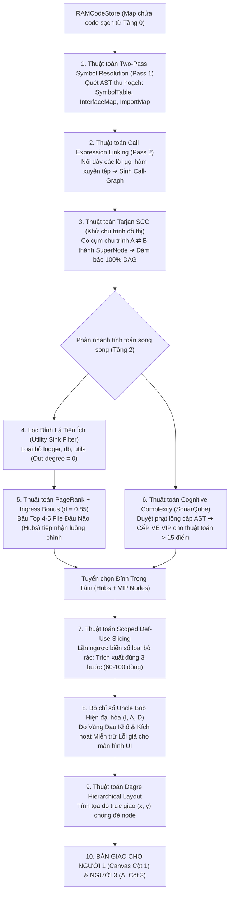

# [TẦNG 1 & 2] ĐẶC TẢ KỸ THUẬT ĐỘNG CƠ CÚ PHÁP AST, ĐỒ THỊ TARJAN & LÁT CẮT NGHIỆP VỤ (0 TOKEN)
## PHÂN HỆ: TWO-PASS SYMBOL RESOLUTION, TARJAN SCC, PAGERANK, SLICING & UNCLE BOB
### Dự án: SimpliFey V2 Pro — Codebase Cognitive Twin (Phụ trách: NGƯỜI 2)

---

| **Thuộc tính** | **Thông số kỹ thuật chuẩn hóa** |
| :--- | :--- |
| **Phân hệ tài liệu** | `01_ENGINE_THUAT_TOAN/02_AST_SLICING_GRAPH.md` |
| **Tầng kiến trúc** | **TẦNG 1 (Cú pháp & Khử chu trình) & TẦNG 2 (Bầu chọn Hubs, Lát cắt & Đo lường)** |
| **Kỹ sư chịu trách nhiệm** | **NGƯỜI 2 (STATIC ENGINE & GRAPH ARCHITECT)** |
| **Đầu vào nhận từ Tầng 0** | `RAMCodeStore = Map<string, string>` (Code sạch từ link GitHub) & `ProjectFingerprint` |
| **Thời gian thực thi** | **< 0.25 giây cho toàn bộ quy trình** (Trên tập 50 files) |
| **Chi phí AI Token** | **0 Token (Toán học giải thuật & Cấu trúc dữ liệu thuần túy trên RAM)** |
| **Đầu ra bàn giao** | `HybridArchitecturalNode[]` (Có tọa độ Dagre, 4 màu, trace code), `Edges[]`, `SymbolWhitelist` |
| **Khớp nối Phân hệ dưới** | **Cung cấp `scoped_code_snippet`, `symbol_whitelist` và `trace_steps` cho `02_AI_VA_BAYES`** |

---

## 1. TỔNG QUAN LUỒNG HOẠT ĐỘNG TẦNG 1 & TẦNG 2

Sau khi Tầng 0 hoàn tất tải mã nguồn từ link GitHub vào `RAMCodeStore`, Tầng 1 và Tầng 2 thực hiện chuỗi 7 bước giải thuật toán học liên hoàn để biến hàng nghìn dòng code thô thành **Đồ thị Lát cắt Kiến trúc Trực quan 4 Màu** trên ReactFlow:



---

## 2. BỘ NHỚ LƯU TRỮ TRÊN RAM: LƯU CÁI GÌ & LƯU NHƯ THẾ NÀO?

Toàn bộ quá trình chạy hoàn toàn trên bộ nhớ Heap của RAM, không dùng Database tạm thời, giải phóng ngay khi hoàn tất:

```text
┌────────────────────────────────────────────────────────────────────────────────────────┐
│ BỘ NHỚ HEAP TRONG RAM CHO STATIC ENGINE (TẦNG 1 & 2)                                   │
├────────────────────────────────────────────────────────────────────────────────────────┤
│ 1. SymbolTable: Map<string, SymbolDefinition>                                          │
│    ├── Khóa (Key): Tên hàm hoặc Class.method (VD: "OrderController.postCheckout")      │
│    └── Giá trị (Value): { filePath, lineStart, lineEnd, isExported }                   │
│                                                                                        │
│ 2. ImportMap: Map<string, Map<string, string>>                                         │
│    ├── Khóa (Key): File đang đứng (VD: "src/controllers/order.controller.ts")          │
│    └── Giá trị (Value): Map<Tên Symbol import -> File định nghĩa gốc>                  │
│                                                                                        │
│ 3. CallGraph: Map<string, Set<string>> (Danh sách kề biểu diễn đồ thị cuộc gọi)        │
│    ├── Khóa (Key): File gọi (Caller File)                                              │
│    └── Giá trị (Value): Tập hợp các File bị gọi (Callee Files)                         │
│                                                                                        │
│ 4. TarjanCondensationGraph: Object                                                     │
│    ├── scc_components: string[][] (Danh sách các file bị lặp chu trình A <-> B)       │
│    └── dag_edges: Array<{ source: string, target: string }> (Đồ thị sạch 100% DAG)   │
│                                                                                        │
│ 5. HubRanking: Map<string, number>                                                     │
│    ├── Khóa (Key): Đường dẫn file nghiệp vụ                                            │
│    └── Giá trị (Value): Điểm số trung tâm Rank Score (0.0 đến 1.0)                     │
└────────────────────────────────────────────────────────────────────────────────────────┘
```

---

## 3. CHI TIẾT 7 THUẬT TOÁN CỐT LÕI (RÕ RÀNG TỪNG BƯỚC)

Mỗi thuật toán dưới đây được chuẩn hóa theo cấu trúc 4 trụ cột: **Tại sao cần & Vai trò $\to$ Cơ chế kỹ thuật $\to$ Làm thế nào để thực hiện được (Từng thao tác chi tiết) $\to$ Minh họa / Bảng trace**.

---

### THUẬT TOÁN 1: TWO-PASS GLOBAL SYMBOL RESOLUTION (15ms - 0 Token)

#### 1. Tại sao cần bước này & Vai trò của nó?
* **Vấn đề thực tế:** Trong các ngôn ngữ hiện đại (TypeScript, Java, Go, Python), hàm A gọi hàm B xuyên tệp. Để biết hàm `orderService.processCheckout()` nằm ở file nào, các IDE thông thường phải cài đặt Language Server Protocol (LSP) hoặc Compiler nặng hàng Gigabytes (như `tsc`, `javac`), khởi động mất 30 giây!
* **Hậu quả nếu không có:** Không thể cài compiler nặng hàng GB trên máy chủ thi 24h. Nếu không có thuật toán giải quyết liên kết hàm, đồ thị sẽ là các file rời rạc không có cạnh nối.
* **Vai trò:** "Bản đồ nối dây liên kết", giúp hệ thống xác định chính xác quan hệ gọi hàm xuyên tệp chỉ trong **15ms** chạy thuần trên RAM mà không cần bất kỳ compiler nào.

#### 2. Cơ chế kỹ thuật:
* Duyệt cây cú pháp trừu tượng 2 chặng (Two-Pass Abstract Syntax Tree Traversal) kết hợp Bảng Băm Ký hiệu Toàn cục (Global Symbol Table) trên bộ nhớ RAM.

#### 3. Làm thế nào để cơ chế đó thực hiện được? (Từng thao tác cụ thể):
* **Thao tác 1 (Pass 1 - Thu hoạch Khai báo):**
  Duyệt song song các file trong `codeStore`. Sử dụng Tree-sitter WASM / AST parser để bóc tách các nút khai báo:
  * Khai báo Class (`export class OrderController`) $\to$ Ghi nhận tên class.
  * Khai báo Hàm/Method (`async postCheckout(...)`) $\to$ Lưu vào `SymbolTable` với Key là `OrderController.postCheckout`, Value là `{ filePath: "src/controllers/order.controller.ts", lineStart: 8, lineEnd: 15 }`.
  * Khai báo Interface (`implements IOrderService`) $\to$ Lưu vào `InterfaceImplMap`.
  * Câu lệnh Import (`import { OrderService } from '../services/order.service'`) $\to$ Lưu vào `ImportMap[currentFile]`.
* **Thao tác 2 (Phân giải Đường dẫn Tương đối):**
  Khi gặp câu lệnh import `./order.service`, hệ thống kết hợp với đường dẫn của file hiện tại (`src/controllers/order.controller.ts`), chuẩn hóa đường dẫn tương đối thành đường dẫn POSIX tuyệt đối trong repo: `src/services/order.service.ts`.
* **Thao tác 3 (Pass 2 - Nối Cạnh Cuộc Gọi):**
  Duyệt quét các biểu thức gọi hàm `CallExpression` (VD: `this.orderService.processCheckout(...)`):
  1. Trích xuất đối tượng gọi: `orderService`.
  2. Tra cứu trong `ImportMap` của file hiện tại để tìm class gốc: `OrderService` $\to$ được import từ `src/services/order.service.ts`.
  3. Tra cứu trong `SymbolTable` để xác nhận method `processCheckout` thực sự tồn tại ở file đích.
  4. Nối một cạnh có hướng vào danh sách kề: `CallGraph.get("order.controller.ts").add("order.service.ts")`.

#### 4. Minh họa Code súc tích có chú thích:
```typescript
function linkCallEdges(filePath: string, code: string, importMap: Map<string, string>, callGraph: Map<string, Set<string>>) {
  // 1. Tìm tất cả các câu lệnh gọi hàm dạng: instance.methodName(...)
  const callMatches = code.matchAll(/(?:this\.)?([A-Za-z0-9_]+)\.([A-Za-z0-9_]+)\s*\(/g);
  
  for (const match of callMatches) {
    const objectName = match[1]; // VD: "orderService"
    
    // 2. Tra cứu trong ImportMap xem objectName thuộc class nào được import từ file nào
    for (const [importedSym, targetFile] of importMap.entries()) {
      if (objectName.toLowerCase().includes(importedSym.toLowerCase())) {
        callGraph.get(filePath)?.add(targetFile); // 3. NỐI CẠNH GIỮA 2 FILE
      }
    }
  }
}
```

---

### THUẬT TOÁN 2: TARJAN SCC — KHỬ CHU TRÌNH ĐỒ THỊ (2ms)

#### 1. Tại sao cần bước này & Vai trò của nó?
* **Vấn đề thực tế (Bài toán Con gà - Quả trứng):** Sinh viên thường viết code có chu trình phụ thuộc chéo: File $A$ gọi $B$, nhưng $B$ lại gọi ngược lại $A$ ($A \rightleftarrows B$).
* **Hậu quả nếu không làm:** Nếu đưa đồ thị có chu trình vào ReactFlow để làm lộ trình học tập, thuật toán sắp xếp tô-pô (Topological Sort) sẽ bị sập vì deadlock (vòng lặp vô tận, không biết học cái nào trước!).
* **Vai trò:** "Bảo hiểm kiến trúc 100% DAG", triệt tiêu toàn bộ chu trình phụ thuộc bằng cách co cụm các file xoắn ốc thành 1 SuperNode duy nhất, đảm bảo đồ thị không bao giờ bị lặp.

#### 2. Cơ chế kỹ thuật:
* Thuật toán Thành phần Liên thông Mạnh (Strongly Connected Components - SCC) của Robert Tarjan (1972) với độ phức tạp $\mathcal{O}(V + E)$ kết hợp kỹ thuật Co Cụm Đồ Thị (Condensation Graph).

#### 3. Làm thế nào để cơ chế đó thực hiện được? (Từng thao tác cụ thể):
* **Thao tác 1 (Khởi tạo biến trạng thái DFS):**
  Tạo ngăn xếp `stack = []`, mảng `dfn` (thời điểm khám phá đỉnh), `lowlink` (chỉ số khám phá nhỏ nhất mà đỉnh có thể vươn tới), và tập hợp `inStack`.
* **Thao tác 2 (Duyệt DFS & Cập nhật Lowlink):**
  Khi ghé thăm đỉnh $u$, gán `dfn[u] = lowlink[u] = ++index`. Đẩy $u$ vào `stack` và đánh dấu `inStack.add(u)`.
  * Duyệt các đỉnh kề $v$ của $u$:
    * Nếu $v$ chưa duyệt $\implies$ Gọi đệ quy `DFS(v)`, sau đó cập nhật $lowlink[u] = \min(lowlink[u], lowlink[v])$.
    * Nếu $v$ đã được duyệt và đang nằm trong `stack` (cạnh ngược) $\implies$ Cập nhật $lowlink[u] = \min(lowlink[u], dfn[v])$.
* **Thao tác 3 (Phát hiện Gốc Chu Trình & Co Cụm SuperNode):**
  Khi quay lui về $u$, nếu $lowlink[u] == dfn[u]$, toàn bộ các đỉnh từ đỉnh stack tới $u$ tạo thành một SCC:
  * Pop lần lượt các đỉnh ra khỏi stack cho tới khi gặp $u$.
  * Nếu cụm có từ 2 file trở lên $\implies$ Gộp chung thành 1 **SuperNode duy nhất** (VD: `SuperNode_Service_Repo`).
* **Thao tác 4 (Tái cấu trúc cạnh đồ thị Condensation Graph):**
  Mọi cạnh nội bộ giữa các đỉnh trong cùng 1 cụm bị triệt tiêu; các cạnh từ bên ngoài trỏ vào bất kỳ đỉnh nào trong cụm được chuyển thành trỏ vào SuperNode. Đồ thị sau co cụm đạt chuẩn **100% Directed Acyclic Graph (DAG)**.

#### 4. Bảng Trace Khi Có Chu Trình Thật ($2 \rightleftarrows 3$):
```text
Đồ thị mẫu: Controller (1) ---> Service (2) <===> Repo (3)
```

| Bước | Đỉnh $u$ | Hành động chi tiết | `dfn` | `lowlink` | Ngăn xếp (Stack) | Kết luận |
| :---: | :---: | :--- | :---: | :---: | :--- | :--- |
| **1** | $1$ | Thăm Controller. Gán time = 1. | $dfn[1]=1$ | $lowlink[1]=1$ | `[1]` | Đi sang $2$ |
| **2** | $2$ | Thăm Service. Gán time = 2. | $dfn[2]=2$ | $lowlink[2]=2$ | `[1, 2]` | Đi sang $3$ |
| **3** | $3$ | Thăm Repo. Gán time = 3. | $dfn[3]=3$ | $lowlink[3]=3$ | `[1, 2, 3]` | Đỉnh $3$ có cạnh ngược trỏ về $2$ |
| **4** | $3 \to 2$| Đỉnh $2$ đã nằm trong Stack $\implies$ Cạnh ngược! | $dfn[3]=3$ | $lowlink[3] = \min(3, dfn[2]) = 2$ | `[1, 2, 3]` | Quay lui về $2$ |
| **5** | $2$ | Cập nhật từ con: $lowlink[2] = \min(2, lowlink[3]) = 2$. | $dfn[2]=2$ | $lowlink[2]=2$ | `[1, 2, 3]` | Hết nhánh con của $2$! |
| **6** | $2$ | $lowlink[2] == dfn[2] == 2$ $\implies$ Pop: `3`, `2`! | — | — | `[1]` | **PHÁT HIỆN SCC: `{Service, Repo}`** |
| **7** | $1$ | $lowlink[1] == dfn[1] == 1$ $\implies$ Pop: `1`! | — | — | `[]` | **SCC Độc lập: `{Controller}`** |

---

### THUẬT TOÁN 3: PAGERANK KÈM UTILITY SINK FILTERING & TRỌNG SỐ INGRESS (5ms)

#### 1. Tại sao cần bước này & Vai trò của nó?
* **Nghịch lý PageRank trên mã nguồn:** Nếu chạy PageRank thuần túy ($d=0.85$), các file tiện ích ở tầng đáy (`logger.ts`, `db.ts`) có nhiều file gọi tới (In-degree rất cao) sẽ tích lũy điểm cao nhất, trong khi Controller tiếp nhận API request có In-degree = 0 sẽ bị điểm thấp nhất. Hậu quả là đồ thị sẽ bầu chọn file ghi log làm bài học số 1!
* **Vai trò:** "Ban giám khảo bầu chọn Hubs", lọc bỏ các file phụ trợ hạ tầng và tôn vinh đúng các file Controller tiếp nhận luồng chính làm điểm bắt đầu học tập.

#### 2. Cơ chế kỹ thuật:
* Lọc đỉnh lá tiện ích (Utility Sink Filtering) kết hợp Trọng số Định tuyến Cửa vào (Ingress Routing Bonus) trên thuật toán lặp ma trận Power Iteration.

#### 3. Làm thế nào để cơ chế đó thực hiện được? (Từng thao tác cụ thể):
* **Thao tác 1 (Lọc đỉnh lá tiện ích):**  
  Đếm Out-degree của mọi đỉnh. Đỉnh nào có $\text{Out-degree} = 0$ và tên file khớp danh sách tiện ích (`logger`, `util`, `config`, `db`) sẽ bị loại bỏ khỏi danh sách tính PageRank.
* **Thao tác 2 (Power Iteration trên đồ thị nghiệp vụ):**  
  Với $N$ file nghiệp vụ còn lại, khởi tạo $PR_0(u) = 1/N$. Chạy 20 vòng lặp theo công thức:
  $$PR_{k+1}(u) = \frac{1-d}{N} + d \sum_{v \in \mathcal{B}_u} \frac{PR_k(v)}{L(v)} \quad (d = 0.85)$$
* **Thao tác 3 (Cộng Trọng số Ingress Routing Bonus):**  
  Các file là Route Handler / Controller (có decorator `@Controller`, `app.post` hoặc export route handler) được cộng thêm điểm:
  $$\text{Rank Score}(u) = PR(u) + \mathbf{1}_{\{u \in \text{Controller / Router}\}} \times 0.50$$
* **Thao tác 4 (Bầu chọn Top Hubs):**  
  Sắp xếp theo Rank Score giảm dần, chọn Top 4-5 file có điểm cao nhất làm các File Đầu Não (Hubs) của đồ thị.

#### 4. Kết quả xếp hạng trên Benchmark:
* `order.controller.ts`: $PR = 0.05 + 0.50 = \mathbf{0.550} \implies$ **HUB SỐ 1 (Đầu não tiếp nhận Request)**.
* `order.service.ts`: $PR = \mathbf{0.333} \implies$ **HUB SỐ 2 (Xử lý nghiệp vụ)**.
* `logger.ts`: Bị loại bỏ từ Thao tác 1 $\implies$ **Không bao giờ bị nhầm làm Hub!**

---

### THUẬT TOÁN 4: COGNITIVE COMPLEXITY (SONARQUBE 2016) & VÉ VIP THUẬT TOÁN

#### 1. Tại sao cần bước này & Vai trò của nó?
* **Vấn đề thực tế:** Tránh việc bỏ sót các hàm giải thuật tinh hoa (như `dijkstra.ts`, `ai_matcher.py`). Vì các hàm này thường là hàm nội bộ ít người gọi, điểm PageRank sẽ rất thấp. Nếu chỉ dựa vào PageRank thì các thuật toán lõi này sẽ bị biến mất khỏi đồ thị học tập!
* **Vai trò:** "Máy quét xoắn não vi mô", phát hiện các thuật toán phức tạp và cấp **Vé VIP** đưa thẳng lên vị trí trung tâm đồ thị để sinh viên được thử thách sát hạch logic.

#### 2. Cơ chế kỹ thuật:
* Thang đo độ phức tạp nhận thức Cognitive Complexity (SonarQube 2016) dựa trên nguyên lý Phạt Lồng Cấp (Nesting Penalty) khi duyệt cây AST.

#### 3. Làm thế nào để cơ chế đó thực hiện được? (Từng thao tác cụ thể):
* **Thao tác 1 (Khởi tạo cấp độ lồng):** Đặt `nestingLevel = 0`, `score = 0`.
* **Thao tác 2 (Phạt cấu trúc rẽ nhánh & vòng lặp):**  
  * Khi gặp `if`, `switch`, `for`, `while`, `catch`: Cộng `+1` (điểm cơ bản) `+ nestingLevel` (điểm phạt lồng cấp).
  * Khi gặp toán tử logic liên tiếp `&&`, `||`: Cộng `+1` cho mỗi toán tử.
* **Thao tác 3 (Tăng giảm Nesting Level):**  
  Khi mở một khối `{` trong cấu trúc rẽ nhánh/lặp $\implies$ `nestingLevel++`. Khi đóng khối `}` $\implies$ `nestingLevel--`.
* **Thao tác 4 (Cấp vé VIP):**  
  Nếu tổng điểm hàm $> 15$ $\implies$ Đánh dấu `is_vip_algorithm = true`, tự động cấp **Vé VIP** đưa thẳng lên đồ thị ReactFlow thành Node nổi bật, không bị PageRank bỏ sót.

#### 4. Bảng chấm điểm mẫu theo chuẩn SonarQube:
| Dòng code | Cú pháp AST | Cấp độ lồng (Nesting) | Điểm cơ bản | Điểm phạt | Tổng điểm dòng |
| :---: | :--- | :---: | :---: | :---: | :---: |
| Dòng 2 | `if (!graph \|\| !start)` | Cấp 0 | $+1$ | $+0$ | **$+1$** |
| Dòng 5 | `for (const node of graph.nodes)` | Cấp 0 | $+1$ | $+0$ | **$+1$** |
| Dòng 6 | `if (node.id === start)` | Cấp 1 (trong `for`) | $+1$ | $+1$ | **$+2$** |
| Dòng 7 | `for (const neighbor of node.edges)` | Cấp 2 (trong `if` trong `for`) | $+1$ | $+2$ | **$+3$** |
| Dòng 8 | `if (neighbor.cost > 0)` | Cấp 3 (lồng 3 cấp) | $+1$ | $+3$ | **$+4$** |
| **TỔNG** | **HÀM TÌM ĐƯỜNG** | — | — | — | **$11$ ĐIỂM** |

---

### THUẬT TOÁN 5: SCOPED DEF-USE SLICING (RÚT SỢI CHỈ DỮ LIỆU)

#### 1. Tại sao cần bước này & Vai trò của nó?
* **Vấn đề thực tế:** Một file Service dài 300 dòng chứa nhiều code đo thời gian (`startTime = Date.now()`), log màn hình (`console.log`), biến tạm thừa. Nếu quăng cả 300 dòng cho AI sẽ làm tràn token, tăng độ trễ lên $> 5$ giây và làm AI hỏi lan man.
* **Vai trò:** "Kéo phẫu thuật mã nguồn", cắt bỏ toàn bộ code rác, chỉ giữ lại đúng chuỗi biến số truyền từ Controller $\to$ Service $\to$ Database dài **60 – 100 dòng code thật**.

#### 2. Cơ chế kỹ thuật:
* Lát cắt chương trình có phạm vi giới hạn (Scoped Program Slicing) dựa trên chuỗi gán và sử dụng biến (Def-Use Chains) trên AST.

#### 3. Làm thế nào để cơ chế đó thực hiện được? (Từng thao tác cụ thể):
* **Thao tác 1 (Xác định Điểm Đích Slicing Criterion):**  
  Điểm cuối cùng của luồng là câu lệnh gọi DB (VD: `await this.inventoryRepo.updateStock(itemId, quantity)`).
* **Thao tác 2 (Lần ngược chuỗi phụ thuộc dữ liệu):**  
  * `itemId` và `quantity` (dòng 9, 10) $\longleftarrow$ được định nghĩa từ `item.id` và `item.qty`.
  * `item` (dòng 8) $\longleftarrow$ lấy từ vòng lặp `for (const item of items)`.
  * `items` (dòng 5) $\longleftarrow$ lấy từ `dto.items`.
  * `dto` (dòng 1) $\longleftarrow$ tham số đầu vào `processCheckout(dto)`.
* **Thao tác 3 (Loại bỏ câu lệnh chết / Side-effects):**  
  Bất kỳ câu lệnh nào không nằm trên chuỗi phụ thuộc biến này (như `startTime = Date.now()`, `console.log(...)`, biến tạm `totalCost` không truyền xuống DB) đều bị loại bỏ khỏi lát cắt!
* **Thao tác 4 (Ghép lát cắt 3 tầng Canonical):**  
  Ghép 20 dòng Controller + 30 dòng Service sạch + 20 dòng Repository $\to$ Tạo thành Lát cắt hoàn hảo dài **60 – 100 dòng code thật**, chuyển cho Cột 2 (Code Viewer) và Cột 3 (Gemini Flash).

#### 4. Kết quả rút gọn:
Đoạn code 15 dòng được rút gọn thành đúng **7 dòng hạt nhân**: `{ 1, 5, 8, 9, 10, 12, 13 }`.

---

### THUẬT TOÁN 6: BỘ CHỈ SỐ UNCLE BOB & MIỄN TRỪ LỖI GIẢ TẦNG UI

#### 1. Tại sao cần bước này & Vai trò của nó?
* **Vấn đề thực tế:** Đánh giá chất lượng thiết kế kiến trúc phần mềm theo tiêu chuẩn Robert C. Martin. Nếu tính trên từng file đơn lẻ hoặc tính cho file màn hình UI, giao diện sẽ bị quy kết oan vào "Vùng Đau Khổ (Zone of Pain)" vì UI import nhiều component con ($C_e$ cao) nhưng không ai viết Interface cho UI ($A = 0$).
* **Vai trò:** "Bác sĩ chẩn đoán kiến trúc", đo đạc độ cân bằng của hệ thống và kích hoạt cơ chế miễn trừ lỗi giả cho màn hình UI để không báo sai trước Ban Giám khảo.

#### 2. Cơ chế kỹ thuật:
* Package Metrics trên phạm vi Cụm Lát Cắt $\mathcal{S}$ (Slice Scope) kết hợp Cơ chế Miễn trừ Lỗi giả cho Tầng Giao diện (UI False-Positive Exemption).

#### 3. Làm thế nào để cơ chế đó thực hiện được? (Từng thao tác cụ thể):
* **Thao tác 1 (Kiểm tra miễn trừ):**  
  Nếu file thuộc nhóm UI (`isUiScreen = true`) $\implies$ Bật `is_exempt = true`, gán thẳng $D = 0.0$ (`BALANCED`), không tính toán để tránh báo lỗi sai trước Ban Giám khảo.
* **Thao tác 2 (Đếm phụ thuộc ngoại vi):**  
  Với các tầng Logic, đếm $C_e$ (số import từ module ngoài cụm $\mathcal{S}$) và $C_a$ (số module ngoài gọi vào cụm $\mathcal{S}$). Tính $I = C_e / (C_a + C_e)$.
* **Thao tác 3 (Đếm trừu tượng):**  
  Đếm $N_a$ (Interface, DTO types) và $N_c$ (Concrete classes). Tính $A = N_a / (N_a + N_c)$.
* **Thao tác 4 (Tính khoảng cách):**  
  $D = |A + I - 1|$. Nếu $D < 0.30 \implies \text{BALANCED}$. Nếu $D \ge 0.50$ và $A, I < 0.5 \implies \text{ZONE\_OF\_PAIN}$.

#### 4. Ví dụ Chạy Tay Bằng Số (Cụm Checkout gồm 3 Classes + 2 DTO Interfaces):
* $N_{\text{Abstract}} = 2$ (2 interfaces trong `order.dto.ts`), $N_{\text{Concrete}} = 3 \implies A = \frac{2}{3 + 2} = \mathbf{0.40}$.
* Gọi ra ngoài: `logger.ts` ($C_e = 1$), được gọi từ Router ngoài ($C_a = 1$) $\implies I = \frac{1}{1 + 1} = \mathbf{0.50}$.
* Khoảng cách: $D = |0.40 + 0.50 - 1| = |0.90 - 1| = \mathbf{0.10}$.
* **Chẩn đoán:** Vì $D = 0.10 < 0.30 \implies$ **`BALANCED` (Cân bằng hoàn hảo!)**.

---

### THUẬT TOÁN 7: DAGRE HIERARCHICAL LAYOUT ENGINE (10ms)

#### 1. Tại sao cần bước này & Vai trò của nó?
* **Vấn đề thực tế:** Đồ thị học tập phải thể hiện rõ các nhánh song song và điểm hội tụ (Branched & Merging DAG). Nếu không tính toán tọa độ tự động, các node sẽ bị đè lên nhau hoặc xếp thành 1 hàng dọc đơn điệu.
* **Vai trò:** "Kiến trúc sư quy hoạch mặt bằng", tự động sắp xếp vị trí các hộp Node theo tầng bậc rõ ràng, không giao cắt rối mắt.

#### 2. Cơ chế kỹ thuật:
* Thuật toán bố cục phân tầng phân cấp Sugiyama Framework tích hợp trong thư viện Dagre.

#### 3. Làm thế nào để cơ chế đó thực hiện được? (Từng thao tác cụ thể):
* **Thao tác 1 (Khởi tạo đồ thị layout):**  
  Khởi tạo `const g = new dagre.graphlib.Graph()`.  
  Cấu hình đồ thị: `rankdir: 'TB'` (Top to Bottom), khoảng cách hàng `ranksep: 100`, khoảng cách cột `nodesep: 80`.
* **Thao tác 2 (Thêm kích thước node):**  
  Duyệt qua danh sách node, gán kích thước cố định cho mỗi hộp: `g.setNode(node.id, { width: 240, height: 90 })`.
* **Thao tác 3 (Thêm cạnh nối):**  
  Duyệt qua danh sách cạnh: `g.setEdge(edge.source, edge.target)`.
* **Thao tác 4 (Tính toán Sugiyama):**  
  Gọi `dagre.layout(g)`: Thuật toán Sugiyama chia đồ thị thành các tầng (Ranks), tối thiểu hóa số giao cắt của các cạnh (Edge Crossings), và tính toán tọa độ tâm $(x, y)$.
* **Thao tác 5 (Ánh xạ về ReactFlow):**  
  Lấy tọa độ góc trên bên trái: `position: { x: pos.x - 120, y: pos.y - 45 }`.

---

## 4. TỔNG KẾT TRACE CHẠY TAY BẰNG SỐ TRÊN BENCHMARK 4 FILE

```text
========================================================================================
1. PASS 1 & PASS 2: Thu hoạch SymbolTable & Nối dây CallGraph
   • E1: order.controller.ts ---> order.service.ts
   • E2: order.service.ts    ---> inventory.repo.ts
   • E3, E4, E5              ---> logger.ts

2. TARJAN SCC:
   • 0 chu trình lặp chéo ---> Giữ nguyên 100% DAG.

3. PAGERANK + UTILITY SINK FILTERING:
   • logger.ts có Out-degree = 0 ---> BỊ LOẠI BỎ (Utility Sink).
   • order.controller.ts nhận thêm Ingress Bonus (+0.50) ---> Rank Score = 0.550 (HUB SỐ 1).
   • order.service.ts: Rank Score = 0.333 (HUB SỐ 2).

4. COGNITIVE COMPLEXITY:
   • order.service.ts có for-of lồng await ---> 2 điểm (< 15) ---> Luồng nghiệp vụ tiêu chuẩn.

5. UNCLE BOB METRICS (Kèm DTO Interfaces):
   • Ce = 1, Ca = 1 ---> I = 0.50
   • Na = 2, Nc = 3 ---> A = 0.40
   • D = |0.40 + 0.50 - 1| = 0.10 ---> BALANCED (Cân bằng hoàn hảo).
========================================================================================
```

---

## 5. ĐỒNG BỘ TOÀN DIỆN VỚI PHÂN HỆ `02_AI_VA_BAYES` (AI HANDOFF CONTRACT)

Tầng 1 & 2 của Engine đóng vai trò là **"nguồn cấp dữ liệu chuẩn mực"** cho toàn bộ phân hệ AI (`02_AI_VA_BAYES`):

```text
┌──────────────────────────────────────────────┬──────────────────────────────────────────────┐
│ DỮ LIỆU TỪ STATIC ENGINE (TẦNG 1 & 2)       │ NƠI SỬ DỤNG TRONG PHÂN HỆ 02_AI_VA_BAYES     │
├──────────────────────────────────────────────┼──────────────────────────────────────────────┤
│ 1. scoped_code_snippet (60-100 dòng thật)    │ • Truyền thẳng vào micro_trace trong         │
│    (Trích xuất từ Scoped Def-Use Slicing)    │   POST /api/enrich-node của Gemini Flash     │
│                                              │ • Giúp AI trả lời tức thì (1.2s - 1.8s),      │
│                                              │   không bao giờ bị quá tải token (0.002$)    │
├──────────────────────────────────────────────┼──────────────────────────────────────────────┤
│ 2. symbol_whitelist: string[]                │ • Nạp vào CỔNG GÁC NHỊ PHÂN (CHỐT 1 - AST)  │
│    (Danh sách toàn bộ hàm/biến từ SymbolTable)│   để kiểm tra referenced_symbols.            │
│                                              │ • NẾU AI BỊA RA HÀM LẠ ➔ LẬP TỨC REJECT!     │
├──────────────────────────────────────────────┼──────────────────────────────────────────────┤
│ 3. uncle_bob.diagnosis                       │ • Làm gợi ý cho AI phát hiện "AI Smell"      │
│    ("ZONE_OF_PAIN", "BALANCED")              │   để đưa vào Tab 1: X-Ray Walkthrough        │
├──────────────────────────────────────────────┼──────────────────────────────────────────────┤
│ 4. hybrid_nodes.id & prerequisites           │ • Cung cấp cấu trúc đồ thị cho Động cơ Bayes │
│    (Đồ thị 100% DAG từ Tarjan)               │   (BKT & q-Matrix) để mở khóa Node tuần tự, │
│                                              │   kích hoạt cơ chế Fast-Track Auto-Pass      │
└──────────────────────────────────────────────┴──────────────────────────────────────────────┘
```

---

## 6. DỮ LIỆU ĐẦU RA BÀN GIAO CHO NGƯỜI 1 VÀ NGƯỜI 3

Kết thúc Tầng 1 và Tầng 2 (< 0.25 giây), kết quả trả về đúng hợp đồng dữ liệu chuẩn:

1. **Bàn giao cho NGƯỜI 1 (Frontend Lead - Cột 1 ReactFlow Canvas):**
   * Mảng `nodes: HybridArchitecturalNode[]` đã có sẵn tọa độ `position: { x, y }`, tên nhãn, và trạng thái màu ban đầu (Node 1 = `AVAILABLE` màu Vàng, các Node sau = `LOCKED` màu Xám).
   * Mảng `edges: Edge[]` nối các Node theo trật tự phân nhánh.
2. **Bàn giao cho NGƯỜI 3 (AI Architect - Cột 3 Sát Hạch Feynman):**
   * Mảng `trace_steps` gồm 3 bước code hạt nhân (60-100 dòng thật) trích xuất bằng Scoped Def-Use Slicing để đưa vào prompt Gemini Flash.
   * `symbol_whitelist`: Danh sách tất cả các hàm và biến có thật trong repo để nạp vào **Cổng Gác Nhị Phân 2 Chốt**, đảm bảo AI không bao giờ bịa đặt công nghệ ngoài repo.
