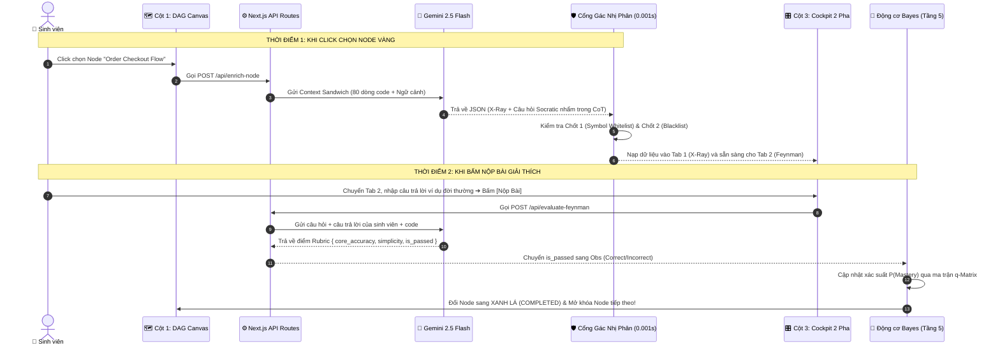
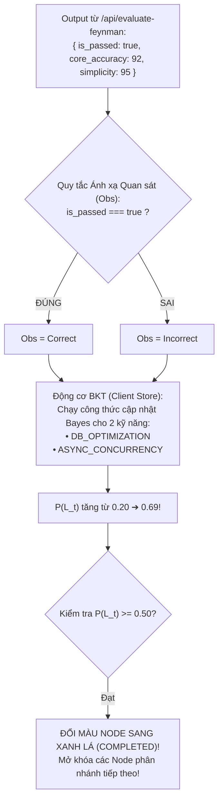
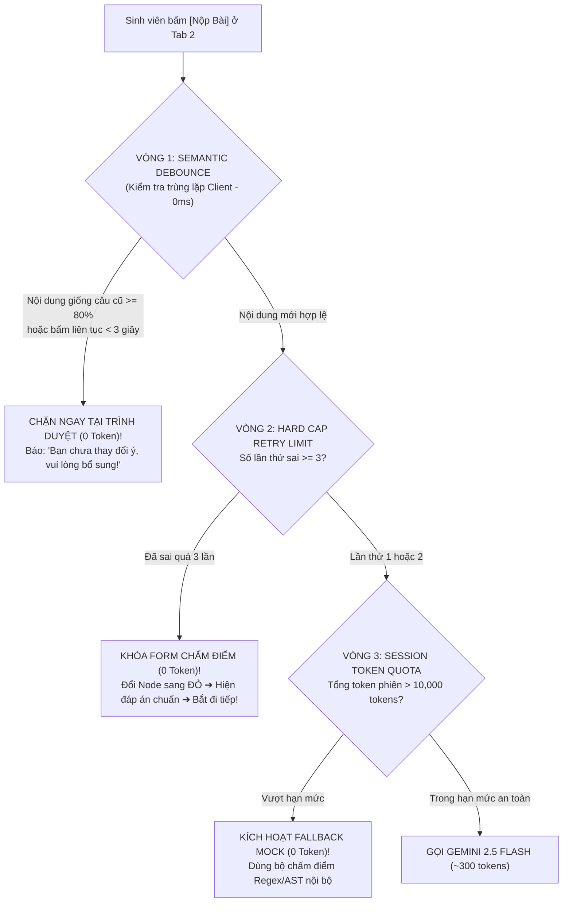
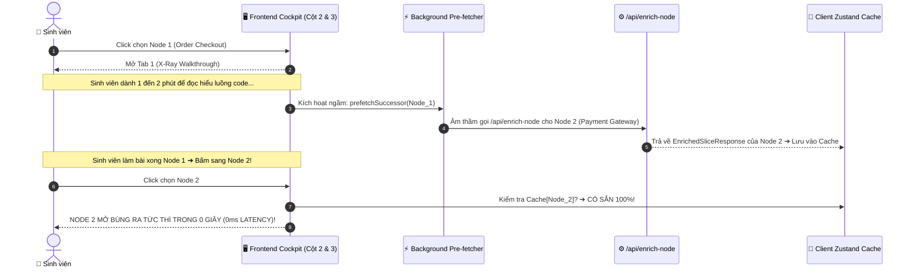

# [TẦNG 3 & TẦNG 4] ĐẶC TẢ CHI TIẾT AI PIPELINE, INPUT/OUTPUT & CỔNG GÁC NHỊ PHÂN
## DỰ ÁN: SIMPLIFEY V2 PRO — CODEBASE COGNITIVE TWIN
### *Cẩm Nang Kỹ Thuật Dành Riêng Cho NGƯỜI 3: Trả Lời Rõ Ràng Khi Nào Gọi AI, Input Là Gì, Output Là Gì!*

---

| **Thuộc tính** | **Thông số kỹ thuật chuẩn** |
| :--- | :--- |
| **Phân hệ** | `02_AI_VA_BAYES/01_LLM_PIPELINE_GUARDRAIL.md` |
| **Người phụ trách** | **NGƯỜI 3 (AI & COGNITIVE ENGINEER)** |
| **Mô hình AI sử dụng** | **Gemini 2.5 Flash** (Google Gen AI SDK `@google/genai`) |
| **Cơ chế cưỡng chế** | **Single-Pass Contrastive CoT** thông qua **Structured Outputs (JSON Schema)** |
| **Số lần gọi AI trong hệ thống** | **CHÍNH XÁC 2 THỜI ĐIỂM (JIT - JUST-IN-TIME)** • Tuyệt đối không gọi AI lúc scan repo! |
| **Độ trễ cam kết** | Endpoint 1 (`enrich-node`): **1.2s – 1.8s** • Endpoint 2 (`evaluate-feynman`): **0.8s – 1.2s** |

---

# 1. TỔNG QUAN: HỆ THỐNG GỌI AI LÚC NÀO? (TIMING & TRIGGER)

Một nguyên tắc vàng trong kiến trúc SimpliFey V2 Pro: **AI KHÔNG BAO GIỜ CHẠY LÚC QUÉT TẢI REPO**.
* Khi người dùng dán link GitHub (Tầng 0 $\to$ Tầng 2): **100% Code Thuần toán học chạy trong 1.5s (0 Token, $0.00)**.
* AI chỉ xuất hiện đúng **2 lần (Just-In-Time)** khi người dùng tương tác trên màn hình:



---

# 2. THỜI ĐIỂM 1: ENDPOINT `POST /api/enrich-node` (KHI CLICK CHỌN NODE)

### 2.1. Mục đích
Khi người dùng click vào một Node màu Vàng trên ReactFlow Canvas (Cột 1):
1. Bóc tách Điểm Hay (Design Pattern) và Điểm Dở (AI Smell: N+1 Query) để nạp vào **Tab 1: X-Ray Walkthrough** cho sinh viên đọc hiểu.
2. Chuẩn bị sẵn 01 câu hỏi phản biện Socratic phù hợp với trình độ người học (Tier 1/2/3) để dùng khi sinh viên bấm chuyển sang **Tab 2: Feynman Challenge**.

---

### 2.2. INPUT ĐƯA VÀO CHO AI (Context Sandwich Payload)

Backend nhận ID Node từ frontend, trích xuất dữ liệu từ Tầng 2 và đóng gói thành đối tượng JSON gửi cho Gemini Flash:

```typescript
// Payload gửi vào Request Body của /api/enrich-node
{
  // LỚP 1: NGỮ CẢNH VĨ MÔ DỰ ÁN (Macro Context - Lấy từ Tầng 0 & Tầng 2)
  "macro_context": {
    "repo_name": "shop-backend-nestjs",
    "tech_stack": ["express", "typeorm", "mysql", "zod"], // Đọc từ package.json
    "node_id": "slice-order-checkout",
    "node_title": "Order Checkout Flow",
    "dag_position": "Đứng sau Auth & Catalog; Đứng trước Inventory & Payment"
  },

  // LỚP 2: LUỒNG THỰC THI VI MÔ (Micro Trace - Đúng 80 dòng code sạch bóc tách từ Tầng 2)
  "micro_trace": {
    "scoped_code_snippet": `
// [Bước 1 - Controller]: src/controllers/order.controller.ts: dòng 8-15
async postCheckout(req, res) {
  const dto = req.body;
  const result = await this.orderService.processCheckout(dto);
  return res.json(result);
}

// [Bước 2 - Service]: src/services/order.service.ts: dòng 20-35
async processCheckout(dto) {
  for (const item of dto.items) {
    // Gọi DB cập nhật tồn kho từng món
    await this.inventoryRepo.updateStock(item.id, item.qty);
  }
  return { status: "SUCCESS" };
}

// [Bước 3 - Repository]: src/repos/inventory.repo.ts: dòng 10-18
async updateStock(productId, quantity) {
  return await db.query("UPDATE inventory SET stock = stock - ? WHERE id = ?", [quantity, productId]);
}
    `,
    "dto_interfaces": "interface CreateOrderDTO { items: Array<{ id: string; qty: number }>; }"
  },

  // LỚP 3: RÀNG BUỘC & CẤP ĐỘ NHẬN THỨC (Invariants)
  "invariants": {
    "learner_tier": "NOVICE", // Lấy từ Động cơ Bayes: "NOVICE" | "PRACTITIONER" | "ARCHITECT"
    "forbidden_external_keywords": ["kafka", "redis", "rabbitmq", "microservices", "docker"]
  }
}
```

---

### 2.3. PROMPT SYSTEM & CƠ CHẾ SINGLE-PASS CONTRASTIVE CoT

Prompt bắt buộc Gemini sử dụng cơ chế nhẩm nội tại trong trường ẩn `_internal_reasoning`:

```text
BẠN LÀ: Kỹ sư Trưởng kiêm Giảng viên Sư phạm Kiến trúc Mã nguồn trong SimpliFey V2 Pro.
NHIỆM VỤ: Đọc đoạn code 80 dòng được cung cấp và thực hiện đúng 3 việc:
1. Nhận diện Mẫu thiết kế (Design Pattern) và lý do tại sao kiến trúc này được chọn (Điểm Hay).
2. Phát hiện chính xác 01 đoạn code viết ẩu tiềm ẩn nguy cơ hiệu năng hoặc toàn vẹn dữ liệu (Điểm Dở / AI Smell).
3. Tự nhẩm 3 góc độ câu hỏi trong _internal_reasoning, sau đó CHỌN 01 CÂU HỎI SOCRATIC DUY NHẤT phù hợp với cấp độ: ${learner_tier}.

QUY TẮC BẤT KHẢ XÂM PHẠM:
- 100% ĐÓNG KHUNG TRONG CODE: referenced_symbols BẮT BUỘC phải là tên biến hoặc tên hàm có thật trong snippet.
- TUYỆT ĐỐI KHÔNG HỎI VỀ CÁC CÔNG NGHỆ BÊN NGOÀI: ${forbidden_external_keywords.join(", ")}.
- PHONG CÁCH FEYNMAN: Câu hỏi phải kích thích người học dùng ví dụ đời thường (quán ăn, đi chợ) hoặc tình huống luồng dữ liệu, không hỏi định nghĩa vẹt sách giáo khoa.
```

---

### 2.4. OUTPUT AI TRẢ VỀ (Structured Output JSON)

Gemini Flash trả về cấu trúc JSON chuẩn mực đã được ép kiểu:

```json
{
  "_internal_reasoning": {
    "candidate_probes": [
      {
        "angle": "Hỏi lý thuyết định nghĩa",
        "probe": "N+1 query là gì?",
        "verdict": "REJECT - Quá dễ, học vẹt chữ trên màn hình"
      },
      {
        "angle": "Hỏi tình huống giả định thiết kế Điểm Hay",
        "probe": "Nếu cần gắn thêm worker chạy ngầm, việc tách Service giúp gì?",
        "verdict": "VALID - Nhưng chưa phù hợp với cấp độ NOVICE"
      },
      {
        "angle": "Hỏi ẩn dụ đời thường theo Feynman về Điểm Dở",
        "probe": "Dùng một ví dụ đời thường (như gọi món quán ăn) giải thích tại sao vòng lặp dòng 22 lại làm nghẽn DB?",
        "verdict": "SELECTED - Buộc người học phải tự chuyển hóa tri thức"
      }
    ]
  },
  "internal_design_xray": {
    "identified_pattern": "Layered Architecture + Dependency Injection",
    "why_it_works": "Tách Controller khỏi Service giúp kiểm thử độc lập và tái sử dụng logic tính tiền.",
    "ai_vibe_smell": {
      "severity": "CRITICAL",
      "location": "src/services/order.service.ts: dòng 22",
      "smell_description": "Vòng lặp N+1 Query trong for-of",
      "consequence_plain_text": "Gọi Database lắt nhắt từng đợt làm nghẽn kết nối khi có 100 người cùng mua."
    }
  },
  "referenced_symbols": ["postCheckout", "processCheckout", "updateStock", "items"],
  "feynman_challenge": {
    "question_type": "FEYNMAN_ANALOGY",
    "question": "Bạn đã thấy cảnh báo về vòng lặp ở dòng 22. Bây giờ bằng phương pháp Feynman, bạn hãy dùng một ví dụ đời thường (như gọi món ở quán ăn) để giải thích cho một người không biết IT hiểu: Tại sao cách trừ kho lắt nhắt này lại làm máy chủ bị đơ khi có 100 người cùng bấm mua một lúc?",
    "target_skills": ["DB_OPTIMIZATION", "ASYNC_CONCURRENCY"]
  }
}
```

---

### 2.5. CỔNG GÁC NHỊ PHÂN 2 CHỐT (0.001s - Chạy ngay sau khi nhận Output)

Hàm code thuần kiểm tra kết quả JSON của Gemini trước khi trả về frontend:

```typescript
function verifyWithBinaryGate(
  aiOutput: EnrichedSliceResponse, 
  symbolTable: Set<string>, 
  blacklist: string[],
  isRelaxedMode: boolean = false // Bật true cho Dart, Java, Kotlin khi dùng Regex Parser
): boolean {
  // CHỐT 1: Kiểm tra Symbol Whitelist (Chống bịa tên biến/hàm)
  if (!isRelaxedMode) {
    const isSymbolsValid = aiOutput.referenced_symbols.every(sym => symbolTable.has(sym));
    if (!isSymbolsValid) {
      console.warn("REJECT: AI bịa ra tên hàm/biến không có trong AST!");
      return false;
    }
  } else {
    // Relaxed Mode: Chỉ kiểm tra ít nhất 1 symbol chính (Class/Method) có trong bảng symbol
    const hasAnyValidSymbol = aiOutput.referenced_symbols.some(sym => symbolTable.has(sym));
    if (!hasAnyValidSymbol && aiOutput.referenced_symbols.length > 0) {
      console.warn("REJECT (Relaxed): Không tìm thấy symbol nào trong mã nguồn!");
      return false;
    }
  }

  // CHỐT 2: Regex Blacklist (Chống lôi công nghệ lạ ngoài manifest: package.json / pubspec.yaml / requirements.txt)
  const questionLower = aiOutput.feynman_challenge.question.toLowerCase();
  const hasForbiddenKeyword = blacklist.some(kw => questionLower.includes(kw.toLowerCase()));
  if (hasForbiddenKeyword) {
    console.warn("REJECT: AI hỏi về công nghệ ngoài repo!");
    return false;
  }

  return true; // PASS (1) - 100% Sạch sẽ an toàn!
}
```

* **Cơ chế Fallback:** Nếu Cổng gác trả về `false`, hệ thống lập tức hủy câu hỏi của AI và nạp câu hỏi AST cú pháp an toàn: *"Trong hàm `processCheckout`, dữ liệu DTO được truyền vào hàm `updateStock` qua thuộc tính nào?"*.

---

# 3. THỜI ĐIỂM 2: ENDPOINT `POST /api/evaluate-feynman` (KHI SINH VIÊN BẤM NỘP BÀI)

### 3.1. Mục đích
Khi sinh viên chuyển sang Tab 2, đọc câu hỏi Socratic, gõ câu trả lời giải thích (hoặc nói bằng micro) và bấm nút **[Nộp Bài Chấm Điểm]**:
1. Đánh giá xem câu trả lời có nắm đúng bản chất kỹ thuật không (`core_accuracy`).
2. Đánh giá xem có dùng từ ngữ bình dân, ví dụ đời thường hay nói vẹt thuật ngữ (`simplicity`).
3. Xuất kết quả `is_passed` để **Động cơ Bayes (Tầng 5)** cập nhật điểm năng lực và đổi màu Node!

---

### 3.2. INPUT ĐƯA VÀO CHO AI

```typescript
// Request Body gửi lên /api/evaluate-feynman
{
  "node_id": "slice-order-checkout",
  "question": "Bạn hãy dùng một ví dụ đời thường để giải thích tại sao cách trừ kho lắt nhắt dòng 22 lại làm nghẽn DB?",
  "target_line_code": "await this.inventoryRepo.updateStock(item.id, item.qty);",
  "student_answer": "Nó giống như bồi bàn trong quán ăn, mỗi lần khách gọi 1 đĩa thì chạy bộ vào bếp báo 1 lần thay vì gom hết 10 đĩa vào 1 tờ giấy rồi mang vào bếp 1 lượt, làm kẹt cửa ra vào của bếp.",
  "target_skills": ["DB_OPTIMIZATION", "ASYNC_CONCURRENCY"]
}
```

---

### 3.3. PROMPT SYSTEM & RUBRIC CHẤM ĐIỂM FEYNMAN

```text
BẠN LÀ: Giám khảo Chấm thi Phương pháp Sư phạm Feynman trong SimpliFey V2 Pro.
NHIỆM VỤ: Đánh giá câu trả lời của sinh viên cho câu hỏi được đặt ra dựa trên đoạn code thực tế.

TIÊU CHÍ CHẤM ĐIỂM RUBRIC (Thang điểm 0 - 100):
1. core_accuracy (0 - 100):
   - 90-100: Hiểu đúng bản chất lỗi kỹ thuật (Network round-trip overhead, nghẽn I/O Database).
   - 60-80: Hiểu đúng ý nhưng diễn giải còn hơi mập mờ.
   - < 60: Hiểu sai bản chất hoặc suy luận bậy bạ.
2. simplicity (0 - 100):
   - 90-100: Sử dụng ẩn dụ đời thường rất sinh động (quán ăn, đi chợ, xếp hàng), hoàn toàn không dùng biệt ngữ phức tạp.
   - 60-80: Có dùng ví dụ nhưng vẫn chêm vào các từ chuyên môn chưa giải thích.
   - < 60: Hoàn toàn nói vẹt chữ trong sách giáo khoa ("do vi phạm nguyên lý bất đồng bộ...").

QUY TẮC ĐẠT (PASS):
- is_passed = true NẾU VÀ CHỈ NẾU (core_accuracy >= 70 VÀ simplicity >= 70).
```

---

### 3.4. OUTPUT AI TRẢ VỀ (Structured Output JSON)

```json
{
  "core_accuracy": 92,
  "simplicity": 95,
  "is_passed": true,
  "feedback": "Ẩn dụ người bồi bàn chạy từng món vào bếp rất xuất sắc! Nó phản ánh chuẩn xác chi phí kết nối liên tục (I/O Overhead) của lỗi N+1 Query trong thực tế.",
  "detected_jargons": []
}
```

---

# 4. MẮT XÍCH LIÊN KẾT GIỮA AI VÀ ĐỘNG CƠ BAYES (TẦNG 5)

Sau khi Gemini Flash trả về kết quả ở Thời điểm 2, chuỗi xử lý toán học tiếp diễn như sau:



### Mã giả liên kết trên Zustand Client Store:
```typescript
// Trong file store/useCognitiveStore.ts
const handleFeynmanResult = (result: FeynmanEvaluationResult, targetSkills: SWESkill[]) => {
  const isCorrect = result.is_passed && result.core_accuracy >= 70;
  
  // Cập nhật từng kỹ năng theo công thức Bayes BKT
  targetSkills.forEach(skill => {
    updateSkillBKT(skill, isCorrect ? "CORRECT" : "INCORRECT");
  });

  if (isCorrect) {
    // Chuyển trạng thái Node sang COMPLETED
    setNodeStatus(currentNodeId, "COMPLETED");
    // Mở khóa các Node con có prerequisites thỏa mãn
    unlockSuccessorNodes(currentNodeId);
  } else {
    incrementRetryCount(currentNodeId);
  }
};
```

---

# 5. TỔNG KẾT BẢNG TRA CỨU NHANH CHO NGƯỜI 3

| Câu hỏi của Kỹ sư AI | Câu trả lời dứt khoát 100% |
| :--- | :--- |
| **Gọi AI khi nào?** | **Chỉ gọi ở 2 thời điểm JIT:** (1) Khi click Node vàng trên Canvas, và (2) Khi sinh viên bấm nộp bài ở Tab 2. |
| **Input của lần 1 là gì?** | `ContextSandwichPayload`: 80 dòng code 3 hàm + DTO + Tên repo + Danh sách cấm. |
| **Output của lần 1 là gì?** | `EnrichedSliceResponse`: Điểm Hay, Điểm Dở (vị trí N+1 query), và 1 câu hỏi Socratic Feynman. |
| **Input của lần 2 là gì?** | Câu hỏi + Câu trả lời của sinh viên + 1 dòng code nghi vấn + Kỹ năng kiểm tra. |
| **Output của lần 2 là gì?** | `FeynmanEvaluationResult`: `core_accuracy`, `simplicity`, `is_passed`, `feedback`. |
| **Liên kết với Bayes thế nào?** | Lấy cờ `is_passed` làm biến đầu vào $\text{Obs}$ cho công thức Bayes BKT để tăng/giảm $P(\text{Mastery})$ và đổi màu Node! |

---

# 6. CƠ CHẾ CỬA SỔ THÍCH ỨNG & XỬ LÝ NODE THUẬT TOÁN PHỨC TẠP (ALGORITHMIC CORE VIP NODE)

### 6.1. Xử lý Thuật toán Vượt Quá 100 Dòng (Adaptive Token Budget & AST Folding)
Con số "80 – 100 dòng" là **mức tối ưu trung bình (Baseline Target)** cho luồng nghiệp vụ web. Đối với các thuật toán phức tạp (như tìm đường Dijkstra, giải nén, mã hóa) dài 150 – 200 dòng:
* **Hệ thống KHÔNG cắt cụt cơ học (No Blind Truncation):** Trình parser Tree-sitter áp dụng kỹ thuật **AST Code Folding** để gập các khối log, comment dài, và khởi tạo mảng test thành `// ... [collapsed 15 lines of setup/logging]`.
* **Trần An Toàn (Hard Token Budget):** Đặt ngưỡng tối đa **$1,500 \text{ tokens}$ (tương đương 150 – 200 dòng code hạt nhân thật)** cho trường `scoped_code_snippet`. Gemini 2.5 Flash có cửa sổ 1.000.000 tokens nên đoạn code 150 dòng vẫn phản hồi cực nhanh (~1.3s) và tốn chưa tới $0.0001 USD!

### 6.2. Luồng Prompt Dành Riêng Cho Algorithmic VIP Node
Đối với Node có `node_type === "ALGORITHMIC_CORE"` (được cấp vé VIP do Cognitive Complexity > 15), AI không hỏi về N+1 query mà tự động chuyển sang **3 góc độ giải thuật**:
```text
BẠN ĐANG PHÂN TÍCH: Một Node Thuật toán Thuần Túy (Algorithmic Core Node: Dijkstra, Crypto, Sorting, Matrix).
HÃY CHỌN CÂU HỎI SOCRATIC THEO 3 GÓC ĐỘ GIẢI THUẬT:
1. Góc độ Biên gãy vỡ (Edge-cases & Deadlock): Đố về điều kiện dừng, đồ thị trọng số âm, hoặc chu trình lặp làm hàm bị treo vô tận.
2. Góc độ Thắt cổ chai Độ phức tạp (Complexity Bottleneck): Đố xem vì sao dùng mảng phẳng thay vì Min-Heap/PriorityQueue lại làm thuật toán bị chậm từ O(E log V) thành O(V^2).
3. Góc độ Ẩn dụ Feynman: Yêu cầu dùng hình ảnh đời thường (mê cung, dòng nước, xếp hàng) giải thích cơ chế thư giãn cạnh (relaxation) cho người ngoài ngành hiểu.
```

---

# 7. CƠ CHẾ 3 VÒNG KIM CÔ KIỂM SOÁT CHI PHÍ & CHỐNG SPAM TOKEN

Để bảo vệ API Key và ngăn chặn việc sinh viên bấm nộp bài liên tục làm cạn kiệt tài khoản, hệ thống áp dụng **3 Tầng Phòng Thủ Tự Động (100% Code thuần chặn từ sớm)**:



1. **Vòng 1 - Semantic Debounce (Chặn tại Client - 0 Token):**
   * Nút [Nộp bài] tự động bị vô hiệu hóa (disabled) **3 giây** sau mỗi lần click.
   * So sánh chuỗi (Jaccard / Levenshtein): Nếu câu trả lời mới giống $\ge 80\%$ câu trả lời vừa bị từ chối $\implies$ Chặn ngay ở Frontend, báo lỗi: *"Bạn chưa thay đổi ý tứ, vui lòng bổ sung thêm phân tích!"*.
2. **Vòng 2 - Hard Cap Retry (Khóa cứng 3 lần thử):**
   * Mỗi Node chỉ cho phép gọi AI chấm điểm tối đa **3 lần** (`retry_count <= 3`).
   * Nếu sai đến lần 3 $\implies$ Khóa form chat, Node tự động chuyển sang màu **ĐỎ (FAILED)**, hiển thị đáp án giải thích chuẩn của hệ thống và bắt buộc sinh viên đi tiếp sang Node khác. **Tuyệt đối cấm chat vô tận!**
3. **Vòng 3 - Session Quota (Hạn ngạch an toàn $10,000 \text{ tokens/phiên}$):**
   * Trung bình một người học hoàn thành cả 7 Node chỉ tốn khoảng **$3,500 \text{ tokens}$ (chưa tới $0.002 USD / 50 đồng Việt Nam)**.
   * Hệ thống đặt trần $10,000 \text{ tokens}$ cho mỗi phiên học. Nếu phát hiện dấu hiệu spam bất thường vượt ngưỡng $\implies$ Tự động ngắt kết nối API và chuyển sang cơ chế **Offline Mock Feedback** an toàn $100\%$.

---

# 8. CƠ CHẾ NẠP NGẦM TIÊN TRI CHO NODE KẾ TIẾP (SPECULATIVE PRE-FETCHING - MỞ BÙNG 0 GIÂY)

Học tập mô hình tối ưu trải nghiệm đỉnh cao của YouTube và Netflix (tải ngầm video kế tiếp khi người dùng đang xem dở video hiện tại), SimpliFey V2 Pro áp dụng cơ chế **Speculative Background Pre-fetching**:



### Quy tắc Triển khai An Toàn:
1. **Thời điểm kích hoạt:** Khi sinh viên ở Tab 1 của Node hiện tại được quá **5 giây** (chứng tỏ sinh viên đang học thật, không phải click lướt qua).
2. **Phạm vi giới hạn:** Chỉ pre-fetch **duy nhất 01 Node con trực tiếp (Immediate Next Successor)** có điểm ưu tiên cao nhất trên đồ thị DAG. Tuyệt đối không pre-fetch toàn bộ đồ thị để tránh hao phí token.
3. **Bộ nhớ đệm (Cache Hit):** Dữ liệu được gán vào `nodeCache[nodeId]`. Khi click sang Node kế tiếp:
   * Nếu đã có trong Cache $\implies$ Render ngay lập tức ($0\text{ms}$), không hiện Skeleton Scanner!
   * Nếu Cache miss (chưa kịp tải) $\implies$ Fallback hiển thị hiệu ứng Scanner như bình thường.


