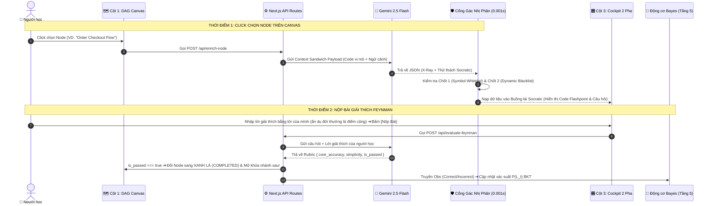
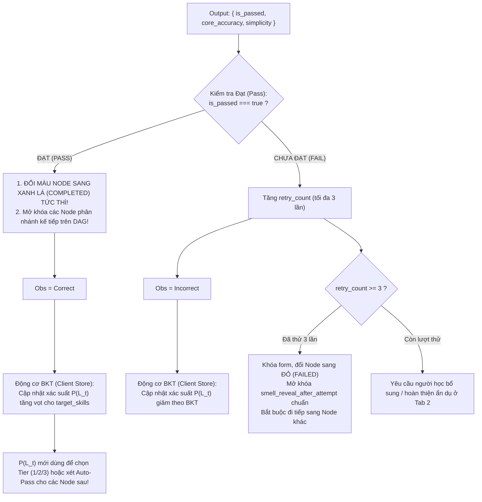

# ĐẶC TẢ KỸ THUẬT AI PIPELINE & CỔNG GÁC NHỊ PHÂN (TẦNG 3 & TẦNG 4)
## DỰ ÁN: SIMPLIFEY V2 PRO — CODEBASE COGNITIVE TWIN

---

| **Thuộc tính** | **Thông số kỹ thuật chuẩn** |
| :--- | :--- |
| **Tài liệu** | `02_AI_VA_BAYES/01_LLM_PIPELINE_GUARDRAIL.md` |
| **Người phụ trách** | **NGƯỜI 3 (AI & COGNITIVE ENGINEER)** |
| **Mô hình AI sử dụng** | **Gemini 2.5 Flash** (Google Gen AI SDK `@google/genai`) |
| **Cơ chế suy luận** | **Single-Pass Contrastive CoT** qua **Structured Outputs (JSON Schema)** |
| **Tần suất gọi AI** | **2 thời điểm JIT (Just-In-Time)** • Tuyệt đối không gọi lúc scan repo |
| **Cam kết độ trễ** | Endpoint 1 (`enrich-node`): **1.2s – 1.8s** • Endpoint 2 (`evaluate-feynman`): **0.8s – 1.2s** |

---

# 1. KIẾN TRÚC LUỒNG GỌI AI, KIỂM SOÁT CHI PHÍ & PRE-FETCHING

### 1.1. Nguyên tắc Kích hoạt Just-In-Time (JIT)
1. **Giai đoạn Tải & Quét Repo (Tầng 0 $\to$ Tầng 2):** $100\%$ code AST tĩnh chạy thuần túy (< 1.5s, tiêu tốn $0\text{ Token}$, chi phí $\$0.00$).
2. **Giai đoạn Tương tác Người học (Tầng 3 & Tầng 4):** AI chỉ được kích hoạt tại đúng 2 thời điểm:
   - **Thời điểm 1 (On-demand):** Người dùng click chọn một Node trên Canvas $\implies$ Gọi `POST /api/enrich-node`.
   - **Thời điểm 2 (Submission):** Người dùng bấm nộp câu trả lời tại Tab 2 $\implies$ Gọi `POST /api/evaluate-feynman`.



---

### 1.2. Bảng Kiểm soát Chi phí & Chống Spam Token (3 Tầng Phòng Thủ)

| Tầng Phòng Thủ | Vị trí Thực thi | Cơ chế Kiểm soát & Điều kiện Kích hoạt | Hành vi Hệ thống khi Vi phạm |
| :--- | :--- | :--- | :--- |
| **Tầng 1: Client Semantic Debounce** | Client UI (0ms, $0\text{ Token}$) | • Vô hiệu hóa nút bấm 3 giây sau mỗi lần click.<br>• So sánh chuỗi (Jaccard / Levenshtein): nội dung mới trùng lặp $\ge 80\%$ so với lần thử trước. | Chặn ngay tại trình duyệt. Thông báo: *"Nội dung chưa thay đổi đáng kể, vui lòng bổ sung lập luận!"* |
| **Tầng 2: Hard Cap Retry Limit** | Client Store / Backend ($0\text{ Token}$) | Mỗi Node chỉ cho phép gọi AI chấm điểm tối đa **3 lần** (`retry_count <= 3`). | Khóa form submit. Đổi màu Node sang **ĐỎ (FAILED)**, mở khóa đáp án chuẩn `smell_reveal_after_attempt`, bắt buộc chuyển sang Node khác. |
| **Tầng 3: Session Token Quota** | Backend Middleware | Đặt hạn ngạch trần **$10,000\text{ tokens/phiên}$** (mức sử dụng trung bình: $3,500\text{ tokens}$ cho toàn bộ 7 Node). | Tự động ngắt kết nối Gemini API. Chuyển sang cơ chế **Offline Fallback Mock Rubric** dựa trên AST/Regex nội bộ. |

---

### 1.3. Quy tắc Tải ngầm Tiên tri (Speculative Background Pre-fetching)
1. **Điều kiện kích hoạt:** Người học dừng lại tại Tab 1 (X-Ray) của Node hiện tại quá **5 giây** (xác nhận trạng thái đọc hiểu nghiêm túc).
2. **Phạm vi giới hạn:** Worker ngầm chỉ tải **duy nhất 01 Node con trực tiếp (Immediate Next Successor)** có điểm ưu tiên cao nhất theo topo đồ thị DAG.
3. **Bộ nhớ đệm (Cache Management):** Dữ liệu trả về được ghi vào `nodeCache[successorNodeId]`:
   - Nếu Cache Hit: Khi người học click sang Node tiếp theo, dữ liệu hiển thị tức thì ($0\text{ms}$ latency, không hiển thị loading skeleton).
   - Nếu Cache Miss: Hiển thị bộ quét Skeleton Scanner và gọi API bình thường.

---

# 2. ĐẶC TẢ ENDPOINT 1 — `POST /api/enrich-node`

Endpoint nhận định danh Node từ Client, đóng gói dữ liệu AST từ Tầng 2, gửi đến Gemini 2.5 Flash để bóc tách mẫu thiết kế và chuẩn bị bài tập phản biện.

### 2.1. Input Schema (`ContextSandwichPayload`)
Payload được thiết kế theo cấu trúc Sandwich 3 lớp:

```typescript
export interface ContextSandwichPayload {
  // LỚP 1: NGỮ CẢNH VĨ MÔ REPO (Macro Context - Lấy từ Tầng 0 & Tầng 2)
  macro_context: {
    repo_name: string;
    tech_stack: string[]; // Trích xuất từ package.json / requirements.txt / pubspec.yaml
    node_id: string;
    node_title: string;
    dag_position: string;
  };

  // LỚP 2: LUỒNG THỰC THI VI MÔ (Micro Trace - Đúng 80-100 dòng code bóc tách từ Tầng 2)
  micro_trace: {
    scoped_code_snippet: string;
    dto_interfaces: string;
  };

  // LỚP 3: RÀNG BUỘC SƯ PHẠM (Invariants)
  invariants: {
    learner_tier: "NOVICE" | "PRACTITIONER" | "ARCHITECT";
    forbidden_external_keywords: string[];
  };
}
```

#### Quy tắc Kỹ thuật Bổ trợ:
1. **Giới hạn Ngân sách Token & AST Code Folding (Mục 6.1 cũ):**
   - Trần tối đa: **$1,500\text{ tokens}$** (tương đương 150 – 200 dòng code hạt nhân).
   - Nếu hàm nghiệp vụ dài vượt ngưỡng, Tree-sitter áp dụng **AST Folding**: tự động gập các khối log, comment rườm rà, và mảng test mock thành `// ... [collapsed N lines of logging/setup]`.
2. **Quy tắc Tạo `forbidden_external_keywords` Động:**
   ```typescript
   const DEFAULT_EXTERNAL_TECH_BLACKLIST = [
     "kafka", "redis", "rabbitmq", "microservices", "docker", 
     "kubernetes", "graphql", "grpc", "elasticsearch", "mongodb", "aws", "serverless"
   ];

   // Loại trừ những công nghệ ĐÃ CÓ THẬT trong tech_stack của repo
   const dynamicBlacklist = DEFAULT_EXTERNAL_TECH_BLACKLIST.filter(
     tech => !macroContext.tech_stack.map(t => t.toLowerCase()).includes(tech.toLowerCase())
   );
   ```

---

### 2.2. System Prompt & Cơ chế Single-Pass Contrastive CoT
Prompt yêu cầu Gemini tự nhẩm qua trường `_internal_reasoning` và lựa chọn câu hỏi theo đúng 2 chế độ Node:

| Chế độ Node | Điều kiện Kích hoạt | Yêu cầu Kỹ thuật Sư phạm trong CoT |
| :--- | :--- | :--- |
| **Chế độ A: Web Business Flow** | Mặc định (`node_type !== "ALGORITHMIC_CORE"`) | • Phân tích mẫu thiết kế (`identified_pattern`) và lý do phân tầng (`why_it_works`).<br>• Trích xuất `execution_steps` tuần tự kèm tọa độ dòng highlight.<br>• Đóng gói thử thách Socratic Feynman (`socratic_challenge`) yêu cầu người học giải thích **vì sao code được thiết kế như vậy**, bám vào hàm/biến cụ thể trong snippet; khuyến khích dùng ví dụ đời thường. |
| **Chế độ B: Algorithmic Core VIP** | `node_type === "ALGORITHMIC_CORE"` (Cognitive Complexity > 15) | • Không hỏi N+1 query web thông thường.<br>• CoT nhẩm theo 3 góc độ: (1) Điều kiện biên gãy vỡ (Edge-cases, chu trình vô hạn, trọng số âm), (2) Thắt cổ chai Big-O (so sánh cấu trúc mảng vs Heap/Tree), (3) Ẩn dụ Feynman về cấu trúc dữ liệu. |

#### Nội dung System Prompt Chuẩn:
```text
BẠN LÀ: Kỹ sư Trưởng kiêm Giảng viên Kiến trúc Mã nguồn trong SimpliFey V2 Pro.
NHIỆM VỤ: Phân tích đoạn code được cung cấp và xuất dữ liệu chuẩn Structured JSON:

1. Phân tích cấu trúc trong internal_design_xray:
   - Xác định identified_pattern và lý do thiết kế why_it_works.
   - Trích xuất execution_steps (mỗi bước gồm: step_index, label, file_path, highlight_lines: number[]).
2. Đóng gói thử thách sư phạm vào socratic_challenge:
   - feynman_question: Câu hỏi Socratic yêu cầu người học giải thích VÌ SAO luồng thực thi hoặc điểm thắt cổ chai trong đoạn code này được viết như vậy, theo cấp độ ${learner_tier}. Câu hỏi phải nhắc tới ít nhất 1 hàm/biến/dòng có thật trong snippet. Có thể gợi ý (không bắt buộc) dùng ví dụ đời thường (quán ăn, đi chợ, giao thông).
   - smell_reveal_after_attempt: Phân tích kỹ thuật chi tiết và giải pháp kiến trúc chuẩn mực (ẩn đi cho đến khi học viên hoàn thành hoặc sau 3 lần thử).
3. Ràng buộc:
   - referenced_symbols: 100% phải là tên biến/hàm/lớp có thật trong snippet.
   - Không hỏi về các công nghệ ngoài: ${forbidden_external_keywords.join(", ")}.
```

---

### 2.3. Output Schema (`EnrichedSliceResponse`)

```json
{
  "_internal_reasoning": {
    "candidate_probes": [
      {
        "angle": "Hỏi định nghĩa lý thuyết vẹt",
        "probe": "N+1 query là gì?",
        "verdict": "REJECT - Học vẹt định nghĩa giáo khoa"
      },
      {
        "angle": "Hỏi tình huống mở rộng thiết kế",
        "probe": "Nếu thêm worker chạy ngầm, việc tách Service giúp ích gì?",
        "verdict": "VALID - Nhưng vượt cấp độ NOVICE"
      },
      {
        "angle": "Ẩn dụ đời thường Feynman về Điểm Dở",
        "probe": "Dùng ví dụ đời thường giải thích tại sao cập nhật DB từng dòng trong vòng lặp làm nghẽn máy chủ?",
        "verdict": "SELECTED - Phù hợp cấp độ NOVICE, kích thích tư duy bản chất"
      }
    ]
  },
  "internal_design_xray": {
    "identified_pattern": "Layered Architecture + Dependency Injection",
    "why_it_works": "Tách Controller khỏi Service giúp kiểm thử độc lập và chuẩn hóa nghiệp vụ thanh toán.",
    "execution_steps": [
      {
        "step_index": 1,
        "label": "Nhận DTO từ HTTP Request",
        "file_path": "src/controllers/order.controller.ts",
        "highlight_lines": [8, 9, 10, 11]
      },
      {
        "step_index": 2,
        "label": "Service điều phối nghiệp vụ và duyệt danh sách mặt hàng",
        "file_path": "src/services/order.service.ts",
        "highlight_lines": [20, 21, 22, 23, 24]
      },
      {
        "step_index": 3,
        "label": "Repository thực thi câu truy vấn cập nhật tồn kho",
        "file_path": "src/repos/inventory.repo.ts",
        "highlight_lines": [10, 11, 12]
      }
    ]
  },
  "referenced_symbols": ["postCheckout", "processCheckout", "updateStock", "items"],
  "target_skills": ["DB_OPTIMIZATION", "ASYNC_CONCURRENCY"],
  "socratic_challenge": {
    "feynman_question": "Dựa vào đoạn code trên, hãy dùng một ví dụ đời thường (như gọi món quán ăn) giải thích cho người không biết IT hiểu: Tại sao cách cập nhật tồn kho từng món trong vòng lặp lại làm máy chủ bị đơ khi có 100 người cùng bấm mua?",
    "smell_reveal_after_attempt": "Lỗi N+1 Query: Chạy truy vấn I/O tuần tự trong vòng lặp for-of gây lãng phí round-trip kết nối Database. Giải pháp chuẩn là dùng Bulk Update hoặc gom ID cập nhật 1 lượt."
  }
}
```

---

# 3. CỔNG GÁC NHỊ PHÂN (BINARY VERIFICATION GATE - 0.001s)

Chạy ngay sau khi nhận Output JSON từ Gemini Flash để đảm bảo tính an toàn ngữ nghĩa tuyệt đối trước khi trả về Frontend:

```typescript
export interface EnrichedSliceResponse {
  _internal_reasoning: { candidate_probes: Array<{ angle: string; probe: string; verdict: string }> };
  internal_design_xray: {
    identified_pattern: string;
    why_it_works: string;
    execution_steps: Array<{ step_index: number; label: string; file_path: string; highlight_lines: number[] }>;
  };
  referenced_symbols: string[];
  target_skills: string[];
  socratic_challenge: {
    feynman_question: string;
    smell_reveal_after_attempt: string;
  };
}

export function verifyWithBinaryGate(
  aiOutput: EnrichedSliceResponse,
  symbolTable: Set<string>,
  dynamicBlacklist: string[],
  isRelaxedMode: boolean = false
): boolean {
  // CHỐT 1: Symbol Whitelist Check (Chống bịa tên hàm/biến)
  if (!isRelaxedMode) {
    const isSymbolsValid = aiOutput.referenced_symbols.every(sym => symbolTable.has(sym));
    if (!isSymbolsValid) {
      console.warn("[BinaryGate: Chốt 1 Failed] AI sử dụng symbol không có trong AST!");
      return false;
    }
  } else {
    const hasAnyValidSymbol = aiOutput.referenced_symbols.some(sym => symbolTable.has(sym));
    if (!hasAnyValidSymbol && aiOutput.referenced_symbols.length > 0) {
      console.warn("[BinaryGate: Chốt 1 Relaxed Failed] Không tìm thấy symbol hợp lệ nào!");
      return false;
    }
  }

  // CHỐT 2: Dynamic Blacklist Check (Chống hỏi công nghệ ngoài tech_stack)
  const questionLower = aiOutput.socratic_challenge.feynman_question.toLowerCase();
  const hasForbidden = dynamicBlacklist.some(kw => questionLower.includes(kw.toLowerCase()));
  if (hasForbidden) {
    console.warn("[BinaryGate: Chốt 2 Failed] Câu hỏi chứa công nghệ ngoài repo!");
    return false;
  }

  return true; // PASS (1) - Dữ liệu sạch sẽ
}
```

* **Cơ chế Fallback (AST Static Question):** Nếu Cổng gác trả về `false`, hệ thống lập tức nạp câu hỏi AST cú pháp tĩnh an toàn: *"Trong hàm `processCheckout`, dữ liệu DTO được truyền vào hàm `updateStock` qua tham số nào?"*.

---

# 4. ĐẶC TẢ ENDPOINT 2 — `POST /api/evaluate-feynman`

Endpoint chấm điểm câu trả lời của sinh viên theo phương pháp sư phạm Feynman và phát tín hiệu cập nhật trạng thái đồ thị.

### 4.1. Input Schema

```typescript
export interface EvaluateFeynmanRequest {
  node_id: string;
  question: string;
  student_answer: string;
  target_skills: string[];  // Danh sách kỹ năng thuộc 16 SWE Skills
}
```

---

### 4.2. System Prompt & Rubric Chấm Điểm

```text
BẠN LÀ: Giám khảo Chấm thi Sư phạm Feynman trong SimpliFey V2 Pro.
NHIỆM VỤ: Đánh giá câu trả lời của sinh viên cho câu hỏi kiến trúc dựa trên đoạn code mục tiêu.

NGƯỜI HỌC: sinh viên IT, vibecoder hoặc người trái ngành đang muốn hiểu đoạn code (thường do AI viết).
Chấp nhận mọi cách diễn đạt: lời bình dân, ẩn dụ, hay thuật ngữ chuyên ngành đều được.

RUBRIC CHẤM ĐIỂM (0 - 100):
1. core_accuracy (0 - 100) — TIÊU CHÍ QUYẾT ĐỊNH ĐẠT/TRƯỢT:
   - 90 - 100: Giải thích đúng VÌ SAO code được viết như vậy (VD: nghẽn I/O Database, round-trip, race condition)
               VÀ bám đúng code thật (nhắc đúng hàm/biến/luồng trong snippet).
   - 60 - 80: Đúng hướng nhưng còn thiếu ý, hoặc nói đúng lý thuyết mà không gắn được vào đoạn code này.
   - < 60: Sai bản chất, hoặc chỉ đọc thuộc định nghĩa/thuật ngữ mà không giải thích được trong code này.
2. simplicity (0 - 100) — ĐIỂM CỘNG, KHÔNG ảnh hưởng Đạt/Trượt:
   - 90 - 100: Có ẩn dụ đời thường trực quan (quán ăn, đi chợ, giao thông) giúp người ngoài ngành hiểu.
   - 60 - 80: Diễn đạt rõ ràng nhưng chưa có ví dụ đời thường.
   - < 60: Khó hiểu, rời rạc.
   - Dùng thuật ngữ chuyên ngành KHÔNG bị trừ điểm.

QUY TẮC ĐẠT (PASS):
is_passed = true NẾU VÀ CHỈ NẾU core_accuracy >= 70.
(Backend tự tính lại is_passed từ core_accuracy, không tin trường is_passed do model trả về.)
```

> [!NOTE]
> **Vì sao ẩn dụ chỉ là điểm cộng:** Mục tiêu sản phẩm là giúp người dùng **hiểu code AI viết và vì sao nó được viết như vậy**, không phải luyện diễn đạt. Một người trả lời đúng bằng thuật ngữ ("đây là N+1 query, nên gom lại thành bulk update") đã hiểu thật và phải được Đạt. Việc chống "học vẹt" chuyển sang tiêu chí **bám code** trong `core_accuracy`: đọc thuộc định nghĩa mà không chỉ ra được nó nằm ở đâu trong đoạn code này thì vẫn Trượt.

---

### 4.3. Output Schema & Điểm Nối Sang Động Cơ Bayes (Tầng 5)

```json
{
  "core_accuracy": 92,
  "simplicity": 95,
  "is_passed": true,
  "feedback": "Ẩn dụ người bồi bàn chạy từng món vào bếp rất trực quan! Phản ánh chuẩn xác chi phí kết nối tuần tự của lỗi N+1 Query.",
  "detected_jargons": []
}
```
* `detected_jargons`: chỉ để hiển thị gợi ý (VD: giải nghĩa thuật ngữ cho người trái ngành), **không dùng để trừ điểm**.

#### Sơ đồ Xử lý Trạng thái & Đổi màu Node:



> [!IMPORTANT]
> **Quy tắc Đổi màu Node:** Node chuyển sang trạng thái **XANH LÁ (COMPLETED)** ngay lập tức khi `is_passed === true`. Chỉ số $P(L_t)$ là điểm tích lũy dài hạn qua các bài toán để điều phối Tier câu hỏi và kích hoạt Auto-Pass ở các Node sau, **không dùng $P(L_t) \ge 0.50$ để chặn hoàn thành Node hiện tại**.

#### Mã giả Zustand Client Store:
```typescript
// File: store/useCognitiveStore.ts
const handleFeynmanResult = (result: FeynmanEvaluationResult, targetSkills: SWESkill[]) => {
  const isCorrect = result.is_passed === true;

  // 1. Cập nhật BKT cho từng kỹ năng mục tiêu
  targetSkills.forEach(skill => {
    updateSkillBKT(skill, isCorrect ? "CORRECT" : "INCORRECT");
  });

  // 2. Cập nhật trạng thái đồ thị DAG
  if (isCorrect) {
    setNodeStatus(currentNodeId, "COMPLETED");
    unlockSuccessorNodes(currentNodeId);
  } else {
    incrementRetryCount(currentNodeId);
    if (getRetryCount(currentNodeId) >= 3) {
      setNodeStatus(currentNodeId, "FAILED");
      revealHiddenSmell(currentNodeId); // Mở khóa lời giải thích chuẩn smell_reveal_after_attempt
    }
  }
};
```
