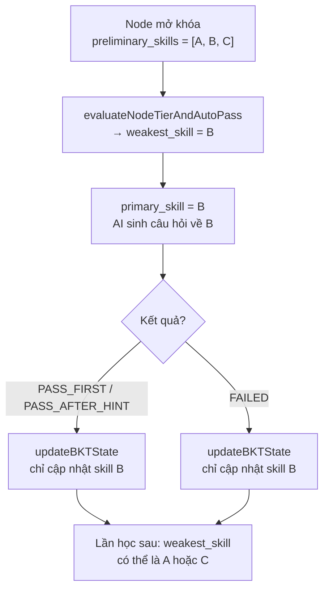
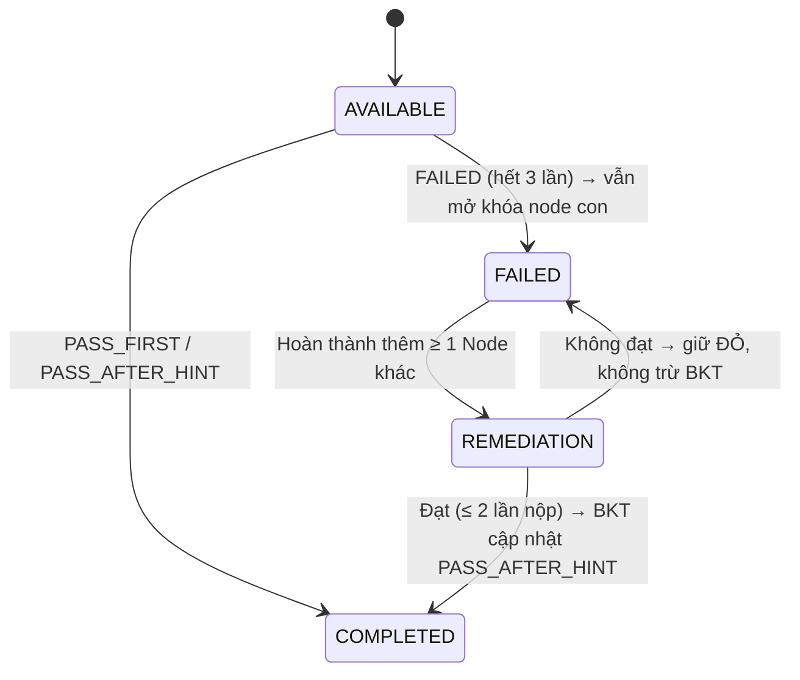
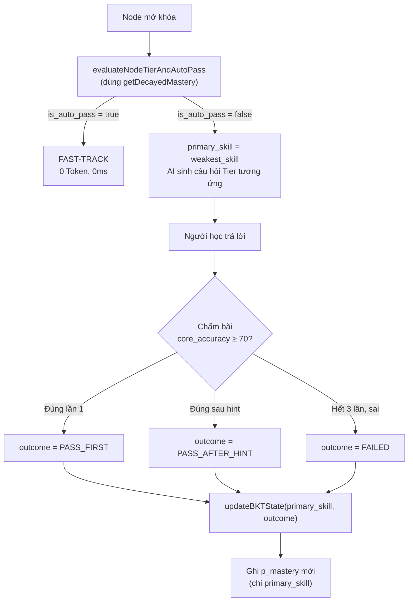
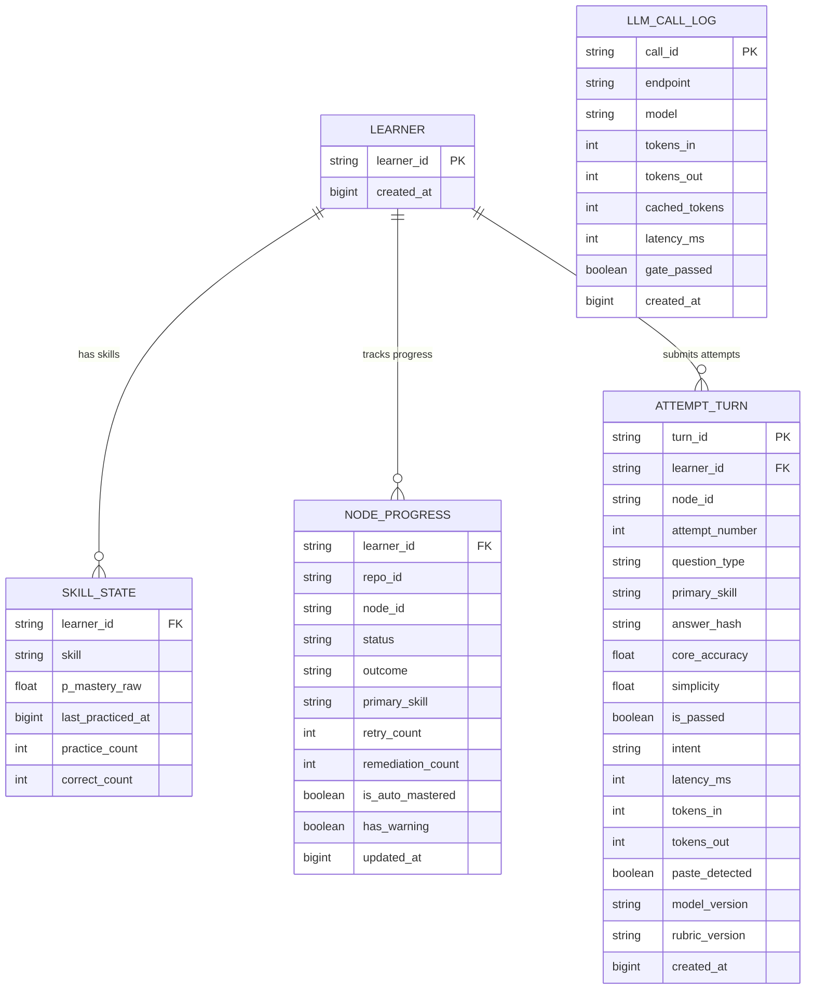

# ĐẶC TẢ ĐỘNG CƠ NHẬN THỨC BAYES, q-MATRIX & THANG TIẾN HÓA (TẦNG 5)
## DỰ ÁN: SIMPLIFEY V2 PRO — CODEBASE COGNITIVE TWIN

---

| **Thuộc tính** | **Thông số kỹ thuật chuẩn** |
| :--- | :--- |
| **Tài liệu** | `02_AI_VA_BAYES/02_BAYES_COGNITIVE_BKT.md` |
| **Người phụ trách** | **NGƯỜI 3 (AI & COGNITIVE ENGINEER)** |
| **Nền tảng lý thuyết** | **Bayesian Knowledge Tracing (Corbett & Anderson, 1995)**, **Ebbinghaus Decay (1885)** |
| **Môi trường thực thi** | **Server** (trong transaction `evaluate-feynman`, lưu Postgres) • Client dùng chung hàm thuần chỉ để vẽ decay • Thời gian tính toán: **< 0.002s** • Chi phí: **0 Token AI** |
| **Mục tiêu kỹ thuật** | Mô hình hóa năng lực người học, phân phối độ khó 3-Tier, tự động miễn thi Fast-Track |

---

# 1. KHÔNG GIAN TRẠNG THÁI & MA TRẬN 16 KỸ NĂNG ($q$-MATRIX)

### 1.1. Danh mục Cố định 16 Kỹ năng Kỹ nghệ Phần mềm Chuẩn (SWE Skills)

Hệ thống định lượng trình độ người học trên không gian véctơ 16 chiều $\mathcal{K} = \{k_1, k_2, \dots, k_{16}\}$. Mỗi kỹ năng được nhận diện sơ bộ qua bộ lọc AST tĩnh (Tầng 2) với chi phí $0\text{ Token}$:

| STT | Mã Enum Kỹ năng | Tên Kỹ năng & Trọng tâm Đánh giá | Dấu hiệu Nhận diện AST Tĩnh tại Tầng 2 (Static AST Heuristics) |
| :---: | :--- | :--- | :--- |
| **$k_1$** | `HTTP_ROUTING` | Định tuyến HTTP, RESTful URL mapping, Controller endpoints | Decorator `@Get()`, `@Post()`, `router.get()`, `app.post()`, `@Controller()` |
| **$k_2$** | `DTO_VALIDATION` | Kiểm thực dữ liệu đầu vào, schema integrity, type casting | Khai báo Zod `z.object()`, class-validator `@IsString()`, `@IsNotEmpty()`, Joi schema |
| **$k_3$** | `AUTH_SECURITY` | Xác thực & phân quyền, Guard bảo vệ, xử lý JWT/Session | Decorator `@UseGuards()`, `passport.authenticate()`, `jwt.verify()`, middleware auth |
| **$k_4$** | `DEPENDENCY_INJECTION` | Tiêm phụ thuộc, IoC Container, loose coupling giữa các tầng | Decorator `@Injectable()`, `@Inject()`, constructor parameter injection |
| **$k_5$** | `LAYERED_SEPARATION` | Phân tầng kiến trúc sạch (Controller $\to$ Service $\to$ Repo) | Import/gọi hàm chéo giữa controller/service/repo, interface abstractions |
| **$k_6$** | `DB_OPTIMIZATION` | Tối ưu hóa truy vấn CSDL, chống N+1 query, Indexing | Lệnh query trong vòng lặp (`for`/`map` chứa `repo.find`), missing relations/join |
| **$k_7$** | `ASYNC_CONCURRENCY` | Lập trình bất đồng bộ, Promise chain, await, non-blocking | Từ khóa `async`/`await`, `Promise.all()`, `Promise.race()`, EventEmitter |
| **$k_8$** | `TRANSACTION_INTEGRITY` | Toàn vẹn giao dịch ACID, transaction commit/rollback | `queryRunner.startTransaction()`, `prisma.$transaction()`, `db.beginTransaction()` |
| **$k_9$** | `ERROR_HANDLING` | Bắt và xử lý ngoại lệ, Global Exception Filters, Error Envelopes | Khối `try/catch`, `throw new HttpException()`, middleware `(err, req, res, next)` |
| **$k_{10}$** | `STATE_MANAGEMENT` | Quản lý trạng thái ứng dụng, state transitions, domain state | Các biến trạng thái module, in-memory Map/Set, Finite State Machine, Zustand store |
| **$k_{11}$** | `ALGORITHMIC_COMPLEXITY` | Tối ưu độ phức tạp thuật toán, cấu trúc dữ liệu, Big-O | Vòng lặp lồng nhau $\ge 2$ cấp, đệ quy, sắp xếp, duyệt đồ thị/cây, Map tra cứu $O(1)$ |
| **$k_{12}$** | `MEMORY_MANAGEMENT` | Quản lý bộ nhớ, Streams, Buffer, chống rò rỉ (memory leak) | `fs.createReadStream()`, `stream.pipe()`, `Buffer.from()`, `emitter.removeListener()` |
| **$k_{13}$** | `API_CONTRACT_DESIGN` | Thiết kế giao tiếp API, chuẩn hóa response format, HTTP status | `res.status(200).json()`, Swagger `@ApiResponse()`, OpenAPI schema tags |
| **$k_{14}$** | `CACHING_STRATEGY` | Chiến lược bộ nhớ đệm, Cache-Aside, thiết lập TTL, invalidate | `redisClient.get()`, `cacheManager.set()`, TTL options, memory-cache |
| **$k_{15}$** | `RATE_LIMIT_RESILIENCE` | Khả năng chịu tải, Rate Limiting, Throttling, Circuit Breaker | Middleware `express-rate-limit`, ThrottlerGuard, retry logic exponential backoff |
| **$k_{16}$** | `DATA_SERIALIZATION` | Tuần tự hóa dữ liệu, JSON transform, DTO mapping, Marshalling | `JSON.parse()`, `classToPlain()`, `plainToInstance()`, custom serialization |

---

### 1.2. Cơ chế Gán nhãn Tĩnh Sơ bộ (`preliminary_skills`) Khử Nghịch lý "Con gà - Quả trứng"
* **Bản chất vấn đề:** Nếu phải chờ Gemini Flash phân tích ở `/api/enrich-node` mới có danh sách kỹ năng, hệ thống buộc phải tiêu tốn token và chịu độ trễ $1.5\text{s}$ trước khi biết người học có đủ điều kiện miễn thi hay không.
* **Giải pháp Kỹ thuật:**
  1. Tại **Tầng 2 (Static AST Parsing - 0 Token, < 1.5s)**: Parser tự động đối sánh mã nguồn Node với bảng heuristics ở trên để gán mảng `preliminary_skills: SWESkill[]` (từ 1 đến 3 kỹ năng) vào metadata của từng Node trên đồ thị DAG.
  2. Ngay khi Node **đủ điều kiện mở khóa** (mọi node cha đã COMPLETED hoặc FAILED): server (hàm `applyUnlocksAndFastTrack` trong cùng transaction, `00_CORE_SPEC/04_LUU_TRU_VA_DONG_BO.md` Mục 6.2) kiểm tra điều kiện Auto-Pass ($\ge 0.92$, tính trên điểm **đã decay**) với `preliminary_skills`. Nếu thỏa mãn (và node không bị Capstone Lock, Mục 3.3), Node chuyển thẳng sang `COMPLETED` với `is_auto_mastered = true` mà **hoàn toàn không cần gọi API AI**; ngược lại chuyển sang `AVAILABLE`.
  3. AI chỉ được chọn `target_skills` **trong** `preliminary_skills` (Cổng gác kiểm tra, xem `01_LLM_PIPELINE_GUARDRAIL.md` Mục 3), để BKT cập nhật đúng tập kỹ năng mà Fast-Track xét.

---

### 1.3. Cấu trúc Dữ liệu Lưu trữ `LearnerCognitiveProfile` (Postgres, bản sao ở Zustand)

Kiểu dữ liệu định nghĩa duy nhất trong [`00_CORE_SPEC/02_DATA_CONTRACTS.md`](../00_CORE_SPEC/02_DATA_CONTRACTS.md) Mục 3: `SWESkill`, `CognitiveSkillState`, `NodeProgressRecord`, `LearnerCognitiveProfile`. Quy tắc quan trọng: `p_mastery` là giá trị **gốc** sau lần cập nhật BKT gần nhất; giá trị đã decay **không được lưu**, chỉ tính khi đọc (Mục 2.4).

> [!IMPORTANT]
> **Đề xuất bổ sung contract (chưa có trong `02_DATA_CONTRACTS.md`, cần NGƯỜI 1 thêm vào):** kiểu `NodeOutcome = "PASS_FIRST" | "PASS_AFTER_HINT" | "FAILED"` (Mục 2.1a); và 3 trường của `NodeProgressRecord`: `outcome: NodeOutcome | null`, `primary_skill: SWESkill | null` (Mục 2.1b), `remediation_count: number` (số lần đã Ôn lại trong phiên, Mục 2.1c). Danh sách đầy đủ ở Phụ lục cuối `01_LLM_PIPELINE_GUARDRAIL.md`.

```json
{
  "user_id": "usr_dev_4091",
  "overall_tier": "PRACTITIONER",
  "last_updated_at": 1774000000000,
  "skills": {
    "HTTP_ROUTING": { "skill": "HTTP_ROUTING", "p_mastery": 0.82, "last_practiced_at": 1773900000000, "practice_count": 4, "correct_count": 3 },
    "DB_OPTIMIZATION": { "skill": "DB_OPTIMIZATION", "p_mastery": 0.25, "last_practiced_at": 1773800000000, "practice_count": 1, "correct_count": 0 },
    "ASYNC_CONCURRENCY": { "skill": "ASYNC_CONCURRENCY", "p_mastery": 0.74, "last_practiced_at": 1773950000000, "practice_count": 3, "correct_count": 3 }
  },
  "node_history": {
    "slice-order-checkout": {
      "node_id": "slice-order-checkout",
      "status": "COMPLETED",
      "is_auto_mastered": false,
      "has_warning": false,
      "retry_count": 1,
      "last_attempt_at": 1773950000000,
      "outcome": "PASS_AFTER_HINT",
      "primary_skill": "DB_OPTIMIZATION",
      "remediation_count": 0
    }
  }
}
```

---

# 2. MÔ HÌNH TOÁN HỌC BKT & SUY GIẢM TRÍ NHỚ (HALF-LIFE DECAY)

### 2.1. Bảng Tham số BKT Chuẩn hóa (Khắc phục Triệt để Lỗi Logic Cũ)

| Tham số | Ký hiệu | Giá trị Chuẩn | Ý nghĩa Sư phạm Kỹ thuật |
| :--- | :---: | :---: | :--- |
| **Prior** | $P(L_0)$ | **$0.25$** | Xác suất tiên nghiệm người học đã làm chủ kỹ năng trước khi vào bài. |
| **Transit (Correct)** | $P(T \mid \text{Correct})$ | **$0.08$** | Tỷ lệ tiếp thu tri thức sau khi người học giải thích đúng. Giữ nhỏ để mỗi lần đúng chỉ nâng 1 bậc Tier. |
| **Transit (Incorrect)** | $P(T \mid \text{Incorrect})$ | **$0.03$** | Tỷ lệ tiếp thu nhỏ từ câu hỏi gợi mở và đáp án được mở khi người học trả lời sai. |
| **Guess** | $P(G)$ | **$0.25$** | Xác suất chưa hiểu sâu nhưng vẫn đạt: ăn may trúng rubric, hoặc nhờ AI khác trả lời hộ (rủi ro thực tế với nhóm người dùng vibecoder). |
| **Guess (có gợi ý)** | $P(G_{\text{hint}})$ | **$0.50$** | Xác suất "đoán trúng" khi đã nhận gợi ý — bằng chứng yếu hơn `PASS_FIRST`. |
| **Slip** | $P(S)$ | **$0.12$** | Xác suất đã làm chủ nhưng không đạt: gõ thiếu ý, hoặc bộ chấm LLM chấm nhiễu. Nằm trong dải $0.10 - 0.15$ để một lần sơ suất không xóa sạch thành tích. |

> [!NOTE]
> **Vì sao chọn bộ tham số này (thay cho bộ cũ $P(T)=0.20, P(G)=0.15, P(S)=0.05$):** Bộ cũ cho $0.25 \to 0.7429 \to 0.9585$, tức là 2 lần đúng đã vượt ngưỡng Fast-Track $0.92$, nên người học **không bao giờ gặp Tier 3 (ARCHITECT)**. Đồng thời, đang ở $0.90$ mà trượt 1 lần thì tụt về $0.36$. Bộ mới đảm bảo **mỗi lần đúng leo đúng 1 bậc** (Tier 1 → 2 → 3 → Fast-Track, xem Mục 2.3), còn một lần sơ suất ở $0.90$ chỉ tụt về $0.60$. Đây vẫn là tham số **đặt tay có lý do**; Giai đoạn 2 sẽ fit lại bằng dữ liệu thật (xem Roadmap).

---

### 2.1a. Quy tắc Cập nhật BKT: 1 Quan sát duy nhất mỗi Node

**Vấn đề với cách cũ:** Mỗi lần retry (thử lại) bị tính là Wrong, phạt nặng người học đang nỗ lực tìm hiểu thông qua gợi ý — mâu thuẫn trực tiếp với triết lý hỗ trợ bằng hint.

**Giải pháp:** BKT chỉ cập nhật **1 lần duy nhất** cho mỗi Node, dựa trên **kết quả cuối cùng** (`NodeOutcome`):

| Outcome | Quan sát BKT | Tham số dùng | Lý do |
| :--- | :--- | :--- | :--- |
| `PASS_FIRST` | Correct | $P(G)=0.25$ | Bằng chứng mạnh — đạt không cần gợi ý |
| `PASS_AFTER_HINT` | Correct | $P(G_{\text{hint}})=0.50$ | Có gợi ý thì "đoán trúng" dễ hơn ⇒ bằng chứng yếu hơn |
| `FAILED` | Incorrect | $P(G)=0.25$ | Một quan sát Sai duy nhất, không phải 3 lần Sai liên tiếp |

**Bảng tham chiếu $P(L_t)$ sau cập nhật** (tính sẵn, dùng $P(S)=0.12$, $P(T\mid C)=0.08$, $P(T\mid I)=0.03$):

| $P$ trước | `PASS_FIRST` | `PASS_AFTER_HINT` | `FAILED` |
| :---: | :---: | :---: | :---: |
| 0.2500 | 0.5767 | 0.4202 | 0.0791 |
| 0.5767 | 0.8413 | 0.7292 | 0.2036 |
| 0.8413 | 0.9532 | 0.9109 | 0.4752 |

> [!IMPORTANT]
> **Cách đọc bảng:** Giá trị `PASS_FIRST` cột $P=0.25$ cho ra $0.5767$ — hoàn toàn khớp với ví dụ chạy tay ở Mục 2.3. Giá trị `PASS_AFTER_HINT` luôn thấp hơn `PASS_FIRST` vì $P(G_{\text{hint}})=0.50 > P(G)=0.25$, làm giảm bằng chứng Correct.

---

### 2.1b. Mỗi câu hỏi nhắm 1 Kỹ năng Chính (`primary_skill`)

**Nguyên tắc:** Một câu trả lời chỉ là bằng chứng cho kỹ năng đang được hỏi. Nếu Node có 3 kỹ năng mà BKT cập nhật cả 3 từ 1 câu trả lời, mô hình sẽ bơm phồng hoặc đánh sụp $P(L_t)$ sai lệch.

**Quy trình xác định `primary_skill`:**

1. `evaluateNodeTierAndAutoPass` trả về `weakest_skill` — kỹ năng yếu nhất trong `preliminary_skills` của Node.
2. `primary_skill = weakest_skill` — AI sinh câu hỏi **tập trung** vào kỹ năng này.
3. Sau khi chấm, BKT **chỉ cập nhật `primary_skill`** (không cập nhật các kỹ năng khác).

**Quy tắc phá hòa (bắt buộc, vì lúc mới bắt đầu mọi kỹ năng đều bằng $0.25$):** nếu nhiều kỹ năng cùng điểm thấp nhất, chọn theo thứ tự:
1. Kỹ năng có `practice_count` nhỏ hơn (chưa từng được hỏi thì ưu tiên).
2. Kỹ năng đứng trước trong `preliminary_skills`. **Yêu cầu với Tầng 2:** `preliminary_skills` phải được sắp theo độ mạnh tín hiệu AST giảm dần, phần tử đầu là "điểm nóng" đặc trưng nhất của Node (VD: phát hiện query trong vòng lặp ⇒ `DB_OPTIMIZATION` đứng đầu).

**Node đa kỹ năng trong thực tế:** Mỗi lượt học 1 Node chỉ có **1 câu hỏi chính** (về `primary_skill`), cộng tối đa 2 câu gợi ý khi trả lời sai. Đạt câu đó là Node XANH. Các kỹ năng còn lại của Node **không bị bỏ qua** mà được đo ở **các Node khác** của repo, nơi chúng là kỹ năng yếu nhất (VD: `HTTP_ROUTING` xuất hiện ở hầu hết Node có Controller). Một Node đã XANH chỉ bị hỏi lại khi: (a) có cảnh báo decay (Mục 2.4), lúc đó hỏi kỹ năng yếu nhất *hiện tại*; hoặc (b) người học mở repo khác có Node tương tự. Xem kịch bản thực tế ở Mục 2.1d.



---

### 2.1c. Lối phục hồi cho Node ĐỎ (FAILED Recovery)

Node `FAILED` **không chặn lộ trình và không bị khóa vĩnh viễn**. Màu ĐỎ **không phải điểm trừ, mà là chỗ người học cần quay lại**. Nó có 3 vai trò:
- **Đánh dấu lỗ hổng:** biến DAG thành bản đồ "code của bạn, bạn hiểu tới đâu", chỉ rõ phần code và kỹ năng chưa nắm, kèm đáp án đã xem để đọc lại. Nếu không có màu đỏ, Node "đã học nhưng chưa hiểu" sẽ trông y hệt Node chưa học.
- **Kéo người học quay lại:** hiện nút "Ôn lại" khi đủ điều kiện (bước 1 bên dưới); bảng tổng kết cuối phiên liệt kê các Node đỏ là việc cần làm tiếp.
- **Tiến độ trung thực:** % hiểu repo chỉ đếm Node XANH; repo chỉ được tính "đã hiểu xong" khi **không còn Node đỏ**. Đây là động lực ôn lại, thay cho khóa cứng.

0. **Ngay khi bị ĐỎ:** người học xem đáp án (`/api/reveal`), và **các Node con vẫn được mở khóa** để đi tiếp. Nếu Node đỏ chặn Node con, người học có thể kẹt cứng khi không còn Node nào khác để học. Màu đỏ được giữ lại như một "món nợ" chờ ôn.
1. **Khi nào được Ôn lại:** sau khi hoàn thành **thêm ít nhất 1 Node khác** (để có khoảng nghỉ, tránh học vẹt đáp án vừa xem). Node đỏ hiện nút **"Ôn lại"**.
2. **Câu ôn lại:** 1 câu **Tier NOVICE** (Data-Flow Tracing) về `primary_skill`, **phải khác góc hỏi với câu gốc** (prompt nhận câu hỏi gốc kèm chỉ thị "không hỏi lại câu này"), vì người học đã xem đáp án câu gốc.
3. **Số lượt:** tối đa **2 lần nộp** (câu ôn lại + 1 gợi ý `CODE_POINTER`). Mỗi Node được Ôn lại tối đa **2 lần mỗi phiên** (giữ trong quota token).
4. **Đạt** (lần 1 hay sau gợi ý đều vậy) ⇒ Node chuyển **XANH (COMPLETED)**, BKT cập nhật theo `PASS_AFTER_HINT` (bằng chứng yếu vì đã từng xem đáp án).
5. **Không đạt** ⇒ Node giữ **ĐỎ**, BKT **không trừ thêm** (tránh vòng xoáy tụt sàn). Muốn Ôn lại lần nữa phải hoàn thành thêm 1 Node khác.



---

### 2.1d. Kịch bản Người dùng Thực tế (minh họa toàn bộ quy tắc 2.1a – 2.1c)

Repo mẫu: web bán hàng do AI viết, có Node **"Thanh toán đơn hàng"** với `preliminary_skills = [DB_OPTIMIZATION, TRANSACTION_INTEGRITY, HTTP_ROUTING]` (Tầng 2 phát hiện query trong vòng lặp nên `DB_OPTIMIZATION` đứng đầu).

**Kịch bản A: Lan (trái ngành, vibecoder), đúng sau gợi ý**
- Mọi kỹ năng của Lan đang là $0.25$ ⇒ hòa ⇒ phá hòa chọn `DB_OPTIMIZATION`, Tier NOVICE.
- Câu hỏi chính: *"Trong `processCheckout`, vòng lặp chạy qua `items` và mỗi vòng gọi `updateStock`. Giỏ hàng có 10 món thì database nhận bao nhiêu lệnh?"*
- Lan trả lời *"1 lệnh, vì bấm thanh toán 1 lần"* ⇒ Trượt. AI không đưa đáp án mà hỏi gợi mở (CONCEPT): *"Nếu đi chợ mua 10 món mà mỗi món phải về nhà cất rồi quay lại chợ, bạn đi bao nhiêu chuyến? Trong đoạn code này, việc 'quay lại chợ' giống dòng nào?"*
- Lan: *"À, mỗi món gọi `updateStock` một lần, nên 10 lệnh, đông người mua sẽ chậm"* ⇒ Đạt ⇒ `PASS_AFTER_HINT`.
- Kết quả: Node XANH; `DB_OPTIMIZATION`: $0.25 \to 0.4202$ (vẫn NOVICE, lần sau gặp DB vẫn hỏi mức dễ). `TRANSACTION_INTEGRITY`, `HTTP_ROUTING` giữ nguyên, sẽ được hỏi ở Node khác.

**Kịch bản B: Minh (sinh viên IT năm 3), đúng ngay**
- `DB_OPTIMIZATION` của Minh đã là $0.5767$ từ repo trước ⇒ Tier PRACTITIONER: *"Vì sao gọi `updateStock` trong vòng lặp gây chậm khi 100 người cùng mua, và nên sửa theo hướng nào?"*
- Minh trả lời đúng ngay lần đầu (dùng thuật ngữ "N+1 query, gom thành bulk update", không cần ẩn dụ) ⇒ `PASS_FIRST`: $0.5767 \to 0.8413$ ⇒ lần sau lên Tier ARCHITECT.

**Kịch bản C: Lan bị ĐỎ rồi Ôn lại**
- Node **"Đăng nhập"**, `primary_skill = AUTH_SECURITY` ($0.25$). Câu hỏi: *"Trước khi vào `getProfile`, request đi qua hàm nào để kiểm tra token?"*
- Lần 1 sai ⇒ gợi ý CONCEPT (bảo vệ kiểm tra vé trước cổng). Lần 2 sai ⇒ gợi ý CODE_POINTER (trỏ vào bước `verifyToken` trong middleware). Lần 3 vẫn sai ⇒ **ĐỎ**, xem đáp án, BKT cập nhật 1 lần: $0.25 \to 0.0791$. Node con vẫn mở, Lan học tiếp.
- Lan hoàn thành Node "Thanh toán" (Kịch bản A) ⇒ Node "Đăng nhập" hiện nút **Ôn lại**.
- Câu ôn lại (góc khác): *"Token nằm ở phần nào của request, và đi qua những hàm nào trước khi tới `getProfile`?"* Lan trả lời đúng ⇒ Node XANH, `PASS_AFTER_HINT`: $0.0791 \to 0.2008$.
- Gặp Node có `AUTH_SECURITY` lần sau mà đúng ngay: $0.2008 \to 0.5118$ (lên Tier 2).

**Kịch bản D: Huy (đã làm chủ), được miễn thi**
- Node **"Tạo sản phẩm"** có `[HTTP_ROUTING, DTO_VALIDATION]`, cả hai của Huy đều $0.9532$ ($\ge 0.92$) ⇒ Fast-Track: Node XANH NHẠT ngay khi mở khóa, **không gọi AI, 0 token**.
- 30 ngày sau Huy không ôn: $0.9532 \to 0.4092$ ($< 0.45$) ⇒ Node hiện viền cảnh báo decay, click vào sẽ được hỏi lại kỹ năng yếu nhất hiện tại.

---

### 2.2. Hệ thống Công thức Cập nhật Hậu nghiệm & Chuyển trạng thái

1. **Quy tắc Ánh xạ Quan sát ($\text{Obs}$):**
   $$\text{Obs} = \begin{cases} \text{Correct} & \text{nếu } \text{core\_accuracy} \ge 70 \\ \text{Incorrect} & \text{ngược lại} \end{cases}$$
   * `core_accuracy` đo việc người học **hiểu đúng vì sao code được viết như vậy và bám đúng code thật** (nhắc đúng hàm, biến, luồng). `simplicity` (dùng ẩn dụ đời thường) **chỉ là điểm cộng**, không tham gia quyết định Đạt/Trượt (xem `01_LLM_PIPELINE_GUARDRAIL.md` Mục 4.2).

2. **Cập nhật Hậu nghiệm Bayes (Posterior Step):**
   * Khi trả lời **ĐÚNG** ($\text{Obs} = \text{Correct}$), với $P(G^{*})$ tùy thuộc outcome:
     - `PASS_FIRST`: $P(G^{*}) = P(G) = 0.25$
     - `PASS_AFTER_HINT`: $P(G^{*}) = P(G_{\text{hint}}) = 0.50$
     $$P(L_{t-1} \mid \text{Correct}) = \frac{P(L_{t-1}) \cdot (1 - P(S))}{P(L_{t-1}) \cdot (1 - P(S)) + (1 - P(L_{t-1})) \cdot P(G^{*})}$$
   * Khi trả lời **SAI** ($\text{Obs} = \text{Incorrect}$):
     $$P(L_{t-1} \mid \text{Incorrect}) = \frac{P(L_{t-1}) \cdot P(S)}{P(L_{t-1}) \cdot P(S) + (1 - P(L_{t-1})) \cdot (1 - P(G))}$$

3. **Bước Chuyển Trạng thái Tiếp thu có Điều kiện (Conditional Transition Step):**
   $$P(L_t) = P(L_{t-1} \mid \text{Obs}) + \Big(1 - P(L_{t-1} \mid \text{Obs})\Big) \times P(T \mid \text{Obs})$$

---

### 2.3. Ví dụ Chạy Tay Bằng Số (Dry-Run Proof)

Khởi tạo kỹ năng với $P(L_0) = 0.25$, các tham số $P(G) = 0.25$, $P(S) = 0.12$, $P(T \mid \text{Correct}) = 0.08$, $P(T \mid \text{Incorrect}) = 0.03$:

#### Trường hợp 1: Người học trả lời ĐÚNG lần đầu (`PASS_FIRST`, $P(G^{*})=0.25$)
1. Tính xác suất hậu nghiệm:
   $$P(L_0 \mid \text{Correct}) = \frac{0.25 \times (1 - 0.12)}{0.25 \times 0.88 + (1 - 0.25) \times 0.25} = \frac{0.2200}{0.2200 + 0.1875} = \frac{0.2200}{0.4075} \approx 0.5399$$
2. Áp dụng chuyển trạng thái với $P(T \mid \text{Correct}) = 0.08$:
   $$P(L_1) = 0.5399 + (1 - 0.5399) \times 0.08 = 0.5399 + 0.4601 \times 0.08 = 0.5399 + 0.0368 = \mathbf{0.5767}$$
* **Kết quả:** $P(L_t)$ **tăng từ $0.25 \to 0.5767$** ($+32.7$ điểm phần trăm), lên đúng **Tier 2 (PRACTITIONER)**.

#### Trường hợp 1b: Người học trả lời ĐÚNG sau gợi ý (`PASS_AFTER_HINT`, $P(G^{*})=0.50$)
1. Tính xác suất hậu nghiệm với $P(G_{\text{hint}})=0.50$:
   $$P(L_0 \mid \text{Correct}) = \frac{0.25 \times 0.88}{0.25 \times 0.88 + 0.75 \times 0.50} = \frac{0.2200}{0.2200 + 0.3750} = \frac{0.2200}{0.5950} \approx 0.3697$$
2. Áp dụng chuyển trạng thái:
   $$P(L_1) = 0.3697 + (1 - 0.3697) \times 0.08 = 0.3697 + 0.0504 = \mathbf{0.4202}$$
* **Kết quả:** $P(L_t)$ tăng từ $0.25 \to 0.4202$ ($+17.0$ điểm phần trăm) — thấp hơn `PASS_FIRST` ($0.5767$) vì bằng chứng yếu hơn. Người học vẫn ở **Tier 1 (NOVICE)** (chưa qua ngưỡng $0.45$).

#### Trường hợp 2: Người học trả lời SAI (`FAILED`, $\text{Obs} = \text{Incorrect}$)
1. Tính xác suất hậu nghiệm:
   $$P(L_0 \mid \text{Incorrect}) = \frac{0.25 \times 0.12}{0.25 \times 0.12 + (1 - 0.25) \times (1 - 0.25)} = \frac{0.0300}{0.0300 + 0.5625} = \frac{0.0300}{0.5925} \approx 0.0506$$
2. Áp dụng chuyển trạng thái với $P(T \mid \text{Incorrect}) = 0.03$:
   $$P(L_1) = 0.0506 + (1 - 0.0506) \times 0.03 = 0.0506 + 0.9494 \times 0.03 = 0.0506 + 0.0285 = \mathbf{0.0791}$$
* **Kết quả:** $P(L_t)$ **giảm từ $0.25 \to 0.0791$** ($-17.1$ điểm phần trăm).
* **Khẳng định tính đúng đắn:** Trả lời sai luôn làm $P(L_t)$ giảm, không lặp lại nghịch lý của mô hình cũ ($P(T)=0.20$ cố định làm $P(L_1) = 0.2116 > 0.20$ khi trả lời sai).

#### Trường hợp 3: Hành trình qua đủ 3 Tier (kiểm chứng không nhảy cóc)

| Sự kiện | $P(L_t)$ | Tier tương ứng (Mục 3.2) |
| :--- | :---: | :--- |
| Bắt đầu | $0.2500$ | Tier 1: NOVICE |
| Đúng lần 1 (`PASS_FIRST`) | $0.5767$ | Tier 2: PRACTITIONER |
| Đúng lần 2 (`PASS_FIRST`) | $0.8413$ | Tier 3: ARCHITECT |
| Đúng lần 3 (`PASS_FIRST`) | $0.9532$ | FAST-TRACK ($\ge 0.92$) |
| *Đang ở $0.90$, sơ suất trượt 1 lần* | $0.6025$ | Tụt 1 bậc về Tier 2, không về sàn |

* Người học phải trả lời đúng **3 lần** cho cùng một kỹ năng, mỗi lần ở một Tier khó hơn, mới được miễn thi kỹ năng đó ở các Node sau.

#### Trường hợp 4: Hành trình `PASS_AFTER_HINT` (cần nhiều bước hơn)

| Sự kiện | $P(L_t)$ | Tier |
| :--- | :---: | :--- |
| Bắt đầu | $0.2500$ | Tier 1: NOVICE |
| `PASS_AFTER_HINT` lần 1 | $0.4202$ | Vẫn NOVICE ($< 0.45$) |
| `PASS_AFTER_HINT` lần 2 | $0.7292$ | Tier 2: PRACTITIONER |
| `PASS_AFTER_HINT` lần 3 | $0.9109$ | Tier 3: ARCHITECT (chưa Fast-Track) |

* Người học dùng gợi ý cần **nhiều lần đúng hơn** để đạt Fast-Track — hợp lý vì bằng chứng yếu hơn.

---

### 2.4. Công thức Suy giảm Trí nhớ Ebbinghaus (Half-Life Decay)

Mức độ làm chủ tri thức suy giảm tự nhiên theo thời gian nếu không được tái kích hoạt. **Suy giảm có sàn $P(L_0)$** — kỹ năng không bao giờ tụt dưới xác suất tiên nghiệm ban đầu:

$$P_{\text{eff}} = P(L_0) + \big(P_{\text{last}} - P(L_0)\big) \cdot 2^{-\Delta t / h}, \quad h = 14 \text{ ngày}$$

* $P_{\text{last}}$: Giá trị `p_mastery` raw (lưu trong `CognitiveSkillState`, **không bị ghi đè bởi decay**).
* $\Delta t$: Thời gian trôi qua kể từ lần thực hành gần nhất (tính theo ngày).
* $h = 14\text{ ngày}$: Chu kỳ bán rã trí nhớ chuẩn.
* $P(L_0) = 0.25$: Sàn decay — kỹ năng không tụt dưới mức tiên nghiệm.

> [!WARNING]
> **Lỗi cũ đã sửa:** Hàm `applyHalfLifeDecay` cũ **ghi đè** `p_mastery` mà không cập nhật `last_practiced_at`, khiến mỗi lần mở app đều tính decay lồng (compound decay). Ví dụ (theo công thức cũ $P \times 2^{-\Delta t/14}$): kỹ năng $0.9532$ sau 20 ngày lẽ ra phải là $0.3541$ nhưng thực tế bị tụt xuống $0.2158$ nếu mở app ở ngày 10 rồi ngày 20.
>
> **Cách sửa:** Thay thế bằng **pure function** `getDecayedMastery(record, now)` — tính trên read, **không bao giờ ghi đè** `p_mastery`. Giá trị `p_mastery` raw chỉ thay đổi khi `updateBKTState` được gọi (có bằng chứng mới).

**Ví dụ số với công thức mới** (sàn $P(L_0)=0.25$):

* Kỹ năng tại $0.5767$ (1 lần đúng) sau **10 ngày**:
  $$P_{\text{eff}} = 0.25 + (0.5767 - 0.25) \times 2^{-10/14} = 0.25 + 0.3267 \times 0.6095 = 0.25 + 0.1991 = 0.4491$$
  → Tụt dưới $0.45$ ⇒ **kích hoạt cảnh báo Decay Warning**.

* Kỹ năng tại $0.9532$ (mastered, 3 lần đúng) sau **26 ngày**:
  $$P_{\text{eff}} = 0.25 + (0.9532 - 0.25) \times 2^{-26/14} = 0.25 + 0.7032 \times 0.2760 = 0.25 + 0.1941 = 0.4441$$
  → Tụt dưới $0.45$ ⇒ kích hoạt cảnh báo.

* Kỹ năng tại $0.9532$ sau **30 ngày**:
  $$P_{\text{eff}} = 0.25 + 0.7032 \times 2^{-30/14} = 0.25 + 0.7032 \times 0.2264 = 0.25 + 0.1592 = \mathbf{0.4092}$$

* **Kỹ năng dưới sàn không "hồi phục":** nếu `p_mastery` gốc $\le 0.25$ (VD: vừa FAILED còn $0.0791$), decay trả về nguyên giá trị đó — thời gian trôi qua không phải bằng chứng là người học đã hiểu. Sàn $0.25$ chỉ áp cho decay; bước cập nhật BKT vẫn kẹp trong $[0.01, 0.99]$.
* **Cảnh báo Trí nhớ Bào mòn (chỉ là lớp hiển thị):** Nếu một node `COMPLETED` có $P_{\text{node}}$ (Mục 3.1, tính trên điểm đã decay) tụt dưới $0.45$, Node **giữ nguyên trạng thái `COMPLETED`** nhưng đổi sang viền **VÀNG CAM (Decay Warning)**. Khi người học click vào, enrich-node được gọi với Tier tính từ điểm đã decay để ôn lại kỹ năng yếu nhất hiện tại.
* **Vì sao chọn công thức "kéo về sàn" thay cho $\max\big(0.25,\, P \cdot 2^{-\Delta t/14}\big)$:** công thức `max` khiến 1 lần đạt ($0.5767$) tụt dưới $0.45$ chỉ sau khoảng 5 ngày, kỹ năng đã làm chủ ($0.9532$) về hẳn $0.25$ sau khoảng 27 ngày, và kéo kỹ năng vừa FAILED lên $0.25$ ngay lập tức. Công thức kéo về sàn giữ lại một phần hiểu biết đã có và tụt êm hơn (10 ngày / 26 ngày).

**Lưu ý:** `updateBKTState` sử dụng `getDecayedMastery` làm $P(L_{t-1})$ — tức là khi nhận bằng chứng mới, BKT tính trên giá trị đã decay (phản ánh trí nhớ thực tế), rồi ghi kết quả mới vào `p_mastery` raw.

---

# 3. MA TRẬN ĐIỀU PHỐI ĐỘ KHÓ (3-TIER ESCALATION) & FAST-TRACK AUTO-PASS

### 3.1. Điểm số Đại diện của Node Đa Kỹ năng (Weakest-Link Principle)
Mỗi Node $u$ bao gồm tập hợp kỹ năng $\mathcal{K}_u \subseteq \mathcal{K}$. Điểm đại diện $P_{\text{node}}(u)$ luôn lấy theo **kỹ năng yếu nhất**:

$$P_{\text{node}}(u) = \min_{k \in \mathcal{K}_u} P(L_t, k)$$

*Luận cứ sư phạm:* Hệ thống không nâng độ khó lên cấp Architect khi người học vẫn còn lỗ hổng ở cấp Novice trong cùng một luồng nghiệp vụ.

---

### 3.2. Bảng Phân định 4 Ngưỡng Không Chồng Lấn

| Cấp độ Nhận thức | Ngưỡng Năng lực Toán học | Trọng tâm Câu hỏi Socratic Feynman | Hành vi Hệ thống |
| :--- | :---: | :--- | :--- |
| **Tier 1: NOVICE** | $P_{\text{node}} < 0.45$ | **Data-Flow Tracing:** Truy vết luồng di chuyển của biến số, kiểu dữ liệu DTO, tham số giữa các hàm. | Kích hoạt bộ gợi ý định vị dòng code cơ bản. |
| **Tier 2: PRACTITIONER** | $0.45 \le P_{\text{node}} < 0.75$ | **Design Critique & AI Smells:** Bắt bệnh N+1 Query, thiếu giao dịch Database, vi phạm phân tầng. | Yêu cầu phân tích tác động hệ thống; khuyến khích (không bắt buộc) dùng ẩn dụ đời thường. |
| **Tier 3: ARCHITECT** | $0.75 \le P_{\text{node}} < 0.92$ | **Deep Invariants & Concurrency Edge:** Xoáy sâu vào Race Condition, Deadlock, phá vỡ toàn vẹn dữ liệu đa luồng. | Thử thách phản biện đa chiều ở mức kỹ sư trưởng. |
| **FAST-TRACK AUTO-PASS** | $\forall k \in \mathcal{K}_u, P(L_t, k) \ge 0.92$ | **Miễn thi hoàn toàn (Exempt):** Không cần làm bài tập. | Gắn cờ `is_auto_mastered = true`, đổi màu **XANH LÁ NHẠT**, mở khóa nhánh tiếp theo ($0\text{ Token}, 0\text{ms}$). |

---

### 3.3. Khóa Fast-Track ở Node Trọng Yếu (Capstone Lock — audit Case 4.4)
Trong mỗi đồ thị, node có `cognitive_complexity` cao nhất (hòa ⇒ node có Rank Score cao nhất) **không bao giờ được Auto-Pass**. Người học giỏi vẫn phải trả lời ít nhất một câu hỏi Tier 3 trên repo đó thay vì "3 click là xong".

---

# 4. ĐẶC TẢ GIAO DIỆN HÀM (MODULE INTERFACE CHO NGƯỜI 3 CODE)

Toàn bộ logic toán học của Tầng 5 được đóng gói thành các hàm thuần túy (Pure Functions) trong file `src/lib/bkt-engine.ts`. File này **dùng chung** hai phía: server gọi cả 3 hàm (là nơi **duy nhất** gọi `updateBKTState` và ghi kết quả vào Postgres); client chỉ gọi `getDecayedMastery` / `evaluateNodeTierAndAutoPass` để vẽ viền cam và nhãn Tier. Hàm không đổi khi chuyển từ client lên server vì không đọc/ghi store nào.

```typescript
import { SWESkill, LearnerCognitiveProfile, CognitiveSkillState } from "./types"; // từ 02_DATA_CONTRACTS.md
import { NodeOutcome } from "./types";  // ĐỀ XUẤT bổ sung contract (Mục 1.3)

// ==========================================
// Hằng số BKT
// ==========================================
export const BKT_PARAMS = {
  P_L0: 0.25,
  P_G: 0.25,
  P_G_HINT: 0.50,
  P_S: 0.12,
  P_T_CORRECT: 0.08,
  P_T_INCORRECT: 0.03,
  HALF_LIFE_DAYS: 14,
  DECAY_WARNING_THRESHOLD: 0.45,
} as const;

export interface NodeEvaluationResult {
  tier: "NOVICE" | "PRACTITIONER" | "ARCHITECT";
  is_auto_pass: boolean;
  representative_score: number;
  weakest_skill: SWESkill | null;  // null khi node không có kỹ năng gán tĩnh
}

/**
 * 1. Hàm tính mastery hiệu dụng có decay — PURE FUNCTION, không ghi đè p_mastery
 *
 * Công thức: P_eff = P(L0) + (P_last - P(L0)) * 2^(-Δt / h)
 * Sàn decay = P(L0) = 0.25 (không bao giờ tụt dưới prior)
 */
export function getDecayedMastery(
  record: CognitiveSkillState | undefined,
  currentTimestamp: number,
  halfLifeDays: number = BKT_PARAMS.HALF_LIFE_DAYS
): number {
  const msPerDay = 86_400_000;

  if (!record || record.last_practiced_at <= 0) {
    return record?.p_mastery ?? BKT_PARAMS.P_L0;
  }

  const deltaDays = Math.max(0, (currentTimestamp - record.last_practiced_at) / msPerDay);

  // Kỹ năng đang ở dưới prior (VD: vừa FAILED còn 0.0791) không "hồi phục" theo thời gian:
  // decay chỉ kéo kỹ năng ĐÃ HỌC về sàn P(L0), không đẩy kỹ năng yếu lên.
  if (deltaDays <= 0 || record.p_mastery <= BKT_PARAMS.P_L0) {
    return record.p_mastery;
  }

  const decayFactor = Math.pow(2, -deltaDays / halfLifeDays);
  const effectiveP = BKT_PARAMS.P_L0 + (record.p_mastery - BKT_PARAMS.P_L0) * decayFactor;

  return Math.max(BKT_PARAMS.P_L0, Math.min(0.99, Number(effectiveP.toFixed(4))));
}

/**
 * 2. Hàm đánh giá cấp độ Tier câu hỏi và cờ Fast-Track Auto-Pass cho một Node
 *    Sử dụng getDecayedMastery để tính decay trước khi so ngưỡng.
 */
export function evaluateNodeTierAndAutoPass(
  preliminarySkills: SWESkill[],
  profile: LearnerCognitiveProfile,
  currentTimestamp: number = Date.now(),
  isCapstone: boolean = false        // Capstone Lock (Mục 3.3)
): NodeEvaluationResult {
  if (preliminarySkills.length === 0) {
    return {
      tier: "NOVICE",
      is_auto_pass: false,
      representative_score: BKT_PARAMS.P_L0,
      weakest_skill: null
    };
  }

  // Tìm kỹ năng có điểm năng lực thấp nhất (Nguyên lý Thùng Gỗ)
  let minScore = Infinity;
  let weakestSkill: SWESkill = preliminarySkills[0];
  let weakestPracticeCount = Infinity;
  let allAboveAutoPass = true;

  // preliminarySkills đã được Tầng 2 sắp theo độ mạnh tín hiệu AST giảm dần,
  // nên khi hòa hoàn toàn, kỹ năng đứng trước (đặc trưng nhất của Node) được giữ lại.
  for (const skill of preliminarySkills) {
    const record = profile.skills[skill];
    const score = getDecayedMastery(record, currentTimestamp); // chưa có record ⇒ P(L0)
    const practiceCount = record?.practice_count ?? 0;

    if (score < 0.92) {
      allAboveAutoPass = false;
    }
    // Phá hòa (Mục 2.1b): điểm thấp hơn trước, rồi đến kỹ năng ít được hỏi hơn
    if (score < minScore || (score === minScore && practiceCount < weakestPracticeCount)) {
      minScore = score;
      weakestSkill = skill;
      weakestPracticeCount = practiceCount;
    }
  }

  // Xác định Tier dựa trên 4 ngưỡng không chồng lấn
  let tier: "NOVICE" | "PRACTITIONER" | "ARCHITECT" = "NOVICE";
  if (minScore >= 0.75) {
    tier = "ARCHITECT";
  } else if (minScore >= 0.45) {
    tier = "PRACTITIONER";
  }

  return {
    tier,
    is_auto_pass: !isCapstone && allAboveAutoPass && minScore >= 0.92,
    representative_score: Number(minScore.toFixed(4)),
    weakest_skill: weakestSkill
  };
}

/**
 * 3. Hàm cập nhật trạng thái BKT sau khi nhận kết quả chấm từ Gemini Flash
 *
 *    Thay đổi so với phiên bản cũ:
 *    - Tham số `outcome: NodeOutcome` thay cho `isPassed: boolean`
 *    - Chỉ cập nhật `primary_skill` (1 skill), không phải mảng targetSkills
 *    - Sử dụng P(G_hint) = 0.50 cho PASS_AFTER_HINT
 *    - Dùng getDecayedMastery làm P(L_{t-1}) để tính trên giá trị đã decay
 */
export function updateBKTState(
  primary_skill: SWESkill,
  outcome: NodeOutcome,
  profile: LearnerCognitiveProfile,
  currentTimestamp: number = Date.now()
): LearnerCognitiveProfile {
  const updatedSkills = { ...profile.skills };

  const currentRecord: CognitiveSkillState = updatedSkills[primary_skill] ?? {
    skill: primary_skill,
    p_mastery: BKT_PARAMS.P_L0,
    last_practiced_at: currentTimestamp,
    practice_count: 0,
    correct_count: 0
  };

  // Lấy P(L_{t-1}) có tính decay
  const pL = getDecayedMastery(currentRecord, currentTimestamp);

  let posterior = 0;
  let isPassed = false;

  switch (outcome) {
    case "PASS_FIRST": {
      // Correct với P(G) = 0.25 — bằng chứng mạnh
      const numerator = pL * (1 - BKT_PARAMS.P_S);
      const denominator = numerator + (1 - pL) * BKT_PARAMS.P_G;
      posterior = denominator > 0 ? numerator / denominator : pL;
      isPassed = true;
      break;
    }
    case "PASS_AFTER_HINT": {
      // Correct với P(G_hint) = 0.50 — bằng chứng yếu hơn
      const numerator = pL * (1 - BKT_PARAMS.P_S);
      const denominator = numerator + (1 - pL) * BKT_PARAMS.P_G_HINT;
      posterior = denominator > 0 ? numerator / denominator : pL;
      isPassed = true;
      break;
    }
    case "FAILED": {
      // Incorrect — 1 quan sát Sai duy nhất
      const numerator = pL * BKT_PARAMS.P_S;
      const denominator = numerator + (1 - pL) * (1 - BKT_PARAMS.P_G);
      posterior = denominator > 0 ? numerator / denominator : pL;
      isPassed = false;
      break;
    }
  }

  // Bước Transition phân nhánh theo kết quả quan sát
  const pTransit = isPassed ? BKT_PARAMS.P_T_CORRECT : BKT_PARAMS.P_T_INCORRECT;
  const newPL = posterior + (1 - posterior) * pTransit;

  updatedSkills[primary_skill] = {
    skill: primary_skill,
    p_mastery: Math.max(0.01, Math.min(0.99, Number(newPL.toFixed(4)))),
    last_practiced_at: currentTimestamp,
    practice_count: currentRecord.practice_count + 1,
    correct_count: currentRecord.correct_count + (isPassed ? 1 : 0)
  };

  return {
    ...profile,
    last_updated_at: currentTimestamp,
    skills: updatedSkills
  };
}
```



---

# 5. MÔ HÌNH DỮ LIỆU LƯU TRỮ (CHUẨN BỊ CHO THIẾT KẾ CSDL)

> [!NOTE]
> Phiên bản hackathon lưu trữ trong Zustand / localStorage theo đúng các cấu trúc bên dưới. Khi chuyển sang production với database thực (PostgreSQL/SQLite), **không cần thay đổi mô hình dữ liệu** — chỉ cần ánh xạ 1:1 sang bảng SQL.



### Mô tả từng bảng

| Bảng | Khóa chính | Mô tả |
| :--- | :--- | :--- |
| **`LEARNER`** | `learner_id` | Thông tin người học. Tối giản cho hackathon — chỉ cần ID và timestamp tạo. |
| **`SKILL_STATE`** | `(learner_id, skill)` | Trạng thái BKT của từng kỹ năng. `p_mastery_raw` là giá trị **raw** (không bao gồm decay) — decay tính runtime qua `getDecayedMastery`. |
| **`NODE_PROGRESS`** | `(learner_id, repo_id, node_id)` | Tiến trình học tập trên từng Node. `outcome` lưu giá trị `PASS_FIRST` / `PASS_AFTER_HINT` / `FAILED` / `null`. `status` tuân theo FSM 4 trạng thái. |
| **`ATTEMPT_TURN`** | `turn_id` | **Append-only** — mỗi lần nộp bài tạo 1 record mới, không sửa/xóa. `question_type` phân biệt `MAIN` / `FOLLOW_UP_CONCEPT` / `FOLLOW_UP_CODE` / `REMEDIATION`. `primary_skill` ghi lại kỹ năng đang được đánh giá. Dữ liệu này phục vụ fitting lại tham số BKT trong giai đoạn 2. |
| **`LLM_CALL_LOG`** | `call_id` | Log mọi cuộc gọi LLM. `gate_passed` cho biết response có qua được Cổng Gác Nhị Phân (Symbol Guard) hay không. Dùng để audit chi phí và chất lượng mô hình. |

---

# 6. BỘ CA KIỂM THỬ (TEST VECTORS)

Bảng input → expected output cho các hàm cốt lõi, dùng để viết unit test tự động (`bkt-engine.test.ts`).

### 6.1. Bảng BKT cập nhật — 9 ô từ bảng tham chiếu (Mục 2.1a)

| # | $P(L_{t-1})$ | `outcome` | $P(G^{*})$ dùng | Expected $P(L_t)$ |
| :---: | :---: | :--- | :---: | :---: |
| 1 | 0.2500 | `PASS_FIRST` | 0.25 | **0.5767** |
| 2 | 0.2500 | `PASS_AFTER_HINT` | 0.50 | **0.4202** |
| 3 | 0.2500 | `FAILED` | 0.25 | **0.0791** |
| 4 | 0.5767 | `PASS_FIRST` | 0.25 | **0.8413** |
| 5 | 0.5767 | `PASS_AFTER_HINT` | 0.50 | **0.7292** |
| 6 | 0.5767 | `FAILED` | 0.25 | **0.2036** |
| 7 | 0.8413 | `PASS_FIRST` | 0.25 | **0.9532** |
| 8 | 0.8413 | `PASS_AFTER_HINT` | 0.50 | **0.9109** |
| 9 | 0.8413 | `FAILED` | 0.25 | **0.4752** |

### 6.2. Decay — 3 giá trị tham chiếu (Mục 2.4)

| # | $P_{\text{last}}$ | $\Delta t$ (ngày) | Expected $P_{\text{eff}}$ | Dưới ngưỡng 0.45? |
| :---: | :---: | :---: | :---: | :---: |
| 10 | 0.5767 | 10 | **0.4491** | ✅ Có |
| 11 | 0.9532 | 26 | **0.4441** | ✅ Có (ngày 25 vẫn là 0.4540) |
| 12 | 0.9532 | 30 | **0.4092** | ✅ Có |
| 12b | 0.0791 (vừa FAILED) | 30 | **0.0791** (giữ nguyên, không bị kéo lên sàn 0.25) | ✅ Có |

### 6.3. Validation Guards — Reject cases

| # | Tình huống | Input | Expected |
| :---: | :--- | :--- | :--- |
| 13 | `referenced_symbols` rỗng | `EnrichedSliceResponse.referenced_symbols = []` | **Reject** — Cổng Gác Nhị Phân từ chối response vì không có symbol nào khớp `symbol_whitelist` |
| 14 | `target_skills` ngoài `preliminary_skills` | `target_skills = ["CACHING_STRATEGY"]` nhưng `preliminary_skills = ["HTTP_ROUTING", "DTO_VALIDATION"]` | **Reject** — AI hallucinated skill không thuộc Node, phải gọi lại hoặc fallback |

### 6.4. Fast-Track Auto-Pass

| # | Tình huống | Input | Expected |
| :---: | :--- | :--- | :--- |
| 15 | Tất cả skills ≥ 0.92 | `preliminary_skills = ["HTTP_ROUTING", "DB_OPTIMIZATION", "ASYNC_CONCURRENCY"]`, tất cả `p_mastery ≥ 0.92` | `is_auto_pass = true`, không gọi AI, Node → COMPLETED với `is_auto_mastered = true` |
