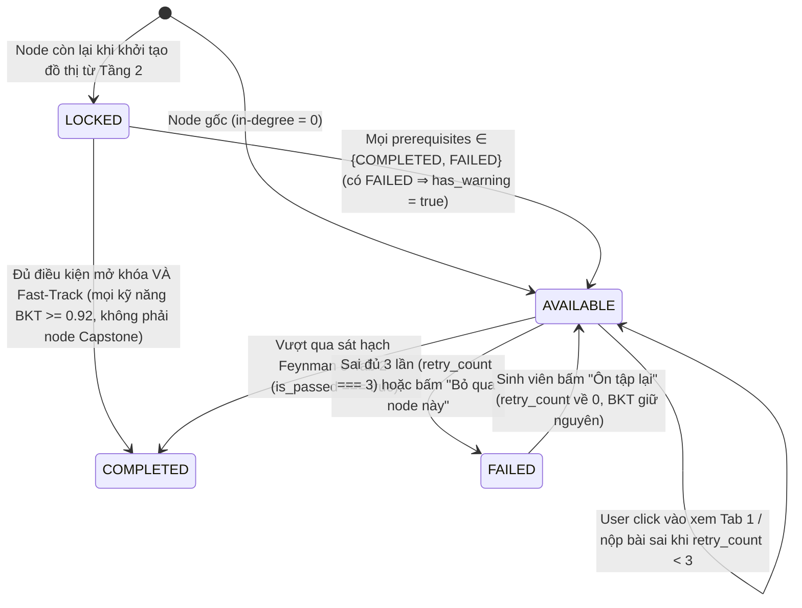

# [TẦNG GIAO DIỆN & TRÌNH DIỄN] ĐẶC TẢ BUỒNG LÁI 3 CỘT & FSM 4 MÀU
## DỰ ÁN: SIMPLIFEY V2 PRO — CODEBASE COGNITIVE TWIN
### *Đặc tả Thiết kế Giao diện Phản ứng & Trải nghiệm Người dùng (Phụ trách: NGƯỜI 1 - LEAD)*

---

| **Thuộc tính** | **Thông số kỹ thuật** |
| :--- | :--- |
| **Phân hệ** | `03_UI_VA_KICH_BAN/01_UI_TRI_PANE_FSM.md` |
| **Người phụ trách** | **NGƯỜI 1 (LEAD ARCHITECT & FULLSTACK)** |
| **Công nghệ UI** | Next.js 15 App Router, ReactFlow (Canvas DAG), Monaco/Prism Code Editor, TailwindCSS Vanilla, Zustand Store |
| **Thiết kế chủ đạo** | Dark Modern Cockpit (Cyberpunk/Graphite Theme), Glassmorphism, Micro-animations, Solar Amber highlight. Nền `#0F172A` |
| **Kiểu dữ liệu** | `StaticEngineResult`, `EnrichNodeClientResponse`, `FeynmanEvaluationResult`, `LearnerCognitiveProfile`, `ClientWorkbenchState` — xem [`02_DATA_CONTRACTS.md`](../00_CORE_SPEC/02_DATA_CONTRACTS.md) |

---

# 1. BỐ CỤC BUỒNG LÁI 3 CỘT (TRI-PANE WORKBENCH LAYOUT)

Giao diện được chia thành 3 cột tương tác phản ứng (Reactive Layout) theo tỷ lệ mặc định `25% - 45% - 30%` (có chế độ trình chiếu phóng to cột đang dùng khi demo trên máy chiếu):

```text
┌────────────────────────────────────────────────────────────────────────────────────────────────────────────────────────┐
│                                       SIMPLIFEY V2 PRO — COGNITIVE WORKBENCH                                           │
├──────────────────────────┬─────────────────────────────────────────────┬───────────────────────────────────────────────┤
│ CỘT 1: DAG CANVAS (25%)   │ CỘT 2: CODE VIEWER TƯƠNG TÁC (45%)          │ CỘT 3: BUỒNG LÁI NHẬN THỨC 2 PHA (30%)        │
├──────────────────────────┼─────────────────────────────────────────────┼───────────────────────────────────────────────┤
│ • ReactFlow Canvas       │ • Monaco/Prism Interactive Code Viewer      │ [TAB 1: X-RAY WALKTHROUGH] [TAB 2: FEYNMAN]   │
│ • Đồ thị phân nhánh DAG: │ • Hiển thị ≤ 30 dòng code thật của step     │                                               │
│                          │ • Tự động cuộn & highlight theo step        │ 🔍 PHA 1: MỔ XẺ (ĐỌC HIỂU TỰ DO)              │
│       ┌──────────────┐   │                                             │ • Luồng chạy: Controller ➔ Middleware ➔       │
│       │ 🟢 Auth      │   │ File: src/services/order.service.ts         │   Service ➔ Repo                              │
│       └───┬──────┬───┘   │ 41  async function checkout(order) {        │ 💡 ĐIỂM HAY KIẾN TRÚC:                        │
│           │      │       │ 42    const items = order.items;            │ • Layered Pattern + Dependency Injection:     │
│       ┌───▼──┐ ┌─▼────┐  │ 43    // Code thật của sinh viên            │   Tách biệt HTTP khỏi logic, giúp dễ test     │
│       │🟢Cat │ │⚪Prom│  │ 44    for (const item of items) {           │   và dễ tái sử dụng cho Bot/Worker.           │
│       └───┬──┘ └──┬───┘  │ 45      await db.updateStock(item);         │                                               │
│           └───┬───┘      │ 46    }                                     │ 📌 BƯỚC THỰC THI (EXECUTION STEPS):           │
│               ▼          │ 47  }                                       │ • Step 1: Controller nhận DTO                 │
│       ┌──────────────┐   │                                             │ • Step 2: Service duyệt mảng items            │
│       │ 🟡 Checkout  │   │                                             │ • Step 3: Repo cập nhật tồn kho               │
│       └───┬──────┬───┘   │                                             │ (TUYỆT ĐỐI GIẤU VỊ TRÍ VÀ TÊN LỖI Ở TAB 1)   │
│           │      │       │                                             │                                               │
│       ┌───▼──┐ ┌─▼────┐  │                                             │ 👉 [NÚT: TÔI ĐÃ HIỂU ➔ BẮT ĐẦU THỬ THÁCH]     │
│       │⚪Inve│ │⚪Pay │  │                                             │───────────────────────────────────────────────│
│       └──────┘ └──────┘  │                                             │ 🎯 PHA 2: THỬ THÁCH FEYNMAN (KHI CHUYỂN TAB 2)│
│                          │                                             │ "Giải thích vì sao vòng lặp ở dòng 44–45      │
│ • Click Node ➔ Nạp Cột 2 │ • Bấm Step ở Cột 3 ➔ Cuộn dòng ở Cột 2      │  được viết như vậy (có thể dùng ví dụ đời     │
│   và Cột 3               │ • Người học vừa đọc code vừa đọc giải thích │  thường)?"                                    │
│                          │                                             │ [Ô nhập giải thích] ➔ [Nộp Bài] [Bỏ qua node] │
└──────────────────────────┴─────────────────────────────────────────────┴───────────────────────────────────────────────┘
```

---

# 2. CHI TIẾT CHỨC NĂNG TỪNG CỘT

### 2.1. Cột 1: ReactFlow Branched DAG Canvas (Bản đồ Nhận thức)
* **Tính chất phân nhánh & hội tụ:** Sử dụng thuật toán Dagre để sắp xếp tọa độ các Node (6–8 node). Không chấp nhận đồ thị thẳng tuột một hàng dọc!
* **Máy Trạng Thái 4 Màu (4-Color FSM):**
  * ⚪ **LOCKED (Xám mờ - Viền đứt nét):** Còn node cha chưa đi qua (chưa COMPLETED hoặc FAILED). Không thể click.
  * 🟡 **AVAILABLE (Vàng hổ phách `#F59E0B` - Có hào quang Pulse sáng):** Node đã mở khóa, sẵn sàng cho sinh viên chọn học. Mọi node gốc (in-degree = 0) đều AVAILABLE từ đầu.
  * 🟢 **COMPLETED (Xanh ngọc lục bảo `#10B981`):** Đã vượt qua sát hạch Feynman (`is_passed === true`) hoặc được Fast-Track. Tự động kích hoạt mở khóa các node con.
  * 🔴 **FAILED (Đỏ cảnh báo `#EF4444`):** Trả lời sai đủ 3 lần, hoặc bấm "Bỏ qua node này". Ghi nhận điểm mù nhưng **vẫn mở khóa node con** (soft-bypass).
* **Các lớp hiển thị phụ (không phải trạng thái FSM):**
  * ⚡ **Fast-Track:** node `COMPLETED` có `is_auto_mastered = true` ⇒ Xanh lá nhạt (Mint Green) kèm tia sét (Mục 4.1).
  * ⚠️ **Mắt xích trước chưa vững:** node có `has_warning = true` (được mở khi có node cha FAILED) ⇒ tam giác vàng ở góc node.
  * 🟠 **Decay Warning:** node `COMPLETED` có $P_{\text{node}}$ đã decay < 0.45 ⇒ viền Vàng Cam (xem `02_BAYES_COGNITIVE_BKT.md` Mục 2.4).
* **Độ tin cậy của cạnh (đa ngôn ngữ):** Cạnh `confidence: "RESOLVED"` (ngôn ngữ có `ImportResolver` riêng) vẽ nét liền. Cạnh `confidence: "INFERRED"` (ngôn ngữ tier `STRUCTURAL`, Universal Resolver) hoặc `ambiguous: true` vẽ **nét đứt** kèm tooltip *"Cạnh suy luận — chưa đảm bảo 100%"*. Thanh trên cùng của canvas hiện huy hiệu `fingerprint.graph_confidence` (Cao / Trung bình / Thấp) và danh sách `language_breakdown`; khi `LOW`, hiển thị cảnh báo từ `ingestion_report.warnings`. Lưu ý: nét đứt của cạnh khác với viền đứt của node LOCKED.

---

### 2.2. Cột 2: Monaco Interactive Code Viewer (Phòng Giải Phẫu Code)
* Hiển thị đoạn code hạt nhân **15 – 30 dòng** (`ExecutionTraceStep.snippet`) của bước thực thi đang chọn; một node có tối đa 100 dòng qua các step.
* **Đồng bộ hóa 2 chiều:**
  * Khi người dùng bấm `Step 1 (Controller)` $\to$ Cột 2 tự động cuộn đến file `order.controller.ts` và highlight dải màu vàng sáng các dòng tiếp nhận DTO (dòng lấy từ `trace_steps[i].line_start..line_end`).
  * Khi bấm `Step 2 (Service)` $\to$ Cột 2 tự động chuyển sang file `order.service.ts` và highlight vòng lặp xử lý.
  * Click SuperNode ⇒ mở `files[0]`.
* **Hiển thị Trích đoạn Mã nguồn Điểm Nút (The Flashpoint Code Snippet):**
  * Đánh số dòng rõ ràng (theo số dòng gốc), tô màu cú pháp (Syntax Highlighting) chuyên nghiệp; dòng marker `// …` thay cho đoạn bị lược.
  * Chỉ phục vụ mục đích đọc hiểu trực quan, **không** bắt học viên click chọn dòng code để trả lời.

---

### 2.3. Cột 3: Buồng Lái Nhận Thức 2 Pha (The 2-Phase Mastery Loop)
* **Tab 1: X-Ray Walkthrough (Đọc hiểu luồng):**
  * Trình diễn luồng biến đổi dữ liệu theo từng bước thực thi `execution_steps`.
  * Phân tích **Điểm Hay (Design Pattern & Dependency Injection)**: Lý do phân tầng, lợi ích kiểm thử và mở rộng.
  * **Không** hiển thị Điểm Dở hay vị trí lỗi (client không có dữ liệu này — đáp án nằm trong `challenge_token`).
* **Tab 2: Socratic Feynman Challenge (Sát hạch Bản chất):**
  * Hiển thị câu hỏi Socratic từ AI Co-Architect, bám vào dòng code cụ thể ở Cột 2.
  * Người học nhập lời giải thích bằng lời của mình (thuật ngữ hay ẩn dụ đều được; ẩn dụ đời thường là điểm cộng) và bấm **[Nộp Bài]**.
  * AI chấm điểm Rubric (`core_accuracy >= 70` là Đạt, `simplicity` là điểm cộng) $\implies$ Đổi màu Node sang XANH LÁ (COMPLETED) tức thì và hiển thị `smell_reveal` (Điểm Dở + giải pháp).
  * Nút **[Tôi chịu, bỏ qua node này]**: gọi `POST /api/reveal`, đổi node sang FAILED, mở Architectural Debrief Box, mở khóa node con (0 token, không gọi AI).

---

# 3. QUY TẮC CHUYỂN DỊCH TRẠNG THÁI (FSM STATE TRANSITION RULES)



*Suy giảm trí nhớ không làm đổi trạng thái:* node `COMPLETED` bị decay vẫn là `COMPLETED`, chỉ đổi viền Vàng Cam; click vào sẽ mở câu hỏi ôn tập theo Tier tính từ điểm đã decay.

---

# 4. ĐẶC TẢ TƯƠNG TÁC NÂNG CAO CHO NGƯỜI 1 (FRONTEND DEV)

### 4.1. Hiển thị Node Fast-Track Auto-Pass (Miễn thi)
* Khi Node có cờ `is_auto_mastered === true` (thỏa mãn $\forall k \in \mathcal{K}_u, P(L_t, k) \ge 0.92$ trên điểm đã decay):
  * Node hiển thị màu **XANH LÁ NHẠT (Mint Green)** kèm biểu tượng tia sét ⚡ và nhãn: *"Đã làm chủ ở Repo trước (Fast-Track - Cấp Architect)"*.
  * Sinh viên không bắt buộc phải làm bài thi, các Node con phía sau tự động mở khóa ($0\text{ Token}$).
  * Nếu sinh viên vẫn click vào, hệ thống chỉ hiển thị Tab 1 (X-Ray) để đọc tham khảo.
  * Node có độ phức tạp cao nhất đồ thị (Capstone) **không bao giờ** được Fast-Track.

### 4.2. Giao diện Stepper Dành Cho Node Thuật Toán (`ALGORITHMIC_CORE`)
* Nếu `node_type === "ALGORITHMIC_CORE"` (Node Dijkstra, Crypto, Sorting):
  * Cột 3 và Cột 2 không hiển thị Stepper Controller $\to$ Service $\to$ Repo.
  * Thay vào đó, Stepper hiển thị 3 bước giải thuật (`ALGO_SETUP ➔ ALGO_EXECUTION ➔ ALGO_TERMINATION`):
    * **Step 1:** Khởi tạo Cấu trúc dữ liệu & Biến trạng thái (Min-Heap, Mảng 2D).
    * **Step 2:** Vòng lặp Hạt nhân Biến đổi Trạng thái (Thư giãn cạnh, cập nhật khoảng cách).
    * **Step 3:** Điều kiện Dừng & Trả kết quả (Đường đi ngắn nhất).

### 4.3. Cơ Chế Chặn Spam Bấm Nộp Bài Tại Frontend (Client Guardrail)
* **Khóa nút 3 giây (Debounce):** Sau khi bấm [Nộp Bài], nút chuyển sang trạng thái Loading và bị vô hiệu hóa (disabled) trong 3 giây.
* **Chặn câu trả lời quá ngắn:** < 15 ký tự (sau khi bỏ khoảng trắng) ⇒ báo ngay tại form, không gửi request.
* **Chặn nộp trùng nội dung ($\ge 80\%$):** Nếu nội dung mới gõ không khác biệt nhiều so với câu vừa bị rớt $\implies$ Báo lỗi đỏ ngay tại form: *"Bạn chưa bổ sung ý mới, hãy diễn giải chi tiết hơn!"* (Tuyệt đối không gửi request lên backend).
* **Khóa cứng khi sai đủ 3 lần:** Khi `retry_count === 3` $\implies$ Ẩn ô nhập bài, hiển thị đáp án giải thích chuẩn (`smell_reveal`) kèm nút *"Tôi đã hiểu, cho tôi đi tiếp sang Node sau!"*.

### 4.4. Hook Nạp Ngầm Tiên Tri (`usePreFetchSuccessor`)
* Khi sinh viên xem Tab 1 của Node hiện tại được quá **5 giây**:
  * Frontend kích hoạt hook ngầm `usePreFetchSuccessor(activeNodeId)`.
  * Âm thầm gửi request `/api/enrich-node` cho Node con kế tiếp trên đồ thị và lưu kết quả vào `node_cache[successorId]`.
  * **Khi cache trúng:** sinh viên click sang Node kế tiếp thì dữ liệu hiển thị ngay, không cần Skeleton. Lần click đầu tiên, hoặc khi prefetch đoán sai node, vẫn mất 1.2s – 1.8s.
    ```typescript
    const cachedData = useNodeStore.getState().node_cache[targetNodeId];
    if (cachedData) {
      // Dữ liệu đã có sẵn trong Cache ➔ Render ngay, không cần hiện Skeleton Scanner
      setCurrentNodeData(cachedData);
    }
    ```

### 4.5. Chế độ Demo Offline (`Ctrl + Shift + D`)
* Nạp `public/demo/mock_repo_shop.json` (kiểu `OfflineMockBundle`, **ghi lại từ output thật của engine**) vào Zustand Store, đặt `is_offline_mode = true`.
* Hiển thị nhãn **"Chế độ Offline — dữ liệu ghi lại"** trên header trong suốt thời gian dùng, để nói rõ với BGK đây không phải lời gọi trực tiếp.
