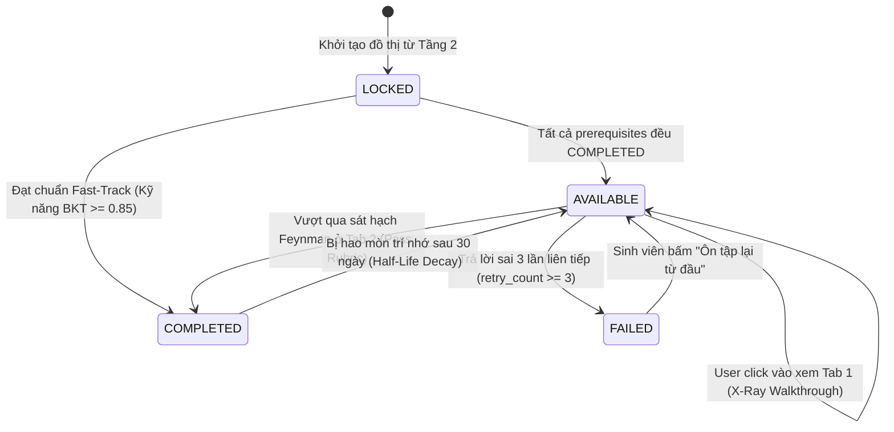

# [TẦNG GIAO DIỆN & TRÌNH DIỄN] ĐẶC TẢ BUỒNG LÁI 3 CỘT & FSM 4 MÀU
## DỰ ÁN: SIMPLIFEY V2 PRO — CODEBASE COGNITIVE TWIN
### *Đặc tả Thiết kế Giao diện Phản ứng & Trải nghiệm Người dùng (Phụ trách: NGƯỜI 1 - LEAD)*

---

| **Thuộc tính** | **Thông số kỹ thuật** |
| :--- | :--- |
| **Phân hệ** | `03_UI_VA_KICH_BAN/01_UI_TRI_PANE_FSM.md` |
| **Người phụ trách** | **NGƯỜI 1 (LEAD ARCHITECT & FULLSTACK)** |
| **Công nghệ UI** | Next.js 15 App Router, ReactFlow (Canvas DAG), Monaco/Prism Code Editor, TailwindCSS Vanilla, Zustand Store |
| **Thiết kế chủ đạo** | Dark Modern Cockpit (Cyberpunk/Graphite Theme), Glassmorphism, Micro-animations, Solar Amber highlight |

---

# 1. BỐ CỤC BUỒNG LÁI 3 CỘT (TRI-PANE WORKBENCH LAYOUT)

Giao diện được chia thành 3 cột tương tác phản ứng (Reactive Layout) cố định theo tỷ lệ vàng `25% - 45% - 30%`:

```text
┌────────────────────────────────────────────────────────────────────────────────────────────────────────────────────────┐
│                                       SIMPLIFEY V2 PRO — COGNITIVE WORKBENCH                                           │
├──────────────────────────┬─────────────────────────────────────────────┬───────────────────────────────────────────────┤
│ CỘT 1: DAG CANVAS (25%)   │ CỘT 2: CODE VIEWER TƯƠNG TÁC (45%)          │ CỘT 3: BUỒNG LÁI NHẬN THỨC 2 PHA (30%)        │
├──────────────────────────┼─────────────────────────────────────────────┼───────────────────────────────────────────────┤
│ • ReactFlow Canvas       │ • Monaco/Prism Interactive Code Viewer      │ [TAB 1: X-RAY WALKTHROUGH] [TAB 2: FEYNMAN]   │
│ • Đồ thị phân nhánh DAG: │ • Hiển thị 20 dòng code hạt nhân thật       │                                               │
│                          │ • Tự động cuộn & highlight theo step        │ 🔍 PHA 1: MỔ XẺ TOÀN DIỆN (ĐỌC HIỂU TỰ DO)    │
│       ┌──────────────┐   │                                             │ • Luồng chạy: Controller ➔ Service ➔ Repo     │
│       │ 🟢 Auth      │   │ File: src/services/order.service.ts         │                                               │
│       └───┬──────┬───┘   │ 41  async function checkout(order) {        │ 💡 ĐIỂM HAY KIẾN TRÚC:                        │
│           │      │       │ 42    const items = order.items;            │ • Layered Pattern + Dependency Injection:     │
│       ┌───▼──┐ ┌─▼────┐  │ 43    // Code thật của sinh viên            │   Tách biệt HTTP khỏi logic, giúp dễ test     │
│       │🟢Cat │ │⚪Prom│  │ 44    for (const item of items) {           │   và dễ tái sử dụng cho Bot/Worker.           │
│       └───┬──┘ └──┬───┘  │ 45      await db.updateStock(item);         │                                               │
│           └───┬───┘      │ 46    }                                     │ ⚠️ ĐIỂM DỞ / AI VIBE SMELL:                   │
│               ▼          │ 47  }                                       │ • Vòng lặp N+1 Query tại dòng 45:             │
│       ┌──────────────┐   │                                             │   Gọi DB lắt nhắt từng đợt làm nghẽn DB       │
│       │ 🟡 Checkout  │   │                                             │   khi có 100 người cùng bấm mua.              │
│       └───┬──────┬───┘   │                                             │                                               │
│           │      │       │                                             │ 👉 [NÚT: TÔI ĐÃ HIỂU ➔ BẮT ĐẦU SÁT HẠCH]      │
│       ┌───▼──┐ ┌─▼────┐  │                                             │───────────────────────────────────────────────│
│       │⚪Inve│ │⚪Pay │  │                                             │ 🎯 PHA 2: SÁT HẠCH FEYNMAN (KHI CHUYỂN TAB 2) │
│       └──────┘ └──────┘  │                                             │ 🎙️ AI hỏi Tình huống Socratic:                │
│                          │                                             │ "Bằng lời bình dân như chuyện quán ăn, giải   │
│ • Click Node ➔ Nạp Cột 2 │ • Bấm Step ở Cột 3 ➔ Cuộn dòng ở Cột 2      │  thích tại sao cách trừ kho dòng 45 làm chậm?"│
│   và Cột 3 tức thì       │ • Người học vừa đọc code vừa đọc giải thích │ [Ô nhập giải thích / Micro] ➔ [Submit Chấm]   │
└──────────────────────────┴─────────────────────────────────────────────┴───────────────────────────────────────────────┘
```

---

# 2. CHI TIẾT CHỨC NĂNG TỪNG CỘT

### 2.1. Cột 1: ReactFlow Branched DAG Canvas (Bản đồ Nhận thức)
* **Tính chất phân nhánh & hội tụ:** Sử dụng thuật toán Dagre để sắp xếp tọa độ các Node. Không chấp nhận đồ thị thẳng tuột một hàng dọc!
* **Máy Trạng Thái 4 Màu (4-Color FSM):**
  * ⚪ **LOCKED (Xám mờ - Viền đứt nét):** Node bị khóa vì các node cha chưa hoàn thành. Không thể click.
  * 🟡 **AVAILABLE (Vàng hổ phách - Có hào quang Pulse sáng):** Node đã mở khóa, sẵn sàng cho sinh viên chọn học.
  * 🟢 **COMPLETED (Xanh ngọc lục bảo):** Đã vượt qua sát hạch Feynman. Tự động kích hoạt mở khóa các node con.
  * 🔴 **FAILED (Đỏ cảnh báo):** Trả lời sai quá 3 lần, ghi nhận vào danh sách điểm mù.

---

### 2.2. Cột 2: Monaco Interactive Code Viewer (Phòng Giải Phẫu Code)
* Hiển thị chính xác **15 – 30 dòng code hạt nhân** của bước thực thi đang chọn (bóc tách từ Tầng 3).
* **Đồng bộ hóa 2 chiều:**
  * Khi người dùng bấm `Step 1 (Controller)` $\to$ Cột 2 tự động cuộn đến file `order.controller.ts` và highlight dải màu vàng sáng các dòng tiếp nhận DTO.
  * Khi bấm `Step 2 (Service)` $\to$ Cột 2 tự động chuyển sang file `order.service.ts` và highlight vòng lặp trừ kho.

---

### 2.3. Cột 3: Buồng Lái Nhận Thức 2 Pha (The 2-Phase Mastery Loop)
* **Tab 1: X-Ray Walkthrough (Đọc hiểu toàn diện):**
  * Trình diễn luồng biến đổi dữ liệu theo từng bước thực thi.
  * Giải thích **Điểm Hay (Design Pattern & Dependency Injection)**: Tại sao tách file, lợi ích mở rộng.
  * Cảnh báo **Điểm Dở (AI Vibe Smell)**: Vị trí dòng code có mùi, nguy cơ sập hệ thống.
  * Người học chủ động đọc, ngẫm nghĩ và chuẩn bị tâm thế làm chủ.
* **Tab 2: Feynman Challenge (Sát hạch làm chủ):**
  * Khi bấm *"Tôi đã hiểu ➔ Bắt đầu Sát hạch"*, Tab 2 mở ra.
  * AI Co-Architect đưa ra câu hỏi Socratic (tình huống giả định hoặc thử thách ẩn dụ đời thường).
  * Hỗ trợ gõ text hoặc bấm icon Micro để trả lời bằng giọng nói.
  * AI chấm điểm Rubric (Đúng bản chất $\ge 70$, Bình dân $\ge 70$) $\implies$ Đổi màu Node sang Xanh!

---

# 3. QUY TẮC CHUYỂN DỊCH TRẠNG THÁI (FSM STATE TRANSITION RULES)



---

# 4. ĐẶC TẢ TƯƠNG TÁC NÂNG CAO CHO NGƯỜI 1 (FRONTEND DEV)

### 4.1. Hiển thị Node Fast-Track Auto-Pass (Miễn thi)
* Khi Node có cờ `is_auto_mastered === true`:
  * Node hiển thị màu **XANH LÁ NHẠT (Mint Green)** kèm biểu tượng tia sét ⚡ và nhãn: *"Đã làm chủ ở Repo trước (Fast-Track)"*.
  * Sinh viên không bắt buộc phải làm bài thi, các Node con phía sau tự động mở khóa.
  * Nếu sinh viên vẫn click vào, hệ thống chỉ hiển thị Tab 1 (X-Ray) để đọc tham khảo.

### 4.2. Giao diện Stepper Dành Cho Node Thuật Toán (`ALGORITHMIC_CORE`)
* Nếu `node_type === "ALGORITHMIC_CORE"` (Node Dijkstra, Crypto, Sorting):
  * Cột 3 và Cột 2 không hiển thị Stepper Controller $\to$ Service $\to$ Repo.
  * Thay vào đó, Stepper hiển thị 3 bước giải thuật:
    * **Step 1:** Khởi tạo Cấu trúc dữ liệu & Biến trạng thái (Min-Heap, Mảng 2D).
    * **Step 2:** Vòng lặp Hạt nhân Biến đổi Trạng thái (Thư giãn cạnh, cập nhật khoảng cách).
    * **Step 3:** Điều kiện Dừng & Trả kết quả (Đường đi ngắn nhất).

### 4.3. Cơ Chế Chặn Spam Bấm Nộp Bài Tại Frontend (Client Guardrail)
* **Khóa nút 3 giây (Debounce):** Sau khi bấm [Nộp Bài Chấm Điểm], nút chuyển sang trạng thái Loading và bị vô hiệu hóa (disabled) trong 3 giây.
* **Chặn nộp trùng nội dung ($\ge 80\%$):** Nếu nội dung mới gõ không khác biệt nhiều so với câu vừa bị rớt $\implies$ Báo lỗi đỏ ngay tại form: *"Bạn chưa bổ sung ý mới, hãy diễn giải chi tiết hơn!"* (Tuyệt đối không gửi request lên backend).
* **Khóa cứng sau 3 lần sai:** Khi `retry_count >= 3` $\implies$ Ẩn ô nhập bài, hiển thị đáp án giải thích chuẩn của hệ thống kèm nút *"Tôi đã hiểu, cho tôi đi tiếp sang Node sau!"*.

### 4.4. Hook Nạp Ngầm Tiên Tri (`usePreFetchSuccessor` - Mở Bùng 0 Giây)
* Khi sinh viên xem Tab 1 của Node hiện tại được quá **5 giây**:
  * Frontend kích hoạt hook ngầm `usePreFetchSuccessor(activeNodeId)`.
  * Âm thầm gửi request `/api/enrich-node` cho Node con kế tiếp trên đồ thị và lưu kết quả vào `nodeCache[successorId]`.
  * **Trải nghiệm 0ms Latency:** Khi sinh viên hoàn thành Node hiện tại và click sang Node kế tiếp:
    ```typescript
    const cachedData = useNodeStore.getState().nodeCache[targetNodeId];
    if (cachedData) {
      // Dữ liệu đã có sẵn 100% ➔ Render bùng nổ tức thì (0ms), không cần hiện Skeleton Scanner!
      setCurrentNodeData(cachedData);
    }
    ```


