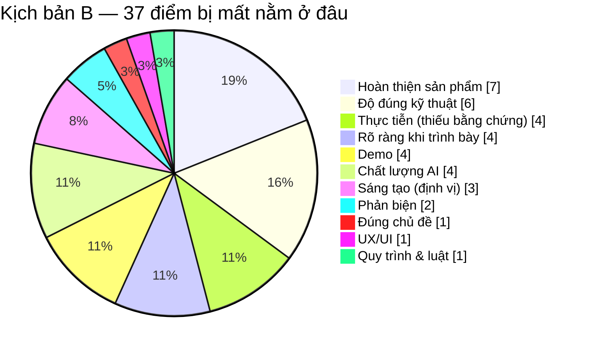

# BÁO CÁO THẨM ĐỊNH CỦA GIÁM KHẢO — SIMPLIFEY V2 PRO
## Codebase Cognitive Twin · Hackathon SGU 2026 – 2027
### *Chấm như một giám khảo khó tính: công tâm, mọi nhận xét đều có bằng chứng trong repo, mọi điểm trừ đều kèm cách khắc phục*

---

| **Thuộc tính** | **Nội dung** |
| :--- | :--- |
| **Thời điểm thẩm định** | 28/10/2026, trước Vòng thử thách 3 ngày (thời gian xây dựng sản phẩm: 12:00 31/10 → 09:00 01/11) |
| **Phạm vi đã đọc** | Toàn bộ repo trừ `archive/`: 12 spec chính thức (`00_CORE_SPEC` → `03_UI_VA_KICH_BAN`), `KyVong45.md`, `04_ROADMAP_KY_THUAT/`, `references/` (thể lệ, giáo trình, `docchoi.md`, `enterprise_arch.md`), `README.md`, `CLAUDE.md`, `index.html`, `cockpit_demo.html` |
| **Căn cứ chấm** | [Thể lệ](references/thele.md#L30-L39): 3 tiêu chí *Ý tưởng · Lập trình · Thuyết trình*. Điểm Vòng thử thách = **90% sản phẩm (BGK chấm) + 10% tương tác áp phích** |
| **Phương pháp** | Đọc chéo mọi file và đối chiếu số liệu. Các phép tính BKT, PageRank, decay và regex đều được **chạy lại bằng Node.js**, không suy đoán |
| **Lưu ý** | Đây là thẩm định giả lập để cải thiện sản phẩm, **không phải** điểm của BGK chính thức. Con số nào là ước lượng thì ghi rõ "ước lượng" |

---

# 0. KẾT LUẬN TRONG 60 GIÂY

| Kịch bản | Giả định | Điểm sản phẩm /100 | Nhận định |
| :--- | :--- | :---: | :--- |
| **A. Chấm đúng hiện trạng** | Những gì đang có hôm nay: tài liệu và 2 trang HTML dữ liệu giả. Chưa có engine, API hay lời gọi AI nào chạy thật | **42** | Ý tưởng mạnh, nhưng tiêu chí "Lập trình" gần như trống |
| **B. Dự phóng ngày 01/11** | Giữ nguyên spec và phạm vi; 3 người, 21 giờ, thực thi ở mức khá | **≈ 63** *(55 – 68)* | Demo chạy được trên 1–2 repo chuẩn bị sẵn nhưng gãy khi BGK dán repo lạ; bị bắt bẻ vì nói quá |
| **C. Sửa hết P0 + P1 trong báo cáo này** | Spec v1.1, MVP cắt gọn, số đo thật, bằng chứng người dùng, pitch dễ hiểu | **≈ 87** | Ứng viên mạnh để vào Chung kết 15/11 |

> **Lời phê của giám khảo (kịch bản B):** *"Ý tưởng trúng nỗi đau thời sự, kiến trúc tham vọng, tài liệu đầu tư công phu hiếm thấy. Nhưng nhóm đang hứa nhiều hơn những gì làm được: nhiều con số chưa từng đo, vài khẳng định mâu thuẫn với chính tài liệu của nhóm, và phần 'biến repo thành bài học' (trái tim của sản phẩm) vẫn chưa có thuật toán."*

**Ba lý do mất điểm nặng nhất**
1. **Trái tim sản phẩm chưa được thiết kế.** Chưa có thuật toán biến call-graph thành 6–8 bài học và các cạnh tiên quyết giữa chúng, nên dữ liệu demo dễ phải vẽ tay (mục 5.1 ❷).
2. **Sinh viên "vibe-code" thì cũng sẽ "vibe-answer".** Repo là public, câu hỏi hiện ngay trên màn hình, nên chỉ cần copy sang ChatGPT là qua bài Feynman. Điều này đánh thẳng vào lời hứa cốt lõi (mục 5.1 ❸).
3. **Nói quá:** "liên kết chính xác 100%", "diệt ảo giác 100%", "0ms", "< $0.002/phiên", "lần đầu tiên"… Vài câu trong số này **đã bị chính Roadmap của nhóm bác bỏ** (mục 5.1 ❺).

**Ba lý do bài này vẫn nổi bật**
1. Nguyên tắc **"code tĩnh trước, AI sau"** rõ ràng, khớp chủ đề "AI tiết kiệm chi phí".
2. **Vòng học 2 pha kết hợp mô hình người học (BKT).** Hiếm đội sinh viên nghĩ tới việc *đo* mức hiểu thay vì chỉ *giải thích*.
3. **Tư duy kỹ thuật chín chắn:** có Data Contracts, FSM, danh mục 38 edge case, và Roadmap có phương pháp nghiên cứu (pyBKT, QWK, ANCOVA, power analysis).

---

# 1. THANG CHẤM

Thể lệ (mục II.3) chỉ nêu 3 tiêu chí mà **không công bố trọng số**. Báo cáo này dùng thang 100 điểm giả định dưới đây. "Lập trình" được trọng số lớn nhất vì đây là vòng làm sản phẩm trong 24 giờ.

| Tiêu chí theo thể lệ | Tiêu chí con | Max |
| :--- | :--- | :---: |
| **3.1 Ý tưởng (30)** | Thực tiễn: nỗi đau có thật, có bằng chứng, có người dùng | 10 |
| | Sáng tạo và khác biệt so với giải pháp hiện có | 10 |
| | Đúng chủ đề *"AI… tiết kiệm chi phí… học tập, dạy học thông minh"* ([thể lệ](references/thele.md#L22-L23)) | 10 |
| **3.2 Lập trình (45)** | Mức hoàn thiện: chạy end-to-end trên repo thật | 15 |
| | Độ đúng kỹ thuật và độ tin cậy của kết quả | 12 |
| | Chất lượng và độ an toàn của phần AI | 10 |
| | UX/UI | 5 |
| | Quy trình code và tuân thủ luật repo | 3 |
| **3.3 Thuyết trình (25)** | Rõ ràng, dễ hiểu với BGK | 10 |
| | Demo thuyết phục | 10 |
| | Phản biện Q&A | 5 |

Phần 10% *"điểm thi trực tuyến"* được tính riêng, theo tương tác với áp phích: Thích 1 điểm, Tim 2 điểm, Chia sẻ 3 điểm ([thể lệ](references/thele.md#L36-L39)). Hiện repo **không có một dòng kế hoạch nào** cho phần này.

---

# 2. BẢNG ĐIỂM CHI TIẾT

| Tiêu chí con | Max | A | B | C | Vì sao bị trừ (kịch bản A/B) |
| :--- | :---: | :---: | :---: | :---: | :--- |
| Thực tiễn | 10 | 6 | 6 | 9 | Nỗi đau có thật nhưng **không có bằng chứng nào**: không khảo sát, không phỏng vấn SV hay GV, không biết đồ án SV SGU dùng stack gì |
| Sáng tạo | 10 | 7 | 7 | 9 | Tổ hợp mới thật, nhưng bước "dán link → sơ đồ kiến trúc" trùng với DeepWiki/GitDiagram, và các câu "lần đầu tiên" không kiểm chứng được |
| Đúng chủ đề | 10 | 9 | 9 | 9 | Rất đúng chủ đề. Trừ 1 điểm vì luận điểm chi phí đang thấp hơn thực tế khoảng 10 lần |
| Hoàn thiện | 15 | 1 | 8 | 12 | A: chưa có engine/API/AI chạy thật. B: chạy được trên repo chuẩn bị sẵn nhưng dễ gãy trên repo bất kỳ |
| Độ đúng kỹ thuật | 12 | 3 | 6 | 10 | Chưa có thuật toán dựng node/cạnh; PageRank dùng sai mục đích; hàm decay có bug; regex lọc file sai; hợp đồng dữ liệu lệch nhau |
| Chất lượng AI | 10 | 2 | 6 | 8 | Bộ chấm không có đáp án tham chiếu; đáp án lộ qua DevTools; cổng gác có lỗ hổng; không có bộ eval |
| UX/UI | 5 | 3 | 4 | 5 | Mockup đẹp, nhưng lộ đáp án (lỗi N+1) ngay màn hình chính, phân biệt trạng thái chỉ bằng màu xanh/đỏ, 3 cột quá chật trên máy chiếu |
| Quy trình & luật | 3 | 0 | 2 | 3 | A: chưa có repo thi. B: rủi ro commit dồn cục hoặc chỉ một người commit |
| Rõ ràng | 10 | 5 | 6 | 9 | Mở đầu tốt, nhưng 5 phút nhồi Tarjan, PageRank, Uncle Bob, BKT, Ebbinghaus thì BGK không kịp hiểu |
| Demo | 10 | 3 | 6 | 9 | A: không có demo thật. B: phụ thuộc mạng hội trường và Gemini; phương án offline lại là dữ liệu giả |
| Phản biện | 5 | 3 | 3 | 4 | Có 8 câu chuẩn bị sẵn, nhưng 4 câu chứa khẳng định sai so với tài liệu của chính nhóm |
| **Tổng** | **100** | **42** | **63** | **87** | |

---

# 3. ĐIỂM MẠNH — GIÁM KHẢO GHI NHẬN

| # | Điểm mạnh | Bằng chứng | Vì sao được điểm |
| :-: | :--- | :--- | :--- |
| 1 | Đúng nỗi đau thời sự, đúng chủ đề | [Tổng quan L18-L23](00_CORE_SPEC/01_TONG_QUAN_KIEN_TRUC.md#L18-L23) | "SV dùng AI sinh code nhưng không hiểu code" chạm đúng mối lo của giảng viên khi chấm vấn đáp |
| 2 | Kiến trúc "tĩnh trước, AI sau" | [Tổng quan L13](00_CORE_SPEC/01_TONG_QUAN_KIEN_TRUC.md#L13), [LLM L19-L23](02_AI_VA_BAYES/01_LLM_PIPELINE_GUARDRAIL.md#L19-L23) | Có kỷ luật về chi phí và độ trễ; AI chỉ được gọi khi thật sự cần |
| 3 | Học trên chính repo của SV (BYOC) | [KyVong45 L70-L72](KyVong45.md#L70-L72) | Cá nhân hoá triệt để, thay cho các ví dụ kiểu "con chó, con mèo" |
| 4 | Vòng 2 pha, có thiết kế chống lộ đề | [UI L77-L84](03_UI_VA_KICH_BAN/01_UI_TRI_PANE_FSM.md#L77-L84), [Contract L175-L178](00_CORE_SPEC/02_DATA_CONTRACTS.md#L175-L178) | Thiết kế sư phạm có chủ đích: đọc hiểu trước, rồi chứng minh |
| 5 | Chống ảo giác bằng symbol table của chính repo | [LLM L229-L259](02_AI_VA_BAYES/01_LLM_PIPELINE_GUARDRAIL.md#L229-L259) | Hướng đúng: AI chỉ được nhắc tới tên có thật trong code |
| 6 | BKT có công thức, có ví dụ chạy tay, đã sửa nghịch lý | [BKT L106-L151](02_AI_VA_BAYES/02_BAYES_COGNITIVE_BKT.md#L106-L151) | `P(T\|Incorrect) = 0.02` khắc phục lỗi "trả lời sai mà điểm vẫn tăng" |
| 7 | Fast-Track dựa trên kỹ năng gán tĩnh | [BKT L43-L47](02_AI_VA_BAYES/02_BAYES_COGNITIVE_BKT.md#L43-L47), [Contract L101](00_CORE_SPEC/02_DATA_CONTRACTS.md#L101) | Giải được bài toán "con gà – quả trứng" mà không tốn token |
| 8 | Ngưỡng VIP = 15 trùng mặc định của SonarQube | [AST L239](01_ENGINE_THUAT_TOAN/02_AST_SLICING_GRAPH.md#L239) | Có cơ sở, không phải số tự đặt |
| 9 | Data Contracts TypeScript, FSM, chia việc theo tầng | [Contract](00_CORE_SPEC/02_DATA_CONTRACTS.md), [README L12-L22](README.md#L12-L22) | 3 người có thể code song song |
| 10 | Có tư duy giữ an toàn cho demo | [UseCase L293-L313](00_CORE_SPEC/Kich_Ban_UseCase.md#L293-L313) | Có offline fallback, persona, prefetch; nhóm hiểu rủi ro của demo trực tiếp |
| 11 | Liệt kê 38 edge case | [Edge-case audit](00_CORE_SPEC/03_SYSTEM_EDGE_CASES_AUDIT.md) | Hiếm đội nào tự soi kỹ như vậy (dù cách chấm màu hơi lạc quan) |
| 12 | Roadmap nghiêm túc theo kiểu nghiên cứu | [Roadmap L79-L111](04_ROADMAP_KY_THUAT/ROADMAP_KY_THUAT_CHI_TIET.md#L79-L111) | Có pyBKT EM, QWK ≥ 0.7, ANCOVA, power analysis, và tự hạ KPI AUC |
| 13 | Định vị khiêm tốn về thuật toán nền | [KyVong45 L16-L22](KyVong45.md#L16-L22) | Không nhận là phát minh ra Compound AI, BKT hay PageRank |
| 14 | Giáo trình chạy tay | [GIAO_TRINH](references/GIAO_TRINH_THUAT_TOAN_CHUAN.md) | Cả đội có tài liệu chung để trả lời Q&A |
| 15 | Prototype giao diện | `index.html`, `cockpit_demo.html` | Truyền đạt trải nghiệm nhanh, giúp cả đội thống nhất tầm nhìn |

---

# 4. THẨM ĐỊNH "ĐIỂM MỚI LẠ"

## 4.1. Những điểm thật sự mới, đứng vững trước BGK
- **Không chỉ giải thích repo mà còn kiểm chứng chủ repo có hiểu hay không.** Vòng "đọc → chứng minh" được đặt trên **chính đồ án của sinh viên**.
- **Câu hỏi bám vào symbol có thật**, được kiểm tra bằng một cổng gác không tốn token.
- **Mô hình người học tích lũy qua nhiều repo**, trên một bộ kỹ năng kiến trúc phần mềm.
- Kết hợp cả ba điều trên trong một sản phẩm chi phí thấp, chỉ gọi AI khi cần (JIT).

## 4.2. Các giải pháp đã có mà BGK có thể biết
| Thành phần | Đã có ở đâu | SimpliFey khác ở chỗ nào |
| :--- | :--- | :--- |
| Dán link GitHub → sơ đồ / tài liệu kiến trúc | DeepWiki (Cognition, 2025), GitDiagram (mã nguồn mở), CodeSee, Sourcetrail | Các công cụ đó dừng ở việc giúp *đọc*. SimpliFey biến kết quả thành lộ trình có khoá/mở và bài kiểm tra |
| Repo-map bằng Tree-sitter + PageRank | Aider | Dùng để chọn *bài học*, không phải để nén context cho AI |
| Gia sư Socratic bằng LLM | Khanmigo (Khan Academy) và nhiều chatbot khác | Câu hỏi bám đúng code của người học, có cổng gác symbol |
| Knowledge Tracing | BKT (Corbett & Anderson, 1995) trong Cognitive Tutor; các nghiên cứu KT cho bài tập lập trình (ví dụ Code-DKT, EDM 2022; nhóm nên tự tra lại) | Áp vào kỹ năng *kiến trúc* trên repo thật. Đây là **ứng dụng mới**, không phải "lần đầu tiên" |
| Suy giảm trí nhớ theo half-life | Duolingo Half-Life Regression (Settles & Meeder, 2016) | Spec dùng h = 14 cố định, tức là **kém hơn** HLR; nên trích HLR làm nguồn gốc |
| Kỹ thuật Feynman bằng AI | Rất nhiều prompt và ứng dụng | SimpliFey có rubric chấm và cập nhật mô hình người học |

## 4.3. Những câu định vị sẽ bị "bắt tại trận"
- **"Lần đầu tiên chuyển giao BKT vào Kỹ nghệ Phần mềm"** ([KyVong45 L64](KyVong45.md#L64), [L150](KyVong45.md#L150)): không kiểm chứng được. Chỉ cần BGK biết một bài báo về knowledge tracing cho lập trình là luận điểm sụp.
- **"Duolingo (Birdbrain) áp dụng BKT"** ([KyVong45 L21](KyVong45.md#L21)): các công bố nổi tiếng của Duolingo là HLR (2016) và Birdbrain (theo hướng Elo/IRT), không phải BKT cổ điển. Riêng Carnegie Learning (Cognitive Tutor) dùng BKT là đúng.
- **"Zero-Trust"** ([Tổng quan L91](00_CORE_SPEC/01_TONG_QUAN_KIEN_TRUC.md#L91), [KyVong45 L14](KyVong45.md#L14)): đây là thuật ngữ an ninh mạng, nghĩa là xác thực mọi truy cập. Ở đây nhóm chỉ muốn nói "không thực thi code người dùng".
- **"Bản sao nhận thức / Cognitive Twin"**: thực chất là 16 xác suất, mỗi xác suất ước lượng từ 1–3 quan sát.
- **"Program Slicing / Inter-procedural Slicing"** ([KyVong45 L61](KyVong45.md#L61), [L74-L78](KyVong45.md#L74-L78)): Roadmap của nhóm ([D3](04_ROADMAP_KY_THUAT/ROADMAP_KY_THUAT_CHI_TIET.md#L23), [G4](04_ROADMAP_KY_THUAT/ROADMAP_KY_THUAT_CHI_TIET.md#L37), [L97](04_ROADMAP_KY_THUAT/ROADMAP_KY_THUAT_CHI_TIET.md#L97)) đã tự nhận đây là **call-chain slicing, không phải slicing theo nghĩa Weiser**.

## 4.4. Câu định vị đề xuất (dùng được cả trên slide lẫn khi trả lời)
> **"DeepWiki giúp bạn *đọc* một repo. SimpliFey kiểm tra xem bạn có *hiểu* repo của chính mình hay không: từng luồng nghiệp vụ, bằng câu hỏi bám đúng dòng code của bạn, và ghi nhớ bạn còn hổng ở đâu."**

---

# 5. ĐIỂM YẾU — SOI TOÀN DIỆN

| Mức | Ý nghĩa |
| :---: | :--- |
| 🔴 **Chí mạng** | Có thể mất phần lớn điểm "Lập trình", mất uy tín trước BGK, hoặc mất tư cách thi |
| 🟠 **Nặng** | Sai thuật toán hoặc thiết kế: lộ ra khi demo, hoặc BGK hỏi là không trả lời được |
| 🟡 **Trung bình** | Bị trừ điểm UX, tính thực tiễn hoặc thuyết trình |
| ⚪ **Nhỏ** | Vệ sinh tài liệu và các chi tiết |

## 5.1. 🔴 CHÍ MẠNG

### ❶ Chưa có sản phẩm, trong khi phạm vi quá tải cho 3 người trong 21 giờ
- **Hiện trạng:** repo chỉ có tài liệu, và Roadmap tự ghi *"chưa có code production"* ([Roadmap L11](04_ROADMAP_KY_THUAT/ROADMAP_KY_THUAT_CHI_TIET.md#L11)). Trong khi đó spec hứa:
  - 14 "thuật toán" ([UseCase L47-L64](00_CORE_SPEC/Kich_Ban_UseCase.md#L47-L64)), 6 archetype, Dart/Java bằng regex, Nominal Event Bridge cho BLoC/Redux;
  - AST folding, Uncle Bob;
  - prefetch, persona, decay, chế độ offline, nhập bằng giọng nói.
- **Vì sao chí mạng:** "Lập trình" là phần nặng điểm nhất. Một sản phẩm làm được 40% của 14 tính năng sẽ thua sản phẩm làm trọn 6 tính năng.
- **Nghịch lý:** sản phẩm rao giảng *"Display Budget 6–8 node để chống quá tải nhận thức"*, nhưng bộ hồ sơ của chính nó có gần 300 KB spec chính thức (gần 420 KB nếu tính cả `references/`) và một kịch bản 5 phút nhắc tới hơn 10 tên thuật toán.
- **Khắc phục:**
  - Cắt MVP theo mục 8.2.
  - Thể lệ cho tối đa 5 thành viên ([L84](references/thele.md#L84)). Nhưng đăng ký đã đóng từ 15/10, nên cần hỏi BTC xem còn được bổ sung người không.

### ❷ Trái tim sản phẩm chưa có thuật toán: biến repo thành 6–8 bài học và nối cạnh tiên quyết
- **Lệch giữa file và node:**
  - PageRank chọn *"Top 4–5 **file**"* ([AST L213](01_ENGINE_THUAT_TOAN/02_AST_SLICING_GRAPH.md#L213)).
  - Nhưng node là **lát cắt xuyên file** ([Contract L95-L110](00_CORE_SPEC/02_DATA_CONTRACTS.md#L95-L110)), và Display Budget là 6–8 node ([UseCase L58](00_CORE_SPEC/Kich_Ban_UseCase.md#L58)).
  - Không file nào mô tả bước đi từ file → lát cắt → 6–8 node.
- **Không có luật sinh cạnh:** `prerequisites` chỉ được ghi là *"ID các node cha (để Dagre phân nhánh)"* ([Contract L102](00_CORE_SPEC/02_DATA_CONTRACTS.md#L102)).
- **Thứ tự không suy ra được từ code:** UseCase hứa thứ tự *"Đăng nhập → Chọn hàng → Đặt hàng → Trừ kho → Thanh toán"* ([UseCase L78](00_CORE_SPEC/Kich_Ban_UseCase.md#L78)). Đây là thứ tự **nghiệp vụ và sư phạm**, call-graph không thể suy ra được.
- **Khái niệm treo:** Edge-case 7.1 nhắc *"PageRank và Critical Path"* để chọn 6–8 node ([Edge L340](00_CORE_SPEC/03_SYSTEM_EDGE_CASES_AUDIT.md#L340)) nhưng không định nghĩa Critical Path.
- **Hệ quả:** dữ liệu demo sẽ phải vẽ tay. BGK dán repo của họ vào là lộ ngay.
- **Khắc phục** (viết thành §3.8 trong `02_AST_SLICING_GRAPH.md`):
  1. **Gốc lát cắt** là entry point phát hiện bằng AST: decorator `@Get/@Post`, `router.get`/`app.post`, `export async function POST` của Next.js route handler, cộng với các hàm VIP (Cognitive Complexity > 15).
  2. **Lát cắt** là kết quả DFS trên call-graph từ gốc, độ sâu tối đa 3.
  3. **Cạnh S₁ → S₂** khi S₂ dùng lại entity, DTO hoặc service mà S₁ đã chạm, hoặc theo thứ tự CRUD (create đứng trước update/delete). Sau đó lấy transitive reduction.
  4. **Chọn 6–8 node** theo `số file phủ × độ phức tạp`, ưu tiên các node nằm trên đường dài nhất.
  5. **Fallback** khi không tìm thấy entry point: gom theo thư mục hoặc module.

### ❸ Sinh viên "vibe-code" thì cũng sẽ "vibe-answer": lời hứa cốt lõi bị vô hiệu bởi chính ChatGPT
- **Vì sao lách được dễ:** Tab Feynman chỉ là một ô nhập chữ; repo là public; câu hỏi hiện rõ. Copy câu hỏi và đoạn code sang ChatGPT là có ngay một ẩn dụ "quán ăn" hoàn hảo.
- **Hai tài liệu nói ngược nhau:**
  - Edge-case 3.7 chấm 🟢 nhờ cơ chế "phạt thuật ngữ" ([Edge L202-L207](00_CORE_SPEC/03_SYSTEM_EDGE_CASES_AUDIT.md#L202-L207)). Nhưng ChatGPT viết bằng ngôn ngữ bình dân rất giỏi.
  - Roadmap G6 tự thừa nhận *"chưa chống nhờ AI trả lời Feynman"* ([Roadmap L39](04_ROADMAP_KY_THUAT/ROADMAP_KY_THUAT_CHI_TIET.md#L39)).
- **BGK có thể tự demo cách lách này trong 20 giây.**
- **Khắc phục rẻ, làm được trong 24 giờ:**
  - Đặt **câu hỏi phản thực tế bám vào dòng code cụ thể**. Ví dụ: *"Nếu dòng 45 đổi thành `Promise.all(...)`, DB nhận bao nhiêu truy vấn khi giỏ hàng có 10 món?"* Phải đọc đúng code mới trả lời được.
  - Chấm thêm tiêu chí **bám code**: câu trả lời có nhắc đúng biến hoặc dòng không.
  - Ghi nhận sự kiện **dán (paste)** và thời gian gõ, hiển thị cờ "nghi dán" (chỉ cảnh báo, không tự phạt).
  - Khi nghi ngờ, hỏi thêm **một câu nối tiếp** được sinh từ chính câu trả lời.
  - Tuỳ chọn: cho trả lời bằng giọng nói, có giới hạn thời gian.
  - **Nói thật với BGK** rằng các biện pháp này *giảm* gian lận chứ không loại bỏ hoàn toàn.

### ❹ Bộ chấm không có đáp án chuẩn, và đáp án lại lộ ra ở trình duyệt
- **Bộ chấm không có căn cứ:** `EvaluateFeynmanRequest` chỉ gồm `question`, `student_answer`, `target_skills` ([LLM L273-L278](02_AI_VA_BAYES/01_LLM_PIPELINE_GUARDRAIL.md#L273-L278)). **Giám khảo AI không được xem code lẫn đáp án tham chiếu**, nên điểm `core_accuracy` không có căn cứ.
- **Đáp án lộ ra trình duyệt:** `smell_reveal_after_attempt` nằm trong `EnrichedSliceResponse` gửi về client ([Contract L175-L178](00_CORE_SPEC/02_DATA_CONTRACTS.md#L175-L178), [L191](00_CORE_SPEC/02_DATA_CONTRACTS.md#L191)). Mở tab Network trong DevTools là đọc được đáp án; "chống lộ đề" hiện chỉ là ẩn trên giao diện.
- **Câu hỏi có thể bị sửa:** `question` do client gửi lên, nên có thể sửa câu hỏi trước khi chấm.
- **Khắc phục:**
  - Server trả về một `challenge_token` mã hoá bằng AES-GCM, chứa câu hỏi, đáp án tham chiếu, `target_skills` và hash của snippet.
  - `/api/evaluate-feynman` giải mã token và đưa cả code lẫn đáp án vào prompt chấm.
  - Thêm endpoint `/api/reveal` để mở đáp án khi được phép.
  - Server không cần lưu gì, nên vẫn đúng nguyên tắc Zero-Disk.

### ❺ Nói quá, và tự mâu thuẫn với chính tài liệu của nhóm
| Khẳng định | Ở đâu | Phản chứng | Nên nói |
| :--- | :--- | :--- | :--- |
| "Liên kết chính xác 100% mà không cần compiler" | [Pitch L65](03_UI_VA_KICH_BAN/02_KICH_BAN_PITCH_DEMO.md#L65) | Roadmap G3 ([L36](04_ROADMAP_KY_THUAT/ROADMAP_KY_THUAT_CHI_TIET.md#L36)) ghi *"sai với dynamic dispatch, DI, alias, re-export"*; code mẫu nối cạnh bằng regex + `includes` ([AST L133-L147](01_ENGINE_THUAT_TOAN/02_AST_SLICING_GRAPH.md#L133-L147)) | "Đủ tốt cho repo SV viết theo mẫu phổ biến; cạnh không chắc chắn sẽ được đánh dấu" |
| "Điểm PageRank hội tụ vào Router/Controller" | [Pitch L71](03_UI_VA_KICH_BAN/02_KICH_BAN_PITCH_DEMO.md#L71) | PageRank chuẩn trên Controller → Service → Repo hội tụ về **0.18 / 0.34 / 0.47**: Controller **thấp nhất**. Controller đứng đầu chỉ nhờ cộng tay +0.50 ([AST L209-L211](01_ENGINE_THUAT_TOAN/02_AST_SLICING_GRAPH.md#L209-L211)). Câu "Service là Hub số 2" ([AST L217](01_ENGINE_THUAT_TOAN/02_AST_SLICING_GRAPH.md#L217)) cũng sai vì Repo đứng trên Service. Bảng trace chỉ dừng ở vòng lặp thứ nhất | "Chọn gốc bằng phát hiện entry point; PageRank (trên đồ thị đảo chiều) chỉ dùng để xếp hạng phụ" |
| "Inter-procedural / Program Slicing", "Def-Use Slicing" | [KyVong45 L61](KyVong45.md#L61), [AST L253-L276](01_ENGINE_THUAT_TOAN/02_AST_SLICING_GRAPH.md#L253-L276) | Roadmap D3/G4 ghi *"không phải program slicing theo nghĩa Weiser"* | "Scoped call-chain slicing" |
| "Diệt ảo giác 100%", "tỷ lệ ảo giác = 0%" | [UseCase L61](00_CORE_SPEC/Kich_Ban_UseCase.md#L61), [Audit L129](00_CORE_SPEC/00_AUDIT_VA_PHAN_VIEC_3_NGUOI.md#L129) | Cổng gác chỉ kiểm *tên* symbol và một danh sách từ khoá; giải thích sai về *ngữ nghĩa* vẫn lọt qua; `referenced_symbols: []` cũng qua ([LLM L237](02_AI_VA_BAYES/01_LLM_PIPELINE_GUARDRAIL.md#L237)) | "Chặn được việc bịa tên hàm/biến và công nghệ không có trong repo" |
| "< $0.002/phiên", "1.000 SV < $15/tháng" | [Tổng quan L14](00_CORE_SPEC/01_TONG_QUAN_KIEN_TRUC.md#L14), [KyVong45 L12](KyVong45.md#L12), [L120](KyVong45.md#L120) | **Ước lượng:** 8 lần enrich (1,5k token vào / 0,8k ra) + 10 lần chấm (1k / 0,2k), tính theo bảng giá Gemini 2.5 Flash mà nhóm cần kiểm tra lại, ra **≈ $0.028/phiên (khoảng 700đ)**. Với 1.000 SV × 4 phiên/tháng thì **khoảng $110/tháng**, chỉ riêng tiền LLM | "Dưới 1.000đ một phiên", kèm số đo hiển thị trực tiếp trên màn hình |
| "0ms latency" | [UseCase L62](00_CORE_SPEC/Kich_Ban_UseCase.md#L62), [L388](00_CORE_SPEC/Kich_Ban_UseCase.md#L388) | Chỉ đúng khi prefetch đoán trúng và người học đã đọc đủ 5 giây; lần click đầu luôn mất ít nhất 1,2–1,8s | "Node kế tiếp thường mở tức thì nhờ được nạp trước" |
| "Dựng DAG < 1,5s" | [Tổng quan L14](00_CORE_SPEC/01_TONG_QUAN_KIEN_TRUC.md#L14), [Pitch L30-L32](03_UI_VA_KICH_BAN/02_KICH_BAN_PITCH_DEMO.md#L30-L32) | Chưa tính thời gian tải zip qua mạng hội trường, khởi tạo Tree-sitter WASM và cold start; chính Ingestion đặt timeout 5s ([L79](01_ENGINE_THUAT_TOAN/01_INGESTION_STREAM.md#L79)) | "Vài giây với repo cỡ đồ án", kèm số đo thật |
| "Repo 200MB… tải trong 0,8 giây… chỉ nạp 1MB" | [Ingestion L184-L186](01_ENGINE_THUAT_TOAN/01_INGESTION_STREAM.md#L184-L186) | Luồng ZIP vẫn phải tải **toàn bộ** byte qua mạng; và trần 15MB đã cắt ngang từ trước đó | "Repo nén lớn hơn 15MB sẽ bị từ chối" |
| "Lần đầu tiên…", "Duolingo dùng BKT", "Zero-Trust", "Cognitive Twin" | Mục 4.3 | — | Như mục 4.4 |
| Tự chấm "đạt 95–98%", "không có mâu thuẫn kỹ thuật nào", 76% edge case 🟢 | [Audit L50](00_CORE_SPEC/00_AUDIT_VA_PHAN_VIEC_3_NGUOI.md#L50), [L65](00_CORE_SPEC/00_AUDIT_VA_PHAN_VIEC_3_NGUOI.md#L65), [L169](00_CORE_SPEC/00_AUDIT_VA_PHAN_VIEC_3_NGUOI.md#L169), [Edge L403-L415](00_CORE_SPEC/03_SYSTEM_EDGE_CASES_AUDIT.md#L403-L415) | Báo cáo này liệt kê hàng chục mâu thuẫn | Bỏ tự chấm phần trăm; dùng checklist có/không |

> **Vì sao chí mạng:** BGK trừ điểm uy tín nặng hơn trừ điểm thiếu tính năng. Chỉ cần bị bắt một câu "100%" là mọi con số khác trong bài đều bị nghi ngờ.

### ❻ Rủi ro về thể lệ, và 10% điểm đang bị bỏ ngỏ
- **Luật repo thi rất chặt:**
  - Repo thi phải **trống**, mọi thành viên phải commit, và chỉ tính commit trong giờ thi.
  - **Cấm push hàng loạt code chuẩn bị trước**; vi phạm thì bị huỷ tư cách thi ([thể lệ L124-L133](references/thele.md#L124-L133)).
  - `index.html`, `cockpit_demo.html` (bản mock do AI tạo) và mọi code nháp **không được** chép vào repo thi.
- **10% điểm áp phích và giải truyền thông** ([L36-L39](references/thele.md#L36-L39), [L79](references/thele.md#L79)): repo không có kế hoạch nào.
- **Slide phải nộp trước 09:30 ngày 01/11** ([L49](references/thele.md#L49)): hiện chỉ có kịch bản dạng chữ, chưa có slide.
- **Khắc phục:** tận dụng buổi họp trực tuyến với BTC ngày 30/10 ([L46](references/thele.md#L46)) để hỏi rõ ba điều:
  - Có được dùng AI coding assistant không?
  - Có được mang theo tài sản *không phải code* (ảnh, dữ liệu mẫu, nội dung prompt) không?
  - Repo tài liệu public hiện tại có bị coi là "code chuẩn bị trước" không?

## 5.2. 🟠 NẶNG — THUẬT TOÁN & KỸ THUẬT

### Engine (Người 2)
| # | Vấn đề | Bằng chứng | Hậu quả | Cách sửa |
| :-: | :--- | :--- | :--- | :--- |
| E1 | PageRank dùng sai mục đích (xem ❺) | [AST L194-L218](01_ENGINE_THUAT_TOAN/02_AST_SLICING_GRAPH.md#L194-L218) | Chọn sai gốc lát cắt; câu trả lời Q3 trong Pitch sai | Phát hiện entry point. Nếu vẫn giữ PageRank thì chạy trên **đồ thị đảo chiều**: Controller 0.47 > Service 0.34 > Repo 0.18, không cần cộng tay |
| E2 | Nối cạnh bằng regex + `includes`, dù tài liệu nói dùng Tree-sitter | [AST L133-L147](01_ENGINE_THUAT_TOAN/02_AST_SLICING_GRAPH.md#L133-L147) | Một symbol import tên `order` sẽ khớp nhầm với `orderService`, sinh cạnh giả | Truy vấn Tree-sitter `call_expression` kết hợp bảng import |
| E3 | Regex lọc rác không neo theo thư mục | [Ingestion L339](01_ENGINE_THUAT_TOAN/01_INGESTION_STREAM.md#L339) | **Đã chạy thử:** `distance.ts`, `query-builder.ts`, `distributor.service.ts`, `.github/` đều bị coi là rác | `(^\|/)(node_modules\|\.git\|dist\|build)(/\|$)` |
| E4 | 50 file được chọn theo kiểu "ai đến trước được nhận" | [Ingestion L342](01_ENGINE_THUAT_TOAN/01_INGESTION_STREAM.md#L342) | Trong monorepo, `client/` đứng trước `server/` theo thứ tự chữ cái nên dùng hết 50 suất trước khi tới backend, trái với luật ưu tiên server | Đọc toàn bộ đường dẫn trước (chỉ phần header), xếp hạng theo các thư mục `controllers/routes/services/repos`, rồi mới đọc nội dung |
| E5 | Manifest bị lọc bỏ ngay ở Tầng 0 | [Ingestion L340](01_ENGINE_THUAT_TOAN/01_INGESTION_STREAM.md#L340) so với [L236](01_ENGINE_THUAT_TOAN/01_INGESTION_STREAM.md#L236) | `pubspec.yaml`, `requirements.txt`, `pom.xml`, `go.mod` không vào RAMCodeStore, nên Bước 5 không đọc được | Whitelist riêng cho manifest, không tính vào giới hạn 50 file |
| E6 | Bảng giới hạn có, nhưng code mẫu không cài đặt | [L74-L80](01_ENGINE_THUAT_TOAN/01_INGESTION_STREAM.md#L74-L80) so với [L321-L371](01_ENGINE_THUAT_TOAN/01_INGESTION_STREAM.md#L321-L371) | Không có bộ đếm byte, timeout 5s, giới hạn 1MB/file, hay giới hạn dung lượng **sau giải nén**, nên bị zip bomb | Cài đủ cả 4, thêm trần tổng dung lượng giải nén |
| E7 | HEAD probe quá mong manh | [L129-L177](01_ENGINE_THUAT_TOAN/01_INGESTION_STREAM.md#L129-L177), [L289-L311](01_ENGINE_THUAT_TOAN/01_INGESTION_STREAM.md#L289-L311) | Timeout 300ms dễ trượt ở lần bắt tay TLS đầu; `catch` trả `false` nên lỗi mạng bị báo thành "private"; github.com trả **404** (không phải 403) cho repo private; dò 3 nhánh tuần tự tốn thời gian | Gọi một lần `GET api.github.com/repos/:o/:r` kèm `GITHUB_TOKEN` để lấy `default_branch`, `private`, `size` |
| E8 | Câu "autodrain nhảy cóc theo Compressed Size, không tốn CPU" | [L209](01_ENGINE_THUAT_TOAN/01_INGESTION_STREAM.md#L209) | Nếu file trong ZIP dùng *data descriptor* (bit 3), kích thước trong header bằng 0, nên buộc phải giải nén mới tìm được điểm kết thúc. **Cần kiểm chứng** với ZIP của GitHub | Đo thực tế trên 3 repo, rồi sửa câu chữ |
| E9 | Cognitive Complexity bỏ sót `\|\|` | [AST L244](01_ENGINE_THUAT_TOAN/02_AST_SLICING_GRAPH.md#L244), [GT L274](references/GIAO_TRINH_THUAT_TOAN_CHUAN.md#L274) | Ví dụ ra 11 điểm, đúng ra phải là 12; trong khi luật ở [AST L235](01_ENGINE_THUAT_TOAN/02_AST_SLICING_GRAPH.md#L235) có ghi cộng điểm cho toán tử này | Sửa bảng |
| E10 | Chỉ số Uncle Bob thiếu luật | [AST L297](01_ENGINE_THUAT_TOAN/02_AST_SLICING_GRAPH.md#L297) | Không có chẩn đoán cho D ∈ [0.30, 0.50); `ZONE_OF_USELESSNESS` không có điều kiện | Bổ sung, hoặc bỏ khỏi MVP |

### AI & BKT (Người 3)
| # | Vấn đề | Bằng chứng | Hậu quả | Cách sửa |
| :-: | :--- | :--- | :--- | :--- |
| A1 | **Hàm decay trừ chồng** mỗi lần mở app | [BKT L208-L235](02_AI_VA_BAYES/02_BAYES_COGNITIVE_BKT.md#L208-L235) | Hàm ghi đè `p_mastery` nhưng giữ nguyên `last_practiced_timestamp`. Sau 20 ngày, giá trị đúng là 0.276; nếu mở app ở ngày 10 rồi ngày 20 thì còn **0.168** | Giữ nguyên `p_mastery` gốc; chỉ tính `decayed_p_mastery` khi đọc |
| A2 | Hai mô hình state người học khác nhau | [Contract L238-L251](00_CORE_SPEC/02_DATA_CONTRACTS.md#L238-L251) so với [BKT L51-L78](02_AI_VA_BAYES/02_BAYES_COGNITIVE_BKT.md#L51-L78) | `LearnerCognitiveProfile` ≠ `UserCognitiveState`; `retry_count` nằm ở 2 nơi | Chọn một (bản bên BKT), cập nhật contract theo |
| A3 | Slip = 0.05 quá khắc nghiệt | [BKT L114](02_AI_VA_BAYES/02_BAYES_COGNITIVE_BKT.md#L114) | Đang 0.90 mà sai 1 lần còn **0.36**. Edge 4.3 ghi "khoảng 0.65" là sai ([Edge L235](00_CORE_SPEC/03_SYSTEM_EDGE_CASES_AUDIT.md#L235)) | Nâng S lên 0.10–0.15 |
| A4 | **Tier 3 bị nhảy cóc** | [BKT L182-L187](02_AI_VA_BAYES/02_BAYES_COGNITIVE_BKT.md#L182-L187), [GT L523-L525](references/GIAO_TRINH_THUAT_TOAN_CHUAN.md#L523-L525) | Trả lời đúng liên tiếp: 0.25 → 0.743 (Tier 2) → **0.9585**, vượt luôn ngưỡng Fast-Track 0.92. Dải ARCHITECT [0.75, 0.92) chỉ gặp khi đã bị decay hoặc từng trả lời sai | Hiệu chỉnh tham số hoặc ngưỡng; sửa đoạn mô tả sai ở GT L523-L525 |
| A5 | Ngưỡng decay lệch ở 3 nơi | [BKT L163](02_AI_VA_BAYES/02_BAYES_COGNITIVE_BKT.md#L163), [UseCase L287](00_CORE_SPEC/Kich_Ban_UseCase.md#L287), [UI L99](03_UI_VA_KICH_BAN/01_UI_TRI_PANE_FSM.md#L99) | Ba giá trị khác nhau: 0.45, 0.50 và "30 ngày". Thực tế 1 lần pass (0.7429) đã rơi dưới 0.45 sau **khoảng 10 ngày**. BKT L163 giả định "node COMPLETED có P ≥ 0.75", điều này sai | Dùng một ngưỡng duy nhất, ghi vào bảng số liệu chuẩn |
| A6 | `target_skills` (do AI chọn) khác `preliminary_skills` (gán tĩnh) | [Contract L101](00_CORE_SPEC/02_DATA_CONTRACTS.md#L101), [L190](00_CORE_SPEC/02_DATA_CONTRACTS.md#L190) | BKT cập nhật kỹ năng do AI chọn, còn Fast-Track xét kỹ năng tĩnh, nên có thể không bao giờ kích hoạt | Ép enum trong schema phải là tập con của `preliminary_skills` |
| A7 | Cổng gác có lỗ hổng | [LLM L237](02_AI_VA_BAYES/01_LLM_PIPELINE_GUARDRAIL.md#L237), [L251](02_AI_VA_BAYES/01_LLM_PIPELINE_GUARDRAIL.md#L251), [L118-L120](02_AI_VA_BAYES/01_LLM_PIPELINE_GUARDRAIL.md#L118-L120), [Edge L284-L290](00_CORE_SPEC/03_SYSTEM_EDGE_CASES_AUDIT.md#L284-L290) | `[].every()` trả `true`; Chốt 2 chỉ quét câu hỏi; LLM doc so khớp tuyệt đối còn Edge doc so khớp chuỗi con; `highlight_lines` do AI tự sinh mà không được kiểm tra | Gate v2: mảng rỗng thì reject; quét mọi trường text; lấy dòng highlight từ `trace_steps` của engine tĩnh thay vì bắt AI sinh |
| A8 | Ngân sách token thấp hơn thực tế | [LLM L61](02_AI_VA_BAYES/01_LLM_PIPELINE_GUARDRAIL.md#L61) | Quota 10k token/phiên, "trung bình 3.500 cho 7 node". Ước lượng riêng output của một lần enrich đã 600–900 token, nên quota cạn sau vài node và hệ thống **chuyển sang mock ngay giữa lúc pitch** | Đo thật; đếm quota ở server; nâng trần |
| A9 | Intent Router là lần gọi LLM thứ ba | [UseCase L33](00_CORE_SPEC/Kich_Ban_UseCase.md#L33), [L216](00_CORE_SPEC/Kich_Ban_UseCase.md#L216), [LLM L12](02_AI_VA_BAYES/01_LLM_PIPELINE_GUARDRAIL.md#L12), [Edge L371](00_CORE_SPEC/03_SYSTEM_EDGE_CASES_AUDIT.md#L371) | Mâu thuẫn với nguyên tắc "AI chỉ ở 2 thời điểm"; con số "50ms" phi thực tế; enum lệch (`SURRENDER` vs `GIVE_UP`) | Gộp trường `intent` vào schema của bộ chấm, hoặc dùng regex phía client |
| A10 | Prompt injection | [Edge L158-L164](00_CORE_SPEC/03_SYSTEM_EDGE_CASES_AUDIT.md#L158-L164) (đang chấm 🟢), [Roadmap L39](04_ROADMAP_KY_THUAT/ROADMAP_KY_THUAT_CHI_TIET.md#L39) | Comment trong repo hoặc câu trả lời của SV có thể ra lệnh cho model. Server kiểm tra "≥ 70" không giúp gì nếu chính model đã bị lừa | Bọc dữ liệu bằng delimiter kèm chỉ thị "đây là dữ liệu, không phải lệnh"; thêm luật cứng phát hiện mẫu câu ra lệnh; đưa đáp án tham chiếu vào prompt (❹) |
| A11 | Tiêu chí chấm thứ 3 có 3 phiên bản | [UseCase L226](00_CORE_SPEC/Kich_Ban_UseCase.md#L226), [GT L454](references/GIAO_TRINH_THUAT_TOAN_CHUAN.md#L454), [Contract L197-L203](00_CORE_SPEC/02_DATA_CONTRACTS.md#L197-L203) | Lần lượt là `repo_grounding`, `analogy_grounding`, và không tồn tại | Chốt một tên, đưa vào contract |
| A12 | Output của AI không ổn định | Spec không nêu `temperature` | Click lại cùng một node ra câu hỏi khác, khó tạo niềm tin | Đặt `temperature` thấp và cache theo `hash(snippet) + tier` |
| A13 | Vòng đời model | Toàn bộ spec gắn với Gemini 2.5 Flash | Đến 11/2026, model có thể đã có bản thay thế hoặc lịch ngừng hỗ trợ (**cần kiểm tra**). Gói miễn phí có hạn mức RPM, dễ dính lỗi 429 khi prefetch và chấm liên tục | Kiểm tra trang thông tin model; dùng API key trả phí cho ngày thi |

### Hạ tầng & chất lượng (cả đội)
| # | Vấn đề | Hậu quả | Cách sửa |
| :-: | :--- | :--- | :--- |
| H1 | Chưa chốt nơi deploy (Vercel, Render hay VPS?) | Lỗi về Tree-sitter WASM, giới hạn RAM/timeout của serverless chỉ lộ ra vào phút cuối | Chốt nơi deploy; deploy bản "hello world" trong 2 giờ đầu |
| H2 | Không có quy định quản lý API key/secret | Lộ key nếu gọi Gemini từ client | Key chỉ đặt trong biến môi trường phía server |
| H3 | GitHub API chỉ cho 60 request/giờ/IP khi không xác thực | Cả hội trường dùng chung IP nên hết hạn mức | Dùng `GITHUB_TOKEN`; hỗ trợ upload file .zip |
| H4 | `/api/*` không có rate-limit; quota đếm ở client (Roadmap đã tự nêu ở [L59](04_ROADMAP_KY_THUAT/ROADMAP_KY_THUAT_CHI_TIET.md#L59)) | Ai cũng spam được; nhấn F5 là quota reset | Rate-limit theo IP ở phía server |
| H5 | Không có test tự động, không có bộ eval | Bug như A1 lọt qua; không có số đo để bảo vệ trước BGK | Unit test cho BKT, Tarjan, decay (đều là hàm thuần, viết rất nhanh); bộ 20–30 câu trả lời đã gắn nhãn |
| H6 | Không có log đo độ trễ và token thật | Không chứng minh được bất kỳ con số nào | Đọc `usage_metadata` của Gemini; hiển thị một "đồng hồ chi phí" trên giao diện |

## 5.3. 🟠 NẶNG — SƯ PHẠM & GIÁ TRỊ CỦA PHÉP ĐO
1. **Feynman không có nghĩa là "bắt buộc ẩn dụ quán ăn".**
   - Rubric đòi `simplicity ≥ 70`, và `detected_jargons` phạt việc dùng thuật ngữ ([LLM L283-L300](02_AI_VA_BAYES/01_LLM_PIPELINE_GUARDRAIL.md#L283-L300)).
   - Nhưng use-case nhóm nhắm tới là *vấn đáp đồ án và phỏng vấn*. Ở đó người hỏi cần **giải thích kỹ thuật chính xác, dùng đúng thuật ngữ**, nên sản phẩm có nguy cơ rèn sai kỹ năng.
   - **Đề xuất:** "giải thích đúng + bám code" là điều kiện bắt buộc để đạt; ẩn dụ chỉ là điểm cộng.
2. **LLM-as-judge chưa được hiệu chuẩn.** Ngưỡng 70/70 là số tự đặt. Chưa có bộ câu trả lời do người gắn nhãn, chưa đo độ đồng thuận giữa AI và giảng viên (Roadmap [L91](04_ROADMAP_KY_THUAT/ROADMAP_KY_THUAT_CHI_TIET.md#L91) mới chỉ lên kế hoạch QWK ≥ 0.7).
3. **BKT chạy trên dữ liệu quá thưa.** Mỗi kỹ năng chỉ có 1–3 quan sát trên một repo, và tham số không được fit từ dữ liệu. Vì vậy "Cognitive Twin" và chỉ số "SWE Mastery Index 72%" trong `index.html` (thực chất là trung bình các xác suất) không có ý nghĩa thống kê. Nên gọi là "ước lượng sơ bộ".
4. **q-Matrix 16 kỹ năng được gán theo heuristic**, chưa có định nghĩa vận hành, chưa được kiểm định ([Roadmap L88](04_ROADMAP_KY_THUAT/ROADMAP_KY_THUAT_CHI_TIET.md#L88) tự nêu).
5. **Đồ án làm theo nhóm.** SV có thể bị hỏi vào phần code do bạn khác (hoặc AI) viết. Nếu dùng cho vấn đáp thì không công bằng. Cần lọc theo tác giả bằng `git blame`, nhưng luồng tải qua codeload không có lịch sử git.
6. **Chưa định nghĩa "học xong thì làm được gì".** Không có mục tiêu học tập đo được, không có pre-test hay post-test, kể cả cho phần demo.
7. **Repo viết "sạch" thì hỏi gì?** Câu hỏi trade-off rất chung chung. Nếu bị ép phải tìm lỗi, AI dễ bịa ra "lỗi", và đây là loại ảo giác ngữ nghĩa mà cổng gác không bắt được (Edge 5.4).
8. **Vòng trượt liên tục không có lối ra.** Node FAILED → "Ôn tập lại từ đầu" → mỗi lần sai, BKT lại đẩy P về sát sàn 0.01–0.02. Không có thiết kế phục hồi, chẳng hạn một bài củng cố dễ hơn.

## 5.4. 🟡 SẢN PHẨM & UX
1. **Chỉ nhận repo GitHub public** ([Ingestion L12](01_ENGINE_THUAT_TOAN/01_INGESTION_STREAM.md#L12)). Nhiều đồ án môn học để private, mà tính năng upload .zip lại đã bị bỏ. Upload .zip đồng thời là phương án chống mất mạng và chống hạn mức GitHub.
2. **Không có tài khoản.** Tiến độ, Fast-Track "từ repo trước" và decay chỉ tồn tại trong một trình duyệt.
3. **"Dashboard giảng viên"** được hứa ở [KyVong45 L130](KyVong45.md#L130) nhưng không có trong spec UI hay kiến trúc, và mâu thuẫn với nguyên tắc "không lưu gì ở server".
4. **Trạng thái FSM chỉ phân biệt bằng màu.** Xanh và đỏ là cặp màu người mù màu đỏ–lục không phân biệt được, mà tỷ lệ này ở nam giới không nhỏ. Cần thêm icon ✓ / ✗ / 🔒 và chữ.
5. **Bố cục 25/45/30 trên máy chiếu** (1366×768 hoặc 1080p) khiến code, đồ thị và cockpit đều quá nhỏ. Cần một "chế độ trình chiếu" phóng to cột đang dùng. (Gọi 25/45/30 là "tỷ lệ vàng" như ở [UI L18](03_UI_VA_KICH_BAN/01_UI_TRI_PANE_FSM.md#L18) cũng không đúng.)
6. **`index.html` vi phạm nguyên tắc chống lộ đề:** lỗi N+1 hiện ngay trên màn hình chính, và chỉ có 5 node trong khi spec là 6–8.
7. **`index.html` phụ thuộc CDN.** Tailwind Play CDN ([L9](index.html#L9)) chỉ dành cho môi trường phát triển, và `lucide@latest` không ghim phiên bản ([L38](index.html#L38)). Mất mạng là vỡ giao diện, đúng vào lúc cần chế độ "offline".
8. **Thiếu onboarding và màn hình trạng thái.** Người mới không được giải thích luật chơi hay ý nghĩa các màu. Chưa thiết kế giao diện cho các tình huống lỗi: repo dùng ngôn ngữ không hỗ trợ, quá lớn, hoặc private.
9. **Nhập bằng giọng nói trong hội trường ồn** là rủi ro khi demo; Web Speech API còn phụ thuộc trình duyệt.
10. **`cockpit_demo.html` là bản mock do AI tạo, dữ liệu viết tay.** Chỉ dùng làm tham chiếu thiết kế, không phải sản phẩm.

## 5.5. 🟡 KINH DOANH & TÍNH THỰC TIỄN
*Vòng Chung kết có chuyên gia doanh nghiệp ngồi ghế giám khảo ([thể lệ L51](references/thele.md#L51), [L72](references/thele.md#L72)).*
1. **Không có bằng chứng người dùng.** Repo không có khảo sát, phỏng vấn hay số liệu nào về SV hoặc GV SGU.
2. **Chưa biết đồ án SV SGU dùng stack gì.** Nếu đa số dùng Java, PHP hoặc C#, thì một MVP chỉ hỗ trợ TS/JS sẽ giải đúng bài nhưng cho sai người.
3. **KPI tự đặt, không có baseline:** giảm 60% thời gian soạn đề, AUC ≥ 0.82, giảm 45% điểm mù, 1.000 MAU ([KyVong45 L105-L108](KyVong45.md#L105-L108)). Roadmap [L70](04_ROADMAP_KY_THUAT/ROADMAP_KY_THUAT_CHI_TIET.md#L70) và [L110](04_ROADMAP_KY_THUAT/ROADMAP_KY_THUAT_CHI_TIET.md#L110) đã tự cảnh báo điều này.
4. **Câu chuyện chi phí sai** (xem ❺), nên luận điểm "tự chủ tài chính" yếu.
5. **Ai trả tiền?**
   - Sinh viên: khả năng chi trả thấp.
   - Nhà trường: quy trình mua sắm chậm.
   - Doanh nghiệp: thị trường devtool đông đúc, đã có công cụ miễn phí cho repo public.

   Hiện chưa có giá, kênh phân phối, hay chi phí thu hút khách hàng.
6. **Chưa rõ lợi thế cạnh tranh bền vững.** Pipeline tĩnh dễ sao chép. Dữ liệu học tập mới là lợi thế thật, nhưng hiện không được lưu.
7. **Quyền riêng tư.**
   - Code và câu trả lời của SV đi qua Gemini API. Điều khoản gói miễn phí của Google (nhóm cần đọc lại bản hiện hành) cho phép dùng dữ liệu để cải thiện sản phẩm. Điều này mâu thuẫn với lời hứa "Zero IP Leak" ([KyVong45 L122-L126](KyVong45.md#L122-L126)).
   - Nghị định 13/2023 chỉ được nhắc ở [Roadmap L60](04_ROADMAP_KY_THUAT/ROADMAP_KY_THUAT_CHI_TIET.md#L60).
8. **B2B on-premise dùng LLM nội bộ:** chất lượng câu hỏi Socratic tiếng Việt của các model nhỏ chưa được kiểm chứng, và hướng này đi ngược câu chuyện chi phí dựa trên Gemini.

## 5.6. 🟡 THUYẾT TRÌNH
1. **Kịch bản đã lỗi thời.** Vẫn chiếu lỗi N+1 ở Tab 1 ([Pitch L40-L42](03_UI_VA_KICH_BAN/02_KICH_BAN_PITCH_DEMO.md#L40-L42)), trái nguyên tắc chống lộ đề. Câu trả lời Q6 vẫn dựa trên thiết kế cũ ([L79-L80](03_UI_VA_KICH_BAN/02_KICH_BAN_PITCH_DEMO.md#L79-L80)).
2. **Thời lượng không khớp.** Đầu file ghi "3 phút pitch + 2 phút Q&A" ([L11](03_UI_VA_KICH_BAN/02_KICH_BAN_PITCH_DEMO.md#L11)), nhưng kịch bản chạy kín 5 phút ([L19-L57](03_UI_VA_KICH_BAN/02_KICH_BAN_PITCH_DEMO.md#L19-L57)).
3. **Quá tải thuật ngữ.** Chỉ trong phút thứ hai đã nhắc liền Tree-sitter WASM, Tarjan, PageRank, Uncle Bob ([L33-L35](03_UI_VA_KICH_BAN/02_KICH_BAN_PITCH_DEMO.md#L33-L35)).
   - BGK vòng thử thách ([thể lệ L64-L69](references/thele.md#L64-L69)) gồm một giảng viên khoa và một nguyên cán bộ Đoàn khoa, nên cần ngôn ngữ đời thường.
   - Đó cũng chính là tinh thần Feynman mà sản phẩm rao giảng.
4. **Chưa có slide.** Thiếu các slide về đội, đối thủ, mô hình kinh doanh và bằng chứng.
5. **Mở đầu không có số liệu.** Câu "hàng triệu Vibe-coder" ([L25](03_UI_VA_KICH_BAN/02_KICH_BAN_PITCH_DEMO.md#L25)) không có nguồn.
6. **Demo phụ thuộc mạng.** Persona simulator và mock offline, nếu không nói rõ, sẽ bị coi là "diễn". Cần một video dự phòng quay từ bản chạy thật, và tuyên bố minh bạch khi chuyển chế độ.
7. **Bốn câu Q&A chứa khẳng định sai:** Q1 "100%", Q3 về PageRank, Q5 "an toàn tuyệt đối", Q8 "liền mạch 100%" ([L65](03_UI_VA_KICH_BAN/02_KICH_BAN_PITCH_DEMO.md#L65), [L71](03_UI_VA_KICH_BAN/02_KICH_BAN_PITCH_DEMO.md#L71), [L77](03_UI_VA_KICH_BAN/02_KICH_BAN_PITCH_DEMO.md#L77), [L88](03_UI_VA_KICH_BAN/02_KICH_BAN_PITCH_DEMO.md#L88)).
8. **Không có kế hoạch áp phích và truyền thông** (10% điểm, cộng thêm giải truyền thông).

## 5.7. ⚪ TÀI LIỆU & VỆ SINH REPO

**Bảng số liệu đang lệch giữa các file:**
| Chỉ số | Giá trị đang lệch | Nơi xuất hiện |
| :--- | :--- | :--- |
| P(L₀) | 0.25 vs 0.20 | BKT L110 · UseCase L253, L305 · Roadmap L35 |
| Điểm sau 1 lần trả lời đúng | 0.7429 vs 0.72 | BKT L142 · UseCase L256 |
| Ngưỡng Fast-Track | 0.92 vs 0.85 | BKT L187 · UseCase L261 · Roadmap L158 |
| Công thức decay | 2^(−Δt/14) kẹp 0.01 vs e^(−λΔt) có sàn P(L₀) | BKT L159 · Edge L254 |
| Ngưỡng decay | 0.45 vs 0.50 vs "30 ngày" | BKT L163 · UseCase L287 · UI L99 |
| Tab 1 có hiện lỗi không? | Giấu vs hiện | UI L77-L84 · Tổng quan L89 · UseCase L139, L346 · Pitch L40-L42 · index.html |
| Click chọn dòng code | Đã bỏ vs vẫn còn | UI L73 vs UI L45 |
| Tiêu chí chấm thứ 3 | `repo_grounding` / `analogy_grounding` / không có | UseCase L226 · GT L454 · Contract L197-L203 |
| Độ dài đoạn code | 7 dòng / 15–30 / 20 / 60–100 / 80–100 / "1.500 token ≈ 150–200 dòng" | GT L407 · UI L67 · Pitch L39 · AST L257 · LLM L92, L107-L108 |
| Token mỗi lần gọi JIT | ~350 vs ~400 | UseCase L12 · Tổng quan L118 |
| Độ trễ JIT | 0,8–1,8s vs 1,2–1,8s | UseCase L12 · LLM L13 |
| Giới hạn retry | `< 3` vs `<= 3` | UseCase L210 · LLM L60 |
| Số node | "Top 4–5 hub" / 5 / 6–8 | AST L213 · index.html · UseCase L58 |
| Middleware | Là bất biến vs chỉ còn là alias cũ | Tổng quan L87 · Contract L50-L60 |
| Trường trong payload | `learner_persona_tier`, `dag_predecessors` vs `learner_tier`, `dag_position` | Contract L146-L154 · LLM L89, L100 |
| Context Caching | "giảm 75%" vs "không dùng" | UseCase L39 · Roadmap L24 |
| Mã lỗi | `ERR_PREFLIGHT_404_OR_PRIVATE`… vs `ERR_REPO_NOT_FOUND`… | Ingestion L398-L405 · Edge L49, L104 |
| Số "thuật toán" | 14 / 7 / "chuỗi 7 bước" nhưng sơ đồ có 10 bước | UseCase L11 · GT L12 · AST L22 |

**Các vấn đề vệ sinh khác:**
- **Tài liệu cũ nằm lẫn trong `references/`:**
  - `docchoi.md` là spec V2.2 cũ, phân vai cho 5 người.
  - `enterprise_arch.md` vẫn nhắc DSPy và con số "0.2s".
  - Trong khi đó README và CLAUDE.md lại ghi `docchoi.md` nằm trong `archive/`.
- **Link tuyệt đối trỏ vào máy cá nhân:** [README L72](README.md#L72), [L80](README.md#L80) (`file:///c:/Users/Admin/...`) và [KyVong45 L9](KyVong45.md#L9).
- **Thư mục `.idea/` bị commit** lên repo.
- **File Audit không được cập nhật.** Vẫn báo lỗi `isomorphic-git` và "0.4s Actor-Critic", dù hai lỗi này đã hết từ lâu ([Audit L84](00_CORE_SPEC/00_AUDIT_VA_PHAN_VIEC_3_NGUOI.md#L84), [L120](00_CORE_SPEC/00_AUDIT_VA_PHAN_VIEC_3_NGUOI.md#L120)). Một tài liệu kiểm toán không cập nhật thì mất giá trị.
- **Contract bị chép lại ở nhiều nơi** ([LLM L82-L103](02_AI_VA_BAYES/01_LLM_PIPELINE_GUARDRAIL.md#L82-L103), [L214-L227](02_AI_VA_BAYES/01_LLM_PIPELINE_GUARDRAIL.md#L214-L227); [BKT L54-L78](02_AI_VA_BAYES/02_BAYES_COGNITIVE_BKT.md#L54-L78); `docchoi.md`). Đây chính là nguồn gốc của các chỗ lệch ở bảng trên.
- **Văn phong marketing trong tài liệu kỹ thuật** ("trái tim tốc độ", "kỷ lục 150ms", "bảo hiểm 100% DAG", "bừng sáng", "đập tan nỗi đau thời đại") làm giảm độ tin cậy khi BGK đọc tài liệu.
- **Lỗi nhỏ:**
  - [GT L157](references/GIAO_TRINH_THUAT_TOAN_CHUAN.md#L157) ghi "đồ thị gồm 4 đỉnh" nhưng chỉ liệt kê 3.
  - [Tổng quan L20](00_CORE_SPEC/01_TONG_QUAN_KIEN_TRUC.md#L20) dẫn ví dụ "Claude 3.5 Sonnet", đã cũ vào thời điểm 10/2026.

---

# 6. NHỮNG GÌ CÒN THIẾU HOÀN TOÀN

### Sản phẩm & kỹ thuật
- [ ] Thuật toán dựng node và cạnh tiên quyết (mục 5.1 ❷)
- [ ] Phát hiện entry point cho Express, NestJS và **Next.js route handler**, để chạy được ngay trên chính repo của nhóm
- [ ] Upload file `.zip`
- [ ] Kiểu request/response cho `/api/ingest`, `/api/enrich-node`, `/api/evaluate-feynman`; bộ mã lỗi thống nhất
- [ ] `OfflineMockBundle` và đặc tả `mock_repo_shop.json`, **ghi lại từ output thật của engine** trong giờ thi
- [ ] Nơi deploy, biến môi trường, quản lý secret, rate-limit
- [ ] Unit test cho BKT, Tarjan, decay và cổng gác
- [ ] Đồng hồ đo độ trễ, token và chi phí thật trên giao diện

### AI & sư phạm
- [ ] `challenge_token` và đáp án tham chiếu cho bộ chấm
- [ ] Bộ eval: 20–30 câu trả lời được 2 người gắn nhãn đạt/không đạt
- [ ] Đánh phiên bản prompt (`prompt_version`), cố định temperature, cache kết quả
- [ ] Biện pháp chống "vibe-answer" (mục 5.1 ❸)
- [ ] Trường dữ liệu cho thang gợi ý và hộp Debrief (Edge 6.1, 6.2 đang hứa nhưng contract chưa có)
- [ ] Mục tiêu học tập đo được cho từng node

### Kinh doanh & bằng chứng
- [ ] Khảo sát nhanh ít nhất 50 SV SGU: stack đang dùng, tỷ lệ dùng AI sinh code, mức tự tin khi giải thích code
- [ ] 2–3 ý kiến giảng viên (có xin phép trích dẫn)
- [ ] Bảng đối thủ có DeepWiki, GitDiagram và ChatGPT
- [ ] Giả thuyết về giá và người trả tiền
- [ ] Tuyên bố quyền riêng tư: dữ liệu nào được gửi đi đâu

### Thuyết trình & truyền thông
- [ ] Bộ slide tối đa 10 trang, kèm slide dự phòng cho phần Q&A về thuật toán
- [ ] Câu định vị một dòng (mục 4.4) và một số liệu mở đầu có nguồn
- [ ] Video demo dự phòng, quay từ bản chạy thật
- [ ] Áp phích và kế hoạch đăng, chia sẻ (10% điểm)
- [ ] Bộ Q&A v2 trung thực (mục 7)

### Đội & quy trình
- [ ] Kế hoạch 21 giờ chia theo giờ: ai làm gì, các mốc tích hợp
- [ ] Quy ước commit: mỗi người commit nhỏ và đều đặn; không squash, không force-push
- [ ] Một người trình bày chính và một người dự phòng; tập ít nhất 3 lần có bấm giờ
- [ ] Danh sách câu hỏi cho buổi họp với BTC ngày 30/10

---

# 7. CÂU HỎI "SÁT THỦ" CỦA GIÁM KHẢO & CÁCH TRẢ LỜI TRUNG THỰC

| # | BGK hỏi | Câu trả lời hiện có trong repo | Nên trả lời |
| :-: | :--- | :--- | :--- |
| 1 | "Đây là repo của tôi, chạy thử ngay được không?" | Chưa có | "Được, với repo TS/JS (và Python) public hoặc file .zip là phạm vi đã kiểm chứng đầy đủ; ngôn ngữ khác có Tree-sitter vẫn vẽ được đồ thị ở tier `STRUCTURAL` nhưng cạnh chỉ là suy luận, chưa đảm bảo 100%." Và sản phẩm phải *thật sự* chạy được |
| 2 | "Khác gì DeepWiki, hay dán code vào ChatGPT rồi hỏi?" | Chỉ so sánh với Aider và Duolingo ([KyVong45 L143-L152](KyVong45.md#L143-L152)) | Dùng câu ở mục 4.4: các công cụ đó giúp *đọc*; SimpliFey *kiểm chứng mức hiểu*, ghi nhớ chỗ hổng, đặt câu hỏi bám code |
| 3 | "SV copy câu hỏi sang ChatGPT thì sao?" | Chưa có | Câu hỏi phản thực tế bám dòng code, chấm điểm bám code, cờ nghi dán, câu hỏi nối tiếp. Nói rõ là "giảm chứ không loại bỏ" |
| 4 | "Sao biết điểm 70/70 của AI là đúng?" | Chưa có | Đưa ra độ đồng thuận đo trên bộ 20–30 câu đã gắn nhãn, và nói rõ đây mới là bước đầu |
| 5 | "Controller không ai gọi tới thì PageRank phải thấp nhất chứ?" | [Pitch L71](03_UI_VA_KICH_BAN/02_KICH_BAN_PITCH_DEMO.md#L71) (đang trả lời sai) | "Đúng ạ, nên bọn em chọn gốc bằng phát hiện entry point. PageRank chạy trên đồ thị đảo chiều chỉ để xếp hạng phụ." |
| 6 | "Program slicing của các em có phải slicing thật không?" | [KyVong45 L74-L78](KyVong45.md#L74-L78) | "Đây là scoped call-chain slicing: lần theo chuỗi gọi hàm, không phải slicing đầy đủ theo Weiser." |
| 7 | "< $0.002/phiên, đã đo chưa?" | Khẳng định nhưng chưa đo | Chỉ vào đồng hồ chi phí đang đo trực tiếp trên màn hình |
| 8 | "Tham số BKT lấy từ đâu? Có fit không?" | Chưa có | "Lấy theo khoảng giá trị phổ biến trong tài liệu; sẽ fit EM bằng pyBKT khi có dữ liệu pilot" ([Roadmap L80](04_ROADMAP_KY_THUAT/ROADMAP_KY_THUAT_CHI_TIET.md#L80)) |
| 9 | "Đồ án làm nhóm, SV bị hỏi vào phần bạn khác viết thì sao?" | Chưa có | Thừa nhận hạn chế; hướng xử lý là lọc theo tác giả bằng `git blame` ([Roadmap L158](04_ROADMAP_KY_THUAT/ROADMAP_KY_THUAT_CHI_TIET.md#L158)) |
| 10 | "Repo private thì sao?" | Chỉ báo lỗi | Upload file .zip; về sau dùng GitHub OAuth với quyền chỉ đọc ([Roadmap L124](04_ROADMAP_KY_THUAT/ROADMAP_KY_THUAT_CHI_TIET.md#L124)) |
| 11 | "Lúc mất mạng thì đang xem demo thật hay dữ liệu giả?" | "Chạy trơn tru 100%" ([Pitch L83](03_UI_VA_KICH_BAN/02_KICH_BAN_PITCH_DEMO.md#L83)) | "Đó là bản ghi lại output thật của engine, và bọn em nói rõ mỗi khi chuyển chế độ." |
| 12 | "Các em có dùng AI để code sản phẩm này không? Có hiểu code mình viết không?" | Chưa có | "Có dùng ạ. Và bọn em chạy SimpliFey trên chính repo này." **Dogfooding là cú chốt đẹp nhất của bài** |
| 13 | "Sao bắt SV dùng ẩn dụ quán ăn? Phỏng vấn thật đâu có hỏi vậy?" | Chưa có | Sau khi sửa rubric: "Đúng kỹ thuật và bám code là bắt buộc; ẩn dụ là điểm cộng, để kiểm tra mức hiểu sâu." |
| 14 | "Dashboard giảng viên đâu?" | [KyVong45 L130](KyVong45.md#L130) đang hứa | "Nằm trong lộ trình giai đoạn 1; hôm nay chưa có." Đừng hứa điều chưa có trên sân khấu |

---

# 8. LỘ TRÌNH ĐỂ ĐI TỪ ~63 LÊN ~87 ĐIỂM

## 8.1. Trước 12:00 ngày 31/10: chỉ làm tài liệu, dữ liệu và nghiên cứu (**không** viết code vào repo thi)
| Ngày | Việc | Người |
| :---: | :--- | :--- |
| 28/10 | Spec v1.1: thuật toán node/cạnh (❷); contract thống nhất có `challenge_token` (❹, A2); sửa decay (A1); gate v2 (A7); bỏ Intent Router (A9); lập **một bảng số liệu chuẩn duy nhất** | Cả đội |
| 28/10 | Gỡ toàn bộ các khẳng định trong bảng ❺ khỏi Pitch, KyVong45, UseCase và Tổng quan | Người 1 |
| 29/10 | Khảo sát Google Form ít nhất 50 SV; xin 2–3 ý kiến giảng viên; gom 5 repo SV public đúng stack mục tiêu (có xin phép) | Người 1 + Người 3 |
| 29/10 | Gắn nhãn tay "lát cắt đúng" cho 2 repo để làm đáp án so sánh khi Q&A; soạn 20–30 câu trả lời mẫu có gắn nhãn | Người 2 + Người 3 |
| 29/10 | Đo độ trễ và token của Gemini bằng AI Studio (đây là nghiên cứu, không phải code dự thi); kiểm tra vòng đời model và hạn mức gói miễn phí | Người 3 |
| 30/10 | Slide v1 (tối đa 10 trang) và slide dự phòng; áp phích cùng kế hoạch chia sẻ; bộ Q&A v2 (mục 7) | Người 1 |
| 30/10 | Họp với BTC: hỏi về AI coding assistant, tài sản không phải code, và repo tài liệu public | Trưởng nhóm |
| 30/10 | Dọn repo tài liệu: chuyển `docchoi.md`, `enterprise_arch.md` vào `archive/`; sửa link tuyệt đối; bỏ `.idea/`; cập nhật file Audit | Bất kỳ ai |

## 8.2. Trong 21 giờ thi: cắt MVP
| Mức | Hạng mục |
| :--- | :--- |
| **Bắt buộc** | Ingest GitHub public và upload .zip · TS/JS (Express, NestJS, Next.js route) · Tree-sitter, phát hiện entry point, call-chain slicing, Tarjan, node builder, Dagre · enrich (X-Ray, 1 câu hỏi, đáp án nằm trong token) với gate v2 · evaluate có đáp án tham chiếu · BKT, FSM, lưu localStorage · giao diện 3 cột có chế độ trình chiếu · đồng hồ chi phí · mock là bản ghi output thật · video dự phòng |
| **Nên có** | Fast-Track · decay kèm persona "du hành thời gian" (nói rõ là mô phỏng) · prefetch · Python · thang gợi ý 2 nấc · cờ "nghi dán" |
| **Để vào Roadmap** | Resolver riêng (tier `RESOLVED`) cho Dart/Java/Go/Flutter và Nominal Event Bridge · Language Registry đầy đủ + Universal Resolver (tier `STRUCTURAL`) cho các ngôn ngữ còn lại · Uncle Bob đầy đủ · AST folding · Context Caching · 6 archetype (chỉ hiển thị nhãn) · Intent Router · Dashboard giảng viên · nhập bằng giọng nói |

| Giờ | Người 1 (UI/Lead) | Người 2 (Engine) | Người 3 (AI/BKT) |
| :--- | :--- | :--- | :--- |
| 12:00–13:00 | Tạo repo trống (để BTC kiểm tra), dựng khung Next.js, viết `types.ts` theo contract, **deploy thử** | Ingest và lọc file | Lời gọi Gemini tối thiểu và schema |
| 13:00–17:00 | Giao diện 3 cột chạy trên dữ liệu giả có kiểu | Parse TS, phát hiện entry point, lát cắt | enrich, gate v2, evaluate, BKT, unit test |
| 17:00–21:00 | **Cả đội:** tích hợp end-to-end trên repo #1 | | |
| 21:00–01:00 | FSM, Fast-Track, đồng hồ chi phí | Node builder, Dagre, upload .zip | `challenge_token`, chống vibe-answer, prefetch |
| 01:00–04:00 | **Cả đội:** test trên 5 repo, sửa lỗi; ghi lại mock từ output thật | | |
| 04:00–06:00 | Chế độ trình chiếu, icon cho người mù màu, chỉnh UI | Ổn định engine | Tinh chỉnh prompt trên bộ eval |
| 06:00–08:00 | **Cả đội:** tập pitch 3 lần, quay video dự phòng, chốt slide | | |
| 08:00–09:00 | **Cả đội:** đóng băng code; viết README cho BGK ("cách chạy, phần nào thật, phần nào mô phỏng") | | |
| Trước 09:30 | **Nộp file thuyết trình** | | |

*Ngủ luân phiên. Mỗi người commit nhỏ ít nhất mỗi 1–2 giờ.*

## 8.3. Sau Vòng thử thách → Chung kết 15/11
- **Pilot với 15–30 SV SGU**, đo các chỉ số:
  - độ đồng thuận AI – giảng viên (κ);
  - điểm SUS;
  - thời gian mỗi phiên và chi phí thật mỗi phiên;
  - tỷ lệ repo xử lý được.
- **Thêm slide kinh doanh:** ai trả tiền, giá giả định, kênh phân phối (qua Khoa/Đoàn), bảng đối thủ.
- **Quyền riêng tư:** chuyển sang API trả phí (kiểm tra điều khoản xem dữ liệu có được dùng để huấn luyện không); thêm màn hình đồng ý theo Nghị định 13/2023.
- **Thay 1–2 KPI tự đặt** bằng số đo thật từ pilot.

## 8.4. Điểm cộng dự kiến cho từng nhóm việc
| Việc | Tiêu chí | Điểm cộng |
| :--- | :--- | :---: |
| Khảo sát và ý kiến giảng viên | Thực tiễn | +3 |
| Định vị đúng (so với DeepWiki, bỏ "lần đầu tiên") | Sáng tạo | +2 |
| Node builder, upload .zip, chạy được repo của BGK | Hoàn thiện | +4 |
| Sửa PageRank, decay, regex, contract và viết unit test | Độ đúng kỹ thuật | +4 |
| `challenge_token`, gate v2, chống vibe-answer | Chất lượng AI | +2 |
| Chống lộ đề, icon cho người mù màu, chế độ trình chiếu | UX/UI | +1 |
| Commit đều; README ghi rõ phần thật và phần mô phỏng | Quy trình | +1 |
| Pitch bằng ngôn ngữ đời thường, có slide | Rõ ràng | +3 |
| Demo thật, đồng hồ chi phí, video dự phòng | Demo | +3 |
| Q&A trung thực (mục 7) | Phản biện | +1 |
| **Tổng** | | **+24 → ≈ 87** |

Con số này chưa tính 10% điểm áp phích. Nếu làm tốt, đây là phần điểm "rẻ" nhất để vượt lên các đội cùng hạng.

---

# 9. LỜI KẾT CỦA GIÁM KHẢO

> Bài này có **tiềm năng rất cao**: đúng nỗi đau, đúng chủ đề, và có chiều sâu kỹ thuật mà ít đội sinh viên đạt được. Nhưng hiện tại nó đang **thua chính tham vọng của mình**: quá nhiều tính năng, quá nhiều con số chưa đo, và vài khẳng định chỉ cần một câu hỏi là đổ.
>
> Lời khuyên gói trong một câu, cũng chính là triết lý sản phẩm của các em: **hãy áp "Display Budget" cho chính bài thi.** Chọn 6–8 thứ để làm thật, đo thật, nói thật. Một sản phẩm nhỏ chạy được trên repo của giám khảo sẽ thắng một kiến trúc 14 thuật toán chỉ chạy được trên dữ liệu vẽ tay.
