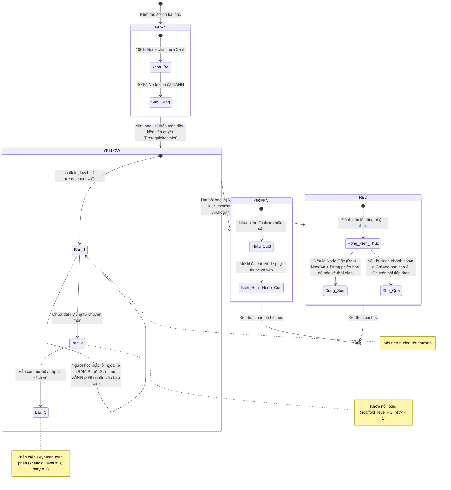

# SƠ ĐỒ MÁY TRẠNG THÁI CỦA NODE BÀI HỌC (NODE FINITE STATE MACHINE)
## DỰ ÁN: SGU-FEYNMAN

Tài liệu này đặc tả chi tiết vòng đời, các trạng thái màu sắc và bộ luật chuyển đổi toán học (Deterministic FSM) của từng khái niệm (`ConceptNode`) trên cây sơ đồ bài học.

---

## 1. SƠ ĐỒ CHUYỂN ĐỔI TRẠNG THÁI CỦA MỘT NODE (STATE TRANSITION DIAGRAM)



---

## 2. BẢNG QUY TẮC CHUYỂN TRẠNG THÁI TOÁN HỌC (TRANSITION RULES TABLE)

| Trạng thái hiện tại | Điều kiện kích hoạt từ kết quả AI | Trạng thái tiếp theo | Hành vi của Hệ thống Backend |
| :--- | :--- | :--- | :--- |
| **GRAY (Xám)** | `100% prerequisites == GREEN` | **YELLOW (Vàng)** | Tự động kích hoạt node này làm `active_node_id`, AI cất lời gợi ý đầu tiên. |
| **YELLOW (Vàng)** | `accuracy >= 70` AND `simplicity >= 70` AND `analogy >= 60` | **GREEN (Xanh lá)** | Node đạt chuẩn thấu suốt! Kích hoạt hiệu ứng chúc mừng, tìm node con tiếp theo để mở khóa. |
| **YELLOW (Vàng)** | `simplicity < 70` (Chép sách) HOẶC `analogy < 60` (Chưa ví von được) | **YELLOW (Vàng)** | Giữ màu Vàng. Tăng `retry_count += 1`, nâng `scaffold_level += 1`. AI đưa câu hỏi vặn đời thường. |
| **YELLOW (Vàng)** | Phát hiện lỗi kiến thức phụ ngoài lề (`peripheral_misconceptions`) | **YELLOW (Vàng)** | Giữ màu Vàng. Bé Minh hướng người học quay lại chủ đề chính, lưu lỗi phụ vào báo cáo cuối phiên. |
| **YELLOW (Vàng)** | `retry_count >= 3` HOẶC `misconception_flag == true` | **RED (Đỏ)** | Đánh dấu node bị hổng kiến thức. Nếu là Node Gốc $\to$ kích hoạt Dừng sớm (Early Termination). |

---

## 3. Ý NGHĨA SƯ PHẠM CỦA 4 MÀU SẮC

* **Màu Xám (GRAY):** Chưa có kiến thức nền tảng để tiếp cận. Giúp người học không bị quá tải nhận thức.
* **Màu Vàng (YELLOW):** Vùng phát triển gần nhất (Zone of Proximal Development - Vygotsky). Người học đang trong quá trình tự sửa chữa tư duy cùng AI.
* **Màu Xanh lá (GREEN):** Thấu suốt bản chất bằng ngôn ngữ bình dị của chính mình (Đạt chuẩn kỹ thuật Feynman).
* **Màu Đỏ (RED):** Điểm mù nhận thức (Cognitive Blindspot). Đánh dấu rõ ràng để sinh viên biết chính xác mình cần đọc lại trang nào trước khi đi thi.

---

## 4. CƠ CHẾ PHÂN BIỆT GIỮA "GIẢI THÍCH THÊM" (ELABORATION) VÀ "BẾ TẮC" (STUCK)

Để tránh tuyệt đối cảm giác **"bị hỏi cung"** hay hiểu lầm rằng *"nói 3 câu là bị đuổi"*, hệ thống phân định rạch ròi 2 hành vi giao tiếp:

```text
┌────────────────────────────────────────────────────────────────────────────────────────┐
│               PHÂN ĐỊNH HÀNH VI TƯƠNG TÁC TẠI TỪNG LƯỢT CHAT (INTENT CLASSIFICATION)    │
├────────────────────────────────────────┬───────────────────────────────────────────────┤
│    TRƯỜNG HỢP A: BỔ SUNG Ý (ELABORATION)│    TRƯỜNG HỢP B: BẾ TẮC THẬT SỰ (STUCK PROBE) │
├────────────────────────────────────────┼───────────────────────────────────────────────┤
│ • Người học nói thêm: "Khoan, để anh   │ • AI đã đặt câu hỏi vặn tình huống cụ thể     │
│   nói thêm...", "Ý anh là...", hoặc    │   (ví dụ: câu hỏi áo mưa ở Cung - Cầu).       │
│   gửi liên tiếp 2 - 3 tin nhắn dài.    │ • Người học trả lời nhưng sai lệch bản chất   │
│ • Vẫn đang trong mạch suy nghĩ tự do.  │   hoặc hoàn toàn bế tắc không giải thích được.│
├────────────────────────────────────────┼───────────────────────────────────────────────┤
│ ➡️ HÀNH VI BACKEND:                     │ ➡️ HÀNH VI BACKEND:                            │
│ KHÔNG TĂNG retry_count!                │ TĂNG retry_count += 1.                        │
│ Giữ nguyên cấp giàn giáo hiện tại.     │ Nâng bậc giàn giáo scaffold_level (1 -> 2 -> 3)│
│ AI chăm chú lắng nghe và tổng hợp ý.   │ để mồi tình huống sát sườn hơn.               │
└────────────────────────────────────────┴───────────────────────────────────────────────┘
```

### 4.1. Quyền chủ động: Nút "Tạm bỏ qua / Đánh dấu ôn sau" (User Skip / Give-up)
* Người học không bao giờ bị ép phải trả lời cố sống cố chết đủ 3 lần nếu họ tự nhận ra mình chưa đọc kỹ bài.
* Trên giao diện luôn có một nút phụ: **"Tạm bỏ qua / Ghi vào sổ tay ôn sau"**.
* Khi người học bấm nút này $\to$ Hệ thống lập tức đổi Node sang màu ĐỎ một cách nhẹ nhàng, ghi vào báo cáo cuối phiên và chuyển bài tiếp theo ngay $\to$ **Người học hoàn toàn làm chủ tiến độ học tập.**

### 4.2. Phản xạ tâm lý của Bé Minh khi chạm ngưỡng 3 lần (Không có "án phạt")
Khi chạm ngưỡng `retry_count == 3`, hệ thống **tuyệt đối không hiển thị thông báo FAILED hay phán xét người học**. Thay vào đó, AI đóng vai một người bạn học thông cảm và chủ động "tháo ngòi nổ" áp lực:

> **Lời thoại mẫu của Bé Minh khi chạm ngưỡng:**  
> *"Dạ em thấy phần này đang hơi lắt léo rồi anh ha! Em với anh tạm gác lại ở đây xíu nha, em có ghi vào sổ tay rồi, tí học xong các phần khác anh mở slide xem lại rồi chỉ lại cho em sau nha! Giờ mình qua phần tiếp theo cho đỡ đau đầu nè!"*

* **Mục đích:** Bảo vệ tâm lý tự tin của sinh viên, giữ cho phiên học luôn nhanh gọn (10–15 phút), và biến một bài học chưa hiểu thành một **mục tiêu ôn tập rõ ràng** trong bản báo cáo cuối phiên.

