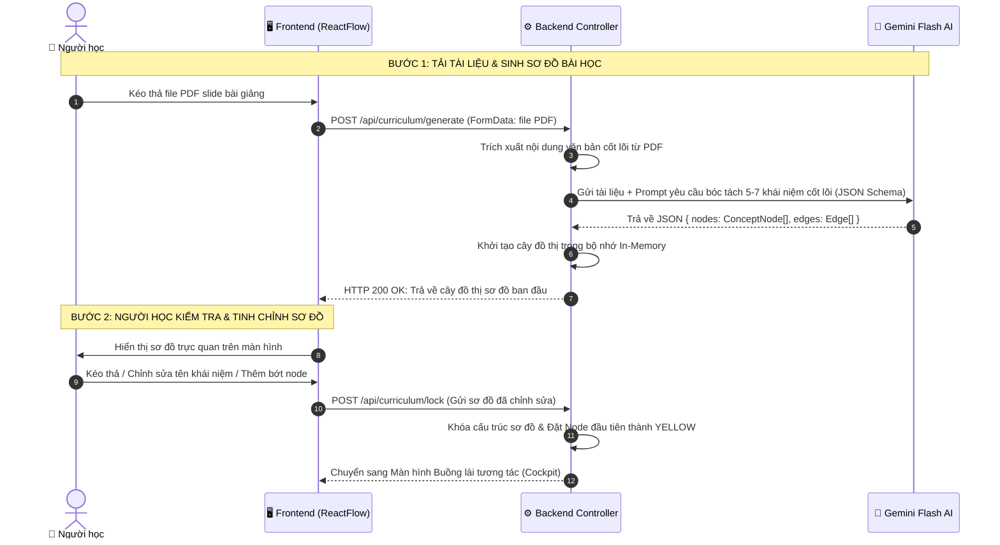
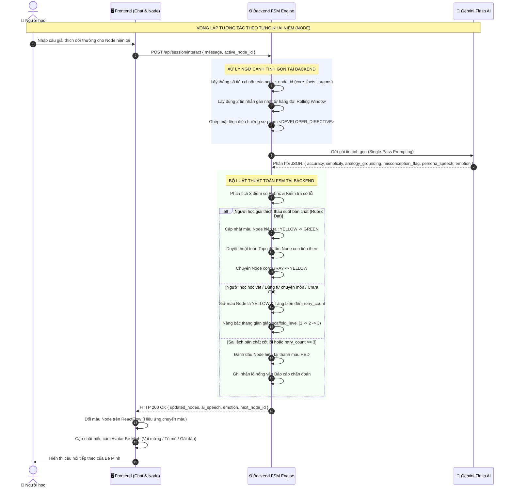
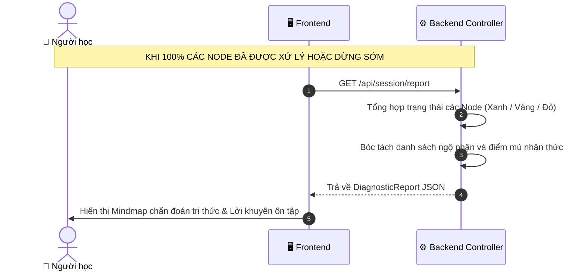

# SƠ ĐỒ TUẦN TỰ DỮ LIỆU CHI TIẾT (SEQUENCE DIAGRAM)
## DỰ ÁN: SGU-FEYNMAN

Tài liệu này thể hiện chi tiết luồng trao đổi dữ liệu theo thời gian thực giữa Người học, Giao diện (Frontend), Bộ điều phối (Backend) và Mô hình AI (Gemini Flash) trong 2 giai đoạn: Khởi tạo sơ đồ và Phiên tương tác Feynman.

---

## 1. GIAI ĐOẠN 1: NẠP TÀI LIỆU & TỰ ĐỘNG SINH CÂY SƠ ĐỒ (INGESTION PHASE)

---

## 2. GIAI ĐOẠN 2: VÒNG LẶP HỌC TẬP TƯƠNG TÁC TỪNG LƯỢT (INTERACTIVE LOOP)

---

## 3. GIAI ĐOẠN 3: KẾT THÚC PHIÊN & TRẢ BÁO CÁO CHẨN ĐOÁN (REPORT PHASE)

