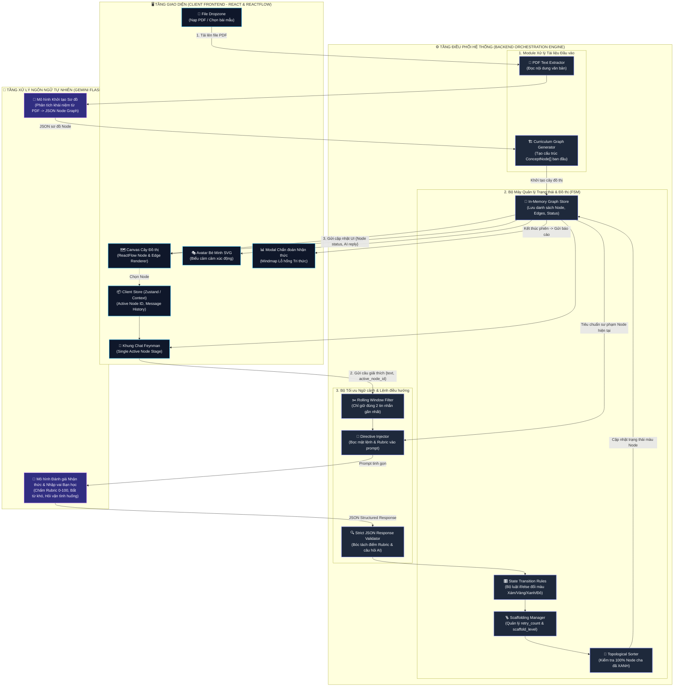

# SƠ ĐỒ KIẾN TRÚC PHÂN TẦNG HỆ THỐNG (SYSTEM ARCHITECTURE)
## DỰ ÁN: SGU-FEYNMAN

Tài liệu này thể hiện kiến trúc kỹ thuật phân tầng rõ ràng giữa Giao diện người dùng (Frontend), Bộ điều phối trạng thái (Backend Engine) và Tầng trí tuệ nhân tạo (Gemini AI Engine).

---

## 1. SƠ ĐỒ KIẾN TRÚC TỔNG THỂ (LAYERED ARCHITECTURE DIAGRAM)

---

## 2. NGUYÊN TẮC PHÂN TÁCH TRÁCH NHIỆM GIỮA CÁC TẦNG

1. **Tầng Giao diện (Frontend):**
   * Hoàn toàn thụ động về mặt logic sư phạm; chỉ hiển thị trực quan dữ liệu cây đồ thị bằng ReactFlow và bắt sự kiện người dùng nhập văn bản.
   * Không tự ý đổi màu Node nếu chưa có gói tin xác nhận từ Backend.
2. **Tầng Điều phối (Backend):**
   * Nắm giữ toàn bộ trạng thái chuẩn (Single Source of Truth) của bài học.
   * Kiểm soát chặt chẽ thứ tự học logic bằng thuật toán Đồ thị (Topological Ordering), tuyệt đối ngăn chặn việc nhảy cóc bài học.
   * Lọc và cắt gọt dữ liệu trò chuyện chỉ giữ tin nhắn gần nhất kèm tiêu chuẩn bài học để tối ưu chi phí API.
3. **Tầng Trí tuệ Nhân tạo (Gemini Flash):**
   * Đảm nhiệm năng lực đọc hiểu ngôn ngữ: trích xuất khái niệm từ tài liệu và thẩm định chiều sâu câu trả lời của người học.
   * Bắt buộc trả về định dạng JSON có cấu trúc để Backend dễ dàng giải mã và vận hành toán học.
