# SƠ ĐỒ LUỒNG TRẢI NGHIỆM NGƯỜI DÙNG (USER JOURNEY & FLOWCHART)
## DỰ ÁN: SGU-FEYNMAN

Tài liệu này mô tả chi tiết toàn bộ hành trình trải nghiệm của người học từ khi truy cập hệ thống, nạp tài liệu bài học, hiệu chỉnh sơ đồ, bước vào vòng lặp tương tác Feynman cho đến khi nhận báo cáo chẩn đoán nhận thức cuối phiên.

---

## 1. SƠ ĐỒ TỔNG THỂ HÀNH TRÌNH NGƯỜI HỌC (END-TO-END FLOWCHART)

```mermaid
flowchart TD
    Start(["🚀 Người học truy cập SGU-Feynman"]):::startNode --> Step1["📂 MÀN 1: NẠP TÀI LIỆU<br/>Kéo thả slide bài giảng (PDF) hoặc chọn bài mẫu"]:::screenNode
    
    Step1 --> AI_Parse["🤖 AI đọc hiểu nội dung<br/>Trích xuất 5 - 7 khái niệm cốt lõi & mối quan hệ"]:::aiNode
    AI_Parse --> Render_Graph["🗺️ Giao diện hiển thị Cây sơ đồ Node ban đầu"]:::screenNode
    
    Render_Graph --> User_Edit{"✏️ Người học kiểm tra sơ đồ:<br/>Có muốn chỉnh sửa không?"}:::decisionNode
    
    User_Edit -- "Có" --> Action_Edit["🛠️ Thêm / bớt Node, đổi tên khái niệm,<br/>sắp xếp lại liên kết trước - sau"]:::actionNode
    Action_Edit --> Confirm_Graph["🔒 Xác nhận & Khóa sơ đồ bài học"]:::actionNode
    User_Edit -- "Không (Hài lòng)" --> Confirm_Graph
    
    Confirm_Graph --> Enter_Cockpit["🎛️ MÀN 2: BUỒNG LÁI TƯ DUY (SPLIT COCKPIT)<br/>Cột trái: Bản đồ Node | Cột phải: Khung chat Feynman"]:::screenNode
    
    Enter_Cockpit --> Select_Node["📍 Hệ thống chọn Root Node đầu tiên<br/>(Node đổi từ màu XÁM sang màu VÀNG)"]:::stateNode
    
    %% VÒNG LẶP HỌC TẬP TỪNG NODE
    Select_Node --> User_Explain["🗣️ Người học nhập câu giải thích<br/>(Đóng vai người dạy, ví von đời thường)"]:::userNode
    
    User_Explain --> AI_Eval["🤖 AI chấm điểm 3 tiêu chí Rubric<br/>(Độ đúng, Độ bình dị, Độ liên hệ thực tế)"]:::aiNode
    
    AI_Eval --> Check_Result{"🎯 Backend thẩm định kết quả"}:::decisionNode
    
    %% KẾT QUẢ ĐẠT
    Check_Result -- "ĐẠT BẢN CHẤT<br/>(Điểm cao, không copy sách)" --> Node_Green["🟢 NODE ĐỔI MÀU XANH LÁ<br/>Bé Minh hiểu bài & reo vui"]:::successNode
    
    Node_Green --> Check_Remaining{"❓ Còn Node nào<br/>chưa học không?"}:::decisionNode
    
    Check_Remaining -- "Còn Node tiếp theo" --> Unlock_Next["🔓 Mở khóa Node con tiếp theo<br/>(Kiểm tra 100% Node cha đã XANH)"]:::actionNode
    Unlock_Next --> Select_Node
    
    %% KẾT QUẢ CHƯA ĐẠT / CẦN GIÀN GIÁO
    Check_Result -- "CHƯA ĐẠT / HỌC VẸT<br/>(Copy sách hoặc còn mơ hồ)" --> Handle_Scaffold["🟡 GIỮ MÀU VÀNG & TĂNG GIÀN GIÁO<br/>AI đặt câu hỏi vặn / Tình huống đời thường"]:::warningNode
    Handle_Scaffold --> Check_Retry{"Số lần thử tại Node này<br/>(retry_count < 3)?"}:::decisionNode
    
    Check_Retry -- "Còn lượt (< 3)" --> User_Explain
    Check_Retry -- "Hết lượt (>= 3) hoặc Sai bản chất cốt lõi" --> Node_Red["🔴 NODE ĐỔI MÀU ĐỎ<br/>Đánh dấu lỗ hổng nhận thức"]:::dangerNode
    
    Node_Red --> Check_Root{"Node bị đỏ có phải<br/>Root Node gốc không?"}:::decisionNode
    Check_Root -- "Phải (Hổng nền tảng gốc)" --> Early_Stop["⚠️ DỪNG PHIÊN HỌC SỚM<br/>Khuyên người học đọc lại tài liệu cơ bản"]:::dangerNode
    Check_Root -- "Không (Node nhánh)" --> Log_Gap["📝 Ghi nhận lỗ hổng vào báo cáo<br/>và cho qua để học node tiếp"]:::actionNode
    Log_Gap --> Check_Remaining
    
    %% KẾT THÚC PHIÊN HỌC
    Check_Remaining -- "Đã hoàn thành 100% Node" --> Step3["📊 MÀN 3: BÁO CÁO CHẨN ĐOÁN NHẬN THỨC<br/>- Bản đồ tư duy đánh dấu vùng Xanh/Đỏ/Vàng<br/>- Danh sách điểm mù & lời khuyên ôn thi vấn đáp"]:::reportNode
    Early_Stop --> Step3
    
    Step3 --> Finish(["🏁 Kết thúc phiên học (10 - 15 phút)"]):::startNode

    %% STYLING
    classDef startNode fill:#0F172A,stroke:#38BDF8,stroke-width:2px,color:#F8FAFC;
    classDef screenNode fill:#1E293B,stroke:#818CF8,stroke-width:2px,color:#F8FAFC;
    classDef aiNode fill:#312E81,stroke:#A5B4FC,stroke-width:2px,color:#EEF2FF;
    classDef userNode fill:#064E3B,stroke:#34D399,stroke-width:2px,color:#ECFDF5;
    classDef decisionNode fill:#334155,stroke:#F59E0B,stroke-width:2px,color:#FEF3C7;
    classDef actionNode fill:#1E293B,stroke:#94A3B8,stroke-width:1.5px,color:#F8FAFC;
    classDef stateNode fill:#1E1B4B,stroke:#C084FC,stroke-width:2px,color:#FAF5FF;
    classDef successNode fill:#064E3B,stroke:#10B981,stroke-width:2px,color:#D1FAE5;
    classDef warningNode fill:#78350F,stroke:#F59E0B,stroke-width:2px,color:#FEF3C7;
    classDef dangerNode fill:#7F1D1D,stroke:#EF4444,stroke-width:2px,color:#FEE2E2;
    classDef reportNode fill:#0C4A6E,stroke:#38BDF8,stroke-width:2px,color:#F0F9FF;
```

---

## 2. CHI TIẾT CÁC GIAI ĐOẠN TRẢI NGHIỆM

| Giai đoạn | Thao tác người dùng | Hệ thống phản hồi | Thời gian dự kiến |
| :--- | :--- | :--- | :--- |
| **1. Khởi động nhanh (Quick Start)** | Kéo thả file PDF slide bài giảng hoặc chọn 1 chuyên đề có sẵn | AI trích xuất 5 - 7 node khái niệm và dựng thành cây sơ đồ trực quan | ~5 - 10 giây |
| **2. Hiệu chỉnh sơ đồ (Refine Graph)** | Xem trước các khái niệm, đổi tên hoặc kéo xóa node nếu muốn | Cập nhật đồ thị theo thời gian thực, khóa cấu trúc khi bấm Bắt đầu | ~15 - 30 giây |
| **3. Buồng lái tương tác (Interactive Loop)** | Gõ câu giải thích đời thường cho Node hiện tại | AI phân tích, hỏi vặn bằng tình huống thực tế hoặc đổi màu Node sang Xanh | ~1 - 2 phút / Node |
| **4. Tiếp nhận phản hồi (Diagnostic Report)** | Xem tổng kết vùng sáng/vùng tối kiến thức | Xuất bản đồ chẩn đoán lỗ hổng, chỉ rõ điểm ngộ nhận để tự tin thi vấn đáp | ~1 phút |
