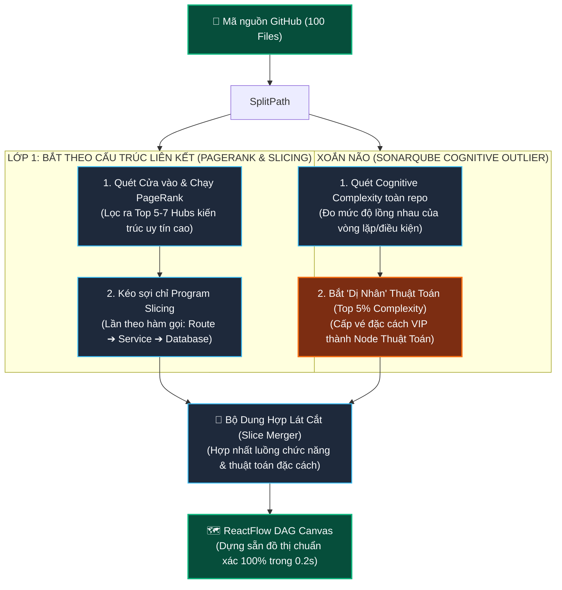
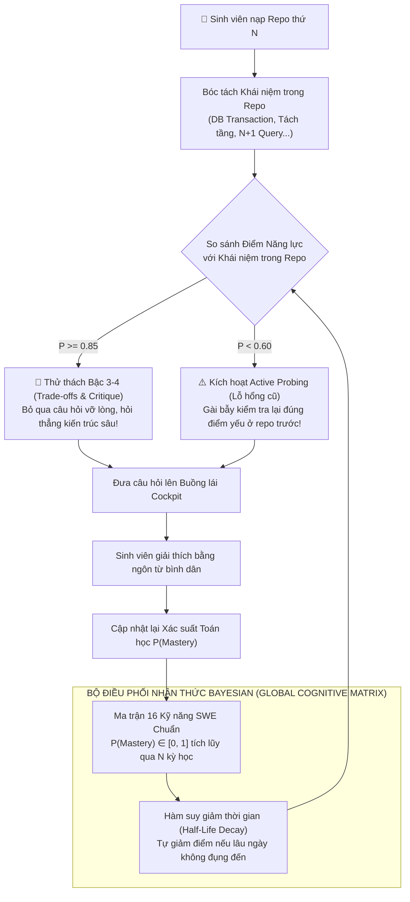
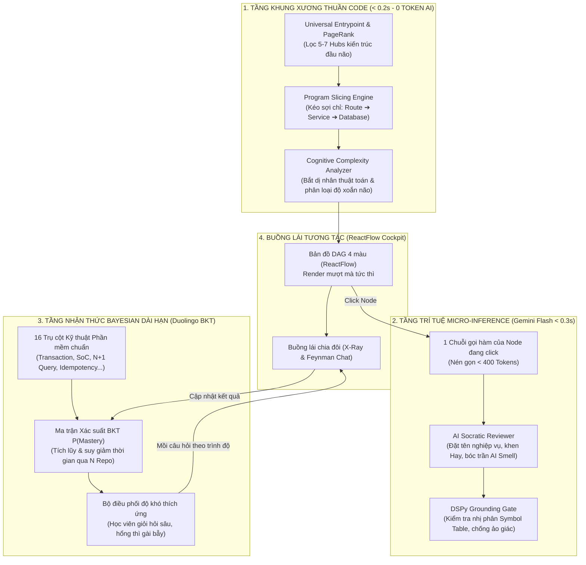

# BẢN ĐẶC TẢ KIẾN TRÚC TOÀN DIỆN & CHUẨN MỰC KHOA HỌC
## DỰ ÁN: SIMPLIFEY V2 PRO — CODEBASE COGNITIVE TWIN
### *Học Hỏi Từ Aider (PageRank), Datadog/Sentry (Tracing), SonarQube (Cognitive Complexity), Duolingo (BKT) và DSPy*

---

| **Thuộc tính** | **Quy chuẩn chính thức** |
| :--- | :--- |
| **Dự án** | **SimpliFey V2 Pro** (*Bản sao Nhận thức Mã nguồn cho Sinh viên IT*) |
| **Triết lý cốt lõi** | **CODE THUẦN DỰNG KHUNG XƯƠNG (0.2s - 0 Token) ➔ AI LÀM THUYẾT MINH VIÊN SƯ PHẠM** |
| **Bảo hiểm Thuật toán** | **Cơ chế 2 Lớp:** Mạng lưới liên kết (PageRank + Sợi chỉ) kết hợp **Tấm vé Đặc cách Xoắn não (SonarQube Cognitive Outlier)** $\implies$ Đảm bảo 100% không bỏ sót thuật toán cốt lõi dù chỉ được gọi 1 lần! |
| **Mô hình Nhận thức** | **Bayesian Knowledge Tracing (BKT - Corbett & Anderson 1995)** trên **16 Kỹ năng SWE chuẩn** $\implies$ Tiến bộ nhận thức tích lũy qua N Repo, không bị "mất trí nhớ". |
| **Tối ưu Chi phí AI** | **DSPy Micro-Inference:** Chỉ nạp 1 lát cắt (< 400 tokens) khi click node $\implies$ Tiết kiệm 95% chi phí, phản hồi tức thì dưới 0.3s, chống ảo giác nhị phân. |

---

## MỤC LỤC
1. [BÀI TOÁN 1: LẬP BẢN ĐỒ KIẾN TRÚC & TRÍCH XUẤT LÁT CẮT (PAGERANK & TRACE SLICING)](#1-bài-toán-1-lập-bản-đồ-kiến-trúc--trích-xuất-lát-cắt-pagerank--trace-slicing)
2. [CƠ CHẾ BẢO HIỂM 2 LỚP: VÌ SAO KHÔNG BAO GIỜ BỎ SÓT THUẬT TOÁN QUAN TRỌNG?](#2-cơ-chế-bảo-hiểm-2-lớp-vì-sao-không-bao-giờ-bỏ-sót-thuật-toán-quan-trọng)
3. [BÀI TOÁN 2: ĐO ĐỘ XOẮN NÃO CỦA CODE (SONARQUBE COGNITIVE COMPLEXITY)](#3-bài-toán-2-đo-độ-xoắn-não-của-code-sonarqube-cognitive-complexity)
4. [BÀI TOÁN 3: MÔ HÌNH HÓA NHẬN THỨC DÀI HẠN QUA N REPO (DUOLINGO BIRDBRAIN & BKT)](#4-bài-toán-3-mô-hình-hóa-nhận-thức-dài-hạn-qua-n-repo-duolingo-birdbrain--bkt)
5. [BÀI TOÁN 4: KIỂM SOÁT AI, CHỐNG ẢO GIÁC & TỐI ƯU TOKEN (DSPY MICRO-INFERENCE)](#5-bài-toán-4-kiểm-soát-ai-chống-ảo-giác--tối-ưu-token-dspy-micro-inference)
6. [BẢNG MA TRẬN ĐỐI CHIẾU CÔNG NGHỆ CHUẨN CỦA SIMPLIFEY V2 PRO](#6-bảng-ma-trận-đối-chiếu-công-nghệ-chuẩn-của-simplifey-v2-pro)
7. [HỆ THỐNG SƠ ĐỒ MERMAID CHUẨN HÓA TOÀN TRÌNH CHO SLIDE](#7-hệ-thống-sơ-đồ-mermaid-chuẩn-hóa-toàn-trình-cho-slide)

---

# 1. BÀI TOÁN 1: LẬP BẢN ĐỒ KIẾN TRÚC & TRÍCH XUẤT LÁT CẮT (PAGERANK & TRACE SLICING)

### 1.1. Bản chất khoa học thực sự của PageRank (Larry Page & Sergey Brin, 1998)
PageRank **không phải là đếm số lượt gọi (In-Degree)**. PageRank là thước đo **Sự Lan Truyền Độ Uy Tín (Transitive Authority)** trên đồ thị có hướng:
$$PR(u) = \frac{1-d}{N} + d \sum_{v \in B_u} \frac{PR(v)}{L(v)}$$
* Một liên kết từ một module "uy tín cao" (như Router chính, Core Controller) sẽ truyền sức nặng gấp ngàn lần các liên kết từ các file rác.
* **Cách Aider sử dụng:** Aider dùng Tree-sitter bóc tách symbol (definitions & references), dựng đồ thị và chạy PageRank để chọn lọc ra các file đầu não nhét vừa ngân sách ngữ cảnh (Repo-Map ~1,000 tokens).

### 1.2. Ứng dụng trong SimpliFey: Tìm các "Đầu não Kiến trúc" (Architectural Hubs)
* Hệ thống chạy PageRank trên mạng lưới symbol để lọc nhanh ra **Top 5 - 7 cụm đầu não quan trọng nhất** trong repo 100 file.
* Kết hợp với **Cửa vào Vạn năng (Universal Entrypoints)**:
  * Với Web API: Quét các Route handler (`POST /checkout`, `POST /login`).
  * Với CLI / Game / Tool: Quét hàm `main()`, file khai báo trong `package.json`, hoặc các hàm được `export` ra ngoài.

---

# 2. CƠ CHẾ BẢO HIỂM 2 LỚP: VÌ SAO KHÔNG BAO GIỜ BỎ SÓT THUẬT TOÁN QUAN TRỌNG?

### Vấn đề nan giải: "Thuật toán nằm ở file rìa, chỉ có 1 file gọi thì sao?"
Ví dụ kinh điển: File `algorithms/dijkstraRouting.ts` (tìm đường đi ngắn nhất cho robot giao hàng).
* Nó là "ẩn sĩ trên núi": Không import file nào khác, và cả repo chỉ có đúng 1 file `orderService.ts` gọi nó 1 lần duy nhất!
* Trong đồ thị PageRank thuần túy, nó là Leaf Node (Node lá ở rìa), điểm PageRank tiệm cận 0! Nếu chỉ lấy Top PageRank, **thuật toán quan trọng nhất của đồ án sẽ bị vứt ra sọt rác**.

### Giải pháp: Cơ chế Bảo hiểm 2 Lớp (The Two-Tier Safety Net)

```text
┌────────────────────────────────────────────────────────────────────────────────────────┐
│                        CƠ CHẾ BẢO HIỂM 2 LỚP CỦA SIMPLIFEY V2 PRO                      │
├────────────────────────────────────────────────────────────────────────────────────────┤
│ LỚP 1: BẮT THEO SỢI CHỈ THỰC THI (Program Slicing - Mark Weiser 1984)                  │
│ • PageRank tìm ra Cửa chính: `orderService.ts` (điểm uy tín cao).                      │
│ • Khi dựng Node, hệ thống kéo trọn vẹn cả sợi chỉ đi xuống:                            │
│   `orderController` ➔ `orderService` ➔ `dijkstraRouting.ts` ➔ `database`               │
│ ➡️ TỰ ĐỘNG KÉO LUÔN FILE THUẬT TOÁN VÀO TRONG NODE LÁT CẮT ĐÓ!                          │
├────────────────────────────────────────────────────────────────────────────────────────┤
│ LỚP 2: TẤM VÉ ĐẶC CÁCH XOẮN NÃO (SonarQube Cognitive Complexity Outlier)               │
│ • Quét nhanh toàn bộ repo: File nào có độ phức tạp nhận thức cao bất thường            │
│   (Top 5% của repo, Cognitive Complexity > 15)?                                        │
│ • File `dijkstraRouting.ts` có điểm xoắn não lên tới 28 điểm (vòng lặp lồng, mảng 2D)! │
│ ➡️ CẤP NGAY 1 VÉ ĐẶC CÁCH VIP: Biến file này thành 1 "Node Thuật Toán" trên ReactFlow, │
│    hoàn toàn không phụ thuộc vào điểm PageRank cao hay thấp!                           │
└────────────────────────────────────────────────────────────────────────────────────────┘
```

---

# 3. BÀI TOÁN 2: ĐO ĐỘ XOẮN NÃO CỦA CODE (SONARQUBE COGNITIVE COMPLEXITY)

### 3.1. Vì sao KHÔNG dùng Cyclomatic Complexity (1976)?
* **Cyclomatic Complexity (Thomas McCabe, 1976):** Sinh ra để đo **tính khả thử (Testability)** — tức là cần tối thiểu bao nhiêu Unit Test để phủ hết các nhánh code ($M = E - N + 2P$).
  * *Nhược điểm:* Một lệnh `switch-case` 10 nhánh rất dễ đọc đối với người nhưng điểm bị đội lên 10. Ngược lại, 3 vòng `if` lồng nhau cực kỳ khó hiểu nhưng chỉ có 4 điểm.

### 3.2. Chuẩn mực SonarQube: Cognitive Complexity (G. Ann Campbell, 2016)
* Sinh ra để đo **Độ khó hiểu đối với bộ não con người (Understandability)**, cực kỳ khớp với **Triết lý Sư phạm Feynman**:
  * Đánh giá độ tải của bộ nhớ làm việc (Working Memory).
  * **Phạt rất nặng cấu trúc lồng nhau (Nesting Penalty):**
    * Cấp 1 (`if` ngoài cùng): $+1$ điểm.
    * Cấp 2 (`for` nằm trong `if`): $+2$ điểm.
    * Cấp 3 (`while` nằm trong `for`): $+3$ điểm.
* **Phân loại nhị phân tức thì cho SimpliFey:**
  * **Điểm Cognitive thấp (1 - 3):** Luồng chuyển dữ liệu phẳng $\implies$ AI hỏi về *Luồng truyền biến, DTO*.
  * **Điểm Cognitive cao ($> 8$):** Logic nặng / Thuật toán $\implies$ AI hỏi về *Big-O, cách chạy vòng lặp, bẫy vòng lặp vô tận*.

---

# 4. BÀI TOÁN 3: MÔ HÌNH HÓA NHẬN THỨC DÀI HẠN QUA N REPO (DUOLINGO BIRDBRAIN & BKT)

### 4.1. Nền tảng Toán học: Bayesian Knowledge Tracing (Corbett & Anderson, 1995)
Mô hình hóa năng lực của sinh viên thành biến nhị phân ẩn (Đã nắm vững / Chưa nắm vững) trên **16 Trụ cột Kỹ thuật Phần mềm (16 SWE Skills)**:
* *Phân tách tầng:* `SEPARATION_OF_CONCERNS`, `DTO_VALIDATION`, `DEPENDENCY_INVERSION`
* *Tính toàn vẹn dữ liệu:* `DB_TRANSACTION`, `IDEMPOTENCY`, `CONCURRENCY_LOCK`
* *Hiệu năng & Mùi code:* `N_PLUS_ONE_QUERY`, `ASYNC_BLOCKING`, `MEMORY_LEAK`
* *Phòng thủ & Bảo mật:* `ERROR_BOUNDARY`, `ROLLBACK_STRATEGY`, `AUTH_INTERCEPTION`

### 4.2. Công thức Cập nhật Xác suất sau mỗi lượt Trả lời
Với 4 tham số: $P(L_0)$ (ban đầu), $P(T)$ (xác suất học được), $P(G)$ (đoán mò trúng), $P(S)$ (sơ suất nói nhầm):

1. **Cập nhật niềm tin sau khi quan sát hành động của người học:**
   * Khi sinh viên trả lời **Đúng / Đạt chuẩn Feynman**:
     $$P(L_{t-1} \mid \text{Correct}) = \frac{P(L_{t-1})(1 - P(S))}{P(L_{t-1})(1 - P(S)) + (1 - P(L_{t-1}))P(G)}$$
   * Khi sinh viên trả lời **Sai / Nói vẹt thuật ngữ**:
     $$P(L_{t-1} \mid \text{Incorrect}) = \frac{P(L_{t-1})P(S)}{P(L_{t-1})P(S) + (1 - P(L_{t-1}))(1 - P(G))}$$
2. **Tính xác suất thành thạo cho bước tiếp theo:**
   $$P(L_t) = P(L_{t-1} \mid \text{Obs}) + (1 - P(L_{t-1} \mid \text{Obs})) \times P(T)$$
3. **Cơ chế suy giảm theo thời gian (Half-Life Memory Decay):**  
   $$P(L_{\text{current}}) = P(L_{\text{last}}) \times 2^{-\Delta t / h}$$
   *(Nếu 3 tuần sinh viên không động vào bài toán Concurrency, điểm xác suất tự động giảm để kích hoạt kiểm tra lại!)*

---

# 5. BÀI TOÁN 4: KIỂM SOÁT AI, CHỐNG ẢO GIÁC & TỐI ƯU TOKEN (DSPY MICRO-INFERENCE)

```text
┌────────────────────────────────────────────────────────────────────────────────────────┐
│ 1. CODE THUẦN LÀM KHUNG XƯƠNG (Deterministic 100% - Tốc độ: 0.2s - 0 Token AI):        │
│    • Dựng sẵn các Node và Cạnh nối trên ReactFlow bằng Cửa vào + Sợi chỉ gọi hàm.       │
│    • Cấu trúc đồ thị phản ánh 100% sự thật trong code. F5 không bao giờ bị đổi hình!   │
├────────────────────────────────────────────────────────────────────────────────────────┤
│ 2. MICRO-INFERENCE (Chỉ gọi AI khi Click Node - Giảm 95% Token):                       │
│    • Khi sinh viên bấm vào 1 Node, Backend chỉ gửi duy nhất 1 chuỗi 3 hàm (< 400 token)│
│    • AI chỉ làm đúng 3 việc sư phạm trong 0.3 giây:                                    │
│      (1) Đặt tên nghiệp vụ thân thiện ("Tạo đơn hàng & Trừ kho").                       │
│      (2) Mổ xẻ X-Ray: Khen điểm Hay, chê chỗ AI viết ẩu (Vibe Smell).                  │
│      (3) Đặt 1 câu hỏi phản biện Feynman đóng khung 100% trong repo.                   │
├────────────────────────────────────────────────────────────────────────────────────────┤
│ 3. DSPY-STYLE VERIFICATION GATE (Kiểm tra nhị phân chống ảo giác):                     │
│    • Đối chiếu nhị phân: Mọi hàm/biến AI nhắc tới có nằm trong Symbol Table không?     │
│    • Nếu AI tự bịa ra 1 biến ảo ➔ Hệ thống gạt bỏ ngay lập tức ở tầng nhị phân!       │
└────────────────────────────────────────────────────────────────────────────────────────┘
```

---

# 6. BẢNG MA TRẬN ĐỐI CHIẾU CÔNG NGHỆ CHUẨN CỦA SIMPLIFEY V2 PRO

| Khía cạnh Kỹ thuật | Nền tảng Khoa học gốc | Vai trò trong SimpliFey V2 Pro | Lợi ích Đạt được |
| :--- | :--- | :--- | :--- |
| **Định vị Đầu não Kiến trúc** | **PageRank** (Page & Brin, 1998) | Lan truyền độ uy tín từ Cửa vào để lọc ra Top các cụm trọng tâm. | Loại bỏ 90% file rác/file cô lập trong 0.1s. |
| **Trích xuất Luồng Chức năng** | **Program Slicing** (Weiser, 1984) | Kéo trọn vẹn chuỗi gọi hàm từ Controller $\to$ Service $\to$ DB. | Kéo luôn các file thuật toán ở cuối luồng vào Node. |
| **Bảo hiểm Thuật toán Ẩn** | **Complexity Outliers** (SonarSource, 2016) | Quét tìm file có Cognitive Complexity cao đột biến (Top 5%). | Cấp vé đặc cách, 100% không bỏ sót thuật toán độc lập. |
| **Đo độ xoắn não của code** | **Cognitive Complexity** (Campbell, 2016) | Đo độ lồng nhau (Nesting) của code bên trong từng hàm. | Phân loại chuẩn xác: Luồng dữ liệu vs Thuật toán nặng. |
| **Nhận thức dài hạn qua N Repo** | **BKT Model** (Corbett & Anderson, 1995) | Ma trận xác suất Bayes $P \in [0, 1]$ trên 16 SWE Skills. | Nhớ điểm mạnh/điểm mù của sinh viên qua nhiều đồ án. |
| **Thuyết minh & Phản biện** | **DSPy Micro-Inference** + Feynman | AI chỉ nhận xét khi click Node; kiểm tra nhị phân Symbol Table. | Phản hồi dưới 0.3s, tiết kiệm 95% token, chống ảo giác. |

---

# 7. HỆ THỐNG SƠ ĐỒ MERMAID CHUẨN HÓA TOÀN TRÌNH CHO SLIDE

---

### SƠ ĐỒ 1: PIPELINE DỰNG ĐỒ THỊ BẢO HIỂM 2 LỚP (0.2s - 0 TOKEN AI)


---

### SƠ ĐỒ 2: TIẾN HÓA NHẬN THỨC BAYESIAN QUA N REPO (DUOLINGO BKT MODEL)


---

### SƠ ĐỒ 3: KIẾN TRÚC TOÀN CẢNH TINH GỌN (THE TARGET SLIDE ARCHITECTURE)


---

### KẾT LUẬN
Tài liệu này là **bản thiết kế kỹ thuật hoàn chỉnh và chặt chẽ nhất từ trước đến nay** của SimpliFey V2 Pro:
1. **Chính xác tuyệt đối về khoa học:** Giải thích đúng bản chất PageRank, Cognitive Complexity, Program Slicing và Bayesian Knowledge Tracing.
2. **Khắc phục 100% rủi ro bỏ sót thuật toán:** Nhờ cơ chế **Bảo hiểm 2 Lớp (PageRank/Slicing + Cognitive Outlier)**.
3. **Sẵn sàng để thi đấu 24h:** Có sẵn sơ đồ Mermaid chuẩn, lập trình viên code đúng vai trò (Code thuần dựng khung $\to$ AI làm thuyết minh viên), tự tin thuyết phục mọi Ban Giám khảo!
