# BẢN PHÂN RÃ HỆ THỐNG, GIAI ĐOẠN PHÁT TRIỂN & DANH MỤC TÍNH NĂNG
## DỰ ÁN: SIMPLIFEY V2 PRO — CODEBASE COGNITIVE TWIN
### *Tài liệu Hướng dẫn Triển khai & Tối ưu hóa Từng Bước (Implementation & Optimization Playbook)*

---

| **Thuộc tính** | **Thông tin** |
| :--- | :--- |
| **Dự án** | **SimpliFey V2 Pro** (*Bản sao Nhận thức Mã nguồn cho Sinh viên IT*) |
| **Mục đích** | Bóc tách toàn diện hệ thống: **Gồm cái gì? Giai đoạn nào? Làm chức năng gì? Tối ưu ra sao?** |
| **Chiến lược** | Đi từ **Khung xương chạy được (Walking Skeleton)** $\to$ **Tối ưu hóa từng module** $\to$ **Hoàn thiện Demo 24h** |
| **Mức độ ưu tiên** | **P0 (Sống còn / Bắt buộc)** • **P1 (Điểm kỹ thuật cao)** • **P2 (Hiệu ứng Wow / Nâng cao)** |

---

## MỤC LỤC
1. [HỆ THỐNG GỒM CÁI GÌ? (5 PHÂN HỆ CẤU THÀNH)](#1-hệ-thống-gồm-cái-gì-5-phân-hệ-cấu-thành)
2. [LỘ TRÌNH 24H: CHIA THÀNH CÁC GIAI ĐOẠN NÀO? (TIMELINE & MILESTONES)](#2-lộ-trình-24h-chia-thành-các-giai-đoạn-nào-timeline--milestones)
3. [DANH MỤC TÍNH NĂNG CHI TIẾT (FEATURE BACKLOG: INPUT - PROCESS - OUTPUT)](#3-danh-mục-tính-năng-chi-tiết-feature-backlog-input---process---output)
4. [SƠ ĐỒ MA TRẬN PHÂN CHIA TRÁCH NHIỆM & TÍNH NĂNG](#4-sơ-đồ-ma-trận-phân-chia-trách-nhiệm--tính-năng)
5. [CẨM NANG TỐI ƯU HÓA TỪNG BƯỚC (STEP-BY-STEP OPTIMIZATION PLAYBOOK)](#5-cẩm-nang-tối-ưu-hóa-từng-bước-step-by-step-optimization-playbook)
6. [KỊCH BẢN CHUẨN BỊ DEMO AN TOÀN TUYỆT ĐỐI (FAIL-SAFE DEMO)](#6-kịch-bản-chuẩn-bị-demo-an-toàn-tuyệt-đối-fail-safe-demo)

---

# 1. HỆ THỐNG GỒM CÁI GÌ? (5 PHÂN HỆ CẤU THÀNH)

Hệ thống SimpliFey V2 Pro được cấu thành từ **5 Phân hệ độc lập (Decoupled Modules)**. Việc module hóa giúp nhóm có thể chia việc cho từng thành viên code song song mà không dẫm chân lên nhau:

```text
┌────────────────────────────────────────────────────────────────────────────────────────┐
│                        TỔNG THỂ KIẾN TRÚC SIMPLIFEY V2 PRO                             │
├────────────────────────────────────────────────────────────────────────────────────────┤
│  MODULE 1: BUỒNG LÁI TƯƠNG TÁC (Cockpit UI & DAG Canvas)                               │
│  • Canvas ReactFlow hiển thị lát cắt kiến trúc 4 màu (Xám, Vàng, Xanh, Đỏ).            │
│  • Khung hiển thị chia đôi (Split-Cockpit): Tab 1 (Mổ xẻ X-Ray) | Tab 2 (Feynman Chat). │
├────────────────────────────────────────────────────────────────────────────────────────┤
│  MODULE 2: ĐỘNG CƠ PHÂN TÍCH TĨNH (Static Ingestion Engine - 0 Token)                  │
│  • TreePruner: Lọc sạch thư mục rác (.gitignore, node_modules, build...).             │
│  • Tree-sitter AST Parser: Bóc tách cấu trúc hàm, class, file liên kết.                │
│  • Call-Graph & Clustering: Gom chuỗi Controller -> Service -> DB thành Lát cắt Node.  │
│  • Dagre Layout: Tự động tính tọa độ (x, y) đa tầng phân cấp.                          │
├────────────────────────────────────────────────────────────────────────────────────────┤
│  MODULE 3: BỘ ĐIỀU PHỐI MÁY TRẠNG THÁI (Deterministic FSM Engine)                      │
│  • Quản lý vòng đời màu sắc: GRAY -> YELLOW -> GREEN / RED.                            │
│  • Thuật toán Soft-prerequisite Bypass (Chống Deadlock khi có Node bị Đỏ/Bỏ qua).      │
│  • Phân loại Intent tương tác: ELABORATION (bổ sung ý) vs EVALUATION (sát hạch).       │
├────────────────────────────────────────────────────────────────────────────────────────┤
│  MODULE 4: BỘ BA TÁC TỬ TRÍ TUỆ AI (AI Triad Reasoning Core)                           │
│  • Agent 1 (X-Ray Generator): Sinh bản mổ xẻ luồng chạy & bóc trần AI Vibe Smells.     │
│  • Agent 2 (Actor-Critic JIT Questioner): Sinh câu hỏi 100% nội tại mã nguồn repo.     │
│  • Agent 3 (Feynman Rubric Judge): Chấm 3 điểm chuẩn Rubric & Bắt từ chuyên môn rỗng.   │
├────────────────────────────────────────────────────────────────────────────────────────┤
│  MODULE 5: BỘ NHỚ KÉP & BÁO CÁO NHẬN THỨC (Dual-Memory & Cognitive Twin Store)         │
│  • User Cognitive Profile: Lưu điểm mù kiến trúc xuyên Node để mồi câu hỏi sau.        │
│  • Self-Calibration Log: Ghi nhận câu hỏi hỏng / hallucination do người dùng flag.     │
│  • Diagnostic Report Generator: Xuất báo cáo bản sao nhận thức mã nguồn cuối phiên.   │
└────────────────────────────────────────────────────────────────────────────────────────┘
```

---

# 2. LỘ TRÌNH 24H: CHIA THÀNH CÁC GIAI ĐOẠN NÀO? (TIMELINE & MILESTONES)

Dựa trên Thể lệ Hackathon SGU (Thời gian làm bài: **12g00 Thứ Bảy 31/10 $\to$ 09g00 Chủ Nhật 01/11**, chấm thi lúc 10g00), lộ trình kỹ thuật được chia làm **6 Giai đoạn liên hoàn**:

```mermaid
gantt
    title LỘ TRÌNH 24 GIỜ PHÁT TRIỂN & TỐI ƯU SIMPLIFEY V2 PRO
    dateFormat  HH:mm
    axisFormat  %H:%M
    
    section Giai đoạn 0: Khởi động
    Khởi tạo Repo trống & Phân quyền Commit       :done, g0_1, 12:00, 13:00
    Setup Next.js, ReactFlow, Zod, Gemini SDK     :done, g0_2, 13:00, 14:00

    section Giai đoạn 1: Khung xương
    Data Contracts (TypeScript Interfaces)        :active, g1_1, 14:00, 15:30
    Mock Data & Dựng Split-Cockpit Layout UI      :active, g1_2, 15:30, 18:00

    section Giai đoạn 2: Phân tích Tĩnh
    TreePruner + Tree-sitter Parser               :g2_1, 18:00, 20:30
    Call-Graph Builder & Dagre Auto-Layout        :g2_2, 20:30, 23:00

    section Giai đoạn 3: AI & FSM
    FSM Engine 4 Màu & Soft-prerequisite          :g3_1, 23:00, 01:30
    Gemini Structured Outputs (Bộ 3 Agent)        :g3_2, 01:30, 04:30

    section Giai đoạn 4: Tinh chỉnh
    Dual-Memory Loop & Báo cáo Cognitive Twin     :g4_1, 04:30, 06:30
    Web Speech API + Animation & Polish           :g4_2, 06:30, 07:30

    section Giai đoạn 5: Tổng duyệt
    Test trên Repo Thật + Xuất Video Backup       :g5_1, 07:30, 08:30
    Nộp file thuyết trình (Trước 09:30)           :g5_2, 08:30, 09:30
```



---

### Chi tiết mục tiêu từng giai đoạn:

#### 🟢 Giai đoạn 0: Khởi động & Ràng buộc Thể lệ (12:00 - 14:00 | 2 Tiếng)
* **Mục tiêu:** Tuân thủ 100% quy chế Hackathon SGU về quản lý mã nguồn.
* **Đầu việc:**
  1. Khởi tạo 01 GitHub Repository công khai (Public) trống hoàn toàn, nộp link cho BTC kiểm tra.
  2. Mời đủ 5 thành viên làm Collaborators. Đảm bảo mỗi người có ít nhất 1 commit ban đầu (Setup docs, cấu hình linter, gitignore).
  3. Khởi tạo dự án Next.js 15 (App Router, TypeScript, Tailwind CSS).
  4. Cài đặt các thư viện lõi: `@xyflow/react`, `@dagrejs/dagre`, `@google/genai`, `zod`, `zustand`, `lucide-react`, `web-tree-sitter`.

#### 🟢 Giai đoạn 1: Xây Dựng Khung Xương (Walking Skeleton) (14:00 - 18:00 | 4 Tiếng)
* **Mục tiêu:** Có giao diện tương tác cơ bản chạy được dữ liệu mẫu (Mock data) ngay trên máy.
* **Đầu việc:**
  1. Khóa cứng file hợp đồng dữ liệu `src/types/schema.ts` (chứa `HybridArchitecturalNode`, `AIEvaluationResponse`, `UserCognitiveProfile`).
  2. Tạo 1 file dữ liệu mẫu (`mock-repo-graph.json`) gồm 5 Node lát cắt chuẩn: `Auth Slice`, `Product Catalog`, `Order Checkout`, `Inventory Sync`, `Payment Gateway`.
  3. Dựng layout Buồng lái chia đôi:
     * Cột trái (40%): Render các Node trên canvas ReactFlow với 4 màu viền CSS.
     * Cột phải (60%): Tab 1 hiển thị code mổ xẻ (X-Ray), Tab 2 hiển thị khung đối thoại (Feynman Challenge).
  4. Bắt sự kiện click Node: Bấm Node vàng $\to$ Cột phải đổi nội dung tương ứng.

#### 🟢 Giai đoạn 2: Động cơ Phân tích Tĩnh (Static Ingestion Engine) (18:00 - 23:00 | 5 Tiếng)
* **Mục tiêu:** Nhập link GitHub hoặc thư mục code thật $\to$ Tự động sinh ra cây đồ thị DAG chuẩn mà không cần ném cả đống code lên LLM.
* **Đầu việc:**
  1. **TreePruner:** Viết hàm quét thư mục, loại bỏ tự động các folder rác (`node_modules`, `.git`, `venv`, `dist`, `__pycache__`).
  2. **Tree-sitter AST Parser:** Dựng parser bóc tách các hàm, import/export, và `CallExpression` (hàm nào gọi hàm nào).
  3. **Call-Graph Linker:** Tạo liên kết giữa các file (Ví dụ: `routes/order.js` gọi `orderService.createOrder` trong `services/order.js`).
  4. **Clustering & Dagre Layout:** Gom các chuỗi gọi hàm thành các cụm lát cắt và dùng `@dagrejs/dagre` tính tọa độ $(x, y)$.

#### 🟢 Giai đoạn 3: Tích hợp Bộ ba AI & Máy Trạng Thái FSM (23:00 - 04:30 | 5.5 Tiếng)
* **Mục tiêu:** "Thổi hồn" trí tuệ vào hệ thống, hoàn thiện vòng lặp Feynman.
* **Đầu việc:**
  1. **FSM Engine:** Viết logic đổi màu Node toán học. Cài đặt thuật toán **Soft-prerequisite Bypass** (Nếu Node cha bị ĐỎ $\to$ Mở khóa Node con kèm cảnh báo nền móng chưa vững).
  2. **Agent 1 (X-Ray Generator):** Viết prompt ép Gemini Flash trả về JSON tóm tắt luồng chạy + chỉ ra 1 vị trí AI viết ẩu (Smell: N+1 query, thiếu rollback transaction).
  3. **Agent 2 (Actor-Critic JIT Questioner):** Thiết kế prompt sinh 3 dạng câu hỏi nội tại 100% trong repo.
  4. **Agent 3 (Feynman Rubric Judge):** Chấm 3 thang điểm (`core_accuracy`, `simplicity`, `repo_grounding`), bắt từ chuyên môn sáo rỗng.

#### 🟢 Giai đoạn 4: Bộ Nhớ Kép, Âm Thanh & Đánh Bóng UX (04:30 - 07:30 | 3 Tiếng)
* **Mục tiêu:** Biến sản phẩm từ "chạy được" thành "đẳng cấp, mượt mà và gây ấn tượng mạnh".
* **Đầu việc:**
  1. **Dual-Memory Loop:** Lưu điểm mù nhận thức của sinh viên (Ví dụ: "Hổng Transaction") để làm tham số mồi câu hỏi cho Node tiếp theo.
  2. **Web Speech API:** Tích hợp nút Mic thu giọng nói nói tiếng Việt thành text để sinh viên có thể "nói" trực tiếp thay vì gõ chữ.
  3. **Visual Polish:** Hiệu ứng viền phát sáng (Glow pulse) ở Node đang học, âm thanh "ding" nhẹ khi qua bài, icon cảnh báo sắc nét.
  4. **Diagnostic Report:** Màn hình Modal tổng kết cuối phiên hiển thị bản sao nhận thức: Vùng hiểu sâu vs Điểm mù kiến trúc.

#### 🟢 Giai đoạn 5: Kiểm Thử Repo Thật & Hoàn Thiện Slide Pitch (07:30 - 09:30 | 2 Tiếng)
* **Mục tiêu:** Chống rủi ro demo trực tiếp và nộp bài đúng hạn.
* **Đầu việc:**
  1. Chuẩn bị sẵn 2 Repo mẫu đã test kỹ: 1 Repo Express/Node.js bán hàng đơn giản, 1 Repo FastAPI/Python.
  2. Quay sẵn 1 video backup 60 giây ghi lại toàn bộ luồng demo mượt mà (đề phòng mạng trường bị nghẽn).
  3. Đưa các sơ đồ Mermaid vào Slide thuyết trình theo cấu trúc 8 slide.
  4. Nộp file thuyết trình cho BTC trước **09g30 ngày 01/11/2026**.

---

# 3. DANH MỤC TÍNH NĂNG CHI TIẾT (FEATURE BACKLOG: INPUT - PROCESS - OUTPUT)

Bảng tổng hợp chi tiết toàn bộ các tính năng từ P0 (cốt lõi) đến P2 (nâng cao):

| Mã | Tên tính năng | Phân hệ | Mức độ | Input | Quá trình xử lý (Process) | Output |
| :---: | :--- | :---: | :---: | :--- | :--- | :--- |
| **F01** | **Repo Ingestion & TreePruning** | Ingestion | **P0** | Thư mục mã nguồn / Link GitHub | Lọc sạch file rác theo `.gitignore`, lọc `node_modules`, `dist`, `.env`. | Cây thư mục sạch dạng JSON phẳng |
| **F02** | **AST Call-Graph Extraction** | Ingestion | **P0** | Các file mã nguồn đã lọc | Tree-sitter parse AST, bóc tách `functions`, `imports`, `call_expressions`. | Đồ thị mạng lưới các hàm gọi nhau |
| **F03** | **Slice Clustering & Dagre Layout** | Ingestion | **P0** | Mạng lưới Call-Graph | Gom chuỗi Controller $\to$ Service $\to$ DB thành cụm; Dagre gán $(x, y)$. | Danh sách `HybridArchitecturalNode[]` |
| **F04** | **DAG Canvas 4 Màu** | Frontend | **P0** | `HybridArchitecturalNode[]` | ReactFlow render đồ thị với 4 màu CSS (Xám, Vàng, Xanh, Đỏ). | Bản đồ kiến trúc trực quan tương tác |
| **F05** | **Cockpit Split-View Layout** | Frontend | **P0** | Trạng thái click trên DAG | Chia màn hình 40/60. Khi click Node $\to$ Cột phải mở Tab X-Ray hoặc Chat. | Giao diện buồng lái song song |
| **F06** | **X-Ray Walkthrough View (Pha 1)** | AI / FE | **P0** | AST Slice của Node được chọn | Agent 1 sinh tóm tắt luồng dữ liệu + chỉ rõ vị trí AI viết ẩu (Smell). | Bảng mổ xẻ code & cảnh báo smell |
| **F07** | **Actor-Critic JIT Questioner (Pha 2)** | AI Core | **P0** | Code AST + User Cognitive State | Agent 2 sinh 1 câu hỏi nội tại 100% trong repo (kế thừa điểm yếu cũ). | 1 Câu hỏi sát hạch phản biện sắc bén |
| **F08** | **Feynman Rubric Evaluator** | AI Core | **P0** | Câu trả lời của sinh viên | Agent 3 chấm 3 điểm (Accuracy, Simplicity, Grounding) & bắt từ sáo rỗng. | JSON `AIEvaluationResponse` |
| **F09** | **FSM Deterministic Transitions** | FSM | **P0** | Kết quả từ Rubric Evaluator | Kiểm tra điều kiện: Đạt $\to$ GREEN; Sai $<3$ $\to$ YELLOW; Sai $\ge 3$ $\to$ RED. | Trạng thái màu mới của Node |
| **F10** | **Soft-Prerequisite Bypass (Anti-Deadlock)** | FSM | **P0** | Node hiện tại bị RED hoặc Bỏ qua | Đánh dấu điểm mù, mở khóa Node con tiếp theo với cờ `has_unstable_foundation`. | Hệ thống tiếp tục chạy, không bị treo |
| **F11** | **User Skip / Give-up Button** | Frontend | **P0** | Người dùng bấm "Tạm bỏ qua / Học sau" | Ngay lập tức chuyển Node thành RED mà không trách phạt, mở bài tiếp. | Chuyển Node êm ái, tôn trọng người học |
| **F12** | **Cognitive Profile Accumulator** | Memory | **P1** | Các lỗi phát hiện qua từng Node | Tích lũy danh sách điểm mù kiến trúc (VD: hổng Transaction, hổng DI). | `UserCognitiveProfile` cập nhật |
| **F13** | **Voice-to-Text Input** | Frontend | **P1** | Giọng nói người dùng qua Micro | Web Speech API chuyển đổi giọng nói tiếng Việt thành văn bản. | Ô chat tự điền nội dung sinh viên nói |
| **F14** | **Diagnostic Twin Report** | Báo cáo | **P1** | `UserCognitiveProfile` toàn phiên | Tổng hợp bản đồ điểm sáng (GREEN) và danh sách điểm mù cần ôn tập (RED). | Bảng báo cáo đánh giá năng lực |
| **F15** | **AI Self-Calibration Flag** | AI Core | **P2** | Người dùng bấm cờ "AI hỏi sai code" | Ghi nhận đoạn code và câu hỏi hỏng vào log, bổ sung Negative Prompt. | Hệ thống tự sửa sai, chống ảo giác |

---

# 4. SƠ ĐỒ MA TRẬN PHÂN CHIA TRÁCH NHIỆM & TÍNH NĂNG

Để nhóm 5 người làm việc nhịp nhàng trong 24 giờ mà không bị chồng chéo code:

```text
┌────────────────────────────────────────────────────────────────────────────────────────┐
│                        PHÂN CHIA VAI TRÒ NHÓM 5 THÀNH VIÊN                             │
├───────────────────┬───────────────────────────────────┬────────────────────────────────┤
│ Thành viên        │ Phân hệ phụ trách                 │ Tính năng trọng tâm            │
├───────────────────┼───────────────────────────────────┼────────────────────────────────┤
│ Dev 1 (Lead Full) │ Architecture & Data Contracts     │ F03, F09, F10 (FSM & Layout)   │
│ Dev 2 (Frontend)  │ ReactFlow Canvas & Split Cockpit  │ F04, F05, F11, F13 (UI/UX)     │
│ Dev 3 (Backend)   │ Tree-sitter AST & Call-Graph      │ F01, F02 (Static Ingestion)    │
│ Dev 4 (AI Eng)    │ Gemini SDK & Bộ 3 Agent Triad     │ F06, F07, F08, F15 (Prompts)   │
│ Dev 5 (Product)   │ Cognitive Report, Slide & Demo    │ F12, F14, Kịch bản & Video     │
└───────────────────┴───────────────────────────────────┴────────────────────────────────┘
```

---

# 5. CẨM NANG TỐI ƯU HÓA TỪNG BƯỚC (STEP-BY-STEP OPTIMIZATION PLAYBOOK)

Khi bắt đầu code, nhóm **tuyệt đối không cố làm mọi thứ hoàn hảo cùng lúc**. Hãy tối ưu từng phân hệ theo thứ tự ưu tiên dưới đây:

### Bước 1: Tối ưu Hóa Khung Xương UI (Cockpit & DAG)
* **Vấn đề thường gặp:** ReactFlow bị lag khi kéo thả hoặc node bị chồng lấn lên nhau.
* **Cách tối ưu:**
  1. Dùng `@dagrejs/dagre` để tính tọa độ tĩnh một lần khi render, không tính lại trong mỗi frame.
  2. Bật cờ `nodesDraggable={true}` nhưng khóa `nodesConnectable={false}` (Người học chỉ click xem, không nối dây thủ công).
  3. Dùng CSS class `transition-colors duration-500` cho viền node để hiệu ứng chuyển màu từ Vàng sang Xanh/Đỏ mượt mà.

### Bước 2: Tối ưu Hóa Tầng Phân Tích Tĩnh (Static AST Ingestion)
* **Vấn đề thường gặp:** Quét cả thư mục `node_modules` làm đơ máy hoặc Tree-sitter bị lỗi file lạ.
* **Cách tối ưu:**
  1. **Chặn từ cửa ngõ (Strict Blacklist):** Chỉ cho phép duyệt các file có đuôi `.ts`, `.tsx`, `.js`, `.py`. Bỏ qua toàn bộ file `.test.ts`, `.spec.ts`, `.d.ts`.
  2. **Giới hạn độ sâu đồ thị:** Giới hạn tối đa mỗi repo sinh ra từ **5 đến 8 Node Lát cắt**. Không sinh 50 Node làm người học ngợp và đồ thị rối rắm.
  3. **Fall-back Mock Pattern:** Nếu repo của người dùng có cấu trúc quá dị biệt mà Tree-sitter không nối được call-graph, tự động gom nhóm theo thư mục (Folder-based Clustering) để luôn luôn tạo ra đồ thị hiển thị được!

### Bước 3: Tối ưu Hóa Tốc Độ & Chi Phí AI (Gemini Flash Latency)
* **Vấn đề thường gặp:** Gọi API AI mất 3 - 5 giây khiến người dùng tưởng app bị treo.
* **Cách tối ưu:**
  1. **Strict JSON Schema:** Bắt buộc dùng thuộc tính `responseSchema` của Gemini SDK (`@google/genai`), không dùng text tự do rồi dùng Regex cắt chuỗi.
  2. **Single-Pass Prompting:** Ghép điểm số Rubric, bắt từ chuyên môn và câu hỏi vặn vào **duy nhất 1 lần gọi API**.
  3. **Optimistic UI:** Khi sinh viên bấm "Bắt đầu sát hạch", hiển thị hiệu ứng skeleton typing "AI Co-Architect đang xem lại luồng code..." để trải nghiệm chờ đợi trở nên tự nhiên.

### Bước 4: Tối ưu Hóa Máy Trạng Thái FSM (Chống Bế Tắc & Deadlock)
* **Vấn đề thường gặp:** Node bị ĐỎ dẫn đến các node sau không mở được (lỗi nghiêm trọng ở V1).
* **Cách tối ưu:**
  1. Triển khai ngay hàm kiểm tra:
     ```typescript
     function isPrerequisiteSatisfied(node: HybridArchitecturalNode, allNodes: HybridArchitecturalNode[]): boolean {
       return node.prerequisites.every(parentId => {
         const parent = allNodes.find(n => n.id === parentId);
         // Mở khóa nếu Node cha đã XANH HOẶC đã ĐỎ (Bypassed)
         return parent && (parent.status === "GREEN" || parent.status === "RED");
       });
     }
     ```
  2. Phân biệt rõ ràng giữa **Elaboration** (bổ sung ý) và **Stuck** (bế tắc): Người học giải thích thêm thì tuyệt đối không tăng biến đếm `retry_count`.

---

# 6. KỊCH BẢN CHUẨN BỊ DEMO AN TOÀN TUYỆT ĐỐI (FAIL-SAFE DEMO)

Trong các cuộc thi Hackathon 24h, mạng Wifi hội trường thường xuyên quá tải hoặc API bên thứ ba có thể bị gián đoạn. Để bảo vệ 90% số điểm trước Ban Giám khảo, nhóm phải chuẩn bị **Chiến lược Phòng thủ 3 Tầng (3-Layer Defense)**:

```text
┌────────────────────────────────────────────────────────────────────────────────────────┐
│                        CHIẾN LƯỢC PHÒNG THỦ DEMO 3 TẦNG                               │
├────────────────────────────────────────────────────────────────────────────────────────┤
│ TẦNG 1: LIVE DEMO THẬT (Mục tiêu số 1)                                                │
│ • Chạy trực tiếp trên localhost máy lập trình viên.                                   │
│ • Nạp một repo GitHub chuẩn đã chuẩn bị sẵn (Ví dụ: repo shop mini Express/Prisma).   │
├────────────────────────────────────────────────────────────────────────────────────────┤
│ TẦNG 2: LOCAL CACHE FALLBACK (Nếu mạng trường bị mất kết nối)                          │
│ • Lưu sẵn kết quả AST và phản hồi AI của repo mẫu vào thư mục `src/data/mock/`.        │
│ • Trên giao diện có một nút ẩn (hoặc phím tắt `Ctrl + Shift + D`): Nhấn vào lập tức   │
│   chuyển sang nạp dữ liệu Local Cache mà giao diện vẫn hoạt động trơn tru 100%!        │
├────────────────────────────────────────────────────────────────────────────────────────┤
│ TẦNG 3: VIDEO BACKUP 60 GIÂY CHẤT LƯỢNG CAO (Nếu máy chiếu hoặc server sập)          │
│ • Quay video màn hình sắc nét trước 08h sáng ngày 01/11.                              │
│ • Video quay đúng kịch bản: Nạp Repo -> Ra DAG 4 màu -> Mở X-Ray -> Chat Feynman      │
│   -> Đổi Node Xanh -> Xuất báo cáo chẩn đoán nhận thức.                               │
└────────────────────────────────────────────────────────────────────────────────────────┘
```

---

### TỔNG KẾT
File tài liệu này là **kim chỉ nam hành động** từng giờ cho nhóm. Bất cứ khi nào chuẩn bị bắt tay vào code một chức năng, hãy đối chiếu với bảng danh mục tính năng và quy trình tối ưu ở trên để luôn đi đúng hướng, tiết kiệm thời gian và tạo ra sản phẩm chiến thắng!
