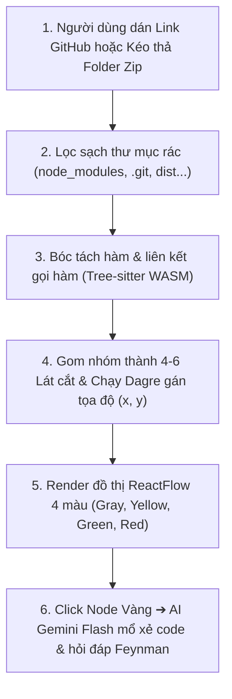

# ĐẶC TẢ KỸ THUẬT & LUỒNG TRIỂN KHAI THỰC TẾ (HACKATHON 24H)
## PHÂN HỆ: CODEBASE INGESTION, GRAPH RENDERING & SÁT HẠCH FEYNMAN
### Dự án: SimpliFey V2 Pro — Codebase Cognitive Twin
**Định hướng:** Thực tế, tinh gọn, code chạy được ngay trong 24 giờ, không vẽ vời lý thuyết quá đà.

---

## 1. TỔNG QUAN LUỒNG HOẠT ĐỘNG THỰC TẾ

Toàn bộ hệ thống từ lúc nhận mã nguồn đến khi người dùng tương tác chỉ gói gọn trong luồng 5 bước đơn giản, không phân nhánh phức tạp:



---

## 2. CHI TIẾT 5 BƯỚC THỰC HIỆN (CODE CHẠY ĐƯỢC NGAY)

---

### BƯỚC 1: TIẾP NHẬN INPUT & LỌC TỆP TIN (TREEPRUNER)

* **Mục tiêu:** Nhận folder mã nguồn và loại bỏ các file thư viện nặng để không làm đơ ứng dụng.
* **Cách làm thực tế:**
  * Dùng 1 mảng Regex đơn giản để bỏ qua các thư mục không chứa code nghiệp vụ:
    ```typescript
    const IGNORE_PATTERNS = [
      /node_modules/, /\.git/, /dist/, /build/, /\.next/, 
      /venv/, /__pycache__/, /target/, /bin/, /coverage/
    ];
    ```
  * Chỉ giữ lại các file có đuôi: `.ts`, `.tsx`, `.js`, `.jsx`, `.py`.
  * Nếu là link GitHub: Dùng `isomorphic-git` hoặc tải file zip trực tiếp qua URL:  
    `https://github.com/{user}/{repo}/archive/refs/heads/main.zip` (giải nén trong bộ nhớ RAM, không cần cài git cli trên server).
* **Đầu ra:** Danh sách khoảng 20 - 50 file code sạch.

---

### BƯỚC 2: BÓC TÁCH HÀM & LỜI GỌI HÀM (PARSING)

* **Mục tiêu:** Biết được trong project có những hàm nào, và hàm nào đang gọi hàm nào.
* **Cách làm thực tế:**
  * Sử dụng thư viện `web-tree-sitter` (chạy WebAssembly trực tiếp trên Node.js hoặc trình duyệt, không cần cài Python/C++ compiler).
  * Nạp file `.wasm` của ngôn ngữ tương ứng (`tree-sitter-typescript.wasm` hoặc `tree-sitter-python.wasm`).
  * Duyệt cây AST để lấy 3 thông tin cơ bản:
    1. **Tên hàm / Controller endpoint:** vị trí file, dòng bắt đầu, dòng kết thúc.
    2. **Lời gọi hàm (`CallExpression`):** hàm A đang gọi hàm B.
    3. **Import:** file A đang import hàm từ file B.
  * **Giải quyết Path Alias (`@/`):** Đọc file `tsconfig.json` (nếu có). Nếu thấy `paths: { "@/*": ["src/*"] }`, thay thế chuỗi `@/` thành `src/`. Xong!

---

### BƯỚC 3: GOM NHÓM LÁT CẮT & TÍNH TỌA ĐỘ BẰNG DAGRE

* **Mục tiêu:** Không hiển thị 50 file rời rạc gây rối mắt. Gom lại thành 4 - 6 nút (Node) nghiệp vụ đại diện cho luồng chạy thực tế từ ngoài vào trong.
* **Cách làm thực tế:**
  1. **Nhận diện điểm bắt đầu (Entrypoint):** Các hàm không có ai trong repo gọi tới (ví dụ: route handler `app.post('/order')`, `loginHandler`, hoặc hàm có export).
  2. **Lần theo vết gọi hàm (Trace):** Từ Controller $\to$ tìm Service được gọi $\to$ tìm hàm Database/Model được gọi. Chuỗi 3 hàm này gộp lại thành **01 Lát cắt (Slice Node)**.
  3. **Khử chu trình đơn giản:** Nếu có file A gọi B và B gọi A, chỉ giữ cạnh A $\to$ B, bỏ qua cạnh ngược lại để đồ thị không bị lặp vô tận.
  4. **Tính tọa độ layout:** Dùng thư viện `@dagrejs/dagre` (đúng 10 dòng code):
     ```typescript
     import dagre from '@dagrejs/dagre';

     const g = new dagre.graphlib.Graph();
     g.setGraph({ rankdir: 'TB', ranksep: 100, nodesep: 80 });
     g.setDefaultEdgeLabel(() => ({}));

     nodes.forEach(node => g.setNode(node.id, { width: 220, height: 80 }));
     edges.forEach(edge => g.setEdge(edge.source, edge.target));

     dagre.layout(g);

     const layoutedNodes = nodes.map(node => {
       const nodeWithPosition = g.node(node.id);
       return {
         ...node,
         position: { x: nodeWithPosition.x - 110, y: nodeWithPosition.y - 40 }
       };
     });
     ```

---

### BƯỚC 4: HIỂN THỊ LÊN REACTFLOW VỚI MÁY TRẠNG THÁI 4 MÀU

* **Mục tiêu:** Dựng giao diện mạng lưới DAG với màu sắc thể hiện tiến độ học tập:
  * **XÁM (GRAY):** Chưa mở khóa (phải làm xong node trước).
  * **VÀNG (YELLOW):** Đang chọn học (Node hiện tại).
  * **XANH (GREEN):** Đã làm chủ (trả lời đạt).
  * **ĐỎ (RED):** Bị lỗi/Chưa nắm vững (trả lời sai 3 lần hoặc bấm Bỏ qua).
* **Quy tắc chuyển màu (Logic đơn giản):**
  * Khởi tạo: Node đầu tiên = `YELLOW`, tất cả node con = `GRAY`.
  * Khi Node hiện tại đạt XANH $\to$ Node con chuyển từ `GRAY` thành `YELLOW`.
  * **Cơ chế chống nghẽn (Soft-Bypass):** Nếu Node hiện tại bị ĐỎ (do bấm Bỏ qua hoặc sai quá 3 lần), hệ thống **vẫn mở khóa node con sang VÀNG**, nhưng gắn thêm cờ `has_warning = true` (hiện icon cảnh báo: *"Mắt xích trước chưa vững"*). Nhờ vậy sinh viên không bao giờ bị kẹt lại một chỗ.

---

### BƯỚC 5: HỎI ĐÁP & CHẤM ĐIỂM FEYNMAN QUA GEMINI FLASH

Khi người dùng click vào một Node màu VÀNG:
1. **Pha 1: Xem mổ xẻ (X-Ray Walkthrough):**
   * Backend gửi đoạn code của lát cắt đó (< 400 dòng) lên Gemini Flash với prompt:  
     *"Tóm tắt luồng dữ liệu của đoạn code này trong 3 gạch đầu dòng, chỉ ra 1 điểm code viết chưa tối ưu (nếu có)."*
   * Giao diện hiện code kèm giải thích. Sinh viên đọc hiểu, không bị chấm điểm.
2. **Pha 2: Thử thách Feynman (Challenge):**
   * Khi sinh viên bấm nút *"Bắt đầu thử thách"*, Gemini sinh 1 câu hỏi tập trung vào bản chất logic:  
     *"Tại sao đoạn code này lại tách riêng controller và service? Nếu gộp lại thì gặp vấn đề gì?"*
   * Sinh viên gõ câu trả lời hoặc nói qua Micro (Web Speech API).
   * Gemini chấm điểm theo tiêu chí:
     * Đúng bản chất logic code trong repo: $\ge 70$ điểm.
     * Giải thích bình dân, không nói vẹt thuật ngữ: $\ge 70$ điểm.
   * **Kết quả:**
     * Cả 2 tiêu chí $\ge 70 \implies$ **Node đổi XANH (GREEN)**.
     * Dưới 70 điểm $\implies$ **Node giữ VÀNG (YELLOW)**, AI gợi ý thêm ví dụ đời thường (cho thử lại 3 lần).
     * Sai quá 3 lần hoặc bấm Bỏ qua $\implies$ **Node đổi ĐỎ (RED)**, mở bài tiếp theo.

---

## 3. CODE MẪU HOÀN CHỈNH CHO BACKEND (TYPESCRIPT)

Dưới đây là đoạn code thực tế, ngắn gọn, có thể chạy trực tiếp trong dự án Next.js API Route (`app/api/ingest/route.ts`):

```typescript
import { NextRequest, NextResponse } from 'next/server';
import dagre from '@dagrejs/dagre';

// 1. Interface Node chuẩn cho ReactFlow
interface SliceNode {
  id: string;
  label: string;
  files: string[];
  status: 'GRAY' | 'YELLOW' | 'GREEN' | 'RED';
  hasWarning: boolean;
  position: { x: number; y: number };
}

// 2. Hàm giả lập gom cụm theo thư mục/tính năng (Auth, Product, Order...)
function extractFeatureSlices(filePaths: string[]) {
  const groups: Record<string, string[]> = {};

  filePaths.forEach(file => {
    // Tự động gom theo từ khóa trong đường dẫn
    let feature = 'Core';
    if (file.includes('auth') || file.includes('user')) feature = 'Auth';
    else if (file.includes('product') || file.includes('catalog')) feature = 'Product';
    else if (file.includes('order') || file.includes('cart') || file.includes('checkout')) feature = 'Order';
    else if (file.includes('payment')) feature = 'Payment';

    if (!groups[feature]) groups[feature] = [];
    groups[feature].push(file);
  });

  return groups;
}

// 3. API Handler chính
export async function POST(req: NextRequest) {
  try {
    const { repoUrl, files } = await req.json();

    // Lọc danh sách file sạch
    const validFiles = (files || []).filter((f: string) => 
      !f.includes('node_modules') && !f.includes('.git') && !f.includes('dist')
    );

    const featureGroups = extractFeatureSlices(validFiles);
    const featureNames = Object.keys(featureGroups);

    // Tạo Nodes
    const rawNodes: SliceNode[] = featureNames.map((name, index) => ({
      id: `slice_${name.toLowerCase()}`,
      label: `Luồng ${name}`,
      files: featureGroups[name],
      status: index === 0 ? 'YELLOW' : 'GRAY', // Node đầu tiên mở sẵn màu vàng
      hasWarning: false,
      position: { x: 0, y: 0 }
    }));

    // Tạo Edges đơn giản (luồng nối tiếp tuần tự: Auth -> Product -> Order -> Payment)
    const rawEdges = [];
    for (let i = 0; i < rawNodes.length - 1; i++) {
      rawEdges.push({
        id: `e_${rawNodes[i].id}_${rawNodes[i+1].id}`,
        source: rawNodes[i].id,
        target: rawNodes[i+1].id,
        animated: true,
      });
    }

    // Chạy Dagre Layout tính tọa độ x, y
    const g = new dagre.graphlib.Graph();
    g.setGraph({ rankdir: 'TB', ranksep: 100, nodesep: 80 });
    g.setDefaultEdgeLabel(() => ({}));

    rawNodes.forEach(node => g.setNode(node.id, { width: 220, height: 80 }));
    rawEdges.forEach(edge => g.setEdge(edge.source, edge.target));
    dagre.layout(g);

    const nodes = rawNodes.map(node => {
      const pos = g.node(node.id);
      return {
        ...node,
        position: { x: pos.x - 110, y: pos.y - 40 }
      };
    });

    return NextResponse.json({ success: true, nodes, edges: rawEdges });
  } catch (error: any) {
    return NextResponse.json({ success: false, error: error.message }, { status: 500 });
  }
}
```

---

## 4. PROMPT GEMINI CHUẨN ĐỂ ĐÁNH GIÁ (STRUCTURED OUTPUT)

Dùng Gemini 1.5/2.5 Flash, yêu cầu trả về đúng định dạng JSON để code frontend dễ xử lý:

```typescript
const EVALUATION_PROMPT = `
Bạn là Giảng viên chấm thi theo phương pháp Feynman.
Hãy chấm điểm câu trả lời của sinh viên dựa trên đoạn code thực tế trong repo.

Đoạn code:
\${codeSnippet}

Câu hỏi:
\${question}

Câu trả lời của sinh viên:
\${studentAnswer}

Yêu cầu trả về duy nhất định dạng JSON sau:
{
  "core_accuracy": <điểm từ 0 đến 100 về độ đúng logic>,
  "simplicity": <điểm từ 0 đến 100, phạt nặng nếu dùng từ ngữ học vẹt sáo rỗng mà không giải thích bản chất>,
  "is_passed": <true nếu cả 2 điểm trên >= 70, ngược lại false>,
  "feedback": "<nhận xét ngắn gọn 2 câu, nếu sai hãy gợi ý bằng 1 ví dụ đời thường>",
  "detected_jargons": ["<từ ngữ chuyên môn nói vẹt nếu có>"]
}
`;
```

---

## 5. XỬ LÝ SỰ CỐ PHÒNG THI (THỰC TẾ & KHẢ THI)

1. **Mất mạng Internet tại phòng thi:**
   * Chuẩn bị sẵn 1 file `mock-graph.json` trong thư mục `public/demo/`. Nếu gọi API GitHub hoặc Gemini thất bại, hệ thống tự động tải dữ liệu mẫu lên canvas. Nhóm vẫn tự tin demo toàn bộ tính năng chuyển màu và giao diện trước Ban Giám khảo.
2. **File code của sinh viên bị lỗi cú pháp:**
   * Do không cần compile project, parser chỉ quét qua các định nghĩa hàm. Code có lỗi logic runtime thì đồ thị vẫn vẽ được bình thường.
3. **Repo không theo cấu trúc chuẩn:**
   * Nếu không tìm thấy các liên kết gọi hàm cụ thể, hệ thống tự động gom nhóm các file theo thư mục thực tế (`controllers/`, `services/`, `models/`), đảm bảo đồ thị không bao giờ bị trắng trang.

---

### TỔNG KẾT
Tài liệu này đã loại bỏ toàn bộ các khái niệm phức tạp thừa thãi. Hệ thống tập trung giải quyết đúng 1 bài toán rõ ràng: **Đọc code $\to$ Vẽ đồ thị 4 màu trực quan $\to$ Bấm vào node để AI hỏi đáp giúp hiểu bài**. Đơn giản, thực tế và chắc chắn hoàn thiện kịp trong 24 giờ!
