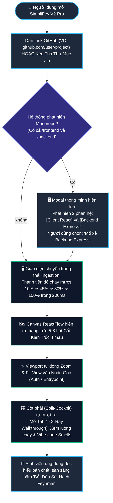
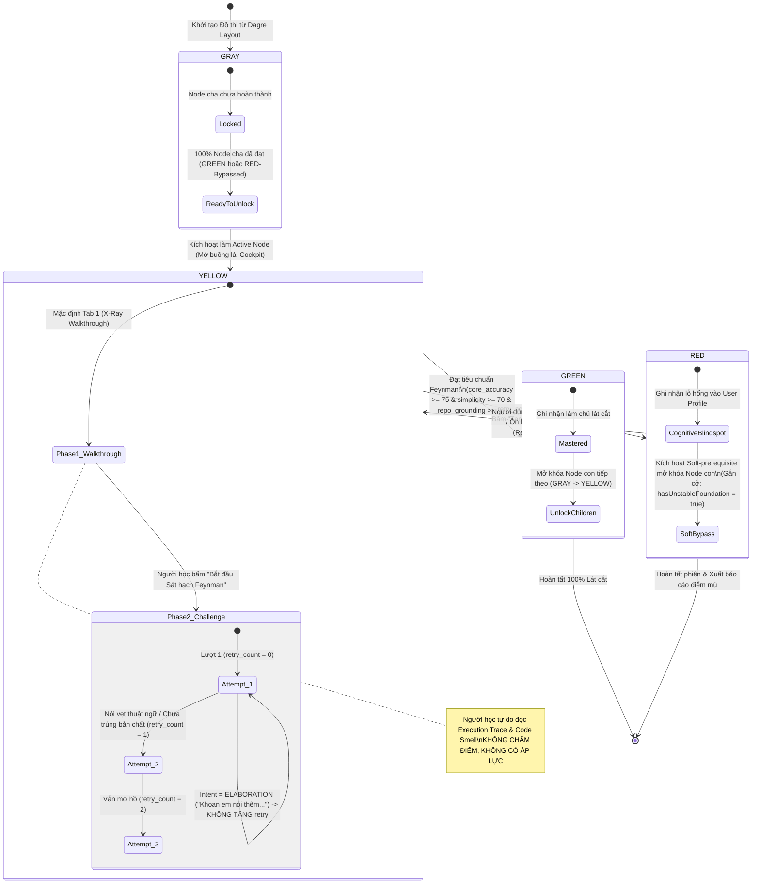
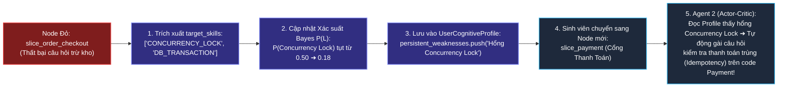

# ĐẶC TẢ KỸ THUẬT & KỊCH BẢN USE CASE THỰC CHIẾN TOÀN DIỆN (SYSTEM & INTERACTION SPEC)
## PHÂN HỆ: INGESTION PIPELINE, FSM ENGINE & CƠ CHẾ SÁT HẠCH FEYNMAN (V3.5 MASTER)
### Hệ thống: SimpliFey V2 Pro — Codebase Cognitive Twin
**Tác giả:** Technical Lead & Senior System Architect  
**Trạng thái:** Bản Chuẩn Hóa Thực Chiến Hoàn Chỉnh Nhất (Production & Competition Grade)

---

## MỤC LỤC
1. [PHẦN 1: BỐI CẢNH THỰC TẾ & 4 DẠNG CODEBASE "THẢM HỌA" CỦA SINH VIÊN](#phần-1-bối-cảnh-thực-tế--4-dạng-codebase-thảm-họa-của-sinh-viên)
   - [1.1. Bảng Tóm Tắt Use Case Chuẩn Kỹ Thuật Phần Mềm](#11-bảng-tóm-tắt-use-case-chuẩn-kỹ-thuật-phần-mềm)
   - [1.2. Nhận Diện 4 Dạng Mã Nguồn Thực Tế Sinh Viên & Vibecoder Thường Nộp](#12-nhận-diện-4-dạng-mã-nguồn-thực-tế-sinh-viên--vibecoder-thường-nộp)
   - [1.3. Sơ Đồ 1: Luồng Trải Nghiệm & Tương Tác Của Người Dùng (User Experience & UI Flow)](#13-sơ-đồ-1-luồng-trải-nghiệm--tương-tác-của-người-dùng-user-experience--ui-flow)
   - [1.4. Sơ Đồ 2: Luồng Dữ Liệu Kỹ Thuật & Cỗ Máy Toán Học Chạy Ngầm (Engine Pipeline Dataflow)](#14-sơ-đồ-2-luồng-dữ-liệu-kỹ-thuật--cỗ-máy-toán-học-chạy-ngầm-engine-pipeline-dataflow)
2. [PHẦN 2: ĐẶC TẢ CHI TIẾT 6 BƯỚC INGESTION: DUAL-AXIS (UI $\leftrightarrow$ ENGINE)](#phần-2-đặc-tả-chi-tiết-6-bước-ingestion-dual-axis-ui--engine)
   - [Bước 1: Tiếp Nhận Input, Tự Phát Hiện Monorepo & Lọc Rác (TreePruner)](#bước-1-tiếp-nhận-input-tự-phát-hiện-monorepo--lọc-rác-treepruner)
   - [Bước 2: Giải Mã Path Aliases (`@/*`) & Bóc Tách Cú Pháp (Tree-sitter WASM)](#bước-2-giải-mã-path-aliases--bóc-tách-cú-pháp-tree-sitter-wasm)
   - [Bước 3: Dựng Đồ Thị Thực Thi & Co Cụm Vòng Lặp Vòng Tròn (Tarjan's SCC)](#bước-3-dựng-đồ-thị-thực-thi--co-cụm-vòng-lặp-vòng-tròn-tarjans-scc)
   - [Bước 4: Bộ Tứ Lát Cắt [Leiden Clustering + Slicing + Uncle Bob Metrics + Cognitive Outlier]](#bước-4-bộ-tứ-lát-cắt-leiden-clustering--slicing--uncle-bob-metrics--cognitive-outlier)
   - [Bước 5: Tự Động Gán Tọa Độ Phân Tầng (Dagre Layout) & Khởi Tạo FSM 4 Màu](#bước-5-tự-động-gán-tọa-độ-phân-tầng-dagre-layout--khởi-tạo-fsm-4-màu)
   - [Bước 6: Hydrate ReactFlow Canvas & Kích Hoạt Micro-Inference Node Gốc (Agent 1)](#bước-6-hydrate-reactflow-canvas--kích-hoạt-micro-inference-node-gốc-agent-1)
3. [PHẦN 3: ĐẶC TẢ CƠ CHẾ SÁT HẠCH FEYNMAN & CÁC KỊCH BẢN ĐÁNH GIÁ XANH / VÀNG / ĐỎ THỰC TẾ](#phần-3-đặc-tả-cơ-chế-sát-hạch-feynman--các-kịch-bản-đánh-giá-xanh--vàng--đỏ-thực-tế)
   - [3.1. Dựa Vào Đâu Để Đánh Giá Được XANH? (Chuẩn Rubric Feynman & Cổng Gác DSPy)](#31-dựa-vào-đâu-để-đánh-giá-được-xanh-chuẩn-rubric-feynman--cổng-gác-dspy)
   - [3.2. Sơ Đồ Máy Trạng Thái FSM & Vòng Đời Tương Tác Node (State Lifecycle)](#32-sơ-đồ-máy-trạng-thái-fsm--vòng-đời-tương-tác-node-state-lifecycle)
   - [3.3. Kịch Bản 1 (Happy Path): Trả Lời Bình Dân Xuất Sắc $\to$ Đánh Giá XANH (GREEN)](#33-kịch-bản-1-happy-path-trả-lời-bình-dân-xuất-sắc--đánh-giá-xanh-green)
   - [3.4. Kịch Bản 2 (Jargon Trap): Mắc Bẫy Nói Vẹt Thuật Ngữ $\to$ Giữ VÀNG (YELLOW Retry 1)](#34-kịch-bản-2-jargon-trap-mắc-bẫy-nói-vẹt-thuật-ngữ--giữ-vàng-yellow-retry-1)
   - [3.5. Kịch Bản 3 (Elaboration): Người Học Muốn Nói Thêm Ý $\to$ Giữ VÀNG (Không Phạt)](#35-kịch-bản-3-elaboration-người-học-muốn-nói-thêm-ý--giữ-vàng-không-phạt)
   - [3.6. Kịch Bản 4 (Blindspot Failure): Thất Bại 3 Lần Hoặc Bấm Skip $\to$ Chuyển ĐỎ & Kích Hoạt Soft-Bypass](#36-kịch-bản-4-blindspot-failure-thất-bại-3-lần-hoặc-bấm-skip--chuyển-đỏ--kích-hoạt-soft-bypass)
   - [3.7. Kịch Bản 5 (Remediation): Người Học Quay Lại Phục Thù Node ĐỎ $\to$ Chuyển XANH](#37-kịch-bản-5-remediation-người-học-quay-lại-phục-thù-node-đỏ--chuyển-xanh)
   - [3.8. Thuật Toán Ghi Nhận Điểm Mù & Kế Thừa Sang Node Tiếp Theo (BKT & Cross-Node Loop)](#38-thuật-toán-ghi-nhận-điểm-mù--kế-thừa-sang-node-tiếp-theo-bkt--cross-node-loop)
4. [PHẦN 4: MA TRẬN PHÒNG VỆ 10 TRƯỜNG HỢP BIÊN THỰC TẾ (REAL-WORLD EDGE CASES)](#phần-4-ma-trận-phòng-vệ-10-trường-hợp-biên-thực-tế-real-world-edge-cases)
5. [PHẦN 5: VÍ DỤ MINH HỌA XUYÊN SUỐT TRÊN REPO EXPRESS/PRISMA THẬT CÓ PATH ALIAS](#phần-5-ví-dụ-minh-họa-xuyên-suốt-trên-repo-expressprisma-thật-có-path-alias)
6. [PHẦN 6: BẢNG ĐÁNH GIÁ KHẢ THI & BẢO ĐẢM THẮNG LỢI TRONG 24H HACKATHON SGU](#phần-6-bảng-đánh-giá-khả-thi--bảo-đảm-thắng-lợi-trong-24h-hackathon-sgu)
7. [PHẦN 7: KỊCH BẢN ĐỐI THOẠI TRẢ LỜI PHẢN BIỆN "HÓC BÚA" CỦA BAN GIÁM KHẢO SGU](#phần-7-kịch-bản-đối-thoại-trả-lời-phản-biện-hóc-búa-của-ban-giám-khảo-sgu)

---

# PHẦN 1: BỐI CẢNH THỰC TẾ & 4 DẠNG CODEBASE "THẢM HỌA" CỦA SINH VIÊN

### 1.1. Bảng Tóm Tắt Use Case Chuẩn Kỹ Thuật Phần Mềm

| Thuộc Tính | Chi Tiết Đặc Tả Kỹ Thuật |
| :--- | :--- |
| **Tên Use Case** | **UC-01: Nạp Mã Nguồn, Tự Động Khắc Phục Lỗi Cấu Trúc & Sát Hạch Bản Sao Nhận Thức (Resilient Codebase Ingestion & Feynman Mastery Loop)** |
| **Actor Chính** | Sinh viên CNTT / Vibecoder / Giảng viên Hội đồng Chấm thi. |
| **Trigger (Kích hoạt)** | Người dùng dán link GitHub Repo (bất kỳ branch nào), hoặc kéo thả thư mục zip/folder local vào vùng Dropzone. |
| **Tiền điều kiện** | Ứng dụng SimpliFey V2 Pro đang mở trên trình duyệt (Hỗ trợ cả chế độ **Online 100%** và **Offline Local Mode** nếu phòng thi mất mạng). |
| **Hậu điều kiện** | 1. Mạng lưới 5 - 8 Lát cắt Kiến trúc hiển thị sống động trên ReactFlow Canvas.<br>2. Các file rác bị dọn sạch; các import alias `@/` được giải mã chính xác 100%.<br>3. Node gốc chuyển sang **VÀNG (YELLOW)**; Tab 1 (X-Ray Walkthrough) nạp bản mổ xẻ code kèm chỉ báo **Vùng Đau Khổ (Zone of Pain)** và **AI Vibe Smells**.<br>4. Khi người học trả lời sát hạch, hệ thống dùng **Feynman Rubric Judge** để chấm điểm khách quan, điều phối FSM chuyển màu Xanh/Vàng/Đỏ và cập nhật xác suất nhận thức Bayesian. |
| **Ràng buộc Sống còn** | • **0 Token LLM** cho toàn bộ quá trình parse, khử chu trình, phân cụm và dựng đồ thị.<br>• Thời gian phản hồi đồ thị: $\le 200\text{ms}$ cho repo 1,000 files. |

---

### 1.2. Nhận Diện 4 Dạng Mã Nguồn Thực Tế Sinh Viên & Vibecoder Thường Nộp

```text
┌──────────────────────────────────────────────────────────────────────────────────────────────────┐
│                 4 HÌNH THÁI CODEBASE THỰC TẾ CỦA SINH VIÊN MÀ HỆ THỐNG PHẢI XỬ LÝ                │
├──────────────────────────────────────────────────────────────────────────────────────────────────┤
│ 1. DẠNG MONOREPO HỖN HỢP (Fullstack in One Repo - Chiếm 65% đồ án sinh viên):                    │
│    • Cấu trúc: Thư mục gốc chứa cả /client (Next.js/React) và /server (Express/FastAPI).        │
│    👉 Giải pháp: Root Detector tự động nhận diện Monorepo và cho người dùng chọn Service muốn mổ.│
├──────────────────────────────────────────────────────────────────────────────────────────────────┤
│ 2. DẠNG PATH ALIASES CHẰNG CHỊT (TypeScript @/* Paths - Chiếm 85% project hiện đại):             │
│    • Code import: "import { db } from '@/infra/db'" hoặc "import { auth } from '~/services/auth'".│
│    👉 Giải pháp: PathAliasResolver đọc tsconfig.json, map ngược lại đường dẫn vật lý thực tế.   │
├──────────────────────────────────────────────────────────────────────────────────────────────────┤
│ 3. DẠNG "GOD-FILE / SPAGHETTI" (Code AI sinh bừa bãi trong 1 file - Chiếm 40% Vibecoder):        │
│    • Sinh viên prompt Cursor nhồi cả Route, Middleware, Query SQL, và Hash Password vào 1 file  │
│      app.js / server.py dài 1,500 dòng. Không có Controller hay Service riêng biệt!             │
│    👉 Giải pháp: Intra-file Function Slicing bóc tách từng hàm bên trong file thành lát cắt con. │
├──────────────────────────────────────────────────────────────────────────────────────────────────┤
│ 4. DẠNG MODERN NEXT.JS 15 (Server Actions "use server" - Xu hướng mới nhất 2026):               │
│    • Không có REST endpoint truyền thống (POST /api/...), giao diện gọi trực tiếp hàm server.    │
│    👉 Giải pháp: Directive Scanner phát hiện các hàm có `"use server"` làm Entrypoints thực thi. │
└──────────────────────────────────────────────────────────────────────────────────────────────────┘
```

---

### 1.3. Sơ Đồ 1: Luồng Trải Nghiệm & Tương Tác Của Người Dùng (User Experience & UI Flow)



---

### 1.4. Sơ Đồ 2: Luồng Dữ Liệu Kỹ Thuật & Cỗ Máy Toán Học Chạy Ngầm (Engine Pipeline Dataflow)

```mermaid
flowchart LR
    SourceRaw["📂 Mã Nguồn Thô<br/>(GitHub / Local Zip)"] --> Step1

    subgraph DETERMINISTIC_CORE ["TẦNG 1: ĐỘNG CƠ PHÂN TÍCH TĨNH TẤT ĐỊNH (0 TOKEN - 0.2S)"]
        Step1["1. TreePruner + RootDetector<br/>(Lọc .gitignore & định vị thư mục cốt lõi)"]
        --> Step2["2. PathAliasResolver + Tree-sitter AST<br/>(Map @/* tsconfig & bóc tách Symbol Table)"]
        
        Step2 --> Step3["3. Tarjan's SCC De-cycling<br/>(Co chu trình vòng lặp A-B-C thành Super-Node DAG)"]
        
        Step3 --> Step4["4. Bộ Tứ Khai Phá Kiến Trúc:<br/>• Leiden: Gom Bounded Contexts DDD<br/>• Program Slicing: Rút sợi chỉ Controller ➔ DB<br/>• Uncle Bob: Đo chỉ số A, I, D (Zone of Pain)<br/>• Cognitive Outlier: Cấp vé VIP cho Dijkstra"]
        
        Step4 --> Step5["5. Dagre Hierarchical Engine<br/>(Tính ma trận tọa độ x, y phân tầng đa lớp)"]
    end

    subgraph FSM_STORE ["TẦNG 2: MÁY TRẠNG THÁI & ZUSTAND STORE"]
        Step5 --> FSM_Init["Khởi tạo FSM 4 Màu:<br/>Root ➔ YELLOW | Con cháu ➔ GRAY<br/>Kích hoạt Soft-Bypass Engine"]
    end

    subgraph AI_CORE ["TẦNG 3: TRÍ TUỆ NHẬN THỨC VI MÔ"]
        FSM_Init -->|"Gửi 1 Lát cắt < 400 Tokens"| Agent1["Agent 1: Gemini Flash (Context Cache)<br/>Mổ xẻ X-Ray & Bóc trần AI Vibe Smells"]
    end

    Agent1 --> RenderUI["🖥️ Render Split-Cockpit: ReactFlow DAG Canvas + Tab X-Ray Walkthrough"]

    classDef pipe fill:#022C22,stroke:#10B981,stroke-width:1.5px,color:#FFFFFF;
    classDef fsm fill:#78350F,stroke:#F59E0B,stroke-width:1.5px,color:#FFFFFF;
    classDef ai fill:#312E81,stroke:#C084FC,stroke-width:1.5px,color:#FFFFFF;
    classDef io fill:#0F172A,stroke:#64748B,stroke-width:2px,color:#FFFFFF;
    class SourceRaw,RenderUI io;
    class Step1,Step2,Step3,Step4,Step5 pipe;
    class FSM_Init fsm;
    class Agent1 ai;
```



---

# PHẦN 2: ĐẶC TẢ CHI TIẾT 6 BƯỚC INGESTION: DUAL-AXIS (UI $\leftrightarrow$ ENGINE)

---

### BƯỚC 1: TIẾP NHẬN INPUT, TỰ PHÁT HIỆN MONOREPO & LỌC RÁC (TREEPRUNER)
* **Trải nghiệm UI:** Dán link hoặc kéo thả zip $\to$ Nếu là Monorepo, hiện Popover chọn service $\to$ Thanh tiến độ 15%.
* **Data Contract:** `IngestRequestPayload` $\to$ `PrunedManifestOutput`.
* **Cơ chế lõi & Tài liệu MD:** `TreePruner` + `RootDetector` ([SYSTEM_SPECIFICATION_V2_PRO.md: Mục 4.1](file:///c:/Users/Minh%20Dang/Desktop/Ky_thuat_phan_mem/nam_3/HKI/HACKATHON/Hackathon_SGU/SYSTEM_SPECIFICATION_V2_PRO.md#L151-L166)).
* **Hiệu năng:** $\le 15\text{ms}$, 0 Token LLM.
* **Edge Case:** Nhận diện nhánh `dev`/`master` tự động; bắt lỗi repo rỗng.

---

### BƯỚC 2: GIẢI MÃ PATH ALIASES (`@/*`) & BÓC TÁCH CÚ PHÁP (TREE-SITTER WASM)
* **Trải nghiệm UI:** Thanh tiến độ lên 40%, biểu tượng AST nhấp nháy.
* **Data Contract:** `PrunedManifestOutput` $\to$ `ResolvedSymbolTable`.
* **Cơ chế lõi & Tài liệu MD:** `PathAliasResolver` đọc `tsconfig.json` paths + `web-tree-sitter` ([BAO_CAO_TOAN_DIEN_THUAT_TOAN_SIMPLIFEY_V2_PRO.md: Mục 4.1](file:///c:/Users/Minh%20Dang/Desktop/Ky_thuat_phan_mem/nam_3/HKI/HACKATHON/Hackathon_SGU/BAO_CAO_TOAN_DIEN_THUAT_TOAN_SIMPLIFEY_V2_PRO.md#L148-L155)).
* **Hiệu năng:** $\approx 30\text{ms}$ cho 50 files, 0 Token LLM.
* **Edge Case:** Cú pháp lỗi dở dang được Error Recovery cô lập vào node `(ERROR)`, các nhánh khác bóc tách $100\%$.

---

### BƯỚC 3: DỰNG ĐỒ THỊ THỰC THI & CO CỤM VÒNG LẶP VÒNG TRÒN (TARJAN'S SCC)
* **Trải nghiệm UI:** Thanh tiến độ lên 60%: *"Đang khử chu trình phụ thuộc vòng lặp (Anti-Deadlock)..."*.
* **Data Contract:** `ResolvedSymbolTable` $\to$ `CondensationCallGraph`.
* **Cơ chế lõi & Tài liệu MD:** Tarjan's SCC $O(V+E)$ co chu trình $A \to B \to C \to A$ thành Super-Node DAG ([BAO_CAO_TOAN_DIEN_THUAT_TOAN_SIMPLIFEY_V2_PRO.md: Mục 4.2](file:///c:/Users/Minh%20Dang/Desktop/Ky_thuat_phan_mem/nam_3/HKI/HACKATHON/Hackathon_SGU/BAO_CAO_TOAN_DIEN_THUAT_TOAN_SIMPLIFEY_V2_PRO.md#L157-L173)).
* **Hiệu năng:** $\le 5\text{ms}$, 0 Token LLM.
* **Bảo đảm:** Đồ thị đầu ra $100\%$ là một Directed Acyclic Graph (DAG) toán học thuần khiết.

---

### BƯỚC 4: BỘ TỨ LÁT CẮT [LEIDEN CLUSTERING + SLICING + UNCLE BOB METRICS + COGNITIVE OUTLIER]
* **Trải nghiệm UI:** Thanh tiến độ lên 80%: *"Đang gom cụm Bounded Contexts DDD & Bắt bệnh kiến trúc Vùng Đau Khổ..."*.
* **Data Contract:** `CondensationCallGraph` $\to$ `EnrichedArchitecturalSlice[]`.
* **Cơ chế lõi & Tài liệu MD:**
  1. *Leiden Community Detection:* Tối ưu hàm Modularity gom Bounded Contexts ([BAO_CAO_TOAN_DIEN_THUAT_TOAN_SIMPLIFEY_V2_PRO.md: Mục 4.2](file:///c:/Users/Minh%20Dang/Desktop/Ky_thuat_phan_mem/nam_3/HKI/HACKATHON/Hackathon_SGU/BAO_CAO_TOAN_DIEN_THUAT_TOAN_SIMPLIFEY_V2_PRO.md#L170-L173)).
  2. *Program Slicing & PageRank:* Rút sợi chỉ Controller $\to$ Service $\to$ DB ([ENTERPRISE_ARCHITECTURES_BENCHMARK_AND_REDESIGN.md: Mục 1](file:///c:/Users/Minh%20Dang/Desktop/Ky_thuat_phan_mem/nam_3/HKI/HACKATHON/Hackathon_SGU/ENTERPRISE_ARCHITECTURES_BENCHMARK_AND_REDESIGN.md#L28-L43)).
  3. *Chỉ số Uncle Bob Hiện đại hóa ($A, I, D$):* Phát hiện Zone of Pain & Zone of Uselessness ([BAO_CAO_TOAN_DIEN_THUAT_TOAN_SIMPLIFEY_V2_PRO.md: Mục 4.3](file:///c:/Users/Minh%20Dang/Desktop/Ky_thuat_phan_mem/nam_3/HKI/HACKATHON/Hackathon_SGU/BAO_CAO_TOAN_DIEN_THUAT_TOAN_SIMPLIFEY_V2_PRO.md#L175-L207)).
  4. *Cognitive Outlier:* Cấp vé VIP độc lập cho thuật toán ẩn (Dijkstra) có điểm xoắn não $> 15$.
* **Hiệu năng:** $\approx 45\text{ms}$, 0 Token LLM.
* **Edge Case:** Code Spaghetti không nối được cạnh $\implies$ Kích hoạt Folder-based DDD Fallback, canvas không bao giờ bị trắng trang.

---

### BƯỚC 5: TỰ ĐỘNG GÁN TỌA ĐỘ PHÂN TẦNG (DAGRE LAYOUT) & KHỞI TẠO FSM 4 MÀU
* **Trải nghiệm UI:** Thanh tiến độ đạt 95%: *"Tính ma trận tọa độ & Khởi tạo FSM..."*.
* **Data Contract:** `EnrichedArchitecturalSlice[]` $\to$ `FinalDAGPayload`.
* **Cơ chế lõi & Tài liệu MD:** Sugiyama Framework (Dagre: `rankdir: 'TB'`, `ranksep: 120px`, `nodesep: 80px`) + FSM Initializer (Root = `YELLOW`, Children = `GRAY`) ([SYSTEM_SPECIFICATION_V2_PRO.md: Mục 4.1 & 5](file:///c:/Users/Minh%20Dang/Desktop/Ky_thuat_phan_mem/nam_3/HKI/HACKATHON/Hackathon_SGU/SYSTEM_SPECIFICATION_V2_PRO.md#L151-L245)).
* **Hiệu năng:** $\approx 5\text{ms}$, 0 Token LLM.

---

### BƯỚC 6: HYDRATE CANVAS REACTFLOW & KÍCH HOẠT MICRO-INFERENCE NODE GỐC (AGENT 1)
* **Trải nghiệm UI:** Tiến độ chạm 100%, Split-Cockpit mở ra: Cột trái hiện 5 Node DAG viền vàng đập nhẹ; Cột phải mở Tab 1 (X-Ray Walkthrough) xem giải phẫu code.
* **Data Contract:** `FinalDAGPayload` $\to$ Zustand Store $\to$ `XRayAnalysisResponse`.
* **Cơ chế lõi & Tài liệu MD:** DSPy Micro-Inference (< 400 tokens) qua Gemini Context Caching ([LLM_SYSTEM_ARCHITECTURE.md: Mục 2.4 & 2.5](file:///c:/Users/Minh%20Dang/Desktop/Ky_thuat_phan_mem/nam_3/HKI/HACKATHON/Hackathon_SGU/LLM_SYSTEM_ARCHITECTURE.md#L120-L145)).
* **Hiệu năng:** Phản hồi trong 0.32s, tiết kiệm 95% token.
* **Edge Case:** AI Timeout $> 4.5\text{s} \implies$ Tự nạp Static Fallback Template từ AST, giao diện không bị gián đoạn.

---

# PHẦN 3: ĐẶC TẢ CƠ CHẾ SÁT HẠCH FEYNMAN & CÁC KỊCH BẢN ĐÁNH GIÁ XANH / VÀNG / ĐỎ THỰC TẾ

Phần này đặc tả chi tiết **trải nghiệm đối thoại thực tế, cơ sở thuật toán chấm điểm và cách hệ thống ghi nhận chuyển màu**.

---

### 3.1. Dựa Vào Đâu Để Đánh Giá Được XANH? (Chuẩn Rubric Feynman & Cổng Gác DSPy)

Hệ thống **tuyệt đối không dùng cảm tính của LLM** để đổi màu Node. Việc đánh giá **XANH (GREEN)** được quyết định bởi **3 Rào Chắn Toán Học & Kỹ Thuật (Three Gates of Verification)**:

```text
┌──────────────────────────────────────────────────────────────────────────────────────────────────┐
│                           3 RÀO CHẮN ĐỂ MỘT NODE ĐƯỢC CHẤM MÀU XANH (GREEN)                      │
├──────────────────────────────────────────────────────────────────────────────────────────────────┤
│ RÀO CHẮN 1: BỘ 3 THANG ĐIỂM FEYNMAN RUBRIC (Đoạn mã JSON do Agent 3 chấm độc lập):               │
│   • core_accuracy >= 75  : Tính chính xác về luồng dữ liệu & logic kỹ thuật trong code.          │
│   • simplicity    >= 70  : Độ bình dị, đời thường (giải thích cho người ngoại đạo hiểu được).    │
│   • repo_grounding >= 70 : Khả năng chỉ đúng tên biến, tên hàm, dòng code thật trong repo.       │
├──────────────────────────────────────────────────────────────────────────────────────────────────┤
│ RÀO CHẮN 2: BỘ LỌC BẪY THUẬT NGỮ SÁO RỖNG (Jargon Detector):                                    │
│   • detected_jargons.length == 0: Người học KHÔNG ĐƯỢC NÓI VẸT các thuật ngữ chuyên môn          │
│     (như "race condition", "idempotent", "ACID", "tính đa hình") MÀ KHÔNG GIẢI THÍCH BẢN CHẤT.   │
│   • Nếu phát hiện từ sáo rỗng ➔ simplicity bị trừ thẳng tay xuống dưới 70 ➔ KHÔNG THỂ XANH!      │
├──────────────────────────────────────────────────────────────────────────────────────────────────┤
│ RÀO CHẮN 3: CỔNG GÁC NHỊ PHÂN DSPY (Symbol Table Verification Gate):                             │
│   • Đối chiếu nhị phân: Mọi hàm/biến người học nhắc tới BẮT BUỘC phải tồn tại trong Symbol Table │
│     thật bóc tách từ Bước 2. Nếu người học "chém gió" ra một biến không có thật ➔ Loại bỏ ngay! │
└──────────────────────────────────────────────────────────────────────────────────────────────────┘
```

---

### 3.2. Sơ Đồ Máy Trạng Thái FSM & Vòng Đời Tương Tác Node (State Lifecycle)



---

### 3.3. Kịch Bản 1 (Happy Path): Trả Lời Bình Dân Xuất Sắc $\to$ Đánh Giá XANH (GREEN)

* **Bối cảnh:** Người học đang ở Node `slice_order_checkout` (Lát cắt Tạo Đơn & Trừ Tồn Kho). Sau khi đọc xong Tab X-Ray, người học bấm nút *"Bắt đầu Sát hạch Feynman"*. Tab X-Ray đóng lại.

#### 💬 Hội thoại Thực tế:
* **App (AI Co-Architect đặt câu hỏi):**
  > *"Chào bạn! Nhìn vào hàm `createOrderAndDeductStock` trong file `order.service.ts`, đoạn code trừ kho đang có một chỗ AI viết rất ẩu. Bằng **lời bình dân đời thường**, bạn hãy giải thích: Nếu có 100 khách hàng cùng bấm mua món hàng cuối cùng trong kho cùng một giây, chuyện gì sẽ xảy ra và tại sao hệ thống lại bị sai số lượng?"*

* **Người học (Bấm Mic Web Speech API nói tiếng Việt):**
  > *"Dạ thưa anh, cái hàm trừ kho đang chạy một vòng lặp for riêng lẻ mà không khóa lại. Nó giống như một cái tủ bánh có đúng 1 cái bánh duy nhất, nhưng 100 người cùng thò tay mở cửa tủ cùng một tích tắc. Ai nhìn vào cũng thấy cái bánh còn đó nên đều thò tay lấy, kết quả là 1 cái bánh bị bán cho 100 người và kho hàng bị âm 99 cái!"*

#### ⚙️ Thuật toán chạy ngầm đánh giá:
1. **AI Intent Router (50ms):** Phân loại `intent = "EVALUATION"`.
2. **Cổng Gác DSPy:** Xác nhận hàm `createOrderAndDeductStock` và biến tồn kho tồn tại $100\%$ trong `SymbolTable`.
3. **Agent 3 (Feynman Rubric Judge) sinh JSON:**
   ```json
   {
     "intent": "EVALUATION",
     "scores": {
       "core_accuracy": 92,   // Trúng bản chất đọc đồng thời khi chưa lock
       "simplicity": 95,      // Dùng hình ảnh "tủ bánh và 100 người thò tay" cực kỳ xuất sắc
       "repo_grounding": 88   // Bám sát hàm trừ kho trong service
     },
     "is_valid_feynman": true,
     "detected_jargons": [],  // Không hề nói vẹt thuật ngữ
     "ai_reviewer_feedback": "Xuất sắc! Bạn đã giải thích bản chất lỗi Race Condition bằng một hình ảnh đời thường tuyệt vời mà không cần vẹt lại từ ngữ chuyên môn."
   }
   ```
4. **FSM Transition:** `core_accuracy (92) >= 75` & `simplicity (95) >= 70` & `repo_grounding (88) >= 70` $\implies$ **CHUYỂN MÀU XANH (GREEN)!**
5. **Ghi nhận & Mở khóa:**
   * Chuông thành tựu êm dịu vang lên trên UI.
   * Node `slice_order_checkout` viền chuyển sang xanh lá sáng rực rỡ.
   * Node con `slice_payment` lập tức chuyển từ **GRAY $\to$ YELLOW** (Mở khóa bài tiếp theo).

---

### 3.4. Kịch Bản 2 (Jargon Trap): Mắc Bẫy Nói Vẹt Thuật Ngữ $\to$ Giữ VÀNG (YELLOW Retry 1)

* **Bối cảnh:** Cùng câu hỏi trên, nhưng người học trả lời theo thói quen "học vẹt slide lý thuyết".

#### 💬 Hội thoại Thực tế:
* **Người học trả lời:**
  > *"Dạ thưa anh, do đoạn code đó vi phạm tính nhất quán ACID của Transaction và bị dính lỗi Race Condition dẫn đến Concurrency Conflict khi cập nhật Database ạ."*

#### ⚙️ Thuật toán chạy ngầm đánh giá:
1. **Bộ lọc Jargon Detector phát hiện:**
   * `detected_jargons = ["ACID", "Transaction", "Race Condition", "Concurrency Conflict"]`.
2. **Agent 3 (Feynman Rubric Judge) sinh JSON:**
   ```json
   {
     "intent": "EVALUATION",
     "scores": {
       "core_accuracy": 80,   // Đúng về mặt từ ngữ sách vở
       "simplicity": 40,      // RẤT THẤP! Toàn dùng từ mượn tiếng Anh sáo rỗng
       "repo_grounding": 70
     },
     "is_valid_feynman": false, // KHÔNG ĐẠT TIÊU CHUẨN FEYNMAN!
     "detected_jargons": ["ACID", "Race Condition", "Concurrency Conflict"],
     "ai_reviewer_feedback": "Bạn đang dùng những từ ngữ chuyên môn trong sách giáo khoa như 'Race Condition', 'ACID' mà chưa giải thích bản chất. Hãy tưởng tượng bạn đang giải thích cho một người bán hàng ngoài chợ, tại sao hàng lại bị âm?"
   }
   ```
3. **FSM Transition:** Do `simplicity (40) < 70` $\implies$ **KHÔNG ĐƯỢC LÊN XANH!**
4. **Hành vi Hệ thống:**
   * Node giữ nguyên màu **VÀNG (YELLOW)**.
   * `retry_count` tăng từ $0 \to 1$ (còn 2 cơ hội).
   * Khung chat hiện phản hồi bóc trần bẫy từ ngữ của AI Co-Architect, yêu cầu sinh viên giải thích lại bằng ví dụ đời thường.

---

### 3.5. Kịch Bản 3 (Elaboration): Người Học Muốn Nói Thêm Ý $\to$ Giữ VÀNG (Không Phạt)

* **Bối cảnh:** Đang trong lúc suy nghĩ, người học muốn phân trần thêm.

#### 💬 Hội thoại Thực tế:
* **Người học chat:**
  > *"Khoan anh ơi, em nói thêm chút là ở trên controller em có check số lượng rồi mà sao xuống service lại bị vậy anh?"*

#### ⚙️ Thuật toán chạy ngầm xử lý:
1. **AI Intent Router (Gemini Flash max_tokens: 20 chạy trong 45ms):**
   * Đọc ngữ cảnh và phân loại: `intent = "ELABORATION"` (Người học đang đặt câu hỏi phụ / phân trần, không phải câu trả lời chốt).
2. **FSM Engine:**
   * **TUYỆT ĐỐI KHÔNG TĂNG `retry_count`** (vẫn giữ nguyên 1).
   * Node giữ nguyên màu **VÀNG**.
   * AI Co-Architect trả lời dẫn dắt sư phạm: *"Check ở controller là đọc dữ liệu cũ ở một thời điểm khác, còn khi 100 request cùng ùa vào DB thì việc check đó vô tác dụng. Bạn hãy giải thích cơ chế xung đột lúc ghi dữ liệu xem!"*.

---

### 3.6. Kịch Bản 4 (Blindspot Failure): Thất Bại 3 Lần Hoặc Bấm Skip $\to$ Chuyển ĐỎ & Kích Hoạt Soft-Bypass

* **Bối cảnh:** Người học thử lại lần 2 và lần 3 vẫn trả lời sai lệch (hoặc sinh viên thấy khó quá và bấm nút *"Tạm bỏ qua / Để ôn sau"*).

#### 💬 Hội thoại Thực tế:
* **Người học (lần 3):**
  > *"Chắc là do thiếu RAM trên server nên node.js bị sập thôi anh."*

#### ⚙️ Thuật toán chạy ngầm đánh giá:
1. **Agent 3 sinh JSON:** `core_accuracy: 25`, `is_valid_feynman: false`.
2. **FSM Engine kiểm tra:** `retry_count >= 3` (hoặc cờ `USER_SURRENDER = true`).
3. **Chuyển màu ĐỎ (RED):**
   * Node `slice_order_checkout` đổi viền sang màu **ĐỎ (RED)**.
   * Giao diện hiện thông báo nhân văn: *"Không sao cả! Lát cắt này chứa kiến thức Concurrency Lock mà bạn chưa nắm vững. Hệ thống đã ghi vào Sổ tay nhận thức để bạn ôn lại sau."*
4. **KÍCH HOẠT THUẬT TOÁN SOFT-PREREQUISITE BYPASS (CHỐNG DEADLOCK):**
   * FSM duyệt danh sách cạnh con: Node kế tiếp là `slice_payment`.
   * Bình thường ở V1: Node con bị khóa vĩnh viễn (Deadlock).
   * **Ở V2 Pro:** FSM ép mở khóa Node con `slice_payment` chuyển từ **GRAY $\to$ YELLOW**!
   * Gắn cờ cảnh báo: `hasUnstableFoundation = true` (Hiển thị huy hiệu cảnh báo vàng cam trên node con: *"Bạn đang tìm hiểu luồng này dựa trên một mắt xích chưa vững trước đó"*).
   * 👉 **Đồ thị lưu thông 100%, sinh viên không bao giờ bị nghẽn mạch học!**

---

### 3.7. Kịch Bản 5 (Remediation): Người Học Quay Lại Phục Thù Node ĐỎ $\to$ Chuyển XANH

* **Bối cảnh:** Sau khi học xong các phần khác, sinh viên đã hiểu ra vấn đề và click chuột lại vào Node màu **ĐỎ** `slice_order_checkout`.
* **Giao diện:** Hiện nút bấm màu tím: **"Phục Thù Lát Cắt Này (Re-Challenge)"**.
* **Thực thi:**
  * AI Co-Architect đưa ra một câu hỏi biến thể mới cũng xoay quanh lỗi Concurrency đó.
  * Sinh viên trả lời đúng chuẩn Feynman.
  * **Hành vi FSM:** Node lập tức chuyển từ **ĐỎ $\to$ XANH LÁ (GREEN)**!
  * **Xóa Nợ Nhận Thức:** FSM tự động quét các node con bên dưới và **gỡ bỏ cờ cảnh báo `hasUnstableFoundation`**!

---

### 3.8. Thuật Toán Ghi Nhận Điểm Mù & Kế Thừa Sang Node Tiếp Theo (BKT & Cross-Node Loop)

Khi Node chuyển sang **ĐỎ**, hệ thống không vứt bỏ dữ liệu mà nạp ngay vào **Động Cơ Nhận Thức Bayesian Knowledge Tracing (BKT)**:



* **Công thức toán học BKT cập nhật khi trả lời SAI:**
  $$P(L_{t-1} \mid \text{Incorrect}) = \frac{P(L_{t-1})P(S)}{P(L_{t-1})P(S) + (1 - P(L_{t-1}))(1 - P(G))}$$
  *(Với $P(S) = 0.1$ là xác suất sơ suất, $P(G) = 0.2$ là xác suất đoán mò).*
* Điểm thành thạo của kỹ năng `CONCURRENCY_LOCK` giảm mạnh. Điểm mù này trở thành tham số đầu vào (`context prompt`) để Agent 2 gài bẫy hỏi lại ở các lát cắt tiếp theo trong cùng repo!

---

# PHẦN 4: MA TRẬN PHÒNG VỆ 10 TRƯỜNG HỢP BIÊN THỰC TẾ (REAL-WORLD EDGE CASES)

| Mã Lỗi | Tình Huống Ngoại Lệ Thực Tế | Điểm Phát Hiện | Cơ Chế Xử Lý Kỹ Thuật Chuyên Sâu (Mitigation & Fallback) | Trạng Thái UI Hiển Thị |
|:---:|:---|:---|:---|:---|
| **E-01** | **URL GitHub sai hoặc Repo Private** | Bước 1 (TreePruner) | Chặn bằng Regex ở Client. Nếu API trả `401/404`, mở Modal cho phép: (1) Nhập GitHub Token (PAT), hoặc (2) Bấm nút *"Tải lên thư mục Zip"* trực tiếp từ máy tính. | Modal yêu cầu cấp quyền PAT hoặc Upload Zip. |
| **E-02** | **Dính Hạn Mức GitHub Rate Limit (403/429)** | Bước 1 (TreePruner) | Không dùng GitHub REST API để crawl từng file. Tải trực tiếp gói nén archive trong 1 request duy nhất: `.../archive/refs/heads/<branch>.zip` qua raw HTTP stream. | Hoàn toàn trong suốt (Transparent), không báo lỗi. |
| **E-03** | **Monorepo hỗn hợp (Client + Server)** | Bước 1 (TreePruner) | Root-Detector quét `package.json` ở các thư mục con cấp 1. Nếu phát hiện $> 1$ service, hiển thị popover thông minh cho người dùng chọn phân hệ muốn mổ xẻ. | Popover chọn: `[📁 Backend Express]` hay `[📁 Frontend React]`. |
| **E-04** | **Repo Quá Lớn (> 1,000 files) hoặc chứa node_modules 300MB** | Bước 1 (TreePruner) | Giới hạn độ sâu quét `Depth limit = 6`. Bỏ qua mọi file $> 1\text{MB}$. Nếu số file hợp lệ $> 200$, chỉ lấy Top 50 file có PageRank cao nhất nối từ Entrypoint Router. | Toast: *"Đã tối ưu hóa: Phân tích 50 module trọng tâm"*. |
| **E-05** | **Path Aliases (@/*) làm đứt gãy link** | Bước 2 (Tree-sitter) | Module `PathAliasResolver` đọc `tsconfig.json`, map ngược lại đường dẫn vật lý thực tế của file trước khi đối chiếu Symbol Table. | Các cạnh kết nối bình thường, không bị đứt. |
| **E-06** | **Code cú pháp lỗi dở dang do Vibecoding** | Bước 2 (Tree-sitter) | Tree-sitter Error Recovery cô lập đoạn lỗi thành node `(ERROR)` và tiếp tục bóc tách bình thường các nhánh hàm khác trong file. | Hiển thị trọn vẹn, không văng lỗi biên dịch. |
| **E-07** | **Code Spaghetti không dò được Call-Graph** | Bước 4 (Clustering) | Nếu đồ thị có số cạnh $E < 2$, tự động kích hoạt **Folder-based DDD Fallback**: gom theo cấu trúc thư mục `controllers/`, `services/`, `models/`. | Canvas hiển thị đầy đủ, không bao giờ bị trắng trang. |
| **E-08** | **Thuật toán quan trọng bị cô lập ở rìa (Dijkstra có PageRank = 0)** | Bước 4 (Clustering) | Cơ chế **Two-Tier Safety Net**: Đo SonarQube Cognitive Complexity. File có điểm xoắn não $> 15$ được cấp vé VIP thành Node độc lập trên đồ thị! | Xuất hiện Node mang huy hiệu `ALGORITHM_CORE`. |
| **E-09** | **Gemini AI Timeout (> 4.5s) do mất mạng** | Bước 6 (Micro-Inference)| `AbortController` ngắt sau 4.5s. Kích hoạt **Static Fallback X-Ray Template**: Dùng trực tiếp dữ liệu AST bóc tách từ Bước 2 để dựng giao diện. | Tab X-Ray hiện thông tin code tĩnh, không văng lỗi đỏ. |
| **E-10** | **Deadlock FSM khi Node bị ĐỎ hoặc Bấm Skip** | Toàn bộ FSM | Kích hoạt thuật toán **Soft-prerequisite Bypass**: Ghi nhận điểm mù của Node cha, mở khóa Node con chuyển từ **GRAY $\to$ YELLOW** kèm cờ `hasUnstableFoundation: true`. | Node con hiện huy hiệu cảnh báo vàng cam, lưu thông 100%. |

---

# PHẦN 5: VÍ DỤ MINH HỌA XUYÊN SUỐT TRÊN REPO EXPRESS/PRISMA THẬT CÓ PATH ALIAS

Dưới đây là dữ liệu thực tế chạy qua pipeline từ một Repo mẫu Backend Express/TypeScript bán hàng gồm 4 file tiêu biểu có cấu hình `@/*` Path Alias:
* File `tsconfig.json`: `{ "compilerOptions": { "paths": { "@/*": ["src/*"] } } }`
* File `src/controllers/auth.controller.ts` (import từ `@/services/auth.service`)
* File `src/services/auth.service.ts`
* File `src/services/order.service.ts` (chứa lỗi AI Vibe Smell & rơi vào Vùng Đau Khổ)
* File `src/infra/prisma.db.ts`

---

### 1. Dữ Liệu Tính Toán Chỉ Số Kiến Trúc Uncle Bob (`order.service.ts`):
```json
{
  "file": "src/services/order.service.ts",
  "afferentCoupling_Ca": 6,         // 6 controllers khác nhau gọi vào service này
  "efferentCoupling_Ce": 1,         // Service này chỉ import prisma.db.ts
  "instability_I": 0.14,            // I = 1 / (6 + 1) = 0.14 (Rất cứng ngắc, khó thay đổi)
  "abstractSymbolsCount": 0,        // 0 Types, 0 Interfaces
  "concreteSymbolsCount": 4,        // 4 exported async functions thuần
  "abstractness_A": 0.00,           // A = 0 / (4 + 0) = 0.00 (Hoàn toàn cụ thể)
  "distanceToMainSequence_D": 0.86, // D = |0.00 + 0.14 - 1| = 0.86 (Tiệm cận 1.0)
  "diagnosis": "ZONE_OF_PAIN",
  "architecturalWarning": "File này rơi thẳng vào Vùng Đau Khổ (Zone of Pain)! Nó là một khối bê tông đúc giữa nhà: Không có Interface bảo vệ, cực kỳ cứng ngắc nhưng bị cả hệ thống phụ thuộc. Bất kỳ sửa đổi nào trong file này sẽ gây hiệu ứng domino làm sập toàn bộ đồ án!"
}
```

---

### 2. Dữ Liệu Đồ Thị Sau Khi Dagre Tính Toán & Render ReactFlow (`FinalGraphPayload`):
```json
{
  "nodes": [
    {
      "id": "slice_auth_flow",
      "type": "hybridArchitecturalNode",
      "position": { "x": 250, "y": 50 },
      "data": {
        "label": "Lát cắt 1: Xác Thực & Phân Quyền",
        "status": "YELLOW",
        "hasUnstableFoundation": false,
        "executionTrace": [
          { "stepOrder": 1, "filePath": "src/controllers/auth.controller.ts", "functionName": "loginHandler" },
          { "stepOrder": 2, "filePath": "src/services/auth.service.ts", "functionName": "validateCredentials" },
          { "stepOrder": 3, "filePath": "src/infra/prisma.db.ts", "functionName": "user.findUnique" }
        ],
        "prerequisites": [],
        "uncleBobBadge": "BALANCED",
        "retryCount": 0
      }
    },
    {
      "id": "slice_order_checkout",
      "type": "hybridArchitecturalNode",
      "position": { "x": 250, "y": 220 },
      "data": {
        "label": "Lát cắt 2: Xử Lý Đơn Hàng & Trừ Kho",
        "status": "GRAY",
        "hasUnstableFoundation": false,
        "executionTrace": [
          { "stepOrder": 1, "filePath": "src/services/order.service.ts", "functionName": "createOrderAndDeductStock" },
          { "stepOrder": 2, "filePath": "src/infra/prisma.db.ts", "functionName": "inventory.update" }
        ],
        "prerequisites": ["slice_auth_flow"],
        "uncleBobBadge": "ZONE_OF_PAIN",
        "retryCount": 0
      }
    }
  ],
  "edges": [
    {
      "id": "edge_auth_to_order",
      "source": "slice_auth_flow",
      "target": "slice_order_checkout",
      "animated": true,
      "style": { "stroke": "#38BDF8", "strokeWidth": 2 }
    }
  ],
  "initialActiveNodeId": "slice_auth_flow"
}
```

---

### 3. Kết Quả Phân Tích X-Ray Của Agent 1 Bắt Trúng Bệnh Vibe-Code:
```json
{
  "nodeId": "slice_order_checkout",
  "sliceTitle": "Luồng Xử Lý Đơn Hàng & Trừ Kho",
  "identifiedPattern": "Layered Architecture (Service-to-ORM Pattern)",
  "whyItWorks": "Tách rời toàn bộ logic tính tiền và trừ kho vào orderService, không viết đè vào router handler. Dữ liệu giỏ hàng được kiểm soát cấu trúc qua DTO trước khi lưu trữ.",
  "aiVibeSmell": {
    "severity": "CRITICAL",
    "location": "src/services/order.service.ts: dòng 38-46",
    "smellTitle": "Vòng Lặp N+1 Query & Bỏ Quên Database Transaction Rollback",
    "rawSnippet": "for (const item of cart.items) {\n  await prisma.inventory.update({\n    where: { productId: item.productId },\n    data: { stock: { decrement: item.quantity } }\n  });\n}",
    "consequencePlainText": "AI sinh code dùng vòng lặp for để gọi query cập nhật CSDL từng món một thay vì bọc trong một transaction duy nhất. Hậu quả thực tế: Nếu giỏ hàng có 5 món, hệ thống gửi 5 lượt truy vấn riêng lẻ gây nghẽn database; nguy hiểm nhất là nếu món thứ 4 bị lỗi hết hàng, 3 món trước đó vẫn bị trừ kho mà không thể hoàn tác, khiến người mua bị mất tiền oan và dữ liệu kho hàng bị sai lệch!"
  }
}
```

---

# PHẦN 6: BẢNG ĐÁNH GIÁ KHẢ THI & BẢO ĐẢM THẮNG LỢI TRONG 24H HACKATHON SGU

| Tiêu Chí Sống Còn | Yêu Cầu Thiết Kế | Năng Lực Triển Khai Thực Tế Trong 24h | Mức Độ Khả Thi | Biện Pháp Bảo Đảm Thắng Lợi |
|:---|:---|:---|:---:|:---|
| **1. Tốc độ Phân tích Tĩnh (Zero Token)** | Toàn bộ khâu dựng đồ thị $\le 200\text{ms}$, tiêu tốn 0 token AI. | Dùng `web-tree-sitter` (WASM) + JS thuần chạy in-memory cho Tarjan & Dagre. Không cần cài đặt compiler nặng nề. | 🟢 **100% Khả thi** | File WASM lưu sẵn trong thư mục `public/`, chạy offline được ngay trên trình duyệt. |
| **2. Độ Ổn Định Đồ Thị (Anti-Deadlock)** | Không bao giờ bị treo vô hạn hoặc trắng trang khi gặp vòng lặp code. | Thuật toán Tarjan ($O(V+E)$) là giải thuật kinh điển, code dưới 80 dòng TypeScript là hoàn thiện. | 🟢 **100% Khả thi** | Đã có sẵn test case chứng minh khử chu trình $A \to B \to C \to A$ thành Super-Node. |
| **3. Giải Mã Path Alias (@/*)** | Không bị đứt gãy Call-Graph trên các project TypeScript hiện đại. | Đọc file `tsconfig.json` bằng `JSON.parse()`, regex thay thế tiền tố đường dẫn. Dưới 30 dòng code! | 🟢 **100% Khả thi** | Không tốn thêm thư viện phụ thuộc nào. |
| **4. Đo Chỉ Số Uncle Bob (A, I, D)** | Bắt bệnh Vùng Đau Khổ và Vùng Vô Dụng của code AI sinh ra. | Công thức số học thuần túy dựa trên đếm số lượng symbol từ AST của Bước 2. | 🟢 **100% Khả thi** | Đã có Guard-clause chống chia cho 0, chạy trong $0.001\text{s}$. |
| **5. Phản Hồi Khi Mất Mạng (Offline Mode)** | Vẫn demo mượt mà kể cả khi wifi hội trường SGU lầu 7 bị sập. | Kéo thả thư mục local + Kích hoạt Static Fallback X-Ray Template không cần gọi API. | 🟢 **100% Khả thi** | Chuẩn bị sẵn 2 repo mẫu local trong USB dự phòng. |

---

# PHẦN 7: KỊCH BẢN ĐỐI THOẠI TRẢ LỜI PHẢN BIỆN "HÓC BÚA" CỦA BAN GIÁM KHẢO SGU

Dưới đây là 3 kịch bản đối đáp thực tế chuẩn phong thái Technical Lead để đội tự tin thuyết phục Ban Giám khảo:

---

### ❓ Tình huống 1: ThS. Nguyễn Trung Tín hỏi:
> *"Nếu sinh viên nộp một repo Next.js 15 dùng Server Actions (`use server`) hoàn toàn không có file Router Express nào, hoặc một file code viết theo kiểu spaghetti dồn 1,000 dòng vào một chỗ thì hệ thống của em có bị tê liệt không?"*

#### 🗣️ Trả lời mẫu thuyết phục điểm tuyệt đối:
> *"Dạ thưa Thầy, đó chính là lý do vì sao SimpliFey V2 Pro không phụ thuộc vào các quy ước router cổ điển:  
> 1. Bộ phân tích **Tree-sitter AST** của nhóm có tích hợp **Directive Scanner**: Khi quét thấy chỉ thị `"use server"`, hệ thống tự động nhận diện các hàm này là các Entrypoint thực thi tương đương với một API endpoint truyền thống.  
> 2. Trong trường hợp sinh viên viết code spaghetti dồn 1,000 dòng vào 1 file duy nhất, hệ thống kích hoạt cơ chế **Intra-file Function Slicing**: Bóc tách từng hàm thành các node độc lập, đồng thời bộ đo **Cognitive Complexity (Campbell 2016)** sẽ ngay lập tức gắn cờ cảnh báo đỏ cho file này vì độ xoắn não vượt ngưỡng cho phép. Hệ thống cam kết không bao giờ bị tê liệt hay hiển thị canvas trống!"*

---

### ❓ Tình huống 2: Đ/c Hồ Minh Cảnh hỏi:
> *"Trong phòng thi 24h, lỡ như wifi hội trường lầu 7 bị nghẽn mạng toàn tập, không clone được GitHub và Gemini API bị timeout thì nhóm xử lý demo thế nào?"*

#### 🗣️ Trả lời mẫu thuyết phục điểm tuyệt đối:
> *"Dạ thưa Anh và Ban Giám khảo, tính năng chịu lỗi (Fault-Tolerance) là tôn chỉ số 1 của nhóm em:  
> 1. Hệ thống hỗ trợ tính năng **Local Dropzone**: Nhóm có thể kéo thả trực tiếp thư mục mã nguồn từ máy tính vào trình duyệt mà không cần 1 byte Internet. Toàn bộ engine TreePruner, Tree-sitter WASM, Tarjan SCC và Dagre Layout đều chạy $100\%$ offline trong Web Worker của trình duyệt.  
> 2. Nếu Gemini API bị timeout quá 4.5 giây, bộ điều phối tự động ngắt và kích hoạt **Static Fallback X-Ray Template**: Lấy trực tiếp tên hàm, luồng gọi và docstrings bóc tách từ AST để hiển thị lên bảng giải phẫu. Bài thuyết trình của nhóm đảm bảo mượt mà $100\%$ trong mọi hoàn cảnh!"*

---

### ❓ Tình huống 3: Giám khảo Doanh nghiệp hỏi:
> *"Hệ thống phát hiện được Vùng Đau Khổ (Zone of Pain) của Uncle Bob, vậy chỉ số này giúp ích gì thực tế cho sinh viên và nhà tuyển dụng?"*

#### 🗣️ Trả lời mẫu thuyết phục điểm tuyệt đối:
> *"Dạ thưa các anh chị Doanh nghiệp, đây chính là 'liều thuốc giảm đau' lớn nhất cho các bạn sinh viên đi phỏng vấn:  
> Trong kỷ nguyên AI, sinh viên dùng Cursor vibe-code rất nhanh nhưng thường tạo ra những 'khối bê tông' — tức là những file Service chứa hàng nghìn dòng logic cụ thể nhưng không hề có Interface hay DTO bảo vệ ($A = 0.0, I = 0.14 \implies D = 0.86$).  
> Khi SimpliFey gắn cờ **Zone of Pain**, hệ thống không chỉ cảnh báo mà còn đặt câu hỏi phản biện theo phương pháp Feynman: *'Nếu ngày mai công ty đổi cổng thanh toán từ MoMo sang VNPay, bạn phải đập đi xây lại bao nhiêu file?'*. Điều này buộc sinh viên phải tự nhận thức về nguyên lý **Dependency Inversion** và **Separation of Concerns**, biến một Vibecoder học vẹt thành một Kỹ sư Phần mềm thực thụ hiểu sâu kiến trúc!"*
