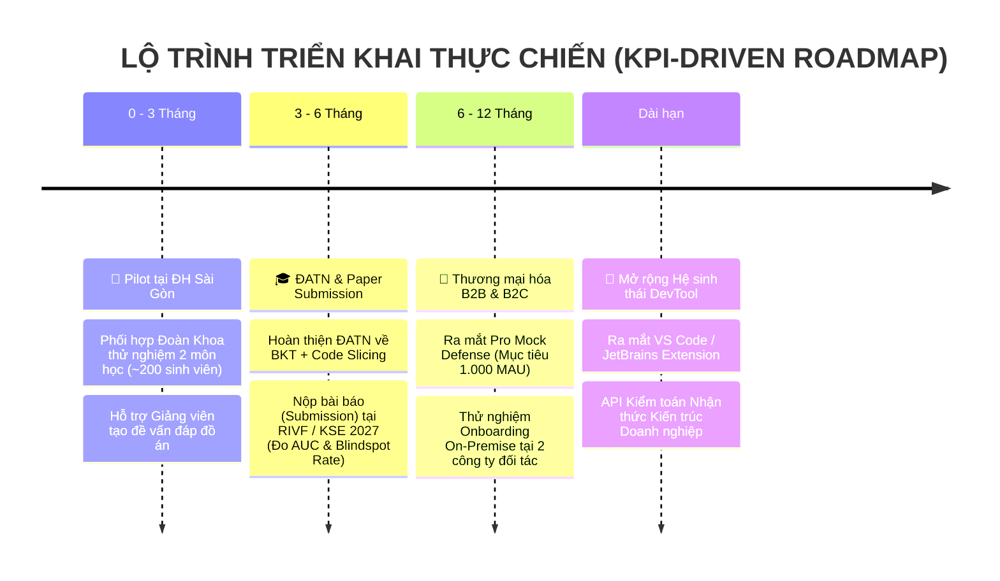

# BẢN CHIẾN LƯỢC ĐỊNH VỊ: ĐIỂM MỚI, LỢI THẾ CẠNH TRANH & KHẢ NĂNG PHÁT TRIỂN
## DỰ ÁN: SIMPLIFEY V2 PRO — CODEBASE COGNITIVE TWIN
### *Tài liệu Chuẩn hóa Báo cáo & Cẩm nang Tranh biện trước Hội đồng Giám khảo SGU 2026 - 2027*

---

# PHẦN I: ĐÁNH GIÁ HỆ THỐNG HIỆN TẠI (SYSTEM AUDIT)

Hệ thống **SimpliFey V2 Pro** đã có khung kiến trúc kỹ thuật rất vững chắc (quy định tại [`00_CORE_SPEC`](file:///c:/Users/THIEN/Desktop/HocTap/SimpliFey/Hackathon_SGU/00_CORE_SPEC/01_TONG_QUAN_KIEN_TRUC.md), [`01_ENGINE_THUAT_TOAN`](file:///c:/Users/THIEN/Desktop/HocTap/SimpliFey/Hackathon_SGU/01_ENGINE_THUAT_TOAN/02_AST_SLICING_GRAPH.md), [`02_AI_VA_BAYES`](file:///c:/Users/THIEN/Desktop/HocTap/SimpliFey/Hackathon_SGU/02_AI_VA_BAYES/01_LLM_PIPELINE_GUARDRAIL.md)):

### 1. Điểm mạnh cốt lõi
* **Bám sát tôn chỉ cuộc thi ("AI sáng tạo, tiết kiệm chi phí"):** Phân tách rạch ròi giữa **Động cơ Toán học Tĩnh (0 Token, < 1.5s)** và **AI Sư phạm JIT (1.2s – 1.8s, ~400 tokens)**. Chi phí vận hành chỉ **< $0.002 / phiên**, giải quyết bài toán "đốt tiền token" của naive RAG.
* **Tích hợp sâu chuỗi công nghệ chuẩn mực:** Tree-sitter WASM, Tarjan SCC, PageRank kèm Utility Sink Filtering, SonarQube Cognitive Complexity, Inter-procedural Slicing, Dagre Layout, và Bayesian Knowledge Tracing (BKT).
* **Kiến trúc Zero-Trust & Zero-Disk:** Không clone file vào đĩa cứng máy chủ, phân tích hoàn toàn in-memory, có Cổng gác nhị phân 2 chốt triệt tiêu hallucination.

### 2. Cảnh báo quan trọng về định vị học thuật (Crucial Positioning)
* **TUYỆT ĐỐI KHÔNG TUYÊN BỐ:** *"Nhóm em phát minh ra kiến trúc Compound AI"* hoặc *"Nhóm em sáng chế ra thuật toán BKT hay PageRank"*.
* **BẢN CHẤT SỰ THẬT:** 
  * *Compound AI System* được UC Berkeley (BAIR - Matei Zaharia) chuẩn hóa đầu năm 2024.
  * *Tree-sitter + PageRank Repo-Map* được công cụ mã nguồn mở **Aider** tiên phong sử dụng để nén codebase cho LLM.
  * *Bayesian Knowledge Tracing (BKT)* được Corbett & Anderson công bố từ năm 1995, được Duolingo (Birdbrain) và Carnegie Learning áp dụng hàng chục năm qua.
* **ĐỊNH VỊ CHUẨN MỰC:** Điểm mới của SimpliFey nằm ở **Đột phá về Hợp nhất & Chuyển giao Miền (Novel Synthesis & Domain Transfer)** và **Đảo ngược Mục đích Công nghệ (Inverse Purpose Paradigm)** theo đúng tiêu chí của Ban Tổ chức: *"Sự khác biệt có thể đến từ cách tiếp cận vấn đề, trải nghiệm người dùng hoặc hiệu quả ứng dụng thực tế"*.

---

# PHẦN II: TIÊU CHÍ 4 — ĐIỂM MỚI VÀ LỢI THẾ CẠNH TRANH

```
                  ┌────────────────────────────────────────────────────────┐
                  │          BẢN ĐỒ KHÁC BIỆT CỦA SIMPLIFEY V2 PRO         │
                  └───────────────────────────┬────────────────────────────┘
                                              │
         ┌────────────────────────────────────┼────────────────────────────────────┐
         ▼                                    ▼                                    ▼
┌──────────────────┐               ┌───────────────────────┐            ┌──────────────────────┐
│  AI ASSISTANTS   │               │   STATIC DIAGRAMS     │            │ TRADITIONAL EDTECH   │
│ (Cursor, Copilot)│               │ (CodeSee, Sourcetrail)│            │ (LeetCode, Duolingo) │
├──────────────────┤               ├───────────────────────┤            ├──────────────────────┤
│ • Sinh code hộ   │               │ • Mạng nhện 500 nodes │            │ • Bài tập đồ chơi    │
│ • SV thành "mù"  │               │ • Tĩnh, không bối cảnh│            │ • Tách rời dự án lớn │
│ • Ảo giác nặng   │               │ • Không có sư phạm    │            │ • Khó áp dụng thực tế│
└────────┬─────────┘               └───────────┬───────────┘            └──────────┬───────────┘
         │                                     │                                   │
         └─────────────────────────────────────┼───────────────────────────────────┘
                                               ▼
                         ┌───────────────────────────────────────────┐
                         │            SIMPLIFEY V2 PRO               │
                         │       "Codebase Cognitive Twin"           │
                         ├───────────────────────────────────────────┤
                         │ 1. Inverse EdTech: Lấy chính repo làm bài │
                         │ 2. Slicing Sư phạm: 6-8 micro-stories     │
                         │ 3. Compound AI: 0 Token DAG + JIT Feynman │
                         │ 4. Mạng Bayes (BKT) chuyển giao vào SWE   │
                         └───────────────────────────────────────────┘
```

### 1. Bảng đối chiếu bản chất kỹ thuật: Ngành đang làm gì vs. Điểm mới của SimpliFey

| Công nghệ nền tảng | Cách ngành công nghiệp đang sử dụng | Điểm mới và khác biệt đột phá của SimpliFey V2 Pro |
| :--- | :--- | :--- |
| **Tree-sitter AST & PageRank** | **Aider & Cursor:** Quét bóc tách symbol để tạo danh sách chữ ký hàm rời rạc (Repo-map) $\to$ **Nhồi vào prompt để AI viết code thay người**. | **Đảo ngược mục đích (Inverse):** Không nhặt symbol rời rạc, mà dùng Inter-procedural Slicing kéo trọn vẹn **1 sợi chỉ thực thi xuyên file** (`Controller` $\to$ `Service` $\to$ `DB`) $\to$ **Ép con người phải hiểu luồng dữ liệu**. |
| **Tarjan SCC Algorithm** | **Compilers:** Khử phụ thuộc vòng tròn giữa các module để tối ưu thứ tự biên dịch. | **Công thái học Nhận thức (Cognitive Ergonomics):** Co cụm các cặp file phụ thuộc lẫn nhau thành **Super-Node duy nhất**, đảm bảo đồ thị đầu ra **100% DAG** không bao giờ bị rối mắt hay lặp vô tận trên Canvas. |
| **Compound AI Architecture** | **Berkeley / Databricks:** Dùng hệ thống đa thành phần để giải quyết tác vụ tự động hóa doanh nghiệp phức tạp. | **Mô hình Sư phạm 2 Pha Tiết kiệm Chi phí:** Toán học gánh 90% việc nặng dựng khung xương với **0 Token**, LLM chỉ được kích hoạt JIT (~400 tokens) đóng vai trò Giảng viên phản biện Socratic. |
| **Bayesian Knowledge Tracing (BKT)** | **Duolingo / Khan Academy:** Đánh giá xác suất nắm vững kiến thức qua các câu hỏi **trắc nghiệm A-B-C-D đóng khung** (Toán, Ngoại ngữ). | **Chuyển giao miền (Domain Transfer) vào SWE:** Lần đầu tiên ánh xạ BKT vào **16 Trụ cột Kỹ nghệ Phần mềm**; biến lời giải thích tự do (Feynman) thành quan sát nhị phân qua Rubric Sensor để cập nhật xác suất tất định. |

---

### 2. Ba (03) Luận điểm Điểm mới then chốt để trình bày trước Hội đồng

#### Luận điểm 1: Đổi mới Phương pháp tiếp cận — "Inverse EdTech" (Học đảo ngược trên dự án thật)
* **Vấn đề của giáo dục hiện tại:** Sinh viên học OOP, Design Pattern qua các ví dụ trừu tượng ("Con chó, Con mèo, Động vật"), nhưng khi làm đồ án tốt nghiệp hay đi làm thực tế thì "ngợp" trước codebase 50–100 file. Khi AI bùng nổ, sinh viên dùng Cursor gõ prompt sinh code chạy được nhưng hoàn toàn mù tịt về luồng thực thi (*vibe-coding*).
* **Điểm mới của SimpliFey:** Mô hình **Bring Your Own Codebase (BYOC)** — Người học dán chính link GitHub đồ án của mình vào. Hệ thống biến đồ án đó thành một giáo trình trực quan, phân nhánh thành các "ải thử thách" từ Dễ đến Khó.

#### Luận điểm 2: Đột phá Hợp nhất Kỹ thuật — "Sợi chỉ Nghiệp vụ Xuyên file" (Inter-procedural Slicing)
* **Khác biệt với Aider:** Aider chỉ nhặt các dòng chữ ký hàm ngắn gọn rải rác để nhét vừa context window. Điều này giúp AI gõ code tiếp được, nhưng con người nhìn vào vẫn không hiểu gì.
* **Giải pháp của SimpliFey:** Sử dụng **Program Slicing** để kết nối các điểm nút thành một câu chuyện hoàn chỉnh:
  $$\text{Route Entrypoint} \longrightarrow \text{Validation Middleware} \longrightarrow \text{Domain Service} \longrightarrow \text{SQL/ORM Query}$$
  Sinh viên nhìn thấy trọn vẹn sự biến đổi của đối tượng dữ liệu (DTO) xuyên qua 4 tầng kiến trúc chỉ trong một lát cắt 20 dòng.

#### Luận điểm 3: Chuyển giao Miền Nhận thức — "BKT cho Kiến trúc Phần mềm qua Lăng kính Feynman"
* **Giải quyết bài toán đánh giá năng lực thực chất:** Thay vì trắc nghiệm lý thuyết suông, hệ thống yêu cầu: *"Hãy dùng một ẩn dụ đời thường để giải thích tại sao dòng code này cần dùng Mutex Lock thay vì biến đếm thông thường"*.
* **Cơ chế Cầu nối (Sensor Bridge):** LLM Structured Output ($T=0.1$) đóng vai trò bộ cảm biến nhị phân đo lường 2 tiêu chí (`accuracy` & `simplicity`). Kết quả nhị phân $u_t \in \{0, 1\}$ được đưa vào mô hình BKT toán học chạy trên Client để cập nhật xác suất $P(L_t)$, hoàn toàn minh bạch và loại bỏ thiên kiến ảo giác.

---

# PHẦN III: TIÊU CHÍ 5 — TÍNH ỨNG DỤNG & LỘ TRÌNH PHÁT TRIỂN DÀI HẠN

Hệ thống được thiết kế ngay từ đầu với lộ trình phát triển 4 giai đoạn gắn liền với các **chỉ số đo lường định lượng (KPIs)** và **phương thức triển khai thực tế**, cam kết không phải là "dự án làm xong để đấy":



---

### BẢNG MA TRẬN KẾ HOẠCH & CHỈ SỐ ĐỊNH LƯỢNG (MILESTONES & KPIS)

| Giai đoạn | Tiêu đề & Trọng tâm | Hành động cụ thể & Kênh triển khai thực tế | Chỉ số đo lường định lượng (KPIs) |
| :---: | :--- | :--- | :--- |
| **0 – 3 Tháng** | **🏫 Thử nghiệm Pilot tại SGU** *(Sân nhà & Giải quyết nỗi đau giảng viên)* | • Phối hợp cùng **Đoàn Khoa CNTT SGU** triển khai dưới dạng **"Chương trình Đồng hành Ôn tập Đồ án"** cho sinh viên.<br/>• Tích hợp bộ **Tạo đề thi Vấn đáp Cá nhân hóa** hỗ trợ giảng viên chấm đồ án môn học. | • Thử nghiệm trên **2 môn học** (*Kỹ thuật Lập trình* & *Đồ án CNTT*).<br/>• Tiếp cận **~200 sinh viên** thực tế.<br/>• Giảm **60% thời gian** chuẩn bị câu hỏi vấn đáp cho giảng viên. |
| **3 – 6 Tháng** | **🎓 Nghiên cứu & Đồ án Tốt nghiệp** *(Học thuật & Tính bền vững)* | • Phát triển thành đề tài ĐATN chính thức: *"Ứng dụng BKT và Program Slicing trong Đo lường Nhận thức Mã nguồn"**.<br/>• Hoàn thiện bản thảo khoa học và **Gửi nộp bài báo (Paper Submission)** tại các hội nghị uy tín (**RIVF / KSE 2027 / IEEE TALE**). | • Đo lường độ chính xác thuật toán: **$\text{AUC} \ge 0.82$** và **$\text{RMSE} \le 0.28$** trên mô hình BKT.<br/>• Chứng minh bằng A/B Testing: Giảm **45% điểm mù kiến trúc** (*Architecture Blindspot Reduction Rate*) so với nhóm tự học. |
| **6 – 12 Tháng**| **🚀 Thương mại hóa B2B & B2C** *(Tự chủ tài chính & Thị trường)* | • **B2C:** Ra mắt gói **Pro Mock Defense** cho sinh viên chuẩn bị bảo vệ đồ án tốt nghiệp hoặc phỏng vấn Fresher.<br/>• **B2B:** Thử nghiệm giải pháp **Developer Onboarding** giúp lập trình viên mới đọc hiểu monorepo doanh nghiệp trong 3 ngày. | • Đạt **1.000 người dùng hoạt động hàng tháng (MAU)**.<br/>• Chi phí vận hành hạ tầng: **$< \$15/\text{tháng}$** (nhờ kiến trúc Zero-Disk + 0 Token DAG).<br/>• Thử nghiệm tại **2 doanh nghiệp phần mềm** theo mô hình **On-Premise Docker** (cam kết 100% không rò rỉ mã nguồn). |
| **Dài hạn** | **🔌 Mở rộng Hệ sinh thái DevTool** *(Bền vững & Scale-up)* | • Đưa hệ thống từ nền tảng Web App thành **VS Code & JetBrains Extension**, tích hợp trực tiếp vào môi trường làm việc của lập trình viên.<br/>• Cung cấp API / Plugin kiểm toán tuân thủ kiến trúc (Cognitive Architecture Audit) cho các hệ thống CI/CD. | • Đạt **10.000 lượt tải** trên VS Code Marketplace.<br/>• Nâng 5 ngôn ngữ phổ biến nhất (TypeScript, Python, Java, Go, Dart/Flutter) lên tier `RESOLVED` (cạnh chính xác cao); mọi ngôn ngữ có Tree-sitter grammar vẫn dùng được ở tier `STRUCTURAL` (cạnh suy luận, không đảm bảo 100%). |

---

> 🔧 **Chi tiết kỹ thuật từng giai đoạn** (công nghệ nâng cấp, thuật toán bổ sung, cách đo, điều chỉnh KPI đề xuất): xem [`04_ROADMAP_KY_THUAT/ROADMAP_KY_THUAT_CHI_TIET.md`](04_ROADMAP_KY_THUAT/ROADMAP_KY_THUAT_CHI_TIET.md).

---

### PHÂN TÍCH CHI TIẾT 4 TRỤ CỘT BỀN VỮNG

#### 1. Tính khả thi của Mô hình Kinh doanh (Chi phí Vận hành Siêu Thấp)
* **Lợi thế sống còn:** Một trong những lý do khiến các startup AI EdTech phá sản là **chi phí token LLM quá lớn**. 
* **SimpliFey giải quyết triệt để:** Nhờ nguyên tắc *Code thuần dựng DAG (0 Token)* và *Gemini Flash JIT (~400 tokens/phiên)*, hệ thống phục vụ 1.000 sinh viên hoạt động thường xuyên chỉ tốn chưa tới **$15 USD/tháng**. Nhóm hoàn toàn tự chủ tài chính ngay cả khi chưa có nguồn thu lớn.

#### 2. Chiến lược An toàn Tuyệt đối khi tiếp cận Doanh nghiệp (Zero IP Leak)
* Doanh nghiệp không bao giờ đưa mã nguồn bí mật lên dịch vụ đám mây công cộng.
* Bản B2B Onboarding của SimpliFey được đóng gói thành **Docker Image chạy Local (On-Premise)**:
  * Toàn bộ quá trình quét AST bằng Tree-sitter WASM và dựng DAG diễn ra trong mạng LAN công ty.
  * Khi cần giải thích, hệ thống chỉ gửi 15 dòng code đã được ẩn danh hóa (anonymized) tới mô hình LLM nội bộ hoặc Private Cloud API của công ty.

#### 3. Giá trị Thiết thực đối với Giảng viên và Khoa CNTT SGU
* Không làm xáo trộn chương trình đào tạo chính quy của nhà trường.
* Giảng viên có một **Bảng điều khiển Giám thị (Dashboard)**: Nhìn thấy ngay sinh viên nào nộp bài mà không hiểu code (điểm $P(\text{Mastery})$ thấp ở các module cốt lõi), từ đó tập trung chất vấn đúng vào các "điểm mù" của sinh viên trong buổi bảo vệ đồ án.

#### 4. Giá trị Hồ sơ Năng lực (Portfolio) Đỉnh cao cho Sinh viên
* Thể hiện tư duy kỹ sư phần mềm chuyên sâu (**Deep Software Engineering**):
  * **Frontend:** Canvas đồ thị phân nhánh phức tạp (ReactFlow), Monaco Editor liên kết AST, State Machine quản lý tiến trình nhận thức (Zustand).
  * **System & Compiler:** Streaming in-memory (Zero-disk), Tree-sitter WASM, các thuật toán đồ thị nâng cao (Tarjan SCC Condensation, PageRank Sink Filter).
  * **AI & Khoa học Dữ liệu:** Compound AI System, Guardrails nhị phân chống ảo giác, Mô hình hóa xác suất Bayes (BKT) đánh giá học tập thích ứng.

---

# PHẦN IV: CẨM NANG TRANH BIỆN TRỰC TIẾP TRƯỚC HỘI ĐỒNG GIÁM KHẢO (DEFENSE SCRIPT)

> ### ❓ Câu hỏi bẫy 1 của Giám khảo:
> *"Mấy cái Tree-sitter bóc code với PageRank này công cụ Aider mã nguồn mở đã làm từ lâu rồi. Còn BKT thì Duolingo dùng cả chục năm nay. Hệ thống của các em rốt cuộc có gì mới hay chỉ là chắp vá?"*
> 
> ### 🎙️ Kịch bản đại diện nhóm tự tin phản biện:
> *"Dạ thưa Thầy, nhận định của Thầy hoàn toàn chính xác và rất sâu sắc ạ! Về mặt thuật toán nền tảng, chúng em **không phát minh lại bánh xe**:
> 
> 1. **Aider** đã chứng minh Tree-sitter và PageRank nén ngữ cảnh cực tốt. Nhưng Aider dùng nó để **AI viết code hộ con người** bằng cách gom các chữ ký hàm rời rạc. Chúng em **đảo ngược hoàn toàn bài toán**: Dùng Program Slicing để rút ra một chuỗi thực thi nghiệp vụ liền mạch xuyên file, nhằm **bóc trần thói quen học vẹt và ép con người phải hiểu code**.
> 
> 2. **Duolingo** đã chứng minh BKT theo dõi tiến độ học ngoại ngữ rất chuẩn qua các câu trắc nghiệm đúng/sai. Điểm mới của chúng em là **lần đầu tiên chuyển giao mô hình BKT vào Kỹ nghệ Phần mềm**: Ánh xạ 16 kỹ năng kiến trúc và dùng LLM làm bộ cảm biến nhị phân đo lường lời giải thích bằng phương pháp Feynman của sinh viên để cập nhật mạng Bayes tất định.
> 
> Đó là sự đổi mới mang tính đột phá về **Phương pháp tiếp cận (Inverse EdTech) và Ứng dụng thực tiễn** theo đúng tiêu chí định hướng của cuộc thi ạ!"*

---

> ### ❓ Câu hỏi bẫy 2 của Giám khảo:
> *"Nếu nói là học theo dự án của sinh viên, lỡ sinh viên nộp một đồ án có kiến trúc sai be bét, viết code 'spaghetti' dồn hết vào 1 file thì hệ thống của các em xử lý thế nào?"*
> 
> ### 🎙️ Kịch bản đại diện nhóm trả lời:
> *"Dạ thưa Thầy, đây chính là lúc giá trị của hệ thống phát huy mạnh nhất!  
> 
> Nếu code bị dồn hết vào 1 file hoặc viết cấu trúc lồng nhau phức tạp, thuật toán **SonarQube Cognitive Complexity** ở Tầng 2 sẽ đo đạc độ xoắn não vượt ngưỡng (> 15 điểm) và gắn cờ cảnh báo. Khi đó, hệ thống không vẽ được lát cắt nghiệp vụ đẹp mà sẽ hiển thị **'Node Báo Động (Anti-Pattern Node)'**. 
> 
> Sang Pha 1 X-Ray, hệ thống chỉ rõ cho sinh viên thấy: 'Hàm này đang gánh quá nhiều trách nhiệm (vi phạm Single Responsibility)'. Và sang Pha 2, AI sẽ đóng vai trò phản biện: 'Nếu đồ án này mở rộng thêm 10.000 người dùng, tại sao cấu trúc hiện tại sẽ gây nghẽn cổ chai?'. Nghĩa là code càng tệ, SimpliFey càng trở thành một người thầy chỉ lỗi đắc lực cho sinh viên!"*
