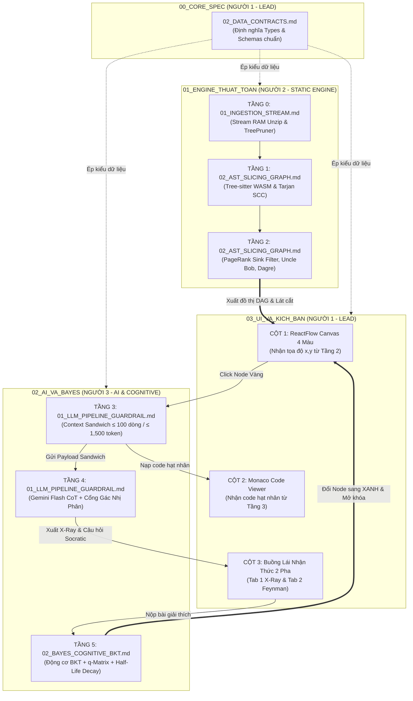

# BẢN ĐỒ PHÂN CHIA THƯ MỤC THEO TẦNG KIẾN TRÚC (MASTER DIRECTORY MAP)
## DỰ ÁN: SIMPLIFEY V2 PRO — CODEBASE COGNITIVE TWIN
### *Hệ Thống Bản Sao Nhận Thức Mã Nguồn Dành Cho Sinh Viên CNTT (Hackathon SGU 2026 - 2027)*

---

> 🎯 **DÀNH CHO THÀNH VIÊN VÀ CÁC CON AI ANTIGRAVITY:**  
> Bảng dưới đây quy định chính xác **từng thư mục tương ứng với Tầng nào** trong kiến trúc 6 tầng của hệ thống, ai chịu trách nhiệm và nhiệm vụ kỹ thuật cụ thể là gì để anh em mở ra code không bao giờ bị dẫm chân lên nhau!

---

# 1. BẢNG ÁNH XẠ TOÀN DIỆN: THƯ MỤC $\Longleftrightarrow$ TẦNG HỆ THỐNG

| Thư mục | Tầng Kiến Trúc Tương Ứng | Thành Viên Phụ Trách | Tài Liệu Quy Định Chi Tiết | Trọng Tâm Kỹ Thuật |
| :--- | :--- | :---: | :--- | :--- |
| **`00_CORE_SPEC/`** | **TẦNG QUẢN TRỊ KIẾN TRÚC & DATA CONTRACTS** *(Chi phối toàn bộ Tầng 0 đến Tầng 5)* | 👑 **NGƯỜI 1** *(Lead Architect)* | • `00_AUDIT_VA_PHAN_VIEC_3_NGUOI.md` • `01_TONG_QUAN_KIEN_TRUC.md` (Mục 5 = bảng số liệu chuẩn) • `02_DATA_CONTRACTS.md` (nguồn chân lý về kiểu) • `03_SYSTEM_EDGE_CASES_AUDIT.md` • `Kich_Ban_UseCase.md` (file tổng hợp, chỉ đồng bộ từ file nguồn) | • Khóa bộ Hợp đồng Dữ liệu TypeScript bất biến. • Quản lý ngân sách độ trễ (Latency Budget). • Duy trì tính toàn vẹn kiến trúc toàn dự án. |
| **`01_ENGINE_THUAT_TOAN/`** | **TẦNG 0, TẦNG 1 & TẦNG 2** *(Động cơ Phân tích Tĩnh 0 Token, < 1.5s)* | ⚙️ **NGƯỜI 2** *(Static Engine Dev)* | • `01_INGESTION_STREAM.md` • `02_AST_SLICING_GRAPH.md` | • **TẦNG 0:** Tải zip stream vào RAM + TreePruner lọc rác. • **TẦNG 1:** Tree-sitter WASM bóc hàm + Tarjan khử chu trình (100% DAG). • **TẦNG 2:** PageRank Sink Filter bầu file sếp + Scoped Def-Use Slicing + Uncle Bob + Dagre Layout $(x, y)$. |
| **`02_AI_VA_BAYES/`** | **TẦNG 3, TẦNG 4 & TẦNG 5** *(AI Phản Biện Feynman & Động cơ Nhận thức Bayes)* | 🧠 **NGƯỜI 3** *(AI & Cognitive Dev)* | • `01_LLM_PIPELINE_GUARDRAIL.md` • `02_BAYES_COGNITIVE_BKT.md` | • **TẦNG 3:** Đóng gói Context Sandwich (≤ 30 dòng/step, ≤ 100 dòng/node). • **TẦNG 4:** Gemini Flash CoT Structured JSON + Cổng Gác Nhị Phân 2 Chốt. • **TẦNG 5:** Bayesian Knowledge Tracing (BKT) + $q$-Matrix 16 chiều + Half-Life Decay. |
| **`03_UI_VA_KICH_BAN/`** | **TẦNG GIAO DIỆN & BUỒNG LÁI NHẬN THỨC** *(Tri-Pane Cockpit & Demo)* | 👑 **NGƯỜI 1** *(Fullstack & UI)* | • `01_UI_TRI_PANE_FSM.md` • `02_KICH_BAN_PITCH_DEMO.md` | • Cột 1: ReactFlow Branched DAG Canvas 4 màu. • Cột 2: Monaco Interactive Code Viewer. • Cột 3: Buồng lái 2 Pha (Tab X-Ray & Tab Feynman). • Kịch bản Pitching 5 phút & Persona Simulator. |
| **`04_ROADMAP_KY_THUAT/`** | **LỘ TRÌNH KỸ THUẬT 4 GIAI ĐOẠN PHÁT TRIỂN** *(Sau Hackathon)* | 👥 **CẢ 3 NGƯỜI** | • `ROADMAP_KY_THUAT_CHI_TIET.md` | • Nâng cấp công nghệ, thuật toán bổ sung và cách đo cho từng giai đoạn Pilot → ĐATN → Thương mại hóa → DevTool. |
| **`references/`** | **TÀI LIỆU NỀN TẢNG & GIÁO TRÌNH HỌC THUẬT TOÁN** | 👥 **CẢ 3 NGƯỜI** | • `GIAO_TRINH_THUAT_TOAN_CHUAN.md` • `thele.md` | • Giáo trình chạy tay bằng số (Dry-run) 7 thuật toán cốt lõi. • Thể lệ cuộc thi Hackathon SGU 2026-2027. |
| **Thư mục gốc** | **ĐỊNH VỊ, THẨM ĐỊNH & PROTOTYPE** | 👥 **CẢ 3 NGƯỜI** | • `KyVong45.md` • `BAO_CAO_THAM_DINH_GIAM_KHAO.md` • `index.html`, `cockpit_demo.html` • `CLAUDE.md` | • Định vị cạnh tranh & cẩm nang phản biện BGK. • Thẩm định giả lập kèm bảng trạng thái xử lý. • Prototype giao diện dữ liệu giả (chỉ tham chiếu thiết kế, **không** chép vào repo thi). • Hướng dẫn cho trợ lý AI. |
| **`archive/`** | **KHO LƯU TRỮ TÀI LIỆU CŨ & BẢN NHÁP SƠ KHAI** | 🗄️ *Hệ thống* | • `docchoi.md`, `enterprise_arch.md`, `atp.md`, `SYSTEM_SPEC...` | Lưu trữ lịch sử thảo luận, **không** dùng làm căn cứ. |

---

# 2. SƠ ĐỒ DÒNG DỮ LIỆU LIÊN THÔNG GIỮA CÁC THƯ MỤC

---

# 3. QUY TRÌNH PHỐI HỢP KHI BẮT ĐẦU CODE (CODE IMPLEMENTATION PROTOCOL)

1. **BƯỚC 1 (Đọc kỹ hợp đồng dữ liệu):**  
   Mọi thành viên mở file [`00_CORE_SPEC/02_DATA_CONTRACTS.md`](00_CORE_SPEC/02_DATA_CONTRACTS.md) để đọc cấu trúc JSON và Type mà mình phải nhận vào / trả ra, và bảng số liệu chuẩn ở [`00_CORE_SPEC/01_TONG_QUAN_KIEN_TRUC.md`](00_CORE_SPEC/01_TONG_QUAN_KIEN_TRUC.md) Mục 5.
2. **BƯỚC 2 (Người 2 triển khai Tầng 0, 1, 2):**  
   Mở thư mục `01_ENGINE_THUAT_TOAN/`, code theo đúng 5 mục: *Input $\to$ Logic $\to$ Fallback $\to$ Output $\to$ SLA < 0.25s*.
3. **BƯỚC 3 (Người 3 triển khai Tầng 3, 4, 5):**  
   Mở thư mục `02_AI_VA_BAYES/`, code Prompt Gemini Flash JSON Schema, Cổng Gác Nhị Phân 2 Chốt và Động cơ Bayes BKT.
4. **BƯỚC 4 (Người 1 dựng Giao diện Cockpit 3 Cột):**  
   Mở thư mục `03_UI_VA_KICH_BAN/`, gắn ReactFlow, Monaco Editor và kết nối Zustand Store để đổi màu Node và chạy Demo 5 phút.
5. **NẾU CẦN ÔN LẠI THUẬT TOÁN:**  
   Mở ngay [`references/GIAO_TRINH_THUAT_TOAN_CHUAN.md`](references/GIAO_TRINH_THUAT_TOAN_CHUAN.md) để xem ví dụ chạy tay bằng số (Dry-run trace) minh bạch!
