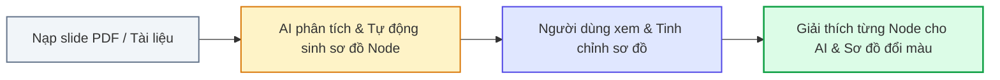
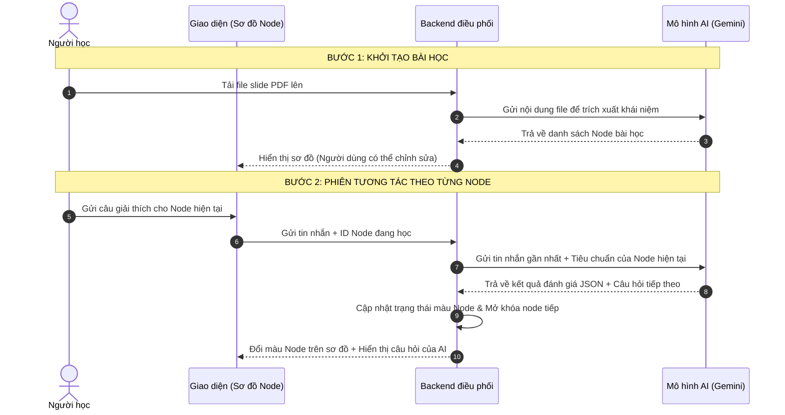

# BẢN NỘI DUNG SLIDE THUYẾT TRÌNH VÒNG SƠ KHẢO (PITCH DECK SCRIPT)
## DỰ ÁN: SGU-FEYNMAN
> **Thời lượng chuẩn:** 3 - 4 phút  
> **Khung cấu trúc:** Chuẩn Y Combinator x Steve Jobs Product Launch  
> **Chủ đề bám sát:** *"Ứng dụng AI sáng tạo, tiết kiệm chi phí vào học tập, dạy học thông minh"*

---

## PHẦN 1: THE HOOK & THE TENSION (30 GIÂY)
*(Mở đầu bằng thực trạng học tập thời AI và mâu thuẫn cốt lõi, không dùng câu hỏi sáo rỗng)*

### Nội dung trình bày trên Slide:
* **Thực trạng thực tế:** 
  > *"Trong kỷ nguyên Generative AI, sinh viên làm bài tập về nhà nhanh hơn bao giờ hết, nhưng khi đứng trước hội đồng thi vấn đáp thì lại lúng túng không giải thích được bản chất."*
* **Vấn đề cốt lõi:** Hiện tượng **"Ảo tưởng thành thạo" (Illusion of Competence)**. Khi đọc bài giải soạn sẵn của AI, não bộ tạo cảm giác rằng mình đã hiểu. Nhưng khi yêu cầu tự diễn đạt lại từ đầu, người học hoàn toàn bế tắc.
* **Hạn chế của Chatbot EdTech hiện tại:** Đa phần chatbot đóng vai "người làm hộ": giải thích thay, mớm đáp án và khen ngợi dễ dãi $\to$ Người học tiếp tục rơi vào trạng thái tiếp thu thụ động.

### Gợi ý hình ảnh Slide:
* Một bên: Sinh viên đọc lời giải AI gật gù (Ảo tưởng hiểu bài).
* Một bên: Sinh viên lúng túng khi bị hỏi vấn đáp vì chưa từng tự cấu trúc lại kiến thức.

---

## PHẦN 2: PHƯƠNG PHÁP FEYNMAN & CƠ CHẾ SGU-FEYNMAN (90 GIÂY)
*(Giới thiệu kỹ thuật Feynman, quy trình đẩy file sinh sơ đồ và tình huống minh họa trực quan)*

### 1. Phương pháp Feynman là gì và tại sao lại hiệu quả?
* **Nguồn gốc:** Được đặt theo tên nhà vật lý đoạt giải Nobel Richard Feynman.
* **Triết lý cốt lõi:** 
  > *"Nếu bạn không thể giải thích một khái niệm cho một đứa trẻ hiểu bằng ngôn ngữ bình dị nhất, thì chính bạn vẫn chưa thực sự hiểu nó."*
* **4 bước của Kỹ thuật Feynman:**
  1. *Chọn một khái niệm* cần nắm vững.
  2. *Giải thích khái niệm đó cho một đứa trẻ 10 tuổi* (hoặc người không có chuyên môn) bằng ngôn từ mộc mạc, tuyệt đối không dùng thuật ngữ chuyên môn đao to búa lớn.
  3. *Nhận diện lỗ hổng:* Chỗ nào mình bị ngập ngừng, lúng túng hoặc phải viện đến từ ngữ sách giáo khoa $\to$ Đó chính là điểm mù kiến thức của mình.
  4. *Đơn giản hóa và đúc kết lại* cho đến khi câu chuyện trở nên trực quan, dễ hiểu.
* **Ứng dụng vào SGU-Feynman:** Thay vì để AI đứng giảng cho học sinh, hệ thống **đảo ngược vai trò**: Sinh viên đóng vai người dạy/người giải thích, còn AI đóng vai một người bạn học tò mò ("Bé Minh") liên tục lắng nghe và hỏi vặn.

### 2. Quy trình trải nghiệm thực tế (Từ file bài giảng đến sơ đồ học tập):
* **Bước 1 - Đẩy file tài liệu & AI phân tích sinh sơ đồ:**
  * Người dùng tải lên file slide bài giảng (PDF) hoặc chọn bài mẫu có sẵn.
  * AI đọc hiểu tài liệu, bóc tách các khái niệm trọng tâm cùng mối liên hệ trước-sau, từ đó **tự động sinh ra cây sơ đồ bài học (Node Graph)**.
* **Bước 2 - Người dùng xem lại & Tinh chỉnh sơ đồ:**
  * Người dùng có thể kiểm tra trực quan, chỉnh sửa tên node, thêm/bớt hoặc sắp xếp lại các node theo mục tiêu học tập của mình trước khi khóa sơ đồ bắt đầu học.
* **Bước 3 - Bước vào buồng lái tương tác:**
  * Màn hình chia 2 cột: Cột trái là cây sơ đồ các node (Xám: chưa học, Vàng: đang thảo luận, Xanh: đã thấu suốt). Cột phải là khung trò chuyện với người bạn học AI.

### 3. Tình huống minh họa: Bắt bẫy học vẹt & Kích hoạt hiểu sâu:
* **Tình huống (Bài học: Quy luật Cung - Cầu):**  
  *Sinh viên copy câu định nghĩa sách giáo khoa:*  
  > *"Giá cả hàng hóa biến động do mối tương quan giữa cung và cầu trên thị trường."*
* **Phản xạ của AI:** AI nhận biết đây là câu học vẹt, không khen ngợi dễ dãi mà đặt một tình huống đời thường:  
  > *"Dạ nghe giống trong sách quá anh ơi! Nhưng ví dụ trời mưa to, trước cổng trường chỉ còn đúng 1 cái áo mưa mà có 10 bạn muốn mua, thì giá cái áo mưa đó tăng hay giảm ạ?"*
* **Chuyển hóa nhận thức:** Khi sinh viên dùng trực giác thực tế trả lời:  
  > *"Giá tăng gấp đôi vì ai cũng cần gấp mà có mỗi 1 cái áo thôi."*  
  $\to$ AI xác nhận sinh viên đã hiểu đúng bản chất $\to$ **Node trên sơ đồ lập tức chuyển sang màu XANH và mở khóa bài tiếp theo!**

---

## PHẦN 3: KIẾN TRÚC HỆ THỐNG & CƠ CHẾ VẬN HÀNH TIẾT KIỆM CHI PHÍ (60 GIÂY)
*(Miêu tả sơ lược, thực tế cách hệ thống vận hành, không dùng số liệu phóng đại)*

### 1. Phân chia vai trò rõ ràng giữa Backend và AI:
* **Vai trò của AI (Gemini Flash):**
  * *Lúc bắt đầu:* Đọc file PDF tài liệu để phân tích và sinh ra cấu trúc các node bài học ban đầu.
  * *Trong lúc chat:* Đọc câu giải thích của người dùng ở từng node, đánh giá mức độ hiểu (độ chính xác, có dùng từ khó không, khả năng ví von thực tế) và xuất kết quả dạng JSON kèm câu hỏi tiếp theo.
* **Vai trò của Backend:**
  * Lưu trữ và quản lý trạng thái của cây sơ đồ bài học.
  * Nhận kết quả đánh giá từ AI để tự động cập nhật màu của Node (Xám $\to$ Vàng $\to$ Xanh) và dẫn đường sang node tiếp theo theo đúng thứ tự logic.

### 2. Cách hệ thống vận hành tinh gọn và tiết kiệm chi phí:
* **Hạn chế của Chatbot thông thường:** Mỗi lượt chat đều phải gửi dồn toàn bộ lịch sử trò chuyện từ đầu đến cuối. Càng trò chuyện dài thì dữ liệu gửi đi càng phình to $\to$ Tốn nhiều chi phí gọi API và phản hồi chậm dần.
* **Giải pháp của SGU-Feynman:**
  * Tiến độ bài học đã được **lưu trực tiếp trên cây sơ đồ ở Backend**.
  * Nhờ vậy, mỗi lượt trao đổi với AI chỉ cần gửi **tin nhắn gần nhất kết hợp với tiêu chuẩn của khái niệm đang học**.
  * Dữ liệu gửi đi luôn giữ ở mức gọn nhẹ, không bị phình to theo thời gian.
  * Giúp **tiết kiệm chi phí gọi API** đáng kể cho mỗi phiên học và giữ cho tốc độ phản hồi luôn nhanh, mượt mà.

---

## PHẦN 4: TÍNH ỨNG DỤNG & KẾ HOẠCH BÀN GIAO 24H (30 GIÂY)
*(Khẳng định tính khả thi và thông điệp cốt lõi trước Hội đồng)*

### 1. Khả năng ứng dụng thực tế:
* **Áp dụng đa ngành:** Phù hợp với mọi môn học có hệ thống khái niệm logic (từ Kinh tế học, Vật lý, Sinh học đến Lập trình).
* **Phiên học vi mô (Micro-session):** Mỗi phiên chỉ kéo dài 10 - 15 phút tập trung vào 5 - 7 khái niệm cốt lõi, giúp sinh viên tự rà soát và củng cố kiến thức ngay sau mỗi buổi học trên lớp.

### 2. Kế hoạch hiện thực hóa tại Vòng Thử thách 24 giờ:
* Nhóm đã chuẩn hóa toàn bộ **Cấu trúc dữ liệu JSON**, **Luồng điều phối sơ đồ trên Backend** và **Kịch bản phản xạ của AI**.
* Đội ngũ kỹ thuật hoàn toàn tự tin ráp nối hoàn chỉnh sản phẩm tương tác thực tế ngay trong 24 giờ của Vòng Thử thách tiếp theo.

> **Thông điệp kết bài:**  
> *"Dạy học thông minh không phải là dùng AI để nói thay hay làm bài hộ học sinh. Dạy học thông minh là dùng AI để tạo môi trường kích hoạt tư duy, giúp người học tự nói ra, tự sửa sai và tự làm chủ tri thức của mình. Nhóm SGU-Feynman rất mong nhận được sự góp ý từ Hội đồng Ban Giám khảo để hoàn thiện sản phẩm ở các vòng tiếp theo!"*

