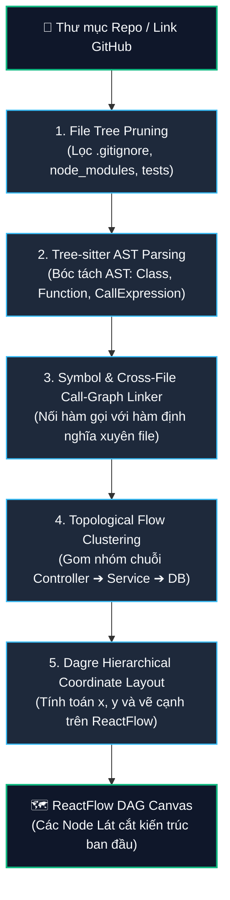
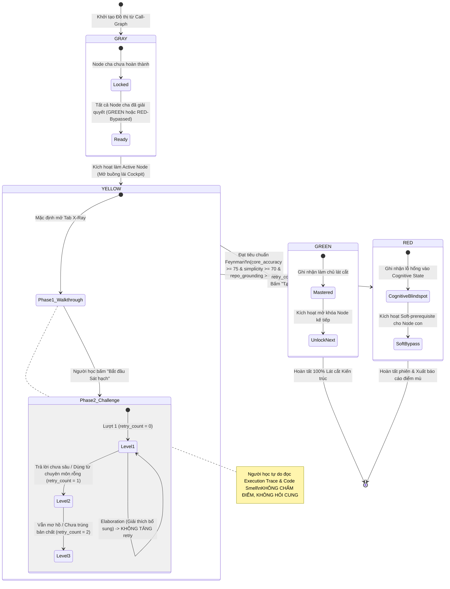
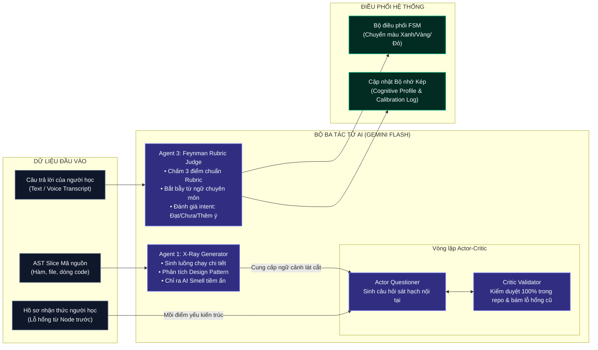
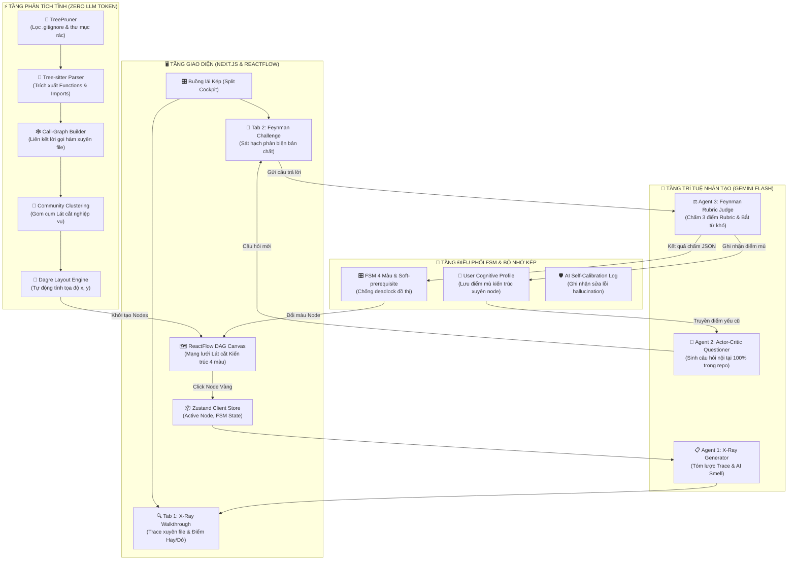
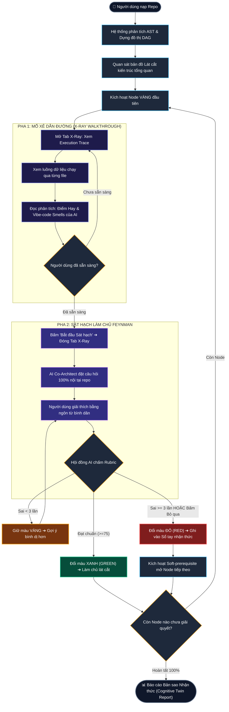
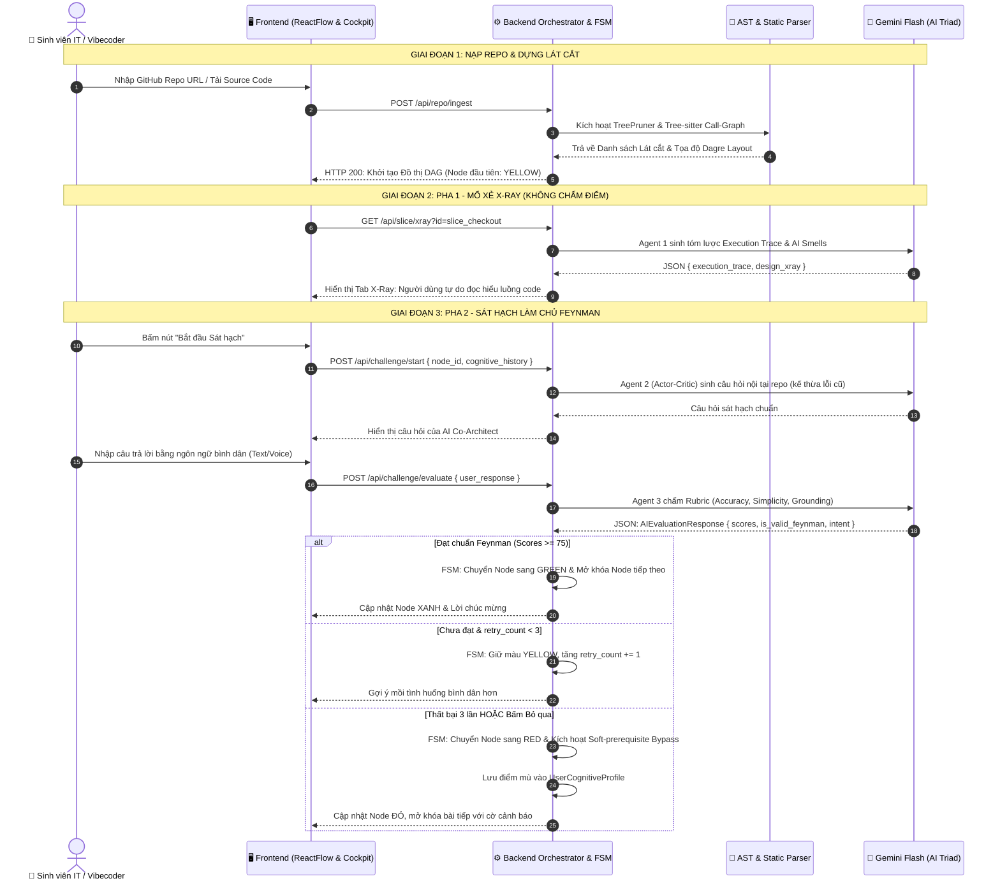
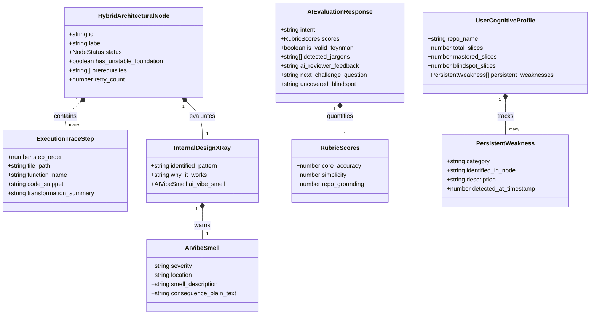
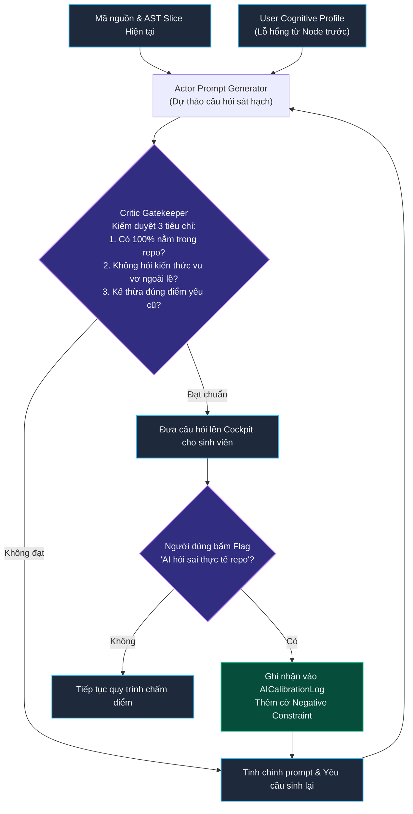

# ĐẶC TẢ YÊU CẦU PHẦN MỀM & THIẾT KẾ KIẾN TRÚC HỆ THỐNG
# SIMPLIFEY V2 PRO — CODEBASE COGNITIVE TWIN
### *Giải pháp Đảo ngược Vai trò Feynman giúp Sinh viên CNTT & Vibecoder Làm chủ Mã nguồn AI sinh*

---

| **Thuộc tính** | **Chi tiết** |
| :--- | :--- |
| **Dự án** | **SimpliFey V2 Pro** (*Thương hiệu giữ nguyên theo Poster Vòng 1*) |
| **Phân hệ** | Codebase Cognitive Twin (Bản sao Nhận thức Mã nguồn) |
| **Cuộc thi** | **Hackathon SGU 2026 – 2027** (BCH Đoàn Khoa CNTT - Đại học Sài Gòn) |
| **Vòng thi** | **Vòng Thử Thách Lập Trình 24 Giờ (Chung kết)** |
| **Mục tiêu sản phẩm** | Biến "Vibe-code" thành "Deep Code Understanding" cho Sinh viên IT |
| **Trạng thái tài liệu** | **Bản chuẩn hóa Kỹ thuật & Sơ đồ Slide (Master Specification)** |

---

## MỤC LỤC
1. [BỐI CẢNH DỰ ÁN, BÀI HỌC VÒNG SƠ LOẠI & CHIẾN LƯỢC XOAY TRỤC (PIVOT)](#1-bối-cảnh-dự-án-bài-học-vòng-sơ-loại--chiến-lược-xoay-trục-pivot)
2. [ĐẶC TẢ YÊU CẦU SẢN PHẨM (PRD - PRODUCT REQUIREMENTS)](#2-đặc-tả-yêu-cầu-sản-phẩm-prd---product-requirements)
3. [KIẾN TRÚC HỆ THỐNG PHÂN TẦNG (SYSTEM ARCHITECTURE SPECIFICATION)](#3-kiến-trúc-hệ-thống-phân-tầng-system-architecture-specification)
4. [ĐỘNG CƠ PHÂN TÍCH TĨNH & DỰNG ĐỒ THỊ LÁT CẮT (STATIC AST & CALL-GRAPH INGESTION)](#4-động-cơ-phân-tích-tĩnh--dựng-đồ-thị-lát-cắt-static-ast--call-graph-ingestion)
5. [MÁY TRẠNG THÁI HỮU HẠN 4 MÀU (FSM ENGINE) & CƠ CHẾ CHỐNG DEADLOCK](#5-máy-trạng-thái-hữu-hạn-4-màu-fsm-engine--cơ-chế-chống-deadlock)
6. [HỆ THỐNG AI ĐA NHIỆM (AI TRIAD) & BỘ NHỚ KÉP (DUAL-MEMORY ENGINE)](#6-hệ-thống-ai-đa-nhiệm-ai-triad--bộ-nhớ-kép-dual-memory-engine)
7. [CHUẨN HÓA HỢP ĐỒNG DỮ LIỆU (DATA CONTRACTS & SCHEMAS)](#7-chuẩn-hóa-hợp-đồng-dữ-liệu-data-contracts--schemas)
8. [TỔNG HỢP HỆ THỐNG SƠ ĐỒ MERMAID CHUẨN SẴN SÀNG LÀM SLIDE](#8-tổng-hợp-hệ-thống-sơ-đồ-mermaid-chuẩn-sẵn-sàng-làm-slide)
9. [KỊCH BẢN THUYẾT TRÌNH (SLIDE PITCH DECK) & CẨM NANG PHẢN BIỆN TRƯỚC HỘI ĐỒNG BGK SGU](#9-kịch-bản-thuyết-trình-slide-pitch-deck--cẩm-nang-phản-biện-trước-hội-đồng-bgk-sgu)

---

# 1. BỐI CẢNH DỰ ÁN, BÀI HỌC VÒNG SƠ LOẠI & CHIẾN LƯỢC XOAY TRỤC (PIVOT)

### 1.1. Tình thế thực tế của đội thi
* Dự án **SimpliFey V1** (Ý tưởng ban đầu: *Học vẹt lý thuyết từ slide PDF qua phương pháp Feynman với nhân vật Bé Minh 10 tuổi*) đã **bị loại ở vòng chấm điểm sơ loại chuyên môn** bởi Ban Giám khảo Khoa CNTT SGU (ThS. Nguyễn Trung Tín & Đ/c Hồ Minh Cảnh).
* Đội thi bước tiếp vào Vòng 2 (Vòng Thử Thách Lập Trình 24 Giờ) nhờ **tấm vé vớt từ Cổng bình chọn trực tuyến qua Áp phích (Poster)** trên Fanpage Đoàn Khoa.
* Theo Thể lệ Hackathon: Điểm vòng 2 bao gồm **10% điểm tương tác poster** và **90% điểm trực tiếp từ Ban Giám khảo**. Điều này đòi hỏi sản phẩm hoàn thiện trong 24h phải có bước nhảy vọt toàn diện về **tính thực tiễn, độ sâu kỹ thuật và giải quyết một nỗi đau nhức nhối (Painkiller)** thay vì một ứng dụng phù phiếm ("Vitamin").

### 1.2. Phân tích nguyên nhân thất bại của V1 & Đối thủ
1. **Thiếu tính cấp bách (Vitamin vs Painkiller):** Bắt sinh viên ngồi gõ chữ giải thích lý thuyết đại cương cho AI là một rào cản quá lớn. Sinh viên thà đọc ChatGPT hoặc xem YouTube tóm tắt còn hơn là ngồi "dạy học cho bot".
2. **Kỹ thuật mỏng (Prompt Wrapper):** Luồng xử lý chỉ là `PDF -> Regex -> LLM Prompt -> JSON Node`. Ban Giám khảo CNTT không thấy thuật toán phức tạp, không có kiến trúc dữ liệu và xử lý hệ thống thật sự.
3. **Đối thủ trực diện đã chiếm trọn phân khúc EdTech lý thuyết:** Điển hình là *Whybi AI* (Cây kỹ năng thông minh, hỗ trợ cả Voice/Text, bản đồ nhiệt giảng viên, ghép bạn cùng tiến). Nếu SimpliFey tiếp tục làm EdTech đọc PDF thông thường, nhóm chắc chắn 100% thất bại.

### 1.3. Ràng buộc bảo toàn (Hard Constraints) & Chiến lược Xoay trục
Để vừa tôn trọng kết quả bình chọn Poster của cộng đồng, vừa lột xác chinh phục hội đồng giám khảo khó tính:
* **Ràng buộc bất biến:**
  1. Giữ nguyên thương hiệu: **SimpliFey** (Mở rộng thành: **SimpliFey V2 Pro - Codebase Cognitive Twin**).
  2. Bảo tồn Visual DNA đã có trên Poster: Đồ thị có hướng không chu trình (**DAG trên ReactFlow**), Máy trạng thái 4 màu (**FSM: Xám - Vàng - Đỏ - Xanh**) và **Triết lý Sư phạm Feynman** (Đảo ngược vai trò, truy vấn bản chất không vẹt thuật ngữ).
* **Đập bỏ hoàn toàn:**
  1. Xóa bỏ hình tượng "Bé Minh 10 tuổi", ví dụ ngụ ngôn "áo mưa / hộp quà". Thay bằng **AI Co-Architect / Code Reviewer**.
  2. Xóa bỏ luồng nạp PDF lý thuyết. Thay bằng **Nạp trực tiếp GitHub Repo / Thư mục mã nguồn**.
* **Định vị mới — Nỗi đau cực lớn của thời đại "Vibecoding":**
  * Hàng triệu sinh viên IT và lập trình viên hiện nay đang dùng Cursor, Claude 3.5 Sonnet, ChatGPT, Copilot, v0 để sinh hàng nghìn dòng code trong vài phút (*Vibecoding*). 
  * **Hậu quả kinh hoàng:** Code chạy được nhưng người viết **hoàn toàn mù tịt về luồng chạy (Execution Flow)**, không giải thích được lý do thiết kế kiến trúc, không phát hiện được lỗi ngầm (AI Hallucinated Smells: N+1 query, race condition, thiếu database transaction, lộ memory leak). Khi lên bảo vệ đồ án trước giảng viên hoặc đi phỏng vấn kỹ thuật, sinh viên lập tức "cứng họng".
  * **SimpliFey V2 Pro** ra đời chính là công cụ **"mổ xẻ và chất vấn mã nguồn"**: Biến repo của chính họ thành một bản đồ nhận thức trực quan, hướng dẫn họ hiểu sâu luồng thực thi và thử thách họ phản biện bằng chính ngôn từ bình dân theo tinh thần Feynman!

---

# 2. ĐẶC TẢ YÊU CẦU SẢN PHẨM (PRD - PRODUCT REQUIREMENTS)

### 2.1. Chân dung Người dùng Mục tiêu (User Persona)
* **Đối tượng chính:** Sinh viên CNTT năm 2 - năm 4 đang làm đồ án môn học, đồ án tốt nghiệp; lập trình viên mới vào nghề (Junior / Intern); Vibecoders sử dụng công cụ AI sinh mã.
* **Nỗi đau trọng tâm:** 
  * "Em prompt Cursor sinh ra một app Fullstack NestJS + Next.js chạy rất mượt, nhưng ngày mai thầy hỏi dữ liệu từ nút Bấm Mua truyền qua những service nào rồi lưu xuống DB ra sao thì em không biết trả lời!"
  * "Code AI viết nhìn có vẻ chuẩn nhưng không biết có lỗ hổng kiến trúc hay thắt cổ chai hiệu năng nào không."

### 2.2. Khái niệm Đột phá: Node Lai Kiến trúc (Hybrid Architectural Node)
Thay vì sai lầm chia đồ thị thành $1 \text{ Node} = 1 \text{ File}$ (nhàm chán và biến app thành một Static Linter đơn thuần), SimpliFey V2 Pro cấu trúc mỗi Node trên ReactFlow là **1 Lát cắt Nghiệp vụ Xuyên File (Cross-file Architectural Slice)**:
1. **Lát cắt Thực thi (Execution Trace):** Chuỗi liên kết động giữa các mắt xích thực tế: `Endpoint (Controller) -> Middleware (Auth/Validation) -> Business Service -> ORM Repository / Model -> Database Call`.
2. **Hồ sơ Thiết kế Nội tại (Internal Design X-Ray):**
   * *Mẫu kiến trúc nhận diện:* Dependency Injection, Repository Pattern, CQRS, Event-Driven...
   * *Điểm Hay (Why it works):* Tại sao đoạn code này được tổ chức tách biệt mà không gộp chung?
   * *Điểm Dở / AI Smell (The Hidden Catch):* Chỉ ra đoạn mã AI viết ẩu (Ví dụ: gọi query DB trong vòng lặp `forEach`, thiếu transaction rollback, bỏ qua error handling).

### 2.3. Quy trình Tương tác 2 Pha (The 2-Phase Mastery Loop)
Loại bỏ cảm giác "bị AI hỏi dồn dập", hệ thống phân tách rõ rệt 2 bước:
* **Pha 1 — Mổ xẻ Dẫn đường (X-Ray Guided Walkthrough):**
  * Khi người dùng click vào một Node màu VÀNG, hệ thống **không hỏi vặn hay chấm điểm ngay**.
  * Cột bên phải mở ra bản đồ giải phẫu: minh họa dữ liệu biến đổi qua từng hàm, giải thích tại sao kiến trúc này được chọn và cảnh báo vị trí AI code có "mùi" (Smell).
  * Người dùng đọc, suy ngẫm và chuẩn bị tinh thần làm chủ mã nguồn.
* **Pha 2 — Sát hạch Làm chủ Feynman (Active Mastery Challenge):**
  * Khi người dùng bấm *"Tôi đã hiểu - Bắt đầu Sát hạch"*, bản X-Ray đóng lại.
  * AI Co-Architect xuất hiện và chỉ đưa ra **3 dạng câu hỏi thuần túy đóng khung 100% trong repo**:
    * **Type 1 (Truy vết Luồng dữ liệu):** Dữ liệu truyền từ `orderController` sang `inventoryService` qua tham số nào? Nếu đổi tên trường thì hàm nào bên dưới sẽ gãy?
    * **Type 2 (Lý do Phân rã Thiết kế):** Tại sao repo này tách riêng tầng Controller và Service? Nếu gộp lại làm một file thì gặp rủi ro gì?
    * **Type 3 (Phê bình Code AI bằng tiếng dân dã):** Đoạn code xử lý trừ kho đang có một chỗ AI viết ẩu. Bằng lời bình dân, bạn hãy chỉ ra tại sao viết như vậy sẽ khiến server "chết đứng" khi có 100 người mua cùng lúc?
  * Vượt qua sát hạch: Node chuyển sang **XANH**. Thất bại quá 3 lần: Node chuyển **ĐỎ** và ghi nhận vào sổ tay lỗ hổng nhận thức.

---

# 3. KIẾN TRÚC HỆ THỐNG PHÂN TẦNG (SYSTEM ARCHITECTURE SPECIFICATION)

Hệ thống được thiết kế theo mô hình **4 Phân tầng Tách biệt (4-Tier Decoupled Architecture)** nhằm đảm bảo tính ổn định, tốc độ phản hồi dưới 1 giây và tối ưu hóa chi phí token:

```
┌─────────────────────────────────────────────────────────────────────────────┐
│ 1. CLIENT TIER (Next.js App Router + ReactFlow + Zustand Store)             │
│    • DAG Graph View (Canvas 4 màu)   • Cockpit Split-View (X-Ray / Chat)   │
├─────────────────────────────────────────────────────────────────────────────┤
│ 2. DETERMINISTIC STATIC INGESTION TIER (Zero LLM Tokens - Thuần Thuật Toán) │
│    • TreePruner (.gitignore filter)  • Tree-sitter AST Multi-lang Parser   │
│    • Call-Graph Builder (Symbol Ref) • Community Clustering Engine         │
│    • Dagre Hierarchical Auto-Layout Engine                                 │
├─────────────────────────────────────────────────────────────────────────────┤
│ 3. REASONING & AI CORE TIER (Gemini Flash + Structured JSON Schemas)        │
│    • Agent 1: Architectural X-Ray Generator                                │
│    • Agent 2: Actor-Critic JIT Questioner (Repo-grounded Questions)        │
│    • Agent 3: Feynman Rubric Evaluator (Simplicity, Grounding, Non-Jargon)  │
├─────────────────────────────────────────────────────────────────────────────┤
│ 4. DUAL-MEMORY & PERSISTENCE TIER (In-Memory Engine & LocalStorage/DB)       │
│    • Deterministic Graph FSM (Gray -> Yellow -> Green / Red)                │
│    • User Cognitive Profile (Tích lũy điểm mù kiến trúc xuyên Node)        │
│    • Self-Calibration Feedback Store (Ghi nhận sửa lỗi hallucination)      │
└─────────────────────────────────────────────────────────────────────────────┘
```

### 3.1. Phân tầng 1: Client Tier (Giao diện Buồng lái Chia đôi - Split Cockpit)
* **Công nghệ:** Next.js 15, `@xyflow/react` (ReactFlow v12), `@dagrejs/dagre`, Zustand, Tailwind CSS, Lucide Icons.
* **Layout chuẩn:**
  * **Cột trái (40% - Canvas Đồ thị):** Hiển thị mạng lưới DAG các Lát cắt Kiến trúc. Mỗi node có màu sắc tương ứng với FSM (Xám, Vàng, Xanh, Đỏ), hiệu ứng viền phát sáng (Glow pulse) ở node đang active.
  * **Cột phải (60% - Buồng lái Nhận thức):** 
    * *Tab 1: X-Ray Walkthrough (Mổ xẻ):* Danh sách các bước trong Execution Trace kèm code snippet syntax highlighting, phân tích Design X-Ray.
    * *Tab 2: Feynman Challenge (Thử thách):* Khung hội thoại tương tác với AI Co-Architect, mic nhập giọng nói (Web Speech API), thanh đo tiến độ làm chủ repo.

### 3.2. Phân tầng 2: Ingestion & Static Analysis Tier (Đột phá Kỹ thuật)
* Điểm mấu chốt để đánh gục luận điểm "Prompt Wrapper" của Ban giám khảo: **Toàn bộ việc dựng đồ thị Lát cắt được thực hiện bằng thuật toán Phân tích tĩnh (Static Analysis) thuần mã nguồn, tiêu tốn 0 token AI**:
  1. **TreePruner:** Quét thư mục, loại bỏ tự động các folder rác (`node_modules`, `.git`, `venv`, `dist`, `build`, `target`).
  2. **Tree-sitter AST Parser:** Dùng `web-tree-sitter` bóc tách cú pháp cây trừu tượng của toàn bộ mã nguồn (hỗ trợ TypeScript/JavaScript, Python, Go, Java). Trích xuất: Functions, Classes, Method Calls, Imports/Exports.
  3. **Symbol Table & Call-Graph Linker:** Tạo liên kết giữa nơi hàm được định nghĩa và nơi hàm được gọi xuyên file.
  4. **Graph Community Clustering:** Sử dụng thuật toán phân cụm đồ thị (Dựa trên độ kết nối sâu giữa Controller -> Service -> Model) để gom các hàm liên quan thành **Hybrid Architectural Slices**.
  5. **Dagre Layout Engine:** Tính toán tự động tọa độ $(x, y)$ phân tầng từ trên xuống dưới (Top-to-Bottom Hierarchical Layout) để đưa lên ReactFlow.

### 3.3. Phân tầng 3: AI Reasoning Core Tier (Mô hình Bộ ba Đặc nhiệm - AI Triad)
* Sử dụng Gemini 1.5/2.5 Flash qua cơ chế **Strict JSON Structured Outputs** (ràng buộc bằng Zod Schema):
  * **Agent 1 — X-Ray Generator:** Khi người dùng mở node Vàng, Agent 1 nhận AST slice và tóm lược: Luồng dữ liệu chạy, Mẫu thiết kế áp dụng, Điểm hay & Vibe-code Smells.
  * **Agent 2 — Actor-Critic JIT Questioner:** Sinh câu hỏi sát hạch theo thời gian thực:
    * *Actor:* Đề xuất câu hỏi xoay quanh 3 dạng (Truy vết mắt xích, Lý do thiết kế, Phê bình code).
    * *Critic:* Kiểm tra câu hỏi có 100% nằm trong repo không? Có bị lộ đáp án không? Có kế thừa điểm yếu từ Node trước trong `User Cognitive Profile` không? Nếu chưa đạt, ép sinh lại.
  * **Agent 3 — Feynman Rubric Evaluator:** Thẩm định câu trả lời của người học:
    * Chấm 3 điểm Rubric: `simplicity` (độ bình dị, không vẹt thuật ngữ), `core_accuracy` (tính chính xác kỹ thuật), `repo_grounding` (bám sát code thực tế).
    * Bóc tách các từ chuyên môn rỗng (`detected_jargons`) và phát hiện ngộ nhận (`is_misconception`).

### 3.4. Phân tầng 4: Dual-Memory & Persistence Tier
* **Graph FSM Store:** Kiểm soát trạng thái 4 màu và thuật toán kích hoạt mở khóa node kế tiếp.
* **User Cognitive Profile:** Không xóa trắng bộ nhớ khi chuyển node. Nếu ở Node `Auth` người học bộc lộ lỗ hổng về *"Không hiểu Dependency Injection"*, đặc tính này được lưu vào bộ nhớ nhận thức. Khi sang Node `Checkout`, Agent 2 sẽ ưu tiên hỏi về Dependency Injection trên đoạn code mới của `orderService`!
* **AI Calibration Feedback Store:** Cho phép người dùng bấm cờ báo *"Câu hỏi của AI hiểu sai code repo"*. Dữ liệu lưu vào log để hiệu chỉnh prompt, chống bẫy ảo giác (Hallucination).

---

# 4. ĐỘNG CƠ PHÂN TÍCH TĨNH & DỰNG ĐỒ THỊ LÁT CẮT (STATIC AST & CALL-GRAPH INGESTION)

### 4.1. Pipeline 5 Bước Xây dựng Đồ thị (Deterministic Execution)



### 4.2. Quy tắc Gom cụm Lát cắt (Clustering Heuristics)
Để đảm bảo đồ thị gọn gàng (từ 5 - 8 Node lát cắt cho một ứng dụng tiêu chuẩn), thuật toán gom nhóm áp dụng các luật ưu tiên:
1. **Entrypoint Detection:** Tìm các hàm định nghĩa Router/Controller (Ví dụ: `@Get`, `@Post`, `app.get()`, `def router_`). Đây là điểm khởi đầu của mỗi Lát cắt.
2. **Call Chain Traversal:** Dò theo độ sâu (Depth-First Search) từ hàm Controller sang các lời gọi hàm thuộc file Service / UseCase nội bộ.
3. **Sink Detection:** Dừng lại khi chạm đến các hàm gọi Database/Model (Prisma, Mongoose, TypeORM, SQLAlchemy) hoặc API Gateway bên ngoài.
4. Mỗi chuỗi từ *Entrypoint* đến *Sink* được tạo thành một **Hybrid Architectural Node**.

---

# 5. MÁY TRẠNG THÁI HỮU HẠN 4 MÀU (FSM ENGINE) & CƠ CHẾ CHỐNG DEADLOCK

### 5.1. Khắc phục Triệt để Nghịch lý Deadlock của V1
Trong phiên bản cũ, hệ thống bắt buộc 100% Node cha phải là **GREEN** mới mở khóa Node con (`allParentsGreen`). Dẫn đến nếu 1 Node bị **RED** hoặc người học bấm Skip, toàn bộ đồ thị bị "đóng băng" (Deadlock)!

Ở **SimpliFey V2 Pro**, cơ chế được giải quyết dứt điểm bằng **Soft-prerequisite Bypass (Mở khóa Mềm có Cảnh báo)**:
* Khi một Node nhánh bị **RED** (do thử sai 3 lần hoặc người dùng bấm *"Tạm bỏ qua / Để sau"*):
  1. Node đó được chốt màu **RED**, điểm mù được ghi ngay vào `User Cognitive Profile`.
  2. Hệ thống kiểm tra xem có **nhánh song song độc lập (Parallel Branch)** nào không. Nếu có, kích hoạt nhánh đó trước.
  3. Nếu chỉ có nhánh nối tiếp: Hệ thống thực hiện **Bypass**, mở khóa Node con tiếp theo chuyển từ **GRAY -> YELLOW** nhưng gắn cờ:
     `has_unstable_foundation: true` (Cảnh báo: *"Bạn đang tìm hiểu luồng này dựa trên một mắt xích chưa vững trước đó"*).
  4. Hệ thống **tuyệt đối không bao giờ rơi vào trạng thái bế tắc**.

### 5.2. Sơ đồ Máy Trạng thái Node Toàn diện (Node Lifecycle FSM)



### 5.3. Bảng Luật Chuyển Trạng thái Toán học (Deterministic FSM Rules)

| Trạng thái gốc | Điều kiện kích hoạt từ Engine | Trạng thái đích | Hành vi Hệ thống & Bộ nhớ |
| :--- | :--- | :--- | :--- |
| **GRAY** | Tất cả node cha $\in \{\text{GREEN}, \text{RED}\}$ | **YELLOW** | Chọn làm `active_node_id`, tự động nạp X-Ray Trace lên màn hình bên phải. |
| **YELLOW** | Người dùng bấm *"Bổ sung ý / Em muốn nói thêm"* | **YELLOW** | Phân loại Intent là `ELABORATION`. **Không tăng** `retry_count`. Giữ nguyên giao diện. |
| **YELLOW** | Trả lời sai trọng tâm hoặc dùng từ sáo rỗng (`detected_jargons > 0`) | **YELLOW** | Tăng `retry_count += 1`. AI đưa câu hỏi gợi ý bình dân hơn, chỉ đích danh dòng code. |
| **YELLOW** | `core_accuracy >= 75` VÀ `simplicity >= 70` VÀ `repo_grounding >= 70` | **GREEN** | Đổi màu Node sang Xanh lá. Kích hoạt âm thanh thành tựu. Mở khóa node tiếp theo. |
| **YELLOW** | `retry_count >= 3` HOẶC Bấm nút *"Bỏ qua"* | **RED** | Đổi màu Đỏ. Lưu lỗ hổng vào `UserCognitiveProfile`. Soft-Bypass mở node tiếp theo. |

---

# 6. HỆ THỐNG AI ĐA NHIỆM (AI TRIAD) & BỘ NHỚ KÉP (DUAL-MEMORY ENGINE)

### 6.1. Sơ đồ Vận hành của Mô hình Ba Tác tử AI (AI Triad Workflow)



### 6.2. Cơ chế Tự Tiến hóa & Chống Bẫy Ảo giác (Self-Calibration Feedback Loop)
* **Bối cảnh:** Các hệ thống AI thông thường khi sinh câu hỏi code hay bị hiện tượng **Hallucination** (Hỏi về một biến không hề tồn tại trong repo, hoặc hiểu sai dụng ý của framework).
* **Giải pháp SimpliFey V2 Pro:**
  1. Giao diện luôn có nút **"Flag Question" (Báo cáo câu hỏi không chuẩn)**.
  2. Khi người dùng bấm báo cáo, đoạn log kèm AST slice hiện tại được nạp vào `AICalibrationLog`.
  3. Lần sinh câu hỏi tiếp theo, prompt tự động chèn chỉ thị cấm lặp lại dạng suy luận sai đó.

---

# 7. CHUẨN HÓA HỢP ĐỒNG DỮ LIỆU (DATA CONTRACTS & SCHEMAS)

Tất cả các module Frontend, Backend và AI đều tuân thủ 100% TypeScript Interface và Zod Schema chuẩn sau đây:

### 7.1. Cấu trúc Node Lai Kiến trúc (`HybridArchitecturalNode`)
```typescript
export type NodeStatus = "GRAY" | "YELLOW" | "GREEN" | "RED";

export interface ExecutionTraceStep {
  step_order: number;
  file_path: string;            // Ví dụ: "src/controllers/order.controller.ts"
  function_name: string;        // Ví dụ: "createOrderHandler"
  code_snippet: string;         // 3-10 dòng code thực tế
  transformation_summary: string; // Dữ liệu biến đổi gì tại bước này
}

export interface InternalDesignXRay {
  identified_pattern: string;   // Ví dụ: "Repository Pattern", "Layered Architecture"
  why_it_works: string;         // Điểm hay: Tách rời nghiệp vụ khỏi tầng giao thức HTTP
  ai_vibe_smell: {
    severity: "CRITICAL" | "WARNING" | "INFO";
    location: string;           // "order.service.ts: line 45-52"
    smell_description: string;  // Ví dụ: "N+1 Query loop trong vòng lặp trừ tồn kho"
    consequence_plain_text: string; // "Làm database nghẽn khi có nhiều khách mua"
  };
}

export interface HybridArchitecturalNode {
  id: string;                   // Ví dụ: "slice_order_checkout"
  label: string;                // "Luồng Tạo Đơn & Trừ Kho"
  status: NodeStatus;
  has_unstable_foundation: boolean; // Bật true nếu đi qua node cha bị RED-Bypass
  prerequisites: string[];      // Danh sách id của node cha
  execution_trace: ExecutionTraceStep[];
  design_xray: InternalDesignXRay;
  retry_count: number;          // Tối đa 3 lần
}
```

### 7.2. Gói tin Phản hồi Thẩm định của AI (`AIEvaluationResponse`)
```typescript
import { z } from "zod";

export const AIEvaluationResponseSchema = z.object({
  intent: z.enum(["EVALUATION", "ELABORATION", "GIVE_UP"]),
  scores: z.object({
    core_accuracy: z.number().min(0).max(100),   // Tính chuẩn xác logic
    simplicity: z.number().min(0).max(100),      // Độ bình dị, không sáo rỗng
    repo_grounding: z.number().min(0).max(100),  // Bám sát biến/hàm thật trong code
  }),
  is_valid_feynman: z.boolean(),                 // True nếu cả 3 điểm >= ngưỡng chuẩn
  detected_jargons: z.array(z.string()),         // Các thuật ngữ nói vẹt không giải thích
  ai_reviewer_feedback: z.string(),              // Lời phản biện của AI Co-Architect
  next_challenge_question: z.string().optional(),// Câu hỏi mồi tiếp theo nếu chưa đạt
  uncovered_blindspot: z.string().optional()     // Lỗ hổng cần ghi vào Cognitive Profile
});

export type AIEvaluationResponse = z.infer<typeof AIEvaluationResponseSchema>;
```

### 7.3. Hồ sơ Nhận thức Người học (`UserCognitiveProfile`)
```typescript
export interface UserCognitiveProfile {
  repo_name: string;
  total_slices: number;
  mastered_slices: number;      // Số node GREEN
  blindspot_slices: number;     // Số node RED
  persistent_weaknesses: Array<{
    category: "DATA_FLOW" | "ARCHITECTURE_DESIGN" | "AI_SMELL_AWARENESS";
    identified_in_node: string;
    description: string;        // Ví dụ: "Chưa phân biệt được Transaction Rollback"
    detected_at_timestamp: number;
  }>;
}
```

---

# 8. TỔNG HỢP HỆ THỐNG SƠ ĐỒ MERMAID CHUẨN SẴN SÀNG LÀM SLIDE

Dưới đây là **7 sơ đồ Mermaid hoàn chỉnh**, cú pháp được kiểm định nghiêm ngặt, sẵn sàng để copy trực tiếp vào công cụ vẽ hoặc Slide thuyết trình (SlideDeck).

### Sơ đồ 1: Kiến trúc Phân tầng Toàn cảnh Hệ thống (System Architecture)


---

### Sơ đồ 2: Luồng Phân tích Tĩnh Xây dựng Lát cắt Kiến trúc (Static Pipeline)


---

### Sơ đồ 3: Hành trình Người dùng & Vòng lặp 2 Pha (User Journey & 2-Phase Loop)


---

### Sơ đồ 4: Sơ đồ Tuần tự Trao đổi Dữ liệu Thời gian thực (Sequence Diagram)


---

### Sơ đồ 5: Mô hình Dữ liệu & Quan hệ Thực thể (Entity-Relationship & Data Model)


---

### Sơ đồ 6: Sơ đồ Phân rã Tính năng Hệ thống (Functional Decomposition Tree)

```mermaid
graph TD
    ROOT["HỆ THỐNG SIMPLIFEY V2 PRO"]:::rootStyle

    ROOT --> M1["1. Phân hệ Phân tích Tĩnh (Zero Token Ingestion)"]:::modStyle
    M1 --> M1_1["1.1 Bộ lọc TreePruner (.gitignore, blacklist)"]:::funcStyle
    M1 --> M1_2["1.2 Trình bóc tách cú pháp Tree-sitter AST"]:::funcStyle
    M1 --> M1_3["1.3 Trình dựng Call-Graph liên kết xuyên file"]:::funcStyle
    M1 --> M1_4["1.4 Thuật toán Gom cụm Lát cắt Kiến trúc"]:::funcStyle
    M1 --> M1_5["1.5 Engine Tự động gán Layout Dagre"]:::funcStyle

    ROOT --> M2["2. Phân hệ Buồng lái Nhận thức (Interactive Cockpit)"]:::modStyle
    M2 --> M2_1["2.1 Canvas ReactFlow tương tác đồ thị 4 màu"]:::funcStyle
    M2 --> M2_2["2.2 Tab X-Ray: Xem luồng thực thi & AI Smell"]:::funcStyle
    M2 --> M2_3["2.3 Tab Feynman: Khung sát hạch phản biện"]:::funcStyle
    M2 --> M2_4["2.4 Thu nhận Giọng nói (Web Speech to Text)"]:::funcStyle
    M2 --> M2_5["2.5 Nút bấm Chủ động 'Tạm bỏ qua / Đánh dấu ôn sau'"]:::funcStyle

    ROOT --> M3["3. Phân hệ Trí tuệ AI Đa nhiệm (AI Triad)"]:::modStyle
    M3 --> M3_1["3.1 Agent 1: X-Ray Generator sinh bản mổ xẻ code"]:::funcStyle
    M3 --> M3_2["3.2 Agent 2: Actor-Critic sinh câu hỏi 100% trong repo"]:::funcStyle
    M3 --> M3_3["3.3 Agent 3: Feynman Rubric Judge chấm 3 thang điểm"]:::funcStyle

    ROOT --> M4["4. Phân hệ Điều phối FSM & Bộ nhớ Kép"]:::modStyle
    M4 --> M4_1["4.1 Quản trị chuyển đổi 4 trạng thái (FSM State Machine)"]:::funcStyle
    M4 --> M4_2["4.2 Thuật toán Soft-prerequisite chống Deadlock"]:::funcStyle
    M4 --> M4_3["4.3 User Cognitive Profile (Tích lũy điểm mù xuyên node)"]:::funcStyle
    M4 --> M4_4["4.4 AI Calibration Log (Hiệu chỉnh chống ảo giác)"]:::funcStyle

    classDef rootStyle fill:#0F172A,stroke:#38BDF8,stroke-width:2px,color:#FFFFFF,font-weight:bold;
    classDef modStyle fill:#1E293B,stroke:#818CF8,stroke-width:2px,color:#FFFFFF,font-weight:bold;
    classDef funcStyle fill:#0F172A,stroke:#64748B,stroke-width:1px,color:#F8FAFC;
```


---

### Sơ đồ 7: Vòng lặp Tự sửa lỗi và Chống Ảo giác (Self-Calibration Actor-Critic Loop)


---

# 9. KỊCH BẢN THUYẾT TRÌNH (SLIDE PITCH DECK) & CẨM NANG PHẢN BIỆN TRƯỚC HỘI ĐỒNG BGK SGU

### 9.1. Cấu trúc 8 Slide Tinh gọn cho 5 Phút Thuyết trình Chung kết

* **Slide 1: Tiêu đề & Cú xoay trục Lịch sử**
  * *Tiêu đề:* SimpliFey V2 Pro — Codebase Cognitive Twin.
  * *Thông điệp:* Từ chiếc vé vớt bình chọn Poster đến giải pháp dập tắt nỗi sợ "Vibecoding" của sinh viên CNTT.
* **Slide 2: Nỗi đau nhức nhối (Painkiller)**
  * *Thực trạng:* AI (Cursor, Claude) giúp sinh viên viết cả project trong 1 đêm. Nhưng 90% sinh viên không hiểu luồng chạy thực tế, "đóng băng" trước câu hỏi vấn đáp của giảng viên và nhà tuyển dụng.
* **Slide 3: Giải pháp Đột phá — Node Lai Kiến trúc (Hybrid Architectural Node)**
  * *Visual:* Minh họa một Node không phải là 1 file code đơn lẻ mà là một Lát cắt thực thi xuyên file (Controller $\to$ Service $\to$ DB) kèm hồ sơ X-Ray chỉ ra chỗ AI viết ẩu.
* **Slide 4: Quy trình 2 Pha — Học thấu đáo trước, Thách thức sau**
  * *Pha 1:* X-Ray Walkthrough (Đọc hiểu dẫn đường, không hỏi cung).
  * *Pha 2:* Feynman Mastery Challenge (Chỉ hỏi 3 dạng nội tại: Dữ liệu truyền thế nào? Tại sao tách file? Chỉ ra chỗ code AI viết ẩu bằng lời bình dân).
* **Slide 5: Kiến trúc Kỹ thuật & Chiều sâu Thuật toán (Đập tan mác "Prompt Wrapper")**
  * *Visual:* Sơ đồ 4 Tiers + Pipeline Phân tích tĩnh Tree-sitter AST & Call-Graph tiêu tốn **0 token LLM**.
* **Slide 6: Máy trạng thái 4 màu FSM & Thuật toán Chống Deadlock**
  * *Visual:* Vòng đời Xám $\to$ Vàng $\to$ Xanh/Đỏ và cơ chế Soft-prerequisite Bypass (Không bao giờ nghẽn mạch học).
* **Slide 7: Demo Thực tế — Mổ xẻ 1 Repo Fullstack thật**
  * Live demo trực tiếp trên màn hình: Quét một repo GitHub, hiển thị DAG trên ReactFlow, chuyển màu Node và đối thoại với AI Co-Architect.
* **Slide 8: Tương lai & Tác động Xã hội**
  * Trở thành công cụ tiêu chuẩn trong các phòng Lab trường Đại học, giúp giảng viên kiểm tra độ hiểu code của sinh viên khi chấm đồ án.

---

### 9.2. Cẩm nang Trả lời Phản biện (Defense Cheat-Sheet) trước Giám khảo SGU

#### ❓ Câu hỏi 1 của ThS. Nguyễn Trung Tín: *"Hệ thống này khác gì một công cụ Static Code Analysis như SonarQube hay Linter thông thường?"*
> **Trả lời:**  
> *"Dạ thưa Thầy, các công cụ như SonarQube chỉ kiểm tra tĩnh các quy tắc cú pháp rời rạc trên từng file (như biến chưa dùng, độ phức tạp Cyclomatic) và đưa ra danh sách cảnh báo thụ động mà sinh viên thường bấm lướt qua.  
> **SimpliFey V2 Pro** giải quyết bài toán ở tầm **Kiến trúc và Nhận thức (Cognitive Twin)**:  
> 1. Hệ thống không nhìn từng file riêng lẻ mà liên kết các lời gọi hàm xuyên suốt từ Controller xuống DB thành **Lát cắt Thực thi**.  
> 2. Quan trọng nhất, hệ thống áp dụng **Triết lý Feynman**: Không sửa giùm code, mà **chất vấn ngược lại người viết** để buộc sinh viên phải tự giải thích bằng ngôn từ bình dân. Sinh viên chỉ thực sự làm chủ mã nguồn khi họ nói ra được bản chất mà không vẹt lại thuật ngữ."*

---

#### ❓ Câu hỏi 2 của Đ/c Hồ Minh Cảnh: *"Ở vòng sơ loại, nhóm bị đánh giá là 'Prompt Wrapper' chỉ lấy text ném cho AI. Bản V2 này hàm lượng thuật toán nằm ở đâu?"*
> **Trả lời:**  
> *"Dạ thưa Ban Giám khảo, đó là bài học xương máu lớn nhất của nhóm em sau vòng sơ loại. Ở bản V2 Pro này, toàn bộ quá trình xây dựng đồ thị kiến trúc **hoàn toàn là thuật toán Deterministic chạy thuần code, tiêu tốn 0 token AI**:  
> 1. Nhóm sử dụng **Tree-sitter AST Parser** để phân tích cú pháp đa ngôn ngữ, bóc tách toàn bộ bảng ký hiệu (Symbol Table) và các biểu thức gọi hàm (`CallExpression`).  
> 2. Sử dụng **Thuật toán Đồ thị Call-Graph & Community Clustering** để lần vết lời gọi hàm xuyên file và gom cụm thành các lát cắt nghiệp vụ logic.  
> 3. Sử dụng **Dagre Layout Engine** để tính toán ma trận tọa độ phân tầng đồ thị DAG.  
> AI (Gemini Flash) chỉ được sử dụng ở tầng cuối cùng như một người đối thoại sư phạm có cấu trúc JSON nghiêm ngặt (Structured Outputs), hoạt động dưới sự kiểm soát của máy trạng thái hữu hạn **FSM 4 màu** và cơ chế **Actor-Critic**."*

---

#### ❓ Câu hỏi 3 của Ban Giám khảo Doanh nghiệp: *"Nếu người dùng dùng AI sinh code dở tệ, repo bị lỗi hoặc quá phức tạp thì hệ thống có bị sập hay ảo giác không?"*
> **Trả lời:**  
> *"Dạ, chính vì repo do AI sinh ra thường có nhiều 'mùi code' (Smell) nên SimpliFey mới phát huy tối đa giá trị:  
> 1. Bộ phân tích tĩnh Tree-sitter chạy trên cấu trúc cú pháp AST nên dù code có lỗi logic runtime thì AST vẫn bóc tách được cây hàm.  
> 2. Agent 1 của nhóm được thiết kế chuyên biệt để phát hiện **Vibe-code Smells** (ví dụ: vòng lặp N+1 query, gọi DB không có transaction).  
> 3. Về mặt chống ảo giác (Hallucination), nhóm triển khai cơ chế **Actor-Critic**: Một AI sinh câu hỏi và một AI kiểm duyệt đối chiếu ngược lại với danh sách hàm thật trong AST. Nếu câu hỏi nhắc tới một biến hay file không có trong repo, nó sẽ bị loại bỏ ngay lập tức trước khi hiển thị cho người học."*

---

### TỔNG KẾT BẢN ĐẶC TẢ
Tài liệu này là kim chỉ nam tối thượng cho nhóm trong **24 giờ thi Hackathon SGU 2026 – 2027**:
* Giữ vững **Visual DNA** đã cam kết với cộng đồng bình chọn.
* Lột xác hoàn toàn về **Bài toán (Painkiller)** và **Kỹ thuật (Deterministic AST + FSM + AI Triad)**.
* Sẵn sàng mã Mermaid để đội thiết kế hoàn thiện slide thuyết trình đẹp mắt, tự tin giành giải thưởng cao nhất!
