# BẢN ĐẶC TẢ THỰC HÀNH SIMPLIFEY V2 PRO (BẢN DỄ ĐỌC DỄ CODE)
## DÀNH CHO LẬP TRÌNH VIÊN & CON AI ANTIGRAVITY
### *Giữ nguyên 100% thuật toán và luồng chạy, nhưng diễn giải rõ ràng, gãy gọn, không đao to búa lớn!*

---

| **Thuộc tính** | **Chi tiết thực chiến** |
| :--- | :--- |
| **Mục đích file** | Làm tài liệu bối cảnh (Context) để đưa vào Prompt cho AI code hoặc để anh em mở ra code theo |
| **Kiến trúc cốt lõi** | 6 Tầng xử lý liên hoàn: Ingestion $\to$ AST $\to$ Graph/Slice $\to$ UI 3 Cột $\to$ AI Socratic $\to$ Bayes |
| **Nguyên tắc vàng** | **Code thuần chạy trước (0 Token, 1.5s)** dựng xong toàn bộ khung xương $\to$ **AI chạy sau (JIT, 1.5s)** hỏi đáp |

---

## 1. TỔNG THỂ HỆ THỐNG TRONG 1 BỨC ẢNH (6 TẦNG LIÊN HOÀN)

```mermaid
flowchart TD
    subgraph T0 ["TẦNG 0: TẢI REPO VÀO RAM (1 Giây - 0 Token)"]
        Link["Link GitHub Repo"] --> Probe["Kiểm tra HEAD probe (200ms)"]
        Probe --> StreamZip["Tải trực tiếp zip stream từ codeload.github.com"]
        StreamZip --> Filter["TreePruner: Lọc sạch node_modules, .git, test, lockfiles"]
        Filter --> RAMStore["Bộ nhớ RAM: 20-50 file code sạch"]
    end

    subgraph T1 ["TẦNG 1: BÓC CÚ PHÁP & KHỬ VÒNG LẶP (0.05 Giây - 0 Token)"]
        RAMStore --> TS["Tree-sitter WASM quét hàm và import (tags.scm)"]
        TS --> Tables["Lập 3 bảng băm: Symbol_Table, Interface_Map, Package_Map"]
        Tables --> RawGraph["Đồ thị phụ thuộc thô (Raw Graph)"]
        RawGraph --> Tarjan["Thuật toán Tarjan: Thấy 2 file gọi vòng tròn ➔ Buộc dây thun thành 1 Node"]
        Tarjan --> CleanDAG["Đồ thị sạch 100% DAG (Không còn vòng lặp)"]
    end

    subgraph T2 ["TẦNG 2: GOM CỤM & TÍNH TỌA ĐỘ DAG (0.15 Giây - 0 Token)"]
        CleanDAG --> PR["PageRank: Tìm ra 4-5 File Sếp (Controller đón request)"]
        PR --> Slice["Program Slicing: Rút sợi chỉ 3 hàm (Controller ➔ Service ➔ Repo)"]
        Slice --> UncleBob["Uncle Bob: Đo tỷ lệ Interface/Code của cả cụm (Bắt lỗi bê tông)"]
        CleanDAG --> VIP["Cognitive Complexity: File nào thuật toán xoắn não > 15 điểm ➔ Cho Vé VIP"]
        Slice --> Merge["Dung hợp Lát cắt & Dagre Layout tính tọa độ (x, y)"]
        VIP --> Merge
        Merge --> RenderC1["Vẽ lên Cột 1: ReactFlow Canvas 4 màu (Đồ thị có phân nhánh)"]
    end

    subgraph T3 ["TẦNG 3: BÓC CODE VIEW & ĐÓNG GÓI CONTEXT (0.01 Giây - 0 Token)"]
        RenderC1 -->|"User Click Node Vàng"| Anchor["Định vị hàm hạt nhân & Cửa sổ 20 dòng quan trọng nhất"]
        Anchor --> RenderC2["CỘT 2: Code Viewer hiển thị code thật, tự cuộn & highlight"]
        Anchor --> Sandwich["Đóng gói Context Sandwich 3 Lớp:<br/>[1. Tên repo & Vị trí DAG] + [2. 3 đoạn code thật] + [3. Luật cấm hỏi ngoài lề]"]
    end

    subgraph T4 ["TẦNG 4: AI HỎI ĐÁP FEYNMAN & CỔNG BẢO VỆ (1.5 Giây - Gemini Flash)"]
        Sandwich --> Gemini["Gemini Flash Single-Pass CoT: Đọc code & nhẩm 3 góc độ câu hỏi"]
        Gemini --> Gate{"CỔNG GÁC NHỊ PHÂN 2 CHỐT (0.001s)<br/>• Chốt 1: Tên hàm có nằm trong code thật không?<br/>• Chốt 2: Có bịa ra từ khóa lạ ngoài package.json (Kafka, Redis) không?"}
        Gate -- "Phát hiện từ khóa lạ" --> Fallback["HỦY CÂU HỎI! Đổi sang câu hỏi truy vết cú pháp tham số thật"]
        Gate -- "Sạch sẽ 100%" --> RenderC3["CỘT 3: Hiển thị Tab 1 (Xem X-Ray) & Tab 2 (Thử thách Feynman)"]
        Fallback --> RenderC3
    end

    subgraph T5 ["TẦNG 5: TÍNH ĐIỂM GAME BAYES & TIẾN HÓA (0.002 Giây - Toán học)"]
        RenderC3 --> Answer["Sinh viên trả lời bằng ví dụ bình dân"]
        Answer --> Judge["Gemini chấm điểm Rubric (Độ chính xác + Độ bình dân)"]
        Judge --> BKT["Mạng Bayes BKT: Làm đúng cộng điểm, làm sai trừ điểm kỹ năng"]
        BKT --> NodeGreen["Đổi Node thành XANH LÁ! Mở khóa Node tiếp theo!"]
        BKT --> Decay["Half-Life Decay: Lâu ngày không học điểm tự giảm nhẹ để nhắc ôn"]
    end
```



---

## 2. CHI TIẾT CÁCH CODE TỪNG TẦNG (TỪ TẦNG 0 ĐẾN TẦNG 5)

---

### TẦNG 0: TẢI REPO VÀO RAM TRONG 1 GIÂY (CHỐNG CHẠM RATE LIMIT GITHUB)
* **Vấn đề cần tránh:** Đừng bao giờ dùng GitHub REST API để duyệt từng file (vì bị giới hạn 60 lần/giờ). Đừng bao giờ gõ lệnh `git clone` trên server (vì đầy ổ cứng).
* **Cách làm thực tế:**
  1. Người dùng dán link `https://github.com/owner/repo`.
  2. Server gửi `HEAD https://github.com/owner/repo` (mất 200ms) để xem repo có public không. Nếu 404/403 báo lỗi ngay.
  3. Tải file zip trực tiếp qua URL công khai của GitHub CDN (không tốn token, không bị rate limit):
     `https://codeload.github.com/owner/repo/zip/refs/heads/main` (lỗi thì thử `master`).
  4. Đọc luồng byte thẳng vào RAM (Stream Unzip qua `unzipper` hoặc `fflate`).
  5. Đọc tên từng file: Nếu thấy `.git/`, `node_modules/`, `dist/`, `build/`, `*.lock`, ảnh, video, thư mục test $\implies$ **vứt ngay lập tức, không giải nén**.
  6. Chỉ giữ lại tối đa 50 file code sạch (`.ts, .js, .py, .java, .go`), tổng dung lượng RAM dưới 15MB.

---

### TẦNG 1: BÓC CÚ PHÁP & KHỬ VÒNG LẶP CON GÀ - QUẢ TRỨNG
* **Two-Pass Symbol Matching (Xử lý đa ngôn ngữ không cần compiler):**
  * *Chặng 1:* Dùng `web-tree-sitter` quét 50 file trong 15ms để lập 3 bảng tra cứu trên RAM:
    * `Symbol_Table`: Tên hàm $\to$ Tọa độ dòng trong file.
    * `Interface_Map`: Gặp `@Autowired OrderService` ở Java hoặc `implements` ở TypeScript $\to$ Ánh xạ tự động sang file thực thi `OrderServiceImpl`.
    * `Package_Map`: Với Go/Python, ánh xạ hàm export về đúng file trong thư mục package.
  * *Chặng 2:* Khi thấy lệnh gọi hàm `orderService.checkout()`, tra trực tiếp bảng trên RAM để biết nó nhảy sang file nào, dòng mấy. Không cần cài JDK hay Go compiler!
* **Thuật toán Tarjan (Khử chu trình):**
  * Nếu file `A` gọi `B` mà `B` lại gọi `A` $\implies$ Tarjan gom chung `[A, B]` lại thành **1 Super-Node duy nhất**.
  * Đảm bảo $100\%$ đồ thị là DAG (mũi tên đi thẳng 1 chiều, không bao giờ bị lặp vô tận).

---

### TẦNG 2: GOM CỤM LÁT CẮT & TÍNH TỌA ĐỘ VẼ ĐỒ THỊ
* **PageRank (Tìm File Sếp):** Đếm xem file nào được các file Router/Controller trỏ tới nhiều nhất $\implies$ Chọn ra 4-5 file đầu não quan trọng nhất.
* **Scoped Slicing (Rút sợi chỉ 3 hàm trong 15ms):**
  * Từ hàm đón API ở Controller $\to$ tìm hàm xử lý ở Service $\to$ tìm hàm ghi DB ở Repository.
  * Chuỗi 3 hàm này dài khoảng 60–100 dòng code. Đây chính là **01 Lát cắt nghiệp vụ**.
* **Uncle Bob ($I, A, D$) tính theo Cụm Lát Cắt:**
  * Gom cả file Service và file Interface/DTO lại để tính: $A = \text{Số Interface} / (\text{Số Hàm} + \text{Số Interface})$.
  * Nếu cả cụm toàn code cụ thể không có type/interface nào mà cả repo bu vào dùng $\implies$ Gắn cờ cảnh báo **Vùng Đau Khổ (Khối bê tông)**.
* **Cognitive Complexity (Cấp vé VIP):** Quét thấy file thuật toán nào có vòng lặp lồng nhau xoắn não $> 15$ điểm (như `dijkstra.ts`) $\implies$ Cho ngay 1 Vé VIP hiển thị riêng trên bản đồ.
* **Dagre Layout:** Dùng thư viện `@dagrejs/dagre` gán tọa độ $(x, y)$ phân nhánh và hội tụ cho các Node.

---

### TẦNG 3: BÓC CODE VIEW & ĐÓNG GÓI "BÁNH MÌ KẸP NGỮ CẢNH"
* **Cột 2 (Code Viewer):** Khi người dùng click vào một Node:
  * Tree-sitter định vị đúng hàm đang xét, cắt lấy **20 dòng code hạt nhân** (chỗ có logic tính toán hoặc gọi DB).
  * Cột 2 tự động cuộn đến đúng dòng và highlight sáng màu hổ phách (Solar Amber).
* **Đóng gói Context Sandwich gửi cho AI:**
  * 🥪 *Lớp trên (Vĩ mô):* Tên repo + Vị trí của Lát cắt trên bản đồ DAG.
  * 🥩 *Lớp nhân (Code thật):* 3 đoạn code của Controller, Service, Model và interface DTO truyền giữa 3 hàm.
  * 🥪 *Lớp dưới (Ràng buộc):* Cấm AI hỏi ngoài lề, bắt buộc bám vào code trong lát cắt.

---

### TẦNG 4: AI HỎI ĐÁP FEYNMAN & CỔNG PHÒNG THỦ 2 CHỐT
* **Quy trình 2 Pha tại Cột 3 (Buồng lái nhận thức):**
  * **Pha 1 (Tab X-Ray Walkthrough):** MỞ TOÀN BỘ BÀI RA! Hiện đầy đủ: Luồng chạy 3 bước + Điểm Hay (Design Pattern) + Điểm Dở (AI Vibe Smell). Người học đọc hiểu thoải mái.
  * **Pha 2 (Tab Feynman Challenge):** Khi người học bấm *"Bắt đầu Sát hạch"*, AI Co-Architect xuất hiện và đưa ra **1 trong 3 dạng câu hỏi Socratic thông minh**:
    * *Dạng 1 (Hỏi về Điểm Hay):* Đặt tình huống giả định (VD: Thầy yêu cầu gắn thêm Bot Telegram thì việc tách Service giúp ích gì?).
    * *Dạng 2 (Hỏi về Điểm Dở):* Thách thức dùng ví dụ đời thường (quán ăn, đi chợ) giải thích tại sao N+1 Query lại làm nghẽn DB cho người ngoài ngành hiểu.
    * *Dạng 3 (Hỏi về Luồng chạy):* Đố xem nếu client gửi số lượng âm thì hàm nào sẽ bắt lỗi hay chạy tuột xuống DB.
* **Cổng gác nhị phân 2 chốt (Chặn AI chém gió trong 1ms):**
  * *Chốt 1:* Kiểm tra mảng `referenced_symbols` của AI xem tên biến/hàm có trong code thật không.
  * *Chốt 2:* Quét danh sách đen (`redis`, `kafka`, `microservice`...). Nếu xuất hiện mà trong `package.json` không có $\implies$ **HỦY CÂU HỎI NGAY**, đổi sang câu hỏi truy vết cú pháp an toàn!

---

### TẦNG 5: TÍNH ĐIỂM GAME THEO BAYES (BKT) & THANG TIẾN HÓA 3 BẬC
* **Bảng điểm năng lực:** Lưu xác suất thành thạo các kỹ năng (`DATA_FLOW`, `ASYNC_CONCURRENCY`, `DB_OPTIMIZATION`).
* **Thang tiến hóa 3 bậc:**
  * *Tier 1 (Novice - Dưới 50%):* AI hỏi câu dễ về luồng truyền biến.
  * *Tier 2 (Practitioner - 50% đến 85%):* AI hỏi về lý do thiết kế Pattern và bắt lỗi N+1 Query.
  * *Tier 3 (Architect - Trên 85%):* AI hỏi câu hóc búa về Race Condition, Transaction Rollback khi 1000 người mua cùng lúc.
* **Đổi màu Node:** Trả lời giải thích bình dân đạt chuẩn $\implies$ Node chuyển sang **XANH LÁ (GREEN)**, mở khóa các Node tiếp theo sang **VÀNG (YELLOW)**!

---

## 3. DATA CONTRACTS CHUẨN ĐỂ CODE (TYPESCRIPT INTERFACES)

Tất cả các file code của cả 5 thành viên đều phải dùng chung các interface này trong `src/types/schema.ts`:

```typescript
export type NodeStatus = "GRAY" | "YELLOW" | "GREEN" | "RED";

// 1. Dữ liệu từng bước trong chuỗi Controller -> Service -> DB
export interface ExecutionTraceStep {
  step: number;
  file_path: string;
  function_name: string;
  start_line: number;
  end_line: number;
  code_snippet: string;          // 20 dòng code hiển thị ở Cột 2
  data_in: string;               // DTO nhận vào
  data_out: string;              // Dữ liệu trả ra
  execution_role: string;        // Vai trò bước này
}

// 2. Thẻ Node hiển thị trên đồ thị ReactFlow (Cột 1)
export interface HybridArchitecturalNode {
  id: string;                    // VD: "slice_checkout"
  label: string;                 // VD: "Luồng Tạo Đơn & Trừ Kho"
  status: NodeStatus;
  prerequisites: string[];       // Danh sách ID node cha (phục vụ đồ thị phân nhánh)
  position: { x: number; y: number }; // Tọa độ (x, y) do Dagre tính
  files: string[];               // Các file trong lát cắt
  cognitive_complexity: number;  // Độ xoắn não SonarQube
  uncle_bob: {
    instability: number;         // I
    abstractness: number;        // A
    distance: number;            // D
    diagnosis: "BALANCED" | "ZONE_OF_PAIN" | "ZONE_OF_USELESSNESS";
  };
  is_vip_algorithm: boolean;     // Có phải thuật toán ẩn nhận vé VIP không
  retry_count: number;           // Số lần thử trả lời sai
  trace_steps: ExecutionTraceStep[];
}

// 3. Dữ liệu mổ xẻ và câu hỏi trả về từ Gemini Flash (Tầng 4)
export interface EnrichedSliceResponse {
  internal_design_xray: {
    identified_pattern: string;  // Pattern nhận diện
    why_it_works: string;        // Điểm hay kiến trúc
    ai_vibe_smell: {
      severity: "CRITICAL" | "WARNING" | "INFO";
      location: string;          // VD: "order.service.ts: dòng 45"
      smell_description: string; // Tên lỗi: N+1 Query
      consequence_plain_text: string; // Hậu quả sập server
    };
  };
  referenced_symbols: string[];  // Danh sách biến/hàm AI dùng
  feynman_challenge: {
    question_type: "DESIGN_TRADE_OFF" | "FEYNMAN_ANALOGY" | "DATA_FLOW_BREAK";
    question: string;            // Câu hỏi tình huống Socratic
    target_skills: string[];     // Kỹ năng liên quan
  };
}

// 4. Kết quả chấm điểm phản biện
export interface FeynmanEvaluationResult {
  core_accuracy: number;         // Điểm đúng bản chất (0 - 100)
  simplicity: number;            // Điểm bình dân, không nói vẹt (0 - 100)
  is_passed: boolean;            // true nếu cả 2 điểm >= 70
  feedback: string;              // Nhận xét ngắn gọn 2 câu
  detected_jargons: string[];    // Thuật ngữ nói vẹt nếu có
}
```

---

## 4. PHÂN CHIA 5 MŨI GIÁP CÔNG CHO 5 THÀNH VIÊN TRONG TEAM

* **DEV 1 (Data Pipeline):** Phụ trách thư mục `lib/ingestion/`. Viết tải Stream zip vào RAM + TreePruner lọc rác + Tree-sitter WASM bóc hàm.
* **DEV 2 (Graph & Math Engine):** Phụ trách thư mục `lib/graph-engine/`. Viết Tarjan khử chu trình + PageRank lọc file sếp + Slicing 3 hàm + Dagre tính tọa độ.
* **DEV 3 (Frontend Cockpit 3 Cột):** Phụ trách `components/cockpit/` và `app/page.tsx`. Dựng Cột 1 ReactFlow, Cột 2 Monaco Code Viewer, Cột 3 Buồng lái 2 Pha (Tab X-Ray & Tab Feynman).
* **DEV 4 (AI Agents & Grounding):** Phụ trách `app/api/enrich-node/` và `app/api/evaluate-feynman/`. Viết Prompt Gemini Flash JSON Schema + Cổng gác nhị phân 2 chốt.
* **DEV 5 (Cognitive Memory & Fail-safe Demo):** Phụ trách `lib/cognitive-store/` và `public/demo/`. Viết tính điểm Bayes + Chuẩn bị sẵn 2 file Mock JSON cực đẹp để bấm phím tắt là demo trơn tru nếu mất Wi-Fi.

*Bản đặc tả này đã sẵn sàng 100% để copy cho AI hoặc anh em đọc code ngay!*
