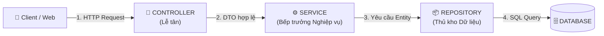

# GIÁO TRÌNH KIẾN THỨC NỀN TẢNG: TỪ NHẬP MÔN ĐẾN LÀM CHỦ HỆ THỐNG SIMPLIFEY V2 PRO
## DÀNH CHO SINH VIÊN KHOA HỌC MÁY TÍNH & KỸ NGHỆ PHẦN MỀM (BẬC ĐẠI HỌC)
### *Giáo trình sư phạm bài bản: Dạy lại từ bản chất toán học, cấu trúc dữ liệu, kiến trúc web đến trí tuệ nhân tạo nhận thức*

---

| **Thuộc tính** | **Thông số giáo trình** |
| :--- | :--- |
| **Tên tài liệu** | **Giáo trình Kiến thức Nền tảng SimpliFey V2 Pro (Foundations of Codebase Cognitive Twin)** |
| **Đối tượng tiếp cận** | Sinh viên năm 1 – năm 3 ngành Công nghệ Thông tin, Khoa học Máy tính, Kỹ thuật Phần mềm |
| **Mục tiêu sư phạm** | Dạy từ gốc rễ ("First Principles"), giải mã triệt để mọi khái niệm, không dùng thuật ngữ mơ hồ |
| **Phạm vi kiến trúc** | Web 3 tầng, AST, Lý thuyết Đồ thị (DAG/Tarjan), Đo lường mã nguồn (PageRank, Uncle Bob), LLM Grounding, Toán xác suất Bayes (BKT) |
| **Phương châm** | *"Nếu bạn không thể giải thích một thuật toán bằng các nguyên lý cơ bản, bạn chưa thực sự hiểu nó."* |

---

# LỜI NÓI ĐẦU: VÌ SAO BẠN CẦN CUỐN GIÁO TRÌNH NÀY?

Khi mới bước chân vào giảng đường đại học ngành CNTT, hầu hết chúng ta bắt đầu bằng những bài tập cơ bản: viết chương trình tính chu vi tam giác, tìm số nguyên tố, hoặc giải phương trình bậc hai trên màn hình dòng lệnh đen trắng. Mọi thứ lúc đó chỉ gói gọn trong một tệp duy nhất `main.c`, `main.cpp` hoặc `main.py`.

Tuy nhiên, khi bước ra thực tế hoặc làm việc trong các công ty phần mềm, bạn sẽ đối mặt với những dự án khổng lồ gồm hàng trăm, hàng nghìn tệp mã nguồn đan xen nhau. Đặc biệt trong thời đại ngày nay, các công cụ Trí tuệ Nhân tạo (Cursor, Copilot, ChatGPT, Claude) có thể sinh ra hàng nghìn dòng mã chỉ sau một câu lệnh ngắn. Hiện tượng này tạo ra một thế hệ lập trình viên "Vibe-coder" — những người có ứng dụng chạy được nhưng hoàn toàn **mù tịt về luồng dữ liệu bên trong**, không hiểu tại sao hệ thống lại chia tách thành nhiều tệp, và không biết làm sao phát hiện lỗi tiềm ẩn.

Dự án **SimpliFey V2 Pro** ra đời để giải quyết chính nỗi đau đó: Nó là một **Bản sao Nhận thức Mã nguồn (Codebase Cognitive Twin)**, tự động đọc hiểu toàn bộ dự án của bạn, dựng thành bản đồ trực quan, và đóng vai một vị "Kỹ sư trưởng" hỏi đáp thử thách để bạn thực sự hiểu sâu mã nguồn của mình.

Để xây dựng được một hệ thống như vậy trong 24 giờ, chúng ta phải sử dụng một chuỗi các kiến thức nền tảng tinh hoa của Khoa học Máy tính:
1. **Kiến trúc Web 3 Tầng** (Tách rời giao diện, nghiệp vụ và dữ liệu).
2. **Cây Cú Pháp Trừu Tượng (AST)** (Cách máy tính đọc mã nguồn mà không cần chạy code).
3. **Lý thuyết Đồ thị & Thuật toán Tarjan** (Khử vòng lặp phụ thuộc để dựng đồ thị một chiều DAG).
4. **Các Động cơ Đo lường Mã nguồn** (PageRank tìm file cốt lõi, Uncle Bob đo độ ổn định, Cognitive Complexity đo độ xoắn não).
5. **Kỹ thuật Lát cắt Chương trình (Program Slicing)** (Rút đúng sợi chỉ dữ liệu liên quan để AI không bị quá tải).
6. **Mô hình Ngôn ngữ Lớn & Cổng Gác Nhị Phân** (Chống ảo giác bằng cấu trúc JSON và đối chiếu ký hiệu).
7. **Toán Xác suất Bayes & Mô hình Hóa Người học (BKT)** (Theo dõi mức độ hiểu bài và quy luật quên lãng của não bộ).

Cuốn giáo trình này được biên soạn như một tài liệu giảng dạy học thuật từ con số 0. Chúng ta sẽ cùng nhau bóc tách từng viên gạch kiến thức, với các ví dụ cụ thể, các chứng minh toán học tường minh, và những giải thích bản chất nhất.

---

# MỤC LỤC CHI TIẾT

- [LỜI NÓI ĐẦU: VÌ SAO BẠN CẦN CUỐN GIÁO TRÌNH NÀY?](#lời-nói-đầu-vì-sao-bạn-cần-cuốn-giáo-trình-này)
- [CHƯƠNG 1: BẢN CHẤT KIẾN TRÚC PHẦN MỀM & MÔ HÌNH 3 TẦNG (3-TIER ARCHITECTURE)](#chương-1-bản-chất-kiến-trúc-phần-mềm--mô-hình-3-tầng-3-tier-architecture)
  - [1.1. Từ mã nguồn đơn lẻ đến ứng dụng Client - Server](#11-từ-mã-nguồn-đơn-lẻ-đến-ứng-dụng-client---server)
  - [1.2. Thảm họa "God Object" & Nguyên lý Phân tách Trách nhiệm (SoC)](#12-thảm-họa-god-object--nguyên-lý-phân-tách-trách-nhiệm-soc)
  - [1.3. Giải phẫu luồng dữ liệu 3 tầng: Controller $\to$ Service $\to$ Repository](#13-giải-phẫu-luồng-dữ-liệu-3-tầng-controller-to-service-to-repository)
  - [1.4. Định nghĩa một "Node" trong SimpliFey V2 Pro: Lát cắt Nghiệp vụ Xuyên File](#14-định-nghĩa-một-node-trong-simplifey-v2-pro-lát-cắt-nghiệp-vụ-xuyên-file)
- [CHƯƠNG 2: MÁY TÍNH ĐỌC MÃ NGUỒN NHƯ THẾ NÀO? AST & PHÂN TÍCH TĨNH](#chương-2-máy-tính-đọc-mã-nguồn-như-thế-nào-ast--phân-tích-tĩnh)
  - [2.1. Phân tích Tĩnh (Static Analysis) vs. Phân tích Động (Dynamic Execution)](#21-phân-tích-tĩnh-static-analysis-vs-phân-tích-động-dynamic-execution)
  - [2.2. Abstract Syntax Tree (AST) là gì?](#22-abstract-syntax-tree-ast-là-gì)
  - [2.3. Tree-sitter: Trình phân tích cú pháp thế hệ mới](#23-tree-sitter-trình-phân-tích-cú-pháp-thế-hệ-mới)
  - [2.4. Thuật toán Two-Pass Global Symbol Resolution](#24-thuật-toán-two-pass-global-symbol-resolution)
- [CHƯƠNG 3: LÝ THUYẾT ĐỒ THỊ & THUẬT TOÁN TARJAN KHỬ CHU TRÌNH](#chương-3-lý-thuyết-đồ-thị--thuật-toán-tarjan-khử-chu-trình)
  - [3.1. Các khái niệm cốt lõi: Đỉnh, Cạnh, Đồ thị Có hướng](#31-các-khái-niệm-cốt-lõi-đỉnh-cạnh-đồ-thị-có-hướng)
  - [3.2. Directed Acyclic Graph (DAG) & Sắp xếp Tô-pô (Topological Sort)](#32-directed-acyclic-graph-dag--sắp-xếp-tô-pô-topological-sort)
  - [3.3. Vấn đề Chu trình Phụ thuộc (Circular Dependency)](#33-vấn-đề-chu-trình-phụ-thuộc-circular-dependency)
  - [3.4. Thuật toán Tarjan tìm Thành phần Liên thông Mạnh (SCC)](#34-thuật-toán-tarjan-tìm-thành-phần-liên-thông-mạnh-scc)
- [CHƯƠNG 4: CÁC ĐỘ ĐO TOÁN HỌC ĐỂ ĐÁNH GIÁ CHẤT LƯỢNG MÃ NGUỒN](#chương-4-các-độ-đo-toán-học-để-đánh-giá-chất-lượng-mã-nguồn)
  - [4.1. Thuật toán PageRank: Bầu chọn "Tệp cốt lõi"](#41-thuật-toán-pagerank-bầu-chọn-tệp-cốt-lõi)
  - [4.2. Độ phức tạp Nhận thức (Cognitive Complexity - SonarQube)](#42-độ-phức-tạp-nhận-thức-cognitive-complexity---sonarqube)
  - [4.3. Bộ chỉ số Kiến trúc Uncle Bob (Clean Architecture Metrics)](#43-bộ-chỉ-số-kiến-trúc-uncle-bob-clean-architecture-metrics)
- [CHƯƠNG 5: KỸ THUẬT LÁT CẮT CHƯƠNG TRÌNH (PROGRAM SLICING)](#chương-5-kỹ-thuật-lát-cắt-chương-trình-program-slicing)
  - [5.1. Định nghĩa và Nguồn gốc (Mark Weiser, 1984)](#51-định-nghĩa-và-nguồn-gốc-mark-weiser-1984)
  - [5.2. Vì sao không thể gửi toàn bộ mã nguồn cho LLM?](#52-vì-sao-không-thể-gửi-toàn-bộ-mã-nguồn-cho-llm)
  - [5.3. Chuỗi biến Định nghĩa - Sử dụng (Def-Use Chain)](#53-chuỗi-biến-định-nghĩa---sử-dụng-def-use-chain)
  - [5.4. Scoped Inter-procedural Slicing trong SimpliFey](#54-scoped-inter-procedural-slicing-trong-simplifey)
- [CHƯƠNG 6: TRÍ TUỆ NHÂN TẠO & PHƯƠNG PHÁP SƯ PHẠM FEYNMAN](#chương-6-trí-tuệ-nhân-tạo--phương-pháp-sư-phạm-feynman)
  - [6.1. Bản chất của Mô hình Ngôn ngữ Lớn (LLM)](#61-bản-chất-của-mô-hình-ngôn-ngữ-lớn-llm)
  - [6.2. Kỹ thuật Single-Pass Contrastive CoT Prompting](#62-kỹ-thuật-single-pass-contrastive-cot-prompting)
  - [6.3. Cổng Gác Nhị Phân 2 Chốt (Two-Gate Binary Verification)](#63-cổng-gác-nhị-phân-2-chốt-two-gate-binary-verification)
  - [6.4. Kỹ thuật Sư phạm Feynman & 3 Dạng câu hỏi Socratic](#64-kỹ-thuật-sư-phạm-feynman--3-dạng-câu-hỏi-socratic)
- [CHƯƠNG 7: MÔ HÌNH HÓA NHẬN THỨC & TOÁN XÁC SUẤT BAYES (BKT & q-MATRIX)](#chương-7-mô-hình-hóa-nhận-thức--toán-xác-suất-bayes-bkt--q-matrix)
  - [7.1. Nhập môn Xác suất Có điều kiện & Định lý Bayes](#71-nhập-môn-xác-suất-có-điều-kiện--định-lý-bayes)
  - [7.2. Mô hình Bayesian Knowledge Tracing (BKT)](#72-mô-hình-bayesian-knowledge-tracing-bkt)
  - [7.3. Ma trận Kỹ năng $q$-Matrix](#73-ma-trận-kỹ-năng-q-matrix)
  - [7.4. Đường cong Quên lãng Ebbinghaus & Quy luật Bán rã (Half-Life Decay)](#74-đường-cong-quên-lãng-ebbinghaus--quy-luật-bán-rã-half-life-decay)
- [LỜI KẾT: TỪ LÝ THUYẾT ĐẾN BẢN LĨNH KỸ SƯ](#lời-kết-từ-lý-thuyết-đến-bản-lĩnh-kỹ-sư)

---

# CHƯƠNG 1: BẢN CHẤT KIẾN TRÚC PHẦN MỀM & MÔ HÌNH 3 TẦNG (3-TIER ARCHITECTURE)

### 1.1. Từ mã nguồn đơn lẻ đến ứng dụng Client - Server

Hãy tưởng tượng bạn đang viết một chương trình quản lý cửa hàng sách nhỏ:
* **Giai đoạn nhập môn:** Bạn viết một hàm `main()`, bên trong có vòng lặp `while(true)` hiển thị menu ra console, đọc bàn phím bằng `scanf` hoặc `cin`, và lưu dữ liệu vào một mảng `struct Book books[100]`.
* **Vấn đề xuất hiện:** Khi có 10 khách hàng cùng muốn mua sách cùng lúc từ điện thoại hoặc máy tính của họ, mô hình trên sụp đổ. Bạn không thể bắt khách hàng ngồi chung một bàn phím máy tính với bạn.

Đây là lúc mô hình **Client - Server (Khách - Chủ)** ra đời:
* **Client (Khách):** Là ứng dụng chạy trên trình duyệt (web) hoặc điện thoại (mobile app). Nhiệm vụ duy nhất của Client là vẽ giao diện cho người dùng nhìn thấy và bắt các sự kiện (bấm nút, nhập form). Khi người dùng bấm nút *"Đặt Mua"*, Client không tự ý trừ tiền trong tài khoản mà đóng gói yêu cầu thành một gói tin HTTP Request gửi qua mạng Internet tới Server.
* **Server (Chủ):** Là một máy tính luôn bật, lắng nghe các yêu cầu gửi đến cổng mạng (Port 80/443), xử lý nghiệp vụ kiểm tra số dư, cập nhật cơ sở dữ liệu, và trả lời bằng HTTP Response (thường chứa dữ liệu JSON).

```
┌─────────────────────────┐       HTTP POST /api/orders        ┌─────────────────────────┐
│     CLIENT (Trình duyệt)│ ─────────────────────────────────> │     SERVER (Node.js)    │
│  Người dùng bấm "Mua"   │ <───────────────────────────────── │  Xử lý & Cập nhật DB    │
└─────────────────────────┘       HTTP 200 { status: "OK" }    └─────────────────────────┘
```

---

### 1.2. Thảm họa "God Object" & Nguyên lý Phân tách Trách nhiệm (SoC)

Khi mới học viết backend (ví dụ bằng ExpressJS hoặc Spring Boot), lập trình viên mới thường mắc một lỗi kinh điển: **Viết toàn bộ mọi thứ vào đúng một hàm xử lý endpoint**.

Hãy quan sát đoạn mã "ngây thơ" sau:

```typescript
// ❌ CÁCH VIẾT TỒI TỆ: TẤT CẢ DỒN VÀO 1 HÀM (ANTI-PATTERN "SPAGHETTI CODE")
app.post("/checkout", async (req, res) => {
  // 1. Kiểm tra dữ liệu đầu vào (Validation)
  if (!req.body.userId || !req.body.items) {
    return res.status(400).send("Thiếu thông tin");
  }

  // 2. Tự viết câu lệnh SQL kết nối Database kiểm tra tồn kho
  const connection = await mysql.createConnection({...});
  const [stock] = await connection.query("SELECT * FROM products WHERE id = ?", [req.body.items[0].id]);
  if (stock.quantity < req.body.items[0].quantity) {
    return res.status(400).send("Hết hàng");
  }

  // 3. Tự gọi API trừ tiền ngân hàng
  const paymentRes = await fetch("https://vnpay.vn/pay", {...});

  // 4. Tự viết câu lệnh SQL lưu đơn hàng
  await connection.query("INSERT INTO orders VALUES (...)");

  // 5. Tự gửi email thông báo
  nodemailer.sendMail({...});

  return res.json({ success: true });
});
```

Tại sao đoạn code trên lại là **thảm họa** trong môi trường doanh nghiệp?
1. **Không thể kiểm thử (Untestable):** Bạn muốn kiểm tra xem logic tính tiền giảm giá có đúng không? Bắt buộc bạn phải chạy cả cơ sở dữ liệu MySQL, giả lập cổng thanh toán và cấu hình gửi mail thật.
2. **Không thể tái sử dụng (Non-reusable):** Ngày mai công ty muốn làm thêm một Bot Telegram để đặt hàng tự động. Bot Telegram nhận tin nhắn chứ không nhận HTTP Request. Bạn không thể tái sử dụng đoạn code trên mà phải copy-paste toàn bộ logic sang file của Bot Telegram.
3. **Vi phạm Nguyên lý Trách nhiệm Đơn lẻ (Single Responsibility Principle - chữ S trong SOLID):** Một hàm vừa lo việc giải mã HTTP, vừa lo việc truy vấn SQL, vừa lo gọi API bên thứ ba. Sửa giao diện cũng đụng vào file này, đổi cơ sở dữ liệu cũng đụng vào file này $\implies$ Xung đột mã (Merge Conflict) liên miên.

Để giải quyết vấn đề này, các kỹ sư phần mềm tạo ra nguyên lý **Separation of Concerns (Phân tách Trách nhiệm)**: Mỗi tầng mã nguồn chỉ được làm đúng một việc và làm thật tốt việc đó.

---

### 1.3. Giải phẫu luồng dữ liệu 3 tầng: Controller $\to$ Service $\to$ Repository

Mô hình kiến trúc phổ biến và tiêu chuẩn nhất trong ngành công nghiệp phần mềm hiện nay là **Kiến trúc 3 Tầng (3-Tier Layered Architecture)**:



Hãy hình dung kiến trúc này tương tự như quy trình vận hành của một **Nhà hàng sang trọng**:

#### Tầng 1: Controller (Người Lễ Tân / Bồi Bàn đón khách)
* **Vị trí:** Tiếp xúc trực tiếp với thế giới bên ngoài (mạng Internet).
* **Nhiệm vụ:**
  * Lắng nghe các HTTP Request (`GET`, `POST`, `PUT`, `DELETE`).
  * Trích xuất dữ liệu từ `req.body`, `req.params`, `req.headers`.
  * **Kiểm tra tính hợp lệ về mặt hình thức (Data Transfer Object - DTO Validation):** Ví dụ: Email có đúng định dạng không? Tuổi có phải là số nguyên dương không? Mật khẩu có đủ 8 ký tự không?
  * Nếu dữ liệu sai $\implies$ Đuổi về ngay bằng mã lỗi HTTP `400 Bad Request`.
  * Nếu dữ liệu đúng $\implies$ Chuyển giao dữ liệu đã làm sạch cho tầng Service.
* **Luật bất biến:** Controller **tuyệt đối không chứa logic nghiệp vụ** (không tính tiền, không trừ kho) và **tuyệt đối không được gõ câu lệnh SQL**.

#### Tầng 2: Service (Bếp Trưởng / Trái Tim Nghiệp Vụ)
* **Vị trí:** Nằm ở trung tâm của hệ thống, hoàn toàn không biết gì về HTTP hay Web.
* **Nhiệm vụ:**
  * Tiếp nhận dữ liệu sạch từ Controller.
  * Thực thi toàn bộ **Quy tắc Nghiệp vụ (Business Rules)**: Ví dụ: Khách hàng VIP được giảm 10%; nếu mua trên 500k được miễn phí ship; áp dụng voucher có còn hạn không; nếu hàng trong kho hết thì báo lỗi.
  * Điều phối luồng xử lý: Yêu cầu tầng Repository lấy dữ liệu, tính toán, và yêu cầu Repository lưu lại kết quả.
* **Luật bất biến:** Service không được chứa các đối tượng liên quan đến giao thức mạng như `req`, `res`, `session`. Service phải hoạt động như một hàm toán học thuần túy: nhận tham số đầu vào và trả về kết quả hoặc ném ra ngoại lệ (`throw Error`).

#### Tầng 3: Repository / Model (Thủ Kho Dữ Liệu)
* **Vị trí:** Nằm sát cơ sở dữ liệu nhất.
* **Nhiệm vụ:**
  * Chịu trách nhiệm về việc **Lưu trữ và Truy xuất (Persistence)**.
  * Viết các câu lệnh truy vấn SQL hoặc sử dụng các thư viện ORM (Prisma, TypeORM, Hibernate) để nói chuyện với Database: `SELECT`, `INSERT`, `UPDATE`, `DELETE`.
  * Chuyển đổi các dòng dữ liệu thô trong bảng (Table Rows) thành các đối tượng mã nguồn (Entities / Objects).
* **Luật bất biến:** Repository không quan tâm logic nghiệp vụ là gì. Nó chỉ làm đúng lệnh: "Thủ kho ơi, lấy cho tôi bản ghi sản phẩm có mã ID = 5" hoặc "Cập nhật cột `stock` thành 10".

---

### 1.4. Định nghĩa một "Node" trong SimpliFey V2 Pro: Lát cắt Nghiệp vụ Xuyên File

Rất nhiều công cụ phân tích mã nguồn cũ mắc một sai lầm chết người: **Mỗi file code được vẽ thành một hình tròn (Node) trên màn hình**.
* Hậu quả: Khi bạn mở một repo có 100 file, màn hình hiện ra một "bụi cây gai" gồm 100 cục tròn chằng chịt các mũi tên chỉ qua lại. Người học nhìn vào hoàn toàn choáng ngợp và không hiểu gì cả. Người ta không học lập trình bằng cách nhìn từng file rời rạc!

Trong **SimpliFey V2 Pro**, một **Node** trên đồ thị hoàn toàn không phải là một file!
> 💡 **ĐỊNH NGHĨA VÀNG:**
> Một **Node** trong SimpliFey V2 Pro là **Một Lát Cắt Nghiệp Vụ Xuyên File (Cross-file Architectural Slice)**. Nó mô tả một hành trình nghiệp vụ trọn vẹn từ lúc người dùng kích hoạt cho đến khi dữ liệu chạm đáy Database.

Ví dụ, Node có tên **"Order Checkout Flow"** thực chất là sự kết hợp liên hoàn của 3 lát cắt code trong 3 file khác nhau:
1. `order.controller.ts: dòng 20-35` (Hàm tiếp nhận đơn hàng POST `/checkout`).
2. `order.service.ts: dòng 40-75` (Hàm kiểm tra voucher và duyệt từng món hàng).
3. `inventory.repository.ts: dòng 15-28` (Hàm trừ tồn kho trong Database).

Nhờ cách tiếp cận này, một dự án 100 file phức tạp sẽ được rút gọn lại thành chỉ còn **5 đến 7 Node nghiệp vụ cốt lõi**, xếp theo thứ tự mạch lạc như một bản đồ hành trình trò chơi (Game Quest Tree).

---

# CHƯƠNG 2: MÁY TÍNH ĐỌC MÃ NGUỒN NHƯ THẾ NÀO? AST & PHÂN TÍCH TĨNH

### 2.1. Phân tích Tĩnh (Static Analysis) vs. Phân tích Động (Dynamic Execution)

Khi muốn biết một đoạn code hoạt động thế nào hoặc có lỗi gì, chúng ta có hai cách tiếp cận:

| Tiêu chí | Phân tích Động (Dynamic Execution) | Phân tích Tĩnh (Static Analysis) |
| :--- | :--- | :--- |
| **Bản chất** | **Chạy code thật** trên máy ảo hoặc môi trường thử nghiệm (Run code). | **Đọc code như đọc một văn bản**, tuyệt đối không chạy code. |
| **Yêu cầu môi trường** | Phải cài đặt đầy đủ: NodeJS, Python, JDK, chạy máy chủ Database, nạp biến môi trường `.env`. | **Không cần cài đặt gì cả**. Chỉ cần đọc các tệp text thô. |
| **Rủi ro bảo mật** | Rất nguy hiểm: Nếu repo chứa mã độc (`rm -rf /` hoặc virus), máy chủ của bạn sẽ bị xóa sạch hoặc chiếm quyền. | **An toàn tuyệt đối (100% Zero-Trust)**: Vì mã nguồn không bao giờ được cấp quyền thực thi. |
| **Tốc độ** | Rất chậm: Cần khởi động container, biên dịch dự án, mất từ vài phút đến nửa tiếng. | **Cực kỳ nhanh**: Quét hàng chục tệp code chỉ mất vài chục mili-giây ($0.05\text{s}$). |

**SimpliFey V2 Pro sử dụng 100% Phân tích Tĩnh (Static Analysis)**. Khi người dùng dán link GitHub, hệ thống không bao giờ chạy thử code của họ mà sử dụng sức mạnh của ngữ pháp hình thức để mổ xẻ cấu trúc.

---

### 2.2. Abstract Syntax Tree (AST) là gì?

Khi bạn nhìn vào dòng code:
```typescript
const total = price * 1.1;
```
Bộ não con người tự động hiểu: có một biến tên là `total`, giá trị của nó bằng biến `price` nhân với `1.1`.

Nhưng máy tính không có não. Đối với máy tính, tệp code chỉ là một chuỗi các ký tự dài ngoằng:
`['c', 'o', 'n', 's', 't', ' ', 't', 'o', 't', 'a', 'l', ' ', '=', ' ', ...]`

Làm sao máy tính hiểu được cấu trúc ngữ nghĩa của chuỗi ký tự đó? Trình biên dịch (Compiler) thực hiện qua hai bước căn bản:
1. **Phân tích từ vựng (Lexical Analysis / Tokenization):** Biến chuỗi ký tự thành một danh sách các "viên gạch từ vựng" (Tokens):
   * `KEYWORD: const`
   * `IDENTIFIER: total`
   * `OPERATOR: =`
   * `IDENTIFIER: price`
   * `OPERATOR: *`
   * `NUMBER: 1.1`
2. **Phân tích cú pháp (Syntactic Analysis / Parsing):** Ráp các token lại theo luật ngữ pháp của ngôn ngữ để tạo thành một cây phân cấp gọi là **Cây Cú Pháp Trừu Tượng (Abstract Syntax Tree - AST)**.

Dưới dạng cây AST, dòng code trên trở thành:

```
               VariableDeclaration (const)
                        │
                        ▼
               VariableDeclarator
               ├── id: Identifier ("total")
               └── init: BinaryExpression (*)
                         ├── left: Identifier ("price")
                         └── right: NumericLiteral (1.1)
```

**Tại sao AST lại là chìa khóa vàng?**
Bởi vì khi code đã biến thành một cái cây cấu trúc đối tượng, chương trình của chúng ta có thể dễ dàng duyệt qua các cành cây để:
* Tìm tất cả các hàm có trong file (`FunctionDeclaration`).
* Tìm tất cả các lệnh gọi hàm (`CallExpression`).
* Tìm tất cả các biến số được truyền qua lại (`Arguments`).
Không cần dùng hàm tìm kiếm chuỗi Regex thô thiển dễ sai lệch, AST cho phép chúng ta "nhìn thấu" cấu trúc logic của chương trình với độ chính xác toán học $100\%$.

---

### 2.3. Tree-sitter: Trình phân tích cú pháp thế hệ mới

Trong lịch sử, để bóc tách AST của từng ngôn ngữ, người ta phải dùng chính trình biên dịch của ngôn ngữ đó (ví dụ dùng `tsc` cho TypeScript, dùng `javaparser` cho Java, dùng module `ast` cho Python).
* **Vấn đề cực lớn trong cuộc thi Hackathon 24h:** Máy chủ của chúng ta không thể cài đặt đủ JDK (2GB), Go SDK (1GB), Python (500MB) và TypeScript Compiler. Làm như vậy máy chủ sẽ quá tải và không thể mở rộng.

Giải pháp đột phá được ngành công nghiệp hiện đại (như GitHub, NeoVim, Cursor) áp dụng là **Tree-sitter**:
* **Tree-sitter là gì?** Nó là một bộ sinh parser đa ngôn ngữ được viết bằng C siêu nhanh, có thể biên dịch thành **WebAssembly (WASM)** để chạy trực tiếp trên môi trường Node.js hoặc trình duyệt mà không cần cài bất kỳ compiler nào.
* **Tốc độ:** Phân tích một file mã nguồn 500 dòng chỉ mất chưa đầy **1 mili-giây ($0.001\text{s}$)**.
* **Cơ chế Truy vấn Cú pháp (Tree-sitter S-expression Query):** Thay vì phải viết hàng nghìn dòng code duyệt cây phức tạp, Tree-sitter cung cấp một ngôn ngữ truy vấn giống như LISP.

Ví dụ, để tìm tất cả các lời gọi hàm trong file TypeScript, ta chỉ cần câu truy vấn sau:
```scheme
;; Truy vấn tìm lời gọi hàm dạng object.method(args)
(call_expression
  function: (member_expression
    object: (identifier) @caller_object
    property: (property_identifier) @called_method)
  arguments: (arguments) @call_args)
```
Hệ thống Tree-sitter WASM sẽ lập tức trả về chính xác tên đối tượng gọi, tên hàm được gọi và dòng code tương ứng trong nháy mắt.

---

### 2.4. Thuật toán Two-Pass Global Symbol Resolution

Một câu hỏi lớn mà các chuyên gia thường đặt ra: *"Nếu không có compiler hay TypeScript Language Server (LSP), làm sao biết hàm `checkout()` trong file Controller thực sự đang trỏ tới hàm `checkout()` nằm ở file Service nào?"*

SimpliFey V2 Pro giải quyết bài toán này bằng thuật toán **Giải quyết Ký hiệu Toàn cục Hai Chặng (Two-Pass Global Symbol Resolution)**:

```
Pass 1: Quét toàn bộ repo (15ms)
├── File 1: order.controller.ts ➔ Export: [OrderController], Gọi: [orderService.checkout]
├── File 2: order.service.ts    ➔ Export: [OrderService.checkout], Gọi: [inventoryRepo.updateStock]
└── File 3: inventory.repo.ts   ➔ Export: [InventoryRepo.updateStock]
         │
         ▼
Lập 3 Bảng Băm (Hash Tables) trên RAM:
1. Symbol_Table:    "OrderService.checkout" ➔ { file: "order.service.ts", line: 41 }
2. Interface_Map:   "IOrderService"         ➔ "OrderServiceImpl" (Hỗ trợ Java Spring Boot)
3. Package_Map:     "service.Checkout"      ➔ "pkg/service/order.go" (Hỗ trợ Golang)
         │
         ▼
Pass 2: Nối dây liên kết (Link Edges - 5ms)
Tra cứu bảng băm: `orderService.checkout` ➔ Nối mũi tên từ Controller sang Service!
```

Thuật toán này chạy thuần túy trên các bảng băm trong bộ nhớ RAM, đạt tốc độ xử lý **dưới $0.05$ giây cho toàn bộ repo 50 file**, hoàn toàn không tốn bất kỳ một token AI nào!

---

# CHƯƠNG 3: LÝ THUYẾT ĐỒ THỊ & THUẬT TOÁN TARJAN KHỬ CHU TRÌNH

### 3.1. Các khái niệm cốt lõi: Đỉnh, Cạnh, Đồ thị Có hướng

Để máy tính tổ chức được một lộ trình học tập từ mã nguồn, chúng ta phải chuyển đổi các mối liên kết giữa các file thành một cấu trúc dữ liệu toán học gọi là **Đồ thị (Graph)**.

Một đồ thị $\mathcal{G}$ được định nghĩa bởi một bộ đôi:
$$\mathcal{G} = (\mathcal{V}, \mathcal{E})$$
* $\mathcal{V}$ (Vertices hoặc Nodes - Tập hợp các Đỉnh): Đại diện cho các thực thể (trong trường hợp của chúng ta là các Lát cắt Nghiệp vụ hoặc Tệp mã nguồn).
* $\mathcal{E}$ (Edges - Tập hợp các Cạnh): Đại diện cho mối quan hệ giữa các thực thể.
* **Đồ thị Có hướng (Directed Graph):** Mối quan hệ có chiều cụ thể. Nếu file `A` gọi hàm trong file `B`, ta có một cạnh có hướng đi từ $A$ sang $B$, ký hiệu là:
  $$e = (A \to B) \in \mathcal{E}$$

---

### 3.2. Directed Acyclic Graph (DAG) & Sắp xếp Tô-pô (Topological Sort)

Hãy chú ý đến một khái niệm tối quan trọng: **Đồ thị Có hướng Không Chu trình (Directed Acyclic Graph - viết tắt là DAG)**.
* **Acyclic (Không chu trình):** Nghĩa là trong đồ thị, bạn **không bao giờ có thể bắt đầu từ một đỉnh, đi theo các chiều mũi tên, rồi quay trở lại chính đỉnh đó**.

```
    ĐỒ THỊ DAG (HỢP LỆ)                      ĐỒ THỊ CÓ CHU TRÌNH (LỖI)
        ┌───┐                                      ┌───┐
        │ A │                                      │ A │◄──────┐
        └───┘                                      └───┘       │
        /   \                                        │         │
       ▼     ▼                                       ▼         │
     ┌───┐ ┌───┐                                   ┌───┐       │
     │ B │ │ C │                                   │ B │───────┘
     └───┘ └───┘                                   └───┘
       \     /                              (Đi từ A ➔ B ➔ A: Lặp vô tận!)
        ▼   ▼
        ┌───┐
        │ D │
        └───┘
```

**Vì sao Lộ trình Học tập bắt buộc phải là một DAG?**
Bởi vì chỉ có trên một đồ thị DAG, chúng ta mới có thể thực hiện thuật toán **Sắp xếp Tô-pô (Topological Sort)**:
* Sắp xếp tô-pô sẽ dàn trải các đỉnh thành một thứ tự trước sau hợp lý: Đỉnh nào là nền tảng (không phụ thuộc vào ai) phải học trước; đỉnh nào cần kiến thức của đỉnh trước sẽ được mở khóa sau.
* Nếu đồ thị bị dính chu trình ($A$ cần $B$, nhưng $B$ lại cần $A$), hệ thống sẽ bị **Tắc nghẽn Nhận thức (Deadlock)**: Người học không thể mở khóa được bài nào vì bài này đòi bài kia và ngược lại!

---

### 3.3. Vấn đề Chu trình Phụ thuộc (Circular Dependency)

Trong thực tế, mã nguồn do con người viết hoặc do AI sinh ra rất hay mắc lỗi **Phụ thuộc Vòng lặp (Circular Dependency)**:
* File `User.service.ts` import `Order.service.ts` (để lấy danh sách đơn của User).
* Nhưng file `Order.service.ts` lại import ngược lại `User.service.ts` (để lấy tên chủ đơn hàng).

Khi bóc tách đồ thị thô, ta sẽ có chu trình $A \leftrightarrow B$. Nếu đưa nguyên đồ thị này vào thuật toán vẽ giao diện (Dagre) hoặc thuật toán mở khóa bài học, hệ thống sẽ rơi vào vòng lặp vô tận (Infinite Loop) hoặc báo lỗi sập ứng dụng!

---

### 3.4. Thuật toán Tarjan tìm Thành phần Liên thông Mạnh (SCC)

Làm sao giải quyết triệt để vấn đề con gà và quả trứng này một cách tự động? Chúng ta sử dụng một thuật toán kinh điển trong Khoa học Máy tính: **Thuật toán Tarjan (Robert Tarjan, 1972)**.

#### Định nghĩa Thành phần Liên thông Mạnh (Strongly Connected Component - SCC)
Trong một đồ thị có hướng, một tập con các đỉnh được gọi là một **Thành phần Liên thông Mạnh (SCC)** nếu giữa bất kỳ cặp đỉnh $u, v$ nào trong tập đó, ta đều có đường đi từ $u$ tới $v$ VÀ có đường đi từ $v$ về $u$.
Nói cách khác: **Một chu trình vòng lặp chính là một SCC!**

#### Cơ chế hoạt động của Thuật toán Tarjan
Thuật toán Tarjan duyệt đồ thị theo chiều sâu (Depth-First Search - DFS) chỉ trong một lần duy nhất với độ phức tạp tuyến tính cực nhanh:
$$\mathcal{O}(|\mathcal{V}| + |\mathcal{E}|)$$

Trong quá trình duyệt, mỗi đỉnh $u$ được gán 2 chỉ số số học:
1. `dfn[u]` (Discovery Time): Thứ tự thời gian đỉnh $u$ được ghé thăm lần đầu tiên.
2. `lowlink[u]` (Chỉ số liên kết thấp nhất): Thứ tự nhỏ nhất của một đỉnh mà đỉnh $u$ (hoặc con cháu của $u$) có thể với tới thông qua các nhánh cây DFS.

Thuật toán duy trì một cấu trúc dữ liệu **Ngăn xếp (Stack)** lưu các đỉnh đang được khám phá.

```
CÔNG THỨC CẬP NHẬT CHỈ SỐ TARJAN:
Khi duyệt từ đỉnh u sang đỉnh hàng xóm v:
1. Nếu v chưa được duyệt:
   DFS(v);
   lowlink[u] = min(lowlink[u], lowlink[v]);
2. Nếu v đã nằm trong Ngăn xếp (nghĩa là phát hiện đường đi ngược về tổ tiên):
   lowlink[u] = min(lowlink[u], dfn[v]);

ĐIỀU KIỆN TÌM THẤY MỘT SCC:
Nếu sau khi duyệt hết các con của u mà:
   lowlink[u] == dfn[u]
==> Đỉnh u chính là GỐC của một chu trình!
Lập tức lấy tất cả các đỉnh trên Ngăn xếp từ đỉnh đỉnh cho đến đỉnh u ra:
Toàn bộ các đỉnh này chính là một Thành phần Liên thông Mạnh (SCC)!
```

#### Ứng dụng Phẫu thuật Khử Chu trình (Graph Condensation)
Khi thuật toán Tarjan tìm thấy một nhóm các đỉnh tạo thành chu trình (ví dụ: `User.service` và `Order.service` gọi vòng tròn nhau), SimpliFey V2 Pro thực hiện thao tác **Co Cụm Đồ Thị (Condensation)**:
* Gom toàn bộ các đỉnh trong chu trình đó lại thành **Một Đỉnh Duy Nhất (Super-Node)** mang tên: *"User & Order Co-dependent Cluster"*.
* Thay thế tất cả các cạnh nội bộ thành cấu trúc bên trong của Super-Node đó.

> 🛡️ **KẾT QUẢ ĐẢM BẢO TOÁN HỌC:**
> Sau khi chạy thuật toán Tarjan Condensation, đồ thị kết quả được chứng minh về mặt toán học là **100% DAG thuần khiết**. Toàn bộ chu trình bị triệt tiêu hoàn toàn, bảo đảm hệ thống vẽ giao diện mượt mà và không bao giờ bị Deadlock!

---

# CHƯƠNG 4: CÁC ĐỘ ĐO TOÁN HỌC ĐỂ ĐÁNH GIÁ CHẤT LƯỢNG MÃ NGUỒN

### 4.1. Thuật toán PageRank: Bầu chọn "Tệp cốt lõi"

Khi mở một repo, có những tệp chỉ là tệp cấu hình phụ, nhưng có những tệp là trung tâm của cả hệ thống. Làm sao để máy tính tự động tìm ra đâu là "File Sếp" mà không cần con người chỉ định?

Chúng ta mượn thuật toán làm nên đế chế Google: **PageRank (Larry Page & Sergey Brin, 1998)**.

#### Mô hình Người lướt web ngẫu nhiên (Random Surfer Model)
Hãy tưởng tượng một người dùng đang duyệt web: Họ bắt đầu từ một trang ngẫu nhiên, bấm vào các liên kết trên trang đó để nhảy sang trang khác.
* Nếu một trang web có rất nhiều trang web uy tín khác trỏ liên kết về nó $\implies$ Trang web đó cực kỳ quan trọng!

Áp dụng vào mã nguồn phần mềm:
* Trang web $\to$ Tệp mã nguồn.
* Siêu liên kết (Hyperlink) $\to$ Lời gọi hàm (`import` / `function call`).
* Nếu một file Service được 10 file Controller khác nhau gọi tới $\implies$ File Service đó có điểm PageRank cực cao, chính là **Tệp Hạt Nhân (Architectural Hub)** của cả dự án!

#### Công thức Toán học của PageRank
Điểm số PageRank của một file $u$ được tính toán qua phương trình cân bằng:

$$PR(u) = \frac{1 - d}{N} + d \sum_{v \in \mathcal{B}_u} \frac{PR(v)}{L(v)}$$

Trong đó:
* $N$: Tổng số lượng file trong toàn bộ dự án.
* $\mathcal{B}_u$: Tập hợp tất cả các file $v$ có trỏ lời gọi hàm tới file $u$.
* $L(v)$: Số lượng liên kết mà file $v$ gọi ra ngoài (Out-degree).
* $d$ (Damping Factor - Hệ số suy giảm, thường đặt là $0.85$): Thể hiện xác suất người đọc tiếp tục lần theo liên kết, còn $(1 - d) = 0.15$ là xác suất người đọc bất ngờ nhảy sang một file ngẫu nhiên khác.

#### Thuật toán Tính lặp Ma trận (Power Iteration)
Vì điểm số của $u$ phụ thuộc vào $v$, mà $v$ lại phụ thuộc vào các file khác, ta giải phương trình này bằng phương pháp lặp xấp xỉ (Power Iteration):
1. Khởi tạo điểm số ban đầu cho mọi file: $PR_0(u) = \frac{1}{N}$.
2. Chạy vòng lặp tính $PR_{k+1}(u)$ từ $PR_k(v)$ cho đến khi độ lệch giữa hai lần lặp nhỏ hơn một ngưỡng cực nhỏ $\epsilon = 10^{-6}$.
3. Với một dự án $50$ file, thuật toán hội tụ chỉ sau **khoảng 20 vòng lặp, mất chưa tới $0.02$ giây trên CPU**! Top 5 file có điểm PageRank cao nhất sẽ được chọn làm các mốc hành trình cốt lõi trên đồ thị.

---

### 4.2. Độ phức tạp Nhận thức (Cognitive Complexity - SonarQube)

Trước đây, trường đại học thường dạy sinh viên chỉ số **Độ phức tạp Chu trình (Cyclomatic Complexity của Thomas McCabe, 1976)**: cứ gặp một câu lệnh điều kiện (`if`, `for`, `while`, `case`) thì cộng thêm 1 điểm.
* **Hạn chế lớn:** Cyclomatic Complexity được thiết kế để đo xem cần viết bao nhiêu bài kiểm thử (Unit Tests), chứ **không phản ánh được bộ não con người cảm thấy khó hiểu đoạn code đó như thế nào**.

Hãy so sánh hai đoạn mã sau:

```typescript
// Đoạn A: Switch-case 4 nhánh (Rất dễ đọc, não chỉ cần lướt qua)
switch (status) {
  case "PENDING": return handlePending();
  case "PAID": return handlePaid();
  case "SHIPPED": return handleShipped();
  default: return handleCancel();
}

// Đoạn B: 3 vòng if-for lồng nhau (Cực kỳ xoắn não, phải nhăn trán suy nghĩ)
if (user.isActive) {
  for (const order of user.orders) {
    if (order.isRecent) {
      // Làm gì đó...
    }
  }
}
```
Cả hai đoạn mã đều có 3-4 nhánh rẽ, nhưng rõ ràng đoạn B làm cho não bộ mệt hơn rất nhiều!

Năm 2016, tổ chức SonarQube đã công bố chỉ số **Độ phức tạp Nhận thức (Cognitive Complexity)** để giải quyết chính xác sự chênh lệch này.

#### Quy tắc tính điểm Cognitive Complexity
1. **Quy tắc bỏ qua:** Các cú pháp đơn giản không làm tăng tải nhận thức (như `switch-case`) chỉ bị phạt $1$ điểm cho toàn bộ khối.
2. **Quy tắc Phạt Lồng Cấp (Nesting Penalty):** Mỗi khi một cấu trúc logic nằm lồng bên trong một cấu trúc khác, điểm phạt sẽ tăng theo cấp số cộng:
   * `if` ở tầng ngoài cùng: $+1$ điểm.
   * `for` nằm bên trong `if`: $+1$ (điểm cơ bản) $+ 1$ (phạt lồng cấp 1) $= +2$ điểm.
   * `if` nằm tiếp bên trong `for`: $+1$ (điểm cơ bản) $+ 2$ (phạt lồng cấp 2) $= +3$ điểm.
   * Tổng điểm của cụm lồng 3 tầng $= 1 + 2 + 3 = 6$ điểm!

#### Cơ chế Vé VIP (VIP Algorithm Node) trong SimpliFey
Trong một dự án, có những file giải thuật (ví dụ: file tìm đường ngắn nhất `dijkstra.ts` hoặc tính toán bảng giá phức tạp) nằm ẩn sâu bên trong, không có nhiều controller gọi tới nên điểm PageRank của nó rất thấp.
* Nếu chỉ dựa vào PageRank, các thuật toán đỉnh cao này sẽ bị chôn vùi!
* **Giải pháp của SimpliFey:** Thuật toán duyệt AST tính Cognitive Complexity cho mọi hàm. Nếu một file có điểm xoắn não $> 15$ điểm $\implies$ Hệ thống **tự động cấp Vé VIP (VIP Algorithm Node)**, đưa nó lên vị trí danh dự trên đồ thị để người học bắt buộc phải chinh phục!

---

### 4.3. Bộ chỉ số Kiến trúc Uncle Bob (Clean Architecture Metrics)

Làm sao để đánh giá xem một module được thiết kế khéo léo hay chắp vá? Huyền thoại kỹ nghệ phần mềm Robert C. Martin ("Uncle Bob") đã đưa ra bộ ba chỉ số đo lường kiến trúc nổi tiếng:

#### 1. Độ Bất Ổn Định (Instability - $I$)
Đo lường mức độ dễ bị rung lắc hoặc thay đổi của một module khi các thành phần khác thay đổi:

$$I = \frac{C_e}{C_a + C_e}$$

Trong đó:
* $C_e$ (Efferent Coupling - Khớp nối đi ra): Số lượng module bên ngoài mà module này phải phụ thuộc vào.
* $C_a$ (Afferent Coupling - Khớp nối đi vào): Số lượng module bên ngoài phụ thuộc ngược lại vào module này.
* **Ý nghĩa:**
  * $I = 0$ (Cực kỳ Ổn định): Không ai có thể làm phiền nó, nhưng nếu nó sửa đổi thì cả thế giới bị ảnh hưởng.
  * $I = 1$ (Cực kỳ Bất ổn): Nó phụ thuộc vào quá nhiều người, ai thay đổi nó cũng phải sửa theo.

#### 2. Độ Trừu Tượng (Abstractness - $A$)
Đo lường tỷ lệ giữa các giao diện trừu tượng (Interface, Abstract Class) so với mã nguồn thực thi cụ thể (Concrete Class):

$$A = \frac{N_a}{N_c}$$

Trong đó:
* $N_a$: Số lượng Interface và Abstract Class trong module.
* $N_c$: Tổng số lượng Class / Function thực thi cụ thể trong module.
* **Ý nghĩa:**
  * $A = 0$: Module chỉ toàn code cụ thể (Concrete), không có sự trừu tượng hóa nào.
  * $A = 1$: Module chỉ toàn định nghĩa giao diện trừu tượng, không có dòng code xử lý thật nào.

#### 3. Khoảng Cách Tới Trục Chính (Distance from Main Sequence - $D$)
Một hệ thống kiến trúc hoàn hảo là sự cân bằng tuyệt đối: **Càng ổn định ($I \to 0$) thì càng phải trừu tượng ($A \to 1$)** để dễ mở rộng; **càng cụ thể ($A \to 0$) thì càng nên linh hoạt ($I \to 1$)**.
Mối quan hệ lý tưởng này tạo thành một đường thẳng:
$$A + I = 1$$

Khoảng cách từ thiết kế thực tế đến đường thẳng lý tưởng này chính là chỉ số $D$:

$$D = |A + I - 1|$$

```
    A (Độ trừu tượng)
    1.0 ┌──────────────────────────────────────┐
        │ [VÙNG VÔ DỤNG]                       │
        │ (Toàn Interface rác,                 │
        │  không có code thật)    TRỤC CHÍNH   │
        │                          A + I = 1   │
        │                             ╲        │
        │                              ╲       │
        │                               ╲      │
        │                       [VÙNG CÂN BẰNG]│
        │                                 ╲    │
        │                                  ╲   │
        │                                   ╲  │
        │                            [VÙNG ĐAU KHỔ]
        │                            (Khối bê tông: Ai cũng gọi,
        │                             nhưng không có Interface)
    0.0 └──────────────────────────────────────┴─── 1.0
        0.0                                        I (Độ bất ổn định)
```

#### Phẫu thuật Bắt bệnh Kiến trúc trong SimpliFey
Nhờ chỉ số $D$, SimpliFey V2 Pro có thể phát hiện và cảnh báo tức thì 2 căn bệnh kiến trúc nguy hiểm:
* **🔴 Vùng Đau Khổ (Zone of Pain - $A \to 0, I \to 0 \implies D \to 1$):** Lát cắt mã nguồn ôm đồm toàn bộ xử lý cứng, không dùng interface nào, nhưng tất cả các file khác đều phụ thuộc vào nó. Đây là một "khối bê tông cốt thép", hễ chạm vào sửa một dòng là toàn bộ ứng dụng sụp đổ!
* **🟡 Vùng Vô Dụng (Zone of Uselessness - $A \to 1, I \to 1 \implies D \to 1$):** Lát cắt vẽ ra hàng loạt Interface hoa mỹ nhưng không có đoạn code thực thi nào và cũng chẳng ai thèm gọi tới. Đây là dấu hiệu điển hình của việc lập trình viên lạm dụng AI sinh ra mã rác thừa thãi!

---

# CHƯƠNG 5: KỸ THUẬT LÁT CẮT CHƯƠNG TRÌNH (PROGRAM SLICING)

### 5.1. Định nghĩa và Nguồn gốc (Mark Weiser, 1984)

Thuật ngữ **Program Slicing** được giới thiệu lần đầu tiên bởi Giáo sư Mark Weiser trong luận án tiến sĩ nổi tiếng năm 1984.

> 📖 **ĐỊNH NGHĨA KHOA HỌC:**
> Lát cắt chương trình (Program Slice) đối với một biến số $v$ tại một dòng lệnh $s$ là một tập con các câu lệnh trong chương trình có khả năng tác động trực tiếp hoặc gián tiếp đến giá trị của biến số $v$ tại vị trí $s$.

Hãy xem ví dụ đơn giản sau:
```javascript
1: let total = 0;
2: let count = 0;
3: for (let i = 0; i < n; i++) {
4:   total += items[i].price;
5:   count++;
6: }
7: console.log(total);
```
Nếu chúng ta chỉ quan tâm đến biến `total` tại dòng số 7:
* Câu lệnh dòng 2 (`let count = 0`) và dòng 5 (`count++`) hoàn toàn không ảnh hưởng gì tới `total`.
* Lát cắt chương trình của `(total, dòng 7)` chỉ bao gồm các dòng: `{ 1, 3, 4, 7 }`. Các dòng khác bị loại bỏ hoàn toàn mà không làm thay đổi giá trị của `total`.

---

### 5.2. Vì sao không thể gửi toàn bộ mã nguồn cho LLM?

Nhiều người nghĩ một cách đơn giản: *"Tại sao không copy toàn bộ 50 file trong repo dán vào prompt gửi cho Gemini hoặc Claude để nó tự hiểu?"*
Đó là một sai lầm chết người trong kỹ thuật phần mềm:
1. **Ô nhiễm Ngữ cảnh (Context Noise):** Một repo có hàng nghìn dòng code phụ trợ (cấu hình logger, định nghĩa css, xử lý chuỗi rác). Nhồi nhét tất cả vào sẽ làm mô hình ngôn ngữ bị phân tán sự chú ý (Attention Dilution), dẫn đến việc sinh câu hỏi lan man, sai trọng tâm.
2. **Chi phí và Độ trễ (Latency Budget):** Gửi 50.000 tokens sẽ khiến API mất từ 10 đến 15 giây để phản hồi, và tiêu tốn hàng USD cho mỗi lần người dùng bấm chuột. Trong một cuộc thi hoặc một sản phẩm thực tế, người dùng sẽ lập tức tắt ứng dụng nếu phải đợi quá 3 giây.
3. **Hiện tượng Ảo giác (Hallucination):** Khi bị quá tải thông tin, LLM có xu hướng "bịa" ra các tên hàm hoặc công nghệ không hề tồn tại trong dự án của bạn (ví dụ sinh viên chỉ dùng SQLite nhưng AI lại hỏi về cụm phân tán Apache Kafka).

---

### 5.3. Chuỗi biến Định nghĩa - Sử dụng (Def-Use Chain)

Để trích xuất được lát cắt chính xác, chúng ta truy vết theo chuỗi toán học **Definition-Use Chain (Def-Use)**:
* **Definition (Def):** Vị trí biến số được gán giá trị (ví dụ: `const dto = req.body;`).
* **Use:** Vị trí biến số được đọc để tính toán hoặc truyền vào hàm khác (ví dụ: `orderService.checkout(dto);`).

Bằng cách dùng AST để lần theo dấu vết từ điểm bắt đầu nhận Request cho tới điểm chạm vào Database, chúng ta có một sợi chỉ đỏ xuyên suốt:

$$\text{Request Body} \xrightarrow{\text{validate}} \text{DTO} \xrightarrow{\text{pass}} \text{Service Parameter} \xrightarrow{\text{extract}} \text{Entity Field} \xrightarrow{\text{bind}} \text{SQL Query Parameter}$$

---

### 5.4. Scoped Inter-procedural Slicing trong SimpliFey

Thay vì dựng đồ thị phụ thuộc toàn cục (Program Dependence Graph - PDG) trên toàn bộ dự án vốn cực kỳ chậm chạp, SimpliFey V2 Pro áp dụng kỹ thuật **Scoped Inter-procedural Slicing (Lát cắt Liên thủ tục có Phạm vi Giới hạn)**:
1. **Phạm vi khóa (Scope Lock):** Chỉ nhắm trúng chuỗi 3 hàm hạt nhân đã được xác định qua PageRank:
   $$\text{Controller Endpoint} \to \text{Business Service Method} \to \text{Database Query}$$
2. **Kích thước tối ưu:** Toàn bộ lát cắt này chỉ dài từ **60 đến 100 dòng code thật**.
3. **Thời gian trích xuất:** Chạy thẳng trên RAM chỉ mất vỏn vẹn **$0.015$ giây**.

Chính 80 dòng code sạch này là nguyên liệu vàng được đóng gói vào **Context Sandwich** để gửi cho AI xử lý ở tầng tiếp theo.

---

# CHƯƠNG 6: TRÍ TUỆ NHÂN TẠO & PHƯƠNG PHÁP SƯ PHẠM FEYNMAN

### 6.1. Bản chất của Mô hình Ngôn ngữ Lớn (LLM)

Mô hình Ngôn ngữ Lớn (như Google Gemini 2.5 Flash) không phải là một "vị thần biết tuốt" có tư duy ý thức như con người. Bản chất toán học của LLM là một **Mạng Nơ-ron Transformer dự đoán token kế tiếp (Next-Token Predictor)**:
$$P(w_t \mid w_1, w_2, \dots, w_{t-1})$$

Cho một chuỗi các từ đã có, mô hình tính toán phân phối xác suất để chọn ra từ tiếp theo hợp lý nhất về mặt thống kê ngôn ngữ.
* **Điểm mạnh:** Cực kỳ giỏi trong việc diễn đạt, tóm tắt, so sánh và tạo ra các ví dụ ẩn dụ phong phú.
* **Điểm yếu cốt tử:** Dễ mắc bẫy ảo giác (Hallucination) nếu ngữ cảnh đầu vào không được đóng khung chặt chẽ.

---

### 6.2. Kỹ thuật Single-Pass Contrastive CoT Prompting

Để buộc AI phải đưa ra những câu hỏi sâu sắc, kiểm tra được bản chất kiến trúc thay vì hỏi vẹt lý thuyết giáo điều, chúng ta áp dụng kỹ thuật **Single-Pass Contrastive Chain-of-Thought (CoT)** kết hợp với tính năng ép kiểu **Structured Outputs (JSON Schema)** của Gemini:

Thay vì để AI trả về văn bản tự do, chúng ta bắt buộc AI phải sinh một đối tượng JSON có trường ẩn `_internal_reasoning`:
```json
{
  "_internal_reasoning": {
    "candidate_probes": [
      {
        "angle": "Hỏi lý thuyết định nghĩa",
        "probe": "N+1 query là gì?",
        "verdict": "REJECT - Quá dễ, sinh viên có thể chép lại bài giảng"
      },
      {
        "angle": "Hỏi tình huống giả định thiết kế",
        "probe": "Nếu cần gắn thêm Telegram Bot, việc tách Service giúp gì?",
        "verdict": "VALID - Kiểm tra thấu suốt nguyên lý phân tách tầng"
      },
      {
        "angle": "Hỏi ẩn dụ đời thường theo Feynman",
        "probe": "Dùng ví dụ quán ăn để giải thích tại sao vòng lặp trừ kho dòng 45 làm nghẽn DB?",
        "verdict": "SELECTED - Buộc người học phải tự chuyển hóa tri thức"
      }
    ]
  },
  "referenced_symbols": ["checkout", "items", "updateStock"],
  "target_file": "order.service.ts",
  "feynman_challenge": {
    "question": "Bạn hãy dùng một ví dụ đời thường để giải thích...",
    "target_skills": ["ASYNC_CONCURRENCY", "DB_OPTIMIZATION"]
  }
}
```

**Tại sao kỹ thuật này ưu việt?**
* **Single-Pass (1 Lượt duy nhất):** Toàn bộ quá trình nhẩm nháp 3 phương án và tự chọn câu hỏi hay nhất diễn ra trong đúng 1 lệnh gọi API duy nhất, giữ độ trễ thực tế ở mức **$1.2\text{s} – 1.8\text{s}$**, không làm người dùng phải chờ đợi.
* **Contrastive (Đối chiếu tương phản):** Bằng cách tự so sánh và tự loại bỏ các câu hỏi tầm thường trong nháp, câu hỏi cuối cùng được chọn lọc ra luôn là câu hỏi khơi gợi tư duy sâu sắc nhất.

---

### 6.3. Cổng Gác Nhị Phân 2 Chốt (Two-Gate Binary Verification)

Để đảm bảo hệ thống không bao giờ bị "bẽ mặt" trước Ban Giám khảo vì AI hỏi linh tinh, chúng ta thiết kế một cơ chế phòng thủ tất định: **Cổng Gác Nhị Phân 2 Chốt (0.001s - 0 Token)**:

```
                  JSON KẾT QUẢ TỪ GEMINI FLASH
                               │
                               ▼
     ┌───────────────────────────────────────────────────┐
     │ CHỐT 1: KIỂM TRA TẬP HỢP KÝ HIỆU (AST WHITELIST)   │
     │ Đối chiếu: referenced_symbols ⊆ Symbol_Table       │
     └───────────────────────────────────────────────────┘
                               │
                [Có symbol bịa đặt ngoài code?]
                     ├── CÓ ➔ LẬP TỨC REJECT!
                     └── KHÔNG (Hợp lệ)
                               │
                               ▼
     ┌───────────────────────────────────────────────────┐
     │ CHỐT 2: KIỂM TRA BỘ LỌC CÔNG NGHỆ (REGEX BLACKLIST)│
     │ Quét các từ khóa: Kafka, Redis, RabbitMQ, Docker  │
     │ Nếu từ khóa đó KHÔNG có trong package.json         │
     └───────────────────────────────────────────────────┘
                               │
                [Có từ khóa công nghệ ngoài lề?]
                     ├── CÓ ➔ LẬP TỨC REJECT!
                     └── KHÔNG (100% Sạch sẽ)
                               │
                               ▼
           CHO PHÉP HIỂN THỊ CÂU HỎI LÊN GIAO DIỆN!
```

Nếu một trong hai chốt bị vi phạm $\implies$ Cổng gác lập tức kích hoạt cơ chế **Fallback an toàn**: Hủy bỏ câu hỏi của AI và sử dụng câu hỏi truy vết cú pháp mẫu được sinh sẵn từ cây AST. Hệ thống được bảo vệ an toàn tuyệt đối $100\%$.

---

### 6.4. Kỹ thuật Sư phạm Feynman & 3 Dạng câu hỏi Socratic

Richard Feynman — nhà vật lý đoạt giải Nobel — nổi tiếng với phương pháp học tập mang tên ông:
> *"Nếu bạn không thể giải thích một khái niệm phức tạp cho một đứa trẻ hoặc một người không có chuyên môn hiểu bằng ngôn từ bình dân giản dị nhất, điều đó chứng tỏ chính bạn vẫn chưa thực sự hiểu sâu sắc khái niệm đó!"*

Trong SimpliFey V2 Pro, ở Pha 1 (X-Ray Walkthrough), hệ thống đã hiển thị mở hoàn toàn cả **Điểm Hay (Design Pattern)** và **Điểm Dở (AI Code Smell)** để sinh viên đọc hiểu.
Khi bước sang Pha 2 (Sát hạch Feynman), AI Co-Architect tuyệt đối không hỏi những câu hỏi kiểm tra trí nhớ học vẹt (như *"Hãy nhắc lại định nghĩa N+1 query"*). Thay vào đó, AI áp dụng phương pháp vấn đáp Socratic với **3 Dạng câu hỏi thử thách thực chiến**:

#### Dạng 1: Phá vỡ Luồng Dữ liệu (Data-Flow Breakage)
* **Bản chất:** Đố người học phát hiện điểm gãy vỡ của dữ liệu khi xảy ra tình huống bất thường.
* **Ví dụ:** *"Dữ liệu từ hàm `checkout` truyền sang `updateStock` qua biến `item`. Nếu Client cố tình gửi `quantity = -5`, hàm nào trong chuỗi sẽ phát hiện ra trước, hay giá trị âm này sẽ chạy thẳng xuống trừ lủng Database?"*

#### Dạng 2: Tình huống Giả định Phản nghiệm (Counterfactual Design Scenario)
* **Bản chất:** Thử thách lý do thiết kế kiến trúc thông qua một bài toán mở rộng hệ thống.
* **Ví dụ:** *"Ở Pha 1 bạn đã thấy mã nguồn tách riêng tầng Controller và tầng Service. Bây giờ thầy yêu cầu gắn thêm một Bot Telegram để đặt hàng tự động song song với Web. Bằng cách nào cấu trúc phân tầng hiện tại giúp bạn tái sử dụng code mà không phải viết lại logic tính tiền?"*

#### Dạng 3: Ẩn dụ Bình dân Phê bình Điểm Dở (Feynman Analogy Critique)
* **Bản chất:** Thách thức người học đóng vai người giảng giải, dùng hình ảnh đời thường để giải thích lỗi kỹ thuật.
* **Ví dụ:** *"Bạn đã thấy cảnh báo về vòng lặp ở dòng 45. Bây giờ bằng phương pháp Feynman, bạn hãy dùng một ví dụ đời thường (như gọi món ở quán ăn hoặc đi siêu thị) để giải thích cho một người không biết IT hiểu: Tại sao cách trừ kho lắt nhắt này lại làm máy chủ bị đơ khi có 100 người cùng bấm mua một lúc?"*

---

# CHƯƠNG 7: MÔ HÌNH HÓA NHẬN THỨC & TOÁN XÁC SUẤT BAYES (BKT & q-MATRIX)

### 7.1. Nhập môn Xác suất Có điều kiện & Định lý Bayes

Làm sao máy tính biết được sinh viên đã "thực sự hiểu bài" hay chỉ đang "đoán mò"? Chúng ta không thể dùng điểm số cộng trừ đơn giản (đúng $+1$, sai $-1$). Chúng ta phải sử dụng toán học xác suất để cập nhật **Mức độ Niềm tin (Degree of Belief)**.

#### Định lý Bayes (Thomas Bayes, 1763)
Định lý Bayes mô tả cách cập nhật xác suất của một giả thuyết $A$ khi có thêm bằng chứng thực tế $B$:

$$P(A \mid B) = \frac{P(B \mid A) \cdot P(A)}{P(B)}$$

Trong đó:
* $P(A)$ (Prior Probability - Xác suất Tiền nghiệm): Niềm tin ban đầu của chúng ta về giả thuyết $A$ khi chưa có quan sát nào.
* $P(B \mid A)$ (Likelihood - Khả năng): Xác suất bằng chứng $B$ xuất hiện nếu giả thuyết $A$ là đúng.
* $P(A \mid B)$ (Posterior Probability - Xác suất Hậu nghiệm): Niềm tin mới về giả thuyết $A$ sau khi đã tận mắt chứng kiến bằng chứng $B$.

---

### 7.2. Mô hình Bayesian Knowledge Tracing (BKT)

Trong lĩnh vực Trí tuệ Nhân tạo Giáo dục (AIED), mô hình chuẩn mực nhất để theo dõi sự tiến bộ của người học là **Bayesian Knowledge Tracing (Corbett & Anderson, Đại học Carnegie Mellon, 1995)**.

BKT coi trạng thái hiểu bài của người học đối với một kỹ năng là một biến nhị phân ẩn: hoặc là **Đã Làm Chủ ($L = 1$)**, hoặc là **Chưa Làm Chủ ($L = 0$)**.
Mô hình được xác định bởi **4 Tham số Căn bản**:

| Tham số | Ký hiệu | Ý nghĩa sư phạm | Giá trị chuẩn |
| :--- | :---: | :--- | :---: |
| **Prior** | $P(L_0)$ | Xác suất người học đã biết kỹ năng này từ trước khi làm bài. | $0.20$ |
| **Transit** | $P(T)$ | Xác suất người học tự tiếp thu và hiểu ra vấn đề sau một lượt tương tác. | $0.20$ |
| **Guess** | $P(G)$ | Xác suất người học **chưa hiểu bài nhưng đoán mò trúng đáp án**. | $0.15$ |
| **Slip** | $P(S)$ | Xác suất người học **đã hiểu bài rất rõ nhưng lỡ tay bấm nhầm / sơ suất**. | $0.05$ |

#### 1. Công thức cập nhật khi Người học trả lời ĐÚNG
Nếu người học trả lời đúng, niềm tin rằng họ đã làm chủ kỹ năng tăng lên:

$$P(L_{t-1} \mid \text{Correct}) = \frac{P(L_{t-1}) \cdot (1 - P(S))}{P(L_{t-1}) \cdot (1 - P(S)) + (1 - P(L_{t-1})) \cdot P(G)}$$

*Mẫu số chính là tổng xác suất của 2 trường hợp có thể dẫn đến câu trả lời đúng: [Đã hiểu và không bị sơ suất] + [Chưa hiểu nhưng đoán mò trúng].*

#### 2. Công thức cập nhật khi Người học trả lời SAI
Nếu người học trả lời sai, niềm tin rằng họ làm chủ kỹ năng sụt giảm:

$$P(L_{t-1} \mid \text{Incorrect}) = \frac{P(L_{t-1}) \cdot P(S)}{P(L_{t-1}) \cdot P(S) + (1 - P(L_{t-1})) \cdot (1 - P(G))}$$

*Mẫu số là tổng xác suất của 2 trường hợp dẫn đến câu trả lời sai: [Đã hiểu nhưng lỡ sơ suất] + [Chưa hiểu và đoán mò trượt].*

#### 3. Dự phóng năng lực cho bước tiếp theo (Transition Step)
Dù vừa trả lời đúng hay sai, người học luôn có cơ hội học hỏi thêm điều mới sau khi đọc phản hồi của hệ thống ($P(T)$):

$$P(L_t) = P(L_{t-1} \mid \text{Quan sát}) + \Big(1 - P(L_{t-1} \mid \text{Quan sát})\Big) \times P(T)$$

---

### 7.3. Ma trận Kỹ năng $q$-Matrix

Trong một dự án phần mềm, người học không chỉ có một kỹ năng duy nhất. Có bạn rất giỏi về viết câu lệnh SQL nhưng lại rất yếu về xử lý bất đồng bộ (`async/await`).

Để theo dõi đa chiều, hệ thống sử dụng **Ma trận Kỹ năng $q$-Matrix (Tatsuoka, 1983)**:
* Hệ thống định nghĩa một không gian gồm **16 Kỹ năng Kỹ nghệ Phần mềm Chuẩn** ($K = 16$), ví dụ:
  * $k_1$: `HTTP_ROUTING` (Định tuyến API)
  * $k_2$: `DTO_VALIDATION` (Kiểm tra dữ liệu)
  * $k_3$: `DEPENDENCY_INJECTION` (Tiêm phụ thuộc)
  * $k_4$: `DB_OPTIMIZATION` (Tối ưu hóa Database, N+1 Query)
  * $k_5$: `ASYNC_CONCURRENCY` (Bất đồng bộ & Luồng)
* Mỗi câu hỏi $j$ mà AI sinh ra sẽ được gắn với một vector kỹ năng:
  $$q_j = [q_{j1}, q_{j2}, \dots, q_{jK}] \quad \text{với } q_{jk} \in \{0, 1\}$$
  Nếu câu hỏi liên quan đến việc tối ưu Database và Bất đồng bộ $\implies q_j$ chỉ bật giá trị $1$ tại vị trí $k_4$ và $k_5$.

Nhờ ma trận $q$-Matrix, thuật toán BKT sẽ cập nhật chính xác điểm số của từng kỹ năng riêng biệt. Giao diện có thể vẽ ra một biểu đồ radar hiển thị rõ: *"Bạn đang đạt 90% kỹ năng Kiến trúc Phân tầng, nhưng Kỹ năng Xử lý Bất đồng bộ chỉ mới đạt 35%!"*.

---

### 7.4. Đường cong Quên lãng Ebbinghaus & Quy luật Bán rã (Half-Life Decay)

Năm 1885, nhà tâm lý học người Đức Hermann Ebbinghaus đã phát hiện ra quy luật kinh điển: **Não bộ con người quên kiến thức theo hàm mũ suy giảm theo thời gian**.
* Nếu hôm nay bạn hiểu rất rõ về N+1 Query, nhưng trong suốt 30 ngày tiếp theo bạn không hề đụng tới nó, mức độ ghi nhớ của não bộ sẽ suy giảm nghiêm trọng.

SimpliFey V2 Pro mô hình hóa hiện tượng này bằng công thức **Chu kỳ Bán rã Trí nhớ (Half-Life Decay)** mượn từ vật lý hạt nhân:

$$P(L_{\text{current}}) = P(L_{\text{last}}) \times 2^{-\frac{\Delta t}{h}}$$

Trong đó:
* $P(L_{\text{last}})$: Mức độ làm chủ đạt được ở lần tương tác gần nhất.
* $\Delta t$: Khoảng thời gian (tính bằng ngày) người học không ôn tập lát cắt này.
* $h$: Chu kỳ bán rã trí nhớ (Half-life), đối với sinh viên CNTT thường được thiết lập là **$14 \text{ ngày}$**.

```
    P(Mastery)
    1.0 ┌────────────────────────────────────────────────────────┐
        │ █ (Đạt chuẩn 95% ngày thi)                             │
    0.8 │  ╲                                                     │
        │   ╲                                                    │
    0.6 │    ╲                                                   │
        │     └─── Tiêu chuẩn làm chủ (Ngưỡng 0.50)              │
    0.4 │         ╲                                              │
        │          ╲────── █ (Sau 30 ngày: Điểm tụt còn 43%!)    │
    0.2 │                   ╲                                    │
        │                    └────────────────────────────────── │
    0.0 └───────┬──────────────┬──────────────┬──────────────┬───┘
              0 ngày        14 ngày        28 ngày        42 ngày (Δt)
```

#### Hiệu ứng trên Giao diện Đồ thị
Khi một sinh viên quay lại hệ thống sau một kỳ nghỉ hè 30 ngày:
* Các Node từng đạt màu **XANH LÁ** sẽ tự động chuyển sang viền màu **VÀNG CAM (Cảnh báo Trí nhớ Bị Bào Mòn)**.
* Khi sinh viên click vào Node đó, AI Co-Architect không hỏi câu hỏi mới mà tự động đưa ra **Câu hỏi Ôn tập Điểm mù Cũ** để giúp não bộ kích hoạt lại vùng trí nhớ dài hạn.

---

# LỜI KẾT: TỪ LÝ THUYẾT ĐẾN BẢN LĨNH KỸ SƯ

Các bạn sinh viên thân mến,

Nhìn lại toàn bộ hành trình qua 7 chương của cuốn giáo trình này, bạn có nhận ra một bức tranh lớn vô cùng đẹp đẽ không?
* Từ việc bóc tách một dòng code text thô bằng **Cây Cú Pháp Trừu Tượng (AST)**,
* Chúng ta khử chu trình bằng **Thuật toán Tarjan (1972)** để dựng nên một đồ thị chuẩn **DAG**,
* Chúng ta tìm ra các file đầu não bằng **PageRank (1998)** và đo đạc độ cân bằng bằng **Chỉ số Uncle Bob**,
* Chúng ta chắt lọc đúng 80 dòng code hạt nhân bằng **Lát cắt Chương trình (1984)**,
* Chúng ta đưa vào mô hình **AI Gemini 2.5 Flash** hiện đại nhất kết hợp với **Phương pháp Sư phạm Feynman** để đặt câu hỏi sâu sắc,
* Và cuối cùng, chúng ta dùng **Toán Xác suất Bayes (1763)** cùng **Đường cong Ebbinghaus (1885)** để thấu hiểu năng lực người học.

Không có bất kỳ phép màu hay ma thuật phù phiếm nào ở đây cả. Toàn bộ hệ thống **SimpliFey V2 Pro** là sự kết tinh kỳ diệu của **Khoa học Máy tính thuần túy, Kỹ nghệ Phần mềm chuẩn mực và Tâm lý học Nhận thức**.

Hiểu được những nguyên lý nền tảng này, bạn không còn là một "Vibe-coder" thụ động phụ thuộc vào AI nữa. Bạn chính thức bước lên vị thế của một **Kỹ sư Phần mềm Chân chính (True Software Engineer)** — người hiểu rõ từng nhịp đập bên trong cỗ máy, làm chủ hoàn toàn mã nguồn của mình, và tự tin kiến tạo nên những hệ thống phần mềm vĩ đại cho tương lai!

---
*(Hết Giáo trình Nền tảng SimpliFey V2 Pro)*
