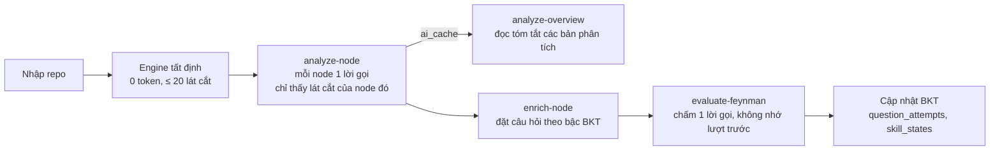
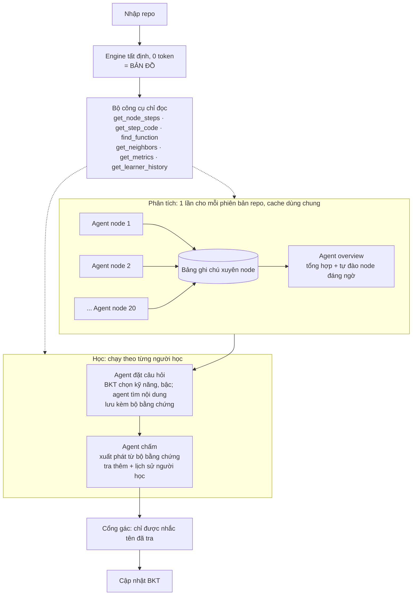
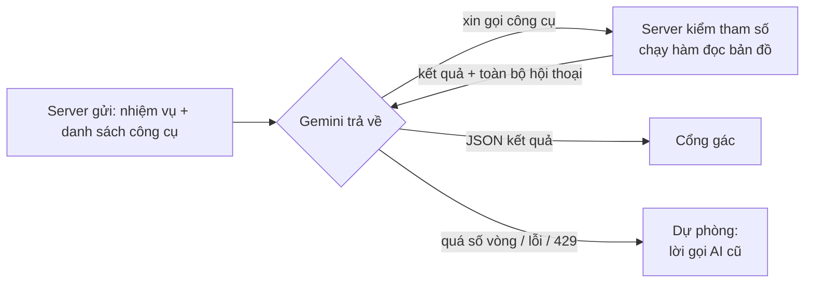

# Đề xuất: nâng cấp từ lời gọi AI lên agent

Ngày 05/11/2026 · Trạng thái: **đề xuất, chờ cả đội quyết** · Mọi số giờ, số token ghi "ước lượng" là chưa đo.

## 1. Tóm tắt

- Đổi cả 4 lời gọi AI thành 4 agent. Cả 4 **dùng chung một runtime** và **một bộ công cụ chỉ đọc bản đồ tất định**.
- Engine tất định (0 token) giữ nguyên. Nó trở thành "bản đồ" để các agent tra cứu.
- Được gì:
  - Phát hiện được điểm yếu **xuyên node**, cái mà luồng hiện tại không thấy.
  - Overview nhẹ hơn, vì các agent node đã ghi lại liên kết giữa các node.
  - Gợi ý khi chấm trỏ đúng gốc lỗi, và nhớ được người học từng hụt gì.
- Không làm kiểu "một agent đọc cả 20 node trong một lần" (lý do ở Mục 7). Làm kiểu **mỗi node một agent chạy song song, ghi vào một bảng ghi chú chung**.
- Mỗi agent giữ lời gọi AI cũ làm dự phòng. Hết giờ ở đâu thì dừng ở đó, demo không vỡ.
- **Điều kiện:** hôm nay phải thử nhanh và có số đo thật (Mục 12) rồi mới chốt.

## 2. Lời gọi AI và agent khác nhau ở đâu

Model vẫn là Gemini. Chỗ khác là **ai quyết định AI được đọc gì**.

| | Lời gọi AI (hiện tại) | Agent |
| :-- | :-- | :-- |
| Ai chọn dữ liệu | Server gom sẵn, gửi 1 lần | AI tự xin tra thêm qua công cụ |
| Số lần gọi Gemini | 1 | Nhiều vòng, đến khi AI trả kết quả |
| AI thấy gì | Chỉ thứ được đưa | Tự tra được cả bản đồ của phiên |
| Kết quả | 1 JSON | 1 JSON + dấu vết các bước đã tra |

Gemini không tự nhớ gì giữa các lần gọi (`src/server/ai/gemini.ts` dòng 123–125). Trong agent, **server chạy vòng lặp** và mỗi vòng gửi lại toàn bộ hội thoại. Cách này giống Claude Code dùng Read, Grep và lệnh `ak` trong ai-kit.

## 3. Lợi ích và tác hại

Không bên nào luôn tốt hơn. Lời gọi AI mạnh ở chỗ **rẻ, nhanh, ổn định**. Agent mạnh ở chỗ **tự tìm đúng thông tin khi không biết trước cần gì**. Ví dụ trong bảng lấy từ chính dự án.

### Lời gọi AI

| Lợi ích | Tác hại |
| :-- | :-- |
| **Rẻ** khi dữ liệu nhỏ: gọi 1 lần, không gửi lại hội thoại | **Chỉ thấy thứ server đưa**: lỗi nằm ở node khác thì AI không biết (ví dụ hiểu sai ở node Thanh toán nhưng gốc ở node Kho) |
| **Nhanh**: 1 lần chờ | **Server phải đoán trước AI cần gì**: đoán thiếu thì AI trả lời thiếu, đoán thừa thì tốn token |
| **Ổn định**: cùng đầu vào thì ra kết quả gần giống nhau, dễ cache, dễ duyệt tay bundle | **Muốn AI thấy nhiều thì phải nhét nhiều**: cho bước chấm thấy cả 20 node là gửi code 20 node mỗi lượt, rất tốn |
| **Dễ test**: mock 1 response là đủ | **Không phản ứng được giữa chừng**: không thể "đọc câu trả lời xong rồi mới mở code chỗ đó" |
| **Dễ kiểm**: cổng gác kiểm một kết quả | **Không có dấu vết suy luận** để hiện lên giao diện |
| **Ít dính 429**: số lời gọi mỗi phút thấp | Khi pitch dễ bị xem là "gọi API rồi hiện kết quả" |
| Lỗi dễ khoanh vùng: hỏng ở đâu thấy ngay | |

### Agent

| Lợi ích | Tác hại |
| :-- | :-- |
| **Tự tìm đúng thông tin cần**: tra node hàng xóm, tra lịch sử người học | **Tốn token hơn khi dữ liệu nhỏ**: mỗi vòng gửi lại cả hội thoại, ước lượng khoảng 2–4 lần lời gọi AI |
| **Rẻ hơn khi dữ liệu lớn** mà mỗi lần chỉ cần một ít: đọc 1–2 bước thay vì gửi cả 20 node | **Chậm hơn**: nhiều vòng là nhiều lần chờ |
| **Xử lý được chỗ không biết trước**: người học nhắc tới hàm ở node khác thì tự đi tra | **Kém ổn định**: hai lần chạy có thể tra đường khác nhau, ra kết quả khác nhau |
| **Có dấu vết suy luận**: hiện lên giao diện, bấm để nhảy tới code. Minh bạch, dễ demo | **Khó test hơn**: phải mock cả chuỗi gọi công cụ |
| **Cổng gác chặt hơn**: chỉ cho nhắc tên đã tra trong lượt đó | **Dễ dính 429**: nhân số lời gọi lên, gói free không chịu nổi lúc demo |
| **Dễ mở rộng**: thêm công cụ mới là agent dùng được ngay | **Có thể lặp hoặc tra lung tung**: bắt buộc có trần số vòng, trần thời gian |
| Kỹ thuật "đáng nói" khi pitch | **Nhiều code hơn**: runtime, công cụ, luật cổng gác, panel dấu vết |
| | **Phụ thuộc model**: cần gọi công cụ tốt. `gemini-3.5-flash-lite` làm được tới đâu thì chưa thử |
| | Lỗi khó khoanh vùng hơn: hỏng ở vòng nào, vì công cụ hay vì model |

### Khi nào chọn cái nào

| Câu hỏi | "Có" thì nghiêng về |
| :-- | :-- |
| Biết trước AI cần đọc gì không? | Lời gọi AI |
| Dữ liệu cần đọc nhét vừa một prompt mà vẫn rẻ không? | Lời gọi AI |
| Kết quả có cần giống nhau mỗi lần không (cache, duyệt tay, test)? | Lời gọi AI |
| Bước sau có phụ thuộc vào thứ vừa đọc được ở bước trước không? | Agent |
| Thông tin cần dùng nằm rải rác, không biết trước nằm ở đâu không? | Agent |

Vì vậy đề xuất này không bỏ hẳn lời gọi AI. Mỗi agent **giữ lời gọi AI cũ làm dự phòng**. Hai agent phân tích **chạy một lần rồi cache** để lấy lại sự ổn định của lời gọi AI.

## 4. Luồng hiện tại

Đặc điểm hiện tại:

- `analyze-node` chạy riêng từng node, tối đa 3 node cùng lúc (`CONFIG.ANALYZE_CONCURRENCY = 3`). Mỗi lời gọi **chỉ thấy lát cắt của node đó**.
- `analyze-overview` đọc bản phân tích của mọi node từ `ai_cache` (`src/app/api/analyze-overview/route.ts` dòng 120–136). Liên kết giữa các node nó phải **tự suy ra** từ các bản tóm tắt.
- `evaluate-feynman` lượt 2 không biết lượt 1 người học viết gì. Nấc gợi ý chỉ phụ thuộc số lượt.

## 5. Luồng sau khi lên agent

Mọi agent đi qua cùng một runtime:

## 6. Thay đổi ở từng chỗ

| Bước | Trước | Sau | Được gì |
| :-- | :-- | :-- | :-- |
| `analyze-node` | Mỗi node 1 lời gọi, chỉ thấy lát cắt của mình | Mỗi node 1 agent, vẫn chạy song song và vẫn cache. Được tra node hàng xóm và **ghi chú xuyên node** (ví dụ "transaction mở ở service node 3, repo node 5 không rollback") | Điểm yếu xuyên node, đúng lõi "lát cắt xuyên file" của sản phẩm |
| `analyze-overview` | Đọc tóm tắt các node, tự suy liên kết | Đọc bản phân tích + **bảng ghi chú xuyên node** có sẵn, rồi tự đào vào node đáng ngờ (chỉ số Uncle Bob lệch, node capstone) | **Overview nhẹ hơn**: liên kết đã được agent node tìm sẵn, overview chỉ tổng hợp và kiểm chứng |
| `enrich-node` | Đặt câu hỏi trong 1 node theo kế hoạch BKT | BKT **vẫn quyết định** kỹ năng và bậc. Agent đi tìm nội dung, có thể hỏi xuyên node. Mỗi câu lưu kèm **bộ bằng chứng** (node, bước đã dùng). Mỗi ý bắt buộc phải trỏ vào một bước trong bộ đó | Câu hỏi sát chỗ người học từng hụt, mà đáp án vẫn kiểm được |
| `evaluate-feynman` | 1 lời gọi, không nhớ lượt trước, nấc gợi ý theo số lượt | Agent nhận sẵn bộ bằng chứng của câu hỏi, tra thêm nếu người học nhắc chỗ khác, đọc lịch sử người học. Nấc gợi ý tính cả bậc BKT | Gợi ý trỏ đúng gốc lỗi, có trí nhớ, thích ứng theo người học |

Cả 4 agent đều trả thêm **dấu vết** (đã tra những gì). Giao diện hiện dấu vết đó, bấm vào thì Monaco và ReactFlow nhảy tới đúng node, đúng bước.

## 7. Vì sao không "một agent làm cả 20 node một lần"

Nghe thì gọn, nhưng vướng cả 4 chỗ:

| Vấn đề | Chi tiết (ước lượng theo số trong spec 02) |
| :-- | :-- |
| **Token nổ** | Một node tốn khoảng 2.000 token đầu vào. Agent tra lần lượt 20 node thì vòng sau phải gửi lại cả hội thoại trước: 2.000 × (1 + 2 + … + 20) ≈ 420.000 token, **gấp đôi** `SESSION_TOKEN_QUOTA = 200.000` của cả một phiên |
| **Vượt trần đầu ra** | Trần hiện tại là 900 token cho mỗi bản phân tích node (`LLM_MAX_OUTPUT_TOKENS.ANALYZE`). 20 node trong một kết quả ≈ 14.000 token ra, dễ bị cắt giữa chừng |
| **Một lỗi hỏng cả 20** | Cổng gác chặn một tên bịa ở node 7 thì phải chạy lại cả lượt. Hiện tại chỉ chạy lại node 7 |
| **Người dùng chờ lâu** | Hiện tại node đầu có kết quả ngay, các node khác nạp dần. Một agent cho 20 node thì phải chờ xong hết mới thấy gì |

Ý tưởng "overview dễ thở hơn" vẫn đạt được bằng **bảng ghi chú xuyên node** ở Mục 5. Các agent node chạy song song, mỗi agent chỉ giữ ngữ cảnh của mình, nhưng cùng ghi phát hiện xuyên node vào một chỗ cho overview đọc.

## 8. Cái gì giữ nguyên

- Engine tất định, 0 token, dựng bản đồ (INV-02 phần "code thuần trước").
- Zero-Trust: công cụ chỉ đọc bản đồ đã cắt, không chạy code người dùng (INV-03).
- Không lưu file mã nguồn. Công cụ chỉ đọc đoạn đã cắt trong `session_snapshots` (INV-04).
- Server là bên duy nhất ghi tiến độ học. BKT vẫn chạy ở server, agent không tự sửa điểm.
- Mọi văn bản AI vẫn qua cổng gác, và cổng gác còn **chặt hơn** ("chỉ được nhắc tên đã tra").
- Kết quả phân tích vẫn cache theo phiên bản repo. Bundle demo vẫn duyệt tay.

## 9. Cái gì phải sửa

| Chỗ sửa | Việc | Vai đề xuất |
| :-- | :-- | :-- |
| `docs/spec/00_QUYET_DINH.md` | Thêm D-xx "4 agent chung runtime"; sửa D-01 (đang ghi 4 lời gọi) | Trưởng nhóm |
| `docs/spec/01` INV-02 | Bỏ câu "không có Actor-Critic nhiều lượt", thay bằng luật agent có giới hạn vòng | Trưởng nhóm |
| `docs/spec/02` + `src/contracts/` | Hằng `CONFIG` mới (số vòng tối đa, hạn thời gian tổng, trần kết quả công cụ); trường dấu vết trong response; ghi chú xuyên node trong bản phân tích; bộ bằng chứng của câu hỏi | Vai A duyệt |
| Công cụ đọc bản đồ (mới) | 6 hàm đọc `session_snapshots`, `question_attempts` | Vai B (sở hữu engine) |
| `src/server/ai/gemini.ts` | Khai báo công cụ, vòng lặp, gửi lại lịch sử, dự phòng | Vai C |
| `src/server/ai/prompts/*` | Prompt agent cho 4 bước | Vai C |
| `src/server/ai/guard/*` | Luật "chỉ nhắc tên đã tra" | Vai C |
| Test | Mock cả chuỗi gọi công cụ | Vai C, E |
| Giao diện | Panel dấu vết, bấm để nhảy tới node hoặc bước | Vai D |
| Bundle offline | Ghi lại bundle (dấu vết nằm trong response nên bundle tự ghi theo) | Vai C |

## 10. Chi phí và tốc độ (ước lượng)

| Bước | Hiện tại (spec 02) | Agent | Ai trả |
| :-- | :-- | :-- | :-- |
| `analyze-node` | ~2.000 vào → 700 ra, 1 lần/node | khoảng 2–3 lần số đó | **Một lần cho mỗi phiên bản repo**, chia đều cho mọi người học |
| `analyze-overview` | ~1.500 → 400 | khoảng 2–3 lần | Như trên |
| `enrich-node` | ~1.600 → 650 | khoảng 2–3 lần | Từng người học |
| `evaluate-feynman` | ~800 → 200 mỗi lượt | khoảng 3–4 lần | Từng người học, mỗi lượt trả lời |

- Thời gian chờ mỗi bước tăng theo số vòng.
- Gói free giới hạn số lời gọi mỗi phút (D-50). Agent nhân số lời gọi lên, lại chạy song song 3 node, nên **phải có key trả phí cho hôm thi**.

## 11. Rủi ro và dự phòng

| Rủi ro | Dự phòng |
| :-- | :-- |
| Gemini không cho dùng công cụ cùng `responseSchema` | Thêm công cụ `submit_result` có tham số đúng bằng khuôn kết quả, hoặc gọi thêm 1 lần cuối chỉ để xuất JSON |
| Agent lặp mãi hoặc tra lung tung | Trần số vòng, trần thời gian tổng; quá trần thì về lời gọi AI cũ |
| 429 lúc demo | Key trả phí + bundle offline |
| Agent vẫn bịa tên | Cổng gác "chỉ nhắc tên đã tra" chặn; bị chặn thì thử lại 1 lần rồi về lời gọi cũ |
| Hết giờ trong 21 giờ | Làm theo thứ tự ở Mục 12; bước nào chưa xong thì giữ lời gọi AI cũ |

## 12. Kế hoạch

**Hôm nay (05/11): thử nhanh trên repo tập**, 1 công cụ `get_step_code`, 1 vòng chấm. Trả lời 3 câu bằng số đo thật:

1. `gemini-3.5-flash-lite` có dùng công cụ cùng `responseSchema` được không?
2. Một lượt chấm mất mấy vòng, bao nhiêu giây, bao nhiêu token?
3. Agent có chịu tra rồi mới nói không, hay vẫn bịa tên?

**Thứ 6 (06/11): chốt.** Ba câu ổn thì sửa spec (D-xx, INV-02, D-01, `CONFIG`, contract) và tập theo hướng mới. Không ổn thì làm A1, A5 (gợi ý theo bậc BKT, đưa trí nhớ vào prompt), agent đưa vào roadmap.

**Trong 21 giờ, thứ tự làm** (luồng cũ đội đã tập xong trong khoảng 12–14 giờ):

1. Luồng cũ đầy đủ trước. Đây là lưới an toàn.
2. Runtime chung + cổng gác "chỉ nhắc tên đã tra" + 6 công cụ.
3. Agent chấm: người học thấy ngay, dễ demo.
4. Agent node + bảng ghi chú xuyên node: lõi sản phẩm.
5. Agent overview đọc bảng ghi chú.
6. Agent đặt câu hỏi + bộ bằng chứng.

Công sức thêm khoảng 15–20 giờ công (ước lượng), chia cho vai B, C, D chạy song song.

## 13. Cách nói khi thuyết trình

**Nên nói:** "Code thuần dựng bản đồ kiến trúc đúng và không tốn token. Bốn agent chuyên biệt tra cứu trên chính bản đồ đó, nên agent của nhóm tra code thật của người học chứ không tra web. Cổng gác chỉ cho agent nhắc những gì nó đã tra."

**Không được nói:**

- "Chống ảo giác 100%." Cổng gác chặn tên bịa, không chặn được giải thích sai ý.
- Nhóm tự nghĩ ra agent, BKT hay repo-map.
