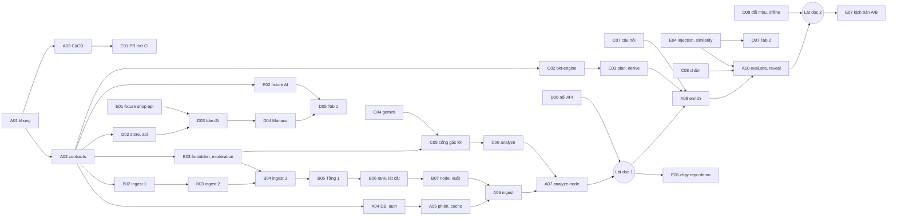

# Quy trình code 21 giờ — sơ bộ công việc (bản nháp 02/11/2026)

> **Bản nháp để cả nhóm đọc và góp ý.** Cho tới khi nhóm chốt, lịch gốc vẫn là [`doc-de-hieu/07_ke_hoach_21h.md`](../../doc-de-hieu/07_ke_hoach_21h.md). Chốt xong thì sửa 07 và các chỗ ở Mục 9. Mọi chỗ lệch với `spec/` thì `spec/` đúng.
>
> Giờ thi giả định: **H+0 = 12:00 thứ Bảy 07/11/2026**, ngừng code **09:00 Chủ nhật 08/11** (H+21), nộp slide trước 09:30, thuyết trình 10:00–11:30.

## 1. Đọc trong 2 phút

- **5 vai:** A trưởng tích hợp · B engine · C AI + BKT · D giao diện · E kiểm thử, demo, slide.
- **A làm toàn bộ setup đầu giờ trong một lượt** (khung code, contracts, CI/CD, database). Chia setup cho nhiều người dễ đụng file.
- **C được bớt việc:** E nhận cụm hàm thuần "lọc đầu vào": `moderation.ts`, `similarity.ts`, `guard/injection.ts`, `guard/forbidden.ts`. Chi tiết ở Mục 2.
- **D không thêm việc mà làm sớm hơn:** Monaco, store, `api.ts`, bảng lỗi, màn hình đầu được kéo lên trước, nên D có việc liên tục từ H+0.5.
- **E có việc code thật từ H+1**, sau đó kiểm thử theo đúng lúc hệ thống chạy được: chạy repo demo sau lát dọc 1 (H+8), chạy kịch bản A/B sau lát dọc 2 (H+12).
- **Mỗi vai có một thư mục `vai-X/`** gồm:
  - `README.md`: lịch của bạn, bạn chờ ai, ai chờ bạn.
  - Mỗi việc một **phiếu**, ví dụ `C02-bkt.md`. Phiếu đọc từ trên xuống: tạo nhánh, copy prompt dán cho Claude trên máy mình (Claude tạo task, giao agy, tự kiểm), tự kiểm theo danh sách "thế nào là xong", rồi tự gõ lệnh commit và mở PR.
- **AI không bao giờ commit hay push.** Người kiểm xong mới commit, nên commit là của chính từng thành viên (luật thi yêu cầu ai cũng phải có commit).
- Phiếu chỉ dùng thứ mà máy nào trong nhóm cũng có: skill ai-kit (`tao-task`, `giao-task-agy`, `kiem-task`, `doc-spec`, `kiem-contract`), lệnh `ak`, `.kb/spec`, `git`, `gh`.

| Vai | Thư mục | Số phiếu |
| :-- | :-- | :-: |
| A — Trưởng tích hợp | [`vai-A/`](vai-A/README.md) | 12 |
| B — Engine | [`vai-B/`](vai-B/README.md) | 10 |
| C — AI + BKT | [`vai-C/`](vai-C/README.md) | 10 |
| D — Giao diện | [`vai-D/`](vai-D/README.md) | 10 |
| E — Kiểm thử, demo, slide | [`vai-E/`](vai-E/README.md) | 10 |

Giai đoạn sửa lỗi cuối (H+17 → H+21) **không viết thành task**, vì lúc đó chưa biết lỗi gì. Mỗi `vai-X/README.md` có mục "Về đích" ghi cách làm trong giai đoạn này.

---

## 2. Khác gì so với file 07

| # | Việc | File 07 | Bản này | Vì sao |
| :-: | :-- | :-- | :-- | :-- |
| 1 | `src/lib/moderation.ts` (`maskSensitive`, `BAD_WORDS`, `hasInappropriateWords`, D-65) | C | **E** (phiếu E03) | Hàm thuần regex, kiểm được bằng test, không cần Gemini. E rảnh ở H+1–8 |
| 2 | `src/server/ai/guard/forbidden.ts` (GUARD-06, GUARD-07) | C | **E** (phiếu E03) | `hasInappropriateWords` dùng `wordRe` của GUARD-07, và `findForbidden` luôn cộng `BAD_WORDS`. Tách cho hai người thì hai người cùng sửa một cụm |
| 3 | `src/server/ai/guard/injection.ts` (GUARD-15) | C | **E** (phiếu E04) | Regex, đã có sẵn bảng "phải khớp / không được khớp" để test |
| 4 | `src/lib/similarity.ts` (GUARD-16) | C | **E** (phiếu E04) | Hàm thuần, có bảng test sẵn |
| 5 | Fixture AI `src/server/ai/__fixtures__/*.json` | "Fixture" chung chung | **E** (phiếu E02) | D và C cần ngay từ H+2 |
| 6 | `scripts/review-run.ts` (GUARD-18 bước 1) | Chưa ai nhận | **E** (phiếu E07) | Theo 07, E đã phụ trách duyệt tay. `record-bundle.ts` vẫn của C |
| 7 | Route `src/app/api/analyze-overview/route.ts` | A | **C** (phiếu C09) | Ở H+12–15 A ngủ, C đang viết `overview.ts` |
| 8 | Offline mode | D giao agent lúc ngủ (H+12.5) | **D tự làm lúc còn thức** (phiếu D08, 22:00–00:30) | Offline nằm trong danh sách "không bao giờ cắt", không nên phó mặc cho agent chạy lúc không ai canh |
| 9 | Cột 2 Monaco, store, `api.ts`, `messages.ts`, màn hình đầu | Không có mốc giờ | Có mốc: H+1–5:30 (phiếu D02–D04) | Tránh dồn hết việc giao diện về sau H+8 |
| 10 | E "Chạy repo demo" | H+4–8, khi engine thật chưa có | H+8–10 (phiếu E06) | Engine thật đến H+8 mới có |
| 11 | E "Kịch bản A, B" | H+8–12, khi lát dọc 2 chưa xong | H+10–12:30 (phiếu E07) | Lát dọc 2 đến H+12 mới xong |
| 12 | PR nhỏ thử CI lúc H+0.5 ([`01_deploy`](../../doc-de-hieu/01_deploy.md) Mục 5) | "Một thành viên" | **E** (phiếu E01) | E là người kiểm, và có commit sớm |
| 13 | Setup đầu giờ | A | **A, không đổi** | Làm một lượt để không đụng file |
| 14 | Lịch ngủ xoay | | **Không đổi** | |

---

## 3. Ai làm gì, sở hữu file nào

Một file chỉ một người sửa tại một thời điểm. Cần sửa file của người khác thì nhắn người đó, hoặc nhờ Vai A nếu là `src/contracts/*`.

| Vai | Việc chính | File sở hữu (theo [`spec/04`](../../spec/04_KIEN_TRUC_TRIEN_KHAI.md) Mục 15) |
| :-- | :-- | :-- |
| **A** | Khung code, contracts, CI/CD, database, auth, mọi API route (trừ `analyze-overview`), ghép nối, review và merge, deploy, Dockerfile | `package.json`, `tsconfig.json`, `next.config.ts`, `.env.example`, `README.md`, `LICENSE`, `.github/**`, `Dockerfile`, `supabase/migrations/*`, `src/contracts/*`, `src/app/api/**` (trừ `analyze-overview`), `src/app/auth/callback/route.ts`, `src/server/{auth,db,errors,session,cache,quota,log,progress,enrich,evaluate,reveal,report,persona}.ts` |
| **B** | Tầng 0–2: tải repo, lọc, AST, đồ thị, lát cắt, node, layout | `public/grammars/*.wasm`, `queries/*.scm`, `src/server/engine/**` (trừ `__fixtures__`) |
| **C** | Gemini, prompt, schema, cổng gác (phần kiểm output AI), chấm, BKT, kế hoạch câu hỏi, tổng quan, đóng băng bundle | `src/lib/{bkt-engine,plan,derive}.ts`, `src/server/ai/{gemini,analyze,overview,questions,grade,schemas}.ts`, `src/server/ai/prompts/*`, `src/server/ai/guard/{text,names,lines,analysis,overview,questions,followup,log}.ts`, `src/app/api/analyze-overview/route.ts`, `scripts/record-bundle.ts`, `review/ket_qua_duyet.md` (chỉ 03:00–05:00, phiếu C10; trước và sau khung này thuộc E) |
| **D** | Cả giao diện, offline, persona menu | `src/app/{layout,page}.tsx`, `src/app/history/page.tsx`, `src/app/dev/*` (trang nháp, xóa trước H+17), `tailwind.config.ts`, `src/store/*`, `src/components/**`, `src/lib/{api,offline,messages}.ts` |
| **E** | Fixture, lọc đầu vào, test xuyên module, duyệt tay, demo, slide | `src/server/engine/__fixtures__/*`, `src/server/ai/__fixtures__/*`, `src/lib/{moderation,similarity}.ts`, `src/server/ai/guard/{forbidden,injection}.ts`, `src/__tests__/*` (test xuyên module), `scripts/review-run.ts`, `review/*` |

Test đơn vị nằm cùng chỗ với code của người viết, theo dạng `src/**/__tests__/*.test.ts`. Tên test bắt đầu bằng mã luật, ví dụ `BKT-03 …`, `GUARD-15 …` ([`spec/50`](../../spec/50_TEST_VA_FIXTURE.md) đầu file).

---

## 4. Các mốc

| Giờ | H+ | Đạt khi | Ai chịu |
| :-- | :-- | :-- | :-- |
| 12:30 | H+0.5 | Khung code trên `main`. Mỗi người có ≥ 1 commit trên nhánh riêng. PR thử CI của E chạy xong | A, mọi người |
| 13:00 | H+1 | `src/contracts/*` merge. Có kết quả 3 giả định tải repo. Nạp được grammar `.wasm`. Đo được độ trễ Gemini thật | A, B, C |
| 13:30 | H+1.5 | Migration chạy trên Supabase dev/staging. `deploy.yml` đẩy được bản khung lên staging | A |
| 16:00 | H+4 | Giao diện hiện bản đồ từ fixture. `bkt-engine`, `plan`, `derive` qua test. Ingest tải và lọc được repo demo trong RAM. Có bộ lọc đầu vào và test | D, C, B, E |
| 20:00 | H+8 | **Lát dọc 1:** dán link repo demo ⇒ engine thật ⇒ bản đồ thật ⇒ bấm node ⇒ Tab 1 từ `analyze-node` thật | A, B, C, D |
| 00:00 | H+12 | **Lát dọc 2:** enrich ⇒ nộp ⇒ chấm ⇒ gợi ý ⇒ BKT ⇒ đổi màu ⇒ mở khóa, ghi Postgres | A, C, D |
| 00:30 | H+12.5 | A, D giao việc cho agy rồi đi ngủ. Dockerfile đã thử deploy revision có tag và không nhận traffic | A, D |
| 03:00 | H+15 | **Giờ cắt Dockerfile:** chỉ merge hoặc bỏ | A |
| 04:00 | H+16 | Đủ 14 endpoint, mở lại phiên, offline, persona, tổng quan, Python | A, B, C, D |
| 05:00 | H+17 | **Đóng băng tính năng.** Duyệt tay xong ⇒ `mock_bundle.json`. Kiểm Definition of Done | C, E, A |
| 07:00 | H+19 | Sửa lỗi từ buổi tập. Mỗi câu trong kịch bản chạy 3 lần. Có video dự phòng | Mọi người |
| 07:30 | H+19.5 | Slide xong | E |
| 09:00 | H+21 | Ngừng code, commit cuối của cả 5 người | Mọi người |

---

## 5. Lịch theo giờ

💤 = ngủ. Ô ghi mã phiếu. Ô "agy" nghĩa là agy chạy phiếu đã giao trước khi đi ngủ.

| Giờ | A | B | C | D | E |
| :-- | :-- | :-- | :-- | :-- | :-- |
| 12:00–12:30 | A01 khung code | B01 thử 3 giả định (curl) | C01 đo Gemini (ngoài repo) | Chuẩn bị máy, đọc task | E01 tạo Issues |
| 12:30–13:00 | A02 contracts (agy) + A03 CI/CD (Claude) | B01 grammar, parser | C01 review contracts, khung `gemini.ts` | D01 token, khung 3 cột | E01 PR thử CI, fixture `shop-api` |
| 13:00–14:30 | A03 xong → A04 DB, auth | B02 ingest 1 | C02 `bkt-engine` | D02 store, `api.ts`, `messages.ts` | E02 fixture AI |
| 14:30–16:00 | A05 phiên, cache, `/api/sessions` | B03 ingest 2 | C03 `plan`, `derive` | D03 bản đồ | E03 `forbidden` + `moderation` |
| 16:00–17:30 | A06 nối ingest | B04 ingest 3 | C04 `gemini.ts`, prompt chung | D04 Monaco | E04 `injection` + `similarity` |
| 17:30–18:30 | A06 → A07 | B05 Tầng 1 | C05 cổng gác lõi | D05 Tab 1, Tổng quan | E05 test kịch bản mức hàm |
| 18:30–20:00 | A07 nối analyze-node | B06 → B07 | C06 `analyze.ts` | D06 màn hình đầu, nối API | E05 |
| **20:00** | **Lát dọc 1** | | | | |
| 20:00–22:00 | A08 enrich + A09 Dockerfile (xen kẽ) | B07 xong → B08 sửa theo repo demo | C07 đặt câu hỏi | D07 Tab 2 | E06 chạy repo demo |
| 22:00–00:00 | A10 evaluate, reveal | B09 tải chọn lọc | C08 chấm, gợi ý | D08 đổi màu, offline | E07 `review-run`, kịch bản A/B |
| **00:00** | **Lát dọc 2** | | | | |
| 00:00–00:30 | A11 giao agy | B09 | C09 tổng quan | D08 → D09 giao agy | E07 |
| 00:30–03:00 | 💤 (agy: A11) | B10 Python, entry `main`, RN | C09 | 💤 (agy: D09) | E08 kịch bản D, X-tests, chạy duyệt lần 1 |
| 03:00–05:00 | A12 kiểm việc agy, Dockerfile, deploy | 💤 | C10 duyệt tay, `record-bundle` | D10 kiểm việc agy, sửa giao diện | 💤 |
| **05:00** | **Đóng băng** | | | | |
| 05:00–06:30 | Về đích | Về đích | 💤 | Về đích | E09 DoD, offline, video |
| 06:30–09:00 | Về đích, commit cuối | Về đích | Về đích | Về đích | E09 → E10 slide, nộp |

---

## 6. Ai chờ ai

Mũi tên `X --> Y` nghĩa là Y cần X đã merge. Task không có mũi tên vào thì làm ngay được.

**Chỗ nghẽn chính:** B05 → B07 (dựng toàn bộ Tầng 1–2 trong khoảng 17:30–20:00). Nếu 20:00 chưa có engine thật thì A, C, D vẫn chạy tiếp trên fixture, và cắt theo [07 Mục 3](../../doc-de-hieu/07_ke_hoach_21h.md) bước 1.

---

## 7. Cách dùng một phiếu

**Trước ngày thi, trên máy mỗi người:**
1. Clone repo thi, chạy `ak bat-dau`, chép `spec/` và `doc-de-hieu/` vào `.kb/` ([`01_deploy`](../../doc-de-hieu/01_deploy.md) Mục 3.8–3.9). Chạy `node cai-dat.mjs --kiem` trong `ai-kit` để chắc có đủ skill `tao-task`, `giao-task-agy`, `kiem-task`, `doc-spec`, `kiem-contract`.
   Máy **không có Antigravity (agy)** hoặc **không cài được ai-kit**: làm thêm phần chuẩn bị và đổi Bước 1–2 theo [`khong-co-ai-kit.md`](khong-co-ai-kit.md).
2. Đọc hết `vai-X/README.md` và lướt các phiếu của mình một lượt. Phiếu **không** chép vào `.kb/`; cứ mở phiếu ở repo tài liệu (hoặc bản in) mà làm theo.

**Trong giờ thi, với mỗi phiếu** (chi tiết ở mục "Một phiếu làm thế nào" trong README mỗi vai):

| Bước | Ai làm | Việc |
| :-- | :-- | :-- |
| 0 | Bạn | Tự gõ lệnh cập nhật `main`, `npm ci`, tạo nhánh `<vai>/<mã>-<tên-ngắn>` |
| 1 | Bạn dán prompt ⇒ Claude | Claude dùng `tao-task` tạo task trong `.kb/tasks/` với nội dung chốt sẵn trong phiếu. Bạn đọc, thấy khớp phiếu thì đi tiếp |
| 2 | Bạn dán prompt ⇒ Claude ⇒ agy | Claude dùng `giao-task-agy` giao agy viết file, rồi `kiem-task` chạy lệnh kiểm, đọc diff, báo kết quả. **Không `ak xong`, không commit, không push** |
| 3 | Bạn | Tự kiểm theo danh sách ô "thế nào là xong". Chưa đạt thì dán prompt làm lại (tối đa 1 lần, vẫn sai thì tự sửa tay). Đạt hết thì tự gõ `ak xong` |
| 4 | Bạn | Tự gõ `git add` từng file, `git commit` theo message có sẵn, `git push`, `gh pr create`. Vai A merge khi CI xanh |

**Kỷ luật thời gian** (lấy từ 07): agy chạy quá 30 phút thì dừng lại và chia nhỏ theo các nhóm commit của phiếu. Đừng tin một mình `.kb/TIEN_DO.md`, việc đã xong hay chưa phải xem `git log` và kết quả test.

---

## 8. Commit và PR

- **Chỉ người commit và push**, AI không làm. Commit **phần của mình**, nhỏ và đều (≤ ~200 dòng mỗi commit). Message dạng `feat(engine): …`, `fix(ui): …`, `test(guard): …`. Phạm vi dùng: `setup`, `contracts`, `db`, `api`, `engine`, `ai`, `guard`, `bkt`, `ui`, `test`, `ci`, `demo`.
- Không dán nguyên khối code dài từ spec vào một commit. Code được gõ hoặc sinh trong giờ thi theo spec rồi chỉnh.
- Không commit `spec/`, `pitch/`, `doc-de-hieu/`, `.kb/`, `.env*` (trừ `.env.example`), `AGENTS.md`, `CLAUDE.md`.
- Mọi người làm trên nhánh riêng, mở PR. `ci.yml` và `security.yml` phải xanh. Vai A merge 30–60 phút một lần. Merge vào `main` thì tự deploy lên staging. Production do Vai A bấm duyệt (D-30).
- Từ 00:30 đến 03:00 không có merge vì A ngủ. PR để chờ, A dậy thì merge.
- Lúc 08:30, Vai A kiểm cả 5 người đều có commit trên `main` (luật thi).

---

## 9. Phải sửa gì khi nhóm chốt bản này

- [`doc-de-hieu/07_ke_hoach_21h.md`](../../doc-de-hieu/07_ke_hoach_21h.md): Mục 1 (mô tả 5 vai, điểm nối) và bảng Mục 2, theo Mục 2 và Mục 5 của file này.
- [`spec/04_KIEN_TRUC_TRIEN_KHAI.md`](../../spec/04_KIEN_TRUC_TRIEN_KHAI.md) Mục 13 đang ghi "`BAD_WORDS` … do vai C viết" ⇒ đổi thành Vai E.
- Dòng đầu [`spec/21_AI_KIEM_VA_DUYET.md`](../../spec/21_AI_KIEM_VA_DUYET.md) đang ghi "đọc: Vai C" ⇒ thêm Vai E (Mục 2 GUARD-06, GUARD-07, Mục 7, Mục 8, Mục 10).
- Sau khi sửa: chạy lại `gan-du-an.mjs` để `.kb/` trên mọi máy nhận bản mới.

## 10. Rủi ro của cách chia này

| Rủi ro | Dấu hiệu | Xử lý |
| :-- | :-- | :-- |
| Contracts chưa merge lúc 13:00 | A02 còn mở | B, C, D, E vẫn làm phần không cần kiểu (curl, đo, khung giao diện, Issues), rồi rebase khi merge |
| Engine trễ | 20:00 chưa có B07 | Mọi người chạy tiếp trên fixture. Cắt theo 07 Mục 3 bước 1 |
| E viết hàm mà C và A gọi, có thể lệch ý | C, A báo hàm không khớp | C review PR E03 và E04 (bắt buộc), vì C dùng `findForbidden`, A dùng `isInjection`, `similarity`, `maskSensitive` |
| A quá tải review lúc 16:00–20:00 | PR chờ > 1 giờ | Người mở PR tự rebase và tự chạy test trước. A merge theo lô 30–60 phút |
| Duyệt tay ở 03:00–05:00 cần người thứ 2 (GUARD-18 bước 4) | C một mình | A hoặc D xem lại các ô ❌ / ❓ của C |
