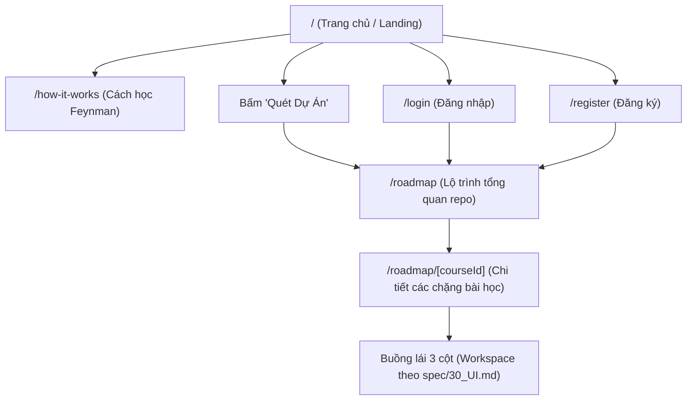

# TÀI LIỆU QUY CHUẨN THIẾT KẾ & HỆ THỐNG GIAO DIỆN (UI DESIGN CONTEXT)
## Dự án SimpliFey — Codebase Cognitive Twin (Hackathon SGU 2026)

> **Phạm vi áp dụng:** Toàn bộ mã nguồn giao diện trong `develop-UI/`  
> **Phiên bản:** 2.0 (Cập nhật sau khi phân tích toàn bộ các màn hình thực tế)  
> **Nguyên tắc cốt lõi:** Tuyệt đối không tự ý thêm thư viện UI bên ngoài, không đổi design system riêng của dự án, tối ưu hóa việc tái sử dụng linh kiện hiện có.

---

## 1. Triết lý Thiết kế & Phong cách Giao diện chung (Design Philosophy)

* **Phong cách tổng thể:** **Modern EdTech / Cognitive Twin Workspace** — Giao diện sáng sủa, thanh lịch, giàu năng lượng học tập nhưng chuẩn xác về mặt kỹ thuật.
* **Cảm xúc định hình thương hiệu:**
  * **Nhiệt huyết & Đột phá:** Sắc cam thương hiệu (`#FF9640`) làm điểm tựa thị giác, khơi gợi tinh thần khám phá codebase thay vì cảm giác sợ hãi khi đọc code lạ.
  * **Ấm áp & Thân thiện:** Sử dụng lớp nền hữu cơ (Organic Fluid Backdrops) với sắc đào nhạt (`#FFDCC5`) và xanh tím nhạt (`#E2E7FF`), bo góc cực lớn (`rounded-[40px]` đến `rounded-[48px]`) và xoay nghiêng nhẹ (`rotate-2`, `-rotate-3`) để xóa bỏ sự khô khan của các khối chữ nhật truyền thống.
  * **Trực quan & Tương tác sống động:** Các thẻ nổi (Floating Cards) được đặt góc nghiêng nhẹ (`-rotate-3`, `rotate-4`), tự động trở về góc thẳng (`hover:rotate-0`) khi rê chuột để tạo chiều sâu thị giác. Hiệu ứng chữ 3D nhẹ (`.text-3d-subtle`) trên logo và từ khóa chính mang lại nét đặc sắc riêng biệt.
  * **Độ tin cậy & Rõ ràng:** Nền canvas trắng tinh khiết (`#FFFFFF`), viền thẻ mảnh (`border-gray-100` hoặc `#E5E7EB`), độ tương phản chữ đậm (`#131b2e` trên nền sáng) đảm bảo tiêu chuẩn tiếp cận WCAG AA.

---

## 2. Công nghệ Giao diện & Thư viện (Tech Stack & UI Dependencies)

Hệ thống UI được xây dựng trên bộ công cụ tinh gọn, không phụ thuộc vào các UI library cồng kềnh (như MUI, AntD, Chakra):

* **Framework:** Next.js 15 (App Router, Turbopack, TypeScript 5).
* **Core View Library:** React 19.
* **Styling Engine:** Tailwind CSS v4 (`@import "tailwindcss";` kết hợp `@theme` directive, không dùng `tailwind.config.js` truyền thống).
* **Iconography:** `lucide-react` (phiên bản `^1.66.0`) — đồng bộ chuẩn icon vector, độ dày nét và kích thước.
* **Font System:** Quản lý tập trung qua `next/font/google` trong [`src/app/layout.tsx`](file:///c:/nquyleee/Coding/Hackathon_SGU/develop-UI/src/app/layout.tsx).

---

## 3. Hệ thống Token Giao diện (Design Tokens)

### 3.1. Bảng màu Chuẩn (Color Palette)

| Phân loại | Tên Token / Hex | Class Tailwind tương đương | Ứng dụng thực tế trong UI |
| :--- | :--- | :--- | :--- |
| **Brand Primary** | `#FF9640` | `bg-[#ff9640]`, `text-[#ff9640]`, `border-[#ff9640]` | Logo SimpliFey, nút CTA chính ("Quét Dự Án", "Đăng ký", "Bắt đầu học"), viền active card, icon highlight |
| **Primary Hover** | `#FF8624` | `hover:bg-[#ff8624]`, `hover:text-[#ff8624]` | Trạng thái hover của các nút bấm và liên kết hành động chính |
| **Primary Shadow** | `rgba(255, 150, 64, 0.35)` | `shadow-[0px_6px_16px_rgba(255,150,64,0.35)]` | Hiệu ứng đổ bóng phát sáng nhẹ cho nút CTA chính |
| **Primary Dark Text** | `#301400` / `#944B00` | `text-[#301400]`, `text-[#944b00]` | Nhãn danh mục in hoa (`tracking-wider uppercase`), chữ trên nền nút cam, chỉ số phần trăm quan trọng |
| **Text Main** | `#131b2e` | `text-[#131b2e]` | Tiêu đề H1, H2, H3, tiêu đề card, chữ nhập liệu input, tên người dùng |
| **Text Secondary** | `#625e56` / `#554337` | `text-[#625e56]`, `text-[#554337]` | Đoạn văn mô tả (body copy), liên kết menu chưa hover, văn bản chú thích phụ |
| **Text Muted / Subtle** | `#887365` / `gray-400` | `text-[#887365]`, `text-gray-400` | Mô tả của các thẻ bị khóa (`locked`), microcopy chỉ dẫn |
| **Canvas Background** | `#FFFFFF` | `bg-white` | Nền toàn trang, nền header, nền các thẻ card tiêu chuẩn |
| **Surface Warm (Footer)**| `#FFF0E4` | `bg-[#fff0e4]`, `border-[#ffe0cc]` | Nền chân trang và đường viền trên của Footer |
| **Surface Highlight Warm** | `#FFF7ED` | `bg-[#fff7ed]`, `border-[#fed7aa]` | Thẻ lộ trình đang học, container icon header, menu hover |
| **Input / Track Surface** | `#F2F3FF` | `bg-[#f2f3ff]` | Nền ô input (nhập URL, Email, Password), track thanh tiến độ |
| **Success / Completed** | `#047857` / `#00B17A` | `bg-[#047857]`, `bg-[#00b17a]`, `text-[#047857]` | Card khóa học đã hoàn thành, thanh tiến độ xanh ngọc, chấm online AI |
| **Success Border** | `#004F1A` / `#007025` | `border-[#004f1a]`, `hover:border-[#007025]` | Viền dày của card trạng thái hoàn thành |
| **Locked Surface** | `#F2F3FF`/60 | `bg-[#f2f3ff]/60`, `border-[#eaedff]/80` | Card bài học chưa mở khóa, tạo cảm giác mờ sương (frost/locked) |
| **Border / Divider** | `#E5E7EB` / `gray-100` | `border-[#E5E7EB]`, `border-gray-100` | Viền Header phân tách, viền ngăn cách card, thanh kẻ chia mục |
| **Decorative Backdrop 1** | `#FFDCC5` (50–80%) | `bg-[#ffdcc5]` | Lớp nền hữu cơ cam đào xoay nghiêng sau hero/auth |
| **Decorative Backdrop 2** | `#E2E7FF` (40–70%) | `bg-[#e2e7ff]` | Lớp nền hữu cơ xanh pastel xoay nghiêng ngược hướng |

---

### 3.2. Hệ thống Typography (Font & Text Hierarchy)

> [!IMPORTANT]
> **QUY TẮC CỨNG VỀ FONT CHỮ (FONT CONSTRAINTS):**  
> Toàn bộ dự án `develop-UI/` **CHỈ ĐƯỢC PHÉP SỬ DỤNG DUY NHẤT 3 FONT**:  
> 1. **Kokoro**  
> 2. **Plus Jakarta Sans**  
> 3. **Inter**  
> **TUYỆT ĐỐI CẤM:** Không được import hoặc sử dụng bất kỳ font nào khác (như JetBrains Mono, Geist, Roboto, Arial...). Mọi đoạn mã (code viewer), số liệu kỹ thuật, nhãn hay đoạn văn trước đây dùng font khác đều phải chuyển về 1 trong 3 font trên.

Khai báo tại [`src/app/globals.css`](file:///c:/nquyleee/Coding/Hackathon_SGU/develop-UI/src/app/globals.css) thông qua `@theme`:
```css
@theme {
  --font-sans: "Kokoro", var(--font-plus-jakarta), var(--font-inter), system-ui, sans-serif;
  --font-kokoro: "Kokoro", var(--font-plus-jakarta), sans-serif;
  --font-jakarta: var(--font-plus-jakarta), sans-serif;
  --font-inter: var(--font-inter), sans-serif;
  --font-mono: var(--font-inter), ui-monospace, monospace;
}
```

#### Phân vai chi tiết cho 3 font:
1. **Kokoro (`--font-kokoro` / `Kokoro`):**
   * *Đặc tính:* Font hiển thị thương hiệu chính, mang phong cách độc đáo, sang trọng và hiện đại.
   * *Ứng dụng:* Logo SIMPLIFEY, Tiêu đề Hero chính, từ khóa nhấn mạnh, các tiêu đề section quan trọng.
2. **Plus Jakarta Sans (`var(--font-plus-jakarta)`):**
   * *Weights:* 500 (Medium), 600 (SemiBold), 700 (Bold), 800 (ExtraBold).
   * *Ứng dụng:* Tiêu đề trang, tiêu đề Section H2, Tiêu đề Card bài học/khóa học, các nút bấm CTA chính ("Quét Dự Án", "Bắt đầu học", "Báo cáo phiên học", "Nộp Bài Chấm Điểm").
3. **Inter (`var(--font-inter)`):**
   * *Weights:* 400 (Regular), 500 (Medium), 600 (SemiBold), 700 (Bold).
   * *Ứng dụng:* 
     * Toàn bộ nội dung đoạn văn body, câu hỏi AI, lời giải thích của học viên.
     * Liên kết thanh điều hướng Navbar, Breadcrumb, form nhãn và ô input.
     * **Trình soi mã nguồn (Code Viewer):** Toàn bộ các dòng code, số dòng và các từ khóa lập trình (thay thế an toàn cho JetBrains Mono).
     * Chỉ số phần trăm tiến độ, điểm số BKT kỹ năng (`0.7250`), số hiệu bước (`01`, `02`), bộ đếm từ vựng.

#### Thang kích thước & Quy cách chữ chuẩn:
* **Display / Hero Heading:** `text-[52px]` (xl: `text-[62px]`), `leading-[1.12]`, `font-extrabold`, `tracking-tight`.
* **Section Title (H2):** `text-[30px]` (sm: `text-[38px]`), `font-extrabold`, `tracking-tight`, `text-[#131b2e]`.
* **Card Title (H3):** `text-[17px]` – `text-[18px]` (sm: `text-[22px]`), `font-bold` hoặc `font-extrabold`.
* **Eyebrow / Category Tag:** `text-[13px]` – `text-[15px]`, `font-bold`, `tracking-wider`, `uppercase`, `text-[#944b00]`.
* **Sub-headline / Hero Body:** `text-[17px]` – `text-[20px]`, `leading-relaxed`, `text-[#625e56]`.
* **Body / Mô tả chung:** `text-[14px]` – `text-[16px]`, `leading-relaxed`, `text-[#625e56]`.
* **Microcopy / Nhãn hỗ trợ:** `text-[11px]` – `text-[13px]`, `font-medium`.

---

### 3.3. Bo góc (Border Radius)

* **Organic Fluid Blobs (Trang trí nền):** `rounded-[40px]` đến `rounded-[48px]`.
* **Khung ảnh minh họa Hero:** `rounded-[24px]`.
* **Container / Thẻ bài học / Form Auth:** `rounded-2xl` (`16px`) hoặc `rounded-[18px]`, `rounded-[20px]`.
* **Khung chứa Icon / Hộp biểu tượng:** `rounded-[10px]` hoặc `rounded-[16px]`.
* **Nút bấm / Input Form:** `rounded-lg` (`8px`) cho input và nút quét; `rounded-[12px]` cho nút Đăng ký, nút Auth, nút Xem bài.
* **Badge / Pill Tag trạng thái:** `rounded-[6px]` hoặc `rounded-full`.

---

### 3.4. Đổ bóng (Box Shadow) & Chiều sâu

* **Thẻ chuẩn (Standard Card):** `shadow-[0px_10px_30px_rgba(0,0,0,0.06)]` hoặc `shadow-[0px_4px_16px_rgba(0,0,0,0.06)]`.
* **Thẻ nổi (Floating Cards tương tác):** `shadow-[0px_16px_32px_rgba(0,0,0,0.12)]`.
* **Thẻ đang học (In-Progress Highlight Card):** `shadow-[0px_4px_12px_rgba(255,150,64,0.12)]` (hover: `shadow-xl`).
* **Dropdown Menu Cài đặt:** `shadow-[0px_16px_40px_rgba(0,0,0,0.12)]`.
* **Nút bấm nổi bật (Primary Action Button):** `shadow-[0px_4px_10px_rgba(255,150,64,0.3)]` (hover: `shadow-[0px_6px_16px_rgba(255,150,64,0.4)]`).

---

### 3.5. Hiệu ứng Chuyển động & Animation Đặc trưng

1. **Hiệu ứng chữ 3D tinh tế (`.text-3d-subtle`):**
   ```css
   .text-3d-subtle {
     text-shadow: 
       0 1px 0 #e6761c,
       0 2px 0 #cc620f,
       0 3px 1px rgba(0, 0, 0, 0.1),
       0 5px 8px rgba(255, 150, 64, 0.25);
   }
   ```
2. **Hiệu ứng Marquee Bounce URL (`.animate-marquee-scroll`):**
   * Tự động trượt ngang qua lại chuỗi URL repo mẫu trong ô input. Dừng animation khi rê chuột (`hover:animation-play-state: paused`).
3. **Thước đo thanh tiến độ:** `transition-all duration-500 ease-out` kết hợp dải gradient cam: `bg-linear-to-r from-[#ff9640] to-[#ff7e14]`.
4. **Viền động Link Header:** Hiệu ứng gạch chân mở rộng từ tâm khi hover: `h-[2px] w-0 bg-[#131b2e] group-hover:w-full transition-all duration-300 ease-out`.
5. **Hiệu ứng xoay bánh răng cài đặt:** `group-hover:rotate-360 transition-transform duration-700 ease-in-out`.

---

## 4. Bản đồ Màn hình Hiện có & Quy chuẩn Trải nghiệm



### 4.1. Trang chủ (`/` - Landing Page)
* **Hero Section:** Tiêu đề 2 dòng đậm nét, nhấn mạnh "SimpliFey" bằng chữ 3D cam. Bên phải là cụm ảnh sinh viên học tập phối cùng 2 lớp blob cam đào/xanh tím và 3 thẻ nổi xoay góc (Thẻ Feynman có chấm online xanh, Thẻ tiến trình 75% thanh xanh ngọc, Thẻ nâng cao tự tin).
* **Khung quét Repo tự động:** Input nền `#F2F3FF`, icon GitHub URL, dòng link monospace tự cuộn marquee, nút "Quét Dự Án" cam rực rỡ có icon mũi tên.
* **Khung đào tạo đa tầng:** 3 cột Card trắng viền xám mỏng, mỗi thẻ chứa một hộp icon vuông viền đôi cam đặc trưng `border-2 border-[#ff9640]`.

### 4.2. Cách học cùng SimpliFey (`/how-it-works`)
* **Hero Banner:** Tiêu đề lớn "Biến đống code xa lạ thành kiến thức dễ ợt", hiệu ứng nền loang blur mềm.
* **4 Bước chia nhỏ:** Thiết kế danh sách thẻ lớn bo góc `rounded-[20px]`, đánh số thứ tự khổ lớn monospace (`01`, `02`, `03`, `04`) màu cam nhạt chuyển cam đậm khi hover, kèm các badge chứng chỉ xanh lá.
* **Hỏi đáp thường gặp (FAQ):** Bố cục card sạch sẽ giải đáp các thắc mắc của sinh viên và "Vibe Coder".

### 4.3. Xác thực người dùng (`/login` & `/register`)
* **Bố cục đối xứng:** Form nằm trong card trắng `max-w-[480px]` đổ bóng lớn, nổi trên nền 2 lớp blob xoay nghiêng nhẹ.
* **Form Field:** Tiêu đề nhãn `text-[14px] font-semibold text-[#131b2e]`, ô input nền `#f2f3ff` tích hợp icon đầu dòng (`Mail`, `Lock`, `User`) và nút ẩn/hiện mật khẩu (`Eye`/`EyeOff`).
* **Nút bấm:** Nút full-width màu cam đậm, hiệu ứng chuyển màu và co giãn nhẹ khi click.

### 4.4. Tổng quan Lộ trình Repo (`/roadmap`)
* **Header chào mừng:** Icon mũ cử nhân trong khung vuông màu cam sữa viền cam nhạt, tiêu đề "Tiếp tục học repo của bạn".
* **Container danh sách:** Khung trắng bo góc `rounded-[18px]` viền xám `#c0c0c0` bọc các khóa học.
* **2 Trạng thái thẻ khóa học:**
  * *Đã hoàn thành (`isCompleted: true`):* Nền xanh lục `#047857`, viền đậm `#004f1a`, icon ngôi sao, badge "Đã hoàn thành" nền trắng chữ xanh, nút "Xem lại bài".
  * *Đang học (`isCompleted: false`):* Nền cam sữa ấm `#fff7ed`, viền cam `#ff9640`, thanh tiến độ phần trăm nổi bật, nút "Tiếp tục học" màu cam.

### 4.5. Chi tiết Chặng học (`/roadmap/[courseId]`)
* **Breadcrumb Navigation:** Nút quay lại danh sách lộ trình với icon mũi tên trượt nhẹ khi hover.
* **3 Trạng thái chặng học (Slice Stages):**
  1. *Chặng Hoàn thành (`completed`):* Nền xanh `#047857`, nút "Xem lại bài".
  2. *Chặng Đang học (`in_progress`):* Nền `#fff7ed`, viền cam `#ff9640`, thanh tiến trình phần trăm, nút "Bắt đầu học" cam.
  3. *Chặng Chưa mở khóa (`locked`):* Nền `#f2f3ff`/60, mờ sương (opacity-85), icon ổ khóa, badge xám "Hoàn thành bài trước để mở khóa", vô hiệu hóa click (đúng quy chuẩn INV-11 và D-02).

### 4.6. Màn hình Không tìm thấy (`/not-found`)
* Mã lỗi `404` hiển thị bằng font JetBrains Mono cực lớn màu cam trong suốt, thông báo thân thiện và nút quay về Trang chủ.

---

## 5. Danh mục Component Dùng Chung & BẮT BUỘC TÁI SỬ DỤNG

Khi phát triển thêm trang hoặc module mới, lập trình viên **phải tái sử dụng các mẫu component sau, tuyệt đối không tự viết lại**:

### 5.1. Header Toàn Trang (`Header`)
* **File nguồn:** [`src/components/Header.tsx`](file:///c:/nquyleee/Coding/Hackathon_SGU/develop-UI/src/components/Header.tsx)
* **Quy chuẩn:** Cố định trên đỉnh màn hình (`sticky top-0 z-50 bg-white border-b border-[#E5E7EB]`).
* **Props tiếp nhận:**
  * `activePage`: `"home" | "login" | "register" | "roadmap" | "how-it-works" | "other"`
  * `userName?: string` (khi đã đăng nhập, tự động chuyển cụm Auth thành lời chào "Xin chào {userName}!")
* **Tích hợp:** Dropdown Cài đặt hệ thống hoàn chỉnh (Lộ trình, Hồ sơ, Chế độ Feynman BKT-v2, Nền tối, Trợ giúp, Đăng xuất).

### 5.2. Footer Toàn Trang (`Footer`)
* **File nguồn:** [`src/components/Footer.tsx`](file:///c:/nquyleee/Coding/Hackathon_SGU/develop-UI/src/components/Footer.tsx)
* **Quy chuẩn:** Nền cam nhạt `#fff0e4`, viền trên `#ffe0cc`. Dòng thông tin bản quyền chuẩn: `SIMPLIFEY © 2025 SimpliFey by MeoMeo Team - Hackathon 2026`.

### 5.3. Nhóm Nút Bấm Chuẩn (Buttons)
* **Nút Chính (Primary Action Button):**
  ```tsx
  className="bg-[#ff9640] hover:bg-[#ff8624] text-[#301400] font-bold text-[16px] px-6 py-3.5 rounded-lg flex items-center justify-center gap-2 shadow-sm hover:shadow-md transition-all duration-200 active:scale-[0.98] hover:scale-105 cursor-pointer disabled:opacity-70"
  ```
* **Nút Đăng ký / Điểm nhấn bo cong (Pill Action Button):**
  ```tsx
  className="text-[14px] font-bold px-6 py-2.5 rounded-[12px] bg-[#ff9640] hover:bg-[#ff8624] text-white shadow-sm hover:shadow-md transition-all duration-300 ease-out hover:scale-105 active:scale-95"
  ```
* **Nút Thứ cấp / Nền trắng (Secondary Button):**
  ```tsx
  className="px-6 py-2.5 bg-white text-[#131b2e] font-bold text-[13px] rounded-[12px] shadow-sm hover:bg-gray-100 transition-all duration-200 cursor-pointer hover:scale-105 active:scale-95"
  ```

### 5.4. Thẻ Trạng thái Bài học / Lộ trình (Status Cards)
Hệ thống hiển thị đồng bộ 3 trạng thái:
1. **Thẻ Đang học (`in_progress`):** Khung `bg-[#fff7ed] border-2 border-[#ff9640] rounded-[16px] p-5 sm:p-6 shadow-[0px_4px_12px_rgba(255,150,64,0.12)]`. Hộp icon nền cam đặc `#ff9640`.
2. **Thẻ Hoàn thành (`completed`):** Khung `bg-[#047857] border-2 border-[#004f1a] rounded-[16px] p-5 sm:p-6 text-white`. Hộp icon nền trắng viền xanh, badge tích xanh.
3. **Thẻ Khóa (`locked`):** Khung `bg-[#f2f3ff]/60 border border-[#eaedff]/80 rounded-[16px] p-5 sm:p-6 opacity-85`. Icon ổ khóa xám nhạt, nút hiển thị dạng nhãn tĩnh.

### 5.5. Thanh Tiến trình Đo lường (Progress Bar)
* **Phiên bản Cam (Đang học):**
  * Track: `w-[180px] sm:w-[240px] h-[8px] bg-[#ffe4d1] rounded-full overflow-hidden`.
  * Fill: `bg-linear-to-r from-[#ff9640] to-[#ff7e14] h-full rounded-full transition-all duration-500`.
  * Label số: `font-mono font-bold text-[18px] text-[#ff9640]`.
* **Phiên bản Xanh Ngọc (Năng lực / BKT Cognitive Level):**
  * Track: `bg-[#f2f3ff] h-2 rounded-full overflow-hidden`.
  * Fill: `bg-[#00b17a] h-full rounded-full w-3/4`.
  * Label số: `font-mono font-bold text-[#944b00] text-[18px]`.

### 5.6. Ô Nhập liệu Form Chuẩn (Form Input Group)
```tsx
<div className="relative flex items-center bg-[#f2f3ff] rounded-lg border border-transparent focus-within:border-[#ff9640] transition-colors">
  <div className="absolute left-3.5 text-gray-500">
    <Icon className="w-4 h-4" />
  </div>
  <input
    className="w-full bg-transparent pl-10 pr-4 py-3 text-[14px] font-sans text-[#131b2e] placeholder-gray-400 focus:outline-none"
  />
</div>
```

### 5.7. Lớp Nền Trang trí Hữu cơ (Organic Fluid Backdrop Decorators)
Mọi trang có tính chất Hero hoặc Auth đều đặt 2 khối div cố định dưới nền:
```tsx
<div className="absolute w-[500px] h-[440px] bg-[#ffdcc5] opacity-50 rounded-[48px] rotate-2 pointer-events-none -z-10" />
<div className="absolute w-[460px] h-[400px] bg-[#e2e7ff] opacity-40 rounded-[40px] -rotate-3 pointer-events-none -z-10" />
```

---

## 6. Quy chuẩn Responsive & Breakpoints

* **Desktop Rộng (`xl: ≥ 1280px` & `2xl: ≥ 1440px`):**
  * Bố cục chuẩn mực với `max-w-[1440px] mx-auto px-12`.
  * Cột Hero 6/12 - 6/12 hiển thị trọn vẹn cụm Floating Cards xoay góc mà không bị che khuất.
* **Laptop / Tablet Ngang (`lg: 1024px` – `1279px`):**
  * Tự động điều chỉnh kích cỡ font H1 từ `62px` xuống `52px`.
  * Căn lề các floating card để tránh đè lên mép container.
* **Tablet Dọc / Mobile Lớn (`md: 768px` – `1023px`):**
  * Lưới 3 cột tính năng chuyển thành dạng cuộn hoặc 2 cột.
  * Form quét dự án chuyển thành cấu trúc xếp dọc nếu chiều rộng màn hình hẹp (`flex-col sm:flex-row`).
* **Điện thoại Di động (`sm: < 768px`):**
  * Thanh điều hướng trên Header tự động ẩn các liên kết chữ ngang (`hidden md:flex`), giữ nguyên Logo và cụm Auth/Cài đặt.
  * Padding trang thu gọn về `px-6 py-10`.
  * Tiêu đề chính co giãn linh hoạt (`text-[32px]` đến `text-[38px]`).
  * Tất cả các card lộ trình chuyển về dạng xếp chồng theo chiều dọc (stack vertically), nút hành động full-width.

---

## 7. Quy tắc Cấm & Chống Suy thoái Giao diện (Anti-Patterns & Strict Rules)

1. **Tuyệt đối không nhúng thêm thư viện CSS / Component kit ngoài:** Không cài đặt Ant Design, Bootstrap, MUI, Chakra hay Tailwind UI component libraries bên ngoài gây xung đột với kiến trúc Tailwind v4 hiện tại.
2. **Không tự bịa mã màu tự do:** Mọi mã màu mới phải thuộc bảng Design Tokens ở Mục 3.1. Tuyệt đối không dùng các màu gradient tím than neon, gradient hồng đậm hay xanh dương rực rỡ xa lạ với nhận diện SimpliFey.
3. **Không phá vỡ bộ 3 font chữ:** Văn bản hiển thị bắt buộc phải thuộc một trong ba font: `Plus Jakarta Sans` (tiêu đề/nút), `Inter` (body/nội dung), hoặc `JetBrains Mono` (code/số liệu).
4. **Không tạo Header hoặc Footer thứ hai:** Mọi màn hình con (kể cả trang Workspace sau này) đều phải dùng `<Header />` và `<Footer />` từ `@/components`.
5. **Không dùng inline styles cho các thuộc tính phổ biến:** Ưu tiên 100% utility classes của Tailwind CSS v4.
6. **Bảo tồn quy tắc bất biến INV-11 và D-02 (từ `spec/01` và `spec/30_UI.md`):** Thẻ bài học chưa mở khóa (`locked`) tuyệt đối không thể bấm được (`cursor: not-allowed` hoặc không bọc link/action trigger), không tự ý giả lập kết quả chấm bài ở client.
