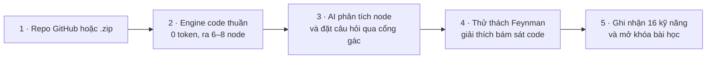
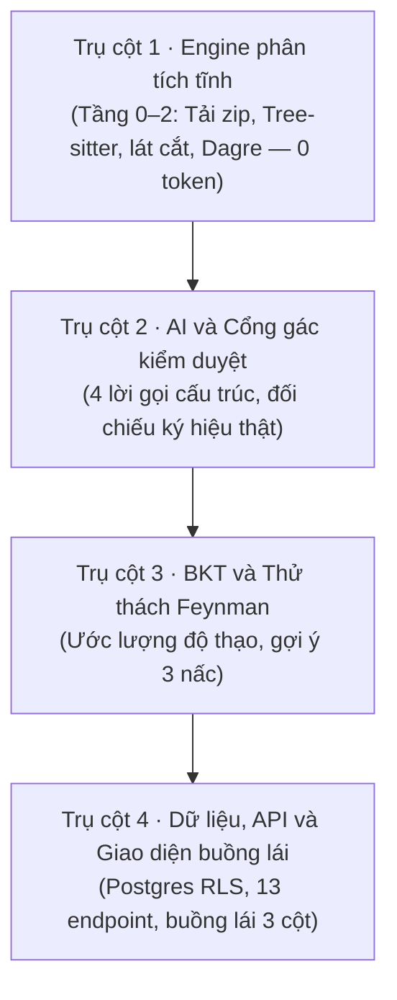
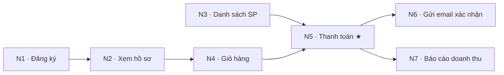
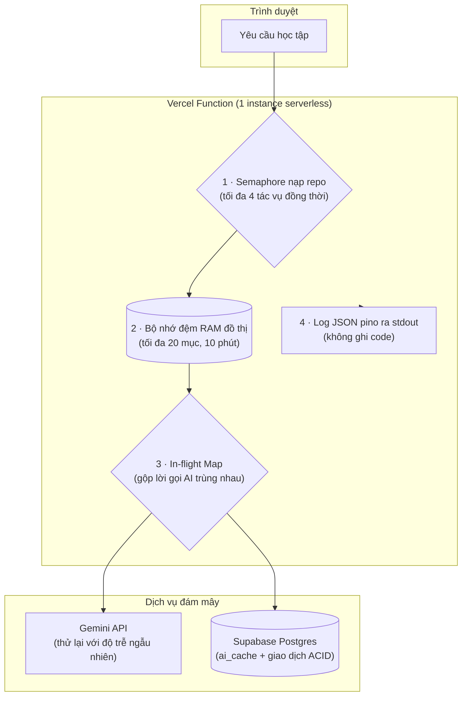

# SIMPLIFEY CHẠY THẾ NÀO — BẢN TOÀN CẢNH CHO CẢ NHÓM

> Khi có điểm lệch, tài liệu đặc tả kỹ thuật trong thư mục `spec/` luôn là nguồn chân lý.
> Mục đích: Đây là bài đọc đầu tiên của cả nhóm để hiểu toàn bộ bức tranh sản phẩm, kiến trúc 4 phần, luồng chạy thực tế qua repo mẫu `shop-api` và cách hệ thống vận hành. Chi tiết kỹ thuật sâu được chia về các tài liệu từ 02 đến 07.

---

## 1. Vấn đề thực tế và sản phẩm SimpliFey

Trong các đồ án công nghệ thông tin mà sinh viên chúng ta thường làm, việc sử dụng các công cụ trí tuệ nhân tạo để sinh code đã trở nên rất quen thuộc. Nhiều bạn có thể tạo ra cả một dự án web chỉ sau vài câu lệnh mô tả. Tuy nhiên, vấn đề thực tế nảy sinh là: code có thể chạy được, nhưng khi thầy cô hoặc nhà tuyển dụng hỏi "luồng dữ liệu đi qua những file nào, vì sao lại tách ra middleware này, đoạn code này có nguy cơ gì về hiệu năng và bảo mật" thì phần lớn sinh viên lúng túng, không giải thích được cội nguồn cấu trúc mà mình đang dùng.

SimpliFey được xây dựng để giải quyết bài toán đó. Bạn chỉ cần đưa vào đường dẫn repo GitHub công khai (public) hoặc tải lên một file nén `.zip`, hệ thống sẽ dẫn dắt bạn qua 4 bước:

1. **Vẽ bản đồ học tập từ chính code của bạn:** Máy chủ tự động phân tích ngữ pháp mã nguồn và rút ra 6 đến 8 node quan trọng nhất. Mỗi node là một luồng nghiệp vụ xuyên qua nhiều file (ví dụ: luồng Đặt hàng đi từ file nhận yêu cầu route, qua file kiểm tra middleware, xuống file xử lý service, rồi tới file lưu dữ liệu repository), hoàn toàn không phải một file đơn lẻ. Bản đồ này được dựng hoàn toàn bằng code thuần, không tốn token AI và không tốn chi phí.
2. **AI phân tích từng node:** Khi bạn mở một node trên bản đồ, AI mới đọc vài chục dòng code của lát cắt đó và chỉ ra: node này thể hiện những kỹ năng phần mềm nào, kiến trúc được tổ chức ra sao, đâu là điểm viết tốt và đâu là điểm viết chưa tốt.
3. **Thử thách giải thích Feynman:** Hệ thống đặt câu hỏi tình huống bám sát các dòng code thật trong repo cho những kỹ năng bạn chưa vững. Bạn trả lời bằng ngôn ngữ của chính mình. Trả lời chưa đúng thì nhận gợi ý từng nấc; trả lời đúng thì hoàn thành node và mở khóa bài học kế tiếp.
4. **Theo dõi năng lực dài hạn:** Hệ thống ghi nhớ độ thuần thục của bạn trên 16 kỹ năng kỹ nghệ phần mềm thông qua mô hình xác suất. Những kỹ năng lâu ngày không luyện tập sẽ nhạt dần trên giao diện. Đây chỉ là thông tin hiển thị, hệ thống không có nút ôn tập.



### Ba nguyên tắc nền tảng của hệ thống

- **Code thuần làm trước, AI làm sau:** Toàn bộ khâu đọc file, phân tích cú pháp, tìm mối quan hệ gọi hàm và dựng khung bản đồ đều do thuật toán code thuần thực hiện. AI chỉ được gọi ở bước sau cùng và chỉ đọc các lát cắt code ngắn để làm đúng nhiệm vụ phân tích nội dung và chấm bài.
- **Không chạm ổ đĩa cho mã nguồn (Zero-Disk):** Mã nguồn dự án và file nén tải lên chỉ tồn tại tạm thời trong bộ nhớ RAM của máy chủ khi phân tích. Hệ thống không lưu trữ bất kỳ file code, đoạn trích dẫn code hay cây cú pháp nào vào ổ cứng hay cơ sở dữ liệu.
- **Máy chủ là nguồn chân lý duy nhất (Server Single Source of Truth):** Toàn bộ các quyết định về điểm số kỹ năng, số lượt trả lời, việc mở khóa các node và đáp án mẫu đều do máy chủ kiểm soát và lưu trữ trong cơ sở dữ liệu Postgres. Trình duyệt chỉ nhận bản sao hiển thị và không thể tự ý thay đổi tiến độ.

Tra chi tiết: spec/01_KIEN_TRUC_VA_LUONG.md Mục 1 và 2.

---

## 2. Bốn trụ cột của hệ thống

Toàn bộ hệ thống SimpliFey được cấu thành từ 4 trụ cột chuyên biệt, phối hợp nhịp nhàng theo một chiều dữ liệu:



### Trụ cột 1: Engine phân tích tĩnh (Tầng 0 đến Tầng 2)
Engine chịu trách nhiệm tiếp nhận repo từ mạng hoặc file tải lên, lọc bỏ các thư mục rác (như thư viện cài sẵn hay file ảnh), che đi các khóa bí mật lỡ để trong code, và giữ lại tối đa 100 file mã nguồn quan trọng trong bộ nhớ RAM. Sau đó, bộ phân tích cú pháp Tree-sitter lập danh bạ các hàm và lần theo vết gọi hàm để trích xuất các lát cắt nghiệp vụ từ điểm đón yêu cầu (route) xuống tầng lưu dữ liệu. Các thuật toán đồ thị như Tarjan gộp các hàm gọi vòng, PageRank xếp hạng độ quan trọng, và Dagre bố trí tọa độ hiển thị để tạo ra bản đồ học tập từ 6 đến 8 node rõ ràng, mạch lạc mà không tốn một token AI nào.
- *Đọc sâu tài liệu:* [02_engine.md](02_engine.md)

### Trụ cột 2: AI và hệ thống cổng gác kiểm duyệt
Hệ thống chỉ sử dụng AI cho đúng 4 tác vụ logic cụ thể: phân tích lát cắt node, viết bản tổng quan kiến trúc toàn dự án, tạo câu hỏi thử thách bám code, và chấm điểm bài giải thích của người học. Để ngăn chặn việc AI đưa ra thông tin sai lệch hoặc bịa đặt, mọi phản hồi từ AI đều phải đi qua một cổng gác bằng code thuần túy: kiểm tra các tên hàm và tên biến được nhắc tới có thực sự nằm trong code hay không, từ chối các công nghệ không hề có trong dự án, và bắt buộc trả về theo định dạng JSON chặt chẽ.
- *Đọc sâu tài liệu:* [03_ai_va_cong_gac.md](03_ai_va_cong_gac.md)

### Trụ cột 3: Thuật toán BKT và Thử thách Feynman
Dựa trên phương pháp học tập nổi tiếng của nhà vật lý Richard Feynman (học sâu bằng cách tự giải thích lại bằng lời của mình), hệ thống đưa ra các câu hỏi tình huống thực tế bám sát các dòng code. Năng lực của người học trên 16 kỹ năng kỹ nghệ phần mềm được theo dõi liên tục bằng mô hình toán học BKT (Bayesian Knowledge Tracing). Mỗi câu trả lời đúng hoặc sai sẽ cập nhật xác suất thành thạo của kỹ năng đó. Khi người học gặp khó khăn, hệ thống cho tối đa 3 lượt trả lời với gợi ý 3 nấc: nấc 1 gợi mở về khái niệm, nấc 2 chỉ tới bước code cụ thể, nấc 3 là hiện đáp án khi câu kết thúc.
- *Đọc sâu tài liệu:* [04_bkt_va_cau_hoi.md](04_bkt_va_cau_hoi.md)

### Trụ cột 4: Nền tảng dữ liệu, API và Giao diện buồng lái 3 cột
Toàn bộ dữ liệu tiến độ học tập, điểm kỹ năng lâu dài và câu hỏi được lưu trữ an toàn trong cơ sở dữ liệu Supabase Postgres, được bảo vệ bằng chính sách phân quyền cấp hàng (RLS). Hệ thống cung cấp 13 endpoint API thực hiện các nghiệp vụ học tập. Ở phía người dùng, giao diện được tổ chức theo buồng lái 3 cột trực quan: Cột trái là bản đồ kiến trúc có thể tương tác; Cột giữa là trình xem code lát cắt tô sáng chính xác từng bước; Cột phải là buồng lái học tập gồm tab X-Ray phân tích cấu trúc, tab Feynman trả lời thử thách và tab Tổng quan toàn dự án.
- *Đọc sâu tài liệu:* [05_du_lieu_va_api.md](05_du_lieu_va_api.md) và [06_giao_dien.md](06_giao_dien.md)

Tra chi tiết: spec/01_KIEN_TRUC_VA_LUONG.md Mục 3 và 4.

---

## 3. Đi một vòng đầy đủ với repo mẫu `shop-api`

Để hiểu toàn bộ hệ thống hoạt động gắn kết với nhau như thế nào trong thực tế, chúng ta hãy cùng theo chân Lan, một người học mới, học qua dự án mẫu `shop-api`.

### Dự án `shop-api` gồm những gì?
`shop-api` là một ứng dụng web bán hàng viết bằng TypeScript trên nền Express kết hợp với thư viện TypeORM và cơ sở dữ liệu Postgres. Dự án chứa các chức năng cơ bản: đăng ký tài khoản, xem hồ sơ cá nhân, danh sách sản phẩm, quản lý giỏ hàng, đặt hàng thanh toán, gửi email xác nhận và báo cáo doanh thu.

Sau khi Engine phân tích, dự án được rút gọn thành một bản đồ gồm 7 node bài học:



Trong đó, node N5 (Thanh toán) là bài học trọng tâm có độ phức tạp cao nhất (node Capstone). Bảng dưới đây thể hiện các kỹ năng và điểm kỹ thuật của từng node:

| Node | Kỹ năng kỹ nghệ phần mềm | Điểm dở kỹ thuật (Nhận định của AI) |
| :-- | :-- | :-- |
| N1 · Đăng ký | Kiểm tra dữ liệu đầu vào, Điều hướng HTTP | Không có |
| N2 · Xem hồ sơ | Xác thực và bảo mật, Điều hướng HTTP | Khóa bí mật JWT viết thẳng trong mã nguồn |
| N3 · Danh sách SP | Tối ưu hóa cơ sở dữ liệu, Phân tầng kiến trúc | Vấn đề truy vấn trong vòng lặp (N+1 query) |
| N4 · Giỏ hàng | Quản lý trạng thái, Kiểm tra dữ liệu đầu vào | Không có |
| N5 · Thanh toán ★ | Toàn vẹn giao dịch, Tối ưu cơ sở dữ liệu, Điều hướng HTTP | Thiếu giao dịch database; truy vấn trong vòng lặp |
| N6 · Gửi email | Bất đồng bộ và đồng thời, Xử lý lỗi | Không có |
| N7 · Báo cáo doanh thu | Tối ưu hóa cơ sở dữ liệu, Độ phức tạp thuật toán | Không có |

### Hành trình học tập của bạn Lan tại node N3 (Danh sách sản phẩm)

Lan là người học mới. Trong hồ sơ của Lan, mọi kỹ năng đều bắt đầu ở mức điểm mặc định ban đầu là 0.25 (chưa đạt ngưỡng đã thạo 0.92, thuộc bậc `NOVICE`).

#### Bước 1: Tiếp nhận và hiển thị bản đồ
Lan dán đường dẫn GitHub của `shop-api` vào hệ thống. Engine xử lý trong bộ nhớ RAM và trả về bản đồ 7 node. Vì N1 và N3 không có node nào đứng trước phụ thuộc, hai node này sáng màu vàng hổ phách (sẵn sàng học). Các node còn lại N2, N4, N5, N6, N7 ở trạng thái khóa (màu xám, viền nét đứt) vì cần hoàn thành các bài học đi trước.

#### Bước 2: Bấm chọn node N3 và đọc code lát cắt
Lan nhấp chuột vào ô N3 "Danh sách SP". Cột giữa lập tức hiển thị toàn bộ lát cắt nghiệp vụ 3 bước của node N3, được trích xuất từ 3 file khác nhau:

```ts
// Bước 1 · ENTRY_POINT · src/controllers/product.controller.ts dòng 8–11
router.get('/products', async (req, res) => {
  const products = await productService.listProducts();
  res.json(products);
});
// Bước 2 · BUSINESS_LOGIC · src/services/product.service.ts dòng 14–20
async listProducts() {
  const products = await productRepo.findAll();
  for (const p of products) {
    p.category = await categoryRepo.findById(p.categoryId);
  }
  return products;
}
// Bước 3 · DATA_ACCESS · src/repos/category.repo.ts dòng 5–7
findById(id) {
  return this.repo.findOne({ where: { id } });
}
```

#### Bước 3: Xem phân tích kiến trúc tại Tab X-Ray
Trình duyệt gọi endpoint phân tích node lên máy chủ. AI gửi về bản phân tích thô có chứa 3 kỹ năng: Tối ưu hóa cơ sở dữ liệu, Phân tầng kiến trúc và Xác thực bảo mật. Khi qua cổng gác kiểm duyệt:
- Cổng gác phát hiện kỹ năng Xác thực bảo mật chỉ định hàm kiểm tra quyền ở bước 3, nhưng trong code bước 3 không hề có hàm đó. Cổng gác lập tức gạch bỏ kỹ năng này.
- Hai kỹ năng còn lại được giữ nguyên vì có bằng chứng thật trong code: Tối ưu hóa cơ sở dữ liệu xuất hiện tại bước 2 qua lời gọi `findById` trong vòng lặp; Phân tầng kiến trúc xuất hiện tại bước 1 khi route chỉ chuyển tiếp cho service mà không tự truy vấn database.
- Tab X-Ray hiển thị điểm hay (tách biệt tầng rõ ràng) và điểm dở kỹ thuật kèm nhãn "Nhận định của AI" (vòng lặp gọi database cho từng sản phẩm khiến trang tải chậm).

#### Bước 4: Chuyển sang Tab Feynman và nhận câu hỏi
Lan chuyển sang tab Feynman để luyện tập. Máy chủ nhận thấy cả hai kỹ năng của N3 Lan đều chưa vững (điểm 0.25, dưới ngưỡng đã thạo 0.92) nên tạo một lần học gồm 2 câu hỏi ở bậc `NOVICE`. AI tạo câu hỏi, đáp án mẫu và danh sách ý bắt buộc rồi lưu toàn bộ vào bảng cơ sở dữ liệu trên máy chủ. Máy chủ chỉ gửi nội dung câu hỏi về cho trình duyệt của Lan mà không gửi kèm đáp án.

#### Bước 5: Trả lời Câu hỏi 1 về Tối ưu hóa cơ sở dữ liệu
Nội dung câu hỏi hiển thị cho Lan:
  #### Bước 6: Trả lời Câu hỏi 2 về Phân tầng kiến trúc
Lan bấm nút chuyển sang câu hỏi thứ hai:
> *"Sản phẩm trả về có thêm thông tin loại hàng. Loại hàng đó từ đâu mà có?"*

Lan trả lời chính xác ngay trong lần thử đầu tiên: nêu đúng đường đi từ route ở `product.controller.ts` qua `productService.listProducts`, đến `categoryRepo.findById` dùng `findOne`, rồi loại hàng được gắn vào sản phẩm trước khi trả về route.
- Máy chủ xác nhận đạt ngay lần đầu. Thuật toán BKT nâng điểm kỹ năng Phân tầng kiến trúc của Lan từ 0.25 lên **0.5767** (đủ điều kiện chuyển lên bậc Thực hành).

#### Bước 7: Hoàn thành bài học và mở khóa
Cả 2 câu hỏi của node N3 đều đã hoàn thành đạt yêu cầu. Máy chủ chốt trạng thái của N3 thành Hoàn thành (node chuyển sang màu xanh lá cây). Vì node N5 còn phải đợi hoàn thành node N4 nên hệ thống chưa mở khóa N5, nhưng tiến độ của Lan đã được lưu trên máy chủ.

Tra chi tiết: spec/50_TEST_VA_FIXTURE.md Mục 1 và Mục 3.1.

---

## 4. Vận hành hệ thống: Log, Xử lý đồng thời và Bộ nhớ đệm

Để một hệ thống web chạy ổn định khi nhiều người cùng vào học trong một đợt thi đồ án, khâu vận hành đóng vai trò quyết định. Đồ án của sinh viên thường bỏ qua phần này hoặc viết rất sơ sài, dẫn đến việc máy chủ bị treo hoặc tài khoản dịch vụ bị khóa đột ngột.



### Chuẩn hóa ghi nhận nhật ký (Logging)
Hệ thống sử dụng thư viện `pino` xuất nhật ký theo định dạng JSON một dòng ra cổng xuất chuẩn `stdout` để nền tảng lưu trữ tự động thu gom. Mỗi dòng nhật ký chứa mã định danh yêu cầu, đường dẫn API, thời gian thực thi, số lượng token tiêu thụ và mã lỗi (nếu có).

Nhằm tuân thủ nguyên tắc bảo mật và không lưu mã nguồn, hệ thống đặt ra **danh sách không được ghi vào nhật ký**:
1. **Không ghi mã nguồn:** Không in nội dung file code, đoạn code trích dẫn, cây cú pháp hay lát cắt code gửi cho AI.
2. **Không ghi khóa bí mật:** Không in các khóa quản trị cơ sở dữ liệu hay khóa API dịch vụ AI.
3. **Không ghi thông tin danh tính và mã token:** Không in mã token truy cập hay header xác thực người dùng.
4. **Không ghi câu trả lời của người học:** Không in nguyên văn nội dung câu giải thích do người học nhập vào.

### Xử lý đồng thời trong bộ nhớ máy chủ (1 instance)
Do hệ thống chạy trên nền tảng serverless, các cơ chế kiểm soát đồng thời được cài đặt trực tiếp trong bộ nhớ của từng tiến trình (instance) để tối ưu tốc độ:
- **Cơ chế Semaphore tiếp nhận repo:** Giới hạn tối đa 4 tác vụ nạp repo diễn ra đồng thời trong một tiến trình máy chủ, điều phối theo hàng đợi vào trước ra trước (FIFO). Nếu phải xếp hàng chờ quá 10 giây, hệ thống trả về thông báo máy chủ đang bận để bảo vệ bộ nhớ.
- **Bản đồ ghép lời gọi AI (In-Flight Map):** Khi nhiều người dùng cùng bấm vào một node chưa có kết quả phân tích và rơi vào cùng một instance, máy chủ chỉ gửi một yêu cầu tới Gemini API; các yêu cầu gửi tới sau sẽ cùng lắng nghe chung kết quả đang chờ trong bộ nhớ RAM, tránh việc gọi lặp gây lãng phí tài nguyên.
- **Thử lại có độ trễ ngẫu nhiên (Backoff và Jitter):** Khi gọi AI mà gặp lỗi quá tải hoặc nghẽn mạng tạm thời, hệ thống tự động thử lại 1 lần sau 500 mili-giây cộng thêm một khoảng ngẫu nhiên từ 0 đến 100 mili-giây để phân tán lưu lượng, tránh tạo thành đợt sóng dồn dập làm sập dịch vụ.
- **Kiểm soát hạn mức phiên học:** Mỗi phiên học được cấp hạn mức trần là 80.000 token (tính cả lượng gửi đi và nhận về). Máy chủ đếm số token sau từng lượt gọi; nếu vượt ngưỡng thì khóa các lượt gọi mới để tránh phát sinh chi phí ngoài ý muốn.

### Chiến lược bộ nhớ đệm (Cache)
- **Bộ nhớ đệm RAM đồ thị trong tiến trình:** Kết quả phân tích đồ thị được lưu trong bộ nhớ RAM tối đa 20 repo gần nhất và tự hết hạn sau 10 phút. Bộ nhớ đệm này chỉ nhằm mục đích giúp phản hồi nhanh hơn, hệ thống không bao giờ phụ thuộc vào nó. Khi chuyển sang một tiến trình mới làm mất bộ nhớ đệm tạm, máy chủ tải lại mã nguồn theo đúng mã commit đã lưu và chạy lại Engine để dựng lại đồ thị như cũ. Riêng phiên từ file `.zip` thì không dựng lại được, người học phải upload lại file.
- **Bộ nhớ đệm AI dùng chung (`ai_cache`):** Các văn bản do AI tạo ra sau khi đã qua cổng gác kiểm duyệt (bản phân tích node, tóm tắt tổng quan kiến trúc) được lưu vào bảng cơ sở dữ liệu Postgres. Khi một người học khác mở cùng repo đó ở cùng phiên bản, dữ liệu được lấy ngay từ cơ sở dữ liệu với chi phí 0 token.

### Các nút thắt kỹ thuật và lộ trình nâng cấp

| Nút thắt | Giới hạn ở bản thi hiện tại | Dấu hiệu cảnh báo | Hướng nâng cấp tiếp theo |
| :-- | :-- | :-- | :-- |
| **1. Bộ nhớ RAM và thời gian chạy Function** | Giới hạn tài nguyên của gói dịch vụ miễn phí; tối đa 4 tác vụ nạp đồng thời | Xuất hiện lỗi máy chủ bận hoặc thời gian thực thi chạm trần | Tách Engine thành cụm máy chủ xử lý tác vụ nền riêng (Worker) qua hàng đợi tin nhắn |
| **2. Hạn mức API của dịch vụ AI** | Hạn mức gói miễn phí của nhà cung cấp; hạn mức 80.000 token mỗi phiên | Xuất hiện lỗi quá hạn mức token hoặc lỗi từ chối dịch vụ từ AI | Đăng ký gói dịch vụ trả phí theo mức dùng thực tế, đưa các tác vụ phân tích nền vào hàng đợi |
| **3. Bộ nhớ đệm RAM theo tiến trình đơn lẻ** | Bộ nhớ đệm tạm trong RAM bị mất khi nền tảng serverless thay đổi tiến trình | Máy chủ phải tải lại mã nguồn theo mã commit nhiều lần | Sử dụng bộ nhớ đệm phân tán dùng chung cho toàn hệ thống (như Redis) |
| **4. Số lượng kết nối cơ sở dữ liệu** | Giới hạn số lượng kết nối đồng thời của gói dịch vụ cơ sở dữ liệu | Xuất hiện lỗi không thể kết nối lưu trữ dữ liệu | Bật tính năng gom cụm kết nối giao dịch (Transaction Pooler) hoặc nâng cấp gói máy chủ |

Tra chi tiết: spec/04_KIEN_TRUC_TRIEN_KHAI.md Mục 8, 9 và 14.

---

## 5. Xử lý các tình huống bất thường và giới hạn thực tế

Một hệ thống đáng tin cậy không phải là hệ thống tự nhận mình không bao giờ có lỗi, mà là hệ thống luôn nói rõ sự thật về những gì mình làm được, những gì chưa làm được và có phương án xử lý rõ ràng khi gặp tình huống bất thường.

### Xử lý đúng bản chất các tình huống đặc biệt

- **Chế độ Ngoại tuyến (Offline):** Đây là chế độ chạy thử nghiệm phục vụ thuyết trình (bật bằng phím tắt `Ctrl+Shift+D`), sử dụng một gói dữ liệu được ghi lại từ một lần chạy thật và đã được các thành viên trong nhóm duyệt tay cẩn thận. Khi bật, nhãn "Offline" luôn hiển thị trên màn hình và hệ thống không lưu tiến độ vào cơ sở dữ liệu. Cần lưu ý rõ: **Offline là chế độ demo dùng dữ liệu ghi sẵn, không phải là tính năng học tập khi mất mạng**.
- **Tính năng Báo sai:** Khi người học thấy câu trả lời của mình bị chấm trượt oan, người học có thể bấm nút Báo sai. Nút này chỉ có ở câu `FAILED` kết thúc bằng nộp bài. Khi nhận yêu cầu, **máy chủ xử lý ngay: cắm cờ cho câu đó, hoàn lại điểm nếu kỹ năng chưa có cập nhật mới, rồi tính lại màu node. Không có người duyệt**.
- **Câu hỏi bị bỏ qua (`DROPPED`):** Trong quá trình tạo câu hỏi, nếu nội dung AI sinh ra vi phạm cổng gác kiểm duyệt (ví dụ: bịa ra tên hàm không có trong code) và sau khi gọi lại 1 lần vẫn tiếp tục vi phạm, câu hỏi đó sẽ bị đánh dấu là bỏ qua. Cần hiểu đúng rằng: **`DROPPED` là câu AI không đặt được, không phải là phiên học bị hủy bỏ**. Hệ thống chỉ bỏ qua đúng câu hỏi bị lỗi đó để người học tiếp tục làm các câu hỏi hợp lệ khác. Nếu mọi câu đều `DROPPED` thì không tạo lần học, giao diện hiện nút "Thử lại".
- **Khi AI phân tích một node bị lỗi:** Nếu sau khi gọi lại AI vẫn không có kỹ năng hợp lệ nào cho một node, node đó giữ màu vàng hổ phách kèm nút "Thử lại phân tích". Các node phụ thuộc phía sau vẫn được mở khóa bình thường kèm một biểu tượng tam giác cảnh báo nhỏ để người học không bị gián đoạn toàn bộ bài học.

### Những giới hạn hệ thống phải nói thật

1. **AI không kiểm soát được hoàn toàn ngữ nghĩa:** Cổng gác của hệ thống chỉ kiểm tra được sự tồn tại của tên biến, tên hàm, số dòng và danh mục từ cấm; cổng gác không thể biết được AI có thực sự hiểu đúng bản chất nghiệp vụ hay không. Do đó, mọi nhận định của AI về điểm yếu trong code luôn phải mang nhãn rõ ràng: "Nhận định của AI" và đi kèm nút Báo sai để bảo vệ người học.
2. **Phạm vi ngôn ngữ được kiểm chứng:** Trong phạm vi bản thi, hệ thống chỉ kiểm chứng độ chính xác hoàn chỉnh trên hai ngôn ngữ là TypeScript/JavaScript và Python. Đối với các ngôn ngữ khác, hệ thống chỉ hỗ trợ phân tích cấu trúc cú pháp cơ bản và các mũi tên phụ thuộc trên bản đồ được hiển thị bằng nét đứt thể hiện mức độ suy luận.
3. **Mô hình tính điểm chưa qua hiệu chuẩn thực tế:** Ngưỡng 70 điểm để công nhận đạt câu hỏi và các tham số xác suất trong mô hình BKT hiện tại do nhóm tự đặt, chưa được hiệu chuẩn với giảng viên.
4. **Các số đo về thời gian và chi phí:** Mọi con số về thời gian chạy Engine (ví dụ: mục tiêu dưới 1,5 giây), chi phí và thời gian gọi AI được nhắc đến trong các tài liệu thiết kế đều là **mục tiêu kỹ thuật hoặc số liệu ước tính, chưa đo đạc đầy đủ trên môi trường sản xuất quy mô lớn**. Khi chạy thực tế, hệ thống luôn hiển thị số đo thực đo được trên đồng hồ bấm giờ tại giao diện.

Tra chi tiết: spec/01_KIEN_TRUC_VA_LUONG.md Mục 9.

---

## 6. Dữ liệu nằm ở đâu

Bảng dưới đây tổng hợp toàn bộ các loại dữ liệu trong hệ thống, chỉ rõ nơi lưu trữ, thời gian tồn tại và quyền truy cập:

| Loại dữ liệu | Nơi lưu trữ | Thời gian tồn tại | Ai được ghi | Ai được đọc |
| :-- | :-- | :-- | :-- | :-- |
| **Mã nguồn dự án, file nén, cây cú pháp** | Bộ nhớ RAM máy chủ | Chỉ trong lúc Engine chạy | Engine nội bộ | Engine nội bộ |
| **Kết quả đồ thị Engine hoàn chỉnh** | Bộ nhớ RAM máy chủ (LRU Cache 1 instance) | Tối đa 10 phút, có thể mất bất kỳ lúc nào khi đổi tiến trình | Engine nội bộ | Các route handler nội bộ |
| **Lát cắt code hiển thị trên giao diện** | Trình duyệt người học (Zustand Store) | Trong phiên làm việc (mất khi tải lại trang hoặc đổi repo) | Máy chủ gửi về | Trình duyệt người học |
| **Tài khoản, hồ sơ điểm 16 kỹ năng** | Cơ sở dữ liệu Supabase Postgres | Lâu dài (cho đến khi xóa tài khoản) | Máy chủ dùng khóa quản trị | Người sở hữu tài khoản qua token xác thực |
| **Phiên học, tiến độ các node** | Cơ sở dữ liệu Supabase Postgres | Lâu dài theo phiên học | Máy chủ dùng khóa quản trị | Người sở hữu phiên học |
| **Câu hỏi, đáp án mẫu, ý bắt buộc** | Cơ sở dữ liệu Supabase Postgres (`node_runs`) | Lâu dài theo phiên học | Máy chủ dùng khóa quản trị | Máy chủ nội bộ; chỉ gửi đáp án về trình duyệt khi câu hỏi đã kết thúc |
| **Lịch sử trả lời, biên bản Báo sai** | Cơ sở dữ liệu Supabase Postgres | Lâu dài theo tài khoản | Máy chủ dùng khóa quản trị | Người học xem lại lịch sử của chính mình |
| **Bản phân tích node và tổng quan kiến trúc** | Cơ sở dữ liệu Supabase Postgres (`ai_cache`) | Lâu dài theo phiên bản repo | Máy chủ dùng khóa quản trị | Máy chủ nội bộ dùng chung cho mọi người học (Trình duyệt cấm đọc trực tiếp) |
| **Cấu hình giao diện (cỡ chữ, vị trí tab)** | Bộ nhớ cục bộ trình duyệt (`localStorage`) | Vĩnh viễn trên trình duyệt của người dùng | Trình duyệt người học | Trình duyệt người học |

Tra chi tiết: spec/01_KIEN_TRUC_VA_LUONG.md Mục 8.

---

## 7. Hướng dẫn đọc sâu theo vai trò

Sau khi đọc xong bức tranh toàn cảnh trong tài liệu này, các thành viên trong nhóm nên tiếp tục đọc sâu các tài liệu chuyên đề tương ứng với phần việc mình phụ trách:

| Vai trò phụ trách | Chủ đề cần nắm vững | Tài liệu cần đọc tiếp |
| :-- | :-- | :-- |
| **Cả nhóm** | Kế hoạch làm việc 21 giờ, các mốc thời gian ráp nối | [07_ke_hoach_21h.md](07_ke_hoach_21h.md) |
| **Phụ trách Engine** | Thuật toán tải zip, lọc file rác, phân tích cú pháp Tree-sitter, trích xuất lát cắt và dựng đồ thị | [02_engine.md](02_engine.md) |
| **Phụ trách AI và Cổng gác** | Cấu trúc 4 lời gọi AI, cơ chế bọc thẻ an toàn, bộ lọc từ cấm và cổng đối chiếu ký hiệu thật | [03_ai_va_cong_gac.md](03_ai_va_cong_gac.md) |
| **Phụ trách Thuật toán học tập** | Công thức toán BKT, mô hình suy giảm trí nhớ theo thời gian, thuật toán lập kế hoạch câu hỏi | [04_bkt_va_cau_hoi.md](04_bkt_va_cau_hoi.md) |
| **Phụ trách Backend và Dữ liệu** | Cấu trúc 8 bảng database, 13 endpoint API, bảo mật RLS và giao dịch chống nghẽn | [05_du_lieu_va_api.md](05_du_lieu_va_api.md) |
| **Phụ trách Giao diện người dùng** | Buồng lái 3 cột, đồng bộ trạng thái chỉ đọc, tô sáng code Monaco và đồ thị ReactFlow | [06_giao_dien.md](06_giao_dien.md) |

Tra chi tiết: doc-de-hieu/07_ke_hoach_21h.md Mục 1.

---

## 8. Từ điển thuật ngữ nhỏ

| Thuật ngữ | Ý nghĩa trong hệ thống SimpliFey |
| :-- | :-- |
| **Repo** | Kho lưu trữ mã nguồn của dự án phần mềm trên GitHub hoặc file nén `.zip`. |
| **Node / Ô / Bài học** | Một luồng nghiệp vụ đi xuyên qua nhiều file từ điểm đón yêu cầu tới cơ sở dữ liệu, không phải là một file đơn lẻ. |
| **Lát cắt (Slice)** | Chuỗi các đoạn code ngắn được trích xuất từ các hàm gọi nhau liên tục, gom lại thành một khối hoàn chỉnh để người học theo dõi. |
| **Token** | Đơn vị định lượng dữ liệu đầu vào và đầu ra khi làm việc với các mô hình ngôn ngữ lớn (khoảng 4 ký tự văn bản). |
| **Cổng gác (Guard)** | Các đoạn code thuần túy kiểm tra phản hồi của AI trước khi hiển thị: bảo đảm tên hàm có thật, không bịa công nghệ, đúng định dạng JSON. |
| **Thử thách Feynman** | Phương pháp học tập chủ động bằng cách tự giải thích lại nguyên lý hoạt động của đoạn code bằng ngôn ngữ của chính mình. |
| **Mô hình BKT** | Thuật toán xác suất Bayesian Knowledge Tracing dùng để ước lượng độ thuần thục của người học trên từng kỹ năng kỹ nghệ phần mềm. |
| **Capstone ★** | Node có độ phức tạp nhận thức (`cognitive_complexity`) lớn nhất trong repo, mỗi đồ thị có đúng 1 node. |
| **Mài mòn (Decay)** | Hiện tượng điểm kỹ năng tự động phai nhạt dần theo thời gian khi người học lâu ngày không luyện tập; thanh kỹ năng hiển thị nhạt dần, không có nút ôn tập. |
| **Mã commit (Commit SHA)** | Chuỗi ký tự định danh duy nhất cho một phiên bản mã nguồn cụ thể trên Git; giúp hệ thống luôn dựng lại cùng một bản đồ học tập nhất quán. |
| **Báo sai** | Thao tác của người học khi thấy mình bị chấm trượt oan; máy chủ xử lý ngay, không có người duyệt, và hoàn lại điểm nếu điểm chưa bị câu khác đổi. |
| **Câu hỏi bị bỏ qua (`DROPPED`)** | Câu hỏi mà AI không thể tạo thành công do vi phạm cổng gác kiểm duyệt sau 1 lần gọi lại; hệ thống bỏ qua câu hỏi này để người học tiếp tục, không phải phiên học bị hủy. |
| **Chế độ Ngoại tuyến (Offline)** | Chế độ demo chạy bằng gói dữ liệu ghi sẵn từ một lần chạy thật đã được duyệt tay; phục vụ thuyết trình nhanh mà không ghi dữ liệu vào cơ sở dữ liệu. |
