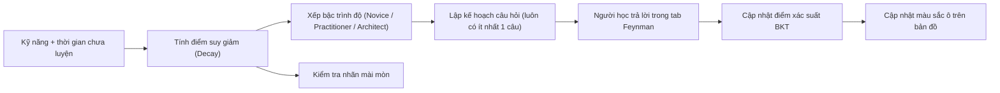
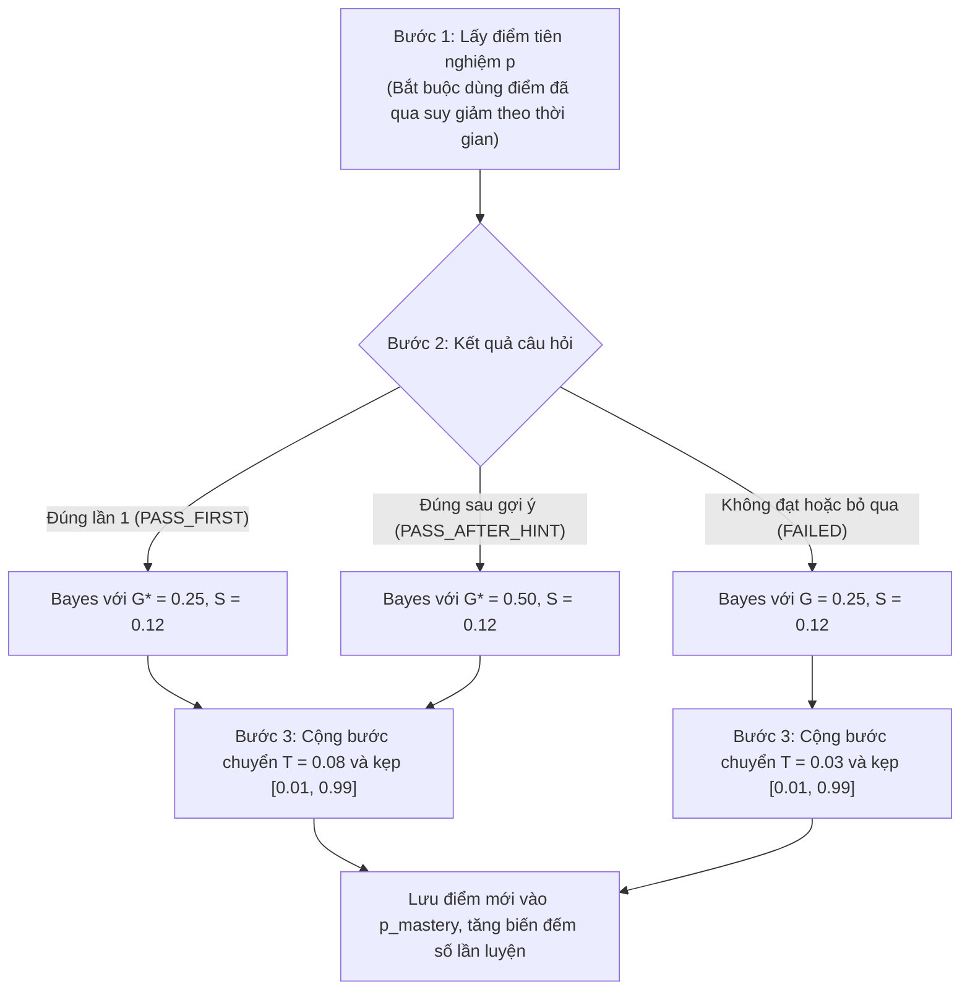
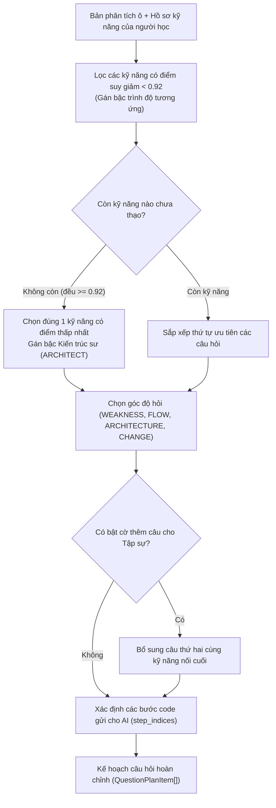
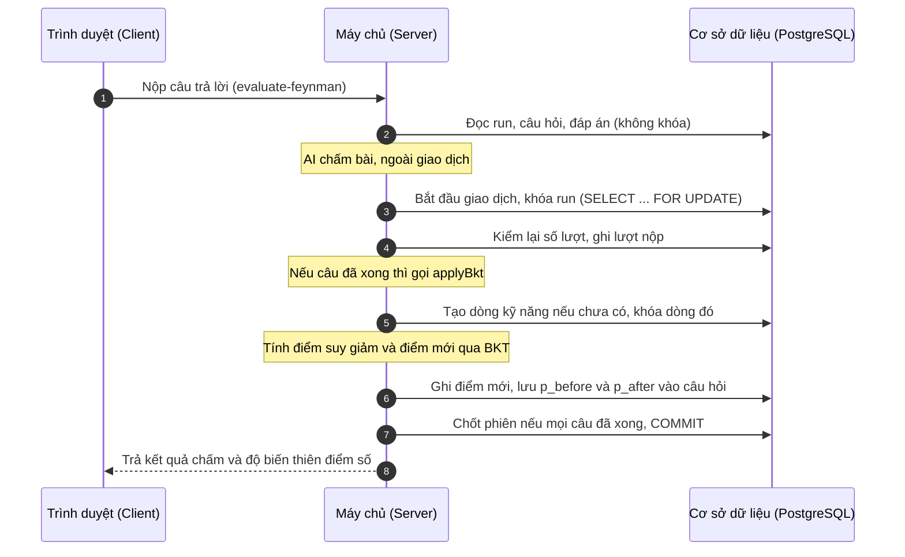
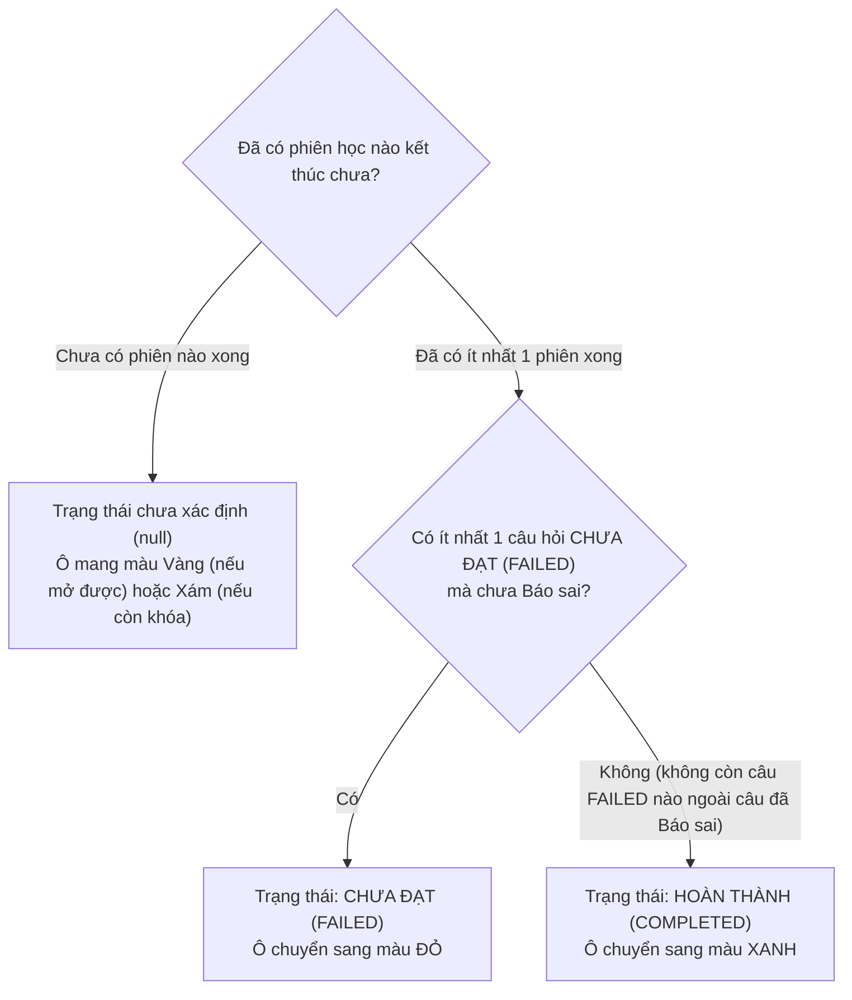
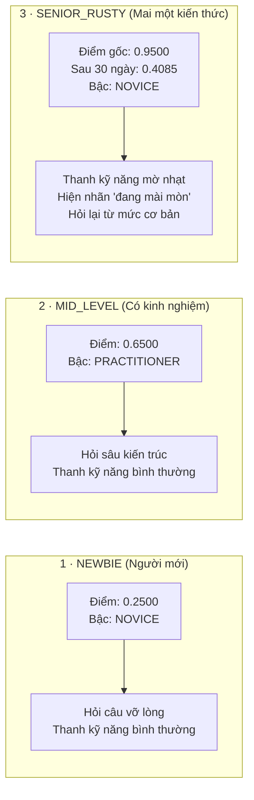

# BKT VÀ KẾ HOẠCH CÂU HỎI — BẢN DỄ HIỂU

> Khi lệch, `spec/` đúng.
> Mục đích: giải thích thuật toán BKT (Bayesian Knowledge Tracing), mô hình suy giảm trí nhớ theo thời gian, danh mục 16 kỹ năng kỹ nghệ phần mềm và cách hệ thống tự động lập kế hoạch câu hỏi cho người học bằng lời thường cho cả nhóm. File này không dùng để code. Bản kỹ thuật nằm ở [`../spec/22_BKT_VA_KE_HOACH_CAU_HOI.md`](../spec/22_BKT_VA_KE_HOACH_CAU_HOI.md).
> Từ dùng trong file: **ô** là node trên bản đồ, **phiên học** là một lần học một node (spec gọi là run), **bậc** là tier.

---

## 1. Toàn cảnh và các nguyên tắc cốt lõi

### Vấn đề thực tế trong các hệ thống học tập trực tuyến
Trong các trang web học lập trình hay làm bài tập trắc nghiệm mà sinh viên chúng ta thường gặp, câu hỏi thường được đưa ra ngẫu nhiên hoặc cố định theo từng bài. Cách làm này bộc lộ ba nhược điểm lớn:
1. **Ai cũng phải làm bài giống nhau:** Người đã đi làm hoặc đã nắm vững kiến thức vẫn phải trả lời lại những câu hỏi vỡ lòng rất mất thời gian. Ngược lại, người mới bắt đầu lại dễ bị ngợp nếu gặp ngay câu hỏi quá sâu.
2. **Không phân biệt được giữa "hiểu thật" và "đoán mò":** Khi một sinh viên chọn đúng đáp án, hệ thống trắc nghiệm thông thường lập tức cho điểm tối đa mà không tính đến khả năng người đó chỉ đang chọn bừa. Tương tự, khi sinh viên làm sai, hệ thống trừ sạch điểm mà không nhận ra có thể họ chỉ mắc một sơ suất nhỏ dù đã hiểu bản chất.
3. **Mặc định kiến thức tồn tại vĩnh viễn:** Bạn học thuộc một khái niệm vào tuần trước, tuần này không đụng đến thì chắc chắn sẽ quên dần. Tuy nhiên các nền tảng học tập thường vẫn đánh dấu bạn "đã hoàn thành" và không bao giờ đo lường sự mai một của trí nhớ.

SimpliFey giải quyết bài toán này bằng hai thứ: **thuật toán BKT (Bayesian Knowledge Tracing)** để ước lượng độ thuần thục của người học sau từng câu trả lời, và **hàm suy giảm theo thời gian (decay)** để hạ dần điểm khi lâu ngày không luyện. Từ đó, khi người học bắt đầu học một ô trên bản đồ, máy chủ tự lập một kế hoạch câu hỏi riêng: hỏi kỹ năng người đó còn yếu, ở mức độ phù hợp, và bám vào đoạn code của dự án.



### 5 nguyên tắc cốt lõi khi cài đặt
Để cùng một đoạn code chạy được ở cả máy chủ lẫn trình duyệt và cho cùng kết quả, phần này tuân theo 5 nguyên tắc:

1. **Hàm thuần túy, không hiệu ứng lề (Pure Functions):** Toàn bộ các hàm tính điểm BKT, tính suy giảm, xếp bậc và lập kế hoạch câu hỏi đều là hàm thuần. Trong thân hàm không đọc/ghi cơ sở dữ liệu, không gọi mạng, không gọi `Date.now()` hay `Math.random()`. Thời điểm hiện tại `now` được truyền từ ngoài vào dưới dạng số mili-giây: máy chủ dùng đồng hồ của máy chủ, trình duyệt dùng `Date.now() + server_clock_offset_ms` (đồng hồ máy khách cộng độ lệch với máy chủ). Nhờ vậy, cùng một đoạn code chạy được trong giao dịch ghi dữ liệu ở máy chủ, và chạy được trên trình duyệt để hiển thị điểm hoặc trong chế độ Offline.
2. **Tính bằng số thực, không làm tròn khi lưu:** Mọi phép tính dùng kiểu `number` (số thực 64-bit), cột `p_mastery` trong Postgres là `double precision` cùng độ chính xác. Không làm tròn sau mỗi bước, vì làm tròn giữa chừng qua nhiều câu sẽ tích lũy sai số (ví dụ ở Mục 10). Hệ thống chỉ làm tròn 4 chữ số khi hiển thị.
3. **Quy ước cho kỹ năng chưa từng luyện tập:** Khi người học mở một ô bài học chứa một kỹ năng mà bản thân chưa từng làm câu hỏi nào trước đó (chưa có dòng lưu trữ trong cơ sở dữ liệu), hệ thống tự động gán điểm xác suất ban đầu là 0.25 (tương ứng với giá trị khởi đầu mặc định trong cấu hình hệ thống), số lần luyện tập bằng 0, số lần làm đúng bằng 0, và không áp dụng tính suy giảm thời gian.
4. **Kỹ năng của một ô lấy từ bản phân tích của AI:** Danh sách kỹ năng của ô là `NodeAnalysis.skills`, tức phần đã qua cổng gác và giữ nguyên thứ tự AI trả về. Code không có bảng dấu hiệu để tự đoán kỹ năng, và ô không có "kỹ năng chính": kỹ năng gắn với từng **câu hỏi**, mỗi câu đúng 1 kỹ năng. Ô phân tích thất bại (`analysis_failed`) thì không lập kế hoạch câu hỏi.
5. **Mọi quyết định đều dựa trên điểm đã suy giảm tại thời điểm hiện tại:** Khi cần xếp bậc trình độ, chọn kỹ năng cần hỏi hay sắp xếp thứ tự câu hỏi trong bài học, hệ thống luôn lấy điểm số đã qua tính toán suy giảm theo thời gian tính đến đúng mốc `now`. Riêng đối với việc hiển thị nhãn "đang mài mòn", hệ thống sẽ so sánh bậc của điểm đã suy giảm với bậc của điểm gốc lưu trong cơ sở dữ liệu.

### Bảng phân công: Hàm nào chạy ở đâu?
Hệ thống phân chia ranh giới rất rõ ràng giữa phần tính toán logic và phần lưu trữ dữ liệu:

| Tên hàm | Chức năng chính | Chạy ở máy chủ (Server) | Chạy ở trình duyệt (Client) |
| :-- | :-- | :-- | :-- |
| `planNodeQuestions` | Lập kế hoạch câu hỏi cho một ô bài học | Chạy khi người học bắt đầu phiên học (`enrich-node`) | Chạy khi học ngoại tuyến (Offline) |
| `outcomeOf` | Quy đổi số lần thử và trạng thái đạt/chưa đạt thành kết quả câu | Chạy khi người học nộp bài hoặc bấm Bỏ qua | Chạy khi học ngoại tuyến (Offline) |
| `computeSkillChange` | Tính toán điểm trước và sau khi cập nhật BKT | Chạy trong quá trình chấm câu hỏi | Chạy khi học ngoại tuyến (Offline) |
| `applyBkt` | Khóa dòng kỹ năng, tính và lưu điểm mới, chạy trong giao dịch đã mở sẵn | Chạy trong giao dịch tại máy chủ khi câu hỏi xong | Không chạy (chế độ Offline không ghi Postgres) |
| `revertSkillChange` | Hoàn lại điểm số khi người học Báo sai | Chạy khi xử lý Báo sai | Không chạy |
| `nodeStatusFromRuns` | Xác định màu sắc của ô (Xanh, Đỏ hoặc chưa xong) | Chạy khi chốt phiên học hoặc khi Báo sai | Chạy khi học ngoại tuyến (Offline) |
| `getDecayedMastery` | Tính điểm số sau khi bị phai mờ theo thời gian | Chạy khi truy vấn thông tin cá nhân | Hiển thị điểm số hiện tại trên giao diện |
| `tierOf`, `overallTier` | Xếp bậc trình độ cho từng kỹ năng và toàn bộ tài khoản | Chạy khi trả thông tin hồ sơ người dùng | Hiển thị huy hiệu trình độ trên giao diện |
| `isDecaying` | Kiểm tra xem kỹ năng có đang bị rớt bậc do thời gian không | Chạy khi người dùng xem hồ sơ | Hiển thị nhãn cảnh báo "đang mài mòn" |

Tra chi tiết: spec/22_BKT_VA_KE_HOACH_CAU_HOI.md Mục 1.


---

## 2. Danh mục 16 kỹ năng kỹ nghệ phần mềm

### Vấn đề thực tế khi đánh giá năng lực lập trình của sinh viên
Khi làm đồ án tốt nghiệp hoặc đi phỏng vấn xin việc, nhiều bạn sinh viên thường tự tin giới thiệu: "Em biết viết TypeScript, biết dùng Express và PostgreSQL". Tuy nhiên, nhà tuyển dụng và các kỹ sư giàu kinh nghiệm thường không đánh giá năng lực của bạn qua việc bạn nhớ bao nhiêu từ khóa cú pháp, mà họ quan sát cách bạn giải quyết các vấn đề cốt lõi của kỹ nghệ phần mềm:
- Bạn viết hàm này thì dữ liệu đầu vào có được kiểm tra chặt chẽ không, hay ai truyền gì vào cũng nhận?
- Cơ sở dữ liệu của bạn có bị quá tải khi số lượng người dùng tăng lên không?
- Khi hai thao tác cùng ghi vào bảng dữ liệu cùng một lúc, tiền và hàng có bị sai lệch không?
- Khi hệ thống gặp lỗi mạng hoặc lỗi bên ngoài, ứng dụng của bạn có sập hoàn toàn không?

Chính vì vậy, SimpliFey không đo người học theo kiểu "thuộc cú pháp ngôn ngữ", mà chia năng lực thành **16 kỹ năng kỹ nghệ phần mềm**. Đây là danh mục cố định dùng khắp hệ thống. AI khi phân tích code phải gắn vào đúng 16 kỹ năng này, kèm bằng chứng là số bước và tên hàm hoặc biến có trong bước đó, rồi code sẽ kiểm bằng chứng. Các ví dụ dưới đây ghi rõ đâu là code thật của `shop-api`, đâu là tình huống tự đặt, vì bản rút gọn của repo mẫu chỉ có code ba ô N2, N3, N5.

### Chi tiết 16 kỹ năng và ví dụ minh họa bằng mã nguồn

#### 1. Định tuyến yêu cầu HTTP (`HTTP_ROUTING`)
- **Nghĩa là gì:** Kỹ năng ánh xạ đúng địa chỉ URL và phương thức HTTP (như GET, POST, PUT, DELETE) vào đúng hàm xử lý (handler hoặc controller); đồng thời trích xuất chính xác các tham số trên đường dẫn và kiểm soát thứ tự ưu tiên của các tuyến đường.
- **Ví dụ trong `shop-api`:** Tại bước 1 của ô N2 (`src/routes/user.routes.ts`), lập trình viên ánh xạ `GET /profile` vào hàm xử lý, có gắn thêm `authMiddleware`:
```ts
router.get('/profile', authMiddleware, async (req, res) => {
  const user = await userService.getProfile(req.user.id);
  res.json(user);
});
```

#### 2. Kiểm tra và ép kiểu dữ liệu đầu vào (`DTO_VALIDATION`)
- **Nghĩa là gì:** Kiểm tra tính hợp lệ và ép kiểu dữ liệu của phần thân yêu cầu (body), tham số truy vấn (query params) theo một khuôn mẫu (schema) định sẵn trước khi đưa dữ liệu vào xử lý nghiệp vụ, nhằm ngăn chặn dữ liệu bẩn và lỗi tràn kiểu.
- **Ví dụ tự đặt:** `spec/50` gắn kỹ năng này cho ô N1 (Đăng ký) và `tech_stack` của `shop-api` có `zod`, nhưng bản rút gọn không có code của N1. Đoạn dưới là giả định, tên `RegisterSchema` không có trong repo mẫu:
```ts
const RegisterSchema = z.object({
  email: z.string().email(),
  password: z.string().min(8)
});
const validatedData = RegisterSchema.parse(req.body);
```

#### 3. Xác thực và phân quyền an toàn (`AUTH_SECURITY`)
- **Nghĩa là gì:** Xác định danh tính của người gửi yêu cầu (xác thực - ai đang gọi) và kiểm tra xem họ có quyền thực hiện hành động đó hay không (phân quyền - được làm gì), thông qua chuỗi token (token), phiên đăng nhập (session), và việc bảo vệ các khóa bí mật.
- **Ví dụ trong `shop-api`:** Tại bước 2 của ô N2 (`src/middlewares/auth.middleware.ts`), middleware kiểm tra token JWT từ header gửi lên. Điểm dở AI nêu ở ô này: khóa `JWT_SECRET` viết thẳng trong code:
```ts
const JWT_SECRET = "<REDACTED_SECRET>";
export function authMiddleware(req, res, next) {
  const token = req.headers.authorization?.split(' ')[1];
  try {
    req.user = jwt.verify(token, JWT_SECRET);
    next();
  } catch {
    res.status(401).json({ message: 'Unauthorized' });
  }
}
```

#### 4. Tiêm phụ thuộc (`DEPENDENCY_INJECTION`)
- **Nghĩa là gì:** Các đối tượng hoặc dịch vụ phụ thuộc được truyền từ bên ngoài vào (thông qua hàm khởi tạo constructor hoặc bộ chứa container) thay vì để hàm tự ý khởi tạo trực tiếp bằng từ khóa `new` bên trong thân hàm, giúp dễ viết mã kiểm thử độc lập (mock test) và giảm sự phụ thuộc cứng.
- **Ví dụ tự đặt (không có trong `shop-api`):** Lớp dịch vụ sản phẩm nhận tầng truy cập dữ liệu qua constructor:
```ts
class ProductService {
  constructor(private productRepo: ProductRepository) {}
  async listProducts() {
    return this.productRepo.findAll();
  }
}
```

#### 5. Phân tách trách nhiệm theo tầng (`LAYERED_SEPARATION`)
- **Nghĩa là gì:** Mỗi tầng trong kiến trúc chỉ làm đúng một nhiệm vụ duy nhất: tầng định tuyến (route) chỉ nhận yêu cầu và trả phản hồi; tầng dịch vụ (service) chỉ xử lý logic nghiệp vụ; tầng dữ liệu (repository) chỉ lo đọc ghi cơ sở dữ liệu. Tầng trên không làm thay việc của tầng dưới và không được gọi tắt bỏ qua tầng trung gian.
- **Ví dụ trong `shop-api`:** Bước 1 của ô N3 chỉ nhận yêu cầu rồi giao ngay cho `productService.listProducts()`, không tự viết câu truy vấn trong file định tuyến.

#### 6. Tối ưu hóa truy vấn cơ sở dữ liệu (`DB_OPTIMIZATION`)
- **Nghĩa là gì:** Kiểm soát số lượng và cấu trúc của các câu lệnh truy vấn gửi tới cơ sở dữ liệu: phát hiện và xử lý lỗi N+1 truy vấn, loại bỏ việc gọi cơ sở dữ liệu lặp đi lặp lại trong vòng lặp, thiết kế chỉ mục (index) và chỉ chọn đúng các cột cần dùng thay vì lấy thừa dữ liệu.
- **Ví dụ trong `shop-api`:** Điểm dở AI nêu tại bước 2 của ô N3 (`src/services/product.service.ts`): truy vấn trong vòng lặp. Càng nhiều sản phẩm, database bị hỏi càng nhiều lần, trang càng chậm:
```ts
// Điểm chưa tốt: vòng lặp gây ra N+1 truy vấn
for (const p of products) {
  p.category = await categoryRepo.findById(p.categoryId);
}
```

#### 7. Bất đồng bộ và xử lý đồng thời (`ASYNC_CONCURRENCY`)
- **Nghĩa là gì:** Điều khiển luồng thực thi bất đồng bộ bằng `async/await`, tránh việc quên từ khóa chờ gây mất dữ liệu, thực hiện song song các tác vụ độc lập để giảm thời gian phản hồi, và ngăn ngừa tình trạng tranh chấp dữ liệu khi nhiều tiến trình chạy cùng lúc.
- **Ví dụ tự đặt:** `spec/50` gắn kỹ năng này cho ô N6 (Gửi email), nhưng bản rút gọn không có code của N6. Giả định quên `await` khi gọi hàm gửi email: lỗi gửi thư sẽ không được bắt ở hàm gọi.

#### 8. Toàn vẹn giao dịch (`TRANSACTION_INTEGRITY`)
- **Nghĩa là gì:** Đảm bảo một chuỗi nhiều thao tác ghi vào cơ sở dữ liệu phải cùng hoàn thành trọn vẹn hoặc cùng được hủy bỏ (rollback) nếu có lỗi xảy ra ở giữa chừng, sử dụng cơ chế khóa dòng và phân định rõ ràng giữa các bước đọc và ghi để tránh tình trạng dữ liệu bị cập nhật dở dang.
- **Ví dụ trong `shop-api`:** Điểm dở AI nêu tại bước 3 của ô N5 (`src/services/order.service.ts`): hàm thanh toán vừa trừ kho vừa tạo đơn nhưng thiếu transaction. Nếu lỗi xảy ra sau khi đã trừ kho mà chưa tạo đơn, kho bị trừ mà không có đơn hàng tương ứng:
```ts
async checkout(userId, items) {
  for (const item of items) {
    const product = await productRepo.findOne({ where: { id: item.productId } });
    if (product.stock < item.qty) throw new Error('Hết hàng');
    product.stock -= item.qty;
    await productRepo.save(product);
  }
  const order = orderRepo.create({ userId, items });
  return orderRepo.save(order);
}
```

#### 9. Xử lý và phân tầng lỗi bài bản (`ERROR_HANDLING`)
- **Nghĩa là gì:** Bắt đúng các ngoại lệ phát sinh, chuyển đổi thành mã lỗi và thông điệp thích hợp trả về cho người dùng hoặc hệ thống gọi, không "nuốt lỗi" bằng các khối bắt lỗi rỗng (`catch {}`), và phân biệt rõ giữa lỗi nghiệp vụ (do dữ liệu người dùng sai) với lỗi máy chủ nội bộ.
- **Ví dụ trong `shop-api`:** Khối bắt lỗi trong middleware xác thực của ô N2 bắt lỗi token hết hạn hoặc không hợp lệ và lập tức trả về mã trạng thái HTTP 401 kèm thông điệp rõ ràng, ngăn không cho yêu cầu đi tiếp vào tầng xử lý bên trong.

#### 10. Quản lý trạng thái ứng dụng (`STATE_MANAGEMENT`)
- **Nghĩa là gì:** Định nghĩa rõ nơi lưu trữ trạng thái của đối tượng nghiệp vụ, kiểm soát ai có quyền thay đổi trạng thái và chỉ cho phép chuyển đổi giữa các trạng thái hợp lệ theo đúng quy trình nghiệp vụ đã quy định.
- **Ví dụ tự đặt:** `spec/50` gắn kỹ năng này cho ô N4 (Giỏ hàng), nhưng bản rút gọn không có code của N4. Giả định giỏ hàng có các trạng thái như đang chọn hàng và đang thanh toán: câu hỏi cần xét ai được đổi trạng thái và chuyển đổi nào là hợp lệ.

#### 11. Độ phức tạp thuật toán và cấu trúc dữ liệu (`ALGORITHMIC_COMPLEXITY`)
- **Nghĩa là gì:** Đánh giá và tối ưu độ phức tạp thời gian và bộ nhớ theo ký hiệu Big-O, lựa chọn cấu trúc dữ liệu thích hợp (ví dụ dùng bảng băm Map/Set thay vì duyệt tìm kiếm tuần tự trên mảng lớn), và xử lý tốt các tình huống dữ liệu biên như mảng rỗng hoặc kích thước phần tử cực lớn.
- **Ví dụ tự đặt:** `spec/50` gắn kỹ năng này cho ô N7 (Báo cáo doanh thu), nhưng bản rút gọn không có code của N7. Giả định cần cộng doanh thu theo danh mục: cộng dồn vào một `Map` cho độ phức tạp O(N), còn hai vòng lặp lồng nhau cho O(N^2).

#### 12. Quản lý bộ nhớ và vòng đời tài nguyên (`MEMORY_MANAGEMENT`)
- **Nghĩa là gì:** Kiểm soát việc cấp phát và giải phóng tài nguyên hệ thống: sử dụng luồng dữ liệu (stream) hoặc bộ đệm (buffer) khi xử lý các file có dung lượng lớn, đóng kết nối cơ sở dữ liệu khi không dùng, hủy các hàm lắng nghe sự kiện để tránh hiện tượng rò rỉ bộ nhớ theo thời gian.
- **Ví dụ tự đặt (không có trong `shop-api`):** Khi xuất danh sách đơn hàng ra file CSV, truyền dữ liệu theo luồng về máy khách thay vì nạp hết vào RAM của máy chủ:
```ts
const readStream = getReportStream();
readStream.pipe(res);
```

#### 13. Thiết kế giao ước API chuẩn mực (`API_CONTRACT_DESIGN`)
- **Nghĩa là gì:** Quy chuẩn cấu trúc dữ liệu của yêu cầu và phản hồi, trả về đúng mã trạng thái HTTP chuẩn mực theo chuẩn RESTful (ví dụ: mã 200 khi đọc thành công, 201 khi tạo mới thành công, 400 khi dữ liệu gửi lên sai, 404 khi không tìm thấy tài nguyên), đảm bảo tính nhất quán và khả năng tương thích ngược của hệ thống API.
- **Ví dụ trong `shop-api`:** Tại bước 1 của ô N5, khi đơn hàng được tạo mới thành công, máy chủ chủ động trả về mã trạng thái HTTP 201 Created cùng với thực thể đơn hàng vừa tạo:
```ts
res.status(201).json(order);
```

#### 14. Chiến lược lưu bộ nhớ đệm (`CACHING_STRATEGY`)
- **Nghĩa là gì:** Quyết định khi nào nên đọc và ghi dữ liệu tạm thời vào bộ nhớ đệm (cache), thiết lập thời gian sống hợp lý cho dữ liệu (TTL), và xây dựng cơ chế làm mới hoặc vô hiệu hóa dữ liệu cũ trong bộ nhớ đệm ngay khi dữ liệu gốc có sự thay đổi.
- **Ví dụ tự đặt (`shop-api` không có cache):** Giả định danh sách sản phẩm ở ô N3 được lưu tạm 60 giây để giảm tải cho database.

#### 15. Chịu tải và chống nghẽn dịch vụ (`RATE_LIMIT_RESILIENCE`)
- **Nghĩa là gì:** Xây dựng khả năng chống chịu cho hệ thống khi bị quá tải hoặc khi các dịch vụ bên ngoài gặp trục trặc: giới hạn tần suất gọi API trên mỗi người dùng, cơ chế tự động thử lại sau một khoảng thời gian tăng dần khi gọi dịch vụ bên ngoài, thiết lập thời gian chờ tối đa (timeout) và tự động ngắt mạch (circuit breaker) để tránh làm sập toàn bộ hệ thống.
- **Ví dụ tự đặt (`shop-api` không có giới hạn tần suất):** Giả định mỗi địa chỉ IP chỉ được gửi 10 yêu cầu thanh toán mỗi phút.

#### 16. Tuần tự hóa và ánh xạ dữ liệu an toàn (`DATA_SERIALIZATION`)
- **Nghĩa là gì:** Chuyển đổi dữ liệu hai chiều giữa đối tượng trong mã nguồn với chuỗi dữ liệu JSON hoặc định dạng truyền tải trên mạng, che giấu hoặc loại bỏ các trường thông tin nhạy cảm (như mật khẩu đã băm, mã khóa bí mật) trước khi gửi phản hồi ra ngoài máy khách.
- **Ví dụ trong `shop-api`:** Tại bước 3 của ô N2 (`src/services/user.service.ts`), hàm chỉ chọn ba cột `id`, `name`, `email`, nên các cột khác của bảng người dùng không đi ra ngoài:
```ts
async getProfile(id) {
  return userRepo.findOne({ where: { id }, select: ['id', 'name', 'email'] });
}
```

### Người học thường thắc mắc điều gì?
- **Vì sao không chia theo ngôn ngữ như JavaScript, Python hay Go?** Ngôn ngữ chỉ là cú pháp. Những vấn đề như N+1 truy vấn, thiếu transaction hay lộ khóa bí mật xuất hiện ở ngôn ngữ nào cũng có.
- **AI có thêm được kỹ năng thứ 17 không?** Không vào được hệ thống. Danh mục nằm trong prompt và trong `responseSchema` (khuôn JSON bắt AI trả đúng giá trị cho phép), và cổng gác còn gạch mọi kỹ năng ngoài danh mục trước khi lưu.

Tra chi tiết: spec/22_BKT_VA_KE_HOACH_CAU_HOI.md Mục 2.


---

## 3. Thuật toán BKT và cách cập nhật điểm kiến thức

### Vấn đề thực tế khi đánh giá kết quả một câu trả lời
Khi chấm bài giải thích của sinh viên trong tab Feynman, hệ thống gặp phải một bài toán xác suất kinh điển:
- Nếu bạn trả lời đúng ngay lần đầu, liệu có chắc chắn bạn đã thực sự thấu hiểu kiến thức, hay bạn chỉ tình cờ nhớ mang máng một vài từ khóa hoặc phỏng đoán vu vơ?
- Nếu bạn trả lời sai, liệu có phải bạn hoàn toàn không biết gì, hay bạn đã hiểu đúng bản chất nhưng chỉ sơ suất gõ nhầm một định danh hàm?
- Nếu bạn cần mở một gợi ý hỗ trợ mới trả lời đúng, mức độ thuần thục của bạn có tương đương với người tự làm được ngay từ đầu không?

Thay vì cộng trừ điểm theo mức cố định, SimpliFey dùng **thuật toán BKT (Bayesian Knowledge Tracing)**. Đây là thuật toán xác suất có sẵn trong nghiên cứu giáo dục, dùng để theo dõi kiến thức của người học qua từng bài tập. Nhóm áp dụng nó, không phải người phát minh.

### Mô hình BKT hoạt động thế nào?
Trạng thái kiến thức của người học đối với mỗi kỹ năng được biểu diễn bằng một biến số thực $p$, thể hiện **xác suất người học đã thực sự nắm vững kỹ năng đó**. Điểm số này luôn nằm trong khoảng giới hạn từ 0.01 đến 0.99.

Mô hình vận hành dựa trên 4 tham số cấu hình:
1. **Điểm xuất phát ban đầu ($p = 0.25$):** Khi bạn chưa từng luyện tập kỹ năng này, hệ thống giả định bạn có 25% xác suất đã hiểu khái niệm.
2. **Xác suất đoán mò ($G$ - Guess):** Khả năng một người chưa nắm vững kỹ năng nhưng vẫn tình cờ trả lời đúng câu hỏi. Nếu đạt ngay lượt đầu, xác suất đoán mò là 0.25. Nếu đạt từ lượt thứ 2 trở đi, xác suất đoán mò là 0.50, vì sau lượt chưa đạt người học đã nhận gợi ý. Hệ thống chỉ dựa vào số lượt, không kiểm tra bạn có đọc gợi ý hay không.
3. **Xác suất sơ suất ($S$ - Slip):** Khả năng một người đã thực sự nắm vững kiến thức nhưng vẫn trả lời sai vì sơ suất, lơ đễnh hoặc hiểu nhầm câu chữ. Hệ thống quy định xác suất sơ suất này là 0.12 (12%).
4. **Xác suất học được sau lượt làm bài ($T$ - Transit):** Sau mỗi lần làm bài, dù đúng hay sai thì não bộ người học vẫn tiếp thu thêm một phần kiến thức mới. Nếu trả lời đúng, mức tiếp thu kiến thức là 0.08. Nếu trả lời sai, bạn vẫn rút ra được một chút bài học với mức tiếp thu là 0.03.

### Luồng 3 bước cập nhật điểm BKT
Mỗi khi một câu hỏi hoàn thành, hệ thống thực hiện tuần tự 3 bước tính toán:



#### Công thức toán học
- **Nếu trả lời đúng (bao gồm làm đúng ngay lần đầu hoặc đúng sau khi xem gợi ý):**
  $$P(L \mid \text{Đúng}) = \frac{p \cdot (1 - S)}{p \cdot (1 - S) + (1 - p) \cdot G^{*}}$$
- **Nếu trả lời không đạt hoặc nhấn nút bỏ qua câu hỏi:**
  $$P(L \mid \text{Sai}) = \frac{p \cdot S}{p \cdot S + (1 - p) \cdot (1 - G)}$$
- **Cập nhật bước chuyển tiếp và kẹp giá trị an toàn:**
  $$p' = \operatorname{clamp}\Big(P(L \mid \text{kết quả}) + \big(1 - P(L \mid \text{kết quả})\big) \cdot T, \quad 0.01, \quad 0.99\Big)$$

Mẫu số của hai công thức luôn lớn hơn 0 vì $S$ và $G^{*}$ nằm trong khoảng (0, 1), nên không có lỗi chia cho 0.

### Ví dụ tính tay chi tiết cho 3 kết quả của một câu hỏi
Để hiểu rõ từng bước tính toán, chúng ta cùng chạy tay chi tiết một câu hỏi xuất phát từ điểm ban đầu của một sinh viên mới: giả định điểm tiên nghiệm $p = 0.25$.

#### Trường hợp 1: Trả lời đúng ngay lần đầu (`PASS_FIRST`)
Người học tự viết câu trả lời và đạt ngay ở lần thử đầu tiên, không cần xem gợi ý. Các tham số: $p = 0.25$, $S = 0.12$, $G^{*} = 0.25$, $T = 0.08$.

- **Bước 1: Tính tử số xác suất hậu nghiệm:**
  $p \cdot (1 - S) = 0.25 \cdot (1 - 0.12) = 0.25 \cdot 0.88 = 0.22$.
- **Bước 2: Tính mẫu số:**
  $(1 - p) \cdot G^{*} = (1 - 0.25) \cdot 0.25 = 0.75 \cdot 0.25 = 0.1875$.
  Mẫu số $= 0.22 + 0.1875 = 0.4075$.
- **Bước 3: Tính xác suất hậu nghiệm:**
  $P(L \mid \text{Đúng}) = \frac{0.22}{0.4075} \approx 0.539877$.
- **Bước 4: Cộng thêm bước chuyển tiếp học tập:**
  $p' = 0.539877 + (1 - 0.539877) \cdot 0.08 = 0.539877 + 0.460123 \cdot 0.08 = 0.539877 + 0.036810 = 0.576687$.
- **Kết quả:** Điểm số mới sau khi làm tròn 4 chữ số là **0.5767**. Nhờ tự trả lời đúng, xác suất thuần thục tăng từ 0.2500 lên 0.5767.

#### Trường hợp 2: Trả lời đúng sau khi xem gợi ý (`PASS_AFTER_HINT`)
Người học nộp lượt 1 chưa đạt, nhận gợi ý rồi đạt ở lượt 2 hoặc 3. Các tham số: $p = 0.25$, $S = 0.12$, $G^{*} = 0.50$ (xác suất đoán mò tăng lên vì có gợi ý), $T = 0.08$.

- **Bước 1: Tính tử số:**
  $p \cdot (1 - S) = 0.25 \cdot 0.88 = 0.22$.
- **Bước 2: Tính mẫu số:**
  $(1 - p) \cdot G^{*} = (1 - 0.25) \cdot 0.50 = 0.75 \cdot 0.50 = 0.375$.
  Mẫu số $= 0.22 + 0.375 = 0.595$.
- **Bước 3: Tính xác suất hậu nghiệm:**
  $P(L \mid \text{Đúng}) = \frac{0.22}{0.595} \approx 0.369748$.
- **Bước 4: Cộng thêm bước chuyển tiếp học tập:**
  $p' = 0.369748 + (1 - 0.369748) \cdot 0.08 = 0.369748 + 0.630252 \cdot 0.08 = 0.369748 + 0.050420 = 0.420168$.
- **Kết quả:** Điểm số mới sau khi làm tròn 4 chữ số là **0.4202**. So với trường hợp 1, điểm tăng ít hơn (0.4202 so với 0.5767), vì hệ thống tính đến khả năng bạn đạt nhờ gợi ý chứ chưa tự làm được.

#### Trường hợp 3: Trả lời không đạt hoặc bấm bỏ qua (`FAILED`)
Người học thử hết 3 lượt vẫn không đạt, hoặc chủ động bấm nút "Bỏ qua câu này". Các tham số: $p = 0.25$, $S = 0.12$, $G = 0.25$, $T = 0.03$.

- **Bước 1: Tính tử số:**
  $p \cdot S = 0.25 \cdot 0.12 = 0.03$.
- **Bước 2: Tính mẫu số:**
  $(1 - p) \cdot (1 - G) = (1 - 0.25) \cdot (1 - 0.25) = 0.75 \cdot 0.75 = 0.5625$.
  Mẫu số $= 0.03 + 0.5625 = 0.5925$.
- **Bước 3: Tính xác suất hậu nghiệm:**
  $P(L \mid \text{Sai}) = \frac{0.03}{0.5925} \approx 0.050633$.
- **Bước 4: Cộng thêm bước chuyển tiếp học tập:**
  $p' = 0.050633 + (1 - 0.050633) \cdot 0.03 = 0.050633 + 0.949367 \cdot 0.03 = 0.050633 + 0.028481 = 0.079114$.
- **Kết quả:** Điểm số mới sau khi làm tròn 4 chữ số là **0.0791**. Điểm tụt mạnh từ 0.2500 xuống 0.0791. Nhờ bước chuyển nhỏ ($T = 0.03$), điểm cuối (0.0791) cao hơn một chút so với hậu nghiệm (0.0506): hệ thống coi người học vẫn học được ít nhiều từ lượt sai.

### Hàm cập nhật trạng thái kỹ năng `updateSkill`
Khi một câu hỏi hoàn tất, hàm `updateSkill` tạo một bản ghi trạng thái mới cho kỹ năng đó. Điểm tiên nghiệm $p$ đưa vào công thức là điểm đã suy giảm tại `now`, không phải `p_mastery` gốc: bằng chứng mới được tính trên trí nhớ thực tế lúc đó, rồi kết quả ghi đè lên `p_mastery`.
- Điểm `p_mastery` nhận giá trị mới $p'$.
- Mốc thời gian luyện tập gần nhất `last_practiced_at` được gán bằng giá trị lớn hơn giữa mốc cũ và `now`; chưa có dòng trạng thái thì lấy `now`.
- Biến đếm tổng số lần luyện tập `practice_count` tăng thêm 1.
- Biến đếm số lần làm đúng `correct_count` tăng thêm 1 nếu kết quả là làm đúng (bao gồm cả làm đúng ngay lần đầu lẫn đúng sau gợi ý).

**Quy tắc cập nhật:** Một câu hoàn thành thì cập nhật đúng một lần cho đúng một kỹ năng của câu đó. Không cập nhật khi: lượt nộp chưa làm xong câu; câu `DROPPED` (AI không đặt được câu này); khi phân tích ô; khi đổi persona. `practice_count` và `correct_count` đếm số câu đã xong có cập nhật BKT, không đếm số lượt nộp.

**Ví dụ có suy giảm:** Giả sử kỹ năng có `p_mastery = 0.9532`, lần luyện gần nhất cách đây 30 ngày, người học đạt ngay lượt đầu. Điểm tiên nghiệm là điểm đã suy giảm (công thức ở Mục 4): $0.25 + (0.9532 - 0.25) \cdot 2^{-30/14} = 0.25 + 0.7032 \cdot 0.226431 = 0.4092$. Đưa vào BKT: $\frac{0.4092 \cdot 0.88}{0.4092 \cdot 0.88 + 0.5908 \cdot 0.25} = \frac{0.360096}{0.507796} \approx 0.7091$, rồi $0.7091 + 0.2909 \cdot 0.08 = 0.7324$. Điểm ghi vào `p_mastery` là 0.7324, thấp hơn 0.9532 dù người học vừa trả lời đúng.

Tra chi tiết: spec/22_BKT_VA_KE_HOACH_CAU_HOI.md Mục 3.


---

## 4. Suy giảm theo thời gian (Decay), các bậc trình độ (Tier) và cơ chế mài mòn

### Vấn đề thực tế của sự mai một kiến thức
Khi sinh viên chúng ta hoàn thành một môn học hoặc đồ án, kiến thức đạt đỉnh ở thời điểm vừa thi xong. Tuy nhiên, nếu trong suốt cả tháng nghỉ hè bạn không hề sờ đến đoạn mã đó:
- Trí nhớ của bạn chắc chắn sẽ phai nhạt dần theo thời gian.
- Nhưng sự phai nhạt này không đưa bạn về con số không tròn trĩnh. Bạn đã từng hiểu khái niệm, nên dù có quên bớt chi tiết triển khai thì nền tảng tư duy cốt lõi vẫn còn đó.
- Nếu một hệ thống học tập cứ giữ nguyên điểm số cao ngất ngưởng của bạn sau cả năm trời không luyện tập, bài kiểm tra tiếp theo có thể sẽ giao cho bạn một thử thách quá khó khiến bạn thất bại. Ngược lại, nếu bắt bạn học lại toàn bộ từ đầu như người chưa biết gì thì lại gây ức chế.

SimpliFey mô phỏng việc này bằng cơ chế **suy giảm theo thời gian (decay)** kiểu bán rã.

### Công thức tính điểm suy giảm theo thời gian
Hệ thống quy định hai thông số then chốt:
- **Chu kỳ bán rã (14 ngày):** Cứ sau 14 ngày người học không làm bất kỳ câu hỏi nào thuộc kỹ năng này, phần kiến thức vượt trên mức nền tảng sẽ giảm đi một nửa.
- **Mức sàn (0.25):** Thời gian không kéo điểm xuống dưới mức này. Điểm đã thấp hơn hoặc bằng sàn (ví dụ 0.0791 sau một câu sai) thì giữ nguyên, không bị giảm thêm và cũng không được kéo lên.

Khi cần xác định điểm số thực tế tại thời điểm hiện tại `now`, hàm `getDecayedMastery` thực hiện các bước:
1. Tính khoảng thời gian trôi qua kể từ lần luyện tập gần nhất:
   $$\Delta t = \frac{\max(0, now - \text{last\_practiced\_at})}{86.400.000} \quad \text{(đổi từ mili-giây sang ngày)}$$
2. Nếu điểm gốc $p$ lưu trong cơ sở dữ liệu nhỏ hơn hoặc bằng mức sàn $0.25$: Điểm giữ nguyên không suy giảm: $\tilde{p} = p$.
3. Nếu điểm gốc $p > 0.25$: Điểm suy giảm được tính theo công thức:
   $$\tilde{p} = 0.25 + (p - 0.25) \cdot 2^{-\Delta t / 14}$$

> **Vì sao không dùng công thức $\max(0.25, p \cdot 2^{-\Delta t / 14})$?**
> Công thức đó sai ở hai đầu. Với điểm dưới sàn, $p = 0.0791$ sẽ bị kéo lên 0.25 chỉ vì thời gian trôi, người vừa trả lời sai lại được tăng điểm. Với điểm cao, $p = 0.95$ sau 30 ngày ra $0.95 \cdot 0.226431 = 0.2151$, tức chạm sàn 0.25, trong khi công thức của hệ thống cho 0.4085. Công thức đúng giữ nguyên điểm dưới sàn và chỉ giảm phần vượt sàn $(p - 0.25)$.
>
> **Nguyên tắc then chốt:** Điểm suy giảm chỉ được tính khi đọc. Hệ thống không ghi giá trị này vào cột `p_mastery`. Điểm gốc trong database chỉ đổi khi hoàn thành một câu mới hoặc khi Báo sai.

### Ba bậc trình độ người học (Tier)
Hệ thống phân chia trình độ của người học thành 3 bậc rõ rệt dựa trên điểm số đã qua suy giảm theo thời gian $\tilde{p}$:

| Bậc trình độ | Mã hiệu | Khoảng điểm suy giảm | Ý nghĩa năng lực |
| :-- | :-- | :-- | :-- |
| **Tập sự** | `NOVICE` | $\tilde{p} < 0.45$ | Người mới bắt đầu; cần hỗ trợ lần theo luồng chạy và chỉ ra vị trí mã nguồn có sẵn. |
| **Thực hành** | `PRACTITIONER` | $0.45 \le \tilde{p} < 0.75$ | Đã nắm chắc kiến thức cơ bản; có thể giải thích nguyên nhân, hậu quả và đề xuất cách sửa lỗi hoặc tái cấu trúc. |
| **Kiến trúc sư** | `ARCHITECT` | $\tilde{p} \ge 0.75$ | Nắm vững toàn diện; có khả năng phân tích các tình huống dữ liệu biên, đánh đổi kiến trúc và chịu tải cao. |

Ngoài ra còn một mốc riêng: **ngưỡng đã thạo ($\tilde{p} \ge 0.92$)**. Đây không phải bậc thứ tư: điểm từ 0.92 trở lên vẫn là `ARCHITECT`. Mốc này chỉ dùng để quyết định có hỏi kỹ năng đó nữa hay không (Mục 5, 6).

**Trình độ tổng thể của tài khoản (`overallTier`):** Chỉ dùng để hiển thị. Hệ thống lấy trung bình điểm đã suy giảm của các kỹ năng có số lần luyện lớn hơn 0, rồi xếp bậc theo bảng trên. Chưa có kỹ năng nào thì là `NOVICE`. Ví dụ hai kỹ năng 0.4202 và 0.5767 vừa luyện xong: trung bình $(0.4202 + 0.5767) / 2 = 0.49845$, từ 0.45 đến dưới 0.75 nên tổng thể là `PRACTITIONER`, dù kỹ năng 0.4202 đứng riêng vẫn là `NOVICE`.

### Cơ chế mài mòn kiến thức (Rustiness)
Mài mòn là một tính năng trực quan nhằm nhắc nhở người học về sự phai nhạt kiến thức.

**Điều kiện xác định mài mòn:**
Một kỹ năng bị coi là "đang mài mòn" khi và chỉ khi thỏa mãn đồng thời hai điều kiện:
1. Người học đã từng luyện tập kỹ năng này trước đó (đã có bản ghi trạng thái trong cơ sở dữ liệu).
2. Bậc trình độ của điểm đã suy giảm thấp hơn bậc trình độ của điểm gốc lưu trong cơ sở dữ liệu:
   $$\text{tierOf}(\tilde{p}) < \text{tierOf}(p)$$

**Hiển thị trên giao diện người dùng:**
- Tại Tab 1 của ô đang mở, mỗi chip kỹ năng có một thanh dài theo điểm đã suy giảm $\tilde{p}$.
- Thanh nhạt dần liên tục theo tỉ lệ $\tilde{p} / p$, kèm tooltip nêu điểm gốc và điểm còn lại.
- Nếu kỹ năng bị rớt bậc, giao diện hiện thêm nhãn **"đang mài mòn"**.
- Nếu điểm có giảm nhưng chưa rớt bậc, thanh chỉ nhạt đi, không có nhãn.

### Ví dụ tính tay chi tiết: Suy giảm, xếp bậc và phát hiện mài mòn
Để thấy rõ ranh giới giữa việc "chưa rớt bậc" và "đã rớt bậc", chúng ta cùng tính tay một kịch bản thực tế:
Giả định một sinh viên sau khi trả lời đúng một câu hỏi về tối ưu cơ sở dữ liệu đạt được điểm gốc $p = 0.5767$ (được lưu vào cơ sở dữ liệu).
Bậc trình độ tương ứng với điểm gốc: vì $0.5767 \ge 0.45$ và $< 0.75$ nên điểm gốc thuộc bậc **Thực hành (`PRACTITIONER`)**.

#### Tình huống A: Sau 9 ngày không luyện tập ($\Delta t = 9$)
- **Bước 1: Tính số chu kỳ bán rã đã trôi qua:**
  $\frac{\Delta t}{14} = \frac{9}{14} \approx 0.642857$.
- **Bước 2: Tính hệ số suy giảm lũy thừa:**
  $2^{-0.642857} \approx 0.640443$.
- **Bước 3: Tính điểm số đã suy giảm:**
  Phần chênh lệch vượt sàn: $p - 0.25 = 0.5767 - 0.25 = 0.3267$.
  Điểm suy giảm: $\tilde{p} = 0.25 + 0.3267 \cdot 0.640443 = 0.25 + 0.209233 = 0.459233$.
  Làm tròn hiển thị: **0.4592**.
- **Bước 4: Xét bậc của điểm suy giảm:**
  Vì $0.4592 \ge 0.45$, điểm suy giảm vẫn thuộc bậc **Thực hành (`PRACTITIONER`)**.
- **Bước 5: Kiểm tra nhãn mài mòn:**
  Bậc hiện tại (`PRACTITIONER`) bằng bậc gốc (`PRACTITIONER`). Kỹ năng chưa bị rớt bậc. Kết quả hàm kiểm tra mài mòn trả về `false`.
  Giao diện: Thanh kỹ năng chỉ mờ nhạt đi một chút, không xuất hiện nhãn "đang mài mòn".

#### Tình huống B: Sau 10 ngày không luyện tập ($\Delta t = 10$)
- **Bước 1: Tính số chu kỳ bán rã:**
  $\frac{\Delta t}{14} = \frac{10}{14} \approx 0.714286$.
- **Bước 2: Tính hệ số suy giảm lũy thừa:**
  $2^{-0.714286} \approx 0.609507$.
- **Bước 3: Tính điểm số đã suy giảm:**
  $\tilde{p} = 0.25 + 0.3267 \cdot 0.609507 = 0.25 + 0.199126 = 0.449126$.
  Làm tròn hiển thị: **0.4491**.
- **Bước 4: Xét bậc của điểm suy giảm:**
  Vì $0.4491 < 0.45$, điểm suy giảm đã rơi xuống dưới ngưỡng và chuyển sang bậc **Tập sự (`NOVICE`)**.
- **Bước 5: Kiểm tra nhãn mài mòn:**
  Bậc hiện tại (`NOVICE`) nhỏ hơn bậc gốc (`PRACTITIONER`). Kỹ năng chính thức bị rớt bậc! Hàm kiểm tra mài mòn trả về `true`.
  Giao diện: Xuất hiện ngay nhãn cảnh báo **"đang mài mòn"**.

### Những hệ quả thiết kế đặc biệt quan trọng
1. **Luyện tập xong là hết mài mòn:** Ngay khi người học hoàn thành một câu hỏi mới cho kỹ năng đó, mốc thời gian được làm mới về hiện tại ($\Delta t = 0$). Điểm suy giảm bằng đúng điểm gốc mới, hai bậc trùng nhau nên nhãn mài mòn biến mất.
2. **Điểm xuất phát thấp không bao giờ mài mòn:** Nếu điểm gốc của bạn nhỏ hơn hoặc bằng mức sàn $0.25$, điểm số không bị suy giảm theo thời gian, do đó bạn không bao giờ bị rớt bậc và không bao giờ bị gắn nhãn mài mòn.
3. **Mài mòn không chặn việc học:** Mài mòn chỉ là thông tin hiển thị. Nó không đổi màu ô, không khóa bài, không tạo phiên học, và không có nút ôn tập. Khi bạn học một ô mới có kỹ năng này, kế hoạch câu hỏi sẽ dùng điểm đã suy giảm.

Tra chi tiết: spec/22_BKT_VA_KE_HOACH_CAU_HOI.md Mục 4.


---

## 5. Nguyên tắc kế hoạch không rỗng và bài học Capstone

### Vấn đề thực tế khi thiết kế luồng học tập cá nhân hóa
Trong nhiều ứng dụng học tập trực tuyến, khi người dùng đã đạt điểm số tối đa ở các bài học trước, hệ thống thường cung cấp tính năng "miễn thi" hoặc "cho qua nhanh" (Fast-Track). Khi bấm vào một bài học mới, nếu tất cả các kỹ năng thành phần đều đã được đánh dấu là thành thạo, hệ thống lập tức đánh dấu hoàn thành bài học đó mà không cần hỏi thêm câu nào.

Thoạt nhìn tính năng này có vẻ tiện lợi, nhưng đối với việc học kỹ nghệ phần mềm dựa trên mã nguồn thực tế của dự án, cách làm này bộc lộ một lỗ hổng nghiêm trọng:
- Một lập trình viên có thể rất giỏi kỹ năng tối ưu truy vấn cơ sở dữ liệu (`DB_OPTIMIZATION`) ở một chức năng đơn giản như hiển thị danh mục sản phẩm, nhưng khi bước sang một chức năng phức tạp như thanh toán đơn hàng kèm trừ kho, bài toán tối ưu lại nằm trong một ngữ cảnh hoàn toàn khác biệt.
- Nếu hệ thống tự cho qua mà không kiểm tra, người học mất cơ hội gặp tình huống thực tế của ô đó.

### Nguyên tắc không miễn thi và kế hoạch câu hỏi không bao giờ rỗng
SimpliFey chọn: **không có cơ chế miễn thi (không Fast-Track)**.
1. **Không ô nào được tự động hoàn thành:** Dù điểm trong hồ sơ cao đến đâu, một ô chỉ chuyển sang Hoàn thành (`COMPLETED`) hoặc Chưa đạt (`FAILED`) khi phiên học của ô đó xong. Việc mở một ô ra xem code không đổi điểm BKT.
2. **Kế hoạch câu hỏi luôn có ít nhất một câu:** Ô có danh sách kỹ năng hợp lệ thì thuật toán luôn trả ít nhất 1 câu ($n \ge 1$), không trả danh sách rỗng.
3. **Quy tắc xử lý khi mọi kỹ năng đều đã thuần thục:** Nếu tất cả các kỹ năng xuất hiện trong ô bài học đều đã đạt điểm số suy giảm từ $0.92$ trở lên (ngưỡng thuần thục):
   - Hệ thống không bỏ qua ô bài học.
   - Thay vào đó, thuật toán sẽ chọn ra **đúng 1 kỹ năng có điểm số suy giảm thấp nhất** trong số các kỹ năng của ô đó để đặt câu hỏi.
   - Nếu có nhiều kỹ năng cùng bằng điểm nhau, hệ thống ưu tiên chọn kỹ năng có số lần luyện tập ít hơn; nếu vẫn hòa thì chọn theo thứ tự xuất hiện đầu tiên trong bản phân tích của ô.
   - Câu này được đặt ở bậc **Kiến trúc sư (`ARCHITECT`)**. Góc hỏi vẫn theo quy tắc chung ở Mục 6: kỹ năng có điểm dở trong ô thì hỏi `WEAKNESS`.

### Bài học thử thách lớn (Capstone)
Trên bản đồ có đúng một ô được gắn nhãn Capstone (trong `shop-api` là ô N5 - Thanh toán):
- Đây là ô có độ phức tạp nhận thức (`cognitive_complexity`) lớn nhất, hòa thì xét Rank Score rồi đến `id`. N5 gồm ba kỹ năng: `TRANSACTION_INTEGRITY`, `DB_OPTIMIZATION`, `HTTP_ROUTING`.
- **Quy tắc áp dụng đồng nhất:** Capstone không có luật riêng về câu hỏi. Ví dụ người học có mọi kỹ năng 0.95 và số lần luyện đều là 1: ba kỹ năng của N5 hòa nhau về điểm và số lần luyện, nên chọn theo thứ tự phân tích là `TRANSACTION_INTEGRITY`. Người học nhận 1 câu bậc `ARCHITECT`, góc `WEAKNESS` vì kỹ năng này có điểm dở trong ô, gửi AI bước 3.

Nhờ quy tắc này, khi ô có kỹ năng hợp lệ thì `planNodeQuestions` luôn trả ít nhất 1 câu, nên `enrich-node` (endpoint tạo phiên học) không bị kẹt vì kế hoạch rỗng.

Tra chi tiết: spec/22_BKT_VA_KE_HOACH_CAU_HOI.md Mục 5.


---

## 6. Thuật toán lập kế hoạch câu hỏi (`planNodeQuestions`)

### Vấn đề thực tế khi đặt câu hỏi cho người học
Khi một sinh viên nhấn vào một ô bài học trên bản đồ, hệ thống cần trả lời bốn câu hỏi lớn:
1. Bài học này nên hỏi mấy câu?
2. Kỹ năng nào cần được hỏi trước, kỹ năng nào hỏi sau?
3. Nên hỏi người học theo góc nhìn nào: lần theo luồng chạy, phân tích kiến trúc, tìm điểm dở hay đề xuất phương án thay đổi mã nguồn?
4. Cần trích xuất những dòng mã nào trong ô để gửi cho AI làm ngữ cảnh đặt câu hỏi?

Nếu giao hết cho AI, kết quả sẽ khó kiểm soát và không lặp lại được. Vì vậy **code ở máy chủ tự quyết định toàn bộ kế hoạch câu hỏi**. Kế hoạch được lập một lần khi tạo phiên học và giữ cố định suốt phiên: câu sau không đổi bậc dù câu trước đã đổi điểm. AI chỉ nhận kế hoạch và viết nội dung câu hỏi. Đầu vào của hàm gồm bản phân tích, hồ sơ kỹ năng, `now` và `stepCount` (số bước của ô).

### Sơ đồ toàn cảnh luồng lập kế hoạch câu hỏi



### Các bước chi tiết trong thuật toán

#### Bước 1: Lọc kỹ năng và xếp bậc trình độ
- Thuật toán duyệt qua toàn bộ các kỹ năng xuất hiện trong bản phân tích của ô bài học và tính điểm số đã suy giảm theo thời gian của người học cho từng kỹ năng đó.
- Lọc ra các kỹ năng có điểm số suy giảm dưới ngưỡng thuần thục ($< 0.92$). Mỗi kỹ năng được gán bậc trình độ tương ứng với điểm số hiện tại của nó (Tập sự nếu $< 0.45$; Thực hành nếu từ $0.45$ đến dưới $0.75$; Kiến trúc sư nếu $\ge 0.75$).
- Nếu tất cả các kỹ năng đều đã đạt ngưỡng thuần thục ($\ge 0.92$), hệ thống kích hoạt quy tắc kế hoạch không rỗng: chọn đúng 1 kỹ năng có điểm số thấp nhất và gán bậc Kiến trúc sư (`ARCHITECT`). Khi hòa điểm, xét số lần luyện rồi thứ tự phân tích (Mục 5).

#### Bước 2: Sắp xếp thứ tự ưu tiên câu hỏi
Thứ tự câu sắp theo 4 tiêu chí, xét lần lượt:
1. **Kỹ năng có điểm dở trong code được hỏi trước,** vì đây là chỗ người học cần thấy nhất.
2. **Kỹ năng có điểm đã suy giảm thấp hơn hỏi trước.**
3. **Kỹ năng có số lần luyện ít hơn hỏi trước.**
4. **Theo thứ tự trong bản phân tích của ô,** để cùng đầu vào luôn ra cùng kết quả.

`question_index` đánh số 1, 2, 3... theo thứ tự này.

#### Bước 3: Lựa chọn góc độ câu hỏi (`focus`)
Hệ thống có 4 góc hỏi. Ô lát cắt (`ARCHITECTURAL_DATA_FLOW`) đi theo luồng dữ liệu qua nhiều file, còn ô thuật toán (`ALGORITHMIC_CORE`) nói về một thuật toán, nên cùng một góc sẽ hỏi khác nhau:

| Góc hỏi (`focus`) | Lấy từ bản phân tích | Với ô lát cắt | Với ô thuật toán |
| :-- | :-- | :-- | :-- |
| `WEAKNESS` (Điểm dở) | `weak_points`, thêm `fix` từ bậc Thực hành | Điểm dở của đúng kỹ năng đó | Big-O, tình huống biên |
| `FLOW` (Luồng chạy) | `steps` | Dữ liệu qua những hàm, file nào, thứ tự nào | Chạy tay với input nhỏ |
| `ARCHITECTURE` (Kiến trúc) | `architecture` + `strengths` | Dùng lại gì, viết thêm gì, vì sao tách như vậy | Vì sao chọn cấu trúc dữ liệu hoặc cách làm này |
| `CHANGE` (Thay đổi) | `steps` + `architecture` | Một thay đổi cụ thể sửa file nào, file nào không sửa | Input đổi cỡ, đổi dạng thì sao |

**Quy tắc phân công góc hỏi:**
- Nếu kỹ năng được chọn có điểm dở trong ô bài học: Bắt buộc chọn góc **`WEAKNESS`**.
- Nếu kỹ năng không có điểm dở trong ô: Chọn góc khởi đầu theo bậc của kỹ năng đó:
  - Bậc Tập sự (`NOVICE`) khởi đầu bằng góc **`FLOW`**.
  - Bậc Thực hành (`PRACTITIONER`) khởi đầu bằng góc **`ARCHITECTURE`**.
  - Bậc Kiến trúc sư (`ARCHITECT`) khởi đầu bằng góc **`CHANGE`**.
- **Vòng xoay tránh trùng góc:** Thứ tự xoay là `FLOW -> ARCHITECTURE -> CHANGE -> FLOW`, bắt đầu từ góc khởi đầu của bậc. Góc `ARCHITECTURE` bị bỏ khi ô không có điểm mạnh nào và cũng không có mẫu thiết kế nào khác `OTHER`. Hệ thống lấy góc đầu tiên trong vòng **chưa** được câu không-`WEAKNESS` nào trước đó dùng. Hết góc thì lấy góc hợp lệ đầu tiên của vòng, nên hai kỹ năng khác nhau có thể trùng góc. Câu bị đổi góc vẫn giữ độ sâu theo bậc của nó.

Ví dụ với hai ô mẫu trong bộ test (không thuộc `shop-api`), đều có 3 kỹ năng 0.65 nên đều bậc `PRACTITIONER`, không có điểm dở:
- Ô X có mẫu thiết kế: câu 1 lấy `ARCHITECTURE`, câu 2 xoay sang `CHANGE`, câu 3 xoay về `FLOW`.
- Ô X′ không có điểm mạnh, mẫu chỉ là `OTHER`, nên bỏ `ARCHITECTURE`: câu 1 `CHANGE`, câu 2 `FLOW`, câu 3 hết góc nên lấy lại `CHANGE`.

**Độ sâu câu hỏi tương ứng với bậc trình độ:**
Dù ở bất kỳ góc độ nào, AI khi đặt câu hỏi đều phải tuân thủ độ sâu nhận thức theo bậc:
- Bậc Tập sự: Chỉ yêu cầu giải thích vì sao một tình huống xảy ra hoặc dữ liệu từ đâu mà có, không cần đếm hay chỉ dòng.
- Bậc Thực hành: Yêu cầu giải thích nguyên nhân, hậu quả và nêu giải pháp khắc phục.
- Bậc Kiến trúc sư: Yêu cầu phân tích tình huống dữ liệu biên, bài toán chịu tải cao, xử lý đồng thời và các đánh đổi kiến trúc.

#### Bước 4: Trích xuất các bước mã nguồn gửi cho AI (`step_indices`)
Để tiết kiệm chi phí token và tránh làm AI bị phân tâm, hệ thống không gửi toàn bộ mã nguồn của dự án mà chỉ trích xuất đúng các bước liên quan trực tiếp đến câu hỏi:
- Góc `WEAKNESS`: Chỉ gửi bước xuất hiện kỹ năng và bước chứa điểm dở đó.
- Góc `FLOW` và `CHANGE`: Gửi toàn bộ các bước của ô bài học (từ bước 1 đến hết).
- Góc `ARCHITECTURE`: Gửi bước 1 (nơi tiếp nhận yêu cầu), bước xuất hiện kỹ năng, và tất cả các bước được ghi nhận là có điểm mạnh kiến trúc.

Danh sách này luôn được lọc trong khoảng từ 1 đến số bước của ô, bỏ trùng, sắp tăng dần và không bao giờ rỗng. Code của các bước này chỉ gửi cho AI khi đặt câu hỏi. Khi chấm bài, AI không nhận code.

#### Bước 5: Cờ mở rộng (Tính năng nâng cao)
- **`NOVICE_SECOND_QUESTION` (thêm câu thứ hai cho bậc Tập sự):** Mặc định tắt, chỉ bật sau khi đo token thật. Khi bật, sau khi xếp xong câu thứ nhất, mỗi câu bậc `NOVICE` có thêm 1 câu cùng kỹ năng, cùng bậc, nối vào cuối danh sách. Góc của câu thêm phải khác câu đầu: nếu câu đầu là `WEAKNESS` thì xoay từ `FLOW`, ngược lại xoay từ góc kế tiếp; bỏ `ARCHITECTURE` nếu ô không đủ điều kiện, ưu tiên góc chưa dùng. Mỗi câu cập nhật BKT riêng, câu sau lấy điểm sau câu trước làm tiên nghiệm. Số câu tối đa là 2 × 3 = 6. Câu thêm cũng được tính `step_indices` như trên. Ví dụ N3 với hồ sơ rỗng khi bật cờ: câu 3 là `DB_OPTIMIZATION`, góc `ARCHITECTURE`, bước `[1, 2]`; câu 4 là `LAYERED_SEPARATION`, góc `CHANGE`, bước `[1, 2, 3]`.
- **`GAP_TARGETING` (nhắm lỗ hổng):** Mặc định tắt, và khi tắt thì không đọc hay ghi dữ liệu nào dưới đây. Khi bật: (1) mỗi ý bắt buộc của câu hỏi mang một nhãn loại ý (`PointTag`, ví dụ `LOCATE` là chỉ chỗ, `CONSEQUENCE` là hậu quả, `EDGE_CASE` là tình huống biên); (2) khi câu xong bằng nộp bài, nhãn của các ý chưa đạt ở lượt cuối được ghi vào `skill_states.gap_tags`; đạt thì xóa rỗng, còn bỏ qua, `DROPPED` hay Báo sai thì giữ nguyên; (3) lần lập kế hoạch sau, `target_tags` của câu là các nhãn trong `gap_tags` hợp với góc hỏi, rỗng thì bỏ trường này; (4) prompt yêu cầu ít nhất 1 ý bắt buộc mang nhãn trong `target_tags`.

---

### Chạy tay thuật toán với ô N3 của `shop-api`
Để thấy rõ thuật toán vận hành trong thực tế, chúng ta cùng chạy tay từng bước với dữ liệu của ô **N3 (Danh sách sản phẩm)** trong repo mẫu `shop-api`.

#### Dữ liệu đầu vào của ô N3 từ bản phân tích tĩnh:
- Số bước thực thi: gồm 3 bước:
  - Bước 1 (`product.controller.ts`): Nhận yêu cầu `GET /products` rồi gọi `productService.listProducts()`.
  - Bước 2 (`product.service.ts`): Lấy danh sách sản phẩm rồi chạy vòng lặp gọi `categoryRepo.findById()`.
  - Bước 3 (`category.repo.ts`): Tìm loại sản phẩm bằng lệnh `this.repo.findOne()`.
- Danh mục kỹ năng được gắn:
  - Kỹ năng 1: `DB_OPTIMIZATION` (xuất hiện tại bước 2).
  - Kỹ năng 2: `LAYERED_SEPARATION` (xuất hiện tại bước 1).
- Điểm dở ghi nhận: Có 1 điểm dở gắn với kỹ năng `DB_OPTIMIZATION` tại bước 2 (lỗi vòng lặp gọi truy vấn cơ sở dữ liệu gây N+1).
- Điểm mạnh kiến trúc: Có 1 điểm mạnh tại bước 1 (tầng định tuyến tách khỏi truy vấn cơ sở dữ liệu).
- Mẫu kiến trúc: Ghi nhận mẫu `LAYERED` và `REPOSITORY` (đủ điều kiện kiến trúc hợp lệ).

---

#### Tình huống thực tế 1: Người học mới toanh (Hồ sơ chưa có điểm)
Một sinh viên mới bắt đầu học, cả hai kỹ năng đều chưa có lịch sử làm bài (điểm mặc định $0.25$, số lần luyện bằng 0).

1. **Bước 1 (Lọc kỹ năng và xếp bậc):**
   - Kỹ năng `DB_OPTIMIZATION`: điểm suy giảm là $0.25 < 0.92$. Vì $0.25 < 0.45$, xếp bậc **Tập sự (`NOVICE`)**.
   - Kỹ năng `LAYERED_SEPARATION`: điểm suy giảm là $0.25 < 0.92$. Vì $0.25 < 0.45$, xếp bậc **Tập sự (`NOVICE`)**.
   - Cả hai kỹ năng đều được chọn vào danh sách cần hỏi.
2. **Bước 2 (Sắp xếp thứ tự ưu tiên):**
   - Xét tiêu chí 1 (có điểm dở): Kỹ năng `DB_OPTIMIZATION` có điểm dở tại bước 2, còn `LAYERED_SEPARATION` không có điểm dở.
   - Do đó, `DB_OPTIMIZATION` được ưu tiên xếp ở vị trí số 1. `LAYERED_SEPARATION` xếp ở vị trí số 2.
3. **Bước 3 (Chọn góc độ hỏi `focus`):**
   - Với câu 1 (`DB_OPTIMIZATION`): Vì kỹ năng này có điểm dở trong ô, hệ thống lập tức chọn góc **`WEAKNESS`**. Góc này không tính vào tập góc thông thường.
   - Với câu 2 (`LAYERED_SEPARATION`): Không có điểm dở. Bậc trình độ là `NOVICE`, nên góc khởi đầu là **`FLOW`**. Vì góc `FLOW` chưa bị câu nào trước đó sử dụng, câu 2 nhận luôn góc `FLOW`.
4. **Bước 4 (Xác định các bước mã nguồn gửi cho AI):**
   - Với câu 1 (`WEAKNESS`): Bước xuất hiện kỹ năng là bước 2, bước chứa điểm dở là bước 2. Hợp hai tập hợp lại ra `{2}`. Hệ thống chỉ gửi đúng mã nguồn của bước 2 cho AI.
   - Với câu 2 (`FLOW`): Góc luồng chạy yêu cầu gửi toàn bộ các bước. Hệ thống gửi mã nguồn của cả ba bước: `[1, 2, 3]`.

**Kế hoạch câu hỏi cuối cùng gồm 2 câu:**
- Câu 1: Chỉ số 1, kỹ năng `DB_OPTIMIZATION`, bậc `NOVICE`, góc `WEAKNESS`, mã nguồn bước `[2]`.
- Câu 2: Chỉ số 2, kỹ năng `LAYERED_SEPARATION`, bậc `NOVICE`, góc `FLOW`, mã nguồn bước `[1, 2, 3]`.

---

#### Tình huống thực tế 2: Người học đã thành thạo cả hai kỹ năng
Một lập trình viên có kinh nghiệm mở ô N3, hồ sơ ghi nhận: điểm `DB_OPTIMIZATION` là $0.96$, điểm `LAYERED_SEPARATION` là $0.93$, cả hai đều có số lần luyện tập là 1.

1. **Bước 1 (Lọc kỹ năng):**
   - Cả $0.96$ và $0.93$ đều $\ge 0.92$ (đã vượt ngưỡng thuần thục). Danh sách kỹ năng cần học bị rỗng!
   - Hệ thống kích hoạt quy tắc kế hoạch không rỗng: chọn kỹ năng có điểm số suy giảm thấp nhất.
   - So sánh điểm: $0.93 < 0.96 \rightarrow$ Hệ thống chọn kỹ năng **`LAYERED_SEPARATION`**.
   - Bậc trình độ ấn định: Bậc **Kiến trúc sư (`ARCHITECT`)**.
2. **Bước 2 (Thứ tự câu hỏi):**
   - Chỉ có đúng 1 câu duy nhất.
3. **Bước 3 (Chọn góc độ hỏi):**
   - Kỹ năng `LAYERED_SEPARATION` không có điểm dở trong ô N3.
   - Bậc Kiến trúc sư có góc khởi đầu là **`CHANGE`**.
   - Góc `CHANGE` được chọn ngay cho câu hỏi này.
4. **Bước 4 (Bước mã nguồn gửi cho AI):**
   - Góc `CHANGE` yêu cầu gửi toàn bộ các bước trong ô. Hệ thống gửi mã nguồn bước `[1, 2, 3]`.

**Kế hoạch câu hỏi cuối cùng gồm đúng 1 câu duy nhất:**
- Câu 1: Chỉ số 1, kỹ năng `LAYERED_SEPARATION`, bậc `ARCHITECT`, góc `CHANGE`, mã nguồn bước `[1, 2, 3]`.
- Vì điểm đã cao, câu này không hỏi lại lỗi N+1 cơ bản. Giả định AI hỏi: muốn đổi nguồn dữ liệu của loại hàng thì sửa những file nào, file nào giữ nguyên, vì sao.

---

### Các bất biến bắt buộc của kế hoạch câu hỏi
Test phải kiểm 8 bất biến:
1. Mọi kỹ năng trong kế hoạch bắt buộc phải nằm trong danh mục kỹ năng của bản phân tích ô.
2. Không bao giờ xuất hiện hai câu hỏi trùng lặp hoàn toàn cả về kỹ năng lẫn góc độ tiếp cận.
3. Trong lượt câu hỏi chính đầu tiên, mỗi kỹ năng chỉ được xuất hiện tối đa đúng 1 lần.
4. Các câu hỏi mang góc `WEAKNESS` luôn được xếp trước các câu hỏi không mang góc `WEAKNESS`.
5. Góc hỏi `ARCHITECTURE` chỉ được phép xuất hiện khi ô bài học có mẫu thiết kế hoặc điểm mạnh kiến trúc hợp lệ.
6. Danh sách các chỉ số bước mã nguồn gửi cho AI luôn là tập con của các bước trong ô và được sắp xếp tăng dần.
7. Cứ ô bài học có phân tích kỹ năng hợp lệ thì kế hoạch câu hỏi luôn có số lượng $n \ge 1$.
8. Cùng một trạng thái đầu vào bắt buộc phải luôn sinh ra cùng một kế hoạch câu hỏi giống hệt nhau.

Tra chi tiết: spec/22_BKT_VA_KE_HOACH_CAU_HOI.md Mục 6.


---

## 7. Kết quả câu hỏi, giao dịch cơ sở dữ liệu và cơ chế Báo sai

### Vấn đề thực tế khi ghi nhận kết quả và điểm số
Khi sinh viên bấm nút nộp bài giải thích trong tab Feynman, hệ thống đối mặt với những vấn đề thực tế của một ứng dụng web:
1. **Xác định kết quả:** Làm sao chuyển đổi trạng thái đạt/chưa đạt và số lượt thử của người học thành kết quả BKT một cách chuẩn xác?
2. **Xung đột ghi đồng thời (Race Condition):** Nếu người học bấm nộp hai lần liên tiếp hoặc mở hai tab, hai yêu cầu có thể tới máy chủ gần như cùng lúc. Làm sao để một lượt không bị tính hai lần và điểm không bị ghi đè?
3. **Khi AI chấm nhầm thì sao?** AI có thể chấm sót một ý bắt buộc của sinh viên. Nếu cho phép người học Báo sai, làm thế nào để hoàn lại điểm mà không phá các lần cập nhật sau đó?

SimpliFey xử lý bằng hàm thuần để tính toán, và giao dịch có khóa dòng trong Postgres để ghi.

### Quy đổi kết quả câu hỏi (`outcomeOf`)
Mỗi câu cho phép nộp tối đa 3 lượt. Lượt bị regex chặn vì nghi tiêm lệnh và lượt `GIVE_UP` (người học gõ kiểu "chịu", không có nội dung kỹ thuật) vẫn được tính. Khi câu kết thúc, `outcomeOf` quy đổi như sau:

| Tình huống kết thúc câu hỏi | Kết quả quy đổi | Tác động lên BKT |
| :-- | :-- | :-- |
| Đạt yêu cầu ngay ở lượt nộp thứ 1 | `PASS_FIRST` (Đạt lần đầu) | Cập nhật BKT với xác suất đoán mò $G = 0.25$, tiếp thu $T = 0.08$ |
| Đạt yêu cầu ở lượt nộp thứ 2 hoặc 3 | `PASS_AFTER_HINT` (Đạt sau gợi ý) | Cập nhật BKT với xác suất đoán mò $G = 0.50$, tiếp thu $T = 0.08$ |
| Thử hết 3 lượt vẫn không đạt | `FAILED` (Chưa đạt) | Cập nhật BKT với xác suất sơ suất $S = 0.12$, tiếp thu $T = 0.03$ |
| Chủ động bấm nút "Bỏ qua câu này" | `FAILED` (Chưa đạt) | Tính như một lần làm chưa đạt, điểm giảm tương tự trường hợp hết lượt |
| Câu `DROPPED` (AI không đặt được câu này) | Không có kết quả | Không cập nhật BKT, không tính khi xét màu ô |
| Báo sai một câu `FAILED` | Vẫn là `FAILED`, thêm cờ `disputed` | Hoàn lại điểm nếu đủ điều kiện (xem bên dưới) |

### Cập nhật an toàn trên máy chủ (`applyBkt`)
Trên máy chủ, BKT được cập nhật trong một giao dịch ngắn. AI chấm bài **ngoài** giao dịch, vì không nên giữ khóa database trong lúc chờ AI:



**Hai lượt nộp đến cùng lúc thì sao?**
Giao dịch khóa dòng `node_runs` của phiên học bằng `SELECT ... FOR UPDATE`. Yêu cầu thứ hai phải chờ giao dịch đầu xong. Khi vào được, nó kiểm lại số lượt, thấy đã lệch hoặc câu đã xong nên trả `ERR_ATTEMPT_OUT_OF_SYNC` và bỏ kết quả chấm, vì vậy một lượt không bị tính hai lần.

**Vì sao `applyBkt` phải tạo dòng trước khi khóa?**
`SELECT ... FOR UPDATE` chỉ khóa được dòng đã tồn tại. Với kỹ năng lần đầu luyện, `applyBkt` chèn dòng mặc định bằng `insert ... on conflict do nothing`, rồi mới khóa dòng `(user_id, skill)`, tính điểm và ghi lại.

### Cơ chế Báo sai (`revertSkillChange`)
Khi người học thấy mình trả lời đúng mà vẫn bị chấm chưa đạt, giao diện có nút **"Báo sai"** kèm ô ghi chú. Nút chỉ hiện với câu `FAILED` kết thúc bằng nộp bài (`ended_by = "ANSWER"`), chưa từng Báo sai, và tắt trong chế độ Offline. Câu bấm "Bỏ qua" không Báo sai được. Không có ai duyệt: máy chủ xử lý ngay, rồi ghi một dòng vào `dispute_reports` để nhóm xem lại sau.

Máy chủ làm theo thứ tự:
1. Khóa run, đặt `disputed = true`. Câu chuyển sang biểu tượng 🚩.
2. So `p_mastery` hiện tại của kỹ năng với `p_after` của câu đó (sai số $10^{-9}$):
   - **Khớp:** từ lúc đó chưa có câu nào khác đổi điểm kỹ năng này. `revertSkillChange` đặt `p_mastery` về `p_before`, giảm `practice_count` đi 1, giữ nguyên `last_practiced_at` và `correct_count`. Lưu ý `p_before` là điểm đã suy giảm dùng làm tiên nghiệm, nên điểm hoàn lại có thể thấp hơn `p_mastery` gốc trước câu đó.
   - **Không khớp:** điểm đã đổi do câu khác, hàm trả `null` và điểm giữ nguyên. Cờ `disputed` vẫn được đặt.
3. Tính lại màu ô, bỏ qua câu 🚩.

Ví dụ: `p_before = 0.25`, `p_after = 0.0791`, `practice_count = 1`, `correct_count = 0`. Nếu `p_mastery` vẫn là 0.0791 thì sau Báo sai điểm về 0.25 và `practice_count = 0`. Nếu kỹ năng đã được làm thêm một câu và điểm thành 0.2008 thì điểm giữ nguyên.

### Chế độ Offline
Offline ở đây là chế độ demo, không phải tính năng học khi mất mạng. Bật bằng `Ctrl+Shift+D` hoặc `?offline=1`, giao diện gắn nhãn cố định "Chế độ Offline — dữ liệu ghi lại, không lưu tiến độ":
- Dữ liệu lấy từ gói ghi sẵn `public/demo/mock_bundle.json`, không gọi API học, 0 token.
- Câu trả lời chỉ chấm được nếu khớp kịch bản ghi sẵn.
- Trình duyệt tự chạy các hàm thuần để tính điểm và màu ô trên RAM, với `now = Date.now() + server_clock_offset_ms`.
- Không ghi Postgres, nên tiến độ không được lưu.

Tra chi tiết: spec/22_BKT_VA_KE_HOACH_CAU_HOI.md Mục 7; spec/03_API_VA_LUU_TRU.md Mục 6.2–6.4.


---

## 8. Trạng thái và màu sắc của các ô trên bản đồ

### Vấn đề thực tế khi thể hiện tiến độ học tập trên giao diện
Sau khi sinh viên hoàn thành toàn bộ các câu hỏi trong một ô bài học, điều đầu tiên họ quan sát trên màn hình là: ô đó sẽ đổi sang màu gì trên bản đồ tiến trình?
- Liệu chỉ cần làm đúng một câu là ô được tính là hoàn thành?
- Nếu trong 3 câu hỏi có 1 câu bị rớt, ô đó sẽ có màu gì?
- Và đặc biệt: nếu người học Báo sai câu bị rớt đó, bản đồ có đổi lại màu không?

Để máy chủ và giao diện cho cùng một kết quả, màu ô do một hàm thuần duy nhất quyết định: `nodeStatusFromRuns`. Hàm này chỉ xét các phiên học đã kết thúc.

### 3 trạng thái màu sắc cốt lõi của một ô bài học
Hàm `nodeStatusFromRuns` duyệt qua danh sách các phiên học chế độ học tập (`LEARN`) đã hoàn thành và áp dụng quy tắc 3 nhánh:



1. **Trạng thái chưa xác định (`null`):**
   Khi người học chưa xong phiên học nào của ô đó (ví dụ mới mở ra xem code hoặc đang làm dở). Màu ô được suy ra theo quan hệ cha con: màu vàng nếu mọi ô cha đã thông, màu xám viền đứt nếu chưa. Ô cha đã thông khi nó Xanh, Đỏ, hoặc còn Vàng nhưng phân tích thất bại.
2. **Trạng thái chưa đạt (`FAILED` — Màu Đỏ):**
   Phiên học có **ít nhất một câu `FAILED`** chưa Báo sai (`disputed = false`). Chỉ cần trượt một kỹ năng, ô chuyển sang màu Đỏ để báo người học còn lỗ hổng ở luồng này. Ô đỏ không chặn đường đi: các ô con vẫn mở, kèm dấu cảnh báo ⚠.
3. **Trạng thái hoàn thành (`COMPLETED` — Màu Xanh):**
   Phiên học đã xong và không còn câu `FAILED` nào được tính, gồm cả trường hợp câu `FAILED` đã Báo sai (`disputed = true`). Ô chuyển sang màu Xanh lá cây.

### Ví dụ thực tế với ô N2 (`slice-profile`) của `shop-api`
Để thấy rõ sự chuyển đổi màu sắc linh hoạt và tác dụng của cơ chế Báo sai, hãy quan sát kịch bản tại ô **N2 (Xem hồ sơ người dùng)**:
Ô N2 gồm hai câu hỏi:
- Câu 1: Kỹ năng `AUTH_SECURITY` (Bảo mật xác thực tại middleware).
- Câu 2: Kỹ năng `HTTP_ROUTING` (Định tuyến đường dẫn tại file route).

**Diễn biến bài làm:**
- Sinh viên làm câu 1: AI chấm chưa đạt và người học thử hết 3 lượt vẫn không qua, kết quả câu 1 là `FAILED`.
- Sinh viên làm câu 2: Trả lời xuất sắc và đạt ngay ở lượt đầu tiên, kết quả câu 2 là `PASS_FIRST`.
- **Kết thúc phiên học:**
  Hàm `nodeStatusFromRuns` kiểm tra phiên học vừa xong: phát hiện câu 1 có kết quả `FAILED` và chưa Báo sai (`disputed = false`).
  Kết quả trả về: `FAILED`.
  Trên bản đồ, **ô N2 chuyển sang màu ĐỎ**. Ô N4 phía sau vẫn mở, màu vàng kèm ⚠.

**Báo sai:**
- Sinh viên đọc lại giải thích của AI ở câu 1 và nhận thấy mình đã nêu đúng ý bắt buộc về việc token JWT được giải mã trong middleware, nhưng AI chấm sót. Sinh viên bấm nút "Báo sai".
- Máy chủ đặt `disputed = true` cho câu 1 ngay, không chờ ai duyệt. Điểm `AUTH_SECURITY` được hoàn lại nếu chưa có câu nào khác đổi điểm này.
- Hàm `nodeStatusFromRuns` chạy lại:
  - Phiên học đã kết thúc: có.
  - Số câu `FAILED` còn hiệu lực (chưa bị cờ tranh chấp): bằng 0 (vì câu 1 đã mang cờ `disputed = true`).
  - Toàn bộ các câu còn lại đều đạt yêu cầu.
  - Kết quả trả về: `COMPLETED`.
- Trên bản đồ, **ô N2 đổi từ màu ĐỎ sang màu XANH LÁ CÂY**.

### Những nguyên tắc bất biến về màu sắc ô
- **Không tính câu `DROPPED`:** Câu AI không đặt được không tính vào kết quả xét màu ô. Ví dụ phiên có câu `AUTH_SECURITY` bị `DROPPED` và câu còn lại đạt thì ô Xanh.
- **Không có chuyện chuyển từ Đỏ về Vàng:** Ô đỏ chỉ có thể sang Xanh bằng Báo sai. Hệ thống không có ôn tập và không có chuyển trạng thái `FAILED` về `AVAILABLE`, nên ô đỏ không có nút học lại. Muốn học lại thì dùng "Học lại từ đầu": tạo phiên làm việc mới, tiến độ các ô trống, điểm kỹ năng giữ nguyên.

Tra chi tiết: spec/22_BKT_VA_KE_HOACH_CAU_HOI.md Mục 8.


---

## 9. Ba chân dung người học mẫu dùng để thử nghiệm (Demo Personas)

### Vấn đề thực tế khi trình diễn sản phẩm (Demo)
Trong một buổi thuyết trình đồ án hoặc cuộc thi hackathon với thời lượng giới hạn chỉ vài phút:
- Bạn không thể bắt ban giám khảo phải ngồi trả lời liên tục 30 câu hỏi để thấy tài khoản dần dần thăng hạng từ Tập sự lên Kiến trúc sư.
- Bạn càng không thể yêu cầu ban giám khảo quay lại sau 14 hay 30 ngày để chứng kiến thanh kỹ năng bị mài mòn do thời gian trôi qua.

Để giải quyết việc này và hỗ trợ viết test, SimpliFey có sẵn **3 chân dung người học mẫu (persona)**. Menu persona nằm trên header, chỉ hiện khi bật chế độ demo (`NEXT_PUBLIC_DEMO_MODE`) hoặc đang Offline. Chọn một persona thì máy chủ ghi đè đủ 16 dòng `skill_states` của tài khoản đang đăng nhập, với `practice_count = correct_count = 1`, nên nhóm phải dùng tài khoản demo riêng. Vì mọi kỹ năng có cùng số lần luyện, khi hòa điểm thứ tự câu rơi về thứ tự phân tích. Trạng thái các ô và tiến độ đã học giữ nguyên:



### Bảng chi tiết 3 chân dung người học mẫu

| Tên chân dung | Điểm số hiện tại | Bậc trình độ | Trạng thái mài mòn | Trải nghiệm bài học thực tế |
| :-- | :-: | :-- | :-: | :-- |
| **`NEWBIE`** (Người mới bắt đầu) | $0.2500$ (Mức sàn mặc định) | Tập sự (`NOVICE`) | Không (`false`) | Hệ thống hỏi toàn bộ các kỹ năng trong ô; câu hỏi tập trung vào việc lần theo luồng dữ liệu (`FLOW`) hoặc chỉ ra vị trí dòng mã chứa lỗi (`WEAKNESS`). |
| **`MID_LEVEL`** (Lập trình viên thực chiến) | $0.6500$ (Bằng điểm gốc) | Thực hành (`PRACTITIONER`) | Không (`false`) | Hệ thống chỉ hỏi những kỹ năng chưa đạt ngưỡng thuần thục; câu hỏi tập trung giải thích nguyên nhân, hậu quả và phân tích cấu trúc kiến trúc (`ARCHITECTURE`). |
| **`SENIOR_RUSTY`** (Thâm niên nhưng mai một) | **$0.4085$** (Điểm gốc là $0.9500$, sau 30 ngày) | Bị rớt xuống Tập sự (**`NOVICE`**) | **Có (`true`)** | Điểm gốc cao nhưng lâu không luyện nên điểm suy giảm rơi xuống dưới $0.45$. Giao diện hiện nhãn "đang mài mòn", câu hỏi ở mức `NOVICE`. |

Nếu trả lời đúng ngay lần đầu, `NEWBIE` lên 0.5767, `MID_LEVEL` lên 0.8779, `SENIOR_RUSTY` lên 0.7319.

### Kịch bản trình diễn tính năng mài mòn với `SENIOR_RUSTY`
Đây là đoạn nhóm dùng để cho ban giám khảo thấy điểm giảm theo thời gian mà không phải chờ thật:
1. **Bước 1: Chọn persona `SENIOR_RUSTY`:** Hệ thống ghi nhận điểm gốc của người dùng là $0.9500$ (mức độ của một chuyên gia kiến trúc), nhưng mốc thời gian luyện tập gần nhất được thiết lập lùi về 30 ngày trước.
2. **Bước 2: Quan sát giao diện bài học:**
   - Tại Tab 1 của ô đang mở, mọi thanh kỹ năng đều nhạt đi theo tỉ lệ suy giảm: $0.4085 / 0.9500 \approx 43\%$.
   - Bên cạnh mỗi kỹ năng có nhãn **"đang mài mòn"**, vì bậc hiện tại (`NOVICE`) thấp hơn bậc gốc (`ARCHITECT`).
   - Không có nút ôn tập, và các ô đã hoàn thành vẫn giữ màu Xanh.
3. **Bước 3: Mở một ô bài học mới:**
   - Kế hoạch câu hỏi đọc điểm suy giảm 0.4085 dù điểm gốc là 0.9500, nên câu hỏi ở bậc `NOVICE`.

Tra chi tiết: spec/22_BKT_VA_KE_HOACH_CAU_HOI.md Mục 9; spec/03_API_VA_LUU_TRU.md Mục 5.4, 6.8.


---

## 10. Chữ ký mã nguồn TypeScript và các bài kiểm tra bắt buộc

### Bố cục mã nguồn trong dự án
Để đảm bảo tính tái sử dụng và kiểm thử độc lập, mã nguồn liên quan đến BKT và lập kế hoạch câu hỏi được phân chia thành 3 file chính:

1. **`src/lib/bkt-engine.ts` (Hàm thuần túy dùng chung):**
   Chứa toàn bộ các hàm toán học không có hiệu ứng lề, được dùng chung cho cả máy chủ lẫn trình duyệt máy khách (phục vụ chế độ học ngoại tuyến):
   - `getDecayedMastery(state, now)`: Tính điểm số suy giảm theo thời gian.
   - `tierOf(p)`: Quy đổi điểm số thành bậc trình độ (`NOVICE`, `PRACTITIONER`, `ARCHITECT`).
   - `overallTier(skills, now)`: Tính bậc trình độ tổng thể của toàn bộ hồ sơ.
   - `updateSkill(skill, state, outcome, now)`: Cập nhật trạng thái kỹ năng mới theo công thức BKT.
   - `isDecaying(state, now)`: Kiểm tra xem kỹ năng có đang bị rớt bậc và cần hiển thị nhãn mài mòn hay không.
   - `outcomeOf(isPassed, attemptsUsed)`: Quy đổi trạng thái nộp bài thành kết quả chuẩn.
   - `computeSkillChange(skill, state, outcome, now)`: Tính toán độ biến thiên điểm số trước và sau khi làm bài.
   - `revertSkillChange(state, change)`: Hoàn lại điểm số khi Báo sai.
2. **`src/lib/plan.ts` (Thuật toán kế hoạch và màu sắc ô dùng chung):**
   - `planNodeQuestions(analysis, skills, now, stepCount)`: Thuật toán lập danh sách câu hỏi cho ô bài học, đảm bảo luôn có ít nhất 1 câu hỏi.
   - `nodeStatusFromRuns(runs)`: Xác định màu sắc của ô bài học (màu Xanh, màu Đỏ hoặc chưa hoàn thành) dựa trên các phiên học đã kết thúc.
3. **`src/server/progress.ts` (Tác vụ có đọc ghi cơ sở dữ liệu trên máy chủ):**
   - `applyBkt(tx, userId, skill, outcome, now)`: Chạy trong giao dịch được truyền vào (`tx`), tạo dòng kỹ năng nếu chưa có, khóa bằng `SELECT ... FOR UPDATE`, tính điểm mới và lưu vào Postgres.

### Các bài kiểm tra bắt buộc then chốt (Test Cases)
Trước khi đưa hệ thống vào vận hành thực tế, bộ mã kiểm thử tự động (sử dụng thư viện Vitest) bắt buộc phải kiểm tra nghiêm ngặt các kịch bản sau:

#### 1. Kiểm tra tính toán chuỗi BKT không làm tròn giữa chừng
Trong quá trình phát triển phần mềm, một lỗi lập trình rất phổ biến của sinh viên là tự ý làm tròn điểm số sau mỗi bước tính (ví dụ làm tròn 4 chữ số thập phân rồi mới tính tiếp).
- **Hậu quả thực tế:** Với chuỗi `PASS_AFTER_HINT` lặp lại từ 0.25, giữ nguyên số thực cho $0.7439$ ở lần 3 và $0.8495$ ở lần 4. Nếu làm tròn 4 chữ số sau mỗi bước, kết quả thành $0.7440$ và $0.8496$, và test sẽ báo sai.
- **Quy tắc kiểm thử:** Toàn bộ các phép tính toán trung gian phải giữ nguyên kiểu số thực `number`, sai số so với công thức toán lý thuyết bắt buộc phải nhỏ hơn $5 \cdot 10^{-5}$.

#### 2. Kiểm tra ranh giới suy giảm và phát hiện mài mòn
Kiểm tra khả năng bắt đúng thời điểm rớt bậc giữa ngày thứ 9 và ngày thứ 10:
- Với một kỹ năng có điểm gốc là $0.5767$ (bậc Thực hành):
  - Tại ngày thứ 9: Điểm suy giảm là $0.4592$. Vì vẫn $\ge 0.45$ (vẫn thuộc bậc Thực hành), hàm kiểm tra mài mòn bắt buộc phải trả về `false`.
  - Tại ngày thứ 10: Điểm suy giảm là $0.4491$. Vì đã rơi xuống dưới $0.45$ (chuyển sang bậc Tập sự), hàm kiểm tra mài mòn bắt buộc phải trả về `true`.

#### 3. Kiểm tra tính an toàn khi đồng hồ hệ thống bị lệch
Nếu `now` nhỏ hơn mốc luyện tập gần nhất (đồng hồ lệch):
- Khoảng thời gian trôi qua được tự động chặn dưới bằng 0 ($\Delta t = \max(0, now - \text{last\_practiced\_at})$).
- Điểm suy giảm giữ nguyên bằng điểm gốc, và `updateSkill` giữ `last_practiced_at` là giá trị lớn hơn.

#### 4. Kiểm tra nguyên tắc kế hoạch không rỗng khi mọi kỹ năng đã thuần thục
Khi kiểm thử với một tài khoản có tất cả kỹ năng trong ô đều đạt điểm số cao (ví dụ $0.95$ trở lên):
- Thuật toán lập kế hoạch không được trả về mảng rỗng `[]`.
- Kết quả bắt buộc phải trả về đúng 1 câu hỏi cho kỹ năng có điểm thấp nhất ở bậc Kiến trúc sư (`ARCHITECT`).

#### 5. Kiểm tra lật màu ô khi Báo sai
Kiểm thử một phiên học có câu hỏi bị trượt:
- Khi câu hỏi chưa Báo sai (`disputed = false`), trạng thái ô trả về là `FAILED` (màu Đỏ).
- Ngay khi cờ chuyển sang `disputed = true`, hàm xác định trạng thái phải trả về ngay `COMPLETED` (màu Xanh) mà không đòi hỏi người học phải làm lại bài.

Tra chi tiết: spec/22_BKT_VA_KE_HOACH_CAU_HOI.md Mục 10.
