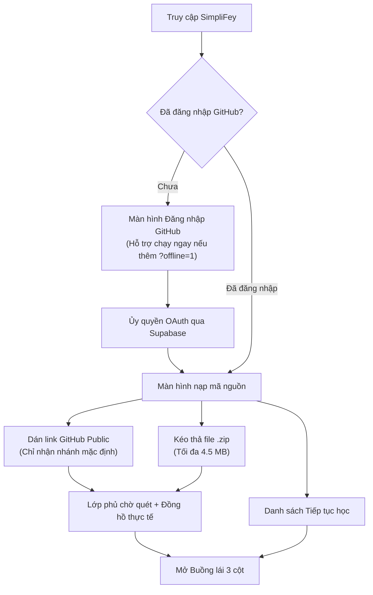
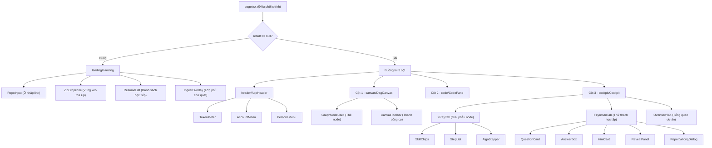
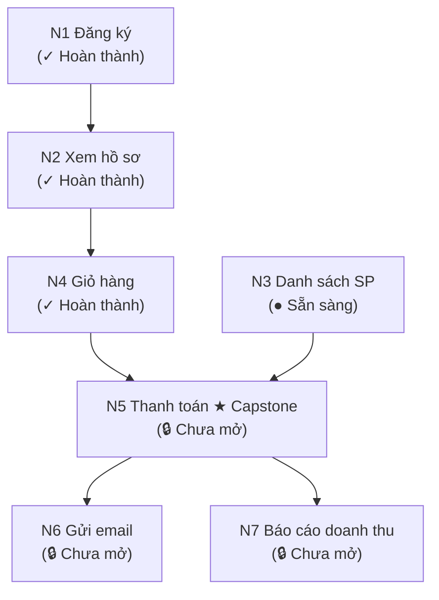
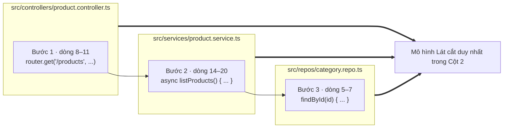
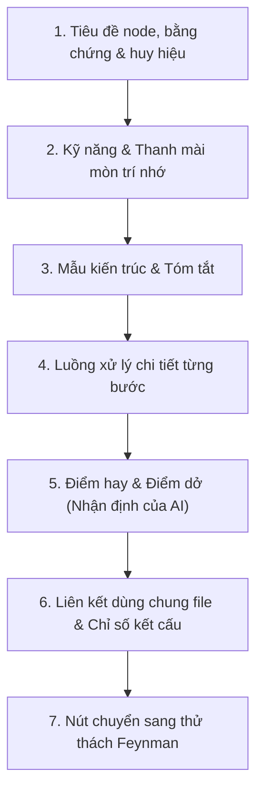
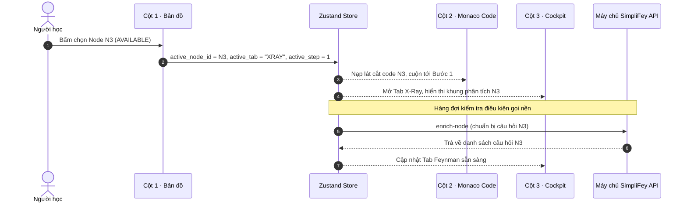
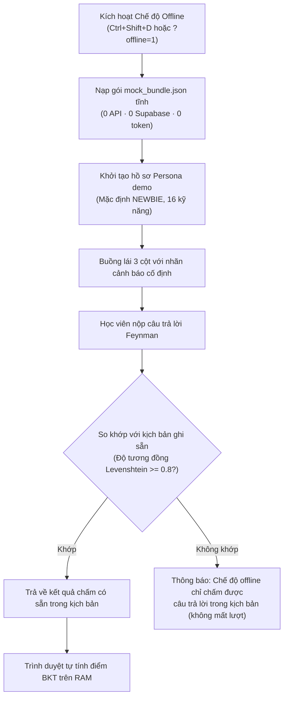
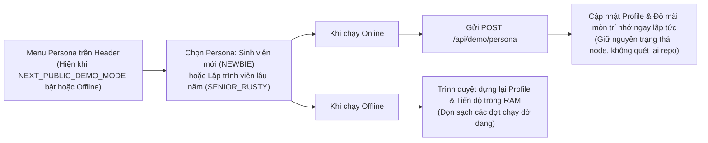
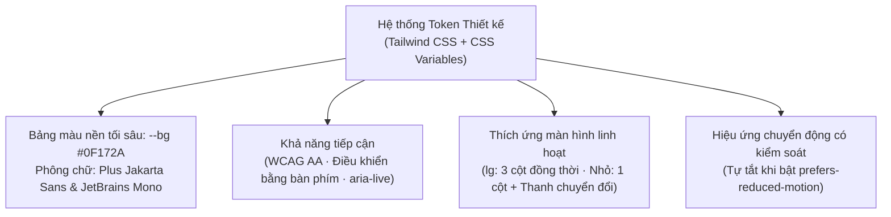

# Hướng dẫn Giao diện Buồng lái 3 cột: Trải nghiệm học kiến trúc mã nguồn trực quan

Trong các đồ án công nghệ thông tin mà sinh viên chúng ta thường làm, khi tiếp cận một kho mã nguồn lớn hoặc mới lạ trên mạng, cách làm bản năng nhất là mở VS Code hoặc duyệt từng file trên GitHub. Bạn bấm vào một controller, thấy nó gọi sang một service, service lại gọi một repository, rồi từ repository nhảy qua model và middleware. Chỉ sau năm phút mở hàng chục tab file khác nhau, chúng ta thường rơi vào trạng thái mất phương hướng: không còn nhớ mình bắt đầu từ đâu, không thấy được bức tranh toàn cảnh các tầng kiến trúc đang giao tiếp với nhau thế nào, và càng không biết đoạn code này được viết theo chuẩn tốt hay đang tiềm ẩn lỗi nghiêm trọng.

Giao diện SimpliFey được thiết kế theo mô hình **Buồng lái 3 cột (3-pane Workbench)** để giảm sự rối rắm đó. Thay vì bắt bạn tự lần mò từng file riêng lẻ, hệ thống gom toàn bộ trải nghiệm vào một màn hình duy nhất với ba góc nhìn đồng bộ thời gian thực:
- **Cột 1 — Bản đồ kiến trúc (Bản đồ):** Giữ vai trò chiếc la bàn định vị toàn cục, hiển thị các luồng nghiệp vụ chính dưới dạng đồ thị có hướng, chỉ rõ luồng nào đã học xong, luồng nào đang mở và luồng nào chưa đủ điều kiện mở khóa.
- **Cột 2 — Trình đọc code lát cắt (Code):** Hiển thị duy nhất một lát cắt nghiệp vụ được trích xuất xuyên file, ghép các bước thực thi từ điểm đón yêu cầu tới tầng lưu dữ liệu thành một khối code liền mạch kèm số dòng gốc chính xác.
- **Cột 3 — Buồng lái học tập (Cockpit):** Cung cấp góc nhìn X-Ray phân tích sâu cấu trúc của lát cắt, các mẫu thiết kế, điểm mạnh, điểm dở kỹ thuật và tab Feynman giúp bạn chủ động củng cố kiến thức bằng cách trả lời các thử thách do AI đặt ra.

Tài liệu này sẽ cùng bạn đi qua toàn bộ giao diện từ màn hình đăng nhập đầu tiên cho đến khi hoàn thành các nút màu xanh trên bản đồ, lấy ví dụ thực tế xuyên suốt bằng kho mã nguồn `shop-api` quen thuộc.

---

## 1. Những nguyên tắc thiết kế nền tảng

Trước khi tìm hiểu chi tiết từng nút bấm và từng ô hiển thị, chúng ta cần nắm vững các nguyên tắc thiết kế cốt lõi của giao diện SimpliFey. Những nguyên tắc này giúp hệ thống hoạt động ổn định, an toàn và nhất quán trên mọi thiết bị.

### Bản sao chỉ đọc từ máy chủ (Server Single Source of Truth)
Toàn bộ logic tính toán quan trọng trong hệ thống — như trạng thái mở khóa của node, điểm đánh giá kỹ năng của học viên, số lượt trả lời còn lại, và đáp án chuẩn của câu hỏi — đều do máy chủ quyết định và lưu trữ. Kho lưu trữ trạng thái tại trình duyệt (Zustand store) chỉ đóng vai trò là một **bản sao chỉ đọc**.
- *Vì sao phải làm vậy?* Nếu cho phép trình duyệt tự tính điểm hay tự mở khóa node, người dùng có thể can thiệp vào mã JavaScript trên máy khách để vượt qua bài học mà không thực sự hiểu bài. Quan trọng hơn, việc giữ một nguồn chân lý duy nhất trên máy chủ giúp đồng bộ chính xác khi người học mở ứng dụng trên nhiều tab hoặc nhiều thiết bị khác nhau.
- *Đánh đổi:* Mọi hành động làm thay đổi tiến độ học tập đều cần gửi yêu cầu lên máy chủ và chờ phản hồi. Trình duyệt chỉ sử dụng các hàm thuần hỗ trợ để hiển thị giao diện và phục vụ chế độ demo dữ liệu ghi sẵn (Offline).

### Tải trước có giới hạn (Smart Lazy Loading)
Một repo có 6 đến 8 node. Nếu ngay khi mở trang, giao diện yêu cầu phân tích toàn bộ các node cùng lúc, hạn mức AI của phiên sẽ tốn cho cả những node người học chưa mở.
- *Cách giải quyết:* Giao diện chỉ yêu cầu phân tích sâu (lời gọi chuẩn bị câu hỏi) cho duy nhất node mà người dùng đang mở xem. Đối với tác vụ phân tích mã nguồn tổng thể, hệ thống chỉ đưa vào hàng đợi xử lý node đang mở cùng với 1 đến 2 node kế tiếp theo thứ tự phụ thuộc, với số lượng xử lý đồng thời tối đa là 3 tác vụ.
- *Khi nào cách này bộc lộ hạn chế?* Khi người học bấm liên tục qua nhiều node, các node chưa kịp phân tích sẽ hiện khung chờ với hiệu ứng lấp lánh (shimmer) cho tới khi dữ liệu về.

### Bảo vệ đáp án và chống xem trước
Khi một câu hỏi Feynman được tải về trình duyệt, dữ liệu nhận được không chứa sẵn đáp án tham khảo hay gợi ý cách sửa. Đáp án chỉ được máy chủ gửi về sau khi câu hỏi đã kết thúc (người học đã hoàn thành đạt yêu cầu, dùng hết 3 lượt thử, hoặc chủ động bấm nút bỏ qua câu hỏi).
- *Vì sao không gửi kèm đáp án rồi ẩn đi bằng CSS?* Bất kỳ sinh viên công nghệ thông tin nào cũng biết mở tab Network trong công cụ lập trình F12 để xem nội dung JSON phản hồi từ máy chủ. Việc không gửi đáp án về máy khách trước khi kết thúc bài giúp bảo đảm tính trung thực của việc tự kiểm tra kiến thức.

### Hiển thị chữ thuần an toàn và chống tấn công XSS
Mọi văn bản do trí tuệ nhân tạo sinh ra (nhận định, gợi ý, phản hồi, tóm tắt) đều được trình duyệt kết xuất dưới dạng chữ thuần túy (plain text), không chèn trực tiếp mã HTML vào trang web. Các đoạn tên biến, tên hàm hoặc đường dẫn được AI đặt giữa hai dấu huyền (backtick) sẽ được giao diện nhận diện và bọc trong thẻ mã hiển thị nội dòng một cách an toàn.

### Minh bạch nguồn gốc và không che giấu sự bất toàn của AI
Hệ thống không bao giờ cam kết rằng AI có thể phân tích chính xác hoàn toàn mà không có sơ suất. Do đó, mọi thông tin do AI suy luận đều được gắn nhãn nguồn gốc rõ ràng để người học luôn giữ tư duy phản biện:
- Khung đánh giá điểm dở trong code luôn mang tiêu đề: **"Điểm dở — Nhận định của AI"**.
- Bảng tổng quan kiến trúc luôn kèm ghi chú: **"Nhận định của AI — có thể chưa chính xác"**.
- Đáp án gợi ý luôn được định danh: **"Đáp án tham khảo do AI viết"**.

### Số liệu thực tế, không dùng số liệu giả định
Giao diện chỉ hiển thị những con số đã được máy chủ đo đạc thực tế hoặc các ngưỡng cấu hình cụ thể. Không hiển thị các con số mục tiêu hay ước lượng chưa được kiểm chứng lên màn hình làm việc của người dùng.

### Ngôn ngữ màu sắc luôn đi kèm biểu tượng và chữ viết
Nhằm hỗ trợ tốt nhất cho mọi người dùng, bao gồm cả những bạn có khiếm khuyết về thị lực như mù màu, hệ thống không bao giờ dùng màu sắc đơn lẻ để biểu thị trạng thái:
- Màu xanh lá luôn đi kèm biểu tượng dấu tích (✓) và nhãn chữ "Hoàn thành".
- Màu vàng hổ phách luôn đi kèm biểu tượng chấm tròn (●) và nhãn chữ "Sẵn sàng".
- Màu đỏ luôn đi kèm biểu tượng dấu chéo (✗) và nhãn chữ "Chưa đạt".
- Màu xám viền nét đứt luôn đi kèm biểu tượng ổ khóa (🔒) và nhãn chữ "Chưa mở".

### Lưu trữ cục bộ tối thiểu và phòng ngừa lỗi
Bộ nhớ cục bộ của trình duyệt (localStorage) chỉ được phép lưu hai mục nhỏ: khóa định danh phiên làm việc gần nhất và tùy chọn giao diện cá nhân. Mọi thao tác đọc và ghi bộ nhớ cục bộ đều được bọc trong khối kiểm tra an toàn (try/catch) để trang web không bị sập nếu người dùng tắt quyền lưu trữ hoặc duyệt web ở chế độ ẩn danh bị chặn ghi đĩa.

Tra chi tiết: spec/30_UI.md Mục 1.

---
## 2. Hành trình người dùng qua các màn hình và bố cục

Hành trình học tập của bạn bắt đầu từ một màn hình tiếp nhận tinh gọn, dẫn dắt vào buồng lái 3 cột chuyên nghiệp nơi mọi thao tác được liên kết chặt chẽ với nhau.

### 2.1. Màn hình tiếp nhận khi chưa có dữ liệu repo

Khi bạn lần đầu truy cập ứng dụng và chưa chọn dự án nào để phân tích, giao diện hiển thị màn hình tiếp nhận với các khu vực chức năng rõ ràng:



- **Xác thực người dùng:** Nếu chưa đăng nhập, giao diện hiển thị nút "Đăng nhập GitHub". Khi nhấn nút, hệ thống chuyển hướng người dùng qua luồng đăng nhập an toàn của Supabase để lấy thông tin tài khoản rồi quay lại ứng dụng. Riêng chế độ demo Offline dùng dữ liệu ghi sẵn có thể mở trực tiếp bằng tham số trên đường dẫn trình duyệt mà không cần đăng nhập.
- **Ô nhập liên kết GitHub:** Nơi bạn dán đường dẫn của kho mã nguồn công khai (Public) và bấm nút "Quét repo". Hệ thống chỉ kiểm tra chặn nếu ô nhập bị bỏ trống. Bên dưới ô nhập luôn có dòng nhắc nhở: "Chỉ hỗ trợ nhánh mặc định". Nếu bạn vô tình dán một liên kết trỏ sâu vào nhánh hoặc file cụ thể (chẳng hạn chứa đoạn `/tree/main/src` hay `/blob/main/README.md`), giao diện sẽ tự nhận diện và tô màu chữ ghi chú sang màu vàng hổ phách để cảnh báo, đồng thời máy chủ sẽ tự động chuẩn hóa và cắt phần thừa về đúng địa chỉ gốc của kho mã nguồn. Nếu dán đường dẫn sai cấu trúc, hệ thống sẽ báo lỗi `ERR_INVALID_GITHUB_URL`.
- **Vùng kéo thả file nén (.zip):** Dành cho trường hợp kho mã nguồn nằm trên máy tính của bạn. Bản dùng thử chạy gói free của Gemini, nên không đưa code bí mật lên. Vùng này chỉ chấp nhận file có dung lượng tối đa 4.5 MB (giới hạn body của Vercel). Trình duyệt sẽ kiểm tra định dạng đuôi file và dung lượng ngay trên máy khách trước khi đẩy lên mạng; nếu file không hợp lệ hoặc quá nặng, hệ thống lập tức thông báo lỗi `ERR_UPLOAD_INVALID` hoặc `ERR_STREAM_QUOTA_EXCEEDED` mà không tốn công gửi dữ liệu vô ích.
- **Bảng "Tiếp tục học":** Liệt kê các phiên học mà bạn đã thực hiện trước đây, sắp xếp phiên gần nhất lên đầu trang. Mỗi dòng tóm tắt thông tin gồm: tên repo, nhánh, 7 ký tự mã commit (nếu nạp từ file zip sẽ có thêm nhãn định danh "zip"), thư mục con nếu là dự án monorepo, số lượng node đã hoàn thành trên tổng số node và số node chưa đạt (ví dụ: `shop-api · main @ 5be1c2a · 3/7 node (1 ✗) · 2h`). Nút "Lịch sử" bên cạnh cho phép bạn xem lại chi tiết các câu trả lời mà mình từng nộp trước đây.
- **Xử lý các tình huống mở lại phiên:**
  - *Phiên bình thường:* Nút "Học tiếp" sẽ mở lại chính xác trạng thái của phiên học cũ. Ngoài ra còn có nút "Học lại từ đầu"; khi bấm nút này, một hộp thoại sẽ hiện lên để bạn xác nhận: "Mở phiên mới cho repo này: tiến độ node làm lại, điểm kỹ năng giữ nguyên, câu hỏi sinh mới." Khi đồng ý, bạn sẽ được học lại từ con số 0 trên cùng một mã nguồn mà không bị mất đi điểm số kỹ năng đã tích lũy trong hồ sơ cá nhân.
  - *Phiên nạp từ file zip hoặc GitHub không đọc được commit:* Do máy chủ áp dụng nguyên tắc không lưu trữ file mã nguồn trên ổ đĩa, sau khi bộ nhớ đệm hết hạn, máy chủ sẽ không còn giữ file zip cũ. Giao diện sẽ thông báo: "Phiên upload không mở lại được — hãy upload lại file .zip." và mở sẵn vùng kéo thả để bạn nạp lại file. Nếu file bạn vừa nạp khác với phiên bản cũ, hệ thống sẽ tự động khởi tạo một phiên học mới kèm thông báo nổi (toast): "File khác bản cũ — đã mở phiên mới". Nếu là repo GitHub không có mã commit, hệ thống sẽ nhắc bạn quét lại kho mã nguồn.
  - *Phiên học tạo bởi phiên bản engine cũ:* Nếu mã nguồn của hệ thống phân tích vừa được nâng cấp lên bản mới hơn, phiên cũ chỉ cho phép "Xem lịch sử" để tránh sai lệch cấu trúc bản đồ.
- **Lớp phủ chờ quét:** Trong suốt thời gian máy chủ tải và dựng bản đồ, một lớp phủ mờ sẽ xuất hiện cùng vòng xoay tiến trình và đồng hồ đếm giây thực tế, đồng thời khóa toàn bộ ô nhập và vùng kéo thả. Khi hoàn tất, giao diện tự động chuyển bạn vào Buồng lái 3 cột ở tab Tổng quan. Nếu bạn mở lại một phiên cũ thành công, một thông báo nổi sẽ chào đón: "Đã mở lại {repo_name} — {completed}/{total} node".

### 2.2. Bố cục buồng lái 3 cột và Chế độ trình chiếu

Sau khi bước vào không gian làm việc chính, bạn sẽ thấy toàn bộ màn hình được chia thành 3 cột riêng biệt nằm dưới một thanh tiêu đề cố định:

```
┌────────────────────────────────────────────────────────────────────────────────────────┐
│ HEADER: shop-api · main @ 5be1c2a │ [Express] │ Bản đồ 850ms · 0 token │ 12,400/80,000  │
├──────────────────────────┬───────────────────────────────┬─────────────────────────────┤
│ CỘT 1: BẢN ĐỒ (25%)      │ CỘT 2: CODE MONACO (45%)      │ CỘT 3: BUỒNG LÁI (30%)      │
│                          │                               │                             │
│ N1 Đăng ký (✓)           │ // Bước 1 · ENTRY_POINT       │ [ X-Ray ]  Feynman  Tổng quan│
│    │                     │ router.get('/products', ...)  │                             │
│    ▼                     │ // Bước 2 · BUSINESS_LOGIC    │ Kỹ năng:                    │
│ N2 Xem hồ sơ (✓)         │ async listProducts() { ... }  │ [DB_OPTIMIZATION: 0.4202]   │
│    │                     │ // Bước 3 · DATA_ACCESS       │                             │
│    ▼                     │ findById(id) { ... }          │ Luồng các bước:             │
│ N4 Giỏ hàng (●)          │                               │ 1. Nhận yêu cầu             │
│    │   N3 Danh sách SP (●)│                              │ 2. Lấy danh sách            │
│    ▼     ▼               │                               │ 3. Tìm loại hàng            │
│ N5 Thanh toán (🔒)       │                               │                             │
└──────────────────────────┴───────────────────────────────┴─────────────────────────────┘
```

Các số trên hình chỉ là minh họa (giả định), không phải số đo thật.

- **Tỉ lệ 3 cột:** Mặc định Cột 1 chiếm 25% chiều rộng màn hình, Cột 2 chiếm 45%, và Cột 3 chiếm 30%. Cả 3 cột đều có thanh cuộn dọc riêng và không có thanh cuộn ngang.
- **Chế độ trình chiếu phóng to:** Ở góc trên của mỗi cột đều có nút biểu tượng hai mũi tên hướng ra ngoài (⤢). Khi bạn chuẩn bị báo cáo đồ án trước giảng viên hoặc muốn tập trung sâu vào một cột duy nhất, hãy bấm nút này:
  - Cột được chọn sẽ tự động mở rộng chiếm 60% chiều rộng màn hình.
  - Hai cột còn lại thu nhỏ chia đều 40% diện tích còn lại, không bị ẩn hoàn toàn để bạn không mất đi ngữ cảnh xung quanh.
  - Toàn bộ kích thước chữ của giao diện và trình đọc code đều được phóng to gấp 1.25 lần giúp người ngồi xa màn hình máy chiếu dễ dàng theo dõi.
  - Bấm lại nút đó hoặc nhấn phím `Esc` trên bàn phím sẽ đưa giao diện trở về tỉ lệ ban đầu.

### 2.3. Thanh đầu trang (Header)

Thanh đầu trang là nơi cung cấp các thông số tổng quát về phiên làm việc hiện tại:
- **Thông tin kho mã nguồn:** Hiển thị tên dự án, tên nhánh và 7 ký tự viết tắt của mã commit (ví dụ: `shop-api · main @ 5be1c2a`). Nút "Repo khác" cho phép bạn thoát khỏi phiên làm việc hiện tại để phân tích một dự án mới, nhưng vẫn giữ nguyên toàn bộ hồ sơ kỹ năng mà bạn đã tích lũy.
- **Thẻ nhận diện công nghệ (vân tay):** Các thẻ nhỏ thể hiện phong cách kiến trúc và framework chính mà máy chủ nhận diện được từ repo (chẳng hạn Express). Nếu phát hiện đây là một dự án monorepo chứa nhiều dự án con, hệ thống sẽ hiện nhãn "Monorepo · {thư mục}" cùng nút "Đổi thư mục" để bạn dễ dàng chuyển vùng phân tích sang thư mục con khác.
- **Thời gian xử lý không tốn token:** Đồng hồ hiển thị thời gian máy chủ tiếp nhận và dựng đồ thị (ví dụ giả định: "Bản đồ 850 ms · 0 token"). Khi nhấp vào con số này, một bảng chi tiết các số đo hiệu năng sẽ mở ra. Con số 0 token khẳng định việc dựng bản đồ hoàn toàn do thuật toán máy tính thực hiện mà không cần tiêu tốn tài nguyên gọi AI.
- **Thước đo hạn mức token của phiên:** Mỗi phiên học được cấp một hạn mức tối đa là 80.000 token AI phục vụ cho các tác vụ phân tích, tổng quan, đặt câu hỏi và chấm bài (ví dụ giả định: "12,400 / 80,000"). Khi số lượng token đã dùng chạm hoặc vượt mức 80.000, thước đo sẽ chuyển sang màu đỏ. Trong chế độ demo Offline, thanh này luôn hiện cố định "0 token".
- **Quản lý tài khoản cá nhân:** Hiển thị ảnh đại diện và tên người dùng GitHub của bạn. Menu thả xuống gồm 3 mục:
  - "Lịch sử học phiên này": Xem lại danh sách các câu hỏi đã trả lời trong phiên.
  - "Đăng xuất": Thoát khỏi tài khoản hiện tại qua hàm đăng xuất của Supabase và đưa bạn trở về màn hình đăng nhập ban đầu.
  - "Xóa tài khoản và dữ liệu": Dành cho trường hợp bạn muốn xóa sạch toàn bộ lịch sử để làm lại từ đầu. Một cảnh báo nghiêm ngặt sẽ xuất hiện: "Xóa toàn bộ điểm kỹ năng, phiên học, câu trả lời. Không hoàn tác." Khi xác nhận, hệ thống sẽ gửi yêu cầu xóa toàn bộ dữ liệu người dùng trên máy chủ, dọn sạch bộ nhớ cục bộ, tự động đăng xuất và tải lại trang web hoàn toàn mới.

Tra chi tiết: spec/30_UI.md Mục 2.

---
## 3. Cây Component và kiến trúc giao diện

Để xây dựng một buồng lái 3 cột phức tạp mà mã nguồn vẫn gọn gàng, dễ bảo trì và không bị hiện tượng truyền dữ liệu xuyên tầng (prop drilling), giao diện được chia nhỏ thành các cụm component độc lập theo từng vùng chức năng.



### Bảng phân tích chi tiết các component cốt lõi

| Nhóm thư mục | Tên Component | Dữ liệu đầu vào (Props) | Dữ liệu đọc trực tiếp từ Store Zustand | Trách nhiệm hiển thị và tương tác |
| :-- | :-- | :-- | :-- | :-- |
| `landing/*` | `Landing`, `RepoInput`, `ZipDropzone`, `ResumeList`, `IngestOverlay` | `ResumeList` nhận mảng tóm tắt các phiên học cũ (`sessions: LearningSessionSummary[]`) | Hồ sơ người học `profile`, danh sách phiên `ui.sessions`, trạng thái chờ `ui.pending` | Quản lý toàn bộ giao diện màn hình tiếp nhận, xử lý nhập link, kéo thả file nén, khôi phục phiên học và lớp phủ chờ xử lý |
| `header/*` | `AppHeader`, `TokenMeter`, `AccountMenu`, `PersonaMenu` | `AccountMenu` nhận `profile`; `PersonaMenu` nhận chế độ persona hiện tại `current` | Kết quả phân tích `result`, số token đã dùng `progress.token_used`, `profile`, cờ `is_offline_mode`, chỉ số hiệu năng `ui.metrics` | Giữ cố định trên đầu trang; hiển thị thông tin dự án, thước đo hạn mức 80.000 token AI, menu tài khoản và menu chuyển persona demo |
| `canvas/*` | `DagCanvas`, `CanvasToolbar` | `CanvasToolbar` nhận vân tay công nghệ `fingerprint` và báo cáo nạp `report` | `result`, trạng thái các node `progress.nodes`, bản phân tích các node `analyses`, mã node đang chọn `active_node_id` | Dựng bản đồ tương tác ReactFlow, hiển thị thanh thông tin tổng thể của bản đồ |
| `canvas/*` | `GraphNodeCard` | Thông tin cấu trúc của node (`node`), trạng thái học tập (`state`), kết quả phân tích (`analysis`), và cờ đang chọn (`active`) | Không đọc trực tiếp (nhận qua props từ bản đồ cha để tối ưu render) | Thể hiện một thẻ node trên đồ thị với màu sắc tương ứng (xám, vàng, xanh, đỏ), biểu tượng capstone, cảnh báo hoặc nhãn đang phân tích |
| `code/*` | `CodePane` | Không nhận prop | Node đang mở, bước đang chọn `active_step`, phân tích của node `analyses[active]`, bước gợi ý `ui.hint_step` | Nhúng trình đọc mã nguồn Monaco Editor ở chế độ chỉ đọc, tô màu cú pháp, đồng bộ số dòng gốc và hiển thị vạch sáng đánh dấu |
| `cockpit/*` | `XRayTab` (kèm `SkillChips`, `StepList`, `AlgoStepper`) | Dữ liệu node (`node`), bản phân tích (`analysis`), trạng thái học tập (`state`) | Bước đang chọn `active_step`, hồ sơ `profile`, độ lệch đồng hồ máy chủ `server_clock_offset_ms`, lượt chạy của node `runs[node.id]` | Mổ xẻ chi tiết lát cắt: danh sách kỹ năng, thanh mài mòn trí nhớ, mẫu kiến trúc, các bước luồng đi, điểm mạnh, điểm dở kỹ thuật và nút bắt đầu trả lời câu hỏi |
| `cockpit/*` | `FeynmanTab` (kèm `QuestionCard`, `AnswerBox`, `HintCard`, `RevealPanel`, `SkillChangeChip`, `RunSummary`, `ReportWrongDialog`) | Từng thẻ con nhận props cụ thể (ví dụ: `QuestionCard` nhận nội dung câu hỏi, trạng thái câu, mã đợt chạy; `HintCard` nhận gợi ý; `RevealPanel` nhận đáp án tham khảo; `RunSummary` nhận tóm tắt lượt chạy) | Danh sách đợt chạy `runs`, trạng thái tiến độ `progress.nodes`, chỉ số câu hỏi đang làm `active_question_index`, câu trả lời trượt gần nhất `last_failed_answers`, kết quả chấm tạm thời `ui.last_evaluations`, bản nháp `ui.drafts` | Điều phối toàn bộ vòng lặp học tập: hiển thị câu hỏi, kiểm tra và gửi câu trả lời, nhận diện lỗi trùng lặp, mở đáp án tham khảo, cập nhật điểm kỹ năng và hộp thoại báo sai tự động |
| `cockpit/*` | `Cockpit`, `OverviewTab` | Không nhận prop | Tab đang mở `active_tab`, mã node đang chọn `active_node_id`, bản tổng quan dự án `overview`, kết quả phân tích `result`, từ điển phân tích `analyses` | Điều phối chuyển đổi giữa 3 tab và hiển thị bức tranh toàn cảnh kiến trúc của toàn bộ kho mã nguồn |

Triết lý thiết kế ở đây rất rõ ràng: các component hiển thị thẻ nhỏ (như `GraphNodeCard` hay các chip kỹ năng) nhận dữ liệu thuần qua props để trình duyệt không phải tính toán lại khi trạng thái khác thay đổi. Ngược lại, các khung nhìn lớn độc lập (như `CodePane` hay `FeynmanTab`) kết nối thẳng vào kho lưu trữ Zustand để lấy đúng lát cắt dữ liệu mình cần.

Tra chi tiết: spec/30_UI.md Mục 3.

---
## 4. Cột 1 — Bản đồ kiến trúc tương tác

Cột 1 là chiếc la bàn định vị toàn cục của bạn. Thay vì nhìn vào một danh sách file phẳng lì, bạn sẽ thấy toàn bộ các luồng nghiệp vụ của dự án được sắp xếp theo một đồ thị có hướng rõ ràng từ trên xuống dưới.



### 4.1. Dựng đồ thị cố định và chống xáo trộn vị trí
Bản đồ sử dụng thư viện ReactFlow để vẽ các thẻ node và đường nối. Điểm đặc biệt là tọa độ hiển thị của từng node hoàn toàn do máy chủ tính toán và định vị sẵn ngay từ đầu bằng thuật toán sắp xếp đồ thị tự động:
- Khi bản đồ tải xong, giao diện sẽ tự động căn chỉnh thu phóng để toàn bộ đồ thị nằm gọn gàng trong khung nhìn của Cột 1.
- Các node bị khóa vị trí cố định, bạn không thể dùng chuột kéo rê làm lệch bố cục, cũng không thể tự vẽ đường nối thủ công giữa các node.
- Bản đồ có sẵn bộ công cụ điều khiển thu phóng (Controls) giúp bạn dễ dàng phóng to, thu nhỏ hoặc đưa đồ thị về giữa màn hình khi dự án có nhiều node.

### 4.2. Bốn trạng thái học tập và ngôn ngữ màu sắc
Mỗi node trên bản đồ đại diện cho một lát cắt kiến trúc xuyên suốt mã nguồn và luôn nằm ở một trong bốn trạng thái nghiêm ngặt:
- **Chưa mở (`LOCKED`):** Thẻ node có viền xám nét đứt mờ, mang biểu tượng ổ khóa (🔒) và nhãn chữ "Chưa mở". Khi bạn bấm chuột hoặc nhấn phím Enter vào một node đang bị khóa (ví dụ N5 khi bạn chưa hoàn thành N4), giao diện hoàn toàn không gửi bất kỳ yêu cầu mạng nào lên máy chủ, con trỏ chuột chuyển sang hình cấm thao tác, và một hộp chú thích nhỏ (tooltip) xuất hiện để hướng dẫn: "Hoàn thành trước: {danh sách node cha chưa thông}".
- **Sẵn sàng (`AVAILABLE`):** Thẻ node có viền màu vàng hổ phách với hiệu ứng nhịp thở nhẹ nhàng, mang biểu tượng chấm tròn (●) và nhãn chữ "Sẵn sàng". Đây là những node đã hoàn thành đủ điều kiện tiên quyết và đang chờ bạn khám phá.
- **Hoàn thành (`COMPLETED`):** Thẻ node chuyển sang viền màu xanh lá cây vững chắc, mang biểu tượng dấu tích (✓) và nhãn chữ "Hoàn thành".
- **Chưa đạt (`FAILED`):** Thẻ node chuyển sang viền màu đỏ, mang biểu tượng dấu chéo (✗) và nhãn chữ "Chưa đạt". 
  - *Giữ đỏ:* Không có nút làm lại hay ôn tập. Node chỉ đổi từ đỏ sang xanh khi Báo sai làm cho không còn câu `FAILED` nào được tính.
  - *Vẫn mở node con:* Dù node cha Chưa đạt, các node con vẫn được mở để người học không bị tắc, nhưng node con mang thêm dấu cảnh báo.

### 4.3. Các lớp phủ thông tin và huy hiệu trực quan
Trên từng thẻ node còn được trang bị các ký hiệu đặc biệt giúp bạn nhận biết ngay đặc tính kỹ thuật:
- **Biểu tượng cảnh báo (⚠):** Nằm ở góc trên bên trái của thẻ node. Biểu tượng này xuất hiện khi node không bị khóa và có node cha Chưa đạt hoặc node cha được cho qua vì phân tích lỗi. Rê chuột vào sẽ thấy thông điệp: "Node trước chưa vững: {node cha FAILED / phân tích lỗi}".
- **Trạng thái đang phân tích:** Khi máy chủ đang chạy tác vụ phân tích mã nguồn cho node, thẻ sẽ hiện biểu tượng xoay tiến trình cùng dòng chữ "đang phân tích…". Nếu phân tích gặp sự cố bất khả kháng, thẻ sẽ báo "Chưa phân tích được" kèm nút bấm "Thử lại phân tích".
- **Huy hiệu Capstone (★):** Gắn cho node có độ phức tạp cao nhất trong toàn bộ hệ thống (như node N5 Thanh toán trong `shop-api`), đóng vai trò là cột mốc thử thách tổng hợp kiến trúc quan trọng nhất.
- **Huy hiệu Thuật toán:** Các node chứa thuật toán cốt lõi sẽ mang nhãn "Thuật toán" màu tím nổi bật.
- **Viền trắng sáng:** Node bạn đang mở có đường viền ngoài màu trắng.

### 4.4. Quy tắc đặt tên node và tiền tố dấu ngã `~`
Động cơ phân tích luôn cố gắng đặt tên cho node bằng tên hàm điểm đón (entry point) hoặc tên miền nghiệp vụ chính. Tuy nhiên, nếu tên gọi này được suy đoán gián tiếp từ tên thư mục, từ khóa lặp lại hoặc tên file, giao diện sẽ tự động thêm tiền tố dấu ngã `~` ở phía trước tên (ví dụ: `~products`).
- Nếu tên node dài quá 32 ký tự, giao diện sẽ cắt bớt và thêm dấu ba chấm "…".
- Khi bạn rê chuột vào thẻ node, tooltip sẽ hiện đầy đủ tên gốc trọn vẹn, căn cứ mà hệ thống dùng để đặt tên đó, cùng dòng lưu ý minh bạch: "Tên suy ra — gần đúng".
- Nếu đây là một node ảo gom nhóm do động cơ tự tạo ra, tooltip sẽ ghi rõ: "Node gom nhóm do engine tạo".
- Ngay dưới tên node là dòng thông tin phụ tóm tắt quy mô: "{số lượng} file · {ngôn ngữ}" (ví dụ: "3 file · TypeScript").

### 4.5. Phân loại cạnh nối và độ tin cậy
Các đường nối giữa các node thể hiện sự phụ thuộc và luồng dữ liệu giữa các lát cắt nghiệp vụ:
- **Cạnh nét liền (`RESOLVED`):** Đại diện cho liên kết đã được phân tích cú pháp xác thực (chẳng hạn N4 và N5 cùng dùng chung hàm `cartService.getCart`).
- **Cạnh nét đứt:** Thể hiện mối liên kết được hệ thống suy luận gián tiếp, kèm theo tooltip cảnh báo khi rê chuột: "Cạnh suy luận — chưa bảo đảm 100%".
- **Màu sắc đường nối:** Khi node nguồn đã Hoàn thành, đường nối sẽ mang màu xanh lá; khi node nguồn Chưa đạt, đường nối mang màu đỏ; các trường hợp còn lại đường nối mang màu xám trung tính tĩnh, hoàn toàn không dùng hiệu ứng chạy chuyển động để bảo đảm sự tập trung tối đa cho người học.

### 4.6. Thanh công cụ phía dưới bản đồ (CanvasToolbar)
Thanh thông tin tổng hợp của Cột 1 cho bạn cái nhìn bao quát về đồ thị:
- Mức độ tin cậy của đồ thị (xanh lá cây biểu thị độ tin cậy cao, vàng trung bình, đỏ thấp).
- Các thẻ phân bổ ngôn ngữ lập trình theo tỉ lệ phần trăm dung lượng code (ví dụ: `TypeScript 85%`).
- Tổng số lượng node trong bản đồ (ví dụ: "7 node").
- Thông báo chế độ suy thoái nếu repo viết theo kiểu tuần tự đơn giản hoặc chỉ là một tập các thuật toán rời rạc.
- Thông báo bảo mật: "Đã che {số lượng} bí mật" (cho biết các chuỗi mật khẩu, private key hay token nhạy cảm trong code đã được che đi).
- Cảnh báo khi kết quả bị cắt bớt (`truncated`) hoặc có `warnings`; cảnh báo độ tin cậy `LOW` không đóng được. Có popover liệt kê các file bị bỏ qua (`skipped`).
- Hộp chú giải tóm tắt ý nghĩa của 4 màu sắc, dấu cảnh báo và đường nét đứt.

Tra chi tiết: spec/30_UI.md Mục 4.

---
## 5. Cột 2 — Trình đọc code lát cắt chỉ đọc (Monaco Editor)

Khi lập trình thực tế, việc đọc hiểu một tính năng đòi hỏi bạn phải liên tục nhảy qua lại giữa Controller, Service, Middleware và Repository. Thao tác này làm đứt đoạn mạch suy nghĩ và rất dễ sót các bước trung gian. Cột 2 loại bỏ hoàn toàn rào cản đó bằng mô hình **Lát cắt kiến trúc (Architectural Slice)**.



### 5.1. Mô hình lát cắt nghiệp vụ ghép nối xuyên file
Thay vì mở một cây thư mục đầy các file lạ, Cột 2 trích xuất đúng các hàm tham gia vào luồng xử lý của node đang chọn và ghép chúng lại thành một khối code duy nhất theo đúng trình tự thực thi:
- Mỗi bước được phân cách rõ ràng bởi một dòng tiêu đề chú thích:
  `// ── Bước 2 · BUSINESS_LOGIC · src/services/product.service.ts · listProducts` (với Python sẽ dùng dấu `#`).
- Các bước được ngăn cách bởi một dòng trống tinh gọn.
- Phần cuối của lát cắt có thể hiển thị thêm khối định nghĩa kiểu dữ liệu truyền nhận (DTO) nếu có.

Hãy quan sát đoạn code thực tế của node **N3 — Danh sách sản phẩm** trong kho mã nguồn `shop-api` được hiển thị liền mạch trên Cột 2:

```typescript
// ── Bước 1 · ENTRY_POINT · src/controllers/product.controller.ts
router.get('/products', async (req, res) => {
  const products = await productService.listProducts();
  res.json(products);
});

// ── Bước 2 · BUSINESS_LOGIC · src/services/product.service.ts · listProducts
async listProducts() {
  const products = await productRepo.findAll();
  for (const p of products) {
    p.category = await categoryRepo.findById(p.categoryId);
  }
  return products;
}

// ── Bước 3 · DATA_ACCESS · src/repos/category.repo.ts · findById
findById(id) {
  return this.repo.findOne({ where: { id } });
}
```

### 5.2. Hiển thị số dòng gốc chính xác
Một trong những điểm tinh tế nhất của Cột 2 là cách đánh số dòng. Nếu đánh số dòng từ 1 đến hết như một file văn bản thông thường, bạn sẽ không thể biết đoạn code đó nằm ở dòng bao nhiêu trong file gốc để đối chiếu khi cần.
- Trình đọc code Monaco sử dụng bảng ánh xạ dòng đặc biệt: chỉ các dòng mã nguồn thật mới hiển thị số dòng gốc trong dự án.
- Ví dụ ở Bước 2 bên trên: dòng `async listProducts() {` sẽ hiển thị số dòng là **14**, dòng tiếp theo là **15**... đúng theo vị trí thực tế trong file `product.service.ts`.
- Các dòng tiêu đề bước, dòng phân cách hoặc các điểm đánh dấu kỹ thuật hoàn toàn không có số dòng và được hiển thị với màu chữ mờ tinh tế.

### 5.3. Ba lớp tô sáng trực quan
Mã nguồn trong Cột 2 không chỉ để đọc thụ động mà còn được tô sáng thông minh theo 3 ngữ cảnh:
- **Bước đang chọn:** Nền của bước được phủ một màu vàng nhạt dịu mắt, mép lề trái xuất hiện dải vạch màu vàng hổ phách nổi bật.
- **Bước có điểm dở kỹ thuật:** Mép lề trái xuất hiện dải vạch màu đỏ kèm biểu tượng glyph cảnh báo (⚠) ngay tại tiêu đề bước. Khi bạn rê chuột vào biểu tượng này, một chú thích sẽ xuất hiện: "Nhận định của AI: {nội dung cảnh báo}".
- **Bước gợi ý khi làm bài thử thách:** Khi bạn gặp khó khăn trong tab Feynman và hệ thống cung cấp gợi ý chỉ điểm mã nguồn, mép lề bước gợi ý sẽ hiện dải vạch màu tím kèm biểu tượng bóng đèn sáng (💡), đồng thời trình đọc code tự động cuộn ngay tới bước đó.

### 5.4. Đồng bộ hai chiều thời gian thực
Cột 2 và Cột 3 luôn hoạt động như hai người bạn đồng hành ăn ý:
- Khi bạn bấm vào bất kỳ một bước, một kỹ năng hay một điểm dở ở Tab X-Ray bên Cột 3 (hoặc bấm vào chip bước ở đầu Cột 2), trình đọc code cuộn bước tương ứng ra giữa khung nhìn.
- Ngược lại, khi bạn đang đọc code ở Cột 2 và bấm chuột vào một dòng bất kỳ trong hàm `listProducts`, hệ thống lập tức hiểu bạn đang quan tâm tới Bước 2, và Tab X-Ray bên Cột 3 sẽ tự động tô sáng Bước 2 tương ứng.
- *Lưu ý quan trọng:* Cơ chế đồng bộ này chỉ kích hoạt khi bạn nhấp chuột, không đồng bộ theo thao tác cuộn chuột tự do. Thiết kế này giúp bạn thoải mái cuộn lướt code mà màn hình phân tích bên cạnh không bị giật cục hay nhảy lung tung.

### 5.5. Cấu hình tối giản và thanh tiêu đề Cột 2
Trình đọc code Monaco được tinh chỉnh tối đa cho mục đích học tập:
- Chế độ chỉ đọc (read-only), khóa sửa mã nguồn, tắt bản đồ thu nhỏ bên phải (minimap) và menu chuột phải để không gây xao nhãng.
- Tự động nhận diện ngôn ngữ lập trình của node (TypeScript, JavaScript, Python...).
- Đầu Cột 2 luôn có thanh thông tin hiển thị rõ: "Bước {k}/{n} · {tầng kiến trúc} · {đường dẫn file} · {tên hàm}".
- Ngay phía dưới là dãy các chip bước nhỏ để bạn nhấp chuyển nhanh giữa các bước.
- Nếu bạn chưa chọn node nào trên bản đồ, Cột 2 sẽ hiển thị dòng hướng dẫn: "Chọn một node — mỗi node là một lát cắt xuyên file".
- Node không có bước code (node gom nhóm) hiện: "Node gom nhóm — không có code riêng", kèm danh sách file.

Tra chi tiết: spec/30_UI.md Mục 5.

---
## 6. Cột 3 — Buồng lái kiến trúc (Cockpit)

Cột 3 là trung tâm phân tích và thử thách tư duy của bạn, gồm 3 góc nhìn: Tab **X-Ray**, Tab **Feynman**, và Tab **Tổng quan**.
- Khi bạn chưa nhấp chọn node nào trên bản đồ: Cột 3 chỉ hiển thị duy nhất Tab Tổng quan để bạn nắm bức tranh toàn cảnh dự án.
- Ngay khi bạn chọn một node: Hệ thống sẽ tự động chuyển sang Tab X-Ray để mổ xẻ lát cắt kiến trúc đó.
- Tab Feynman chỉ mở ra khi node đã có bản phân tích mã nguồn. Nếu máy chủ đang trong quá trình chuẩn bị câu hỏi, tab này sẽ hiện vòng xoay chờ; nếu chưa có bản phân tích, tab sẽ tạm khóa kèm dòng nhắc nhở: "Cần bản phân tích trước khi đặt câu hỏi".

---

### 6.1. Tab X-Ray — Mổ xẻ chi tiết lát cắt kiến trúc

Tab X-Ray sắp xếp thông tin theo một trình tự khoa học từ trên xuống dưới, giúp bạn tiếp thu kiến trúc một cách mạch lạc:



#### 1. Tiêu đề và thông tin định danh
Hiển thị tên đầy đủ của node, căn cứ chứng minh tên gọi, các huy hiệu đặc biệt (ngôi sao Capstone, cảnh báo hoặc nhãn Thuật toán), và bậc hỗ trợ phân tích của hệ thống.

#### 2. Kỹ năng kỹ thuật và Thanh mài mòn trí nhớ Duolingo
Mỗi lát cắt kiến trúc luôn rèn luyện từ 1 đến 3 kỹ năng kỹ thuật chuẩn mực (như tối ưu database, phân tách tầng, bảo mật xác thực).
- Mỗi kỹ năng được thể hiện bằng một chip thông tin gồm: tên kỹ năng, điểm số năng lực (làm tròn 4 chữ số thập phân) và bậc danh hiệu tương ứng:
  - Bậc mới bắt đầu (`NOVICE`): điểm số nhỏ hơn 0.45.
  - Bậc thực hành (`PRACTITIONER`): điểm số từ 0.45 đến 0.7499.
  - Bậc kiến trúc sư (`ARCHITECT`): điểm số từ 0.75 trở lên.
- Rê chuột vào chip kỹ năng sẽ thấy căn cứ rõ ràng: "Vì: {lý do} — bước {bước} · `{tên hàm/biến}` · {đường dẫn file} dòng {dòng bắt đầu}–{dòng kết thúc}". Bấm vào chip sẽ khiến Cột 2 cuộn ngay tới bước chứa kỹ năng đó.
- **Mài mòn theo thời gian:** Kiến thức nếu học xong mà không áp dụng sẽ mai một dần. Giao diện thể hiện điều này qua độ dài và độ đậm của thanh:
  - Thanh dài theo điểm đã suy giảm, và nhạt dần liên tục theo tỉ lệ điểm đã suy giảm trên điểm gốc.
  - Nếu điểm suy giảm làm bạn tụt bậc (chẳng hạn từ `ARCHITECT` xuống `NOVICE`), chip hiện nhãn "đang mài mòn".
  - Nếu điểm có giảm nhưng chưa làm rớt bậc, thanh chỉ hiển thị màu nhạt hơn mà không có nhãn, kèm chú thích: "Điểm gốc {điểm ban đầu} — đã giảm còn {điểm hiện tại} vì lâu chưa luyện".
  - Tính năng này chỉ dùng để phản ánh trực quan năng lực hiện tại của bạn, hoàn toàn không có nút bắt ép ôn tập, và không làm đổi màu thẻ node trên bản đồ.

> **Ví dụ tính tay công thức mài mòn:**
> Một học viên có điểm gốc ban đầu là $p_0 = 0.95$ cho kỹ năng tối ưu database (đạt bậc `ARCHITECT`). Sau 30 ngày học viên này không đụng tới mã nguồn và không luyện tập lại kỹ năng này.
> Công thức tính điểm sau thời gian suy giảm:
> $$p(t) = \text{Mức sàn} + (p_0 - \text{Mức sàn}) \cdot 2^{-\Delta t / \text{Chu kỳ bán rã}}$$
> Trong hệ thống, Mức sàn quy định là 0.25, Chu kỳ bán rã là 14 ngày.
> 1. Tính số chu kỳ đã trôi qua: $30 / 14 \approx 2.142857$.
> 2. Tính hệ số suy giảm: $2^{-2.142857} \approx 0.2264$.
> 3. Tính điểm số còn lại:
>    $$p(30) = 0.25 + (0.95 - 0.25) \cdot 0.2264 = 0.25 + 0.70 \cdot 0.2264 = 0.25 + 0.1585 = 0.4085$$
> Kết quả: Điểm số giảm từ 0.95 xuống còn **0.4085**. Do 0.4085 thấp hơn ngưỡng 0.45, học viên rớt từ bậc `ARCHITECT` xuống bậc `NOVICE`. Trên giao diện, thanh của chip này nhạt đi và có nhãn "đang mài mòn".

#### 3. Mẫu kiến trúc và tóm tắt nghiệp vụ
Liệt kê các mẫu thiết kế cấu trúc phát hiện trong node bằng thuật ngữ tiếng Việt chuẩn mực:
- `LAYERED`: Tách tầng.
- `MIDDLEWARE_CHAIN`: Chuỗi middleware.
- `DEPENDENCY_INJECTION`: Tiêm phụ thuộc.
- `OBSERVER_EVENT`: Observer.
- `PIPELINE`: Chuỗi xử lý.
- `ALGORITHMIC`: Thuật toán.
- `PROCEDURAL`: Tuần tự.
- `OTHER`: Khác.
Các mẫu thiết kế khác giữ nguyên thuật ngữ tiếng Anh gốc.

#### 4. Luồng xử lý chi tiết từng bước
Liệt kê danh sách từng bước trong lát cắt: số thứ tự, tầng kiến trúc, file mã nguồn, khoảng dòng, tên hàm và lời giải thích ngắn gọn bằng tiếng Việt. Bước đang chọn được tô vàng; bước có điểm dở mang biểu tượng cảnh báo (⚠). Bạn có thể bấm vào bất kỳ bước nào để đồng bộ với Cột 2.

#### 5. Bộ chỉ báo 3 chặng cho node thuật toán
Nếu đây là một node thuộc nhóm lõi giải thuật (`ALGORITHMIC_CORE`), Tab X-Ray sẽ hiển thị bộ chỉ báo tiến trình 3 chặng: Khởi tạo (`ALGO_SETUP`) → Vòng lặp chính (`ALGO_EXECUTION`) → Điều kiện dừng (`ALGO_TERMINATION`). Chặng nào không có trong code sẽ hiển thị mờ.

#### 6. Điểm hay và Điểm dở kỹ thuật
- **Điểm hay:** Đánh dấu bằng biểu tượng dấu tích xanh kèm số bước và lời khen ngợi kiến trúc (ví dụ: "✅ (bước 1) Route không chứa truy vấn database; muốn đổi cách lấy dữ liệu chỉ cần sửa service hoặc repository.").
- **Điểm dở — Nhận định của AI:** Được đóng trong khung viền màu đỏ nổi bật, ghi rõ vị trí file, dòng code và kỹ năng vi phạm. Nội dung chỉ rõ hiện tượng (`what`) và hậu quả kiến trúc (`consequence`).
  - *Ví dụ ở node N3 của `shop-api`:* "Vòng for gọi categoryRepo.findById cho từng sản phẩm. Hậu quả: Càng nhiều sản phẩm, database bị hỏi càng nhiều lần, trang càng chậm."
  - *Nguyên tắc bảo vệ kiến thức:* Khung điểm dở không đưa ra cách sửa code (không nhắc đến giải pháp gộp quan hệ query), không đưa ra số liệu biên tình huống. Việc tìm giải pháp khắc phục là bài tập để bạn tự suy nghĩ và trả lời trong Tab Feynman.

#### 7. Thông tin liên quan và Chỉ số chất lượng Uncle Bob
- Phần thông tin liên quan chỉ ra các file dùng chung giữa các node: "Liên quan: dùng chung product.repo.ts với N5 Thanh toán".
- Các chỉ số Uncle Bob gồm: Độ bất ổn định (I), Độ trừu tượng (A), Độ lệch khỏi trục cân bằng (D) kèm chẩn đoán kết cấu (`is_exempt` thì ghi "Miễn trừ"), và Độ phức tạp nhận thức.
- Nếu phần chữ của AI trượt cổng gác, tab hiện dòng: "AI chưa giải thích được node này — chỉ hiện khung do code dựng".
- Khi đang chờ phân tích, tab hiện khung lấy từ các bước code kèm shimmer "đang phân tích…". Khi phân tích thất bại, tab hiện "Chưa phân tích được" và nút "Thử lại phân tích".

#### 8. Nút chuyển sang thử thách Feynman
Ở dưới cùng của Tab X-Ray:
- Nếu node đang ở trạng thái Sẵn sàng (`AVAILABLE`) và chưa xong phiên học, giao diện có nút: "Bắt đầu trả lời ({số câu chưa xong, trừ câu `DROPPED`})". Khi bấm nút, bạn được đưa sang Tab Feynman. Lúc đang chờ câu hỏi, nút hiện "Đang chuẩn bị câu hỏi…"; nếu lỗi thì hiện "Thử lại".
- Nếu node đã Hoàn thành (`COMPLETED`) hoặc Chưa đạt (`FAILED`), hệ thống hoàn toàn không hiển thị nút này vì phiên học không hỗ trợ ôn tập hay làm lại.

---

### 6.2. Tab Feynman — Vòng lặp học tập chủ động

Tab Feynman là nơi bạn thực sự biến kiến thức vừa đọc thành năng lực của bản thân thông qua phương pháp Feynman: giải thích lại bản chất kỹ thuật bằng ngôn từ của chính mình.

```
Câu 1/2 · DB_OPTIMIZATION · NOVICE  lượt ●●○ ✍  │ Độ chính xác ██████░░│  Ý bắt buộc ● ○  │ 💡 Gợi ý: "…"
[ô trả lời …………………………… 33/2000]  [Nộp]  [Bỏ qua câu này]        Câu 2/2 · LAYERED_SEPARATION ⏳
```

#### 1. Danh sách câu hỏi và trạng thái
Đầu tab hiển thị hàng loạt thẻ nhỏ cho từng câu hỏi: "Câu {k}/{n} · {kỹ năng} · {bậc}". Kèm theo các biểu tượng trạng thái rõ ràng:
- ⏳ Đang chờ làm.
- ✍ Đang mở làm bài.
- ✅ Đạt yêu cầu.
- ❌ Chưa đạt (hết lượt hoặc bỏ qua).
- 🚩 Câu đã được người học báo sai do máy chủ xử lý lại.
- ⊘ "AI không đặt được câu này — không tính" (`DROPPED`). Lưu ý đặc biệt: `DROPPED` là trạng thái một câu hỏi cụ thể mà AI không thể tạo ra câu hỏi đạt chuẩn kiểm định an toàn, hoàn toàn không phải là phiên học bị hủy bỏ.
Mỗi node có phân tích đều luôn có ít nhất một câu hỏi, không có node nào được miễn thi. Mặc định hệ thống luôn mở câu hỏi chưa hoàn thành đầu tiên.

#### 2. Quản lý lượt trả lời (Tối đa 3 lượt)
Mỗi câu hỏi bạn có tối đa 3 lượt nộp bài, được hiển thị bằng các chấm tròn (ví dụ: `●●○` biểu thị đã dùng 2 lượt, còn 1 lượt).

#### 3. Bốn chốt chặn kiểm tra ở trình duyệt trước khi gửi bài (Client Preflight)
Khi bạn bấm nút "Nộp", trình duyệt sẽ chạy bộ kiểm tra nghiêm ngặt ngay trên máy khách. Nếu vi phạm, thông báo lỗi sẽ xuất hiện ngay dưới ô nhập, máy khách không gửi bất kỳ yêu cầu mạng nào lên máy chủ, và bạn hoàn toàn không bị mất lượt:
1. **Kiểm tra độ dài tối thiểu:** Không tính khoảng trắng, câu trả lời phải có từ 15 ký tự trở lên. Nếu bạn chỉ gõ vài từ cụt lủn như "ok" hay "do vòng lặp", hệ thống lập tức từ chối và báo lỗi `ERR_ANSWER_TOO_SHORT`.
2. **Kiểm tra độ dài tối đa:** Giới hạn tối đa 2000 ký tự, có bộ đếm ký tự hiển thị trực tiếp theo thời gian thực dưới ô nhập.
3. **Phát hiện câu trả lời trùng lặp:** Trình duyệt so sánh câu trả lời bạn vừa gõ với câu trả lời bị trượt ở lần trước đó của cùng câu hỏi bằng thuật toán khoảng cách Levenshtein. Nếu độ tương đồng đạt từ 80% trở lên (tỉ lệ tương đồng ≥ 0.8), hệ thống sẽ chặn lại và báo lỗi `ERR_ANSWER_DUPLICATE`: "Bạn chưa bổ sung ý mới so với lần trước — hãy diễn giải khác hoặc chi tiết hơn."
4. **Chống bấm liên tục và kiểm soát hạn mức:** Nút "Nộp" chuyển sang "Đang chấm…" và bị khóa cho tới khi có phản hồi của máy chủ **và** đã qua 3000 ms (`CONFIG.SUBMIT_DEBOUNCE_MS`). Nếu phiên học đã dùng hết hạn mức 80.000 token AI, ô nhập và nút nộp bị tắt kèm thông báo: "Hết hạn mức AI của phiên — không chấm được bài mới".
- Giao diện hỗ trợ phím tắt `Ctrl+Enter` để nộp bài nhanh và tự động lưu lại bản nháp câu trả lời theo từng câu để bạn không bị mất chữ khi chuyển qua lại giữa các tab.

#### 4. Kết quả chấm bài và Thẻ gợi ý tím
Sau khi nộp bài thành công, kết quả đánh giá của AI xuất hiện sinh động:
- Thước đo độ chính xác cốt lõi (`core_accuracy`) với vạch chuẩn đạt ở mức 70 điểm.
- Điểm `simplicity` hiện nhỏ, ghi "không ảnh hưởng Đạt", và danh sách từ chuyên môn người học dùng (`detected_jargons`).
- Nhận xét của AI (tối đa 2 câu).
- Đánh giá các ý bắt buộc đã nêu được hay chưa ("Ý bắt buộc: ● ○").
- **Gợi ý tiếp nối (`follow_up`):** Nếu bạn chưa đạt ở lượt 1, hệ thống sẽ mở một thẻ màu tím chứa gợi ý tư duy. Nếu sang lượt 2 bạn vẫn chưa đạt, AI có thể đưa ra gợi ý chỉ điểm mã nguồn (`CODE_POINTER`), hiển thị dòng chữ "Xem bước {step_index}"; khi đó Cột 2 sẽ tự động cuộn đến đúng bước đó và xuất hiện vạch sáng màu tím kèm biểu tượng bóng đèn 💡.
- Nếu câu trả lời bị đánh giá là hoàn toàn lạc đề, giao diện sẽ thông báo: "Câu trả lời bị coi là lạc đề — mất 1 lượt, không có gợi ý." Nếu bạn bấm nộp câu xin hàng, giao diện báo: "Đã tính 1 lượt chưa đạt." Đồng thời ô trả lời sẽ rung nhẹ để cảnh báo.

#### 5. Bảng hiện đáp án tham khảo khi kết thúc câu hỏi
Khi câu hỏi kết thúc (bạn đã thi đạt, hoặc dùng hết 3 lượt, hoặc chủ động bấm bỏ qua), ô nhập văn bản sẽ biến mất và nhường chỗ cho bảng đáp án hoàn chỉnh gồm 3 phần:
- "Đáp án tham khảo do AI viết" (`reference_answer`).
- "Ý bắt buộc" (`must_have_points`) với dấu tích xanh hoặc dấu chéo đỏ theo các ý bạn đã nêu được.
- "Cách sửa" (`fix`) hướng dẫn cách tái cấu trúc lại đoạn mã nguồn chuẩn mực.
- Thẻ cập nhật điểm số: "{kỹ năng}: {điểm trước} → {điểm sau}" kèm danh hiệu mới và nút "Câu tiếp theo" để chuyển nhanh sang câu kế tiếp.

#### 6. Tính năng "Bỏ qua câu này"
Nếu bạn cảm thấy câu hỏi quá khó hoặc tài khoản đã hết hạn mức token AI, bạn có thể bấm nút "Bỏ qua câu này". Một hộp thoại sẽ hiện lên yêu cầu bạn xác nhận: "Câu này sẽ tính là CHƯA ĐẠT cho {kỹ năng} và hiện đáp án." Khi đồng ý, câu hỏi được đánh dấu Chưa đạt và bảng đáp án tham khảo sẽ mở ra ngay lập tức.

#### 7. Nút "Báo sai" — Xử lý tự động ngay trên máy chủ
Khác với nhiều hệ thống cần người kiểm duyệt thủ công, Báo sai ở SimpliFey được máy chủ xử lý ngay:
- Nút "Báo sai" chỉ xuất hiện với câu `FAILED` kết thúc bằng nộp bài (`ended_by = "ANSWER"`) và chưa từng Báo sai. Câu bấm "Bỏ qua" không có nút này.
- Khi bấm nút, bạn nhập ghi chú tối đa 500 ký tự (ví dụ giải thích vì sao câu trả lời của bạn đúng dù AI chấm trượt).
- **Máy chủ xử lý ngay:** Câu được gắn lá cờ (🚩). Nếu điểm kỹ năng chưa bị câu nào khác đổi, điểm được hoàn lại và giao diện báo "Đã hoàn lại điểm {skill}: {p_before} → {p_after}". Máy chủ tính lại trạng thái node, nên node có thể đổi từ đỏ sang xanh. Giao diện hiện toast: "Đã ghi nhận — nhóm sẽ xem lại câu này".
- Trong chế độ demo Offline, nút Báo sai sẽ bị vô hiệu hóa.

#### 8. Băng tổng kết đợt chạy của node
Khi bạn trả lời xong toàn bộ các câu hỏi của node, một bảng tổng kết sẽ hiện ra: "✅ {kỹ năng đạt} · ❌ {kỹ năng chưa đạt} · 🚩 {kỹ năng đã Báo sai}" (bỏ các câu DROPPED).
Phía dưới là dải băng thông báo lớn theo kết quả:
- Nếu Hoàn thành: dải băng màu xanh lá "Hoàn thành node. Vừa mở: {danh sách các node con vừa mở khóa}".
- Nếu Chưa đạt: dải băng màu đỏ "Chưa đạt — các node sau vẫn mở, kèm ⚠".

Node đã xong thì Tab Feynman chỉ đọc: vẫn xem được câu hỏi, kết quả, đáp án và nút "Báo sai" của lần học cuối.

---

### 6.3. Tab Tổng quan — Bức tranh kiến trúc toàn cảnh

Tab Tổng quan là nơi giúp bạn tổng hợp lại toàn bộ bức tranh kiến trúc của cả dự án sau khi đã đi qua các lát cắt:
- **Khi các node chưa phân tích xong:** Tab hiển thị các dữ kiện lấy từ kết quả engine (phong cách kiến trúc, framework, `tech_stack`, "Bắt đầu từ" là node gốc) kèm thông báo tiến độ: "Nhận định của AI sẽ hiện khi mọi node phân tích xong ({số node xong}/{tổng số node})".
- **Khi đã có bản tổng quan:** Tab hiện `overview.facts`, "Luồng chính", và khung mang tiêu đề **"Nhận định của AI — có thể chưa chính xác"** gồm phong cách kiến trúc, tóm tắt, luồng chính, các tầng và ghi chú. Nếu `ai = null` thì không có khung này. Mọi node được nhắc đến là chip bấm được, trừ node `LOCKED`.

Tra chi tiết: spec/30_UI.md Mục 6.

---
## 7. Quản lý trạng thái và luồng giao tiếp API

Một trong những thách thức lớn nhất của giao diện 3 cột là làm sao để mọi thay đổi trên một cột lập tức phản ánh chính xác sang hai cột còn lại mà không gây xung đột dữ liệu, không gọi API trùng lặp và không làm chậm trình duyệt.



### 7.1. Cấu trúc kho lưu trữ Zustand và phân tách dữ liệu tạm
Giao diện quản lý toàn bộ trạng thái trong kho lưu trữ Zustand. Dữ liệu được chia thành hai nhóm riêng biệt:
- **Dữ liệu phiên làm việc cốt lõi:** Chứa mã phiên, kết quả phân tích cấu trúc đồ thị, trạng thái tiến độ các node, từ điển bản phân tích của các node, danh sách các đợt trả lời câu hỏi và bản tổng quan dự án. Khi bạn chuyển sang phân tích một repo khác, toàn bộ dữ liệu này sẽ được dọn sạch hoàn toàn để tránh rò rỉ thông tin giữa các dự án.
- **Dữ liệu giao diện tạm thời (`ui` slice):** Quản lý những trạng thái mang tính nhất thời của trình duyệt như: danh sách tác vụ đang chờ mạng, các thông báo lỗi hiện tại, kết quả chấm bài gần nhất, các đoạn văn bản nháp bạn đang gõ dở, thông số hiệu năng đo đạc, và bước code đang được gợi ý sáng đèn.
- **Độ lệch đồng hồ máy chủ:** Được tính bằng `server_now − Date.now()` mỗi khi gọi API lấy hồ sơ. Nhờ vậy việc tính mài mòn dùng đúng giờ của máy chủ, kể cả khi đồng hồ máy người dùng bị chỉnh sai.
- **Quy tắc an toàn chống lệch phiên:** Mọi gói dữ liệu phản hồi từ máy chủ gửi về đều phải mang đúng mã phiên hiện tại. Nếu bạn vừa bấm chuyển sang repo khác mà một phản hồi cũ của repo trước mới bay về, hệ thống sẽ tự động vứt bỏ gói dữ liệu đó để tránh ghi đè làm hỏng trạng thái mới.

### 7.2. Chuỗi 5 bước khởi động ứng dụng
Khi bạn mở trang web SimpliFey lên, ứng dụng sẽ thực hiện tuần tự chuỗi kiểm tra khởi động:
1. **Kiểm tra cờ demo:** Nếu trên đường dẫn trình duyệt có tham số `?offline=1`, ứng dụng lập tức chuyển sang chế độ demo dữ liệu ghi sẵn (Offline) và dừng toàn bộ các bước kiểm tra mạng tiếp theo.
2. **Kiểm tra đăng nhập:** Gọi thư viện Supabase để kiểm tra phiên đăng nhập của người dùng. Nếu chưa có tài khoản, ứng dụng dừng lại và hiển thị màn hình "Đăng nhập GitHub".
3. **Lấy hồ sơ năng lực:** Gửi yêu cầu `GET /api/me` để lấy hồ sơ điểm số kỹ năng của bạn và đồng bộ độ lệch thời gian với máy chủ.
4. **Lấy lịch sử học tập:** Gửi yêu cầu `GET /api/sessions` để lấy danh sách các dự án bạn đã từng học phục vụ cho bảng "Tiếp tục học".
5. **Tự động mở lại phiên gần nhất:** Nếu `sf.last_session` có và phiên đó `can_resume`, hệ thống gửi yêu cầu mở lại. Nếu lỗi thì xóa `sf.last_session`, về màn hình tiếp nhận và báo lỗi.
- Nếu xảy ra sự cố mất kết nối mạng ở Bước 2 hoặc 3, giao diện sẽ hiển thị bảng thông báo: "Không kết nối được máy chủ" kèm nút "Thử lại" và nút "Mở bản demo Offline".

### 7.3. Hàng đợi phân tích thông minh và tổng quan dự án
Khi một dự án có nhiều node, việc phân tích mã nguồn được điều phối qua một hàng đợi thông minh theo nguyên tắc tải trước có giới hạn:
- Giao diện không gọi phân tích ồ ạt mà chỉ đưa vào hàng đợi node mà người dùng đang mở xem cùng 1 đến 2 node kế tiếp theo thứ tự phụ thuộc của đồ thị.
- Số lượng tác vụ phân tích chạy song song tối đa là 3 tác vụ cùng lúc.
- **Ưu tiên linh hoạt theo hành vi người dùng:** Nếu bạn đang xem node N1 mà bỗng nhiên bấm chuột chuyển sang xem node N3, hàng đợi sẽ lập tức chuyển trọng tâm ưu tiên sang node N3 và các node kế tiếp của N3.
- Khi một node vào hàng đợi, thẻ node trên bản đồ hiện biểu tượng xoay và chữ "đang phân tích…". Nếu máy chủ phân tích xong, kết quả được lưu vào `analyses`. Nếu gặp sự cố, node đó chuyển sang trạng thái thất bại phân tích và hiển thị nút "Thử lại phân tích".
- Nếu phiên hết hạn mức 80.000 token AI, hàng đợi dừng lại và các node đang chờ chuyển sang thất bại phân tích.
- **Tự động kích hoạt tổng quan:** Khi mọi node trên bản đồ đều đã hoàn thành phân tích (hoặc đã xác nhận thất bại), giao diện sẽ tự động gửi yêu cầu tạo bản tổng quan dự án đúng 1 lần duy nhất. Nếu máy chủ báo chưa đủ điều kiện, giao diện sẽ im lặng chờ đợi và tự động gọi lại sau khi có thêm kết quả phân tích mới.

### 7.4. Luồng xử lý khi bấm chọn một node
Khi bạn nhấp chuột vào một node hợp lệ trên bản đồ (không phải node bị khóa `LOCKED`):
1. Giao diện lập tức ghi nhận mã node đang chọn, tự động mở Tab X-Ray ở Cột 3, chọn Bước 1 và đặt lại các trạng thái câu hỏi dở dang. Cột 2 ngay lập tức hiển thị mã nguồn lát cắt của node đó.
2. Nếu node đã có bản phân tích và bạn chưa hoàn thành bài tập của node đó, một yêu cầu chuẩn bị câu hỏi (`enrich-node`) sẽ được gửi ngầm lên máy chủ.
3. Khi danh sách câu hỏi gửi về, hệ thống cập nhật vào bộ đợt chạy và chuẩn bị sẵn sàng câu hỏi chưa làm đầu tiên. Lưu ý rằng giao diện không tự ý giật màn hình nhảy sang Tab Feynman mà kiên nhẫn để bạn đọc xong mã nguồn ở Tab X-Ray rồi mới tự bấm nút bắt đầu.

### 7.5. Quy tắc cập nhật dữ liệu và giải quyết xung đột nhiều tab
- Khi nhận được kết quả làm bài từ máy chủ, giao diện lập tức cập nhật tiến độ của node, cộng dồn số lượng token AI đã sử dụng và cập nhật trạng thái câu hỏi.
- Nếu điểm số kỹ năng thay đổi, giao diện hiển thị chip biến động điểm và tự động gọi lại API hồ sơ để đồng bộ toàn bộ bảng kỹ năng.
- Nếu bạn vừa hoàn thành một node khiến các node con phía sau được giải phóng khỏi trạng thái khóa, hệ thống sẽ tự động gọi API lấy tiến độ mới nhất để cập nhật lại toàn bộ bản đồ ở Cột 1. Các node con vừa mở khóa sẽ có hiệu ứng phóng to nhẹ một lần để bạn dễ nhận biết.
- **Giải quyết xung đột khi mở nhiều tab trình duyệt:**
  - Nếu bạn mở cùng một câu hỏi trên hai tab trình duyệt khác nhau và bấm nộp ở tab A trước, khi bạn quay lại tab B và bấm nộp, máy chủ sẽ phát hiện lượt nộp bị lệch nhịp hoặc câu hỏi đã kết thúc ở tab khác.
  - Lúc này, tab B nhận mã lỗi `ERR_ATTEMPT_OUT_OF_SYNC` hoặc `ERR_QUESTION_FINISHED`. Tab B tự nạp lại trạng thái mới nhất, hiện toast "Câu này vừa được nộp ở tab khác", và giữ nguyên nội dung bạn vừa gõ trong ô nhập.
  - Nếu máy chủ gặp sự cố cơ sở dữ liệu tạm thời (`ERR_PERSISTENCE_UNAVAILABLE`), giao diện cũng không tự ý lưu tạm dữ liệu bài làm vào trình duyệt, mà giữ nguyên nội dung bài trong ô nhập kèm nút "Thử lại" để bạn gửi lại khi máy chủ phục hồi.

Tra chi tiết: spec/30_UI.md Mục 7.

---
## 8. Chế độ demo Offline (Dữ liệu ghi sẵn)

Một hiểu lầm rất phổ biến khi nghe đến từ "Offline" là nghĩ rằng ứng dụng có khả năng chạy AI để phân tích mã nguồn và chấm bài ngay trên trình duyệt khi người dùng bị ngắt mạng Internet. Thực tế không phải như vậy: các mô hình ngôn ngữ lớn như Gemini đòi hỏi hạ tầng máy chủ đám mây rất mạnh mẽ và không thể chạy cục bộ trên trình duyệt của người dùng.

Trong SimpliFey, **Offline là chế độ demo chuyên biệt sử dụng dữ liệu đã ghi lại sẵn từ trước**. Chế độ này được thiết kế để phục vụ các buổi thuyết trình đồ án, các cuộc thi hackathon hoặc các buổi giới thiệu sản phẩm — nơi mà kết nối mạng có thể chập chờn, dịch vụ AI bên ngoài có thể bị nghẽn lưu lượng, hoặc người dùng muốn trải nghiệm thử toàn bộ tính năng của hệ thống một cách mượt mà mà không cần tạo tài khoản hay tốn bất kỳ một token AI nào.



### 8.1. Cách kích hoạt và nhận diện chế độ Offline
Bạn có thể bật hoặc tắt chế độ demo Offline theo 3 cách:
- Nhấn tổ hợp phím tắt `Ctrl+Shift+D` trên bàn phím (giao diện sẽ chặn thao tác bookmark mặc định của trình duyệt để chuyển chế độ).
- Thêm tham số `?offline=1` vào thanh địa chỉ của trình duyệt web.
- Bấm vào nút "Mở bản demo Offline" khi hệ thống phát hiện mất kết nối mạng ở màn hình khởi động.

Khi chế độ này được kích hoạt, thanh tiêu đề trên cùng sẽ luôn xuất hiện một nhãn thông báo cố định: **"Chế độ Offline — dữ liệu ghi lại, không lưu tiến độ"**. Rê chuột vào nhãn này bạn sẽ thấy xuất xứ của dữ liệu mẫu đã được ghi lại từ đâu.

### 8.2. Hoạt động hoàn toàn khép kín không gọi mạng
- Trình duyệt nạp gói dữ liệu mẫu định dạng JSON có sẵn trong thư mục công khai (`public/demo/mock_bundle.json`). Gói dữ liệu này chứa toàn bộ cấu trúc đồ thị, các lát cắt mã nguồn, các bản phân tích mẫu và danh sách câu hỏi thử thách đã được đội ngũ phát triển chuẩn bị và kiểm duyệt kỹ lưỡng bằng tay.
- Hệ thống hoàn toàn không gọi bất kỳ một endpoint API nào lên máy chủ SimpliFey, và không kết nối tới dịch vụ Supabase. Toàn bộ thông số token sử dụng đều hiển thị cố định là "0 token".
- Hồ sơ kỹ năng của học viên được khởi tạo từ đối tượng giả lập persona (mặc định là người học mới bắt đầu `NEWBIE`) với đầy đủ 16 kỹ năng kỹ thuật chuẩn mực, kèm theo số ngày chưa luyện tập để thể hiện tính năng mài mòn trí nhớ trực quan.

### 8.3. Chấm bài bằng thuật toán so khớp khoảng cách chuỗi
Trong chế độ Offline không có AI chạy thật, nên hệ thống chấm theo kịch bản có sẵn:
- Trình duyệt sử dụng thư viện mô phỏng có chữ ký hàm giống hệt thư viện gọi API trực tuyến.
- Khi bạn gõ câu trả lời vào Tab Feynman và bấm Nộp, trình duyệt sẽ so sánh câu văn của bạn với danh sách các câu trả lời mẫu trong kịch bản bằng thuật toán tính độ tương đồng chuỗi Levenshtein.
- Nếu câu trả lời của bạn có độ tương đồng đạt từ 80% trở lên (tỉ lệ tương đồng ≥ 0.8) so với câu trả lời mẫu trong kịch bản, hệ thống sẽ coi là khớp và trả về kết quả chấm điểm cùng nhận xét chi tiết đã chuẩn bị sẵn.
- Nếu câu văn của bạn quá khác biệt so với kịch bản dự kiến, giao diện sẽ hiện thông báo nhẹ nhàng: "Chế độ offline chỉ chấm được câu trả lời trong kịch bản", và bạn hoàn toàn không bị tính mất lượt làm bài.
- Sau khi có kết quả đạt hay chưa đạt, trình duyệt sẽ tự chạy hàm toán học BKT ngay trong bộ nhớ RAM để cập nhật điểm số kỹ năng và đổi màu thẻ node tương ứng mà không ghi đè vào bất kỳ cơ sở dữ liệu nào.
- Các tính năng đòi hỏi máy chủ thực thụ như nút Báo sai, gọi API đổi persona hay lưu lịch sử đều được vô hiệu hóa an toàn trong chế độ này.
- Khi bạn tắt chế độ Offline, toàn bộ dữ liệu mẫu trong RAM sẽ được dọn sạch và ứng dụng sẽ chạy lại quy trình khởi động trực tuyến 5 bước.

Tra chi tiết: spec/30_UI.md Mục 8.

---
## 9. Chế độ Giả lập Học viên (Persona)

Khi phát triển hoặc trình diễn một nền tảng giáo dục thông minh thích ứng theo năng lực cá nhân, một câu hỏi lớn luôn được đặt ra: *Làm sao ban giám khảo hoặc người xem có thể kiểm chứng được rằng hệ thống thực sự đối xử khác biệt giữa một bạn sinh viên năm nhất mới học lập trình so với một lập trình viên dày dạn kinh nghiệm?*

Để giải quyết bài toán này mà không bắt người thử nghiệm làm bài rất lâu, SimpliFey có menu **Chế độ Giả lập Học viên (Persona)**.



### 9.1. Điều kiện hiển thị và các đối tượng giả lập
Menu chọn Persona nằm trên thanh đầu trang, chỉ xuất hiện khi `NEXT_PUBLIC_DEMO_MODE = "true"` hoặc khi đang ở chế độ demo Offline. Menu có 3 mục, hiện theo nhãn trong spec:
- "Sinh viên năm 2" (`NEWBIE`): mọi kỹ năng 0.25.
- "Mid-level dev" (`MID_LEVEL`): mọi kỹ năng 0.65.
- "Senior nghỉ 30 ngày" (`SENIOR_RUSTY`): điểm gốc 0.95, đã 30 ngày không luyện nên điểm suy giảm còn 0.4085.

### 9.2. Hành vi khi chạy trực tuyến (Online)
- Khi bạn chọn một persona trong menu, giao diện sẽ gửi yêu cầu `POST /api/demo/persona` lên máy chủ.
- Máy chủ sẽ lập tức cập nhật lại toàn bộ hồ sơ năng lực cá nhân và gửi về máy khách.
- **Không xáo trộn đồ thị:** Trạng thái Hoàn thành hay Chưa đạt của các node trên bản đồ không bị thay đổi, và hệ thống không quét lại kho mã nguồn từ đầu.
- **Cập nhật mài mòn tức thì:** Toàn bộ chip kỹ năng của node bạn đang xem ở Tab X-Ray sẽ được tính toán và vẽ lại ngay lập tức. Nếu bạn chuyển từ một persona đang có kỹ năng vững sang `SENIOR_RUSTY`, bạn sẽ thấy ngay thanh tiến độ kỹ năng nhạt màu đi và nhãn "đang mài mòn" xuất hiện ngay trước mắt.
- Tiến độ các bài đã học của bạn vẫn được giữ nguyên. Nếu bạn muốn xóa sạch mọi dấu vết để học lại hoàn toàn từ đầu như một người mới, bạn chỉ cần chọn mục "Xóa tài khoản và dữ liệu" trong menu tài khoản.
- Nếu máy chủ trả lỗi `ERR_DEMO_MODE_DISABLED`, menu Persona được ẩn.

### 9.3. Hành vi khi chạy demo (Offline)
- Khi đang ở chế độ Offline, việc đổi persona hoàn toàn không gửi yêu cầu qua mạng. Trình duyệt sẽ tự động cập nhật biến trạng thái, tái tạo lại hồ sơ năng lực 16 kỹ năng trong bộ nhớ RAM, tự tính toán lại trạng thái các node và dọn sạch các đợt làm bài dở dang để sẵn sàng cho một kịch bản demo mới.
- Menu Offline được lập trình thông minh: chỉ hiển thị những persona nào thực sự có kịch bản câu hỏi ghi sẵn trong gói dữ liệu tĩnh để bảo đảm người xem không bao giờ gặp phải tình huống bấm vào mà không có dữ liệu.

Tra chi tiết: spec/30_UI.md Mục 9.

---
## 10. Từ điển lỗi và Ứng xử Giao diện

Trong một ứng dụng web kết hợp nhiều tầng xử lý từ tải kho mã nguồn GitHub, phân tích cú pháp AST, gọi trí tuệ nhân tạo đến lưu trữ cơ sở dữ liệu, có vô vàn sự cố có thể xảy ra: link sai, repo riêng tư, file quá lớn, mạng chập chờn, hoặc hạn mức AI bị cạn kiệt.

Thay vì hiển thị những dòng mã lỗi khô khan bằng tiếng Anh như `Error 500: Internal Server Error` khiến người dùng hoang mang, SimpliFey quản lý tập trung toàn bộ các mã lỗi trong một bảng từ điển chuẩn bằng tiếng Việt. Nếu lập trình viên quên định nghĩa thông điệp cho bất kỳ mã lỗi nào, trình biên dịch TypeScript sẽ báo lỗi ngay lập tức.

### Phân loại vị trí hiển thị lỗi trên giao diện
Giao diện không hiển thị lỗi bừa bãi mà phân chia thông minh thành 3 kênh thông báo:
- **Thông báo ngay dưới ô nhập liệu:** Dành cho các lỗi thao tác nhập liệu trực tiếp (như dán link sai cấu trúc, câu trả lời quá ngắn, hoặc câu trả lời trùng lặp). Kênh này được gắn thuộc tính trợ năng để các công cụ đọc màn hình có thể phát âm thanh cảnh báo ngay cho người khiếm thị.
- **Thông báo nổi góc màn hình (Toast):** Dành cho các sự cố mạng hoặc thông báo nghiệp vụ phát sinh trong quá trình tương tác (như cảnh báo câu trả lời vừa được nộp ở tab khác, hoặc thông báo phiên làm việc đã hết hạn).
- **Xử lý im lặng trong nền:** Đối với các tình huống như máy chủ chưa kịp chuẩn bị xong bản phân tích hoặc tổng quan chưa sẵn sàng, giao diện hoàn toàn không hiện thông báo lỗi gây phiền toái, mà tự động đưa tác vụ vào hàng đợi ưu tiên để gọi lại trong nền.

### Bảng tra cứu toàn bộ mã lỗi và ứng xử giao diện

| Mã lỗi kỹ thuật | Thông điệp tiếng Việt chuẩn hiển thị cho người dùng | Hành động phản ứng của giao diện |
| :-- | :-- | :-- |
| `ERR_INVALID_GITHUB_URL` | Vui lòng nhập đúng đường dẫn repo GitHub (VD: https://github.com/facebook/react). | Tô đỏ viền ô nhập liên kết |
| `ERR_PREFLIGHT_404_OR_PRIVATE` | Không tìm thấy repo này. Kiểm tra chính tả và bảo đảm repo đang Công khai (Public) — repo riêng tư thì nén thành .zip rồi kéo thả vào đây, nhưng không đưa code bí mật lên bản dùng thử. | Tự động mở vùng kéo thả file zip |
| `ERR_NETWORK_TIMEOUT` | Kết nối tới GitHub đang chậm. Repo có thể vẫn tồn tại — vui lòng thử lại sau vài giây. | Nút bấm Thử lại |
| `ERR_BRANCH_NOT_FOUND` | Không tải được nhánh mặc định của repo. Repo có thể đang trống hoặc vừa đổi nhánh mặc định — vui lòng thử lại sau. | Báo dưới ô nhập |
| `ERR_EMPTY_REPOSITORY` | Repo này đang trống (chưa có commit). Hãy đẩy mã nguồn lên rồi thử lại. | Báo dưới ô nhập |
| `ERR_REPO_UNAVAILABLE_451` | Repo này đã bị GitHub hạn chế truy cập. | Báo dưới ô nhập |
| `ERR_GITHUB_RATE_LIMIT_CDN` | GitHub đang tạm hạn chế lưu lượng. Đợi một lát rồi thử lại, hoặc kéo thả file .zip của repo. | Nút Thử lại, mở sẵn vùng kéo thả zip |
| `ERR_STREAM_TIMEOUT` | Đường truyền tới GitHub bị chậm. Vui lòng thử lại, hoặc kéo thả file .zip của repo. | Nút Thử lại |
| `ERR_STREAM_CORRUPTED` | Dữ liệu tải về bị gián đoạn hoặc file .zip bị hỏng. Vui lòng thử lại. | Nút Thử lại |
| `ERR_STREAM_QUOTA_EXCEEDED` | Repo quá lớn (vượt 15 MB nén). Hãy nén riêng thư mục mã nguồn chính (VD `server/`) thành .zip rồi kéo thả vào đây. <br/>*Khi người dùng upload file zip quá cỡ (vượt 4.5 MB):* "File .zip vượt 4.5 MB — giới hạn tải lên của máy chủ. Hãy nén riêng thư mục mã nguồn chính, hoặc dán link GitHub (không bị giới hạn này)." | Mở vùng thả. Không khuyên người dùng dán link nhánh con hay file vì dịch vụ tải của GitHub luôn kéo toàn bộ repo |
| `ERR_UNSUPPORTED_LANGUAGE` | Repo chủ yếu viết bằng {details.language}. SimpliFey chưa có bộ phân tích cú pháp cho ngôn ngữ này nên chưa dựng được bản đồ. | Báo dưới ô nhập |
| `ERR_NO_SOURCE_FILES_FOUND` | Không tìm thấy file mã nguồn nào đọc được (repo chỉ có tài liệu, cấu hình hoặc file nhị phân). {details.hint} | Báo dưới ô nhập |
| `ERR_NO_ARCHITECTURAL_SLICE` | Đọc được code nhưng không dựng được lát cắt nào (không thấy hàm entry). Hãy thử repo hoặc thư mục khác. | Báo dưới ô nhập |
| `ERR_UPLOAD_INVALID` | File tải lên không phải .zip hợp lệ. | Mở lại vùng kéo thả |
| `ERR_SERVER_BUSY` | Máy chủ đang xử lý nhiều repo cùng lúc. Vui lòng thử lại sau vài giây. | Nút Thử lại |
| `ERR_NODE_NOT_AVAILABLE` | Node này chưa mở hoặc đã học xong. | Làm mới lại tiến độ bản đồ |
| `ERR_ANALYSIS_NOT_READY` | *(Không hiện chữ ra ngoài)* | Xử lý im lặng trong nền: đưa node lên đầu hàng đợi phân tích; khi có bản phân tích sẽ tự động gọi chuẩn bị câu hỏi |
| `ERR_OVERVIEW_NOT_READY` | *(Không hiện chữ ra ngoài)* | Xử lý im lặng trong nền: tự động thử lại sau khi có thêm node hoàn thành phân tích |
| `ERR_QUESTION_FINISHED` | Câu này đã kết thúc. | Tự động tải lại câu hỏi trong nền và hiện thông báo nổi |
| `ERR_ATTEMPT_OUT_OF_SYNC` | Câu này vừa được nộp ở tab khác. | Tự động tải lại đợt chạy trong nền, hiện thông báo nổi và giữ nguyên vẹn nội dung ô nhập |
| `ERR_ANSWER_TOO_SHORT` | Câu trả lời quá ngắn — viết ít nhất 15 ký tự (không tính khoảng trắng). | Hiện ngay dưới ô trả lời, không gửi mạng, không mất lượt |
| `ERR_ANSWER_TOO_LONG` | Câu trả lời dài quá 2000 ký tự. | Hiện ngay dưới ô trả lời, chặn gõ thêm |
| `ERR_ANSWER_DUPLICATE` | Bạn chưa bổ sung ý mới so với lần trước — hãy diễn giải khác hoặc chi tiết hơn. | Hiện ngay dưới ô trả lời, không gửi mạng, không mất lượt |
| `ERR_REPORT_NOT_ALLOWED` | Chỉ báo sai được câu bị chấm trượt, mỗi câu một lần. | Tải lại đợt chạy, ẩn nút Báo sai |
| `ERR_AI_UNAVAILABLE` | Khi chấm bài: "AI chấm bài đang bận — bài chưa được chấm, không tính lượt."<br/>Khi đặt câu hỏi: "AI chưa đặt được câu hỏi lúc này."<br/>Khi phân tích mã nguồn: Thẻ node hiện "Chưa phân tích được". | Nút Thử lại (khi chấm bài thì gửi lại chính câu trả lời đó mà không bị trừ lượt) |
| `ERR_AI_REJECTED` | AI chưa đặt được câu hỏi hợp lệ cho node này. | Nút Thử lại chuẩn bị câu hỏi |
| `ERR_TOKEN_QUOTA_EXCEEDED` | Phiên này đã dùng hết hạn mức AI: vẫn đọc được bản phân tích đã có và bỏ qua câu để xem đáp án, nhưng không chấm được bài mới. | Thước đo token chuyển màu đỏ; vô hiệu hóa nút Nộp bài; dừng toàn bộ hàng đợi phân tích |
| `ERR_UNAUTHENTICATED` | Phiên đăng nhập đã hết hạn. | Trình duyệt tự động làm mới phiên 1 lần; nếu vẫn thất bại thì hiện nút "Đăng nhập lại" đưa về màn hình Đăng nhập GitHub |
| `ERR_SESSION_NOT_FOUND` | Không tìm thấy phiên học này. <br/>*Nếu là phiên nạp từ file zip:* "Phiên upload không mở lại được — hãy upload lại file .zip." | Dọn sạch mã phiên trong bộ nhớ cục bộ, đưa về màn hình tiếp nhận và tải lại danh sách phiên |
| `ERR_SESSION_ENGINE_OUTDATED` | Phiên này tạo bằng phiên bản engine cũ — chỉ xem lại lịch sử. Quét lại repo để học bằng bản mới. | Hiện hai nút: "Xem lịch sử" và "Quét lại" |
| `ERR_PERSISTENCE_UNAVAILABLE` | Máy chủ lưu tiến độ đang gặp sự cố — thao tác chưa thực hiện, bạn không mất lượt. | Giữ nguyên nội dung ô nhập, hiện nút Thử lại |
| `ERR_DEMO_MODE_DISABLED` | Chế độ đổi persona đang tắt trên máy chủ. | Tự động ẩn menu chọn persona trên thanh tiêu đề |
| `ERR_CLIENT_NETWORK` | Mất kết nối tới máy chủ SimpliFey. | Nút Thử lại; nếu ở màn hình khởi động thì hiện thêm nút "Mở bản demo Offline" |

Tra chi tiết: spec/30_UI.md Mục 10.

---
## 11. Khả năng tiếp cận, Thích ứng màn hình và Token thiết kế

Một giao diện buồng lái hiện đại không chỉ cần đẹp mắt mà còn phải thân thiện với mọi đối tượng người dùng, từ những lập trình viên thích dùng phím tắt, những người dùng có thị lực kém, cho đến những bạn lướt xem đồ án trên điện thoại di động.



### 11.1. Hệ thống Token thiết kế và thẩm mỹ công nghệ
Toàn bộ giao diện được xây dựng trên một bảng biến màu sắc (CSS Variables) chuẩn mực, được tích hợp chặt chẽ vào cấu hình của Tailwind CSS:
- **Màu nền tối:** Màu nền tổng thể (`--bg`) dùng mã `#0F172A`, kết hợp với màu nền các cột (`--panel #111B31` và `--panel-2 #0D1629`).
- **Màu sắc trạng thái trực quan:**
  - Màu vàng hổ phách (`--amber #F59E0B`): dành cho trạng thái Sẵn sàng và các cảnh báo quan trọng.
  - Màu xanh lá cây (`--green #10B981`): dành cho trạng thái Hoàn thành và các điểm mạnh kiến trúc.
  - Màu đỏ (`--red #EF4444`): dành cho trạng thái Chưa đạt, các cảnh báo điểm dở và hành động nguy hiểm.
  - Màu xám đá (`--locked #475569`): dành cho các node chưa đủ điều kiện mở khóa.
  - Màu tím (`--violet #A78BFA`): dành cho huy hiệu thuật toán và gợi ý chỉ điểm code.
  - Màu xanh da trời (`--blue #38BDF8`): màu phụ trong bảng token.
- **Kiểu chữ chuyên nghiệp:** Giao diện sử dụng phông chữ **Plus Jakarta Sans** hiện đại cho toàn bộ các văn bản giao diện, và phông chữ **JetBrains Mono** sắc nét cho trình đọc code Monaco và các đoạn mã nguồn. Cả hai phông chữ đều được tối ưu hóa tải trang thông qua thư viện font của Next.js.
- **Hiệu ứng kính mờ:** Dùng `--panel` kết hợp `backdrop-blur` cho toast, popover và hộp thoại. Các cột và thẻ giữ nền đặc.

### 11.2. Điều khiển hoàn toàn bằng bàn phím và Hỗ trợ công cụ đọc màn hình
Các thao tác chính làm được bằng bàn phím:
- Tiêu điểm bàn phím đi qua các node theo thứ tự tô-pô. Nhấn `Enter` hoặc phím cách (`Space`) để mở một node.
- Nhấn tổ hợp phím `Ctrl+Enter` để nộp bài làm trong Tab Feynman một cách nhanh chóng.
- Nhấn phím `Esc` để đóng các hộp thoại xác nhận hoặc thoát khỏi chế độ trình chiếu phóng to.
- Mọi thành phần đang nhận tiêu điểm bàn phím đều được bao quanh bởi một đường viền màu vàng hổ phách sắc nét, không bị hiện tượng mất dấu tiêu điểm.
- **Tiêu chuẩn trợ năng WCAG AA:** Mọi thẻ node đều có nhãn phụ trợ mô tả đầy đủ: "{tên node} — {trạng thái}[, có cảnh báo][, đang phân tích]". Kết quả chấm bài của AI và các thông báo lỗi được đặt trong vùng lắng nghe trực tiếp (`aria-live="polite"`), giúp phần mềm đọc màn hình của người khiếm thị có thể phát âm thanh thông báo ngay khi có kết quả mới.

### 11.3. Thích ứng linh hoạt trên thiết bị di động
- Trên màn hình máy tính để bàn hoặc máy tính bảng màn hình lớn (độ phân giải từ chuẩn `lg` trở lên), giao diện hiển thị trọn vẹn Buồng lái 3 cột đồng bộ song song.
- Trên màn hình hẹp hơn, giao diện chuyển thành 1 cột với thanh chuyển đổi giữa 3 góc nhìn: "Bản đồ · Code · Học". Thanh tiêu đề xuống dòng và không có cuộn ngang.

### 11.4. Hiệu ứng chuyển động mượt mà và Chế độ bảo vệ thị giác
Các hiệu ứng trên giao diện dùng CSS thuần: nhịp sáng cho node Sẵn sàng, chuyển màu khi đổi trạng thái, phóng nhẹ một lần cho node vừa mở khóa, shimmer khi chờ phân tích, thanh điểm chạy chiều rộng, toast trượt vào, và ô nhập rung nhẹ khi chưa đạt.
- **Tôn trọng tùy chọn giảm chuyển động (`prefers-reduced-motion: reduce`):** Khi bật tùy chọn này, mọi hiệu ứng được tắt, giao diện chỉ đổi màu.

Tra chi tiết: spec/30_UI.md Mục 11. Danh sách kiểm tra T1 đến T27 nằm ở mục Test bắt buộc của spec/30.
