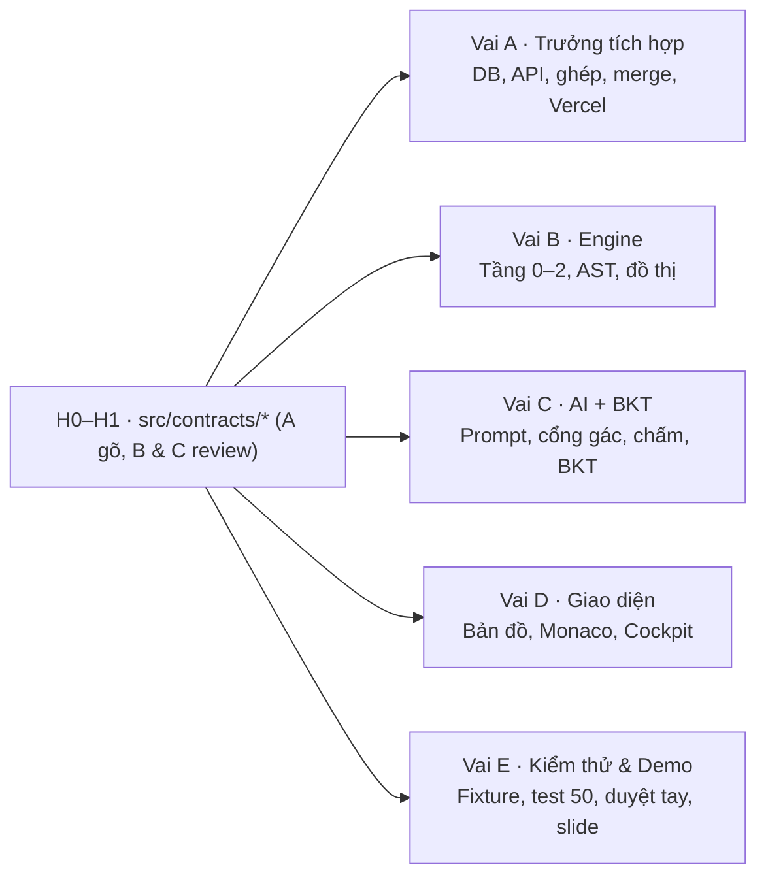

# Kế hoạch code 21 giờ (12g00 07/11 → 09g00 08/11/2026)

> Kế hoạch cho cả nhóm. Đây là nơi gốc của lịch 21 giờ, các quyết định khác đọc ở `spec/00_QUYET_DINH.md`. Đọc cùng `references/thele.md` (luật thi) và [`01_deploy.md`](01_deploy.md) (việc trước ngày thi).

## Đọc nhanh

- **Luật thi (Mục 4):** repo thi **trống** lúc bắt đầu, BTC chỉ nhận commit trong giờ thi, **cấm bulk-commit code viết sẵn**, **mọi thành viên phải có commit**; spec là tài liệu đọc, không phải code: không chép nguyên khối vào repo thi trong một commit.
- **Trước giờ thi:** làm hết Bước 0 ở [`01_deploy.md`](01_deploy.md) Mục 3.
- **Mốc chính (Mục 2):** H+1 13:00 `contracts/*`; H+8 20:00 lát dọc 1; H+12 00:00 CN lát dọc 2; H+16 04:00 đủ endpoint; H+17 05:00 đóng băng tính năng, kiểm Definition of Done (`spec/50` Mục 5); H+21 09:00 ngừng code.
- **Trễ mốc ≥ 1 giờ (Mục 3):** cắt từ trên xuống theo thứ tự ở Mục 3; danh sách không bao giờ cắt nằm cuối Mục 3.

---

## 1. Năm vai song song & điểm nối

Nhóm chia 5 vai:
- **Vai A — Trưởng tích hợp:** Thiết lập dự án, DB migration, auth, API routes, ghép nối, review & merge PR, deploy Vercel.
- **Vai B — Engine:** Tầng 0 (tải repo, lọc rác), Tầng 1 (parser, AST, đồ thị gọi hàm), Tầng 2 (lát cắt, layout Dagre).
- **Vai C — AI + BKT:** Lời gọi Gemini (`gemini-3.5-flash-lite`), prompt & responseSchema, cổng gác `guard/*`, chấm bài, `bkt-engine`.
- **Vai D — Giao diện:** Cột 1 Bản đồ (ReactFlow), Cột 2 Code (Monaco), Cột 3 Cockpit (X-Ray, Feynman, Tổng quan), chế độ offline.
- **Vai E — Kiểm thử, demo, slide:** Fixture, chạy bộ test `50`, chạy thử repo demo, duyệt tay output AI, video demo dự phòng, slide thuyết trình.

**Điểm nối để không ai phải chờ:**
- **Fixture `StaticEngineResult`:** Vai A, D, E dùng bản viết tay từ repo mẫu (`50` Mục 1), đặt ở `src/server/engine/__fixtures__/shop-api.json`, gõ ở H+1; engine thật của Vai B thay vào lúc H+8.
- **Fixture phản hồi AI:** Vai D dựng UI Tab 1/2 bằng JSON mẫu của `50` Mục 2 cho tới khi Vai C có lời gọi thật.
- **Hàm thuần `src/lib/*`:** Vai C viết và test trước (`50`), Vai A gọi trong transaction.

---

## 2. Mốc giờ theo 5 vai

| Giờ | Mục tiêu | A | B | C | D | E |
| :-- | :-- | :-- | :-- | :-- | :-- | :-- |
| H+0–1 | Khung, contracts | Khởi tạo, `contracts`, thử deploy | Thử 3 giả định tải repo | Gọi thử API AI | Khung trang | Fixture |
| H+1–4 | Chạy bằng dữ liệu giả | Bảng, auth, `/api/me` | Tải, lọc repo | BKT + test | Bản đồ từ fixture | Test `50` |
| H+4–8 | Lát dọc 1 | Nối ingest, analyze | Bản đồ thật | Phân tích + cổng gác | Tab 1 | Chạy repo demo |
| H+8–12 | Lát dọc 2 | Nối enrich, evaluate | Sửa theo repo demo | Câu hỏi, chấm, gợi ý | Tab 2, đổi màu | Kịch bản A, B |
| H+12–15 | Giao agent, ngủ xoay | Phiên, API còn lại (giao agent, ngủ từ H+12.5) | Python | Tổng quan | Lịch sử, offline (giao agent, ngủ từ H+12.5) | Test lỗi, slide |
| H+15–17 | Đủ endpoint (H+16), đóng băng (H+17) | Kiểm việc agent, merge, deploy | Ngủ | Duyệt tay, bundle | Kiểm việc agent, sửa giao diện | Ngủ |
| H+17–19 | Tập demo | Sửa lỗi | Sửa lỗi | Ngủ tới H+18.5, rồi sửa lỗi | Sửa lỗi | Definition of Done (H+17), video dự phòng |
| H+19–21 | Về đích | Commit cuối | Kiểm | Kiểm | Kiểm | Slide, nộp |

### Chi tiết các mốc chính (Definition of Done từng mốc)

- **H+0 (12:00):** `create-next-app`, cài gói, `.env.local`, migration chạy trên Supabase; mỗi người commit ≥ 1 lần trên nhánh riêng.
- **H+1 (13:00):** `contracts/*` xong; fixture shop-api; kiểm 3 giả định ⚠️ của `10` (codeload trả đúng mã cho `HEAD`, `archive/HEAD.zip` chuyển hướng tới nhánh mặc định, comment EOCD có commit SHA); đo độ trễ prompt thật của Gemini, chỉnh `LLM_TIMEOUT_MS` nếu cần (D-50); nạp được grammar `.wasm` (`spec/04` Mục 16).
- **H+4 (16:00):** UI hiện bản đồ từ fixture; `bkt-engine` + `plan` + `derive` qua test `50`; ingest tải + lọc repo demo trong RAM.
- **H+8 (20:00):** **Lát dọc 1:** dán link repo demo ⇒ engine thật ⇒ bản đồ thật ⇒ bấm node ⇒ Tab 1 từ `analyze-node` thật.
- **H+12 (00:00 CN):** **Lát dọc 2:** enrich ⇒ nộp ⇒ chấm ⇒ gợi ý ⇒ BKT ⇒ đổi màu ⇒ mở khóa, ghi Postgres; mài mòn ở kỹ năng của node đang mở (D-35).
- **H+16 (04:00):** Mọi endpoint của `03` chạy; mở lại phiên; offline mode; persona; tổng quan; Python resolver.
- **H+17 (05:00):** **Đóng băng tính năng.** Duyệt tay output AI repo demo (`21` Mục duyệt tay) ⇒ ghi `mock_bundle.json`; deploy bản chạy thật.
- **H+19 (07:00):** Sửa lỗi từ buổi tập demo; chạy 3 lần mỗi câu trả lời trong kịch bản; quay video dự phòng.
- **H+19.5 (07:30):** Slide xong (dựa `pitch/`).
- **H+21 (09:00):** Ngừng code. Commit cuối của cả 5 người.
- **Trước 09:30:** Nộp file thuyết trình.
- **10:00–11:30:** Thuyết trình + chạy thử + phản biện.

---

## 3. Thứ tự cắt dự phòng (chỉ khi trễ mốc ≥ 1 giờ)

Cắt từ trên xuống. Mỗi mục cắt phải ghi lại vào `00_QUYET_DINH.md` sau cuộc thi.

1. Resolver Java / Go / Dart và tầng `STRUCTURAL` (giữ TS/JS + Python; INV-09 vẫn đúng vì chỉ hai ngôn ngữ này được tuyên bố đã kiểm chứng).
2. `report-wrong` (ẩn nút "Báo sai").
3. Màn hình lịch sử học (`/history`).
4. Phần AI của tổng quan (chỉ hiện `facts`).

Không bao giờ cắt: bản đồ tất định, Tab 1, câu hỏi + chấm + gợi ý, BKT ở server, offline mode, cổng gác.

---

## 4. Quy ước commit & cách làm việc

- Mỗi người commit **phần của mình**, nhỏ và thường xuyên (mục tiêu ≤ ~200 dòng / commit), message dạng `feat(engine): cắt link về gốc repo` / `fix(ai): …`.
- Không dán nguyên một file lớn từ spec vào một commit; code được gõ hoặc sinh trong giờ thi theo spec rồi chỉnh.
- Không commit `spec/`, `pitch/`, `doc-de-hieu/` vào repo thi (giữ ở repo tài liệu này).
- **Quy trình nhánh + PR (D-30):** Mọi người làm trên nhánh riêng, mở PR; GitHub Actions chạy CI (`typecheck`, `lint`, test); chỉ Vai A (người giữ Vercel) bấm merge commit vào `main` để deploy.
- Không commit `.env*` (chỉ `.env.example`), `.kb/`, `AGENTS.md`, `CLAUDE.md`.

### Cách làm với agent

- **Vòng lặp 30–45 phút:** Đề task rõ ràng, giao agent chạy trên nhánh riêng. Lúc agent đang chạy: đọc PR trước đó hoặc soạn task tiếp theo. Agent chạy xong: người kiểm lại code, chạy test cục bộ rồi mở PR. Vai A merge 30–60 phút một lần.
- **Ranh giới:** Mỗi người 1 agent, 1 nhánh riêng. 1 file chỉ 1 người sửa tại một thời điểm.
- **Duy nhất Vai A sửa `contracts`:** Thay đổi hợp đồng phải được Vai A chốt.
- **Kỷ luật thời gian:** Agent chạy quá 30 phút mà chưa xong thì dừng lại, chia nhỏ task. Làm lại một task tối đa 1 lần, nếu vẫn sai thì người tự code tay.
- **File task:** Mỗi việc là 1 file trong `.kb/tasks/`, ghi rõ tài liệu cần đọc và tên skill cần dùng (`doc-spec`, `kiem-contract`, `commit-nho`), vì AI không tự dùng đủ skill nếu task không nêu tên. Mẫu file task và cách theo dõi ở `docs/huong-dan.md` của `ai-kit`, tình huống 11. Xong thì chuyển vào `.kb/tasks/xong/`.
- **Tiến độ:** Việc của riêng bạn ghi ở `.kb/TIEN_DO.md`. File này do AI tự ghi nên có thể sai; việc đã xong hay chưa phải xem `git log` và kết quả test.
- **Việc cả nhóm:** `.kb` chỉ nằm trên máy mỗi người, nên ai đang làm gì thì theo dõi bằng GitHub Issues của repo thi. Repo public nên Issue chỉ ghi tên việc và người nhận.
- **`ai-kit` đóng băng:** Trước giờ thi mỗi người chạy `node cai-dat.mjs --kiem`. Trong giờ thi không thêm skill, chỉ chủ repo `ai-kit` sửa khi có lỗi khiến cả nhóm không làm việc được, rồi báo cả nhóm `git pull`.

### Lịch ngủ xoay (H+12.5 → H+18.5)

Bảo đảm luôn có người thức trực chiến và không kiệt sức:
- **H+12.5–15:** Vai A, D ngủ (B, C, E trực). Trước khi ngủ, A và D giao việc cho agent. Không có merge trong khoảng này; PR chờ Vai A dậy.
- **H+15–17:** Vai B, E ngủ (A, C, D trực). A, D kiểm việc agent đã làm; Vai A merge.
- **H+17–18.5:** Vai C ngủ (A, B, D, E trực). Vai E kiểm Definition of Done lúc H+17.

Task giao trước khi ngủ được chạy quá 30 phút; dậy phải kiểm trước khi mở PR.

### Buổi tập 21 giờ trước ngày thi

- Làm thử toàn bộ quy trình ở một **repo tập riêng, private**.
- Tuyệt đối không chép code từ repo tập sang repo thi (vi phạm luật thi).
- Mọi lỗi spec phát hiện được trong buổi tập phải được ghi nhận về `spec/00_QUYET_DINH.md` và sửa tại file đích.

---

## 5. Sản phẩm nộp kèm

| Thứ | Hạn | Nguồn |
| :-- | :-- | :-- |
| Slide thuyết trình | trước 09g30 08/11 | `pitch/KICH_BAN_DEMO.md`, `pitch/PHAN_BIEN_BGK.md` |
| Kịch bản demo + câu trả lời đã chạy thử | H+19 | `pitch/KICH_BAN_DEMO.md` |
| Video demo dự phòng | H+19 | Quay màn hình chế độ thật + offline |
| Áp phích (10% điểm vòng thử thách theo lượt tương tác) | Theo lịch BTC | Cần làm riêng — chưa có trong tài liệu |

---

## 6. Rủi ro chính

| Rủi ro | Dấu hiệu sớm | Ứng phó |
| :-- | :-- | :-- |
| Model AI không dùng được / free tier cạn | Lỗi 404 / 429 ở H+1 | Demo bằng Offline. Muốn đổi sang Groq theo D-50 thì phải viết thêm lớp gọi Groq và thêm `GROQ_API_KEY`, đổi `CONFIG.LLM_MODEL` thôi không đủ |
| Comment EOCD không có commit SHA | Kiểm H+1 thất bại | Dùng `ARCHIVE_HASH`; phiên không dựng lại được khi trượt cache RAM trên Vercel (Q-12, ghi vào `00`) |
| Engine trễ | Không có lát dọc 1 ở H+8 | Các vai khác tiếp tục trên fixture; cắt theo Mục 3 bước 1 |
| Tree-sitter WASM lệch ABI | Parser lỗi khi nạp grammar | Đổi phiên bản `web-tree-sitter` trong `package.json` cho khớp grammar có sẵn, không tự build lại (D-32) |
| Postgres / mạng hội trường chập chờn | Lỗi khi tập demo | Mạng di động riêng (thể lệ khuyến khích); offline mode |
| Câu trả lời trên sân khấu bị chấm khác lần tập | Lệch trong 3 lần chạy thử | Chỉ dùng câu đã ổn định 3/3; còn lại dùng offline |
