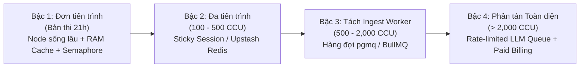

# BẢNG THẨM ĐỊNH KIẾN TRÚC & CÔNG NGHỆ (CHO BAN GIÁM KHẢO)

> Thuyết minh kiến trúc, giải trình lựa chọn công nghệ, lộ trình mở rộng và hỏi–đáp phản biện vận hành cho SimpliFey V2 Pro.
> Khi có sự không nhất quán, [`spec/04_KIEN_TRUC_TRIEN_KHAI.md`](../spec/04_KIEN_TRUC_TRIEN_KHAI.md) và [`spec/02_CONTRACTS.md`](../spec/02_CONTRACTS.md) là chuẩn xác định cuối cùng.

---

## 1. Bảng công nghệ toàn diện (Stack Thẩm định theo Mẫu BTC)

| Hạng mục | Chọn | Vì sao chọn | Không chọn | Vì sao không |
| :-- | :-- | :-- | :-- | :-- |
| **Frontend** | **Next.js 15, React 19, ReactFlow, Monaco, Zustand** | ReactFlow tối ưu cho đồ thị DAG; Monaco chuẩn code viewer; Zustand nhẹ không gây re-render thừa (`spec/01` §3, `spec/30`). | Nuxt, SvelteKit, Canvas tự vẽ | Tốn thời gian dựng buồng lái 3 cột trong 21h; ReactFlow và Monaco hoàn thiện nhất cho sơ đồ và mã nguồn. |
| **Backend** | **Next.js 15 Route Handlers trên 1 tiến trình Node.js sống lâu (`next start`)** | Chia sẻ kiểu dữ liệu (`src/contracts/`); giữ cache RAM đồ thị 10 phút, in-flight map và semaphore in-process (`spec/03` API-08). | Tách Fastify/Express; Python FastAPI | Tách backend tăng chi phí tích hợp và deploy lúc thi; Next.js gom API và Web thành khối thống nhất. |
| **AI (LLM)** | **Google Gemini (`gemini-2.5-flash` qua SDK `@google/genai`)** | Sinh phản hồi nhanh (1.2–1.8 s), hỗ trợ JSON `responseSchema`; chi phí tối ưu (~$0.05/phiên đầu, ~$0.02/phiên sau) (`spec/02` §1.1, R-05). | GPT-4o, Claude 3.5 Sonnet | Chi phí token cao gấp 5–10 lần; quota gói thử nghiệm không phù hợp quy mô gọi đồng thời của cuộc thi. |
| **Database** | **Supabase Postgres (AWS Singapore `ap-southeast-1`)** | Chuẩn ACID cho mô hình BKT và transaction chấm điểm; RLS bảo vệ dữ liệu; cùng vùng Singapore với host (`spec/03` §3, R-03). | MongoDB, Firestore, SQLite | BKT cần toàn vẹn giao dịch (`BEGIN ... SELECT FOR UPDATE`); NoSQL dễ xung đột khi nhiều tab nộp bài cùng lúc. |
| **Cache & Queue** | **RAM LRU Cache + Semaphore FIFO trong bộ nhớ** | Giữ đồ thị trong RAM 10 phút (`CONFIG.INGESTION_CACHE_TTL_MS`); semaphore giới hạn 4 luồng nạp; 0 chi phí và 0 độ trễ mạng phụ (`spec/03` §4, §6.7). | Redis, RabbitMQ, BullMQ ở bản thi | Tăng độ phức tạp và rủi ro mạng trong 21h; semaphore + in-flight map trong RAM là đủ cho tải demo (`spec/00` D-31). |
| **Logging** | **Pino (xuất JSON 1 dòng ra `stdout`)** | Chi phí CPU/RAM tối thiểu; log JSON dễ lọc; tích hợp Next.js 15 qua `serverExternalPackages: ['pino']` (R-08, D-28). | Winston, Morgan | Winston cấu hình cồng kềnh; Morgan chỉ ghi log HTTP thô, không gắn được `session_id`, `node_id`, `tokens_used`. |
| **Monitoring** | **Railway Metrics Dashboard + Server Live Logs** | Có sẵn CPU, RAM, Network I/O và log stream thời gian thực; không mất thời gian cấu hình lúc thi (R-09, D-29). | Datadog, Prometheus + Grafana | Quá cồng kềnh, cấu hình vượt thời gian cho phép của hackathon 21h; gây lãng phí tài nguyên. |
| **Container** | **Nixpacks / Dockerfile Node 20 trên Railway** | Tối ưu layer dựng Next.js; cô lập tiến trình máy chủ độc lập (R-02). | Kubernetes, Docker Compose tự dựng | Không cần thiết cho 1 máy chủ duy nhất; tăng gánh nặng bảo trì hạ tầng không cần thiết. |
| **CI/CD** | **GitHub Actions (`ci.yml`) + Railway Webhook** | Chạy kiểm tra tự động (`typecheck`, `lint`, `vitest`) miễn phí cho repo public; tự deploy vào `main` khi test pass (R-10, D-30). | Jenkins, GitLab CI, Deploy thủ công | GitHub Actions tích hợp sâu; deploy tự động loại bỏ lỗi thao tác tay trong giờ thi. |
| **Deployment** | **Railway PaaS (Singapore `asia-southeast1-eqsg3a`)** | Tiến trình Node sống lâu 24/7; không ngủ/spin-down khi rảnh; cấp RAM động; cùng vùng với Supabase (ping < 10 ms) (R-02, D-27). | Vercel Serverless, Render Free | Vercel stateless làm mất cache RAM và semaphore (R-01); Render Free tự ngủ sau 15p rảnh, bật lại mất ~1p (R-02). |
| **File Storage** | **KHÔNG CÓ (Zero-Disk cho mã nguồn)** | Bất biến Zero-Disk (`spec/01` INV-04): File zip và mã nguồn chỉ nằm trong RAM khi phân tích rồi giải phóng ngay; không ghi đĩa hay DB. | AWS S3, Google Cloud Storage, Supabase Storage | Vi phạm cam kết Zero-Disk; lưu mã nguồn người học xuống đĩa đám mây tạo nguy cơ rò rỉ bản quyền phần mềm. |
| **API Docs** | **Đặc tả nội bộ tại `spec/02_CONTRACTS.md` & `spec/03_API_VA_LUU_TRU.md`** | 100% endpoint, schema request/response, mã lỗi TypeScript được chuẩn hóa tại một nguồn duy nhất. | Swagger / OpenAPI UI công khai | Mọi route cần phiên Supabase nội bộ; không phát hành API công khai cho bên thứ ba trong hackathon. |
| **Auth** | **Supabase Auth (Khách ẩn danh + GitHub OAuth Linking)** | Cấp quyền tức thì cho khách trải nghiệm ngay (`signInAnonymously`); cho phép gắn tài khoản GitHub khi muốn lưu lâu dài (`spec/03` §2). | Auth0, NextAuth tự dựng | Supabase Auth tích hợp sẵn RLS của database; không cần tự quản lý bảng session hay JWT thủ công. |
| **Code Sandbox** | **KHÔNG CÓ / KHÔNG CẦN (Chỉ phân tích tĩnh)** | Bất biến Zero-Trust (`spec/01` INV-03): Hệ thống chỉ bóc tách cú pháp tĩnh bằng Tree-sitter AST, không biên dịch hay chạy code người dùng. | Docker Sandbox, Firecracker microVM | Hệ thống là gia sư kiến trúc, không phải Online Judge chạy testcase. Không chạy code loại trừ 100% rủi ro RCE. |

---

## 2. Lộ trình mở rộng hệ thống theo 4 bậc

Kiến trúc module hóa một chiều (`spec/04` §4) cho phép mở rộng tuần tự theo tải thực tế:

| Bậc kiến trúc | Dấu hiệu cần nâng bậc | Thay đổi trong Code | Hạ tầng bổ sung |
| :-- | :-- | :-- | :-- |
| **Bậc 1: Đơn tiến trình** *(Bản thi)* | Khởi đầu demo (CCU ≤ 50). | Giữ nguyên kiến trúc hiện tại (`spec/04`). | 1 Node instance Railway (Singapore) + Supabase Free + Gemini API. |
| **Bậc 2: Đa tiến trình** | Tải tăng; CPU máy chủ > 70%; cache RAM trượt do redeploy. | Chuyển `RAMCodeStore` và LRU cache sang bộ nhớ phân tán; cấu hình Session Affinity. | **Upstash Redis** (gói Free 500k commands/tháng, R-11) làm tầng đệm dùng chung. |
| **Bậc 3: Tách Ingest Worker** | p95 Ingest > 5 s; semaphore 4 luồng bị đầy; nhiều repo nặng cùng nạp. | Tách module `engine/*` thành Worker riêng; `/api/ingest` đẩy job vào queue và trả job ID để polling. | Hàng đợi **`pgmq` (Supabase Queues)** chạy trực tiếp trên Postgres (0 chi phí phụ, R-04, R-11) hoặc BullMQ. |
| **Bậc 4: Hàng đợi gọi AI** | Chạm trần quota Gemini Free (15 RPM); phục vụ toàn trường (> 2,000 SV). | Chuyển phân tích nền (`analyze-node`, `analyze-overview`) qua worker bất đồng bộ theo batch. | Gắn Google Cloud Billing (Paid Tier, không train model, R-06); dùng **Upstash QStash** (1,000 msg/ngày free). |

---

## 3. Hỏi – Đáp phản biện cùng Ban giám khảo (Q&A)

### Q1. Tại sao bản thi không dùng hàng đợi ngoài (Redis, BullMQ, RabbitMQ)?
> Trong 21 giờ thi, thêm Redis hay RabbitMQ làm tăng ít nhất 2 điểm lỗi tiềm ẩn (mạng, timeout, đồng bộ). Hệ thống giải quyết tải bằng cách tiếp cận kỷ luật:
> 1. Dùng **Semaphore FIFO nội bộ** (`CONFIG.MAX_CONCURRENT_INGESTIONS = 4`) chặn nghẽn CPU khi nạp repo.
> 2. Dùng **In-flight promise map** trong RAM triệt tiêu lời gọi AI trùng lặp.
> 3. Dùng **Bảng `ai_cache` trong Postgres** chia sẻ vĩnh viễn phân tích giữa mọi người học cùng repo.
> Khi mở rộng, Bậc 3 sẽ dùng `pgmq` (có sẵn trong Supabase Postgres) mà không làm đổi logic lõi.

### Q2. Hệ thống chịu tải được bao nhiêu người dùng đồng thời?
> Trả lời trung thực: **Hệ thống chưa đo đạc tải tối đa trên code thật** (`spec/02` §1.1). Dựa trên phân tích lý thuyết:
> - Ingest xử lý tối đa 4 repo song song, mỗi repo < 1.5 s ⇒ ~160 repo/phút.
> - Sau khi dựng xong bản đồ, người học chỉ đọc và nộp text ngắn; Node.js chịu tải hàng trăm kết nối đọc/ghi qua Supabase.
> - Nút thắt thực tế là quota Gemini Free (15 RPM). Bản thi được thiết kế tối ưu cho nhóm 10–30 người học đồng thời.

### Q3. Nếu Gemini API gặp lỗi 429 hoặc sập mạng lúc chấm bài thì sao?
> Hệ thống có 3 lớp bảo vệ:
> 1. **Retry tự động:** Thử lại 1 lần với exponential backoff + jitter (`CONFIG.LLM_RETRY_DELAY_MS = 500` ms, Jitter 100 ms).
> 2. **Không phạt người học:** AI vẫn lỗi ⇒ trả `ERR_AI_UNAVAILABLE` (HTTP 503), hiện nút "Thử lại", **không trừ lượt nộp** (`spec/00` D-03, `spec/03` §7).
> 3. **Chế độ Offline (`Ctrl+Shift+D`):** Khi mất mạng ngoài, chuyển sang bundle dữ liệu chuẩn bị sẵn (`mock_bundle.json`) đã duyệt tay 100% (`spec/01` §2 INV-05).

### Q4. Tại sao chọn Railway mà không chọn Vercel Serverless?
> Vercel Serverless có 2 điểm không tương thích với hệ thống (R-01):
> 1. **Mất cache RAM:** Vercel scale về 0 khi rảnh. Cache đồ thị `StaticEngineResult` (lưu 10 phút) sẽ bị xóa liên tục, buộc phải tải lại repo từ đầu.
> 2. **Vô hiệu hóa Semaphore:** Mỗi serverless function là môi trường cô lập, không thể chia sẻ Semaphore giới hạn 4 luồng nạp repo.
> Railway duy trì tiến trình Node sống lâu 24/7, giữ vững cache RAM và cơ chế đồng thời, cùng vùng Singapore với Supabase (R-02).

### Q5. Hệ thống có nguy cơ bị tấn công thực thi mã từ xa (RCE) không?
> **Hoàn toàn không.** Hệ thống tuân thủ nghiêm ngặt **Zero-Trust** (`spec/01` INV-03):
> - Không chạy `git clone`, không `eval()`, không `npm install`, không thực thi bất kỳ lệnh nào từ code người dùng.
> - Mã nguồn chỉ được nạp vào RAM để **Tree-sitter WASM** bóc tách cú pháp tĩnh (AST) tìm hàm và quan hệ gọi hàm. Không có môi trường thực thi nào được kích hoạt.

### Q6. Ghi log tập trung có làm lộ mã nguồn hay khóa API không?
> Hệ thống thiết lập danh sách **CẤM GHI LOG TUYỆT ĐỐI** (`spec/04` §9.2):
> - Cấm ghi nội dung file code, đoạn snippet, hay `code_context`.
> - Cấm ghi khóa bí mật (`SUPABASE_SERVICE_ROLE_KEY`, `GEMINI_API_KEY`, khóa HMAC/AES).
> - Cấm ghi header `Authorization`, bearer token và câu trả lời tự do của người học (`student_answer`).

### Q7. Supabase gói Free có nguy cơ bị tạm dừng (pause) làm hỏng demo không?
> Theo tài liệu Supabase (R-03), project chỉ bị tạm dừng nếu **không có truy vấn nào suốt 7 ngày liên tục**.
> Nhóm kiểm soát bằng:
> 1. Kiểm tra dashboard và ping DB trước giờ thi ở mốc H-1 (`spec/40` §1).
> 2. Có sẵn **Chế độ Offline (`Ctrl+Shift+D`)** chạy độc lập hoàn toàn với database và mạng ngoài, đảm bảo không bao giờ gián đoạn thuyết trình.

---

## 4. Nguồn xác thực chính thức (Truy cập 2026-10-29)

1. Vercel Functions Limits: `https://vercel.com/docs/functions/limitations`
2. Railway Regions: `https://docs.railway.app/reference/regions`
3. Railway Pricing: `https://docs.railway.app/reference/pricing`
4. Render Free Services: `https://render.com/docs/free`
5. Fly.io Pricing: `https://fly.io/docs/about/pricing/`
6. Supabase Limits: `https://supabase.com/docs/guides/platform/manage-your-usage/disk-budget`
7. Supabase Inactivity: `https://supabase.com/docs/guides/platform/pause-and-unpause`
8. Supabase Connection Pooler: `https://supabase.com/docs/guides/database/connecting-to-postgres`
9. Supabase Queues: `https://supabase.com/docs/guides/queues`
10. Gemini Rate Limits: `https://ai.google.dev/pricing`
11. Gemini Error Handling: `https://ai.google.dev/gemini-api/docs/troubleshooting`
12. Gemini Terms & Privacy: `https://ai.google.dev/gemini-api/terms`
13. Next.js serverExternalPackages: `https://nextjs.org/docs/app/api-reference/config/next-config-js/serverExternalPackages`
14. GitHub Actions Billing: `https://docs.github.com/en/billing/managing-billing-for-github-actions/about-billing-for-github-actions`
15. GitHub Secondary Rate Limits: `https://docs.github.com/en/rest/using-the-rest-api/rate-limits-for-the-rest-api#about-secondary-rate-limits`
