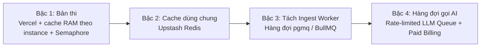

# BẢNG THẨM ĐỊNH KIẾN TRÚC & CÔNG NGHỆ (CHO BAN GIÁM KHẢO)

> Thuyết minh kiến trúc, giải trình lựa chọn công nghệ, lộ trình mở rộng và hỏi–đáp phản biện vận hành cho SimpliFey V2 Pro.
> Khi có sự không nhất quán, [`spec/04_KIEN_TRUC_TRIEN_KHAI.md`](../spec/04_KIEN_TRUC_TRIEN_KHAI.md) và [`spec/02_CONTRACTS.md`](../spec/02_CONTRACTS.md) là chuẩn xác định cuối cùng. Mọi số độ trễ / tải / chi phí dưới đây là **mục tiêu hoặc ước tính, chưa đo**.

---

## 1. Bảng công nghệ toàn diện (Stack Thẩm định theo Mẫu BTC)

| Hạng mục | Chọn | Vì sao chọn | Không chọn | Vì sao không |
| :-- | :-- | :-- | :-- | :-- |
| **Frontend** | **Next.js 15, React 19, ReactFlow, Monaco, Zustand** | ReactFlow hợp với đồ thị DAG; Monaco chuẩn code viewer; Zustand nhẹ, ít re-render thừa (`spec/01` §3, `spec/30`). | Nuxt, SvelteKit, Canvas tự vẽ | Tốn thời gian dựng buồng lái 3 cột trong 21h; ReactFlow và Monaco hoàn thiện nhất cho sơ đồ và mã nguồn. |
| **Backend** | **Next.js 15 Route Handlers chạy trên Vercel Functions** | Chia sẻ kiểu dữ liệu (`src/contracts/`) giữa client và server; một repo, một lần deploy (`spec/03` API-08). | Tách Fastify/Express; Python FastAPI | Tách backend tăng chi phí tích hợp và deploy lúc thi. |
| **AI (LLM)** | **Google Gemini (`CONFIG.LLM_MODEL` qua SDK `@google/genai`)** | Hỗ trợ JSON `responseSchema`; chi phí ước tính ~0,05 USD người học đầu / ~0,03 USD người học sau mỗi repo, chưa đo (`spec/02` §1.1). | GPT-4o, Claude 3.5 Sonnet | Giá token cao hơn ở thời điểm chọn; nhóm chỉ cần 1 nhà cung cấp cho bản thi. |
| **Database** | **Supabase Postgres (AWS Singapore `ap-southeast-1`)** | ACID cho BKT và transaction chấm điểm; RLS bảo vệ dữ liệu; cùng vùng Singapore với host (`spec/03` §3). | MongoDB, Firestore, SQLite | BKT cần toàn vẹn giao dịch (`BEGIN ... SELECT FOR UPDATE`); NoSQL dễ xung đột khi nhiều tab nộp bài cùng lúc. |
| **Cache & Queue** | **RAM LRU Cache + Semaphore FIFO trong 1 instance; `ai_cache` ở Postgres** | Cache RAM (`CONFIG.INGESTION_CACHE_TTL_MS`) và semaphore (`CONFIG.MAX_CONCURRENT_INGESTIONS`) chỉ giúp nhanh, **không được dựa vào**: trượt cache ⇒ dựng lại theo commit SHA (`spec/03` §4, D-27, D-39). | Redis, RabbitMQ, BullMQ ở bản thi | Tăng độ phức tạp và rủi ro mạng trong 21h (`spec/00` D-31). |
| **Logging** | **Pino (JSON 1 dòng ra `stdout`)** | Vercel thu log của Function; log JSON dễ lọc theo `session_id`, `node_id`, `tokens_used`; cấu hình `serverExternalPackages: ['pino']` (D-28). | Winston, Morgan | Winston cấu hình cồng kềnh; Morgan chỉ ghi log HTTP thô. |
| **Monitoring** | **Log + Vercel Observability + dashboard Supabase** | Có sẵn, không mất thời gian cấu hình lúc thi (D-29). | Datadog, Prometheus + Grafana | Cấu hình vượt thời gian cho phép của hackathon 21h. |
| **CI/CD** | **GitHub Actions (`ci.yml`) + Vercel Git Integration** | Actions chạy `typecheck`, `lint`, `vitest` miễn phí cho repo public; Vercel tự deploy khi vào `main`, có preview cho mỗi PR (D-30). | Jenkins, GitLab CI, Deploy thủ công | Deploy tự động loại bỏ lỗi thao tác tay trong giờ thi. |
| **Deployment** | **Vercel gói free, region `sin1` (Singapore)** | Miễn phí, tự deploy từ GitHub, cùng vùng với Supabase. Chấp nhận mất cache RAM giữa các instance vì đã có đường dựng lại theo SHA (D-27). | Railway, Render, Fly.io | Tốn phí hoặc cần tự quản lý tiến trình; nhóm theo hướng mã nguồn mở, người tự cài dùng gói free được (D-33). |
| **File Storage** | **KHÔNG CÓ (Zero-Disk cho mã nguồn)** | `spec/01` INV-04: zip và mã nguồn chỉ nằm trong RAM khi phân tích rồi giải phóng; không ghi đĩa hay DB. Upload `.zip` ≤ `CONFIG.MAX_UPLOAD_BYTES` (giới hạn body của Vercel). | AWS S3, Google Cloud Storage, Supabase Storage | Vi phạm cam kết Zero-Disk; lưu mã nguồn người học lên đám mây tạo nguy cơ rò rỉ. |
| **API Docs** | **Đặc tả nội bộ tại `spec/02_CONTRACTS.md` & `spec/03_API_VA_LUU_TRU.md`** | Mọi endpoint, schema request/response, mã lỗi TypeScript ở một nguồn duy nhất. | Swagger / OpenAPI UI công khai | Mọi route cần phiên Supabase; không phát hành API công khai trong hackathon. |
| **Auth** | **Supabase Auth (Khách ẩn danh + GitHub OAuth Linking)** | Khách dùng ngay (`signInAnonymously`); gắn GitHub khi muốn lưu lâu dài (`spec/03` §2). | Auth0, NextAuth tự dựng | Supabase Auth tích hợp sẵn RLS; không tự quản lý session hay JWT. |
| **Code Sandbox** | **KHÔNG CÓ / KHÔNG CẦN (Chỉ phân tích tĩnh)** | `spec/01` INV-03: chỉ bóc tách cú pháp tĩnh bằng Tree-sitter, không biên dịch hay chạy code người dùng. | Docker Sandbox, Firecracker microVM | Hệ thống là gia sư kiến trúc, không phải Online Judge; không chạy code nên không có đường thực thi code người dùng. |

---

## 2. Lộ trình mở rộng hệ thống theo 4 bậc

Kiến trúc module hóa một chiều (`spec/04` §4) cho phép mở rộng tuần tự theo tải thực tế. Ngưỡng nâng bậc chỉ chốt khi có số đo.

| Bậc kiến trúc | Dấu hiệu cần nâng bậc | Thay đổi trong Code | Hạ tầng bổ sung |
| :-- | :-- | :-- | :-- |
| **Bậc 1** *(Bản thi)* | Khởi đầu demo, nhóm nhỏ người học. | Giữ nguyên kiến trúc hiện tại (`spec/04`). | Vercel gói free (`sin1`) + Supabase Free + Gemini API. |
| **Bậc 2: Cache dùng chung** | Log cho thấy nhiều lần dựng lại theo SHA vì trượt cache RAM giữa các instance. | Chuyển LRU cache `StaticEngineResult` sang bộ nhớ dùng chung. | **Upstash Redis** gói free làm tầng đệm dùng chung. |
| **Bậc 3: Tách Ingest Worker** | Ingest chạm giới hạn thời gian / RAM của Vercel Functions; `ERR_SERVER_BUSY` thường xuyên. | Tách `engine/*` thành Worker riêng; `/api/ingest` đẩy job vào queue và trả job ID để polling. | Hàng đợi **`pgmq` (Supabase Queues)** chạy trên Postgres, hoặc BullMQ. |
| **Bậc 4: Hàng đợi gọi AI** | Chạm trần quota gói Free của Gemini. | Chuyển phân tích nền (`analyze-node`, `analyze-overview`) qua worker bất đồng bộ theo batch. | Gắn Google Cloud Billing (Paid Tier, không dùng dữ liệu để huấn luyện); hàng đợi có rate-limit (vd Upstash QStash). |

---

## 3. Hỏi – Đáp phản biện cùng Ban giám khảo (Q&A)

### Q1. Tại sao bản thi không dùng hàng đợi ngoài (Redis, BullMQ, RabbitMQ)?
> Trong 21 giờ thi, thêm Redis hay RabbitMQ là thêm điểm lỗi (mạng, timeout, đồng bộ). Hệ thống giữ đơn giản:
> 1. **Semaphore FIFO** (`CONFIG.MAX_CONCURRENT_INGESTIONS`) trong mỗi instance chặn nghẽn khi nạp repo.
> 2. **In-flight promise map** trong RAM gộp lời gọi AI trùng lặp.
> 3. **Bảng `ai_cache` trong Postgres** chia sẻ bản phân tích node và tổng quan giữa mọi người học cùng repo (D-37).
> Hai cơ chế đầu chỉ là tối ưu trong 1 instance, đúng sai của hệ thống không phụ thuộc vào chúng. Khi mở rộng, Bậc 3 dùng `pgmq` (có sẵn trong Supabase) mà không đổi logic lõi.

### Q2. Hệ thống chịu tải được bao nhiêu người dùng đồng thời?
> Trả lời trung thực: **chưa đo tải tối đa trên code thật** (`spec/02` §1.1).
> - Sau khi dựng xong bản đồ, người học chỉ đọc và nộp text ngắn; Vercel tự tăng số instance theo request.
> - Nút thắt dự kiến là quota gói Free của Gemini và giới hạn của gói free Vercel / Supabase. Bản thi nhắm tới nhóm nhỏ người học đồng thời; con số cụ thể chỉ nói sau khi đo.

### Q3. Nếu Gemini API gặp lỗi 429 hoặc sập mạng lúc chấm bài thì sao?
> Hệ thống có 3 lớp bảo vệ:
> 1. **Retry tự động:** thử lại `CONFIG.LLM_MAX_RETRIES` lần, chờ `CONFIG.LLM_RETRY_DELAY_MS` cộng jitter ngẫu nhiên (`CONFIG.LLM_RETRY_JITTER_MS`).
> 2. **Không phạt người học:** AI vẫn lỗi ⇒ `ERR_AI_UNAVAILABLE` (HTTP 503), hiện nút "Thử lại", **không trừ lượt nộp** (`spec/00` D-03, `spec/03` §7).
> 3. **Chế độ Offline (`Ctrl+Shift+D`):** mất mạng ngoài ⇒ chuyển sang bundle ghi lại từ một lần chạy thật (`mock_bundle.json`), đã duyệt tay; nhãn Offline luôn hiện.

### Q4. Tại sao chọn Vercel? Vercel serverless làm mất cache RAM thì sao?
> Đúng là trên Vercel, cache RAM và semaphore chỉ sống trong 1 instance và có thể mất bất kỳ lúc nào. Nhóm chấp nhận điều đó và thiết kế để **không dựa vào cache** (D-27):
> 1. **Phiên gắn commit SHA (D-39):** trượt cache ⇒ tải lại zip theo đúng SHA của phiên và chạy lại engine tất định ⇒ bản đồ y hệt, tiến độ ghép lại từ Postgres.
> 2. **Tiến độ, câu hỏi, đáp án đều ở Postgres**, không ở RAM ⇒ request rơi vào instance nào cũng chấm đúng (D-36).
> 3. **Đổi lại:** miễn phí, tự deploy từ GitHub, cùng vùng Singapore với Supabase, và người tự cài từ mã nguồn mở dùng được gói free (D-33).
> Giới hạn còn lại: phiên tạo từ file `.zip` (không có SHA) không dựng lại được khi trượt cache — người học phải kéo thả lại đúng file (`spec/00` Q-12).

### Q5. Hệ thống có nguy cơ bị tấn công thực thi mã từ xa (RCE) không?
> Hệ thống không có đường nào thực thi code người dùng (`spec/01` INV-03):
> - Không chạy `git clone`, không `eval()`, không `npm install`, không thực thi lệnh nào từ code người dùng.
> - Mã nguồn chỉ được nạp vào RAM để **Tree-sitter WASM** bóc tách cú pháp tĩnh tìm hàm và quan hệ gọi hàm.
> Rủi ro còn lại nằm ở thư viện giải nén / parser (zip bomb, file dị dạng) — đã có trần byte, tỉ lệ nén và thời gian (`spec/10`).

### Q6. Ghi log tập trung có làm lộ mã nguồn hay khóa API không?
> Hệ thống có danh sách **CẤM GHI LOG** (`spec/04` §9.2):
> - Cấm ghi nội dung file code, đoạn snippet, AST, lát cắt gửi AI.
> - Cấm ghi khóa bí mật (`SUPABASE_SERVICE_ROLE_KEY`, `GEMINI_API_KEY`).
> - Cấm ghi header `Authorization`, bearer token và câu trả lời tự do của người học (`student_answer`).

### Q7. Supabase gói Free có nguy cơ bị tạm dừng (pause) làm hỏng demo không?
> Theo tài liệu Supabase, project gói Free bị tạm dừng khi không có hoạt động trong một thời gian dài (xem nguồn 4).
> Nhóm kiểm soát bằng:
> 1. Kiểm tra dashboard và ping DB trước giờ thi (`spec/40` §1).
> 2. Có sẵn **Chế độ Offline (`Ctrl+Shift+D`)** chạy độc lập với database và mạng ngoài.

---

## 4. Nguồn xác thực chính thức (Truy cập 2026-10-29)

1. Vercel Functions Limits: `https://vercel.com/docs/functions/limitations`
2. Supabase Limits: `https://supabase.com/docs/guides/platform/manage-your-usage/disk-budget`
3. Supabase Connection Pooler: `https://supabase.com/docs/guides/database/connecting-to-postgres`
4. Supabase Inactivity: `https://supabase.com/docs/guides/platform/pause-and-unpause`
5. Supabase Queues: `https://supabase.com/docs/guides/queues`
6. Gemini Rate Limits: `https://ai.google.dev/pricing`
7. Gemini Error Handling: `https://ai.google.dev/gemini-api/docs/troubleshooting`
8. Gemini Terms & Privacy: `https://ai.google.dev/gemini-api/terms`
9. Next.js serverExternalPackages: `https://nextjs.org/docs/app/api-reference/config/next-config-js/serverExternalPackages`
10. GitHub Actions Billing: `https://docs.github.com/en/billing/managing-billing-for-github-actions/about-billing-for-github-actions`
11. GitHub Secondary Rate Limits: `https://docs.github.com/en/rest/using-the-rest-api/rate-limits-for-the-rest-api#about-secondary-rate-limits`
