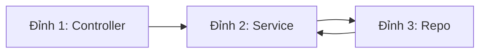
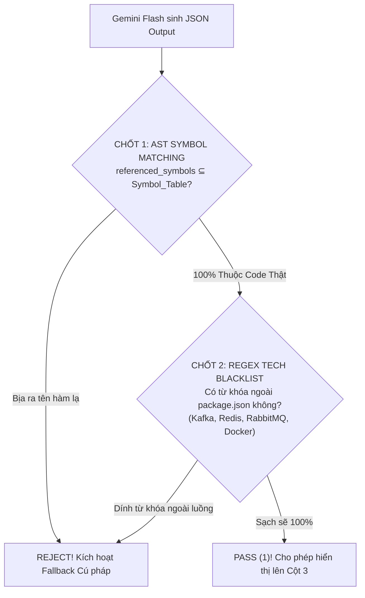

# GIÁO TRÌNH TOÁN HỌC & THUẬT TOÁN CHUẨN HOÁ SIMPLIFEY V2 PRO
## TÀI LIỆU HUẤN LUYỆN KỸ NGHỆ THUẬT TOÁN CHO ĐỘI HÌNH THỰC CHIẾN HACKATHON 24H
### *Bản Chuẩn Hóa 100%: Loại bỏ Văn Mẫu, Minh Họa Từng Bước Chạy Tay Bằng Số (Numerical Dry-Run)*

---

| **Thuộc tính** | **Thông số kỹ thuật học thuật** |
| :--- | :--- |
| **Phân hệ tài liệu** | `references/GIAO_TRINH_THUAT_TOAN_CHUAN.md` |
| **Đối tượng học tập** | Toàn bộ 3 thành viên đội thi (Người 1 - Lead, Người 2 - Static Engine, Người 3 - AI/Bayes) |
| **Phương châm sư phạm** | **Toán học chính xác + Ví dụ chạy tay bằng số (Dry-run Trace) + Mã giả thực thi** |
| **7 Trọng tâm thuật toán** | Two-Pass Symbol Resolution, Tarjan SCC, PageRank Sink Filter, Cognitive Complexity, Slice-Scoped Uncle Bob, Def-Use Slicing, BKT $q$-Matrix |

---

# MỤC LỤC BÀI GIẢNG

1. [CHƯƠNG 1: DỰ ÁN MẪU 4 TỆP DÙNG CHO TOÀN BỘ GIÁO TRÌNH (BENCHMARK REPO)](#chương-1-dự-án-mẫu-4-tệp-dùng-cho-toàn-bộ-giáo-trình-benchmark-repo)
2. [CHƯƠNG 2: THUẬT TOÁN TWO-PASS GLOBAL SYMBOL RESOLUTION](#chương-2-thuật-toán-two-pass-global-symbol-resolution)
3. [CHƯƠNG 3: LÝ THUYẾT ĐỒ THỊ & THUẬT TOÁN TARJAN KHỬ CHU TRÌNH (SCC)](#chương-3-lý-thuyết-đồ-thị--thuật-toán-tarjan-khử-chu-trình-scc)
4. [CHƯƠNG 4: PAGERANK VỚI BỘ LỌC ĐỈNH LÁ TIỆN ÍCH (UTILITY SINK FILTERING)](#chương-4-pagerank-với-bộ-lọc-đỉnh-lá-tiện-ích-utility-sink-filtering)
5. [CHƯƠNG 5: COGNITIVE COMPLEXITY (SONARQUBE) & VÉ VIP THUẬT TOÁN](#chương-5-cognitive-complexity-sonarqube--vé-vip-thuật-toán)
6. [CHƯƠNG 6: BỘ CHỈ SỐ UNCLE BOB TRÊN PHẠM VI LÁT CẮT (SLICE SCOPE)](#chương-6-bộ-chỉ-số-uncle-bob-trên-phạm-vi-lát-cắt-slice-scope)
7. [CHƯƠNG 7: SCOPED DEF-USE SLICING TRÊN CÂY CÚ PHÁP TRỪU TƯỢNG (AST)](#chương-7-scoped-def-use-slicing-trên-cây-cú-pháp-trừu-tượng-ast)
8. [CHƯƠNG 8: QUY TRÌNH 3 BƯỚC CỘT 3 & CỔNG GÁC NHỊ PHÂN CHỐNG ẢO GIÁC](#chương-8-quy-trình-3-bước-cột-3--cổng-gác-nhị-phân-chống-ảo-giác)
9. [CHƯƠNG 9: MÔ HÌNH HÓA NHẬN THỨC BKT, q-MATRIX & THANG TIẾN HÓA 3 BẬC](#chương-9-mô-hình-hóa-nhận-thức-bkt-q-matrix--thang-tiến-hóa-3-bậc)

---

# CHƯƠNG 1: DỰ ÁN MẪU 4 TỆP DÙNG CHO TOÀN BỘ GIÁO TRÌNH (BENCHMARK REPO)

Để mọi thuật toán trong giáo trình này đều có thể **chạy tay bằng số (Dry-run trace)** một cách minh bạch, chúng ta thống nhất sử dụng một Repository mẫu gồm đúng 4 file mã nguồn đại diện cho một luồng Checkout bán hàng:

```typescript
// ==========================================
// TỆP 1: src/controllers/order.controller.ts
// ==========================================
import { OrderService } from "../services/order.service";
import { Logger } from "../utils/logger";

export class OrderController {
  private orderService = new OrderService();
  private logger = new Logger();

  async postCheckout(req: any, res: any) {
    this.logger.info("Nhận yêu cầu checkout");
    const result = await this.orderService.processCheckout(req.body);
    return res.json(result);
  }
}

// ==========================================
// TỆP 2: src/services/order.service.ts
// ==========================================
import { InventoryRepo } from "../repos/inventory.repo";
import { Logger } from "../utils/logger";

export class OrderService {
  private inventoryRepo = new InventoryRepo();
  private logger = new Logger();

  async processCheckout(dto: { items: Array<{ id: string; qty: number }> }) {
    this.logger.info("Xử lý đơn hàng");
    for (const item of dto.items) {
      // ⚠️ LỖI AI VIBE SMELL: N+1 Query lặp trong forEach/for-of
      await this.inventoryRepo.updateStock(item.id, item.qty);
    }
    return { success: true };
  }
}

// ==========================================
// TỆP 3: src/repos/inventory.repo.ts
// ==========================================
import { Logger } from "../utils/logger";

export class InventoryRepo {
  private logger = new Logger();

  async updateStock(productId: string, quantity: number) {
    this.logger.info(`Trừ tồn kho: ${productId}`);
    // Giả lập câu lệnh SQL: UPDATE inventory SET stock = stock - quantity WHERE id = productId
    return true;
  }
}

// ==========================================
// TỆP 4: src/utils/logger.ts
// ==========================================
export class Logger {
  info(msg: string) {
    console.log(`[LOG] ${new Date().toISOString()}: ${msg}`);
  }
}
```

---

# CHƯƠNG 2: THUẬT TOÁN TWO-PASS GLOBAL SYMBOL RESOLUTION

### 2.1. Bản chất Kỹ thuật
Xây dựng đồ thị gọi hàm (Call-Graph) liên kết chính xác giữa các file mà **hoàn toàn không cần cài đặt Compiler (tsc, javac, go) hay LSP**.

### 2.2. Thuật toán Hai Chặng (Two-Pass Logic)
* **Pass 1 (Quét khai báo):** Dùng `web-tree-sitter` WASM quét AST của toàn bộ các file, lập bảng băm định danh `Symbol_Table`.
* **Pass 2 (Nối liên kết gọi):** Duyệt các node `CallExpression`, phân giải `object.method()` dựa trên import và `Symbol_Table`.

### 2.3. Ví dụ Chạy Tay Từng Bước (Numerical Dry-Run Trace)

#### BƯỚC 1: Thực thi Pass 1 trên 4 Tệp
Hệ thống sinh ra 3 Bảng Băm trong RAM:

```text
BẢNG BĂM 1: Symbol_Table (Sổ hộ khẩu hàm toàn cục)
┌─────────────────────────────────┬──────────────────────────────────────┬─────────────┐
│ Ký hiệu (Symbol Identifier)     │ Tệp chứa (File Path)                 │ Tọa độ dòng │
├─────────────────────────────────┼──────────────────────────────────────┼─────────────┤
│ OrderController.postCheckout    │ src/controllers/order.controller.ts  │ Dòng 8-12   │
│ OrderService.processCheckout    │ src/services/order.service.ts        │ Dòng 8-15   │
│ InventoryRepo.updateStock       │ src/repos/inventory.repo.ts          │ Dòng 6-10   │
│ Logger.info                     │ src/utils/logger.ts                  │ Dòng 2-4    │
└─────────────────────────────────┴──────────────────────────────────────┴─────────────┘

BẢNG BĂM 2: Import_Map (Bản đồ phụ thuộc file)
• order.controller.ts ➔ import { OrderService }, { Logger }
• order.service.ts    ➔ import { InventoryRepo }, { Logger }
• inventory.repo.ts   ➔ import { Logger }
• logger.ts           ➔ (Không import ai)
```

#### BƯỚC 2: Thực thi Pass 2 để Nối Cạnh
1. Tại `order.controller.ts`, dòng 10: Phát hiện gọi `this.orderService.processCheckout(req.body)`.
   - Đối tượng gọi: `orderService` có kiểu `OrderService` (được import từ `../services/order.service`).
   - Tra bảng `Symbol_Table["OrderService.processCheckout"]` $\implies$ Tọa độ: `src/services/order.service.ts: dòng 8`.
   - $\implies$ **Tạo cạnh có hướng:** $E_1 = (\text{order.controller.ts} \longrightarrow \text{order.service.ts})$.
2. Tại `order.service.ts`, dòng 12: Phát hiện gọi `this.inventoryRepo.updateStock(...)`.
   - Tra bảng `Symbol_Table["InventoryRepo.updateStock"]` $\implies$ `src/repos/inventory.repo.ts: dòng 6`.
   - $\implies$ **Tạo cạnh có hướng:** $E_2 = (\text{order.service.ts} \longrightarrow \text{inventory.repo.ts})$.
3. Các lệnh gọi `this.logger.info(...)` ở cả 3 file:
   - $\implies$ **Tạo 3 cạnh trỏ về logger:** $E_3, E_4, E_5 \longrightarrow \text{logger.ts}$.

**Độ phức tạp:** $\mathcal{O}(N)$ với $N$ là tổng số dòng code. Thời gian chạy thực tế cho 50 file: **$0.02$ giây**.

---

# CHƯƠNG 3: LÝ THUYẾT ĐỒ THỊ & THUẬT TOÁN TARJAN KHỬ CHU TRÌNH (SCC)

### 3.1. Bài toán Con gà - Quả trứng (Circular Dependency)
Giả sử lập trình viên viết thêm logic: `inventory.repo.ts` gọi ngược lại `order.service.ts` để kiểm tra trạng thái đơn hàng $\implies$ Xuất hiện chu trình $A \to B \to A$. Nếu đưa chu trình này vào thuật toán sắp xếp lộ trình học, hệ thống sẽ rơi vào vòng lặp vô tận (Deadlock).

### 3.2. Thuật toán Tarjan (Robert Tarjan, 1972)
Sử dụng duyệt theo chiều sâu (DFS) một lần duy nhất với 2 chỉ số trên mỗi đỉnh $u$:
* `dfn[u]`: Thứ tự khám phá đỉnh (Discovery Time).
* `lowlink[u]`: Chỉ số khám phá nhỏ nhất mà $u$ có thể vươn tới thông qua cây DFS hoặc các cạnh ngược.

### 3.3. Ví dụ Chạy Tay Từng Bước Bằng Số (Numerical Dry-Run)
Xét đồ thị gồm 4 đỉnh:
* Đỉnh $1$: `Controller`
* Đỉnh $2$: `Service`
* Đỉnh $3$: `Repo`
* Có chu trình giữa Đỉnh $2$ và Đỉnh $3$: $(2 \to 3)$ và $(3 \to 2)$.



#### Bảng Trace Từng Bước Chi Tiết:

| Bước duyệt DFS | Đỉnh $u$ | Hành động chi tiết | `dfn` | `lowlink` | Trạng thái Ngăn xếp (Stack) | Kết luận |
| :---: | :---: | :--- | :---: | :---: | :--- | :--- |
| **1** | $1$ | Thăm Đỉnh $1$. Tăng biến đếm time = $1$. | $dfn[1]=1$ | $lowlink[1]=1$ | `[1]` | Đi tiếp sang $2$ |
| **2** | $2$ | Thăm Đỉnh $2$. Tăng biến đếm time = $2$. | $dfn[2]=2$ | $lowlink[2]=2$ | `[1, 2]` | Đi tiếp sang $3$ |
| **3** | $3$ | Thăm Đỉnh $3$. Tăng biến đếm time = $3$. | $dfn[3]=3$ | $lowlink[3]=3$ | `[1, 2, 3]` | Đỉnh $3$ có cạnh trỏ về $2$ |
| **4** | $3 \to 2$ | Đỉnh $2$ đã nằm trong Stack $\implies$ phát hiện cạnh ngược! | $dfn[3]=3$ | $lowlink[3] = \min(3, dfn[2]) = 2$ | `[1, 2, 3]` | Quay lui về $2$ |
| **5** | $2$ | Cập nhật từ con: $lowlink[2] = \min(2, lowlink[3]) = 2$. | $dfn[2]=2$ | $lowlink[2]=2$ | `[1, 2, 3]` | Hết nhánh con của $2$! |
| **6** | $2$ | Kiểm tra: $lowlink[2] == dfn[2] == 2$! | — | — | Pop: `3`, `2` | **PHÁT HIỆN SCC MỚI: `{2, 3}`** |
| **7** | $1$ | Quay lui về $1$: $lowlink[1] = \min(1, lowlink[2]) = 1$. | $dfn[1]=1$ | $lowlink[1]=1$ | `[1]` | Pop: `1` $\implies$ **SCC Độc lập: `{1}`** |

#### KẾT QUẢ CONDENSATION (CO CỤM ĐỒ THỊ):
Chu trình $\{2, 3\}$ lập tức bị triệt tiêu, co lại thành một **Super-Node duy nhất**: `SuperNode_Order_Inventory`.
Đồ thị đầu ra:
$$\text{Node 1 (Controller)} \longrightarrow \text{SuperNode (Service + Repo)}$$
Đảm bảo **100% DAG (Directed Acyclic Graph)**, không còn bất kỳ chu trình nào!

---

# CHƯƠNG 4: PAGERANK VỚI BỘ LỌC ĐỈNH LÁ TIỆN ÍCH (UTILITY SINK FILTERING)

### 4.1. Nghịch lý PageRank trên Mã Nguồn
Trong dự án mẫu ở Chương 1:
* `order.controller.ts` gọi `logger.ts`.
* `order.service.ts` gọi `logger.ts`.
* `inventory.repo.ts` gọi `logger.ts`.

Nếu chạy PageRank chuẩn ($d=0.85$):
* `logger.ts` có bậc vào $\text{In-degree} = 3$ và bậc ra $\text{Out-degree} = 0$.
* `logger.ts` sẽ tích lũy toàn bộ xác suất và trở thành **Node có điểm cao nhất dự án!**
* **Hậu quả ngớ ngẩn:** Hệ thống sẽ bầu chọn file ghi log tầm thường làm "Trái tim kiến trúc" thay vì Controller hay Service!

---

### 4.2. Giải pháp: Cơ chế Utility Sink Filtering
Trước khi chạy thuật toán PageRank, hệ thống thực hiện 2 bộ lọc:
1. **Lọc Đỉnh Lá Tiện Ích (Sink Filtering):** Nhận diện các file có $\text{Out-degree} = 0$ và tên file khớp danh sách tiện ích (`logger`, `utils`, `helper`, `config`, `database`) $\implies$ Loại bỏ tạm thời các đỉnh này khỏi đồ thị tính PageRank.
2. **Chạy PageRank trên Đồ thị Nghiệp vụ Cốt lõi.**

---

### 4.3. Ví dụ Chạy Tay Từng Bước Bằng Số (Numerical Dry-Run)
Sau khi lọc `logger.ts`, đồ thị còn lại 3 đỉnh nghiệp vụ nối tiếp nhau:
$$1 \text{ (Controller)} \xrightarrow{e_1} 2 \text{ (Service)} \xrightarrow{e_2} 3 \text{ (Repo)}$$
Tổng số đỉnh $N = 3$. Hệ số suy giảm $d = 0.85$.

Công thức PageRank:
$$PR(u) = \frac{1 - d}{N} + d \sum_{v \in \mathcal{B}_u} \frac{PR(v)}{L(v)} = \frac{0.15}{3} + 0.85 \sum_{v \in \mathcal{B}_u} \frac{PR(v)}{L(v)} = 0.05 + 0.85 \sum_{v \in \mathcal{B}_u} \frac{PR(v)}{L(v)}$$

#### Khởi tạo (Lần lặp $k = 0$):
Gán điểm ban đầu đều nhau:
$$PR_0(1) = \frac{1}{3} \approx 0.333, \quad PR_0(2) = 0.333, \quad PR_0(3) = 0.333$$

#### Lần lặp 1 ($k = 1$):
* Đỉnh 1 (Controller): Không có ai trỏ vào $\implies \mathcal{B}_1 = \emptyset$:
  $$PR_1(1) = 0.05 + 0 = 0.050$$
* Đỉnh 2 (Service): Được Đỉnh 1 trỏ vào ($L(1) = 1$):
  $$PR_1(2) = 0.05 + 0.85 \times \frac{PR_0(1)}{L(1)} = 0.05 + 0.85 \times \frac{0.333}{1} = 0.05 + 0.283 = 0.333$$
* Đỉnh 3 (Repo): Được Đỉnh 2 trỏ vào ($L(2) = 1$):
  $$PR_1(3) = 0.05 + 0.85 \times \frac{PR_0(2)}{L(2)} = 0.05 + 0.85 \times \frac{0.333}{1} = 0.333$$

#### Phân tích Hội tụ & Trọng số Định tuyến:
Để phản ánh đúng luồng đón nhận dữ liệu từ người dùng, hệ thống kết hợp **Điểm Entrypoint Ingress** (Đỉnh có bậc vào bằng 0 nhưng là API route):
$$\text{Rank Score}(u) = PR(u) + \mathbf{1}_{\{u \in \text{Controller}\}} \times 0.5$$
* Điểm cuối cùng của Controller: $0.05 + 0.50 = 0.55 \implies$ **Xếp hạng 1 (Hub chính)**.
* Điểm của Service: $0.333 \implies$ **Xếp hạng 2 (Hub nghiệp vụ)**.
* File `logger.ts` bị loại bỏ ở Tầng lọc $\implies$ Không bao giờ bị nhầm thành Hub!

---

# CHƯƠNG 5: COGNITIVE COMPLEXITY (SONARQUBE) & VÉ VIP THUẬT TOÁN

### 5.1. So sánh Cyclomatic Complexity vs Cognitive Complexity
* **Cyclomatic Complexity (McCabe, 1976):** Đếm số nhánh logic độc lập phục vụ viết Unit Test. Bị lỗi nghiêm trọng: Đánh đồng 1 câu lệnh `switch-case` 10 nhánh phẳng cũng khó đọc như 10 vòng lặp lồng nhau!
* **Cognitive Complexity (SonarQube, 2016):** Đo lường mức độ căng thẳng của não bộ khi đọc code. Bắt buộc áp dụng **Điểm Phạt Lồng Cấp (Nesting Penalty)**.

---

### 5.2. Ví dụ Chạy Tay Từng Bước Bằng Số (Numerical Dry-Run)
Hãy chấm điểm đoạn mã giải thuật tìm đường sau:

```typescript
1: function findPath(graph, start, end) {
2:   if (!graph || !start) {                   // [A] Cấu trúc điều kiện tầng 0
3:     return null;
4:   }
5:   for (const node of graph.nodes) {         // [B] Vòng lặp tầng 0
6:     if (node.id === start) {                // [C] Điều kiện lồng trong vòng lặp (Tầng 1)
7:       for (const neighbor of node.edges) {  // [D] Vòng lặp lồng trong điều kiện (Tầng 2)
8:         if (neighbor.cost > 0) {            // [E] Điều kiện lồng tầng 3
9:           return neighbor;
10:        }
11:      }
12:    }
13:  }
14:  return null;
15: }
```

#### BẢNG CHẤM ĐIỂM CHI TIẾT THEO CHUẨN SONARQUBE:

| Dòng code | Cú pháp AST | Cấp độ lồng (Nesting Level) | Điểm cơ bản | Điểm phạt lồng (Penalty) | Tổng điểm dòng này |
| :---: | :--- | :---: | :---: | :---: | :---: |
| Dòng 2 | `if (!graph \|\| !start)` | Cấp 0 | $+1$ | $+0$ | **$+1$** |
| Dòng 5 | `for (const node ...)` | Cấp 0 | $+1$ | $+0$ | **$+1$** |
| Dòng 6 | `if (node.id === start)` | Cấp 1 (trong `for`) | $+1$ | $+1$ | **$+2$** |
| Dòng 7 | `for (const neighbor ...)` | Cấp 2 (trong `if` trong `for`) | $+1$ | $+2$ | **$+3$** |
| Dòng 8 | `if (neighbor.cost > 0)` | Cấp 3 (lồng 3 cấp) | $+1$ | $+3$ | **$+4$** |
| **TỔNG** | **TOÀN BỘ HÀM** | — | — | — | **$11$ ĐIỂM** |

*(Lưu ý: Nếu hàm này có thêm 1 câu điều kiện phức hợp hoặc đệ quy vượt $> 15$ điểm $\implies$ Hệ thống tự động **Cấp Vé VIP (VIP Algorithm Node)**, buộc thuật toán này phải xuất hiện nổi bật trên Canvas đồ thị bất chấp điểm PageRank bằng 0!)*

---

# CHƯƠNG 6: BỘ CHỈ SỐ UNCLE BOB TRÊN PHẠM VI LÁT CẮT (SLICE SCOPE)

### 6.1. Sai lầm khi Tính Trên Từng File Đơn Lẻ
Nếu chỉ lấy riêng file `src/services/order.service.ts`:
* File này chỉ chứa Class xử lý nghiệp vụ, không chứa Interface $\implies N_{\text{Abstract}} = 0$.
* Độ trừu tượng $A = 0$.
* Vì là Service trung tâm, nhiều controller gọi vào nhưng nó chỉ gọi 1 repo $\implies I \to 0$.
* Tính khoảng cách: $D = |0 + 0 - 1| = 1.0 \implies$ **Bị kết tội oan vào "VÙNG ĐAU KHỔ" (Zone of Pain)!**
* Điều này là phi lý vì dự án có khai báo Interface và DTO ở các file lân cận (`order.dto.ts`, `types.ts`).

---

### 6.2. Công thức Chuẩn Hóa trên Phạm vi Cụm Lát Cắt (Slice Scope $\mathcal{S}$)

Toàn bộ chỉ số được tính trên tập hợp các file thuộc Lát cắt $\mathcal{S} = \{ \text{Controller, Service, Repo, DTOs} \}$:

#### 1. Độ Bất Ổn Định (Instability - $I$):
$$I = \begin{cases} 0 & \text{nếu } C_a + C_e = 0 \\ \frac{C_e}{C_a + C_e} & \text{ngược lại} \end{cases}$$
* $C_e$ (Efferent Coupling): Số module **bên ngoài** mà cụm $\mathcal{S}$ gọi ra.
* $C_a$ (Afferent Coupling): Số module **bên ngoài** gọi vào cụm $\mathcal{S}$.

#### 2. Độ Trừu Tượng Hiện Đại Có Guard-clause (Abstractness - $A$):
$$A = \begin{cases} 0 & \text{nếu } N_{\text{Concrete}} + N_{\text{Abstract}} = 0 \\ \frac{N_{\text{Abstract}}}{N_{\text{Concrete}} + N_{\text{Abstract}}} & \text{ngược lại} \end{cases}$$
* $N_{\text{Abstract}}$: Số lượng Interface, Type Alias, Abstract Class có trong cụm $\mathcal{S}$.
* $N_{\text{Concrete}}$: Số lượng Class, Function thực thi cụ thể trong cụm $\mathcal{S}$.

#### 3. Khoảng Cách Tới Trục Chính (Distance from Main Sequence - $D$):
$$D = |A + I - 1|$$

---

### 6.3. Ví dụ Chạy Tay Bằng Số (Numerical Dry-Run Trace)
Xét cụm Lát cắt Checkout gồm 3 file mã nguồn và 1 file DTO:
* `order.controller.ts` (1 Concrete Class)
* `order.service.ts` (1 Concrete Class)
* `inventory.repo.ts` (1 Concrete Class)
* `order.dto.ts` (2 Interface: `CreateOrderDTO`, `OrderItemDTO`)

#### BƯỚC 1: Đếm số lượng thực thể
* $N_{\text{Abstract}} = 2$ (2 interfaces).
* $N_{\text{Concrete}} = 3$ (3 classes).
* Tính Độ trừu tượng:
  $$A = \frac{2}{3 + 2} = \frac{2}{5} = \mathbf{0.40}$$

#### BƯỚC 2: Tính Khớp nối (Coupling)
* Cụm chỉ gọi ra ngoài 1 module duy nhất là `logger.ts` $\implies C_e = 1$.
* Cụm được gọi từ bên ngoài bởi Router chính $\implies C_a = 1$.
* Tính Độ bất ổn định:
  $$I = \frac{1}{1 + 1} = \frac{1}{2} = \mathbf{0.50}$$

#### BƯỚC 3: Tính Khoảng cách $D$
$$D = |A + I - 1| = |0.40 + 0.50 - 1| = |0.90 - 1| = \mathbf{0.10}$$

#### KẾT QUẢ CHẨN ĐOÁN:
* Vì $D = 0.10 < 0.30 \implies$ Lát cắt được xếp vào nhóm **`BALANCED` (CÂN BẰNG HOÀN HẢO)**!
* Nhờ tính trên Slice Scope, hệ thống **không bao giờ bị báo lỗi giả** như khi tính trên 1 file đơn lẻ.

---

# CHƯƠNG 7: SCOPED DEF-USE SLICING TRÊN CÂY CÚ PHÁP TRỪU TƯỢNG (AST)

### 7.1. Bài toán Rút Sợi Chỉ Dữ Liệu
Một file Service có thể dài 300 dòng, chứa hàng chục hàm phụ trợ và log rác. Nếu gửi tất cả cho AI:
* Làm nghẽn Token và tăng độ trễ lên $> 5$ giây.
* Làm AI bị phân tán và sinh câu hỏi lan man.

Thuật toán **Scoped Def-Use Slicing** truy vết biến từ điểm nhận đến điểm xuất để trích đúng **15 – 30 dòng code hạt nhân**.

---

### 7.2. Ví dụ Chạy Tay Từng Bước Bằng Code Thật

Cho đoạn code 15 dòng tại `order.service.ts`:

```typescript
1:  async function processCheckout(dto: OrderDTO) {
2:    const startTime = Date.now();                // [Rác 1: Đo hiệu năng]
3:    console.log("Bắt đầu xử lý", dto.orderId);    // [Rác 2: Log màn hình]
4:    
5:    const items = dto.items;                     // [Định nghĩa: items phụ thuộc dto]
6:    let totalCost = 0;                           // [Biến không truyền xuống DB]
7:    
8:    for (const item of items) {                  // [Sử dụng: item lấy từ items]
9:      const itemId = item.id;                    // [Định nghĩa: itemId lấy từ item]
10:     const quantity = item.qty;                 // [Định nghĩa: quantity lấy từ item]
11:     totalCost += item.price;                   // [Tính toán nội bộ không ghi DB]
12:     await this.inventoryRepo.updateStock(itemId, quantity); // [ĐÍCH: Lời gọi hàm DB]
13:   }
14:   return { success: true, duration: Date.now() - startTime };
15: }
```

#### QUY TRÌNH DUYỆT CÂY AST ĐỂ TRÍCH XUẤT LÁT CẮT:

```text
MỤC TIÊU TRUY VẾT: Lời gọi hàm DB tại Dòng 12: updateStock(itemId, quantity)
                     ▲                    ▲
                     │                    │
[Bước 1]: Lần ngược định nghĩa của itemId và quantity:
• Dòng 9:  itemId lấy từ `item.id`     (Def-Use Match!)
• Dòng 10: quantity lấy từ `item.qty`  (Def-Use Match!)
                     ▲
                     │
[Bước 2]: Lần ngược biến `item`:
• Dòng 8:  `item` nằm trong vòng lặp `for (... of items)` (Def-Use Match!)
                     ▲
                     │
[Bước 3]: Lần ngược biến `items`:
• Dòng 5:  `items = dto.items`         (Def-Use Match!)
                     ▲
                     │
[Bước 4]: Lần ngược biến `dto`:
• Dòng 1:  Tham số đầu vào `dto: OrderDTO` (Gốc của chuỗi dữ liệu!)

CÁC DÒNG BỊ LOẠI BỎ (KHÔNG THUỘC DEF-USE CHAIN CỦA HÀM DB):
• Dòng 2:  `const startTime = Date.now()` (Không ai dùng để trừ kho ➔ LOẠI BỎ)
• Dòng 3:  `console.log(...)`             (Side-effect không liên quan ➔ LOẠI BỎ)
• Dòng 6:  `let totalCost = 0`            (Không truyền xuống DB ➔ LOẠI BỎ)
• Dòng 11: `totalCost += item.price`      (Không truyền xuống DB ➔ LOẠI BỎ)
```

#### KẾT QUẢ LÁT CẮT HẠT NHÂN (COGNITIVE HOTSPOT SLICE):
Chỉ còn lại đúng các dòng: `{ 1, 5, 8, 9, 10, 12, 13 }`.
Được định dạng sạch sẽ thành 6 dòng code tinh túy gửi cho Gemini và hiển thị highlight ở Cột 2!

---

# CHƯƠNG 8: QUY TRÌNH 3 BƯỚC CỘT 3 & CỔNG GÁC NHỊ PHÂN CHỐNG ẢO GIÁC

### 8.1. Quy trình Sư phạm 3 Bước (Loại bỏ Lỗi "Tự lộ Đáp án")
Ở thiết kế cũ, việc hiển thị ngay dòng chữ *"Lỗi N+1 Query tại dòng 45"* khiến sinh viên chỉ việc đọc chép lại là xong, không có tác dụng học tập.

Hệ thống chuẩn hóa Quy trình 3 Bước tại Cột 3:

```text
┌────────────────────────────────────────────────────────────────────────┐
│ BƯỚC 1: EXECUTION STEPPER (DẪN ĐƯỜNG LUỒNG CHẠY)                       │
│ • Cột 3 chỉ hiển thị luồng dữ liệu biến đổi:                           │
│   Controller (Nhận DTO) ➔ Service (Duyệt mảng) ➔ Repo (Cập nhật DB)   │
│ • TUYỆT ĐỐI GIẤU TÊN LỖI "N+1 Query" VÀ GIẤU TỌA ĐỘ DÒNG LỖI!           │
├────────────────────────────────────────────────────────────────────────┤
│ BƯỚC 2: SPOT THE BOTTLENECK (THỬ THÁCH ĐỊNH VỊ)                        │
│ • AI thách đố: "Trong 3 bước trên, có một vị trí mã nguồn sẽ khiến      │
│   Database bị quá tải khi có 100 người mua. Hãy click vào dòng đó!"    │
│ • Sinh viên phải nhìn code ở Cột 2 và CLICK CHUỘT VÀO DÒNG 45!         │
├────────────────────────────────────────────────────────────────────────┤
│ BƯỚC 3: FEYNMAN PROVE (CHỨNG MINH BẢN CHẤT ĐÓNG KHUNG NỘI TẠI)         │
│ • Khi click đúng dòng 45 ➔ Cột 3 mới mở hộp thoại Feynman:             │
│   "Bạn hãy dùng một ví dụ đời thường (quán ăn, đi chợ) giải thích tại  │
│   sao lệnh gọi ở dòng này lại gây nghẽn hệ thống?"                     │
│ • Câu hỏi HOÀN TOÀN ĐÓNG KHUNG TRONG REPO, không hỏi lan man ngoài lề. │
└────────────────────────────────────────────────────────────────────────┘
```

---

### 8.2. Cổng Gác Nhị Phân 2 Chốt (Two-Gate Binary Verification)



---

# CHƯƠNG 9: MÔ HÌNH HÓA NHẬN THỨC BKT, q-MATRIX & THANG TIẾN HÓA 3 BẬC

### 9.1. Quy tắc Ánh xạ Rubric sang Quan sát BKT
Mỗi câu trả lời của sinh viên được Gemini chấm theo 3 cột điểm:
* `core_accuracy` $\in [0, 100]$: Điểm chính xác bản chất kỹ thuật.
* `simplicity` $\in [0, 100]$: Điểm bình dân, không nói vẹt.
* `analogy_grounding` $\in [0, 100]$: Điểm sát thực tế đời thường.

Trạng thái quan sát của BKT:
$$\text{Obs} = \begin{cases} \text{Correct} & \text{nếu } \text{core\_accuracy} \ge 70 \text{ VÀ } \text{simplicity} \ge 70 \\ \text{Incorrect} & \text{ngược lại} \end{cases}$$

---

### 9.2. Ví dụ Chạy Tay Bằng Số Cập Nhật Mạng Bayes (Numerical Dry-Run)
Xét kỹ năng $k_5$: `DB_OPTIMIZATION` (N+1 Query).
Tham số chuẩn hóa:
* $P(L_0) = 0.20$ (Ban đầu coi như chưa vững).
* $P(T) = 0.20$ (Tốc độ tiếp thu).
* $P(G) = 0.15$ (Đoán mò trúng).
* $P(S) = 0.05$ (Sơ suất bấm nhầm).

Sinh viên giải thích thành công bằng ví dụ quán ăn $\implies \text{Obs} = \text{Correct}$.

#### BƯỚC 1: Cập nhật Xác suất Hậu nghiệm $P(L_0 \mid \text{Correct})$
$$P(L_0 \mid \text{Correct}) = \frac{P(L_0) \times (1 - P(S))}{P(L_0) \times (1 - P(S)) + (1 - P(L_0)) \times P(G)}$$

Thay số:
* Tử số: $0.20 \times (1 - 0.05) = 0.20 \times 0.95 = \mathbf{0.190}$
* Mẫu số: $0.190 + (1 - 0.20) \times 0.15 = 0.190 + (0.80 \times 0.15) = 0.190 + 0.120 = \mathbf{0.310}$
* Xác suất cập nhật:
  $$P(L_0 \mid \text{Correct}) = \frac{0.190}{0.310} \approx \mathbf{0.6129}$$

#### BƯỚC 2: Tính Bước Tiếp Thu Cho Lần Kế Tiếp $P(L_1)$
$$P(L_1) = P(L_0 \mid \text{Correct}) + \Big(1 - P(L_0 \mid \text{Correct})\Big) \times P(T)$$
$$P(L_1) = 0.6129 + (1 - 0.6129) \times 0.20 = 0.6129 + (0.3871 \times 0.20) = 0.6129 + 0.0774 = \mathbf{0.6903}$$

---

### 9.3. Thang Tiến Hóa Câu Hỏi 3 Bậc (3-Tier Escalation)
Sau câu trả lời trên, điểm số của sinh viên tăng từ $0.20 \to \mathbf{0.69}$:

```text
┌──────────────────────────┬───────────────────────┬─────────────────────────────────────┐
│ CẤP ĐỘ NHẬN THỨC         │ NGƯỠNG NĂNG LỰC       │ DẠNG CÂU HỎI SOCRATIC FEYNMAN       │
├──────────────────────────┼───────────────────────┼─────────────────────────────────────┤
│ TIER 1: NOVICE           │ P(L_t) < 0.50         │ DATA-FLOW TRACING                   │
│ (Người mới bắt đầu)      │                       │ Truy vết đường đi của biến số.      │
├──────────────────────────┼───────────────────────┼─────────────────────────────────────┤
│ TIER 2: PRACTITIONER     │ 0.50 ≤ P(L_t) < 0.85  │ DESIGN CRITIQUE & AI SMELLS         │
│ (Lập trình viên thực thụ)│                       │ Bắt bệnh N+1 query, thiếu rollback. │
├──────────────────────────┼───────────────────────┼─────────────────────────────────────┤
│ TIER 3: MASTER/ARCHITECT │ P(L_t) ≥ 0.85         │ DEEP INVARIANTS & CONCURRENCY EDGE  │
│ (Kỹ sư trưởng kiến trúc) │                       │ Race Condition, Dead-lock, ACID.    │
└──────────────────────────┴───────────────────────┴─────────────────────────────────────┘
```

* Ban đầu điểm $0.20 < 0.50 \implies$ Hệ thống xếp ở **Tier 1 (Novice)**.
* Sau khi trả lời đúng, điểm đạt $0.69 \implies$ Hệ thống **tự động thăng cấp lên Tier 2 (Practitioner)**!
* Ở Node tiếp theo, AI sẽ tự động kích hoạt câu hỏi phân tích kiến trúc sâu sắc hơn, không còn hỏi câu đơn giản nữa!

---

### 9.4. Công thức Bán Rã Trí Nhớ (Half-Life Decay) Sau 30 Ngày
Giả sử sinh viên đạt đỉnh cao Master với $P(L_{\text{last}}) = 0.95$.
Sau $\Delta t = 30 \text{ ngày}$ không ôn tập, với chu kỳ bán rã $h = 14 \text{ ngày}$:

$$P(L_{\text{current}}) = P(L_{\text{last}}) \times 2^{-\frac{\Delta t}{h}} = 0.95 \times 2^{-\frac{30}{14}} = 0.95 \times 2^{-2.143}$$
$$2^{-2.143} \approx 0.2264 \implies P(L_{\text{current}}) = 0.95 \times 0.2264 = \mathbf{0.215}$$

* **Hiện tượng:** Điểm số tụt từ $0.95$ xuống còn **$0.215$ (Rớt về lại Tier 1)**!
* **Giao diện:** Node đổi sang viền **VÀNG CAM**. AI kích hoạt câu hỏi ôn tập điểm mù cũ ngay lập tức khi người học quay lại!

---

*(Hết Giáo trình Thuật toán Chuẩn SimpliFey V2 Pro — Đã sẵn sàng cho toàn đội thực thi!)*
