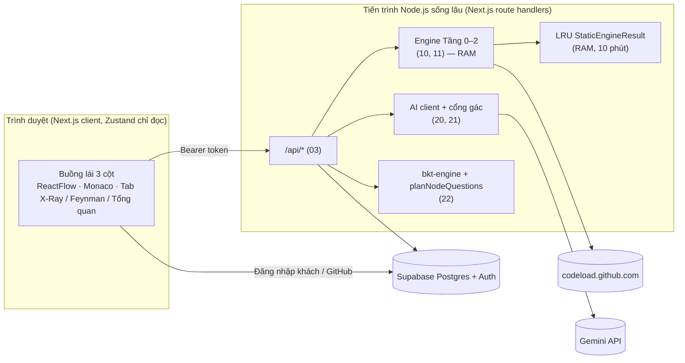
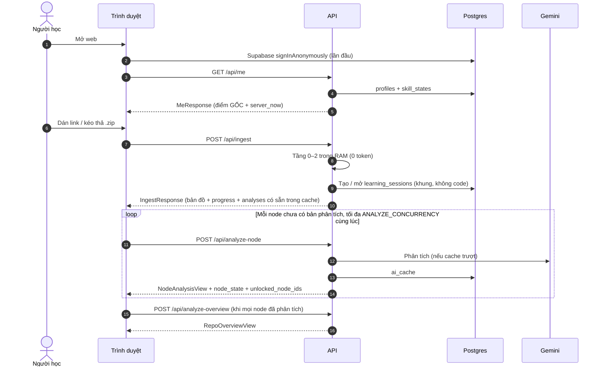
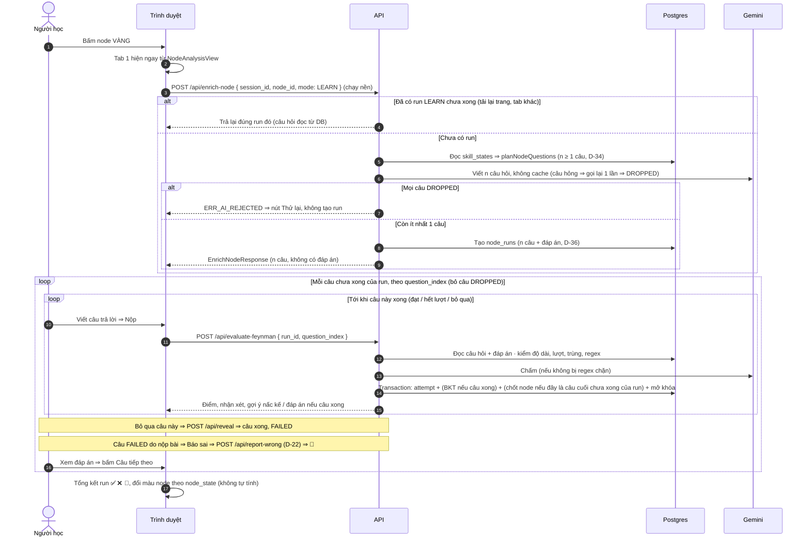
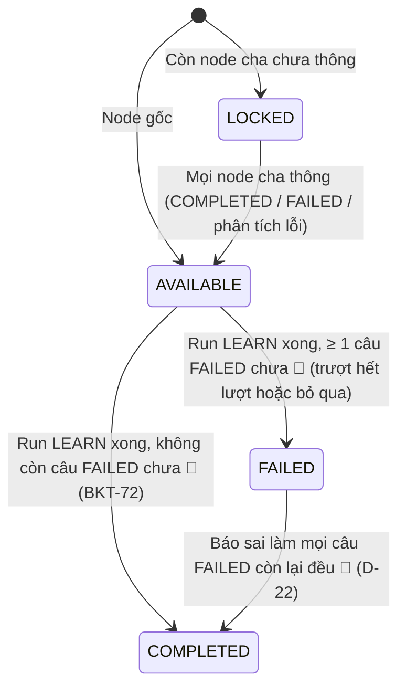

# 01 — KIẾN TRÚC, BẤT BIẾN & LUỒNG HỆ THỐNG

> Kiểu: `02_CONTRACTS.md`. Endpoint & giao dịch: `03_API_VA_LUU_TRU.md`. Hằng số: `CONFIG.*`.

---

## 1. Sản phẩm trong 1 đoạn

SimpliFey V2 Pro biến một repo GitHub public (hoặc file `.zip`) thành **bản đồ học tập** gồm 6–8 node. Mỗi node là một **lát cắt nghiệp vụ xuyên file** (route → middleware → service → repository), không phải một file. Bản đồ dựng bằng **code thuần, 0 token** (Tree-sitter, Tarjan, PageRank, lát cắt, Dagre). Sau đó AI (Gemini) làm 4 việc:
1. phân tích từng node (kỹ năng + điểm hay + điểm dở, dùng chung cho mọi người học);
2. viết tổng quan repo;
3. đặt câu hỏi Feynman cho đúng các kỹ năng người học còn yếu;
4. chấm câu trả lời và gợi ý 3 nấc.

Mô hình **BKT** ghi nhận năng lực của 16 kỹ năng lâu dài trong Postgres. Từ đó có Fast-Track (miễn thi phần đã vững) và cảnh báo khi trí nhớ phai.

---

## 2. Bất biến (INV-xx) — sửa spec không được phá

| ID | Bất biến |
| :-- | :-- |
| **INV-01** | **1 node = 1 lát cắt xuyên file** mở đầu bằng 1 hàm entry đã đăng ký (D-06); không bao giờ là 1 file đơn lẻ. Node thuật toán (`ALGORITHMIC_CORE`) là 1 hàm phức tạp tách riêng. |
| **INV-02** | **Code thuần trước, AI sau.** Bản đồ (Tầng 0–2) không gọi AI, mục tiêu < 1.5 s. AI chỉ chạy ở **4 lời gọi**: `analyze-node`, `analyze-overview`, `enrich-node` (đặt câu hỏi), `evaluate-feynman` (chấm). Không có Intent Router, không có Actor-Critic nhiều lượt. |
| **INV-03** | **Zero-Trust:** không `git clone`, không chạy code người dùng; chỉ phân tích tĩnh. Tải từ `codeload.github.com` sau HEAD probe; file zip upload chỉ nằm trong RAM. |
| **INV-04** | **Zero-Disk cho mã nguồn:** code, `snippet`, `StaticEngineResult`, `code_context` không bao giờ ghi đĩa hay DB. Postgres chỉ chứa dữ liệu học tập + khung đồ thị không code + văn bản AI đã qua kiểm (API-01). |
| **INV-05** | **Server là nơi ghi duy nhất** của tiến độ học: lập kế hoạch câu hỏi, BKT, đếm lượt, mở khóa, Fast-Track, quyết định mở đáp án. Client giữ bản sao chỉ đọc. `localStorage` chỉ giữ `SyncReceipt` và tiện ích giao diện, không giữ hồ sơ người học. |
| **INV-06** | **Tab 1 (X-Ray)** hiện luồng, kiến trúc, điểm hay **và điểm dở** do AI tìm, gắn nhãn "Nhận định của AI". Tab 1 **không** nêu con số theo tình huống, cách sửa, tình huống biên — đó là thứ câu hỏi hỏi. |
| **INV-07** | **Đáp án** (`reference_answer`, `must_have_points`, `fix`) chỉ nằm ở server (`ai_cache`) và trong `challenge_token` mã hóa; chỉ gửi xuống client khi câu **xong** (đạt / hết lượt / bỏ qua). |
| **INV-08** | **Mọi văn bản AI phải qua cổng gác trước khi hiển thị** (`21`). Cổng gác chặn tên bịa, kỹ năng ngoài danh mục, công nghệ ngoài repo; nó **không** kiểm được nghĩa đúng/sai. Không bao giờ tuyên bố "diệt 100% ảo giác". Câu hỏi hỏng ⇒ gọi lại 1 lần ⇒ bỏ câu đó; **không có** câu dự phòng dựng từ AST. |
| **INV-09** | **Đa ngôn ngữ theo tầng** (Language Registry): `RESOLVED` (có `ImportResolver`: TS/JS, Python, Java, Go, Dart) cạnh chính xác; `STRUCTURAL` (có grammar Tree-sitter) cạnh `INFERRED`, không bảo đảm 100%; `UNSUPPORTED` ⇒ `ERR_UNSUPPORTED_LANGUAGE`. Chỉ TS/JS và Python được kiểm chứng cho bản thi. Không regex fallback, không dùng LLM để dựng đồ thị. |
| **INV-10** | **Engine tất định:** cùng repo + cùng commit + cùng `ENGINE_VERSION` ⇒ cùng đồ thị, cùng `node_id`, cùng tọa độ (D-10). Mọi vòng lặp duyệt theo khóa đã sort. |
| **INV-11** | **Màu & lớp hiển thị:** nền `#0F172A`; `AVAILABLE` `#F59E0B`; `COMPLETED` `#10B981`; `FAILED` `#EF4444` (vẫn mở node con — soft-bypass); `LOCKED` xám, viền đứt. Fast-Track (xanh nhạt + ⚡), tam giác cảnh báo, viền cam decay, "đang phân tích…" là **lớp hiển thị**, không phải trạng thái FSM. |
| **INV-12** | **Mọi con số nằm ở `CONFIG`** (`02` Mục 1); mọi kiểu nằm ở `02`. File khác chỉ nhắc tên. |
| **INV-13** | **Định vị:** không tuyên bố tự phát minh Compound AI, BKT, PageRank, Tree-sitter repo-map (Aider đã có). Điểm mới là **cách kết hợp và ứng dụng** vào học kiến trúc mã nguồn. |

---

## 3. Sơ đồ thành phần

---

## 4. Các tầng xử lý

| Tầng | Việc | Token | Spec |
| :-- | :-- | :-: | :-- |
| 0 | Phân tích link, HEAD probe, tải zip vào RAM, đọc commit SHA, lọc rác, chọn ≤ `MAX_CLEAN_FILES` file, che secret, nhận diện monorepo / archetype / tech_stack | 0 | `10` |
| 1 | Tree-sitter + Language Registry, bảng symbol, đồ thị gọi hàm (`RESOLVED` / `INFERRED`), Tarjan SCC | 0 | `11` |
| 2 | Lát cắt từ entry (D-06), độ phức tạp & VIP, PageRank xếp hạng, Uncle Bob, cạnh giữa node (D-07), Display Budget, đặt tên tất định, Dagre | 0 | `11` |
| 3a | `analyze-node`: kỹ năng + bằng chứng, mẫu kiến trúc, giải thích từng bước, điểm hay, điểm dở — cache dùng chung | AI | `20`, `21` |
| 3b | `analyze-overview`: tổng quan repo từ các bản phân tích (không gửi code) | AI | `20`, `21` |
| 4 | `enrich-node`: server lập kế hoạch câu hỏi theo hồ sơ người học, AI viết câu hỏi + đáp án | AI | `20`, `21`, `22` |
| 5 | `evaluate-feynman`: AI chấm + gợi ý 3 nấc; server quyết Đạt, cập nhật BKT, mở khóa, Fast-Track | AI + 0 | `20`, `21`, `22`, `03` |

---

## 5. Luồng end-to-end

### 5.1. Mở web → bản đồ → phân tích nền

Node chưa phân tích xong hiện "đang phân tích…". Bấm vào node đó thì Tab 1 chờ bản phân tích; Tab 2 khóa cho tới khi có bản phân tích.

### 5.2. Học 1 node

- **1 run = n câu cố định**, 1 câu cho mỗi kỹ năng chưa thạo của node (`22` BKT-41, BKT-42). Mọi kỹ năng đã thạo ⇒ vẫn 1 câu cho kỹ năng có điểm thấp nhất; không có node miễn thi (D-34). Mỗi câu có 1 kỹ năng, lượt và gợi ý riêng (Mục 7). Mọi câu trả về ngay khi tạo run, nên chuyển câu không gọi thêm API.
- **Câu hỏi + đáp án lưu ở DB** (`node_runs`), client không đọc trực tiếp; chấm bài đọc từ DB, AI chấm không nhận code (D-36).
- **Câu xong** ⇒ hiện đáp án và nút "Câu tiếp theo", không tự nhảy (`30` UI-54).
- **Run xong** khi mọi câu không `DROPPED` đều xong ⇒ server chốt màu node (`22` Mục 8), trả `node_state` và `unlocked_node_ids` (`30` UI-57).

### 5.3. Không ôn tập — hiển thị mài mòn (D-35)

- Không có run ôn: node đỏ giữ đỏ, node xanh giữ xanh.
- Bảng kỹ năng hiện thanh kỹ năng nhạt dần theo điểm đã decay và nhãn "đang mài mòn" khi điểm đã decay thấp hơn điểm gốc. Chỉ hiển thị, không có nút ôn (`22`, `30`).

### 5.4. Mở lại phiên

Màn hình trống hiện danh sách "Tiếp tục học" (`GET /api/sessions`). Bấm mở ⇒ `POST /api/ingest { session_id }` ⇒ server dựng lại đúng commit SHA của phiên (trúng cache hoặc tải lại theo SHA; kết quả giống hệt nhờ INV-10) ⇒ ghép `node_progress` và các run (D-39). Repo có commit mới ⇒ dán link ⇒ bản đồ và phiên mới. Phiên từ `.zip` ⇒ mời kéo thả lại đúng file (so SHA-256). Phiên tạo bằng `engine_version` cũ ⇒ chỉ xem lịch sử.

"Học lại từ đầu" ⇒ phiên mới cùng repo: tiến độ node làm lại, điểm kỹ năng giữ nguyên, câu hỏi sinh mới (D-42).

---

## 6. Vòng đời node (trong 1 phiên)

| Chuyển | Ai kích hoạt | Endpoint | Ghi gì | Client nhận |
| :-- | :-- | :-- | :-- | :-- |
| `LOCKED → AVAILABLE` | Server (suy ra) | Bất kỳ lệnh làm node cha xong | Không ghi (suy ra khi đọc, `03` Mục 5.1) | `unlocked_node_ids`, `node_state` |
| `AVAILABLE → COMPLETED / FAILED` | Server, khi câu cuối của run `LEARN` xong | `evaluate-feynman`, `reveal` | `node_runs.finished_at`, `node_progress.status` | `node_state` |
| `FAILED → COMPLETED` | Server | `report-wrong` | `node_progress.status` | `node_state` |
| Phân tích lỗi | Server | `analyze-node` | `node_progress.analysis_failed = true` | `analysis = null`, node con mở kèm tam giác |

Chuyển `FAILED → AVAILABLE` **không tồn tại** (D-16).

## 7. Vòng đời 1 câu hỏi (trong 1 run)

Một run có n câu (Mục 5.2); bảng dưới áp riêng cho từng câu. Câu xong ⇒ người học bấm sang câu kế; câu cuối xong ⇒ run xong.

Lượt tối đa: `CONFIG.MAX_ATTEMPTS_PER_QUESTION`. Lượt nào là lượt tối đa thì áp dòng "Lượt cuối".

| Lượt | Đạt (D-13) | Chưa đạt |
| :-: | :-- | :-- |
| 1 | Xong, `PASS_FIRST` ⇒ BKT | Gợi ý nấc 1 `CONCEPT`: hỏi khái niệm bị hiểu sai, chưa chỉ chỗ |
| 2 | Xong, `PASS_AFTER_HINT` ⇒ BKT | Gợi ý nấc 2 `CODE_POINTER` (chỉ bước) |
| Lượt cuối | Xong, `PASS_AFTER_HINT` ⇒ BKT | Xong, `FAILED` ⇒ BKT, hiện đáp án |
| Bất kỳ | — | "Bỏ qua câu này" ⇒ xong, `FAILED`, `ended_by = SKIP` ⇒ BKT, hiện đáp án |
| Sau khi xong | — | Câu `FAILED` do nộp bài ⇒ "Báo sai" ⇒ 🚩, hoàn BKT nếu kỹ năng chưa có cập nhật khác (D-22, `22` BKT-63) |

- `intent = GIVE_UP` (gõ "chịu", "không biết") ⇒ tính 1 lượt trượt, vẫn nhận gợi ý nấc kế.
- Regex tấn công khớp ⇒ tính 1 lượt, 0 điểm, `OFF_TOPIC`, không gợi ý, không gọi AI.
- AI lỗi ⇒ không tính lượt.
- Mỗi câu cập nhật BKT **đúng 1 lần**, cho đúng 1 kỹ năng của câu đó, ngay khi câu xong.

---

## 8. Dữ liệu nằm ở đâu

| Dữ liệu | Nơi | Sống bao lâu | Ai ghi |
| :-- | :-- | :-- | :-- |
| Mã nguồn repo (`RAMCodeStore`, `ManifestStore`) | RAM server | Trong lúc chạy Tầng 0–2 | Engine |
| `StaticEngineResult` đầy đủ | LRU RAM của 1 instance — không được dựa vào (D-27) | Tối đa `INGESTION_CACHE_TTL_MS` | Engine |
| `ClientStaticEngineResult` (có snippet để hiện Monaco) | Zustand | Tới khi đổi repo / tải lại trang | Server trả về |
| Tài khoản, `skill_states`, phiên, tiến độ, run, lượt nộp | Postgres | Tới khi xóa tài khoản | Chỉ server |
| Bản phân tích, tổng quan (văn bản AI đã kiểm) | `ai_cache` (Postgres) | Lâu dài; khóa theo phiên bản repo + engine + prompt + model | Chỉ server |
| Câu hỏi + đáp án của 1 run (văn bản AI đã kiểm, không code) | `node_runs` (Postgres), client không đọc trực tiếp | Theo phiên | Chỉ server |
| Tab đang mở, cỡ chữ | `localStorage` | Lâu dài | Client |

---

## 9. Chế độ suy biến & giới hạn phải nói thật

- **Repo không có kiến trúc tầng** (`PROCEDURAL`) hoặc **tập thuật toán rời** (`ALGORITHM_COLLECTION`) ⇒ engine dựng node ảo theo `11`; AI dùng chế độ B (câu hỏi về thuật toán, Big-O, tình huống biên).
- **Ngôn ngữ `STRUCTURAL`** ⇒ cạnh nét đứt, huy hiệu độ tin cậy thấp, cổng gác chạy Relaxed Mode (`21`).
- **AI hiểu sai nghĩa** ⇒ code không bắt được (INV-08). Bù lại bằng 3 cách:
  - duyệt tay toàn bộ output của repo demo (`21` Mục 6);
  - hiện bằng chứng (bước + tên) cho người học;
  - nút "Báo sai".
- **Mọi số độ trễ / token / chi phí là mục tiêu, chưa đo** (`02` Mục 1.1). Khi trình bày, kèm số đo thật hiện trên giao diện.
