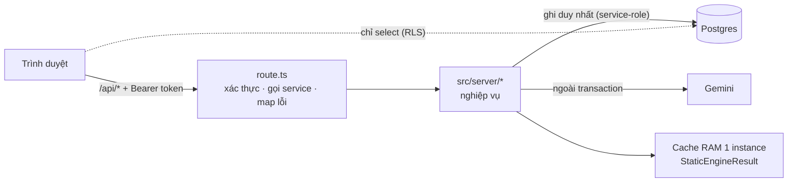
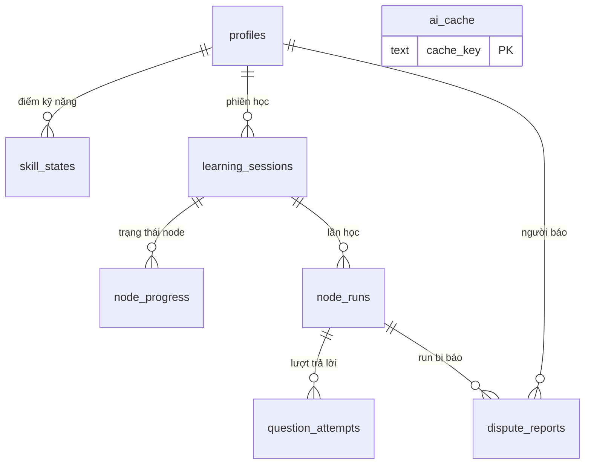
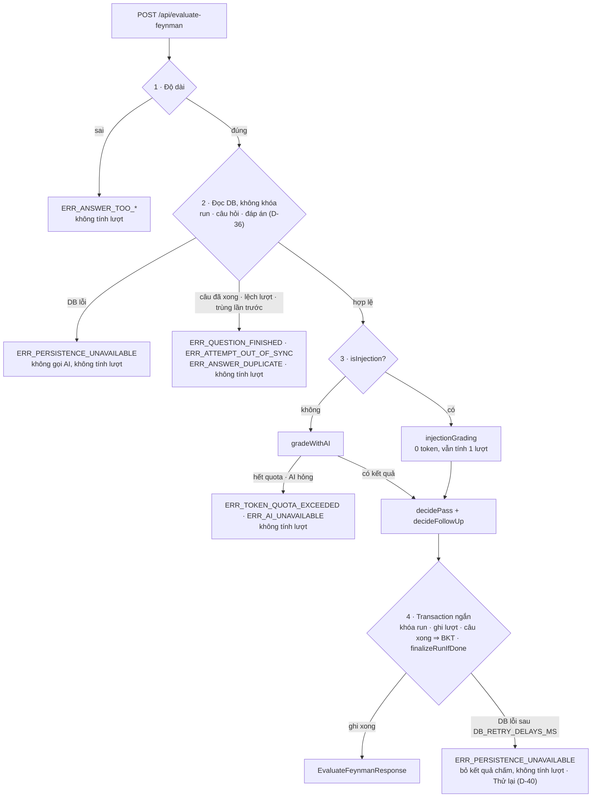

# 03 — API, LƯU TRỮ & GIAO DỊCH

> Quy định 13 endpoint, lược đồ Postgres, RLS, khóa cache AI, suy ra trạng thái node và các luồng ghi. Người đọc: cả nhóm; Người 1 cài đặt, gọi hàm của Người 2 (`10`, `11`) và Người 3 (`20`–`22`).
> **Trong repo thi:** route handler ở `src/app/api/**/route.ts` (mỏng: xác thực → gọi service → map lỗi); nghiệp vụ ở `src/server/*.ts`; SQL ở `supabase/migrations/0001_init.sql`.
> **Kiểu:** `02_CONTRACTS.md` (Mục 5–9). **Hằng số:** `CONFIG.*`. Luồng nghiệp vụ tổng thể: `01_KIEN_TRUC_VA_LUONG.md`.

## Đọc nhanh

- Nhận request ở 13 endpoint (kiểu ở `02` Mục 8) ⇒ xác thực phiên Supabase, kiểm `session_id` thuộc người gọi ⇒ gọi service ở `src/server/*.ts` ⇒ trả response dựng theo danh sách trường cho phép.
- Server là nơi ghi duy nhất vào Postgres; Postgres không chứa mã nguồn (API-01, API-02).
- `evaluate-feynman`: đọc câu hỏi + đáp án từ DB, kiểm không khóa ⇒ gọi AI ngoài transaction ⇒ transaction ngắn ghi lượt và BKT; ghi hỏng ⇒ `ERR_PERSISTENCE_UNAVAILABLE`, người học bấm "Thử lại" (Mục 6.2).
- Trạng thái node suy ra khi đọc từ khung đồ thị + `node_progress` (`deriveNodeStates`, Mục 5.1); `LOCKED` không bao giờ được lưu.
- Chạy trên Vercel; cache RAM chỉ giúp nhanh, không được dựa vào (API-08).



| Mục | Nói về | Code (file / hàm chính) |
| :-: | :-- | :-- |
| 1 | Nguyên tắc: không lưu mã nguồn, server ghi duy nhất, xác thực, quota token, AI ngoài transaction, Vercel | — |
| 2 | 13 endpoint (request → response, bảng ghi, lỗi riêng); `GET /api/sessions`; liên kết GitHub | `src/app/api/**/route.ts` |
| 3 | Lược đồ Postgres; 3.1 `RunQuestion`; 3.2 RLS; 3.3 khóa cache AI | `supabase/migrations/0001_init.sql` |
| 4 | Khóa phiên, cache RAM, dựng lại `StaticEngineResult` | `getOrRebuildStaticResult` |
| 5 | Suy ra trạng thái node (5.1), mài mòn (5.2), kế hoạch không rỗng (5.3), đổi persona (5.4) | `deriveNodeStates` (`src/lib/derive.ts`) |
| 6.1 | `enrich-node`: tạo run, lưu câu hỏi + đáp án | `src/server/enrich.ts` (`enrichNode`) |
| 6.2 | `evaluate-feynman`: kiểm ⇒ chấm ⇒ khóa ⇒ ghi | `src/server/evaluate.ts` (`evaluateFeynman`) |
| 6.3 | `reveal`: bỏ qua câu | `src/server/reveal.ts` |
| 6.4 | `report-wrong`: báo sai | `src/server/report.ts` |
| 6.6 | `finalizeRunIfDone`: đổi màu node khi run xong | `src/server/progress.ts` |
| 6.7 | `analyze-node`, `analyze-overview`, `ingest` | `src/app/api/**/route.ts` |
| 6.8 | `demo/persona` | `src/server/persona.ts` |
| 7 | Sự cố và tình huống biên | — |
| 8 | Biến môi trường server | — |

---

## 1. Nguyên tắc

- **Không lưu mã nguồn.** Postgres không chứa file code, `snippet`, `trace_steps`, `StaticEngineResult`. Được lưu: tài khoản, điểm kỹ năng, phiên học (commit SHA + khung đồ thị không có code), tiến độ, câu trả lời của người học, văn bản AI **đã qua kiểm** trong `ai_cache` và `node_runs` (câu hỏi, đáp án mẫu — D-36), tên bước / tên hàm (API-01).
- **Server là nơi ghi duy nhất.** Client không có quyền `insert/update/delete` trên bảng nào; mọi lệnh ghi đi qua route handler bằng service-role key (API-02).
- **Trả về theo danh sách trường cho phép.** Mỗi response dựng bằng một hàm map tường minh (`toClientResult`, `toAnalysisView`, `toEvaluateResponse`…). Cấm spread object thô của AI hay của DB vào response, để không lộ `misconception`, đáp án, `suspicious_instruction_files` (API-03).
- **Mọi request cần phiên Supabase.** Header `Authorization: Bearer <access_token>`; server xác thực bằng `supabase.auth.getUser(token)`. Thiếu / sai ⇒ `ERR_UNAUTHENTICATED` (API-04).
- **Kiểm quyền sở hữu.** `session_id` (và `run_id`) phải thuộc `user_id` hiện tại, nếu không ⇒ `ERR_SESSION_NOT_FOUND`; không tiết lộ đó là phiên của người khác (API-05).
- **Đếm token ở server.** Sau mỗi lời gọi AI thật (không tính trúng cache), cộng `usage_metadata` vào `learning_sessions.tokens_used`. Trước mỗi lời gọi AI: `tokens_used ≥ CONFIG.SESSION_TOKEN_QUOTA` ⇒ `ERR_TOKEN_QUOTA_EXCEEDED` (API-06).
- **Gọi AI ngoài transaction.** Không giữ khóa DB trong lúc chờ AI (D-18, API-07).
- **Triển khai trên Vercel** (region `sin1`, D-27). Cache RAM `StaticEngineResult`, semaphore ingest và in-flight map chỉ sống trong 1 instance: giúp nhanh hơn, **không được dựa vào**. Cache trượt ⇒ dựng lại theo commit SHA (Mục 4). Upload zip ≤ `CONFIG.MAX_UPLOAD_BYTES` (giới hạn body của Vercel); link GitHub không bị giới hạn này (API-08).

---

## 2. Bảng endpoint

| # | Endpoint | Request → Response (`02` Mục 8) | Ghi Postgres | AI | Lỗi riêng |
| :-: | :-- | :-- | :-- | :-: | :-- |
| 1 | `GET /api/me` | — → `MeResponse` | Tạo `profiles` nếu chưa có; đồng bộ `is_guest` theo identity GitHub | — | — |
| 2 | `DELETE /api/me` | — → 204 | Xóa `auth.users` ⇒ cascade mọi bảng | — | — |
| 3 | `GET /api/sessions` | — → `SessionsResponse` | — | — | — |
| 4 | `GET /api/sessions/{id}/history` | — → `HistoryResponse` | — | — | — |
| 5 | `POST /api/ingest` | `IngestRequest` → `IngestResponse` | Tạo / mở `learning_sessions` (Mục 6.7) | — | Mọi `IngestionErrorCode`, `ERR_SESSION_ENGINE_OUTDATED` |
| 6 | `POST /api/analyze-node` | `AnalyzeNodeRequest` → `AnalyzeNodeResponse` | `ai_cache`, `node_progress.analysis_failed`, `tokens_used` | ✅ | `ERR_TOKEN_QUOTA_EXCEEDED` |
| 7 | `POST /api/analyze-overview` | `AnalyzeOverviewRequest` → `AnalyzeOverviewResponse` | `ai_cache`, `tokens_used` | ✅ | `ERR_OVERVIEW_NOT_READY`, `ERR_TOKEN_QUOTA_EXCEEDED` |
| 8 | `POST /api/enrich-node` | `EnrichNodeRequest` → `EnrichNodeResponse` | `node_runs` (tạo run), `tokens_used`, `last_active_at` | ✅ | `ERR_NODE_NOT_AVAILABLE`, `ERR_ANALYSIS_NOT_READY`, `ERR_AI_REJECTED`, `ERR_AI_UNAVAILABLE`, `ERR_TOKEN_QUOTA_EXCEEDED` |
| 9 | `POST /api/evaluate-feynman` | `EvaluateFeynmanRequest` → `EvaluateFeynmanResponse` | Transaction Mục 6.2 | ✅ | `ERR_ANSWER_*`, `ERR_QUESTION_FINISHED`, `ERR_ATTEMPT_OUT_OF_SYNC`, `ERR_AI_UNAVAILABLE`, `ERR_TOKEN_QUOTA_EXCEEDED` |
| 10 | `POST /api/reveal` | `RevealRequest` → `RevealResponse` | Transaction Mục 6.3 | — | `ERR_QUESTION_FINISHED` |
| 11 | `POST /api/report-wrong` | `ReportWrongRequest` → `ReportWrongResponse` | Mục 6.4 | — | `ERR_REPORT_NOT_ALLOWED` |
| 12 | `POST /api/demo/persona` | `PersonaRequest` → `PersonaResponse` | Ghi đè 16 dòng `skill_states` của **tài khoản hiện tại** | — | `ERR_DEMO_MODE_DISABLED` |
| 13 | `GET /api/sessions/{id}/progress` | — → `ProgressResponse` | — (chỉ đọc DB, không engine, không AI) | — | — |

### Lỗi chung

Không lặp ở cột "Lỗi riêng":
- Mọi endpoint ⇒ `ERR_UNAUTHENTICATED` (API-04), `ERR_PERSISTENCE_UNAVAILABLE` (Postgres lỗi khi đọc hoặc ghi, D-40).
- Endpoint nhận `session_id` / `run_id` ⇒ `ERR_SESSION_NOT_FOUND` (API-05).
- Endpoint gọi `getOrRebuildStaticResult` (`ingest { session_id }`, `analyze-node`, `analyze-overview`, `enrich-node`) ⇒ `ERR_SESSION_ENGINE_OUTDATED` và các lỗi của Mục 4.

### `GET /api/sessions`

Mỗi `LearningSessionSummary` được tính khi đọc, không lưu:
- `completed_count` / `failed_count` đếm `node_progress.status`; `total_nodes = graph_skeleton.length`.
- `engine_version ≠ CONFIG.ENGINE_VERSION` ⇒ `can_resume = false`, `resume_blocker = "ENGINE_UPDATED"`.
- Ngược lại, `ARCHIVE_HASH` (nguồn `ZIP`, hoặc GitHub không đọc được SHA) mà cache RAM không còn kết quả ⇒ `false`, `"ZIP_SOURCE"` (D-39, Q-12).
- Còn lại (phiên `COMMIT_SHA`) ⇒ `true`, `null`.

### Liên kết GitHub

Không phải endpoint của mình: client gọi `supabase.auth.linkIdentity({ provider: "github" })` (scope mặc định `read:user`, không xin quyền repo private), sau đó gọi lại `GET /api/me` để server cập nhật `is_guest = false`.

---

## 3. Lược đồ Postgres (`supabase/migrations/0001_init.sql`)



```sql
create type swe_skill as enum (
  'HTTP_ROUTING','DTO_VALIDATION','AUTH_SECURITY','DEPENDENCY_INJECTION',
  'LAYERED_SEPARATION','DB_OPTIMIZATION','ASYNC_CONCURRENCY','TRANSACTION_INTEGRITY',
  'ERROR_HANDLING','STATE_MANAGEMENT','ALGORITHMIC_COMPLEXITY','MEMORY_MANAGEMENT',
  'API_CONTRACT_DESIGN','CACHING_STRATEGY','RATE_LIMIT_RESILIENCE','DATA_SERIALIZATION'
);                                                     -- cùng thứ tự SWE_SKILLS
create type run_mode as enum ('LEARN');                -- D-35

create table profiles (
  user_id      uuid primary key references auth.users on delete cascade,
  display_name text,
  is_guest     boolean not null default true,
  created_at   timestamptz not null default now()
);

create table skill_states (                            -- = CognitiveSkillState; thiếu dòng ⇒ P = BKT_P_L0
  user_id           uuid not null references profiles on delete cascade,
  skill             swe_skill not null,
  p_mastery         double precision not null check (p_mastery between 0.01 and 0.99),  -- = CONFIG.BKT_P_MIN / BKT_P_MAX
  last_practiced_at timestamptz not null,
  practice_count    int not null default 0,
  correct_count     int not null default 0,
  primary key (user_id, skill)
);

create table learning_sessions (
  id               uuid primary key default gen_random_uuid(),
  user_id          uuid not null references profiles on delete cascade,
  source           text not null check (source in ('GITHUB','ZIP')),
  repo_key         text not null,
  snapshot_id      text not null,
  snapshot_id_kind text not null check (snapshot_id_kind in ('COMMIT_SHA','ARCHIVE_HASH')),
  subdir           text not null default '',
  ref_label        text,
  repo_name        text not null,
  engine_version   text not null,
  graph_skeleton   jsonb not null,                     -- GraphSkeletonNode[] — KHÔNG có code
  tokens_used      int not null default 0,
  created_at       timestamptz not null default now(),
  last_active_at   timestamptz not null default now()
);
create index on learning_sessions (user_id, source, snapshot_id, subdir, engine_version);  -- Khóa phiên, không unique: "Học lại từ đầu" tạo phiên mới (D-42)

create table node_progress (                           -- Chỉ node đã có sự kiện; thiếu dòng ⇒ suy ra (Mục 5.1)
  session_id       uuid not null references learning_sessions on delete cascade,
  node_id          text not null,
  status           text check (status in ('AVAILABLE','COMPLETED','FAILED')),  -- null ⇒ suy ra
  analysis_failed  boolean not null default false,
  updated_at       timestamptz not null default now(),
  primary key (session_id, node_id)
);

create table node_runs (                               -- 1 lần học 1 node (D-16); chứa đáp án ⇒ client không đọc (Mục 3.2)
  id          uuid primary key default gen_random_uuid(),
  session_id  uuid not null references learning_sessions on delete cascade,
  node_id     text not null,
  mode        run_mode not null,
  questions   jsonb not null,                          -- RunQuestion[] (Mục 3.1)
  steps       jsonb not null,                          -- RunStepRef[] — chỉ tên, không code (D-36)
  forbidden_external_keywords text[] not null,         -- Từ cấm của repo lúc tạo run — gác gợi ý khi chấm (21)
  started_at  timestamptz not null default now(),
  finished_at timestamptz
);
create unique index node_runs_one_open on node_runs (session_id, node_id) where finished_at is null;

create table question_attempts (                       -- Chỉ thêm, không sửa
  id             bigint generated always as identity primary key,
  run_id         uuid not null references node_runs on delete cascade,
  question_index smallint not null,
  attempt_number smallint not null check (attempt_number between 1 and 3),   -- = CONFIG.MAX_ATTEMPTS_PER_QUESTION
  skill          swe_skill not null,
  core_accuracy  smallint not null,
  simplicity     smallint not null,
  intent         text not null check (intent in ('ANSWER','GIVE_UP','OFF_TOPIC')),
  is_passed      boolean not null,
  points_covered boolean[] not null,
  student_answer text not null check (char_length(student_answer) <= 2000),  -- = CONFIG.ANSWER_MAX_CHARS
  created_at     timestamptz not null default now()
);
create index on question_attempts (run_id);

create table ai_cache (                                -- D-37: văn bản AI đã qua kiểm, dùng chung mọi người học
  cache_key     text primary key,
  kind          text not null check (kind in ('NODE_ANALYSIS','REPO_OVERVIEW')),
  payload       jsonb not null,                        -- NodeAnalysis | RepoOverviewRaw
  model         text not null,
  prompt_version text not null,
  tokens_in     int not null,
  tokens_out    int not null,
  created_at    timestamptz not null default now()
);

create table dispute_reports (                         -- Nút "Báo sai" (D-22) — để nhóm đọc lại
  id             bigint generated always as identity primary key,
  user_id        uuid not null references profiles on delete cascade,
  run_id         uuid not null references node_runs on delete cascade,
  question_index smallint not null,
  note           text not null check (char_length(note) <= 500),           -- = CONFIG.REPORT_NOTE_MAX_CHARS
  created_at     timestamptz not null default now()
);
```

### 3.1. `node_runs.questions` (jsonb) — kiểu `RunQuestion`

```typescript
interface RunQuestion extends QuestionPlanItem, Omit<GeneratedQuestionRaw, "skill"> {  // 02 Mục 5.3 — câu hỏi + reference_answer + must_have_points + fix (D-36)
  attempts_used: number;
  finished: boolean;
  outcome: NodeOutcome | null;
  ended_by: "ANSWER" | "SKIP" | "DROPPED" | null;
  disputed: boolean;
  p_before: number | null;           // Điểm kỹ năng trước / sau lần cập nhật BKT của câu này (cho D-22)
  p_after: number | null;
  last_answer: string | null;        // Kiểm trùng ở server
}
```

### 3.2. Bảo mật hàng (RLS)

- Bật RLS trên **mọi** bảng.
- `select` cho client: `profiles`, `skill_states`, `learning_sessions`, `dispute_reports` khi `auth.uid() = user_id`; `node_progress` khi `session_id` thuộc phiên của `auth.uid()`.
- `ai_cache`, `node_runs`, `question_attempts`: **không có chính sách nào** cho client (chứa đáp án — INV-07; lịch sử đọc qua endpoint 4).
- Không có chính sách `insert/update/delete` cho client ở bất kỳ bảng nào (API-02).

### 3.3. Khóa cache AI

`cache_key` theo loại:
- `NODE_ANALYSIS`: `na|{source}|{snapshot_id}|{subdir}|{engine_version}|{node_id}|{PROMPT_VERSION}|{LLM_MODEL}`
- `REPO_OVERVIEW`: `ov|{source}|{snapshot_id}|{subdir}|{engine_version}|{PROMPT_VERSION}|{LLM_MODEL}`

Câu hỏi không cache: mỗi run sinh mới và lưu trong `node_runs`; chấm bài không cache (D-37). Hai yêu cầu trùng khóa cùng lúc trong 1 instance dùng chung một promise (in-flight map); khác instance ⇒ ghi `on conflict do nothing`.

---

## 4. Định danh phiên & cache RAM

- **Khóa phiên:** `(user_id, source, snapshot_id, subdir, engine_version)`; trùng khóa ⇒ mở phiên có `last_active_at` mới nhất.
  - GitHub: `snapshot_id` = commit SHA 40 hex đọc từ comment EOCD của zip codeload (`10` Mục snapshot). Comment không khớp `/^[0-9a-f]{40}$/` ⇒ `ARCHIVE_HASH` = SHA-256 của **toàn bộ** buffer zip, kèm cảnh báo "phiên không mở lại được" (`10`).
  - Upload `.zip`: `ARCHIVE_HASH` = SHA-256 của buffer.
- **Phiên gắn commit SHA (D-39):** dựng lại luôn theo đúng SHA của phiên. Repo có commit mới ⇒ dán link ra SHA mới ⇒ bản đồ và phiên mới.
- **Cache RAM `StaticEngineResult`** (API-08): LRU `CONFIG.INGESTION_CACHE_MAX_ENTRIES`, TTL `CONFIG.INGESTION_CACHE_TTL_MS`, hai tầng:
  - alias `owner/repo` + `subdir_override` (link đã chuẩn hóa, `10` ING-04) `⇒ snapshot_id`;
  - kết quả `snapshot_id|subdir|engine_version ⇒ StaticEngineResult`.

### `getOrRebuildStaticResult(session)`

| Tình huống | Xử lý |
| :-- | :-- |
| Trúng cache | Dùng kết quả đó |
| Trượt, `COMMIT_SHA` | Tải `codeload.github.com/{owner}/{repo}/zip/{sha}` rồi chạy lại Tầng 0–2 |
| Trượt, `ARCHIVE_HASH` | Không dựng lại được ⇒ `ERR_SESSION_NOT_FOUND` (Q-12, V-5). Nguồn `ZIP` chỉ best-effort: UI báo "phiên upload không mở lại được, hãy upload lại .zip" (`30` Mục 10); trùng khóa phiên ⇒ mở lại phiên đó |
| codeload 404 theo SHA (commit bị force-push xóa) | `ERR_SESSION_NOT_FOUND` (Q-12); phiên chỉ còn xem lịch sử |

Kiểm tất định khi dựng lại: khung đồ thị dựng lại phải trùng `graph_skeleton` đã lưu (so `node_id` + `prerequisites`). Lệch ⇒ ghi log lỗi và trả `ERR_SESSION_ENGINE_OUTDATED`.

---

## 5. Suy ra trạng thái (hàm thuần, dùng chung client và server)

### 5.1. `deriveNodeStates(skeleton, progressRows): Record<node_id, NodeStateView-lite>`

Node `is_group_root` (D-24) không có trong `graph_skeleton` và không bao giờ là node cha. Duyệt các node còn lại theo thứ tự tô-pô (hòa ⇒ `node_id` tăng dần):
1. Dòng `node_progress` có `status` ≠ null ⇒ dùng `status` đó.
2. Ngược lại ⇒ `AVAILABLE` nếu mọi node cha **đã thông**, nếu không ⇒ `LOCKED`. Node gốc luôn thỏa.
   - Node cha **đã thông** khi trạng thái của nó ∈ {`COMPLETED`, `FAILED`} **hoặc** (nó `AVAILABLE` **và** `analysis_failed = true`) — D-03.
3. `has_warning = true` khi node không `LOCKED` và có ≥ 1 node cha `FAILED` hoặc được thông nhờ `analysis_failed`.

Không có chuyển trạng thái `FAILED → AVAILABLE` (D-16) và không có ôn tập (D-35): node `FAILED` giữ đỏ, node con không bao giờ bị khóa ngược.

### 5.2. Mài mòn (chỉ hiển thị, D-35)

Không đổi trạng thái node, không có nút ôn. Client tính từ `profile` bằng `bkt-engine` (`getDecayedMastery`, `now = Date.now() + server_clock_offset_ms`); quy tắc hiển thị ở `22`, `30`.

### 5.3. Kế hoạch câu hỏi không bao giờ rỗng (D-34)

Không có Fast-Track, không có node miễn thi. Mọi kỹ năng của node đã thạo ⇒ `planNodeQuestions` vẫn trả 1 câu cho kỹ năng có điểm thấp nhất của node (`22`). Node chỉ `COMPLETED` / `FAILED` khi run `LEARN` xong (Mục 6.6).

### 5.4. Đổi persona

Chỉ ghi `skill_states` (Mục 6.8); UI gọi lại `GET /api/me`. Trạng thái node không đổi.

---

## 6. Luồng ghi

### 6.1. `enrich-node` — tạo run, lưu câu hỏi + đáp án

```typescript
// src/server/enrich.ts
async function enrichNode(req: EnrichNodeRequest, userId: string): Promise<EnrichNodeResponse> {
  const now = Date.now();
  const session = await getOwnedSession(req.session_id, userId);
  const open = await db.findOpenRun(session.id, req.node_id);            // Idempotent (tải lại trang, tab khác): trả lại đúng run, không dựng engine
  if (open) return buildEnrichResponse(open);

  const state = await loadNodeState(session, req.node_id);               // deriveNodeStates + node_progress; node_id lạ ⇒ ERR_NODE_NOT_AVAILABLE
  if (state.status !== "AVAILABLE") throw ERR_NODE_NOT_AVAILABLE;
  const analysis = await aiCache.get(analysisKey(session, req.node_id));
  if (!analysis) throw ERR_ANALYSIS_NOT_READY;
  const profile = await loadProfile(userId);                             // skill_states ⇒ LearnerCognitiveProfile
  const graph = await getOrRebuildStaticResult(session);                 // Cần snippet để AI đặt câu hỏi
  const node = mustFindNode(graph, req.node_id);
  const plan = planNodeQuestions(analysis, profile.skills, now, node.trace_steps.length); // 22; luôn ≥ 1 câu (Mục 5.3)
  const questions: RunQuestion[] = await generateQuestions(session, graph, node, analysis, plan); // 20: không cache (D-37); câu hỏng ⇒ gọi lại riêng 1 lần ⇒ vẫn hỏng ⇒ DROPPED
  if (questions.every(q => q.ended_by === "DROPPED")) throw ERR_AI_REJECTED;          // Không tạo run; UI hiện "Thử lại"
  const run = await db.createRun(session.id, node.id, "LEARN", questions, toStepRefs(node), forbiddenKeywords(graph)); // Vi phạm node_runs_one_open (2 tab) ⇒ đọc lại run đang mở, trả như nhánh idempotent
  await db.touchSession(session.id);
  return buildEnrichResponse(run);                                       // Không có đáp án của câu chưa xong (API-03)
}
```

### 6.2. `evaluate-feynman` — kiểm ⇒ chấm ⇒ khóa ⇒ ghi (D-18)



```typescript
// src/server/evaluate.ts
async function evaluateFeynman(req: EvaluateFeynmanRequest, userId: string): Promise<EvaluateFeynmanResponse> {
  const now = Date.now();
  // 1. Đầu vào (0 token, 0 DB)
  validateAnswerLength(req.student_answer);                              // src/lib/similarity.ts, dùng chung với client: số ký tự không phải khoảng trắng < ANSWER_MIN_CHARS ⇒ _TOO_SHORT; độ dài thô > ANSWER_MAX_CHARS ⇒ _TOO_LONG

  // 2. Đọc KHÔNG khóa — DB lỗi ⇒ ERR_PERSISTENCE_UNAVAILABLE, không gọi AI
  const { run, session } = await readForGrading(req, userId);           // run thuộc phiên của userId, 1 ≤ question_index ≤ n — sai ⇒ ERR_SESSION_NOT_FOUND
  const q = run.questions[req.question_index - 1];                      // Câu hỏi + đáp án mẫu + ý bắt buộc đọc từ DB (D-36)
  if (run.finished_at || q.finished) throw ERR_QUESTION_FINISHED;
  if (req.attempt_number !== q.attempts_used + 1) throw ERR_ATTEMPT_OUT_OF_SYNC;
  if (q.last_answer && similarity(req.student_answer, q.last_answer) >= CONFIG.ANSWER_DUPLICATE_SIMILARITY) throw ERR_ANSWER_DUPLICATE;

  // 3. Chấm (ngoài transaction)
  const maxAttempts = CONFIG.MAX_ATTEMPTS_PER_QUESTION;
  const t = { ...q, steps: run.steps, forbidden_external_keywords: run.forbidden_external_keywords }; // GradeContext (20 AI-27)
  const grading = isInjection(req.student_answer)                       // 21: chuẩn hóa NFC rồi chỉ bắt mẫu câu lệnh
    ? injectionGrading(q)                                               // 0 điểm, OFF_TOPIC, không gợi ý, 0 token — VẪN tính 1 lượt
    : await gradeWithAI(t, req.student_answer, req.attempt_number, maxAttempts, session); // 20: không code_context (D-36); quota ⇒ ERR_TOKEN_QUOTA_EXCEEDED; hỏng ⇒ ERR_AI_UNAVAILABLE
  const isPassed = decidePass(grading, q.must_have_points, req.student_answer);        // D-13
  const followUp = decideFollowUp(grading, req.attempt_number, maxAttempts, isPassed, t, req.student_answer); // 20, 21

  // 4. Transaction ngắn — DB lỗi sau CONFIG.DB_RETRY_DELAYS_MS ⇒ ERR_PERSISTENCE_UNAVAILABLE, bỏ kết quả chấm (D-40)
  return withDbRetry(() => db.tx(async (tx) => {
    const run2 = await tx.lockRun(run.id);                               // SELECT … FOR UPDATE
    const q2 = run2.questions[req.question_index - 1];
    if (q2.finished || q2.attempts_used !== req.attempt_number - 1) throw ERR_ATTEMPT_OUT_OF_SYNC; // Bỏ kết quả chấm
    await tx.insertAttempt(run2.id, q2, req, grading, isPassed);         // 4.1
    q2.attempts_used += 1; q2.last_answer = req.student_answer;          // 4.2
    let skillChange: SkillChange | null = null;
    if (isPassed || q2.attempts_used === maxAttempts) {                  // 4.3 Câu xong
      q2.finished = true; q2.ended_by = "ANSWER";
      q2.outcome = outcomeOf(isPassed, q2.attempts_used);                // 22: lượt 1 ⇒ PASS_FIRST
      skillChange = await applyBkt(tx, userId, q2.skill, q2.outcome, now); // 22
      q2.p_before = skillChange.p_before; q2.p_after = skillChange.p_after;
    }
    await tx.saveRunQuestions(run2);                                     // 4.4
    const unlocked = await finalizeRunIfDone(tx, run2, now);             // 4.5: Mục 6.6
    return toEvaluateResponse(req, grading, isPassed, followUp, q2, skillChange, unlocked, await tx.loadNodeState(run2));
  }));
}
```

Quy tắc mở đáp án: `question.reveal` chỉ có khi câu `finished` (đạt, hết lượt, hoặc bỏ qua). Response không bao giờ có `misconception`, `reference_answer` của câu chưa xong, hay `quote` của AI.

### 6.3. `reveal` — "Bỏ qua câu này"

1. Đọc run theo `run_id`, `question_index` như 6.2 bước 2.
2. Khóa run. Câu phải chưa xong, ngược lại `ERR_QUESTION_FINISHED`.
3. Đặt `finished = true`, `outcome = FAILED`, `ended_by = SKIP`.
4. `applyBkt(FAILED)`.
5. `finalizeRunIfDone`, rồi trả `RevealResponse` kèm `reveal`.

0 token. DB lỗi ⇒ `ERR_PERSISTENCE_UNAVAILABLE`, không đổi gì (D-40).

### 6.4. `report-wrong` — "Báo sai" (D-22)

1. Khóa run. Câu phải có `outcome = FAILED`, `ended_by = ANSWER`, `disputed = false`; ngược lại `ERR_REPORT_NOT_ALLOWED`.
2. Đặt `disputed = true`.
3. Nếu `skill_states.p_mastery` của kỹ năng đúng bằng `p_after` (sai số 1e-9): đặt lại `p_mastery = p_before` (`p_before` là điểm **đã decay** dùng làm tiên nghiệm lúc cập nhật), `practice_count -= 1`, giữ nguyên `last_practiced_at` và `correct_count` (`revertSkillChange`, `22`).
4. Insert `dispute_reports`.
5. Tính lại màu node (Mục 6.6, câu `disputed` bị bỏ qua).
6. Trả `ReportWrongResponse`.

### 6.6. `finalizeRunIfDone(tx, run, now)`

Run xong khi mọi câu `finished`. Câu `DROPPED` và câu `disputed` không tính khi xét màu: có câu `FAILED` ⇒ node `FAILED`; ngược lại `COMPLETED`. Sau đó đặt `finished_at`, upsert `node_progress`, trả `unlocked_node_ids` (node vừa từ `LOCKED` sang `AVAILABLE`).

### 6.7. `analyze-node` / `analyze-overview` / `ingest`

- **`analyze-node`:** phiên hợp lệ ⇒ dựng khung ⇒ trúng `ai_cache` ⇒ trả ngay. Trượt ⇒ kiểm quota ⇒ gọi AI qua in-flight map ⇒ kiểm theo `21`.
  - Kỹ năng còn lại sau kiểm = 0 sau thử lại ⇒ `analysis_failed = true`, không cache.
  - Phần chữ trượt gác 2 lần ⇒ `skeleton_only = true`, vẫn cache.
  - Thành công ⇒ xóa `analysis_failed`.
  - Client gọi tối đa `CONFIG.ANALYZE_CONCURRENCY` node cùng lúc, ưu tiên node đang mở.
- **`analyze-overview`:** mọi node không `analysis_failed` phải có bản phân tích, nếu không ⇒ `ERR_OVERVIEW_NOT_READY`. Server tự gom dữ liệu từ `ai_cache` + khung (không nhận dữ liệu từ client, không gửi code cho AI). AI hỏng sau thử lại ⇒ `ai: null`, vẫn trả `facts`.
- **`ingest`:**
  - Semaphore `MAX_CONCURRENT_INGESTIONS` (trong 1 instance); chờ quá `INGEST_QUEUE_TIMEOUT_MS` ⇒ `ERR_SERVER_BUSY`.
  - Upload zip: client kiểm `CONFIG.MAX_UPLOAD_BYTES` trước khi gửi; vượt ⇒ `ERR_STREAM_QUOTA_EXCEEDED`.
  - `{ repo_url }` / upload: chạy Tầng 0–2 (`10`, `11`) ⇒ trùng khóa phiên ⇒ mở phiên đó (`resumed = true`), không ⇒ tạo phiên mới. Ghi chạy **sau** khi có kết quả, không tính vào mục tiêu cold-start.
  - `{ session_id }`: `engine_version` khác `CONFIG.ENGINE_VERSION` ⇒ `ERR_SESSION_ENGINE_OUTDATED`; dựng lại theo Mục 4.
  - `{ session_id, restart: true }` — "Học lại từ đầu" (D-42): tạo phiên mới cùng snapshot + `graph_skeleton`; `node_progress` trống; `skill_states` giữ nguyên; câu hỏi sinh mới khi `enrich-node`.
  - Trả `analyses` có sẵn trong cache.

### 6.8. `demo/persona`

- `process.env[CONFIG.DEMO_MODE_ENV] !== "true"` ⇒ `ERR_DEMO_MODE_DISABLED`.
- Ngược lại upsert đủ 16 dòng `skill_states`: `p_mastery = PERSONAS[mode].initial_p_mastery`, `last_practiced_at = now − days_idle · CONFIG.MS_PER_DAY`, `practice_count = 1`, `correct_count = 1`.
- Chỉ tài khoản đang đăng nhập; nhóm dùng tài khoản demo riêng, không dùng tài khoản thật của thành viên.

---

## 7. Sự cố & tình huống biên

| Tình huống | Xử lý |
| :-- | :-- |
| Hai tab nộp cùng một câu | Bước 2 hoặc bước khóa của 6.2 ⇒ tab chậm nhận `ERR_ATTEMPT_OUT_OF_SYNC`; UI tải lại run và báo "Câu này vừa được nộp ở tab khác" |
| Postgres lỗi (đọc hoặc ghi) | `ERR_PERSISTENCE_UNAVAILABLE`, không tính lượt; UI hiện nút "Thử lại" (D-40) |
| AI lỗi khi chấm | `ERR_AI_UNAVAILABLE`, không tính lượt, UI hiện "Thử lại" (D-03) |
| Hết quota phiên | `ERR_TOKEN_QUOTA_EXCEEDED` cho mọi lời gọi AI mới; câu đang làm không nộp được; chế độ Offline chỉ dành cho repo demo |
| Commit bị force-push xóa | `ERR_SESSION_NOT_FOUND` (Q-12); phiên chỉ còn xem lịch sử; điểm kỹ năng không ảnh hưởng |
| Chế độ Offline (`Ctrl+Shift+D`) | Không gọi API học; không ghi Postgres; nhãn "Chế độ Offline — dữ liệu ghi lại, không lưu tiến độ" |
| Câu trả lời chứa thông tin cá nhân | Lưu ≤ `ANSWER_MAX_CHARS`, chỉ đọc qua API của chủ tài khoản, xóa theo tài khoản |

---

## 8. Biến môi trường (server)

| Biến | Dùng cho | Ghi chú |
| :-- | :-- | :-- |
| `GEMINI_API_KEY` | 4 lời gọi AI | Không bao giờ gửi xuống client |
| `NEXT_PUBLIC_SUPABASE_URL`, `NEXT_PUBLIC_SUPABASE_ANON_KEY` | Client đăng nhập khách / GitHub | Công khai được |
| `SUPABASE_SERVICE_ROLE_KEY` | Mọi lệnh ghi ở server | Chỉ server |
| `DEMO_MODE` | Bật `/api/demo/persona` | `"true"` chỉ ở máy demo |
| `NEXT_PUBLIC_DEMO_MODE` | Client chỉ dùng để hiện menu Persona | Đặt cùng giá trị với `DEMO_MODE`; server vẫn kiểm `DEMO_MODE` |
