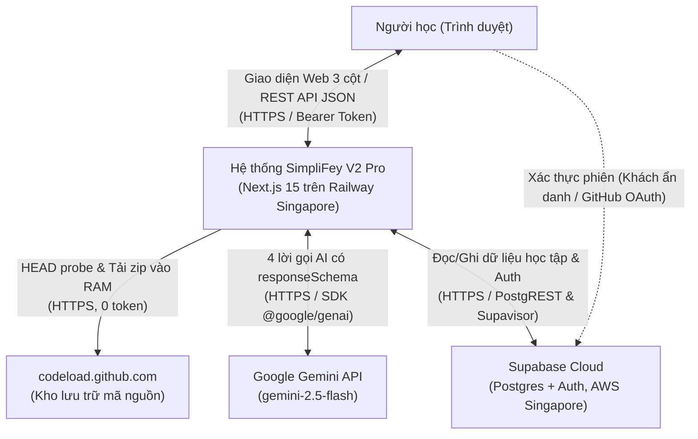
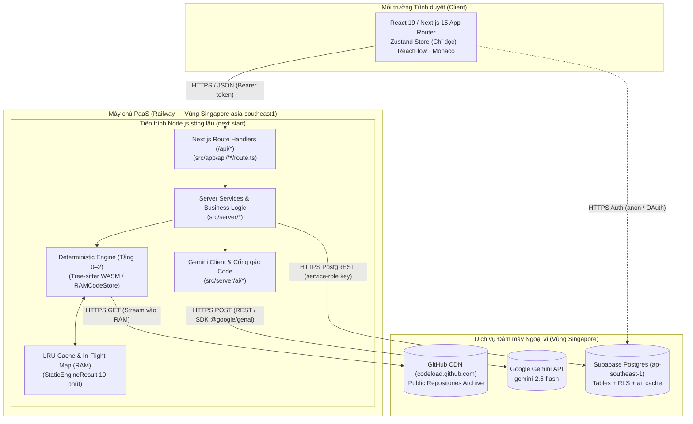
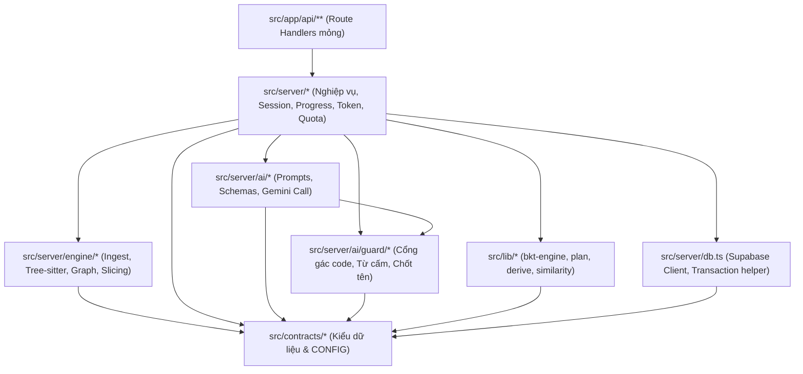
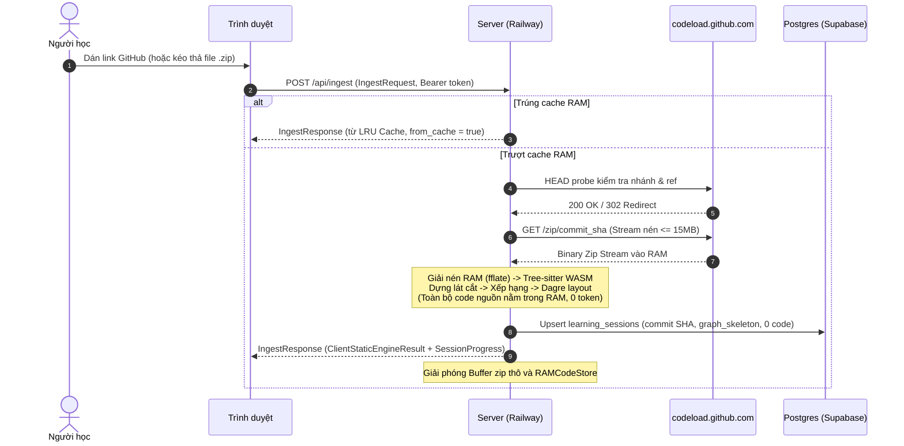
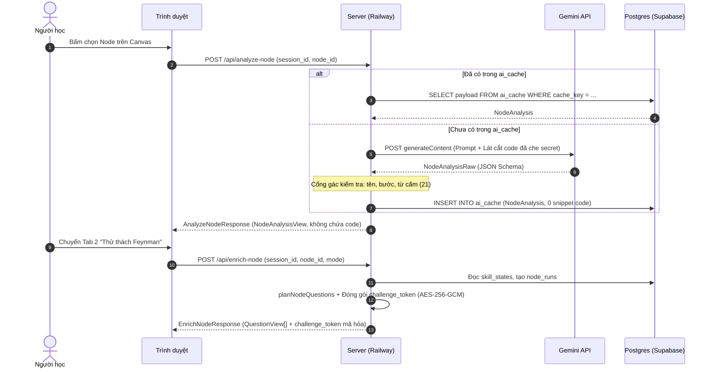
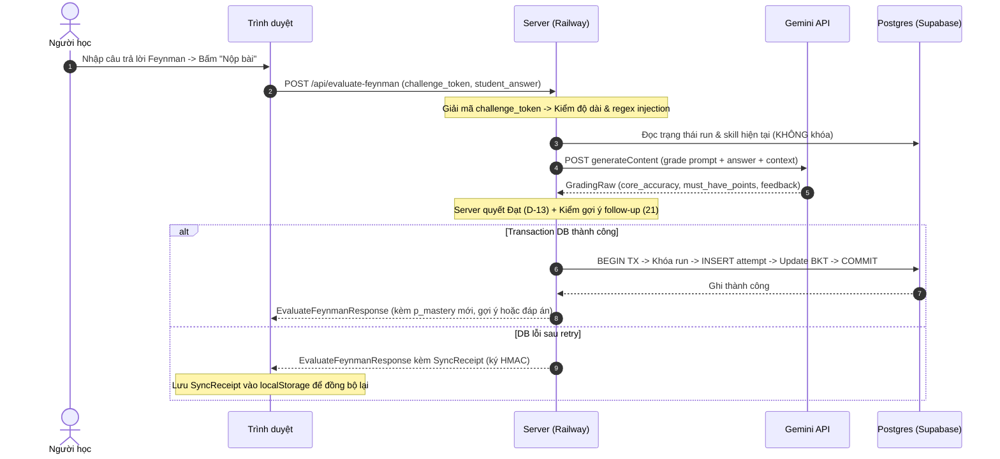

# 04 — KIẾN TRÚC TRIỂN KHAI, VẬN HÀNH & BẢO MẬT

> Quy định cấu trúc triển khai, ranh giới dữ liệu, luồng qua mạng, logging, giám sát, CI/CD và bảo mật cho SimpliFey V2 Pro.
> Nguồn chân lý cho kiểu dữ liệu: [`02_CONTRACTS.md`](02_CONTRACTS.md). Hằng số: `CONFIG.*` trong `02_CONTRACTS.md`. Endpoint & lược đồ DB: [`03_API_VA_LUU_TRU.md`](03_API_VA_LUU_TRU.md). Luồng logic: [`01_KIEN_TRUC_VA_LUONG.md`](01_KIEN_TRUC_VA_LUONG.md).

---

## 1. Đọc nhanh

- **Một tiến trình Node.js sống lâu:** Chạy `next start` trên Railway (vùng Singapore), đặt cùng vùng với Supabase Postgres AWS Singapore (`ap-southeast-1`), không dùng serverless (API-08, D-27).
- **Ranh giới Zero-Disk:** Mã nguồn repo và file zip tải về chỉ tồn tại trong RAM máy chủ khi chạy Tầng 0–2; tuyệt đối không ghi xuống đĩa hoặc database (INV-03, INV-04, API-01).
- **Đồng thời trong bộ nhớ:** Hạn chế nạp đồng thời bằng semaphore `CONFIG.MAX_CONCURRENT_INGESTIONS` (4), cache đồ thị LRU `CONFIG.INGESTION_CACHE_MAX_ENTRIES` (20), và in-flight promise map chống gọi AI trùng lặp.
- **Log có cấu trúc:** Dùng `pino` xuất JSON 1 dòng (NDJSON) ra `stdout`; cấm ghi mã nguồn, token và khóa bí mật.
- **Tự động hóa CI/CD:** GitHub Actions kiểm tra tự động (`typecheck`, `lint`, `vitest`); Railway tự động deploy khi cập nhật nhánh `main`.

| Ai | Cần đọc các mục |
| :-- | :-- |
| **Cả nhóm** | Mục 1, 2, 3, 7, 13 |
| **Người 1 — Lead, UI, DB, Ops** | Mục 3, 5, 6, 8, 9, 10, 11, 12, 14 |
| **Người 2 — Engine** | Mục 4, 5, 6a, 7, 8, 14 |
| **Người 3 — AI, BKT, Bảo mật** | Mục 4, 5, 6b, 6c, 8, 9, 13 |

---

## 2. Sơ đồ ngữ cảnh hệ thống



---

## 3. Sơ đồ triển khai



---

## 4. Sơ đồ module trong server

Ánh xạ từ cây thư mục `src/` (`spec/40` §2) và luồng phụ thuộc một chiều giữa các module:



---

## 5. Bảng thành phần hệ thống

| Thành phần | Trách nhiệm chính | Kiểu nhận (`spec/02`) | Kiểu trả (`spec/02`) | Nơi lưu dữ liệu | Spec chi tiết |
| :-- | :-- | :-- | :-- | :-- | :-- |
| **API Routers** | Nhận HTTP request, kiểm token Bearer, bắt lỗi map về `ApiError` | `IngestRequest`, `AnalyzeNodeRequest`, `EnrichNodeRequest`, `EvaluateFeynmanRequest`... | `IngestResponse`, `AnalyzeNodeResponse`, `EnrichNodeResponse`, `EvaluateFeynmanResponse`... | Không lưu | `spec/03` §2 |
| **Ingest Engine** | Tải zip, lọc file rác, phân tích cú pháp Tree-sitter, dựng lát cắt nghiệp vụ | URL repo hoặc Buffer zip trong RAM | `StaticEngineResult` | RAM server (`CONFIG.INGESTION_CACHE_TTL_MS`) | `spec/10`, `spec/11` |
| **AI Client** | Gọi Gemini API theo schema cấu trúc cố định, xử lý thử lại khi lỗi 429/503 | Prompt text + Context lát cắt code | `NodeAnalysisRaw`, `RepoOverviewRaw`, `GeneratedQuestionRaw`, `GradingRaw` | Không lưu | `spec/20` |
| **Cổng gác AI** | Kiểm tra bằng chứng, chốt tên symbol, quét từ cấm, regex câu lệnh | Dữ liệu raw từ AI / Người học | `NodeAnalysis`, `RepoOverviewView`, `QuestionPlanItem` | Không lưu | `spec/21` |
| **BKT & Planning** | Tính xác suất thạo kỹ năng, suy hao trí nhớ, lập kế hoạch câu hỏi | `LearnerCognitiveProfile`, `NodeAnalysis` | `QuestionPlanItem[]`, `SkillChange` | Postgres (`skill_states`) | `spec/22` |
| **Storage & Sync** | Quản lý phiên, transaction chấm điểm, ký và mở `challenge_token`, replay receipt | `ChallengeTokenPayload`, `SyncReceipt` | `SessionProgress`, `NodeStateView` | Postgres (`learning_sessions`, `node_runs`, `node_progress`) | `spec/03` §3, §6 |

---

## 6. Luồng dữ liệu qua ranh giới mạng

### 6.1. Mở repo → Engine → Dựng đồ thị

Dữ liệu mã nguồn chỉ đi từ GitHub vào RAM server và bị giải phóng sau khi trích xuất `ClientStaticEngineResult`.



### 6.2. Mở node → Phân tích & Tạo câu hỏi



### 6.3. Nộp câu trả lời → Chấm điểm → BKT → Ghi DB



---

## 7. Bảng dữ liệu theo vị trí lưu trữ

Tuân thủ bất biến [`01_KIEN_TRUC_VA_LUONG.md`](01_KIEN_TRUC_VA_LUONG.md) §8, bổ sung thời gian sống và quyền truy cập:

| Dữ liệu | Vị trí lưu | Thời gian sống (TTL) | Ai được ghi | Ai được đọc |
| :-- | :-- | :-- | :-- | :-- |
| **Mã nguồn repo, buffer zip, AST** | RAM server (`RAMCodeStore`) | Trong lúc chạy Tầng 0–2 (< 2 giây) | Engine | Engine nội bộ |
| **`StaticEngineResult` đầy đủ** | RAM server (LRU Cache) | `CONFIG.INGESTION_CACHE_TTL_MS` (10 phút) | Engine | Route handlers nội bộ |
| **`ClientStaticEngineResult` (snippet hiển thị)** | Trình duyệt (Zustand Store) | Phiên làm việc (mất khi reload/đổi repo) | Server trả về | Trình duyệt |
| **Tài khoản, phiên, hồ sơ kỹ năng (`skill_states`)** | Supabase Postgres | Vĩnh viễn (tới khi xóa tài khoản) | Server (service-role) | Chủ sở hữu (`auth.uid() = user_id`) |
| **Tiến độ node (`node_progress`), lượt học (`node_runs`)** | Supabase Postgres | Vĩnh viễn theo phiên học | Server (service-role) | Chủ phiên học |
| **Lịch sử nộp (`question_attempts`), Báo sai** | Supabase Postgres | Vĩnh viễn theo tài khoản | Server (service-role) | Chủ phiên học |
| **Văn bản AI đã kiểm (`ai_cache`)** | Supabase Postgres (`ai_cache`) | Lâu dài (theo `engine` + `prompt` + `model`) | Server (service-role) | Server nội bộ (Client CẤM đọc) |
| **Đáp án tham chiếu & context của câu đang làm** | `challenge_token` (AES-GCM) ở Client | `CONFIG.CHALLENGE_TOKEN_TTL_MS` (24 giờ) | Server phát hành | Server giải mã |
| **`SyncReceipt` chờ đồng bộ** | Trình duyệt (`localStorage`) | Tới khi đồng bộ thành công qua `/api/sync/replay` | Server ký HMAC | Client giữ, Server đọc |
| **Tùy chọn giao diện (tab, cỡ chữ)** | Trình duyệt (`localStorage`) | Vĩnh viễn trên trình duyệt | Client UI | Client UI |

---

## 8. Đồng thời & hàng đợi (Bản thi)

Hệ thống bản thi duy trì đồng thời bằng tài nguyên nội bộ của tiến trình Node, không dùng hàng đợi ngoài:

1. **Semaphore nạp Repo (Ingest Semaphore):**
   - Giới hạn: `CONFIG.MAX_CONCURRENT_INGESTIONS = 4` tác vụ đồng thời.
   - Cơ chế: Hàng đợi FIFO trong bộ nhớ.
   - Hạn mức chờ: `CONFIG.INGEST_QUEUE_TIMEOUT_MS = 10000` ms. Nếu hàng đợi đầy quá 10 giây ⇒ Trả lỗi HTTP 503 `ERR_SERVER_BUSY`.
2. **In-Flight Map cho AI Calls:**
   - Khi có nhiều request đồng thời yêu cầu cùng một `cache_key` chưa tồn tại trong `ai_cache`, server chỉ gửi duy nhất 1 request tới Gemini API; các request sau cùng lắng nghe chung Promise đang chạy trong RAM.
3. **Giới hạn tốc độ Gemini (Rate-limit Resilience):**
   - Số lần thử lại: `CONFIG.LLM_MAX_RETRIES = 1`.
   - Độ trễ chờ: `CONFIG.LLM_RETRY_DELAY_MS = 500` ms kết hợp `CONFIG.LLM_RETRY_JITTER_MS = 100` ms ngẫu nhiên (chống dồn dập).
   - Khi gặp HTTP 429 hoặc 503: Thử lại 1 lần với backoff + jitter; nếu vẫn lỗi ⇒ Trả mã lỗi `ERR_AI_UNAVAILABLE` (không trừ lượt nộp của người học).
4. **Hạn mức phiên (Session Token Quota):**
   - Ngưỡng: `CONFIG.SESSION_TOKEN_QUOTA = 80000` token (vào + ra).
   - Server kiểm tra trước mỗi lời gọi AI; nếu vượt ngưỡng ⇒ Trả mã lỗi HTTP 429 `ERR_TOKEN_QUOTA_EXCEEDED` và khóa các lời gọi mới.

---

## 9. Chuẩn hóa Logging

Sử dụng thư viện `pino` xuất log định dạng JSON 1 dòng (NDJSON) ra `stdout`. Khai báo `serverExternalPackages: ['pino']` trong `next.config.ts`.

### 9.1. Định dạng bản ghi Log (Bắt buộc)

```json
{
  "time": "2026-10-31T14:32:01.124Z",
  "level": "info",
  "req_id": "req_c9a1b2e3",
  "route": "POST /api/evaluate-feynman",
  "status": 200,
  "duration_ms": 1150,
  "tokens_used": 1050,
  "session_id": "sess_88f12a",
  "node_id": "slice-checkout-a1b2c3",
  "error_code": null
}
```

### 9.2. Danh sách CẤM ghi log tuyệt đối (Zero-Disk & Security)

Để bảo đảm an toàn dữ liệu và tuân thủ nguyên tắc bảo mật:
1. **Mã nguồn:** Không ghi nội dung file code, đoạn snippet, AST, `code_context`.
2. **Khóa bí mật:** Không ghi `SUPABASE_SERVICE_ROLE_KEY`, `GEMINI_API_KEY`, `CHALLENGE_TOKEN_KEY`, `RECEIPT_HMAC_KEY`.
3. **Thông tin định danh & Token:** Không ghi header `Authorization`, bearer token, refresh token.
4. **Dữ liệu bài làm của người học:** Không ghi nội dung câu trả lời `student_answer`.

---

## 10. Giám sát hệ thống (Monitoring)

Trong 21 giờ thử thách, toàn bộ thông số vận hành được quan sát trực tiếp qua các kênh có sẵn:

| Chỉ số theo dõi | Mục tiêu vận hành | Dấu hiệu bất thường | Xem ở đâu |
| :-- | :-- | :-- | :-- |
| **Thời gian chạy Engine** | < 1.5 s (`02` §1.1) | `ingest_ms + engine_ms > 2000` ms | Log server (`duration_ms` route `/api/ingest`) |
| **Token mỗi lời gọi AI** | Trong trần `LLM_MAX_OUTPUT_TOKENS` | Lời gọi tiệm cận trần output | Log server (`tokens_used` của từng route AI) |
| **Tỉ lệ trúng cache AI** | > 40% khi học cùng repo | Nhiều lời gọi AI trùng lặp | Log server (`from_cache = true` vs `false`) |
| **Lỗi mạng Gemini (429 / 5xx)** | = 0 trường hợp trượt | Xuất hiện `ERR_AI_UNAVAILABLE` | Railway Live Logs / Filter `error_code` |
| **Tải phần cứng (CPU & RAM)** | RAM < 70%, CPU < 60% | RAM tăng dần không hạ (rò rỉ bộ nhớ) | Railway Dashboard (Bảng điều khiển Metrics) |

---

## 11. Xử lý lỗi & Phân cấp Log

Phân cấp ghi log tương ứng với mã lỗi định nghĩa tại [`02_CONTRACTS.md`](02_CONTRACTS.md) §9:

| Mức Log | Mã lỗi áp dụng | Ý nghĩa vận hành |
| :-- | :-- | :-- |
| **ERROR** | `ERR_PERSISTENCE_UNAVAILABLE`, `ERR_RECEIPT_INVALID`, lỗi runtime 500 không bắt được | Lỗi nghiêm trọng hạ tầng hoặc toàn vẹn dữ liệu DB |
| **WARN** | `ERR_AI_UNAVAILABLE`, `ERR_TOKEN_QUOTA_EXCEEDED`, `ERR_SERVER_BUSY`, `ERR_GITHUB_RATE_LIMIT_CDN`, `ERR_STREAM_QUOTA_EXCEEDED`, `ERR_SESSION_SOURCE_EXPIRED`, `ERR_SESSION_ENGINE_OUTDATED` | Suy biến dịch vụ, nghẽn mạng ngoại vi hoặc vượt hạn mức |
| **INFO** | `ERR_UNAUTHENTICATED`, `ERR_SESSION_NOT_FOUND`, `ERR_NODE_NOT_AVAILABLE`, `ERR_MODE_NOT_ALLOWED`, `ERR_QUESTION_FINISHED`, `ERR_ATTEMPT_OUT_OF_SYNC`, `ERR_ANSWER_*`, `ERR_REPORT_NOT_ALLOWED`, `ERR_AI_REJECTED` | Lỗi nghiệp vụ từ phía client hoặc thao tác không hợp lệ của người dùng |

---

## 12. Môi trường & Quy trình CI/CD

### 12.1. Phân định Môi trường

- **Môi trường Phát triển (Local Dev):** Chạy `next dev`, kết nối với project Supabase staging/dev, file cấu hình `.env.local`. Bật cờ `DEMO_MODE="true"` để kiểm thử persona.
- **Môi trường Sản phẩm (Production trên Railway):** Chạy lệnh `next build` và `next start`. Biến môi trường cấu hình trên Railway Dashboard theo [`03_API_VA_LUU_TRU.md`](03_API_VA_LUU_TRU.md) §8. Cờ `DEMO_MODE="false"` (chỉ bật `"true"` trên môi trường thi demo).

### 12.2. Quy trình CI qua GitHub Actions

Tạo workflow `.github/workflows/ci.yml` kích hoạt trên mọi Pull Request và Push vào `main`:

```yaml
name: CI
on:
  push:
    branches: [main]
  pull_request:
    branches: [main]
jobs:
  verify:
    runs-on: ubuntu-latest
    steps:
      - uses: actions/checkout@v4
      - uses: actions/setup-node@v4
        with:
          node-version: '20'
          cache: 'npm'
      - run: npm ci
      - run: npm run typecheck  # npx tsc --noEmit
      - run: npm run lint       # npx eslint .
      - run: npm test           # npx vitest run
```

### 12.3. Triển khai tự động (Continuous Deployment)

- Kết nối Railway trực tiếp với kho mã nguồn GitHub qua webhook.
- Khi nhánh `main` vượt qua bộ kiểm thử CI, Railway tự động kích hoạt tiến trình dựng (`npm run build`) và khởi động lại dịch vụ (`next start`) với thời gian gián đoạn tối thiểu (zero-downtime rolling restart).

---

## 13. Bảo mật vận hành & Quyền riêng tư

1. **Bảo vệ Mã nguồn & Zero-Disk:** Không bao giờ ghi file code xuống đĩa PaaS hay database. Mọi buffer zip được giải phóng ngay sau khi dựng xong cây cú pháp trong RAM.
2. **Kiểm soát Truy cập Hàng (RLS):** Bật RLS 100% trên toàn bộ bảng Postgres. Client chỉ có quyền đọc dữ liệu của chính mình thông qua anon token; mọi thao tác sửa đổi dữ liệu bắt buộc đi qua route handler sử dụng `SUPABASE_SERVICE_ROLE_KEY` (API-02).
3. **Bảo mật Bí mật:** Khóa API Gemini, Supabase Service Role Key và các khóa mã hóa đối xứng (`CHALLENGE_TOKEN_KEY`, `RECEIPT_HMAC_KEY`) được lưu độc quyền tại biến môi trường server Railway, tuyệt đối không lộ qua client bundle.
4. **Điều khoản Quyền riêng tư AI (Gemini Privacy):**
   - Gói Free của Gemini API cho phép Google sử dụng dữ liệu nhập/xuất để huấn luyện mô hình.
   - Hệ thống chủ động giảm thiểu rủi ro bằng cách: (a) Che toàn bộ secret và khóa API trong code trước khi gửi; (b) Chỉ gửi các lát cắt hàm ngắn, không gửi toàn bộ repo; (c) Trong lộ trình mở rộng sau thi, hệ thống chuyển sang gói Paid Tier (Cloud Billing) để được cam kết không sử dụng dữ liệu huấn luyện theo điều khoản doanh nghiệp của Google.

---

## 14. Giới hạn mở rộng & Các nút thắt của bản thi

Bản thi phục vụ mục tiêu thử thách 21 giờ. Bảng dưới đây chỉ rõ 4 nút thắt vật lý, dấu hiệu cảnh báo và bước nâng cấp kế tiếp:

| Nút thắt | Giới hạn bản thi | Dấu hiệu cảnh báo sớm | Hướng giải quyết tiếp theo (Xem `pitch/KIEN_TRUC_BGK.md`) |
| :-- | :-- | :-- | :-- |
| **1. RAM / CPU khi Ingest** | `MAX_CONCURRENT_INGESTIONS = 4`, Semaphore hàng đợi trong RAM | HTTP 503 `ERR_SERVER_BUSY` tăng đột biến; RAM server > 80% | **Bậc 3:** Tách Ingest Engine thành cụm Worker riêng, điều phối bằng hàng đợi tác vụ (`pgmq` hoặc BullMQ/Redis) |
| **2. Quota API Gemini** | Free Tier: ~15 RPM, 1,000,000 TPM (`CONFIG.SESSION_TOKEN_QUOTA = 80000`) | HTTP 429 `ERR_AI_UNAVAILABLE` hoặc `ERR_TOKEN_QUOTA_EXCEEDED` | **Bậc 4:** Gắn Cloud Billing (nâng RPM lên 1000+), chuyển các lời gọi phân tích nền qua hàng đợi rate-limited |
| **3. Cache RAM 1 Tiến trình** | LRU 20 entries, TTL 10 phút; mất cache khi redeploy | Tỉ lệ trúng cache giảm; CPU tăng do phải phân tích lại repo | **Bậc 2:** Dùng chung bộ nhớ đệm phân tán qua Upstash Redis; áp dụng sticky session |
| **4. Kết nối Postgres** | Nano compute: 60 direct, 200 pooler connections | Lỗi `ERR_PERSISTENCE_UNAVAILABLE` do cạn pool | Sử dụng Supavisor Transaction Pooler (Port 6543) hoặc nâng gói Compute của Supabase |

