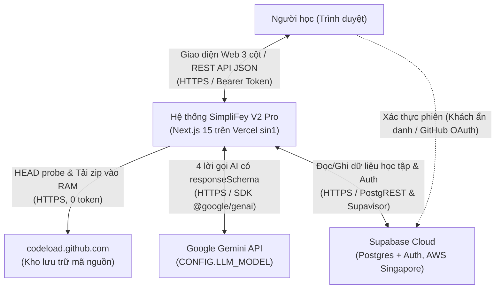
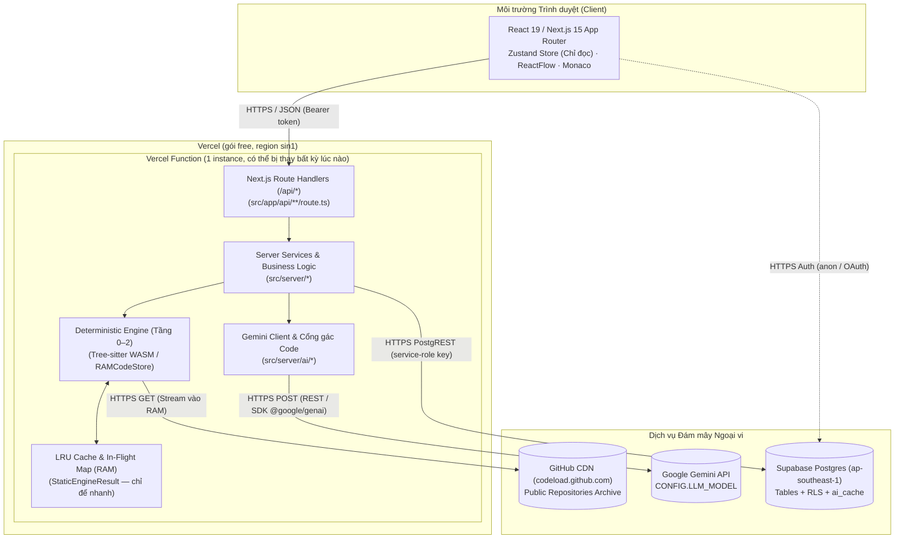
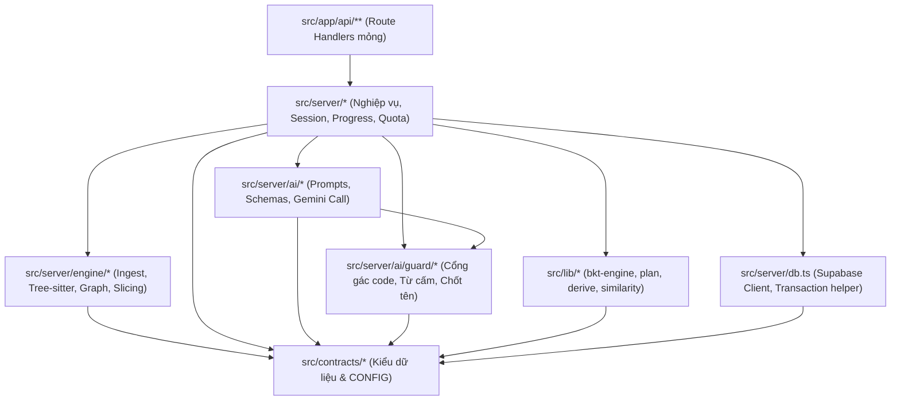
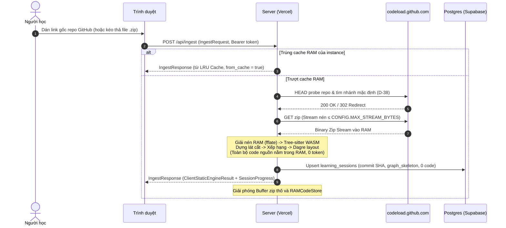
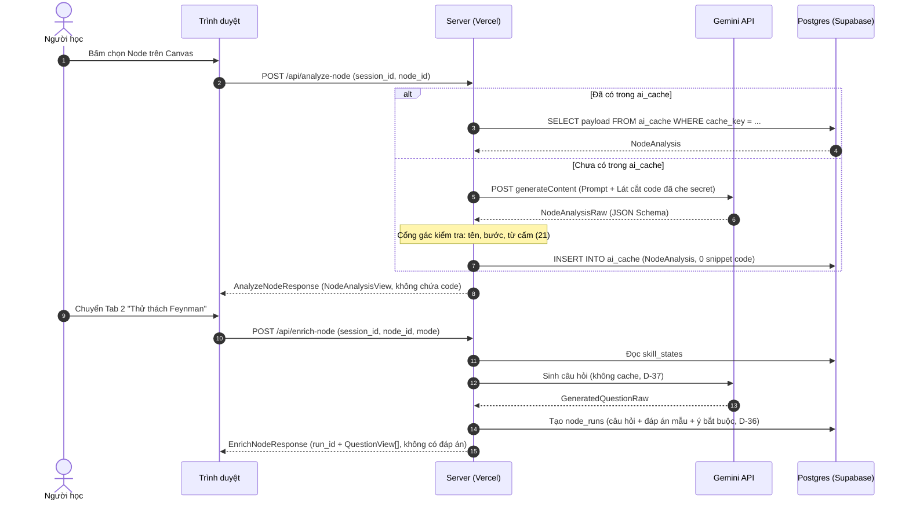
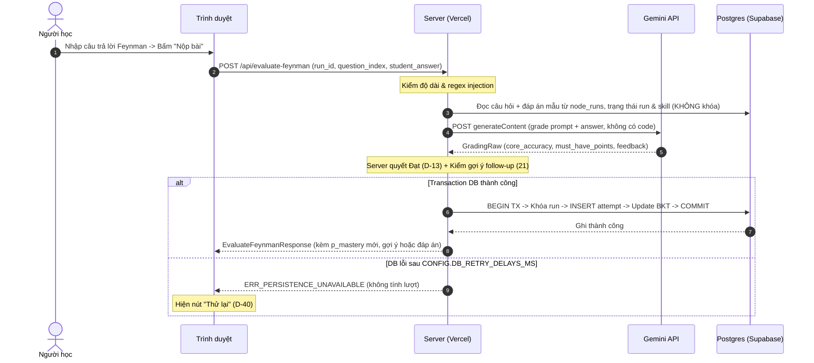

# 04 — KIẾN TRÚC TRIỂN KHAI, VẬN HÀNH & BẢO MẬT

> Quy định cấu trúc triển khai, ranh giới dữ liệu, luồng qua mạng, logging, giám sát, CI/CD và bảo mật cho SimpliFey V2 Pro.
> Nguồn chân lý cho kiểu dữ liệu: [`02_CONTRACTS.md`](02_CONTRACTS.md). Hằng số: `CONFIG.*` trong `02_CONTRACTS.md`. Endpoint & lược đồ DB: [`03_API_VA_LUU_TRU.md`](03_API_VA_LUU_TRU.md). Luồng logic: [`01_KIEN_TRUC_VA_LUONG.md`](01_KIEN_TRUC_VA_LUONG.md).

---

## 1. Đọc nhanh

- **Host = Vercel (gói free), region `sin1`:** Next.js chạy trên Vercel Functions, cùng vùng với Supabase Postgres AWS Singapore (`ap-southeast-1`) (API-08, D-27). Cache RAM chỉ sống trong 1 instance: giúp nhanh hơn, **không được dựa vào** — trượt cache ⇒ tải lại zip theo commit SHA và chạy lại engine (`03` Mục 4, D-39).
- **Ranh giới Zero-Disk:** Mã nguồn repo và file zip chỉ tồn tại trong RAM máy chủ khi chạy Tầng 0–2; tuyệt đối không ghi xuống đĩa hoặc database (INV-03, INV-04, API-01). Upload zip ≤ `CONFIG.MAX_UPLOAD_BYTES` (giới hạn body của Vercel); link GitHub không bị giới hạn này.
- **Đồng thời trong bộ nhớ:** semaphore `CONFIG.MAX_CONCURRENT_INGESTIONS`, cache đồ thị LRU `CONFIG.INGESTION_CACHE_MAX_ENTRIES` và in-flight promise map — đều trong 1 instance, không dùng queue ngoài (D-31).
- **Log có cấu trúc:** `pino` xuất JSON 1 dòng ra `stdout`, Vercel thu log; cấm ghi mã nguồn, token và khóa bí mật (D-28).
- **Giám sát:** log + Observability có sẵn của Vercel + dashboard Supabase (D-29).
- **CI/CD:** GitHub Actions chạy `typecheck`, `lint`, `vitest`; Vercel tự deploy khi vào `main` và tạo bản preview cho mỗi PR (D-30).

| Ai | Cần đọc các mục |
| :-- | :-- |
| **Cả nhóm** | Mục 1, 2, 3, 7, 13 |
| **Người 1 — Lead, UI, DB, Ops** | Mục 3, 5, 6, 8, 9, 10, 11, 12, 14 |
| **Người 2 — Engine** | Mục 4, 5, 6a, 7, 8, 14 |
| **Người 3 — AI, BKT, Bảo mật** | Mục 4, 5, 6b, 6c, 8, 9, 13 |

---

## 2. Sơ đồ ngữ cảnh hệ thống



---

## 3. Sơ đồ triển khai



---

## 4. Sơ đồ module trong server

Ánh xạ từ cây thư mục `src/` (`spec/40` §2) và luồng phụ thuộc một chiều giữa các module:



---

## 5. Bảng thành phần hệ thống

| Thành phần | Trách nhiệm chính | Kiểu nhận (`spec/02`) | Kiểu trả (`spec/02`) | Nơi lưu dữ liệu | Spec chi tiết |
| :-- | :-- | :-- | :-- | :-- | :-- |
| **API Routers** | Nhận HTTP request, kiểm token Bearer, bắt lỗi map về `ApiError` | `IngestRequest`, `AnalyzeNodeRequest`, `EnrichNodeRequest`, `EvaluateFeynmanRequest`... | `IngestResponse`, `AnalyzeNodeResponse`, `EnrichNodeResponse`, `EvaluateFeynmanResponse`... | Không lưu | `spec/03` §2 |
| **Ingest Engine** | Tải zip, lọc file rác, phân tích cú pháp Tree-sitter, dựng lát cắt nghiệp vụ | URL repo hoặc Buffer zip trong RAM | `StaticEngineResult` | RAM server (`CONFIG.INGESTION_CACHE_TTL_MS`, không được dựa vào) | `spec/10`, `spec/11` |
| **AI Client** | Gọi Gemini API theo schema cấu trúc cố định, xử lý thử lại khi lỗi 429/503 | Prompt text + Context lát cắt code | `NodeAnalysisRaw`, `RepoOverviewRaw`, `GeneratedQuestionRaw`, `GradingRaw` | Không lưu | `spec/20` |
| **Cổng gác AI** | Kiểm tra bằng chứng, chốt tên symbol, quét từ cấm, regex câu lệnh | Dữ liệu raw từ AI / Người học | `NodeAnalysis`, `RepoOverviewView`, `QuestionPlanItem` | Không lưu | `spec/21` |
| **BKT & Planning** | Tính xác suất thạo kỹ năng, suy hao trí nhớ, lập kế hoạch câu hỏi | `LearnerCognitiveProfile`, `NodeAnalysis` | `QuestionPlanItem[]`, `SkillChange` | Postgres (`skill_states`) | `spec/22` |
| **Storage** | Quản lý phiên, lưu câu hỏi + đáp án mẫu + ý bắt buộc của run, transaction chấm điểm (D-36, D-40) | `EvaluateFeynmanRequest`, `RevealRequest` | `SessionProgress`, `NodeStateView` | Postgres (`learning_sessions`, `node_runs`, `node_progress`) | `spec/03` §3, §6 |

---

## 6. Luồng dữ liệu qua ranh giới mạng

### 6.1. Mở repo → Engine → Dựng đồ thị

Dữ liệu mã nguồn chỉ đi từ GitHub (hoặc file upload) vào RAM server và bị giải phóng sau khi trích xuất `ClientStaticEngineResult`.



Upload `.zip`: body ≤ `CONFIG.MAX_UPLOAD_BYTES`, vượt ⇒ `ERR_STREAM_QUOTA_EXCEEDED` (`10` ING-45). Request sau rơi vào instance khác (trượt cache) ⇒ dựng lại theo đúng commit SHA của phiên (`03` Mục 4, D-39).

### 6.2. Mở node → Phân tích & Tạo câu hỏi



### 6.3. Nộp câu trả lời → Chấm điểm → BKT → Ghi DB



---

## 7. Bảng dữ liệu theo vị trí lưu trữ

Tuân thủ bất biến [`01_KIEN_TRUC_VA_LUONG.md`](01_KIEN_TRUC_VA_LUONG.md) §8, bổ sung thời gian sống và quyền truy cập:

| Dữ liệu | Vị trí lưu | Thời gian sống (TTL) | Ai được ghi | Ai được đọc |
| :-- | :-- | :-- | :-- | :-- |
| **Mã nguồn repo, buffer zip, AST** | RAM server (`RAMCodeStore`) | Chỉ trong lúc chạy Tầng 0–2 | Engine | Engine nội bộ |
| **`StaticEngineResult` đầy đủ** | RAM server (LRU Cache, 1 instance) | Tối đa `CONFIG.INGESTION_CACHE_TTL_MS`; mất bất kỳ lúc nào khi instance bị thay | Engine | Route handlers nội bộ |
| **`ClientStaticEngineResult` (snippet hiển thị)** | Trình duyệt (Zustand Store) | Phiên làm việc (mất khi reload/đổi repo) | Server trả về | Trình duyệt |
| **Tài khoản, phiên, hồ sơ kỹ năng (`skill_states`)** | Supabase Postgres | Vĩnh viễn (tới khi xóa tài khoản) | Server (service-role) | Chủ sở hữu (`auth.uid() = user_id`) |
| **Tiến độ node (`node_progress`)** | Supabase Postgres | Vĩnh viễn theo phiên học | Server (service-role) | Chủ phiên học |
| **Lượt học (`node_runs`): câu hỏi, đáp án mẫu, ý bắt buộc** | Supabase Postgres | Vĩnh viễn theo phiên học | Server (service-role) | Chỉ server; client đọc qua API, đáp án chỉ lộ khi câu đã xong (INV-07, D-36) |
| **Lịch sử nộp (`question_attempts`), Báo sai** | Supabase Postgres | Vĩnh viễn theo tài khoản | Server (service-role) | Chủ phiên học qua API |
| **Văn bản AI đã kiểm (`ai_cache`)** | Supabase Postgres (`ai_cache`) | Lâu dài (theo `engine` + `prompt` + `model`) | Server (service-role) | Server nội bộ (Client CẤM đọc) |
| **Tùy chọn giao diện (tab, cỡ chữ)** | Trình duyệt (`localStorage`) | Vĩnh viễn trên trình duyệt | Client UI | Client UI |

---

## 8. Đồng thời & hàng đợi (Bản thi)

Bản thi không dùng hàng đợi ngoài (D-31). Mọi cơ chế dưới đây sống trong 1 instance Vercel — giúp giảm tải, không được dựa vào để đúng (D-27):

1. **Semaphore nạp Repo (Ingest Semaphore):**
   - Giới hạn: `CONFIG.MAX_CONCURRENT_INGESTIONS` tác vụ đồng thời.
   - Cơ chế: Hàng đợi FIFO trong bộ nhớ.
   - Hạn mức chờ: `CONFIG.INGEST_QUEUE_TIMEOUT_MS`; chờ quá ⇒ HTTP 503 `ERR_SERVER_BUSY`.
2. **In-Flight Map cho AI Calls:**
   - Khi có nhiều request đồng thời yêu cầu cùng một `cache_key` chưa tồn tại trong `ai_cache`, server chỉ gửi duy nhất 1 request tới Gemini API; các request sau cùng lắng nghe chung Promise đang chạy trong RAM.
3. **Giới hạn tốc độ Gemini (Rate-limit Resilience):**
   - Số lần thử lại: `CONFIG.LLM_MAX_RETRIES`.
   - Độ trễ chờ: `CONFIG.LLM_RETRY_DELAY_MS` cộng ngẫu nhiên `[0, CONFIG.LLM_RETRY_JITTER_MS)` (chống dồn dập).
   - Khi gặp HTTP 429 hoặc 503: thử lại với backoff + jitter; vẫn lỗi ⇒ `ERR_AI_UNAVAILABLE` (không trừ lượt nộp của người học).
4. **Hạn mức phiên (Session Token Quota):**
   - Ngưỡng: `CONFIG.SESSION_TOKEN_QUOTA` token (vào + ra).
   - Server kiểm tra trước mỗi lời gọi AI; vượt ngưỡng ⇒ HTTP 429 `ERR_TOKEN_QUOTA_EXCEEDED` và khóa các lời gọi mới.

---

## 9. Chuẩn hóa Logging

Sử dụng thư viện `pino` xuất log định dạng JSON 1 dòng (NDJSON) ra `stdout`; Vercel thu log của mọi Function (D-28). Khai báo `serverExternalPackages: ['pino']` trong `next.config.ts`.

### 9.1. Định dạng bản ghi Log (Bắt buộc)

```json
{
  "time": "2026-10-31T14:32:01.124Z",
  "level": "info",
  "req_id": "req_c9a1b2e3",
  "route": "POST /api/evaluate-feynman",
  "status": 200,
  "duration_ms": 1150,
  "tokens_used": 1050,
  "session_id": "sess_88f12a",
  "node_id": "slice-checkout-a1b2c3",
  "error_code": null
}
```

Số trong ví dụ chỉ minh họa định dạng, không phải số đo.

### 9.2. Danh sách CẤM ghi log tuyệt đối (Zero-Disk & Security)

Để bảo đảm an toàn dữ liệu và tuân thủ nguyên tắc bảo mật:
1. **Mã nguồn:** Không ghi nội dung file code, đoạn snippet, AST, lát cắt gửi AI.
2. **Khóa bí mật:** Không ghi `SUPABASE_SERVICE_ROLE_KEY`, `GEMINI_API_KEY`.
3. **Thông tin định danh & Token:** Không ghi header `Authorization`, bearer token, refresh token.
4. **Dữ liệu bài làm của người học:** Không ghi nội dung câu trả lời `student_answer`.

---

## 10. Giám sát hệ thống (Monitoring)

Theo D-29: log `pino` + Observability có sẵn của Vercel + dashboard Supabase. Không cài thêm công cụ giám sát trong 21 giờ thi.

| Chỉ số theo dõi | Mục tiêu vận hành | Dấu hiệu bất thường | Xem ở đâu |
| :-- | :-- | :-- | :-- |
| **Thời gian chạy Engine** | Mục tiêu ở `02` §1.1 (chưa đo) | `ingest_ms + engine_ms` vượt mục tiêu nhiều lần liên tiếp | Log (`duration_ms` route `/api/ingest`) qua Vercel Logs |
| **Token mỗi lời gọi AI** | Trong trần `CONFIG.LLM_MAX_OUTPUT_TOKENS` | Lời gọi tiệm cận trần output | Log (`tokens_used` của từng route AI) |
| **Trúng cache AI** | Học lại cùng repo phần lớn trúng `ai_cache` | Nhiều lời gọi AI trùng lặp cho cùng `cache_key` | Log (`from_cache = true` vs `false`) |
| **Lỗi Gemini (429 / 5xx)** | Không có lần nào hết thử lại | Xuất hiện `ERR_AI_UNAVAILABLE` | Vercel Logs, lọc `error_code` |
| **Function lỗi / chậm / cold start** | Không có lỗi 5xx không bắt được | Tỉ lệ lỗi hoặc thời gian chạy Function tăng | Vercel Observability |
| **Postgres (kết nối, truy vấn chậm)** | Không cạn pool | `ERR_PERSISTENCE_UNAVAILABLE` xuất hiện | Dashboard Supabase |

---

## 11. Xử lý lỗi & Phân cấp Log

Phân cấp ghi log tương ứng với mã lỗi định nghĩa tại [`02_CONTRACTS.md`](02_CONTRACTS.md) §9:

| Mức Log | Mã lỗi áp dụng | Ý nghĩa vận hành |
| :-- | :-- | :-- |
| **ERROR** | `ERR_PERSISTENCE_UNAVAILABLE`, lỗi runtime 500 không bắt được | Lỗi nghiêm trọng hạ tầng hoặc toàn vẹn dữ liệu DB |
| **WARN** | `ERR_AI_UNAVAILABLE`, `ERR_TOKEN_QUOTA_EXCEEDED`, `ERR_SERVER_BUSY`, `ERR_GITHUB_RATE_LIMIT_CDN`, `ERR_STREAM_QUOTA_EXCEEDED`, `ERR_SESSION_ENGINE_OUTDATED` | Suy biến dịch vụ, nghẽn mạng ngoại vi hoặc vượt hạn mức |
| **INFO** | `ERR_UNAUTHENTICATED`, `ERR_SESSION_NOT_FOUND`, `ERR_NODE_NOT_AVAILABLE`, `ERR_QUESTION_FINISHED`, `ERR_ATTEMPT_OUT_OF_SYNC`, `ERR_ANSWER_*`, `ERR_REPORT_NOT_ALLOWED`, `ERR_AI_REJECTED` | Lỗi nghiệp vụ từ phía client hoặc thao tác không hợp lệ của người dùng |

---

## 12. Môi trường & Quy trình CI/CD

### 12.1. Phân định Môi trường

- **Môi trường Phát triển (Local Dev):** Chạy `next dev`, kết nối với project Supabase staging/dev, file cấu hình `.env.local`. Bật cờ `DEMO_MODE="true"` để kiểm thử persona.
- **Preview (mỗi PR):** Vercel tự dựng bản preview cho mỗi Pull Request, dùng biến môi trường nhóm "Preview" trên Vercel.
- **Production (Vercel, `main`):** Biến môi trường khai trong Vercel Project Settings theo [`03_API_VA_LUU_TRU.md`](03_API_VA_LUU_TRU.md) §8. Cờ `DEMO_MODE="false"` (chỉ bật `"true"` trên môi trường thi demo).

### 12.2. Quy trình CI qua GitHub Actions

Tạo workflow `.github/workflows/ci.yml` kích hoạt trên mọi Pull Request và Push vào `main`:

```yaml
name: CI
on:
  push:
    branches: [main]
  pull_request:
    branches: [main]
jobs:
  verify:
    runs-on: ubuntu-latest
    steps:
      - uses: actions/checkout@v4
      - uses: actions/setup-node@v4
        with:
          node-version: '20'
          cache: 'npm'
      - run: npm ci
      - run: npm run typecheck  # npx tsc --noEmit
      - run: npm run lint       # npx eslint .
      - run: npm test           # npx vitest run
```

### 12.3. Triển khai tự động (Continuous Deployment)

- Kết nối project Vercel với kho GitHub (Vercel Git Integration) (D-30).
- Push / merge vào `main` ⇒ Vercel tự chạy `next build` và đưa bản mới lên production; mỗi PR có URL preview riêng.
- Không deploy thủ công trong giờ thi.

---

## 13. Bảo mật vận hành & Quyền riêng tư

1. **Bảo vệ Mã nguồn & Zero-Disk:** Không bao giờ ghi file code xuống đĩa của Function hay database. Mọi buffer zip được giải phóng ngay sau khi dựng xong cây cú pháp trong RAM.
2. **Kiểm soát Truy cập Hàng (RLS):** Bật RLS trên toàn bộ bảng Postgres. Client chỉ đọc dữ liệu của chính mình qua anon token, và không được đọc trực tiếp `node_runs`, `question_attempts`, `ai_cache` (`03` Mục 3); mọi thao tác ghi bắt buộc đi qua route handler dùng `SUPABASE_SERVICE_ROLE_KEY` (API-02).
3. **Bảo mật Bí mật:** `GEMINI_API_KEY` và `SUPABASE_SERVICE_ROLE_KEY` chỉ nằm ở biến môi trường server trên Vercel, tuyệt đối không lộ qua client bundle (không đặt tiền tố `NEXT_PUBLIC_`).
4. **Điều khoản Quyền riêng tư AI (Gemini Privacy):**
   - Gói Free của Gemini API cho phép Google sử dụng dữ liệu nhập/xuất để huấn luyện mô hình.
   - Hệ thống chủ động giảm thiểu rủi ro bằng cách: (a) Che toàn bộ secret và khóa API trong code trước khi gửi; (b) Chỉ gửi các lát cắt hàm ngắn, không gửi toàn bộ repo; (c) Người tự cài đặt có thể dùng key gói Paid Tier (Cloud Billing) để được cam kết không sử dụng dữ liệu huấn luyện theo điều khoản của Google.

---

## 14. Giới hạn mở rộng & Các nút thắt của bản thi

Bản thi phục vụ mục tiêu thử thách 21 giờ. Bảng dưới đây chỉ rõ 4 nút thắt, dấu hiệu cảnh báo và bước nâng cấp kế tiếp:

| Nút thắt | Giới hạn bản thi | Dấu hiệu cảnh báo sớm | Hướng giải quyết tiếp theo (Xem `pitch/KIEN_TRUC_BGK.md`) |
| :-- | :-- | :-- | :-- |
| **1. RAM / thời gian chạy Function khi Ingest** | Semaphore `CONFIG.MAX_CONCURRENT_INGESTIONS` trong 1 instance; giới hạn RAM / thời gian của Vercel Functions gói free | HTTP 503 `ERR_SERVER_BUSY` tăng; Function hết giờ hoặc hết RAM trong Vercel Observability | **Bậc 3:** Tách Ingest Engine thành cụm Worker riêng, điều phối bằng hàng đợi tác vụ (`pgmq` hoặc BullMQ/Redis) |
| **2. Quota API Gemini** | Hạn mức gói Free của Gemini; `CONFIG.SESSION_TOKEN_QUOTA` mỗi phiên | HTTP 429 `ERR_AI_UNAVAILABLE` hoặc `ERR_TOKEN_QUOTA_EXCEEDED` | **Bậc 4:** Gắn Cloud Billing, chuyển các lời gọi phân tích nền qua hàng đợi rate-limited |
| **3. Cache RAM theo instance** | LRU `CONFIG.INGESTION_CACHE_MAX_ENTRIES`, TTL `CONFIG.INGESTION_CACHE_TTL_MS`; mất khi instance bị thay hoặc redeploy | Nhiều lần dựng lại theo SHA; thời gian `/api/ingest` và `enrich-node` tăng | **Bậc 2:** Bộ nhớ đệm dùng chung (vd Upstash Redis) |
| **4. Kết nối Postgres** | Giới hạn kết nối của gói Supabase đang dùng | Lỗi `ERR_PERSISTENCE_UNAVAILABLE` do cạn pool | Dùng Supavisor Transaction Pooler hoặc nâng gói Compute của Supabase |
