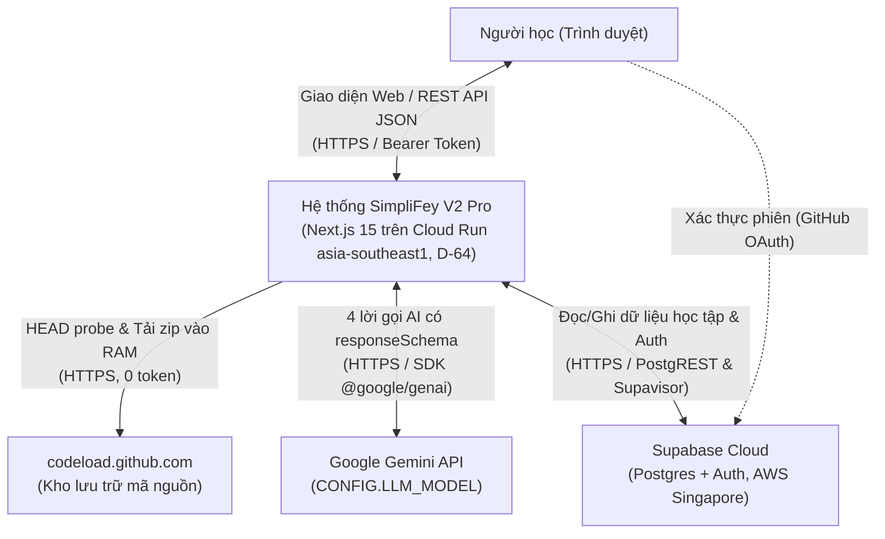
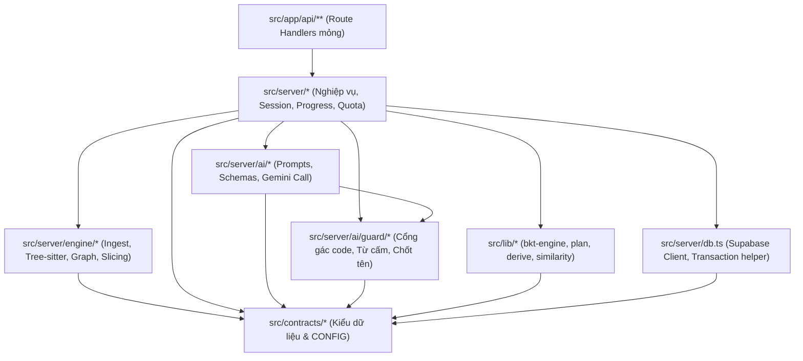
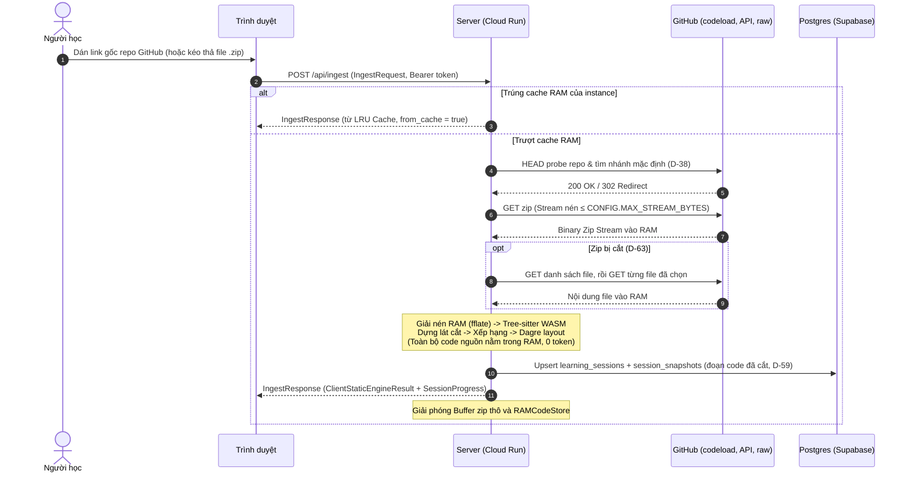
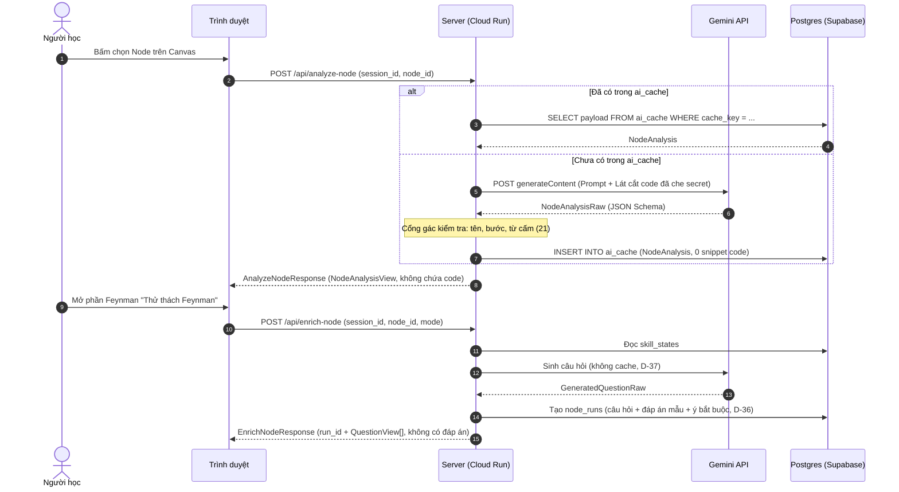
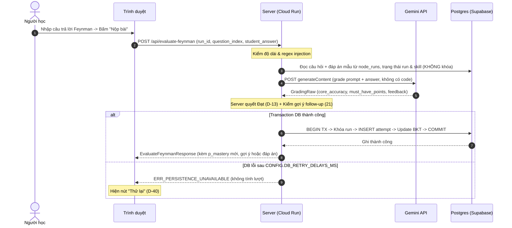
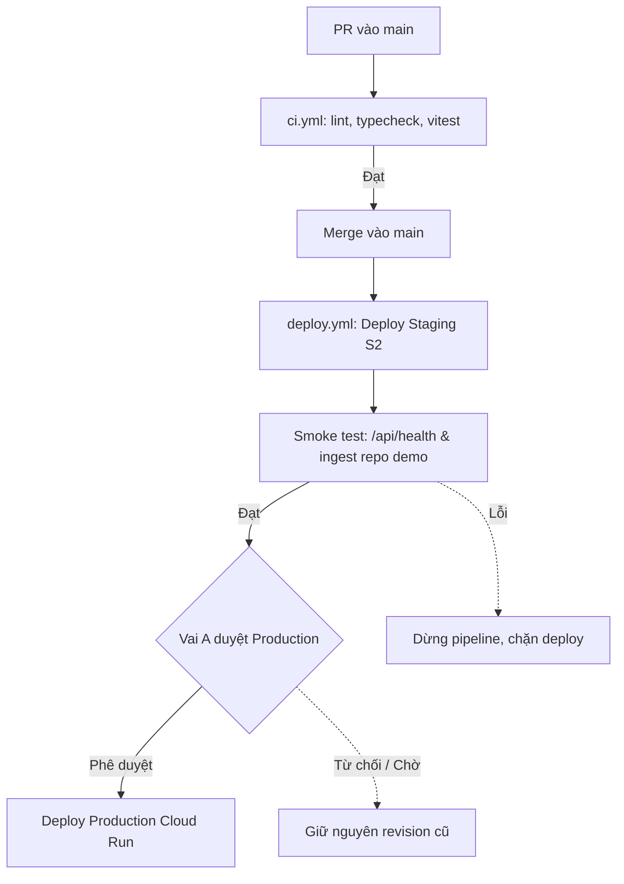

# 04 — KIẾN TRÚC TRIỂN KHAI, VẬN HÀNH & BẢO MẬT

> Quy định cấu trúc triển khai, ranh giới dữ liệu, luồng qua mạng, logging, giám sát, CI/CD và bảo mật cho SimpliFey V2 Pro.
> Nguồn chân lý cho kiểu dữ liệu: [`02_CONTRACTS.md`](02_CONTRACTS.md). Hằng số: `CONFIG.*` trong `02_CONTRACTS.md`. Endpoint & lược đồ DB: [`03_API_VA_LUU_TRU.md`](03_API_VA_LUU_TRU.md). Luồng logic: [`01_KIEN_TRUC_VA_LUONG.md`](01_KIEN_TRUC_VA_LUONG.md).

---

## 1. Đọc nhanh

- **Host chính Google Cloud Run, region `asia-southeast1` (D-64):** Container chạy Next.js standalone, cùng vùng Singapore với Supabase Postgres AWS (`ap-southeast-1`); Vercel `sin1` làm bản dự phòng khi demo (Phương án C). Cấu hình hạ tầng chi tiết quy định tại `spec/05`. Cache RAM trong container chỉ giúp nhanh hơn, **không được dựa vào** — trượt cache ⇒ đọc kết quả engine đã lưu của phiên (`session_snapshots`, D-59, `03` Mục 4).
- **Ranh giới lưu code:** File nguồn repo, buffer zip và AST không ghi xuống đĩa hay database; chỉ lưu đoạn code đã cắt của các node trong `session_snapshots` (D-59, INV-03, INV-04, API-01). Upload zip ≤ `CONFIG.MAX_UPLOAD_BYTES` (trần upload an toàn chung, D-27); link GitHub không bị giới hạn này.
- **Đồng thời trong bộ nhớ:** semaphore `CONFIG.MAX_CONCURRENT_INGESTIONS` theo từng bản sao Cloud Run, cache đồ thị LRU `CONFIG.INGESTION_CACHE_MAX_ENTRIES` và in-flight promise map — không dùng queue ngoài (D-31, D-64).
- **Log có cấu trúc:** `pino` xuất JSON 1 dòng ra `stdout`, Google Cloud Logging tự động thu thập và đánh chỉ mục (ở bản dự phòng Vercel tự gom log, D-28, D-64); cấm ghi mã nguồn, token và khóa bí mật.
- **Giám sát:** Google Cloud Monitoring (`uptime check`, metrics) + Cloud Logging + dashboard Supabase (D-29, D-64).
- **CI/CD & Staging S2:** GitHub Actions chạy CI (`ci.yml`, `security.yml`), merge `main` tự động deploy lên Staging S2 (`simplifey-staging`), chạy smoke test, Vai A duyệt deploy Production (`simplifey-prod`) (D-30; hạ tầng chi tiết xem `05`).

| Ai | Cần đọc các mục |
| :-- | :-- |
| **Cả nhóm** | Mục 1, 2, 3, 7, 13, 15, 16, 18 |
| **Vai A, D, E — Tích hợp, UI, Ops, kiểm thử** | Mục 3, 5, 6, 8, 9, 10, 11, 12, 14, 18 |
| **Vai B — Engine** | Mục 4, 5, 6a, 7, 8, 14, 18 |
| **Vai C — AI, BKT, Bảo mật** | Mục 4, 5, 6b, 6c, 8, 9, 13, 18 |

---

## 2. Sơ đồ ngữ cảnh hệ thống



---

## 3. Sơ đồ triển khai

```mermaid
flowchart TB
    subgraph ClientEnv["Môi trường Trình duyệt (Client)"]
        Browser["React 19 / Next.js 15 App Router<br/>Zustand Store (Chỉ đọc) · ReactFlow · Monaco"]
    end

    subgraph HostEnv["Google Cloud Run (asia-southeast1, D-64)"]
        subgraph Container["Container Instance (tự co giãn 1–4 bản sao)"]
            Routes["Next.js Route Handlers (/api/*)<br/>(src/app/api/**/route.ts)"]
            Services["Server Services & Business Logic<br/>(src/server/*)"]
            Engine["Deterministic Engine (Tầng 0–2)<br/>(Tree-sitter WASM / RAMCodeStore)"]
            RAMCache["LRU Cache & In-Flight Map (RAM)<br/>(StaticEngineResult — chỉ để nhanh)"]
            AIGuard["Gemini Client & Cổng gác Code<br/>(src/server/ai/*)"]
        end
        SM["Google Secret Manager<br/>(DATABASE_URL · GITHUB_TOKEN · SUPABASE_KEY)"] -. "nạp env" .-> Container
    end

    subgraph BackupEnv["Bản dự phòng: Vercel (sin1, Phương án C)"]
        VercelFn["Vercel Function (dự phòng nóng khi demo)"]
    end

    subgraph ExternalCloud["Dịch vụ Đám mây Ngoại vi"]
        SupabaseDB[("Supabase Postgres (ap-southeast-1)<br/>Tables + RLS + ai_cache")]
        GitHubCDN[("GitHub CDN (codeload.github.com)<br/>Public Repositories Archive")]
        GeminiAPI[("Google Gemini API / Vertex AI<br/>CONFIG.LLM_MODEL")]
    end

    Browser -- "HTTPS / JSON (Bearer token)" --> Routes
    Browser -. "Khi sự cố demo (Tab 2)" .-. VercelFn
    Routes --> Services
    Services --> Engine
    Engine <--> RAMCache
    Services --> AIGuard
    Engine -- "HTTPS GET (Stream vào RAM)" --> GitHubCDN
    AIGuard -- "HTTPS (Vertex AI / REST)" --> GeminiAPI
    Services -- "Postgres qua Supavisor (DATABASE_URL)" --> SupabaseDB
    Browser -. "HTTPS Auth (anon / OAuth)" .-> SupabaseDB
```

---

## 4. Sơ đồ module trong server

Ánh xạ từ cây thư mục `src/` (Mục 15) và luồng phụ thuộc một chiều giữa các module:



---

## 5. Bảng thành phần hệ thống

| Thành phần | Trách nhiệm chính | Kiểu nhận (`spec/02`) | Kiểu trả (`spec/02`) | Nơi lưu dữ liệu | Spec chi tiết |
| :-- | :-- | :-- | :-- | :-- | :-- |
| **API Routers** | Nhận HTTP request, kiểm token Bearer, bắt lỗi map về `ApiError` | `IngestRequest`, `AnalyzeNodeRequest`, `EnrichNodeRequest`, `EvaluateFeynmanRequest`... | `IngestResponse`, `AnalyzeNodeResponse`, `EnrichNodeResponse`, `EvaluateFeynmanResponse`... | Không lưu | `spec/03` §2 |
| **Ingest Engine** | Tải zip, lọc file rác, phân tích cú pháp Tree-sitter, dựng lát cắt nghiệp vụ | URL repo hoặc Buffer zip trong RAM | `StaticEngineResult` | RAM server (`CONFIG.INGESTION_CACHE_TTL_MS`, không được dựa vào) | `spec/10`, `spec/11` |
| **AI Client** | Gọi Gemini API theo schema cấu trúc cố định, xử lý thử lại khi lỗi 429/503 | Prompt text + Context lát cắt code | `NodeAnalysisRaw`, `RepoOverviewRaw`, `GeneratedQuestionRaw`, `GradingRaw` | Không lưu | `spec/20` |
| **Cổng gác AI** | Kiểm tra bằng chứng, chốt tên symbol, quét từ cấm, regex câu lệnh | Dữ liệu raw từ AI / Người học | `NodeAnalysis`, `RepoOverviewRaw`, `GeneratedQuestionRaw` | Không lưu | `spec/21` |
| **BKT & Planning** | Tính xác suất thạo kỹ năng, suy hao trí nhớ, lập kế hoạch câu hỏi | `LearnerCognitiveProfile`, `NodeAnalysis` | `QuestionPlanItem[]`, `SkillChange` | Postgres (`skill_states`) | `spec/22` |
| **Storage** | Quản lý phiên, lưu câu hỏi + đáp án mẫu + ý bắt buộc của run, transaction chấm điểm (D-36, D-40) | `EvaluateFeynmanRequest`, `RevealRequest` | `SessionProgress`, `NodeStateView` | Postgres (`learning_sessions`, `node_runs`, `node_progress`) | `spec/03` §3, §6 |

---

## 6. Luồng dữ liệu qua ranh giới mạng

### 6.1. Mở repo → Engine → Dựng đồ thị

Dữ liệu mã nguồn chỉ đi từ GitHub (hoặc file upload) vào RAM server và bị giải phóng sau khi trích xuất `ClientStaticEngineResult`.



Upload `.zip`: body ≤ `CONFIG.MAX_UPLOAD_BYTES`, vượt ⇒ `ERR_STREAM_QUOTA_EXCEEDED` (`10` ING-45). Request sau rơi vào instance khác (trượt cache) ⇒ đọc `session_snapshots` (D-59), không tải lại zip.

### 6.2. Mở node → Phân tích & Tạo câu hỏi



### 6.3. Nộp câu trả lời → Chấm điểm → BKT → Ghi DB



---

## 7. Bảng dữ liệu theo vị trí lưu trữ

Bảng đầy đủ ở [`01_KIEN_TRUC_VA_LUONG.md`](01_KIEN_TRUC_VA_LUONG.md) §8.

---

## 8. Đồng thời & hàng đợi (Bản thi)

Bản thi không dùng hàng đợi ngoài (D-31). Mọi cơ chế dưới đây sống trong 1 container instance của Cloud Run (D-64) — giúp giảm tải, không được dựa vào để đúng (D-27):

1. **Semaphore nạp Repo (Ingest Semaphore):**
   - Giới hạn: `CONFIG.MAX_CONCURRENT_INGESTIONS` tác vụ đồng thời.
   - Cơ chế: Hàng đợi FIFO trong bộ nhớ.
   - Hạn mức chờ: `CONFIG.INGEST_QUEUE_TIMEOUT_MS`; chờ quá ⇒ HTTP 503 `ERR_SERVER_BUSY`.
2. **In-Flight Map cho AI Calls:**
   - Khi có nhiều request đồng thời yêu cầu cùng một `cache_key` chưa tồn tại trong `ai_cache`, server chỉ gửi duy nhất 1 request tới Gemini API; các request sau cùng lắng nghe chung Promise đang chạy trong RAM.
3. **Giới hạn tốc độ Gemini (Rate-limit Resilience):**
   - Số lần thử lại: `CONFIG.LLM_MAX_RETRIES`.
   - Độ trễ chờ: theo `retryDelay` của Google khi có (`20` AI-12, D-74).
   - Vẫn lỗi ⇒ `ERR_AI_UNAVAILABLE` (không trừ lượt nộp của người học).
4. **Hạn mức phiên (Session Token Quota):**
   - Ngưỡng: `CONFIG.SESSION_TOKEN_QUOTA` token (vào + ra).
   - Server kiểm tra trước mỗi lời gọi AI; vượt ngưỡng ⇒ HTTP 429 `ERR_TOKEN_QUOTA_EXCEEDED` và khóa các lời gọi mới.

---

## 9. Chuẩn hóa Logging

Sử dụng thư viện `pino` xuất log định dạng JSON 1 dòng (NDJSON) ra `stdout`; Google Cloud Logging tự động thu thập và đánh chỉ mục từ stdout của container Cloud Run (ở bản dự phòng Vercel tự gom log, D-28, D-64). Khai báo `serverExternalPackages: ['pino']` trong `next.config.ts`.

### 9.1. Định dạng bản ghi Log (Bắt buộc)

```json
{
  "time": "2026-10-31T14:32:01.124Z",
  "level": "info",
  "req_id": "req_c9a1b2e3",
  "route": "POST /api/evaluate-feynman",
  "status": 200,
  "duration_ms": 1150,
  "tokens_used": 1050,
  "session_id": "sess_88f12a",
  "node_id": "slice-checkout-a1b2c3",
  "error_code": null
}
```

Định dạng log L1 cho mỗi lời gọi AI (Cloud Logging thu thập, D-66):
```json
{
  "time": "2026-11-02T10:15:30.120Z",
  "level": "info",
  "req_id": "req_a1b2c3d4",
  "call_kind": "ANALYZE",
  "backend": "vertex",
  "model": "gemini-3.5-flash-lite",
  "tokens_in": 1980,
  "tokens_out": 685,
  "cached_tokens": 0,
  "retries": 0,
  "cost_usd": 0.002306,
  "ai_cache_hit": false,
  "duration_ms": 7120,
  "session_id": "sess_88f12a",
  "node_id": "slice-auth-login"
}
```

Số trong ví dụ chỉ minh họa định dạng, không phải số đo. Dòng log cổng gác chặn dùng `GuardLogEntry` (`02` Mục 5), theo `21` GUARD-22. Log lỗi Gemini: `20` AI-12.

### 9.2. Danh sách CẤM ghi log tuyệt đối (Bảo mật mã nguồn)

Để bảo đảm an toàn dữ liệu và tuân thủ nguyên tắc bảo mật:
1. **Mã nguồn:** Không ghi nội dung file code, đoạn snippet, AST, lát cắt gửi AI.
2. **Khóa bí mật:** Không ghi `DATABASE_URL` (chứa mật khẩu DB), `SUPABASE_SERVICE_ROLE_KEY`, `GEMINI_API_KEY`, `GITHUB_TOKEN`.
3. **Thông tin định danh & Token:** Không ghi header `Authorization`, bearer token, refresh token.
4. **Dữ liệu bài làm của người học:** Không ghi nội dung câu trả lời `student_answer`.
5. Dòng `guard_blocked` chỉ có các trường của `GuardLogEntry`; `node_id` giữ như Mục 9.1; không ghi thêm tên hàm, văn bản AI hoặc tên trong `GuardIssue`.

- **Lỗi lạ:** ghi thêm `error_name` và `error_message` đã che secret; không ghi biến môi trường, body request.
- **Khởi động:** kiểm biến môi trường bắt buộc 1 lần ở `instrumentation.ts`, thiếu ⇒ log `error`.

---

## 10. Giám sát hệ thống (Monitoring)

Theo D-29, D-64, D-66: Cloud Logging + Cloud Monitoring (metrics, uptime check, budget alerts) + dashboard Supabase (Vercel Observability dùng cho bản dự phòng). Không cài thêm công cụ giám sát ngoài trong 21 giờ thi.

- **Chỉ số chi phí AI (Cloud Monitoring qua log L1, D-66):**
  1. Biểu đồ tổng chi phí tích lũy theo giờ (`sum(cost_usd)`).
  2. Phân bổ token vào/ra theo loại tác vụ (`tokens_in`, `tokens_out` nhóm theo `call_kind`).
  3. Tỷ lệ gọi lại (`retries > 0` so với `retries == 0`).
  4. Tỷ lệ trúng cache phân tích (`ai_cache_hit = true` so với `false`).
- **Quy trình xử lý Budget Alert & `AI_DISABLED` (D-66):**
  - Khi nhận cảnh báo Budget Alert 100 % (chi tiết tại [`05`](05_HA_TANG_CLOUD.md)): Vai A thực hiện quy trình bán tự động đặt biến môi trường trên Cloud Run: `gcloud run services update simplifey-prod --update-env-vars AI_DISABLED="true" --region asia-southeast1`.
  - Khi `AI_DISABLED="true"`: Mọi lời gọi AI lập tức trả mã lỗi `ERR_AI_UNAVAILABLE` (HTTP 503), không gọi Gemini, không trừ lượt; nạp repo (0 token) và Chế độ Offline vẫn chạy bình thường.

| Chỉ số theo dõi | Mục tiêu vận hành | Dấu hiệu bất thường | Xem ở đâu |
| :-- | :-- | :-- | :-- |
| **Thời gian chạy Engine** | Mục tiêu ở `02` §1.1 (chưa đo) | `ingest_ms + engine_ms` vượt mục tiêu nhiều lần liên tiếp | Log (`duration_ms` route `/api/ingest`) qua Cloud Logging |
| **Token mỗi lời gọi AI** | Trong trần `CONFIG.LLM_MAX_OUTPUT_TOKENS` | Lời gọi tiệm cận trần output | Log (`tokens_used` của từng route AI) |
| **Trúng cache AI** | Học lại cùng repo phần lớn trúng `ai_cache` | Nhiều lời gọi AI trùng lặp cho cùng `cache_key` | Log (`from_cache = true` vs `false`) |
| **Lỗi Gemini (429 / 5xx)** | Không có lần nào hết thử lại | Xuất hiện `ERR_AI_UNAVAILABLE` | Cloud Logging, lọc `error_code` |
| **Container lỗi / chậm / cold start** | Không có lỗi 5xx không bắt được | Tỉ lệ lỗi hoặc thời gian chạy container tăng | Cloud Monitoring (metrics, uptime check) |
| **Postgres (kết nối, truy vấn chậm)** | Không cạn pool | `ERR_PERSISTENCE_UNAVAILABLE` xuất hiện | Dashboard Supabase |

---

## 11. Xử lý lỗi & Phân cấp Log

Phân cấp ghi log tương ứng với mã lỗi định nghĩa tại [`02_CONTRACTS.md`](02_CONTRACTS.md) §9:

| Mức Log | Mã lỗi áp dụng | Ý nghĩa vận hành |
| :-- | :-- | :-- |
| **ERROR** | `ERR_PERSISTENCE_UNAVAILABLE`, lỗi runtime 500 không bắt được | Lỗi nghiêm trọng hạ tầng hoặc toàn vẹn dữ liệu DB |
| **WARN** | `ERR_AI_UNAVAILABLE`, `ERR_TOKEN_QUOTA_EXCEEDED`, `ERR_SERVER_BUSY`, `ERR_GITHUB_RATE_LIMIT_CDN`, `ERR_STREAM_QUOTA_EXCEEDED`, `ERR_SESSION_ENGINE_OUTDATED` | Suy biến dịch vụ, nghẽn mạng ngoại vi hoặc vượt hạn mức |
| **INFO** | `ERR_UNAUTHENTICATED`, `ERR_SESSION_NOT_FOUND`, `ERR_NODE_NOT_AVAILABLE`, `ERR_QUESTION_FINISHED`, `ERR_ATTEMPT_OUT_OF_SYNC`, `ERR_ANSWER_*`, `ERR_REPORT_NOT_ALLOWED`, `ERR_AI_REJECTED` | Lỗi nghiệp vụ từ phía client hoặc thao tác không hợp lệ của người dùng |

---

## 12. Môi trường & Pipeline CI/CD (D-30)

### 12.1. Phân định Môi trường

Hệ thống phân định 4 môi trường độc lập:
1. **Môi trường Phát triển (Local Dev):** Chạy `next dev`, kết nối project Supabase dev/staging (D2), file `.env.local`, bật `DEMO_MODE="true"` để kiểm thử persona.
2. **Staging S2 (`simplifey-staging` trên Cloud Run):** Tự động deploy khi PR merge vào `main`, kết nối project Supabase dev/staging (D2), cấu hình tại [`05`](05_HA_TANG_CLOUD.md). Là môi trường kiểm thử tích hợp và nghiệm thu chính thức.
3. **Production (`simplifey-prod` trên Cloud Run):** Chỉ deploy sau khi Trưởng tích hợp (Vai A) bấm duyệt trên GitHub Actions; kết nối project Supabase production, cấu hình tại [`05`](05_HA_TANG_CLOUD.md).
4. **Preview S1 (Vercel Preview):** Kênh phụ xem nhanh giao diện tĩnh cho từng PR; không dùng làm căn cứ nghiệm thu backend hay thay thế staging S2.

### 12.2. Pipeline GitHub Actions & Workflow Triển khai

Pipeline gồm 3 workflow tự động hóa:
- **`ci.yml`:** Chạy trên mọi PR và push vào `main`, thực thi `typecheck` (`tsc --noEmit`), `lint` (`eslint`), `vitest run`. Bất kỳ bước nào lỗi lập tức dừng toàn bộ pipeline (fail-fast).
- **`security.yml`:** Quét `npm audit --omit=dev --audit-level=critical` trên PR và định kỳ hằng tuần (D-65).
- **`deploy.yml`:** Kích hoạt khi merge vào `main`, phối hợp các job:
  1. `verify`: Chạy lại lint, typecheck, unit test.
  2. `deploy-staging`: Xác thực GCP qua Workload Identity Federation (WIF, dự phòng secret key JSON; quyền IAM xem `05`) ⇒ deploy lên `simplifey-staging` qua `gcloud run deploy --source` (hoặc image từ Artifact Registry sau khi merge Dockerfile ở H+15).
  3. `smoke-test`: Kiểm tra tự động sau deploy staging: `GET /api/health` = 200; `POST /api/ingest` repo demo Q-03 kèm Bearer token lấy từ tài khoản bot (`grant_type=password`, `05`). Đạt khi 200, có `session_id`, `result.nodes.length >= CONFIG.DISPLAY_MIN_NODES`. Thất bại ⇒ dừng pipeline, chặn mở cổng duyệt.
  4. `deploy-production`: Gắn GitHub Environment `production` (cổng duyệt thủ công, duy nhất Vai A duyệt) ⇒ sau khi duyệt, xác thực GCP ⇒ deploy lên `simplifey-prod` (cùng source, hoặc image prod build từ cùng commit với bản đã qua staging, D-72) ⇒ kiểm tra uptime check.



### 12.3. Triển khai tự động & Thứ tự lùi an toàn

- **Quy trình nhánh & phân quyền:** Mọi thành viên làm trên nhánh riêng, mở PR; CI tự động kiểm tra; sau khi merge vào `main`, pipeline tự deploy staging và chạy smoke test; quyền duyệt deploy production trao duy nhất cho Trưởng tích hợp (Vai A). Bãi bỏ cơ chế triển khai qua Vercel Git Integration cũ.
- **Bản dự phòng Vercel (Phương án C):** Vercel chỉ dùng để deploy bản dự phòng nóng khi demo (`05` Mục 4).
- **Thứ tự lùi khi có sự cố sát demo:**
  1. Rollback revision trên Cloud Run `simplifey-prod` về bản ổn định gần nhất.
  2. Dùng revision tag của Staging S3 (`--no-traffic --tag stable`).
  3. Phương án C: Chuyển tab sang Vercel dự phòng (< 5 giây).
  4. Chế độ Offline (`Ctrl+Shift+D`).

---

## 13. Bảo mật vận hành & Quyền riêng tư

1. **Bảo vệ mã nguồn:** không ghi file code hay buffer zip xuống đĩa hay database; chỉ lưu đoạn code đã cắt của phiên ở `session_snapshots` (D-59). Buffer zip giải phóng ngay sau khi dựng xong cây cú pháp trong RAM.
2. **Kiểm soát Truy cập Hàng (RLS):** Bật RLS trên toàn bộ bảng Postgres. Client chỉ đọc dữ liệu của chính mình qua anon token, và không được đọc trực tiếp `node_runs`, `question_attempts`, `ai_cache` (`03` Mục 3); mọi thao tác ghi bắt buộc đi qua route handler dùng driver `postgres` (`DATABASE_URL`) (API-02).
3. **Bảo mật Bí mật:** `DATABASE_URL`, `GITHUB_TOKEN`, `SUPABASE_SERVICE_ROLE_KEY` nằm ở **Secret Manager**, nạp vào Cloud Run dạng biến môi trường server (D-64); bản Vercel dự phòng đặt trong Project Settings; tuyệt đối không lộ qua client bundle (không đặt tiền tố `NEXT_PUBLIC_`).
4. **Điều khoản Quyền riêng tư AI (Vertex AI & Gemini Privacy — D-66):**
   - Production và staging trên Cloud Run gọi Gemini qua **Vertex AI** (xác thực bằng service account, `roles/aiplatform.user`): Dữ liệu prompt và mã nguồn người học được bảo vệ theo điều khoản dữ liệu khách hàng doanh nghiệp của Google, **không bị sử dụng để huấn luyện mô hình**.
   - Bản Vercel dự phòng sử dụng Google AI Studio gói trả phí (Pay-as-you-go, không dùng dữ liệu huấn luyện); gói Free của Google AI Studio chỉ dùng ở môi trường Local Dev. Endpoint `location: "global"` không cố định vùng địa lý xử lý; hệ thống giảm thiểu rủi ro bằng cách che secret (`<REDACTED_SECRET>`), PII (`***`) qua `maskSensitive` (D-65) và chỉ gửi lát cắt hàm ngắn (≤ 100 dòng), không gửi toàn bộ repo.
5. **Bộ lọc an toàn & che dữ liệu nhạy cảm (`maskSensitive` — D-65):**
   - **Hàm `maskSensitive(text)`:** Đặt tại `src/lib/moderation.ts`, dùng chung cho cả server và client (nếu cần), 0 token, xử lý regex thuần.
   - **Cửa nhận repo (`10` Mục 11):** secret đã che ở `redactSecrets` (`10` ING-110) bằng `<REDACTED_SECRET>`. Sau đó mã nguồn chạy tiếp qua `maskSensitive` để che email (`[A-Za-z0-9._%+-]+@[A-Za-z0-9.-]+\.[A-Za-z]{2,}`), số điện thoại VN (`(?<!\d)(\+84|0)(3|5|7|8|9)[0-9]{8}(?!\d)`), CCCD 12 số (`\b0[0-9]{11}\b`), và từ xấu. Mọi mục nhạy cảm được che bằng `***`, bảo toàn số dòng (`\n`), cộng dồn số lần che vào `redacted_secret_count`.
   - **Cửa câu trả lời (`03` Mục 6.2):** Ngay sau bước kiểm tra độ dài:
     + Quét từ xấu: nếu phát hiện từ xấu ⇒ trả ngay mã lỗi `ERR_ANSWER_INAPPROPRIATE` (HTTP 400), không tính lượt, không gọi AI (0 token).
     + Nếu đạt: che theo thứ tự `maskSensitive(redactSecrets(req.student_answer).code)`; secret thành `<REDACTED_SECRET>`, PII thành `***` trước khi gửi cho `gradeWithAI` và trước khi lưu vào CSDL (`question_attempts.student_answer`).
     + Ghi chú của nút "Báo sai" (`report-wrong`, `03` Mục 6.4) cũng che theo thứ tự `maskSensitive(redactSecrets(note).code)` trước khi ghi vào bảng `dispute_reports`.
   - **Danh sách từ xấu:** danh sách là hằng `BAD_WORDS` trong `src/lib/moderation.ts`, do vai C viết, lưu dạng NFC chữ thường. `hasInappropriateWords(text)` = có `w` thuộc `BAD_WORDS` mà `wordRe(w)` (`21` GUARD-07) khớp `text.normalize("NFC")`. Không dùng `\b` vì không hiểu chữ có dấu. Chỉ bao gồm từ ngữ có dấu và cụm từ rõ nghĩa (xúc phạm, tục tĩu rõ ràng). Tuyệt đối không bắt dạng không dấu mơ hồ (`cac`, `lon`) để tránh chặn nhầm code/tên biến; không chứa các từ kỹ thuật phổ biến (`kill`, `attack`, `hack`, `daemon`, `terminate`, `abort`...).
   - **Phạm vi bảo vệ:** Cơ chế chống prompt injection (`21`) giữ nguyên; Gemini bật `safetySettings` 4 nhóm `BLOCK_ONLY_HIGH` (`20`); chữ AI có từ trong `BAD_WORDS` bị GUARD-07 bắt như từ cấm rồi gọi lại (`21`).

---

## 14. Giới hạn mở rộng & Các nút thắt của bản thi

Bản thi phục vụ mục tiêu thử thách 21 giờ. Bảng dưới đây chỉ rõ 4 nút thắt, dấu hiệu cảnh báo và bước nâng cấp kế tiếp:

| Nút thắt | Giới hạn bản thi | Dấu hiệu cảnh báo sớm | Hướng giải quyết tiếp theo (Xem `pitch/ROADMAP.md` Mục 12) |
| :-- | :-- | :-- | :-- |
| **1. RAM / thời gian chạy container khi Ingest** | Semaphore `CONFIG.MAX_CONCURRENT_INGESTIONS` theo từng bản sao; giới hạn tài nguyên container Cloud Run (cấu hình tại `05`; Vercel dự phòng bị trần thời gian serverless) | HTTP 503 `ERR_SERVER_BUSY` tăng; container hết RAM hoặc hết giờ trong Cloud Monitoring / Logging | **Bậc 3:** Tách Ingest Engine thành cụm Worker riêng, điều phối bằng hàng đợi tác vụ (`pgmq` hoặc BullMQ/Redis) |
| **2. Quota API Gemini** | Hạn mức gói Free của Gemini; `CONFIG.SESSION_TOKEN_QUOTA` mỗi phiên | HTTP 429 `ERR_AI_UNAVAILABLE` hoặc `ERR_TOKEN_QUOTA_EXCEEDED` | **Bậc 4:** Gắn Cloud Billing, chuyển `analyze-node`, `analyze-overview` qua hàng đợi rate-limited |
| **3. Cache RAM theo instance** | LRU `CONFIG.INGESTION_CACHE_MAX_ENTRIES`, TTL `CONFIG.INGESTION_CACHE_TTL_MS`; mất khi instance bị thay hoặc redeploy | Nhiều lần đọc `session_snapshots` (trượt cache RAM); thời gian `/api/ingest` và `enrich-node` tăng | **Bậc 2:** Bộ nhớ đệm dùng chung (vd Upstash Redis) |
| **4. Kết nối Postgres** | Pooler Supavisor (port 6543, Transaction mode) qua `DATABASE_URL`, driver `postgres` `prepare: false` | Timeout kết nối pooler khi đồng thời quá nhiều request | Nâng gói Compute Supabase hoặc tách read-replica / dedicate pool |

---

## 15. Cây thư mục repo thi

```
.
├── README.md · LICENSE                          # README có mục "Tự cài đặt" (D-45); LICENSE MIT (D-49)
├── package.json · tsconfig.json · next.config.ts · postcss.config.mjs · .env.example · .nvmrc
├── supabase/migrations/0001_init.sql            # 03 Mục 3
├── scripts/{review-run,record-bundle}.ts        # Duyệt tay output AI + ghi mock_bundle (21)
├── review/                                      # Bảng kiểm & kết quả duyệt tay (21) — không chứa code repo demo
├── queries/<language>.scm                       # Truy vấn Tree-sitter (11)
├── public/
│   ├── grammars/*.wasm                          # Grammar Tree-sitter (10, 11)
│   └── demo/mock_bundle.json                    # OfflineMockBundle (ghi lại ở giờ H+17)
└── src/
    ├── contracts/{config,…}.ts · contracts/index.ts   # 02 — config.ts = Mục 1, mỗi Mục 2–10 một file, index.ts re-export; viết đầu tiên
    ├── app/
    │   ├── layout.tsx · page.tsx · history/page.tsx   # 30
    │   ├── auth/callback/route.ts                     # Supabase OAuth callback (D-44)
    │   └── api/
    │       ├── me/route.ts                      # GET, DELETE
    │       ├── sessions/route.ts · sessions/[id]/history/route.ts · sessions/[id]/progress/route.ts  # [id] = session_id
    │       ├── ingest/route.ts · analyze-node/route.ts · analyze-overview/route.ts
    │       ├── enrich-node/route.ts · evaluate-feynman/route.ts · reveal/route.ts
    │       ├── report-wrong/route.ts · demo/persona/route.ts
    ├── server/
    │   ├── auth.ts · db.ts · errors.ts · session.ts · cache.ts · quota.ts · log.ts   # log.ts: pino (04)
    │   ├── progress.ts                          # deriveNodeStates (gọi lib), finalizeRunIfDone
    │   ├── enrich.ts · evaluate.ts · reveal.ts · report.ts · persona.ts
    │   ├── engine/index.ts                      # runEngine()
    │   ├── engine/ingest/*.ts                   # 10
    │   ├── engine/graph/*.ts · engine/graph/resolvers/*.ts   # 11
    │   ├── ai/{gemini,analyze,overview,questions,grade}.ts · ai/prompts/*.ts · ai/schemas.ts      # 20
    │   └── ai/guard/{text,names,forbidden,lines,analysis,overview,questions,followup,injection,log}.ts  # 21
    ├── lib/{bkt-engine,plan,derive,similarity}.ts   # 22 — hàm thuần dùng chung server + client
    ├── lib/{api,offline,messages}.ts            # Client gọi API có kiểu · bản Offline cùng chữ ký · bảng thông điệp lỗi (30)
    ├── store/workbench.ts                       # Zustand (30)
    └── components/{auth,canvas,code,home,how-it-works,layout,roadmap,roadmap-detail,ui}/*.tsx  # 30
```

---

## 16. Công nghệ & phiên bản

Chốt **phiên bản chính xác ở giờ H+0** bằng lệnh cài đặt, ghi vào `package.json` (không dùng `latest`). Dòng khuyến nghị:

| Gói | Dòng | Dùng cho |
| :-- | :-- | :-- |
| Node.js | 22 LTS (`engines` `>=22 <23`, `.nvmrc`) | Runtime dev, CI, Cloud Run, Vercel (D-68) |
| `next`, `react`, `react-dom` | Next 15 App Router, React 19 | Khung |
| `typescript` | 5.x, `strict: true` | Không `any` |
| `@xyflow/react` | 12.x (ReactFlow) | Canvas |
| `@dagrejs/dagre` | 1.x | Layout |
| `@monaco-editor/react` | 4.x | Code viewer (read-only) |
| `zustand` | 5.x | Store |
| `tailwindcss` | 4.x | Giao diện; cấu hình bằng `@theme` trong `globals.css`, không có `tailwind.config.ts` (D-67) |
| `web-tree-sitter` + file `.wasm` của từng grammar | Cùng ABI với grammar | Parser |
| `fflate` | 0.8.x | Giải nén zip trong RAM |
| `@google/genai` | 1.x | Gemini, structured output |
| `postgres` | 3.x | DB client (truy vấn, `db.tx` dùng `sql.begin`, `prepare: false`) |
| `@supabase/supabase-js`, `@supabase/ssr` | 2.x | Auth (OAuth GitHub, xác thực token) |
| `pino` | 9.x | Log JSON 1 dòng ra stdout (`04` Mục 9, D-28) |
| `vitest` | 2.x hoặc 3.x | Test hàm thuần (`50`) |

**Nguồn grammar `.wasm`** (`public/grammars/`, tên file theo `LanguageAdapter.wasm_grammar`): ưu tiên `.wasm` phát hành sẵn của grammar chính thức (`tree-sitter-typescript`, `tree-sitter-python`, …) hoặc gói npm `tree-sitter-wasms`; không có ⇒ tự build bằng `npx tree-sitter build --wasm` (cần Emscripten hoặc Docker). Mọi grammar phải cùng ABI với bản `web-tree-sitter` đã pin.

**Nạp grammar và truy vấn trên Cloud Run & Docker standalone (D-61, D-64, D-70):** engine chỉ chạy trong `POST /api/ingest` (mở lại phiên đọc `session_snapshots`, không parse lại). Docker: stage runner chép `public/` (gồm `public/grammars/*.wasm`) và `queries/`, đọc bằng `fs.readFile(path.join(process.cwd(), ...))` theo `adapter.wasm_grammar`, `adapter.query_file`; `next.config.ts` giữ `outputFileTracingIncludes: { "/api/ingest": ["./public/grammars/*.wasm", "./node_modules/web-tree-sitter/*.wasm", "./queries/*.scm"] }` (Vercel và `standalone`). Route `ingest` đặt `export const runtime = "nodejs"`; `Parser.init({ locateFile })` trỏ tới `tree-sitter.wasm` trong `node_modules/web-tree-sitter/`.

> ⚠️ **Phải kiểm chứng ở H+1:** nạp được grammar TS/JS + Python bằng `initParsers()` (`11` ENG-11). Kiểm trên môi trường Staging S2 (và bản Vercel dự phòng): ingest repo demo thành công. **Fallback (D-32):** lệch ABI ⇒ đổi bản `web-tree-sitter` trong `package.json` cho khớp với grammar `.wasm` đã có sẵn, không tự build lại grammar.

---

## 17. GitHub tự canh lỗ hổng & An ninh CI/CD (D-65)

1. **Dependabot alerts & security updates:** Bật trên kho GitHub; cấu hình `.github/dependabot.yml` cập nhật dependencies định kỳ hằng tuần (package-ecosystem: `npm`, directory: `/`, schedule: `weekly`). Khi có lỗ hổng CVE trong dependency, Dependabot tự động tạo PR nâng cấp phiên bản an toàn tối thiểu.
2. **Secret scanning & Push protection:** Bật Secret scanning kèm Push protection trên repo GitHub nhằm quét lịch sử commit và chặn ngay khi developer thực hiện `git push` nếu phát hiện API key, token hoặc khóa riêng tư vô tình lọt vào commit.
3. **CodeQL default setup:** Bật CodeQL default setup trong GitHub Advanced Security; tự động phân tích ngữ nghĩa mã nguồn JavaScript/TypeScript trên PR và nhánh chính mà không cần viết workflow tùy biến phức tạp.
4. **Security workflow (`.github/workflows/security.yml`):** Chạy trên mọi Pull Request và lịch hằng tuần (`schedule: cron '0 0 * * 1'`), thực thi `npm audit --omit=dev --audit-level=critical` để phát hiện và chặn các lỗ hổng mức nghiêm trọng (critical) ở các gói chạy production.
5. **Security headers trong `next.config.ts`:** Route handler và trang giao diện trả về các tiêu đề HTTP bảo vệ:
   - `X-Content-Type-Options: nosniff` (ngăn trình duyệt đoán sai MIME type).
   - `X-Frame-Options: DENY` (chặn nhúng vào iframe, phòng thủ Clickjacking).
   - `Referrer-Policy: strict-origin-when-cross-origin` (giới hạn rò rỉ URL nguồn).
   - `Strict-Transport-Security: max-age=31536000; includeSubDomains` (ép kết nối HTTPS).
   - *Lưu ý:* Không đặt CSP (Content Security Policy) ở bản thi để tránh xung đột với Monaco Editor và ReactFlow web worker/inline styles.

### Bảng đối chiếu lỗi bảo mật phổ biến với luật sẵn có

| Lỗ hổng phổ biến | Rủi ro | Cơ chế phòng thủ của SimpliFey |
| :-- | :-- | :-- |
| **Lộ Secret / API Key** | Đẩy secret lên repo, rò rỉ qua log hoặc gửi cho AI | GitHub Secret scanning + Push protection; `redactSecrets` (`10`) + `maskSensitive` (`04`) che trước khi gửi AI hoặc lưu DB; cấm ghi bí mật vào log (D-28); env chỉ nằm ở server |
| **Dependency chứa CVE** | Thư viện bên thứ ba có lỗ hổng nghiêm trọng | Dependabot alerts & security updates tự tạo PR sửa; workflow `.github/workflows/security.yml` chạy `npm audit --audit-level=critical` chặn PR |
| **SQL Injection** | Chèn mã SQL độc qua tham số đầu vào | Driver `postgres` 3.x tự động tham số hóa tagged template literal (`sql\`...\``); không ghép chuỗi SQL |
| **XSS / Clickjacking** | Chèn script độc hại vào trình duyệt, nhúng iframe | Headers `X-Frame-Options: DENY`, `X-Content-Type-Options: nosniff`; React tự escape; văn bản AI là chữ thuần (không `dangerouslySetInnerHTML`) |
| **Lộ dữ liệu chéo người dùng** | Đọc tiến độ, điểm số, bài làm của tài khoản khác | Kiểm tra quyền sở hữu ở mọi endpoint (API-05) là lớp chính vì server kết nối bằng vai trò bỏ qua RLS; RLS `auth.uid() = user_id` chỉ chặn client đọc thẳng DB; không lưu code đầy đủ (D-59) |
| **Prompt Injection / Jailbreak** | Người học dùng bài làm để điều khiển AI chấm | Chuẩn hóa NFC + regex chặn câu lệnh; 0 điểm `OFF_TOPIC` (`21`); không đưa `code_context` vào prompt chấm (D-36); responseSchema cố định |

---

## 18. Hạ tầng Cloud Run (D-64)

Toàn bộ đặc tả hạ tầng Google Cloud Run (cấu hình production, bảo mật mạng, đóng gói Docker với mốc cắt H+15, startup probe `/api/health`, và bản dự phòng Vercel) được quy định tập trung tại [`05_HA_TANG_CLOUD.md`](05_HA_TANG_CLOUD.md). Mọi giá trị hạ tầng chỉ quy định duy nhất tại `05`.

