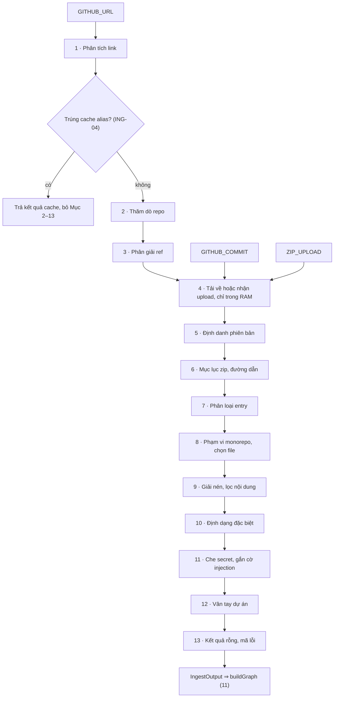

# 10 — ENGINE TẦNG 0: NHẬN REPO, TẢI, LỌC, VÂN TAY

> Biến link GitHub hoặc `.zip` thành code sạch trong RAM + vân tay dự án. Zero-Disk (INV-03, INV-04). Input: `IngestSource`. Output: `IngestOutput` ⇒ `11_ENGINE_DO_THI.md`.
> Code: `src/server/engine/index.ts` (`runIngest`, `runEngine`) · `src/server/engine/ingest/{url,probe,refs,download,unzip,prune,priority,special,secrets,fingerprint,snapshot}.ts`.
> Kiểu: `02_CONTRACTS.md` · Hằng số: `CONFIG.*` · Mã luật `ING-xx`. Language Registry: `11` Mục 1.

## Đọc nhanh

- Tầng 0 nhận link GitHub / `.zip`, làm sạch code trong RAM (Zero-Disk), nhận diện vân tay (0 token AI).
- Phiên bản (`COMMIT_SHA` hoặc `ARCHIVE_HASH`) làm khóa cache.
- Lọc file: giữ code (≤ `CONFIG.MAX_CLEAN_FILES`, `CONFIG.MAX_CODE_BYTES_TOTAL`), loại rác, nhị phân.
- Che bí mật (Zero-Leak) bằng `<REDACTED_SECRET>` bảo toàn số dòng.
- 13 bước tuần tự cho kết quả `IngestOutput` chuyển sang Tầng 1 (`11_ENGINE_DO_THI.md`).

Luồng Ingest Tầng 0:



| Mục | Nội dung | File chính |
| :-: | :-- | :-- |
| 0–3 | Luồng, link, probe & ref | `index.ts`, `url.ts`, `probe.ts`, `refs.ts` |
| 4–6 | Tải về, snapshot & zip | `download.ts`, `snapshot.ts`, `unzip.ts` |
| 7–9 | Phân loại, scope & giải nén | `prune.ts`, `priority.ts`, `unzip.ts` |
| 10–13 | Định dạng, secret, vân tay, lỗi | `special.ts`, `secrets.ts`, `fingerprint.ts` |

---


## 0. Luồng, kiểu nội bộ, luật chung

Thứ tự: `GITHUB_URL` ⇒ Mục 1–4; `GITHUB_COMMIT` / `ZIP_UPLOAD` ⇒ Mục 4; sau đó 5 → 13.

```typescript
// nội bộ — src/server/engine/index.ts
type IngestSource =
  | { kind: "GITHUB_URL"; repo_url: string; subdir_override: string | null }
  | { kind: "GITHUB_COMMIT"; owner: string; repo: string; sha: string; subdir: string }  // getOrRebuildStaticResult (03 §4)
  | { kind: "ZIP_UPLOAD"; file_name: string; bytes: Uint8Array; subdir_override: string | null };

interface VirtualFileOrigin {           // nội bộ — SourceMapStore
  kind: "NOTEBOOK" | "SFC";
  original_path: string;                // "nb/eda.ipynb"
  line_origin: string[];                // [i] = nhãn của dòng ảo i+1: "cell 4" | "<script>" | ""
}

interface IngestOutput {                // nội bộ — chỉ sống trong runEngine
  repo_name: string;
  snapshot: RepoSnapshotKey;
  fingerprint: ProjectFingerprint;
  report: IngestionReport;              // engine_ms = 0, skipped.parse_error = 0 — 11 điền tiếp
  code: Map<string, string>;            // RAMCodeStore: path POSIX ⇒ nội dung đã làm sạch + che secret
  file_language: Map<string, LanguageId>;
  manifests: Map<string, string>;       // ManifestStore — không tính vào CONFIG.MAX_CLEAN_FILES
  source_map: Map<string, VirtualFileOrigin>;
  module_info: { go_module_path: string | null; dart_package_name: string | null; package_entry_files: string[] };
}
export async function runIngest(src: IngestSource, signal: AbortSignal): Promise<IngestOutput>;
```

- **Zero-Disk (ING-01):** Buffer zip, file, manifest chỉ ở RAM, không ghi file tạm. `finally`: hủy timer, stream, bỏ tham chiếu buffer.
- **Tất định (ING-02):** Duyệt path đã sort (`Array.prototype.sort`); Map chèn path tăng dần; không dùng thời gian thực/ngẫu nhiên. Cùng buffer + `IngestSource` ⇒ cùng `IngestOutput`.
- **`ingest_ms` (ING-03):** = `performance.now()` cuối Mục 13 − lúc `runIngest` bắt đầu (sau `CONFIG.MAX_CONCURRENT_INGESTIONS`, `03` §6.7), làm tròn ms. Chỉ hiển thị.
- **Cache (ING-04):** `GITHUB_URL`: tra alias `owner/repo@ref_path/subdir` (`03` §4); trúng ⇒ trả cache, bỏ Mục 2–13.

---

## 1. Phân tích link — `url.ts`

**Mục đích:** chuẩn hóa link thành `GithubRepoInfo`. **Input:** `string`. **Output:** `GithubRepoInfo`.

```typescript
export function parseGithubUrl(raw: string): GithubRepoInfo;   // lỗi ⇒ IngestionError("ERR_INVALID_GITHUB_URL")
```

1. `trim()`; cắt từ `?` hoặc `#` đầu tiên (ING-10).
2. Chuẩn hóa theo thứ tự (ING-11): `git@github.com:` ⇒ `https://github.com/`; `http://` ⇒ `https://`; thiếu scheme bắt đầu `github.com/` hoặc `www.github.com/` ⇒ thêm `https://`; bỏ `www.`; bỏ `/` cuối.
3. Host khác `github.com` ⇒ `ERR_INVALID_GITHUB_URL` (ING-12).
4. Khớp `^https://github\.com/([A-Za-z0-9_.-]+)/([A-Za-z0-9_.-]+?)(?:\.git)?(?:/(tree|blob)/(.+)|/[^/]+(?:/.*)?)?$` (ING-13), không khớp ⇒ `ERR_INVALID_GITHUB_URL`. `owner` = nhóm 1; `repo` = nhóm 2; `ref_path` = nhóm 4 sau `decodeURIComponent`, giữ `/` bên trong (tên nhánh được chứa `/`), có đoạn `..` ⇒ lỗi, không có `tree|blob` ⇒ `null` (trang con `/pulls`… bị bỏ qua); `is_blob_link` = nhóm 3 là `blob`; `clean_url` = `https://github.com/{owner}/{repo}`.

---

## 2. Thăm dò repo — `probe.ts`

**Mục đích:** phân biệt không có repo với mạng chậm. **Input:** `GithubRepoInfo`. **Output:** `{ result: ProbeResult; owner; repo }`.

```typescript
export async function probeRepo(info: GithubRepoInfo): Promise<{ result: ProbeResult; owner: string; repo: string }>;
```

1. `HEAD https://github.com/{owner}/{repo}` (ING-20), `redirect: "follow"`, `User-Agent: SimpliFey`, timeout `CONFIG.PREFLIGHT_TIMEOUT_MS`; `clearTimeout` trong `finally`.
2. 200 ⇒ `OK` (ING-21) (chuyển hướng ⇒ lấy `owner/repo` mới từ `res.url` cho mọi bước sau) · 404 (cả repo private) ⇒ `NOT_FOUND_OR_PRIVATE` ⇒ `ERR_PREFLIGHT_404_OR_PRIVATE` · 451 ⇒ `UNAVAILABLE_451` ⇒ `ERR_REPO_UNAVAILABLE_451` · 429, 403 ⇒ `RATE_LIMITED` ⇒ `ERR_GITHUB_RATE_LIMIT_CDN` · hết giờ, lỗi mạng, 5xx ⇒ `TIMEOUT` ⇒ chờ `CONFIG.PREFLIGHT_RETRY_DELAY_MS`, thử lại 1 lần, vẫn `TIMEOUT` ⇒ `ERR_NETWORK_TIMEOUT`.
3. `probeRepo` không trả `EMPTY` (Mục 3 gán, ING-33); `TIMEOUT` không báo thành "repo không tồn tại" (ING-22).

---

## 3. Phân giải ref — `refs.ts`

**Mục đích:** tìm ref tải được và thư mục con. **Input:** `owner`, `repo`, `GithubRepoInfo`. **Output:** `ResolvedRef`.

```typescript
interface ResolvedRef { download_url: string; ref: string | null; ref_label: string | null; subdir: string }  // nội bộ; ref null = nhánh mặc định chưa biết tên
export async function resolveRef(owner: string, repo: string, info: GithubRepoInfo): Promise<ResolvedRef>;
async function refExists(owner: string, repo: string, ref: string): Promise<boolean>;
```

1. **Kiểm 1 ref (ING-30):** `HEAD https://codeload.github.com/{owner}/{repo}/zip/{ref}`, timeout `CONFIG.PREFLIGHT_TIMEOUT_MS`: 200 ⇒ có; 404 ⇒ không; 429/403 ⇒ `ERR_GITHUB_RATE_LIMIT_CDN`; 451 ⇒ `ERR_REPO_UNAVAILABLE_451`; hết giờ/5xx ⇒ thử lại 1 lần sau `CONFIG.PREFLIGHT_RETRY_DELAY_MS`, vẫn lỗi ⇒ `ERR_NETWORK_TIMEOUT`.
   > ⚠️ Giờ 0: codeload trả đúng mã cho `HEAD`. Fallback: `HEAD` trả 405/501 ⇒ `GET` cùng URL rồi `abort()` ngay khi có header.
2. **ING-31 Link có `ref_path` (D-11).** Tách theo `/` thành `s1..sk`; link `/blob/` bỏ đoạn cuối (tên file) khỏi tập tạo ứng viên. Ứng viên `s1`, `s1/s2`, … thử **ngắn → dài**, tối đa `CONFIG.MAX_REF_CANDIDATES`. Ứng viên đầu tiên tồn tại là `ref`, phần còn lại là `subdir`; `/blob/` ⇒ `subdir` = thư mục chứa file (file ở gốc ⇒ `""`). Hết ứng viên ⇒ `ERR_BRANCH_NOT_FOUND`. `ref_label = ref`.
3. **ING-32 Link gốc.** (1) `HEAD https://github.com/{owner}/{repo}/archive/HEAD.zip`, `redirect: "manual"`: 3xx có `Location` khớp `^https://codeload\.github\.com/[^/]+/[^/]+/zip/(?:refs/heads/)?(.+)$` ⇒ `ref` = nhóm 1, `download_url = Location`, `ref_label = ref`; 3xx khác mẫu hoặc 200 ⇒ `download_url` = chính URL `archive/HEAD.zip` (tải theo chuyển hướng), `ref = ref_label = null`; 404 ⇒ (2). (2) Thử lần lượt `CONFIG.DEFAULT_BRANCH_FALLBACKS` bằng ING-30.
   > ⚠️ Giờ 0: `archive/HEAD.zip` chuyển hướng tới nhánh mặc định thật. Fallback: hành vi khác ⇒ coi như 404, chạy (2).
4. **ING-33** Link gốc mà mọi bước đều 404 ⇒ `ProbeResult = "EMPTY"` ⇒ `ERR_EMPTY_REPOSITORY`.
5. **ING-34** `subdir` chuẩn hóa như ING-60.4; không có code dưới đó ⇒ `ERR_NO_SOURCE_FILES_FOUND` (ING-80).

---

## 4. Tải về — `download.ts`

**Mục đích:** đưa byte zip vào RAM có trần byte và thời gian. **Input:** URL / body upload. **Output:** `RawArchive` (nội bộ).

```typescript
interface RawArchive { bytes: Uint8Array; stream_cut: boolean; source: "GITHUB" | "ZIP" }  // nội bộ
export async function downloadArchive(url: string, signal: AbortSignal): Promise<RawArchive>;
export async function receiveUpload(body: ReadableStream<Uint8Array>, contentType: string): Promise<{ file_name: string; bytes: Uint8Array; subdir: string | null }>;
```

1. **ING-40 Timer.** Mỗi lần thử có 1 `AbortController` hết hạn sau `CONFIG.STREAM_TIMEOUT_MS`, phủ tải + đọc mục lục + giải nén (Mục 5–11 kiểm `signal.aborted` giữa các entry).
2. **Tải.** `GET download_url` (`GITHUB_COMMIT` ⇒ `https://codeload.github.com/{owner}/{repo}/zip/{sha}`). Không tin `Content-Length`; cộng dồn byte thật theo chunk.
3. **ING-42 Cắt cụt.** Vượt `CONFIG.MAX_STREAM_BYTES` ⇒ `abort()`, giữ đúng `CONFIG.MAX_STREAM_BYTES` byte đầu (bỏ phần thừa chunk cuối), `stream_cut = true`, đi tiếp — không ném lỗi.
4. **HTTP.** 404 ⇒ `ERR_BRANCH_NOT_FOUND` (`GITHUB_COMMIT`: `03` §4 đổi thành `ERR_SESSION_SOURCE_EXPIRED`); 429/403 ⇒ `ERR_GITHUB_RATE_LIMIT_CDN`; 451 ⇒ `ERR_REPO_UNAVAILABLE_451`.
5. **ING-44 Thử lại.** 5xx, `ECONNRESET`, đứt giữa chừng, hết giờ, zip hỏng (ING-63) ⇒ chờ `CONFIG.STREAM_RETRY_DELAY_MS`, tải lại **1 lần** với timer mới. Vẫn lỗi ⇒ hết giờ: `ERR_STREAM_TIMEOUT`, còn lại: `ERR_STREAM_CORRUPTED`. Không thử lại 404/429/451.
6. **ING-45 Upload.** Multipart qua bộ đếm byte; vượt `CONFIG.MAX_STREAM_BYTES` ⇒ hủy, `ERR_STREAM_QUOTA_EXCEEDED` (không cắt cụt). Thiếu trường `archive` hoặc 4 byte đầu không phải `PK\x03\x04`/`PK\x05\x06` ⇒ `ERR_UPLOAD_INVALID`. Trường `subdir` ⇒ `subdir_override`. `repo_name` = tên file bỏ `.zip`. Không thử lại.

---

## 5. Định danh phiên bản — `snapshot.ts`

**Mục đích:** sinh `RepoSnapshotKey` để mở lại đúng commit (`03` §4). **Input:** `RawArchive`, ref, scope tường minh. **Output:** `RepoSnapshotKey`.

```typescript
export function readEocdComment(bytes: Uint8Array): string | null;
export function computeArchiveHash(bytes: Uint8Array): string;   // SHA-256 hex của TOÀN BỘ bytes (D-10)
export function computeSnapshot(a: RawArchive, ctx: { repo_key: string; ref: string | null; ref_label: string | null; explicit_subdir: string }): RepoSnapshotKey;
```

1. **ING-50 EOCD tự đọc** (không phụ thuộc tên trường thư viện): dò ngược trong tối đa 22 + 65 535 byte cuối tìm chữ ký `0x06054b50`; độ dài comment = uint16 LE tại offset 20; comment = byte từ offset 22, giải mã UTF-8, `trim()`. Không thấy ⇒ `null`.
   > ⚠️ Giờ 0: comment EOCD của zip codeload là commit SHA 40 hex. Fallback: không có ⇒ `ARCHIVE_HASH` (ING-52) + warning "Không đọc được mã commit — phiên này không mở lại được bằng link".
2. GitHub: `ref` khớp `/^[0-9a-f]{40}$/` ⇒ `snapshot_id = ref`, `COMMIT_SHA`; ngược lại comment EOCD khớp mẫu ⇒ `snapshot_id = comment`, `COMMIT_SHA`. `stream_cut` ⇒ không có EOCD ⇒ ING-52.
3. **ING-52** Còn lại và mọi upload ⇒ `computeArchiveHash(bytes)`, `ARCHIVE_HASH`. Với `stream_cut`, `bytes` là đúng `CONFIG.MAX_STREAM_BYTES` byte đã giữ ⇒ vẫn tất định.
4. `repo_key` = `owner/repo` viết thường (sau ING-21) hoặc tên file zip; `ref_label` từ Mục 3 (upload: `null`); `subdir` = scope tường minh (`subdir_override` hoặc `subdir` từ link), `""` khi Mục 8 tự phát hiện. Dựng lại truyền như `subdir_override` ⇒ kết quả trùng (INV-10).

---

## 6. Mục lục zip & đường dẫn — `unzip.ts`

**Mục đích:** biết **toàn bộ** danh sách file + kích thước trước khi chọn. **Input:** `RawArchive`. **Output:** `ZipEntryMeta[]` (nội bộ).

```typescript
interface ZipEntryMeta {                // nội bộ
  path: string;                         // đã chuẩn hóa (ING-60)
  compressed_size: number; size: number;// size = uncompressed của mục lục, hoặc byte giải nén đo ở lượt 1 (streaming)
  method: number; local_offset: number | null;
  is_dir: boolean; is_symlink: boolean; is_encrypted: boolean;
}
export function readCentralDirectory(bytes: Uint8Array): ZipEntryMeta[] | null;
export function listEntriesStreaming(bytes: Uint8Array, signal: AbortSignal): ZipEntryMeta[];
```

1. **ING-60 Chuẩn hóa đường dẫn.** (1) Cờ bit 11 ⇒ UTF-8; tắt mà mọi byte < 0x80 ⇒ ASCII; còn lại ⇒ loại, `skipped.binary++`. (2) `\` ⇒ `/`. (3) Mọi entry chung segment đầu (zip GitHub có `<repo>-<ref>/`) ⇒ cắt segment đó, ngược lại giữ. (4) `path.posix.normalize`; bắt đầu `../` hoặc `/`, hoặc chứa NUL ⇒ loại. (5) Trùng path ⇒ giữ entry đầu theo thứ tự mục lục, sau đó `skipped.garbage++`.
2. **ING-61 Central-Directory-First (mặc định).** Từ EOCD (ING-50) lấy offset Central Directory, duyệt bản ghi `0x02014b50`: cờ, `method`, kích thước, tên, `external_attrs`, offset local header. `is_symlink` = `((external_attrs >>> 16) & 0xF000) === 0xA000`; `is_dir` = tên kết thúc `/`; `is_encrypted` = cờ bit 0. Offset/chữ ký sai ⇒ `null`.
3. **Streaming (dự phòng)** khi ING-61 trả `null` (mục lục hỏng hoặc `stream_cut`): lượt 1 chạy `fflate.Unzip` + `UnzipInflate`, không lưu nội dung, chỉ ghi tên + đếm byte giải nén thật (entry chưa trọn bị bỏ); chọn theo FPS (không theo thứ tự zip); lượt 2 chạy lại, chỉ giữ entry đã chọn. Không nhận diện symlink ở chế độ này. Tất định vì buffer cố định độ dài (ING-42); codeload sinh byte khác cùng commit ⇒ `ARCHIVE_HASH` khác.
4. **ING-63** Cả hai chế độ không ra entry hợp lệ ⇒ GitHub: thử lại theo ING-44 ⇒ `ERR_STREAM_CORRUPTED`; upload: `ERR_UPLOAD_INVALID`.

---

## 7. Phân loại entry — `prune.ts`

**Mục đích:** tách rác / manifest / code / định dạng đặc biệt / ngôn ngữ không có grammar. **Input:** `ZipEntryMeta`. **Output:** `EntryClass` (nội bộ).

```typescript
type EntryClass = "GARBAGE" | "MANIFEST" | "CODE" | "SPECIAL" | "NO_GRAMMAR" | "OTHER";  // nội bộ
export function classifyEntry(e: ZipEntryMeta, registry: LanguageRegistry): { cls: EntryClass; language: LanguageId | null };
```

Luật đầu tiên khớp thắng. Segment so **nguyên segment**, không phân biệt hoa thường.

| Luật | Điều kiện | Lớp |
| :-- | :-- | :-- |
| **ING-70** | `is_dir`, `is_symlink` (`skipped.garbage`); `is_encrypted`, `method` ∉ {0, 8} (`skipped.binary`) | `GARBAGE` |
| **ING-71** | Có segment thư mục ∈ `node_modules .git .github dist build out .next .nuxt .turbo coverage vendor venv .venv env __pycache__ .pytest_cache .mypy_cache target obj .gradle .idea .vscode Pods .dart_tool` | `GARBAGE` |
| Có segment `bin` và đuôi không thuộc Language Registry (`bin/cli.js` được giữ; `.dll`, `.class`, `.pdb` bị bỏ) | `GARBAGE` |
| Tên khớp `/(\.min\.(js\|css)\|\.d\.ts\|\.map\|\.lock\|-lock\.json\|\.pb\.go\|_pb2\.py\|\.generated\.\w+\|\.g\.dart\|\.freezed\.dart)$/i`, hoặc đuôi `png jpg jpeg gif webp ico svg mp4 mov mp3 wav pdf zip gz jar exe dll so woff woff2 ttf psd class pyc` | `GARBAGE` |
| **ING-74** | Basename ∈ hợp `manifest_files` của mọi adapter ∪ {`package.json`, `tsconfig.json`, `jsconfig.json`, `requirements.txt`, `pyproject.toml`, `setup.py`, `Pipfile`, `pom.xml`, `build.gradle`, `build.gradle.kts`, `go.mod`, `pubspec.yaml`, `Cargo.toml`, `composer.json`, `Gemfile`} và độ sâu thư mục ≤ `CONFIG.MAX_MANIFEST_DEPTH` (gốc = 0) | `MANIFEST` |
| **ING-75** | Đuôi `.ipynb` (⇒ `PYTHON`), `.vue`, `.svelte` (ngôn ngữ quyết ở ING-101) | `SPECIAL` |
| **ING-76** | Đuôi ∈ `extensionMap` của registry | `CODE` + `LanguageId` |
| **ING-77** | Đuôi ∈ `KNOWN_NO_GRAMMAR` của registry (`11` Mục 1) | `NO_GRAMMAR`, `skipped.unsupported_lang++` |
| — | Còn lại (`.md`, `.json`, `.yml`, `Dockerfile`, `.gitmodules`…) | `OTHER` (không đếm) |

- Thư mục test/spec/example/demo/migrations không bị loại, chỉ trừ điểm (ING-87).
- Có `.gitmodules` ở gốc ⇒ cờ nội bộ `has_submodules` (ING-131).

---

## 8. Phạm vi (monorepo) & chọn file — `fingerprint.ts` (`detectScope`) + `priority.ts`

Xác định thư mục phân tích trước khi cấp quota, rồi xếp ứng viên.

```typescript
interface ScopeDecision { root_dir_offset: string; is_monorepo: boolean; candidates: string[]; explicit: boolean }  // nội bộ
export function detectScope(entries: ClassifiedEntry[], explicit_subdir: string | null): ScopeDecision;
export function filePriorityScore(path: string, size: number, scope: string): number;
export function selectFiles(entries: ClassifiedEntry[], scope: ScopeDecision): { manifests: ZipEntryMeta[]; ordered_candidates: ZipEntryMeta[] };
```

1. **Scope tường minh (ING-80):** ưu tiên: `subdir_override` (`IngestRequest` / trường `subdir` của upload) ⇒ `subdir` từ link ⇒ `subdir` của phiên khi dựng lại. Chuẩn hóa dạng `"server/"`. Không có entry `CODE`/`SPECIAL` dưới đó ⇒ `ERR_NO_SOURCE_FILES_FOUND` (details `{ subdir, hint: "empty_subdir" }`). Có scope tường minh ⇒ bỏ bước 3, `is_monorepo` vẫn tính theo bước 2–3.
2. **Ứng viên** (chỉ đếm entry `CODE`/`SPECIAL`, khớp nguyên segment ⇒ `api-docs/`, `apiClient/` không khớp):
   - *Server:* `<x>/` ở gốc, `x ∈ {server, backend, api}`; `apps/<x>/`, `packages/<x>/` với `x ∈ {server, backend, api}` hoặc kết thúc `-api`/`-server`/`-backend`, **có manifest**; `services/<x>/` có manifest riêng.
   - *Client:* `<x>/`, `apps/<x>/`, `packages/<x>/` với `x ∈ {client, frontend, web, ui, mobile, webapp, app-web}` hoặc kết thúc `-web`/`-client`/`-ui`/`-mobile`.
3. **Quyết định.** `bytes(d)` = tổng `size` entry `CODE`/`SPECIAL` dưới `d`; server tốt nhất = `bytes` lớn nhất, hòa ⇒ path nhỏ hơn. (a) ≥ 1 client và ≥ 1 server, hoặc ≥ 2 server ⇒ `is_monorepo = true`, offset = server tốt nhất. (b) Đúng 1 server, không client, `bytes(server)/bytes(repo) > CONFIG.MONOREPO_DOMINANT_RATIO` ⇒ offset = server đó, `is_monorepo = false`. (c) Còn lại ⇒ `""`, `false`.
4. ≥ 2 server ⇒ warning "Phát hiện nhiều thư mục backend: {danh sách}. Đang phân tích {offset}; có thể chọn thư mục khác." UI gửi lại `POST /api/ingest` kèm `subdir_override`.
5. **Hiệu lực (ING-84):** Offset ≠ `""` ⇒ (a) file trong scope cộng `CONFIG.FPS_IN_SCOPE`; (b) file ngoài scope nạp nếu còn chỗ (`packages/shared`); (c) `11` chỉ lấy entry, hàm VIP trong scope; (d) ngôn ngữ, `graph_confidence`, archetype, framework tính trong scope.

$$\text{FPS}(f) = \texttt{FPS\_IN\_SCOPE}\cdot\mathbf 1_{\text{scope}} + \texttt{FPS\_ROLE\_NAME}\cdot\mathbf 1_{\text{vai trò}} + \frac{1}{\text{depth}(f)+1} + \texttt{FPS\_TEST\_PENALTY}\cdot\mathbf 1_{\text{test}} + \texttt{FPS\_TINY\_PENALTY}\cdot\mathbf 1_{\text{size} < \texttt{FPS\_TINY\_BYTES}}$$

6. `depth(f)` = số segment thư mục (gốc: 0 ⇒ hạng tử = 1). `1_scope` = path bắt đầu bằng offset.
7. **Tên vai trò.** `ROLE_NAMES = controller(s) route(s) router(s) handler(s) service(s) usecase(s) repository repositories repo(s) model(s) entity entities schema(s) middleware(s) api main app server index`. Khớp khi segment thư mục ∈ tập, hoặc stem basename tách `.` `_` `-` và camelCase có token cuối hoặc cả stem ∈ tập (`order.controller.ts`, `OrderController.java`, `user_service.py`, `main.go` khớp; `distance.ts`, `apiClient.ts` không).
8. **Cờ test (ING-87):** Segment ∈ {test, tests, \_\_tests\_\_, spec, specs, example, examples, demo, demos, e2e, fixtures, \_\_mocks\_\_, migrations, seeds}, hoặc stem kết thúc `.test`/`.spec`/`_test`, hoặc bắt đầu `test_`.
9. **Xếp (ING-88):** Bỏ trước giải nén (`skipped.oversized++`): `size > CONFIG.MAX_SINGLE_FILE_BYTES` (`.ipynb`: `CONFIG.MAX_NOTEBOOK_BYTES`), hoặc `compressed_size > 0` và `size/compressed_size > CONFIG.MAX_COMPRESSION_RATIO`. Còn lại sắp FPS giảm dần, hòa ⇒ path tăng dần. Manifest theo path tăng dần.

---

## 9. Giải nén & lọc nội dung — `unzip.ts`

**Mục đích:** giải nén đúng file đã chọn (`selectFiles`), chống zip bomb, chuẩn hóa văn bản.

```typescript
export function inflateSelected(bytes: Uint8Array, plan: ReturnType<typeof selectFiles>, report: IngestionReport, signal: AbortSignal): { code: Map<string, string>; manifests: Map<string, string>; inflated_cap_hit: boolean };
export function decodeAndFilter(buf: Uint8Array, report: IngestionReport, opts: { check_minified: boolean }): string | null;
```

1. Mục lục: cắt dữ liệu nén từ local header; method 8 ⇒ `fflate.Inflate` theo chunk, method 0 ⇒ sao chép; vượt trần file (ING-88) ⇒ dừng file, `skipped.oversized++`.
2. **Thứ tự & trần tổng:** Manifest trước (> `CONFIG.MAX_MANIFEST_BYTES` ⇒ bỏ + warning), rồi ứng viên theo ING-88. Trước khi nhận file kế: `inflated_total + size > CONFIG.MAX_INFLATED_BYTES` ⇒ dừng toàn bộ, `inflated_cap_hit = true`, giữ file đã nhận.
3. **Quota:** Dừng khi nhận đủ `CONFIG.MAX_CLEAN_FILES` file code; ứng viên chưa xét ⇒ `skipped.quota++`.
4. **`decodeAndFilter`:** (1) BOM `FF FE`/`FE FF` ⇒ UTF-16LE/BE; (2) `0x00` trong `CONFIG.BINARY_SNIFF_BYTES` byte đầu ⇒ `null`, `skipped.binary++`; (3) UTF-8 (hỏng ⇒ U+FFFD), cắt BOM; (4) dòng đầu `version https://git-lfs.github.com/spec/v1` ⇒ `null`, `skipped.binary++`; (5) `\r\n`, `\r` ⇒ `\n`; (6) `check_minified` (dòng > `CONFIG.MAX_LINE_LENGTH` hoặc TB > `CONFIG.MAX_AVG_LINE_LENGTH`) ⇒ `null`, `skipped.oversized++` (`SPECIAL` kiểm sau trích xuất).
5. `truncated = stream_cut ∨ inflated_cap_hit ∨ skipped.quota > 0`; khi `true` thêm warning "Repository lớn — chỉ phân tích {n} tệp mã nguồn được ưu tiên."

---

## 10. Định dạng đặc biệt — `special.ts`

**Mục đích:** biến `.ipynb`/`.vue`/`.svelte` thành file ảo + `VirtualFileOrigin`.

```typescript
export function extractNotebook(path: string, json: string, report: IngestionReport): { virtual_path: string; code: string; origin: VirtualFileOrigin } | null;
export function extractSfcScript(path: string, text: string): { virtual_path: string; code: string; language: LanguageId; origin: VirtualFileOrigin } | null;
export function originNoteFor(origin: VirtualFileOrigin, lines: number[]): string | undefined;  // 11 điền ExecutionTraceStep.origin_note
```

1. **ING-100 Notebook.** (1) `JSON.parse` lỗi ⇒ bỏ + warning "Notebook {path} bị hỏng định dạng". (2) Ngôn ngữ = `metadata.kernelspec.language` ?? `metadata.language_info.name` ?? `"python"`; khác `python` ⇒ bỏ, `skipped.unsupported_lang++`. (3) Cell: v4 `cells`, v3 `worksheets[0].cells`; chỉ `cell_type === "code"`; nội dung `source` (v4) / `input` (v3), `string[]` ⇒ `join("")`; bỏ `outputs`. (4) Cell code ở vị trí `N` (1-based trong **toàn bộ** danh sách cell): dòng `# %% [cell N]` rồi các dòng của cell; dòng bắt đầu (sau khoảng trắng) bằng `%` hoặc `!` ⇒ `# [magic] <dòng gốc>`; mọi dòng ảo của cell có nhãn `"cell N"`. (5) `virtual_path = path + ".py"`, `PYTHON`.
2. **ING-101 SFC.** Khối `/<script\b([^>]*)>([\s\S]*?)<\/script>/gi`. Có `lang="ts"`/`"typescript"` ⇒ `TYPESCRIPT`, `path + ".ts"`; ngược lại `JAVASCRIPT`, `path + ".js"`. Ký tự ngoài nội dung `<script>` bị xóa nhưng **giữ `\n`** ⇒ số dòng ảo = số dòng gốc; nhãn `"<script>"` cho dòng trong khối, `""` cho dòng khác. Không có khối ⇒ bỏ file.
3. **ING-102 `origin_note`.** Với số dòng gốc ≠ 0 của một bước: một nhãn ⇒ nhãn đó; nhiều nhãn notebook ⇒ `"cell a–b"` (a, b = cell nhỏ/lớn nhất); SFC ⇒ `"<script>"`.
4. File ảo thay file gốc trong RAMCodeStore, `file_index` và mọi `file_path` của `11`. Tính 1 file code.

---

## 11. Che secret & gắn cờ injection — `secrets.ts`

**Mục đích:** không gửi secret thật ra ngoài; đánh dấu file có câu lệnh nhắm vào AI. **Input:** RAMCodeStore. **Output:** bản đã che, `redacted_secret_count`, `suspicious_instruction_files`.

```typescript
export function redactSecrets(code: string): { code: string; count: number };
export function hasInjectionText(code: string): boolean;
```

1. **ING-110 Mẫu** (theo thứ tự, trên toàn văn bản; `MASK = "<REDACTED_SECRET>"`):
   - Khối `-----BEGIN (RSA |EC |OPENSSH |DSA )?PRIVATE KEY-----` … `-----END …PRIVATE KEY-----` ⇒ từng dòng (cả BEGIN/END) thay bằng thụt lề + `MASK`, giữ `\n`.
   - `AKIA[0-9A-Z]{16}`, `\b(ghp|gho|ghs|ghu)_[A-Za-z0-9]{36}\b`, `\bAIza[0-9A-Za-z_-]{35}\b` ⇒ thay cả token.
   - `(password|passwd|pwd|secret|api_?key|token|private_?key|access_?key)\s*[:=]\s*(["'])([^"'\s]+)\2` (không phân biệt hoa thường, khớp cả trong `JWT_SECRET`), nhóm 3 dài ≥ `CONFIG.SECRET_MIN_VALUE_LENGTH` ⇒ thay nội dung trong nháy (giữ tên biến, giữ nháy).
   - `(mongodb(\+srv)?|postgres(ql)?|mysql|redis|amqp)://([^:/\s]+):([^@\s]+)@` ⇒ thay phần mật khẩu.
2. **Bảo toàn dòng.** Số `\n` trước/sau che bằng nhau (lệch ⇒ bỏ file + warning, không giữ bản chưa che). `redacted_secret_count` = tổng số lần khớp (1 khối key = 1).
3. Bản đã che là bản duy nhất trong RAMCodeStore; Tầng 1–2, `snippet`, `code_context` đều đọc từ bản này.
4. **ING-113 Cờ injection** (không sửa code): khớp `/(ignore|disregard|forget)\s+(all\s+)?(the\s+)?(previous|above|prior)\s+(instructions?|prompts?)|you\s+are\s+now\b|system\s+prompt|<\/?\s*(system|instructions?)\s*>/i` ⇒ path vào `suspicious_instruction_files` (sort, không trùng). Chỉ server — `toClientResult` loại bỏ (`11` Mục 15); phòng thủ thuộc `20`/`21`.

---

## 12. Vân tay dự án — `fingerprint.ts`

**Mục đích:** sinh `ProjectFingerprint` đủ mọi trường. **Output:** `ProjectFingerprint` + `module_info`.

```typescript
export function parseManifests(manifests: Map<string, string>, report: IngestionReport): Array<{ path: string; packages: string[]; has_bin: boolean; main: string | null; bin_paths: string[] }>;
export function buildFingerprint(entries: ClassifiedEntry[], manifests: Map<string, string>, scope: ScopeDecision, report: IngestionReport): { fingerprint: ProjectFingerprint; module_info: IngestOutput["module_info"] };
```

1. **Đọc manifest:** JSON lỗi ⇒ bỏ comment `//`, `/* */`, dấu phẩy thừa, BOM parse lại; vẫn lỗi ⇒ bỏ + warning. Tên gói: `package.json` — `dependencies`/`devDependencies`/`peerDependencies`, `bin` (`has_bin`, `bin_paths`), `main` · `requirements.txt` — `^\s*([A-Za-z0-9_.-]+)`, bỏ `#`/`-r`/`-e` · `pyproject.toml` — `[project].dependencies` (tên trước `[<>=!~;\s]`), `[tool.poetry.dependencies]` trừ `python` · `Pipfile` — `[packages]`, `[dev-packages]` · `pom.xml` — `<groupId>` + `<artifactId>` của `<dependency>` · `build.gradle(.kts)` — `(implementation|api|compile\w*)\s*\(?\s*["']([^"':]+):([^"':]+)` nhóm 2 + 3 · `go.mod` — `module <path>` ⇒ `go_module_path`, module trong `require` · `pubspec.yaml` — `name:` ⇒ `dart_package_name`, khóa dưới `dependencies:`/`dev_dependencies:` · `Cargo.toml` `[dependencies]` · `composer.json` `require` · `Gemfile` `gem '<tên>'` · `tsconfig.json`/`jsconfig.json` giữ nguyên cho resolver `11`.
2. **`tech_stack`** = hợp gói của mọi manifest (`trim` + lowercase chuẩn hệ sinh thái, so từ cấm `21`): npm (`express`, `@nestjs/core`) · PyPI — chuẩn hóa PEP 503 (chuỗi `[-_.]` ⇒ `-`; `Flask_SQLAlchemy` ⇒ `flask-sqlalchemy`) · Maven/Gradle — `groupId:artifactId` (`org.springframework.boot:spring-boot-starter-web`) · Go (module trong `require`: `github.com/labstack/echo/v4`) · pub (`flutter`, `provider`) · Cargo/Composer/Gem (`vendor/package`). Sort tăng dần, không trùng.
3. **`deps_scope`** (nội bộ) = gói của manifest trong offset ∪ manifest ở gốc (offset rỗng ⇒ mọi manifest).
4. **Archetype** trên `deps_scope` — luật đầu tiên khớp thắng (thứ tự là quy phạm):
   1. `MOBILE_APP`: `react-native`, `expo`, hoặc `pubspec.yaml` trong scope có gói `flutter`.
   2. `DESKTOP_APP`: `electron`, `@tauri-apps/api`, `pyqt5`, `pyqt6`, `pyside6`.
   3. `WEB_BACKEND`: `express`, `koa`, `fastify`, `@nestjs/core`, `@hapi/hapi`, `fastapi`, `flask`, `django`, `org.springframework.boot:spring-boot-starter-web`, `org.springframework.boot:spring-boot-starter-webflux`, gói bắt đầu `github.com/gin-gonic/gin`, `github.com/labstack/echo`, `github.com/gofiber/fiber`, `github.com/go-chi/chi`.
   4. `WEB_FRONTEND`: `react-dom`, `vue`, `svelte`, `@angular/core`, `next`, `nuxt`.
   5. `CLI_TOOL`: `has_bin` ở `package.json` trong scope, hoặc `commander`, `yargs`, `typer`, `click`, `github.com/spf13/cobra`, `clap`.
   6. `ALGORITHM_CORE`: còn lại (kể cả không có manifest).
5. **`detected_framework`** = nhãn mục đầu tiên có gói trong `deps_scope` (Go so tiền tố vì có `/vN`), không có ⇒ `null`: `@nestjs/core` NestJS · `express` Express · `fastify` Fastify · `koa` Koa · `fastapi` FastAPI · `flask` Flask · `django` Django · `org.springframework.boot:spring-boot-starter-web` Spring Boot · `github.com/gin-gonic/gin` Gin · `github.com/labstack/echo` Echo · `next` Next.js · `nuxt` Nuxt · `@angular/core` Angular · `react-native` React Native · `expo` Expo · `flutter` Flutter · `electron` Electron · `vue` Vue · `svelte` Svelte · `react-dom` React.
6. **Ngôn ngữ:** Trên entry `CODE`/`SPECIAL`/`NO_GRAMMAR` trong scope, cộng `size` theo `LanguageId` ⇒ `language_breakdown` (`tier` từ registry; `NO_GRAMMAR` ⇒ `UNSUPPORTED`), sort `code_bytes` giảm dần, hòa ⇒ `language` tăng dần. `primary_language` = phần tử đầu có tier ≠ `UNSUPPORTED` (không có ⇒ phần tử đầu).
7. **`graph_confidence`:** Mẫu = byte `RESOLVED` + `STRUCTURAL`. `RESOLVED/mẫu ≥ CONFIG.GRAPH_CONFIDENCE_HIGH_RATIO` ⇒ `HIGH`; ngược lại `STRUCTURAL/mẫu ≥ CONFIG.GRAPH_CONFIDENCE_LOW_RATIO` ⇒ `LOW` + warning "Đồ thị của {ngôn ngữ} được suy luận bằng bộ phân giải phổ quát; cạnh nét đứt có thể chưa chính xác."; còn lại `MIXED`.
8. `is_monorepo`, `root_dir_offset` từ `ScopeDecision`. `module_info.package_entry_files` = `main` + `bin_paths` của `package.json` trong scope.

---

## 13. Kết quả rỗng & mã lỗi Tầng 0

```typescript
export function assertNotEmpty(out: IngestOutput, flags: { stream_cut: boolean; inflated_cap_hit: boolean; has_submodules: boolean; unsupported_ratio: number; top_unsupported: LanguageId | null }): void;
```

1. `report.code_file_count` = số file trong RAMCodeStore; `manifest_count` = số manifest. `code_file_count > 0` ⇒ trả `IngestOutput`.
2. **ING-131** `code_file_count = 0`, xét theo thứ tự: (1) `stream_cut ∨ inflated_cap_hit` ⇒ `ERR_STREAM_QUOTA_EXCEEDED`; (2) `unsupported_ratio` = byte `NO_GRAMMAR` / byte (`CODE` + `SPECIAL` + `NO_GRAMMAR`) trong scope `> CONFIG.UNSUPPORTED_LANGUAGE_RATIO` ⇒ `ERR_UNSUPPORTED_LANGUAGE`, `ApiError.error.details.language` = ngôn ngữ `UNSUPPORTED` nhiều byte nhất (C#, PHP, Rust có grammar nên là `STRUCTURAL`, không vào nhánh này); (3) còn lại ⇒ `ERR_NO_SOURCE_FILES_FOUND` với `details.hint`: `has_submodules` ⇒ `"submodule"`; có byte `NO_GRAMMAR` ⇒ `"only_unsupported"`; `manifest_count > 0` ⇒ `"only_manifests"`; còn lại ⇒ `"no_code"`. Scope tường minh rỗng (ING-80) ⇒ `details = { subdir, hint: "empty_subdir" }`.
3. Thông điệp (`30_UI`). Cấm khuyên dán `/tree/<thư mục>`: codeload luôn nén cả repo. Khi quá lớn: tải `.zip` chỉ chứa thư mục mã nguồn.

Nơi phát mã lỗi (`retryable` theo `02` Mục 9): `ERR_INVALID_GITHUB_URL` ING-12/13 · `ERR_PREFLIGHT_404_OR_PRIVATE` ING-21 · `ERR_NETWORK_TIMEOUT` ING-21/30 · `ERR_REPO_UNAVAILABLE_451` ING-21/30/43 · `ERR_GITHUB_RATE_LIMIT_CDN` ING-21/30/43 · `ERR_BRANCH_NOT_FOUND` ING-31/43 · `ERR_EMPTY_REPOSITORY` ING-33 · `ERR_STREAM_TIMEOUT`, `ERR_STREAM_CORRUPTED` ING-44 · `ERR_STREAM_QUOTA_EXCEEDED` ING-45/131 · `ERR_UPLOAD_INVALID` ING-45/63 · `ERR_UNSUPPORTED_LANGUAGE` ING-131 · `ERR_NO_SOURCE_FILES_FOUND` ING-80/131 · `ERR_SERVER_BUSY` `03` §6.7.

---

## Test bắt buộc

Số liệu theo `CONFIG` hiện tại. Tên test bắt đầu bằng mã luật.

| ID | Input | Kỳ vọng |
| :-- | :-- | :-- |
| T-ING-01 | `"  https://github.com/nestjs/nest.git?tab=readme#x "` | `nestjs/nest`, `ref_path null`, `is_blob_link false`, `clean_url https://github.com/nestjs/nest` |
| T-ING-02 | `git@github.com:a/b.git` · `github.com/a/b/` · `https://www.github.com/a/b` · `.../a/b/pulls` | Cả 4 ⇒ `a/b`, `ref_path null` |
| T-ING-03 | `.../a/b/tree/release/v2/src`, codeload chỉ có `release/v2` | Thử `release` (404), `release/v2` (200) ⇒ `ref "release/v2"`, `subdir "src"`, đúng 2 HEAD |
| T-ING-04 | `.../a/b/blob/main/src/app.ts` | Ứng viên chỉ `main`, `main/src` ⇒ `ref "main"`, `subdir "src"` |
| T-ING-05 | `ref_path "f/a/b/c/d/x"`, nhánh thật `f/a/b/c/d` | Thử đúng 4 ứng viên ⇒ `ERR_BRANCH_NOT_FOUND` |
| T-ING-06 | `https://gitlab.com/a/b` · `.../a/b/tree/x/../y` | `ERR_INVALID_GITHUB_URL` |
| T-ING-07 | Probe 404 · 451 · 429 · 2 lần hết 300 ms · 200 sau chuyển hướng tới `/c/d` | `ERR_PREFLIGHT_404_OR_PRIVATE` · `ERR_REPO_UNAVAILABLE_451` · `ERR_GITHUB_RATE_LIMIT_CDN` · `ERR_NETWORK_TIMEOUT` · `OK`, `owner c`, `repo d` |
| T-ING-08 | Link gốc; `HEAD.zip` 302 ⇒ `https://codeload.github.com/a/b/zip/refs/heads/develop` | `ref "develop"`, không thử `main` |
| T-ING-09 | Link gốc; `HEAD.zip`, `main`, `master`, `dev` đều 404 | `ERR_EMPTY_REPOSITORY` |
| T-ING-10 | Zip GitHub > 15 728 640 byte; 3 file `.ts` trọn vẹn trong phần đầu | `stream_cut`, giữ đúng 15 728 640 byte, streaming 2 lượt, 3 file, `truncated`, `ARCHIVE_HASH` = SHA-256 phần giữ |
| T-ING-11 | Như T-ING-10 nhưng phần đầu chỉ có `node_modules/**` | `ERR_STREAM_QUOTA_EXCEEDED` |
| T-ING-12 | Upload 16 MB | `ERR_STREAM_QUOTA_EXCEEDED`, không giải nén |
| T-ING-13 | 30 `.ts` trong `client/`, 30 trong `server/`, mỗi thư mục có `package.json` | `is_monorepo`, offset `"server/"`; 30 file `server/` nạp trước mọi file `client/`; `skipped.quota 10` |
| T-ING-14 | `services/order/` 40 KB, `services/user/` 60 KB, mỗi thư mục có manifest | Offset `"services/user/"`, `is_monorepo`, 1 warning nêu `services/order/` |
| T-ING-15 | Chỉ `backend/` 80% byte · chỉ `backend/` 60% · `api-docs/x.ts` | `"backend/"`, `is_monorepo false` · `""` · không là ứng viên |
| T-ING-16 | FPS, scope `"server/"`: `server/src/controllers/order.controller.ts` 500 B · `client/src/App.tsx` 500 B · `server/tests/order.test.ts` 500 B · `index.ts` gốc 100 B | **5.25** · **2.3333** · **1.3333** · **2** |
| T-ING-17 | `src/distance.ts`, `lib/builder.ts`, `bin/cli.js`, `dist/a.js`, `node_modules/x/i.js`, `a.min.js`, `types.d.ts`, `bin/Debug/app.dll`, symlink | Giữ 3 file đầu; còn lại `GARBAGE` |
| T-ING-18 | Upload `src/a.ts` + `README.md` · GitHub `b-main/src/a.ts` + `b-main/README.md` | Cả hai ⇒ `src/a.ts` |
| T-ING-19 | `../../etc/x.ts` · `a/../../x.ts` · tên non-UTF8 không cờ bit 11 | Loại cả 3 |
| T-ING-20 | Khai báo 10 KB, nén 50 B · giải nén thật 1.5 MB dù khai báo 10 KB | `oversized` trước giải nén · dừng ở 1 MB, `oversized` |
| T-ING-21 | 30 ứng viên × 400 KB | Nhận 20 file, `inflated_cap_hit`, `truncated` |
| T-ING-22 | UTF-16LE có BOM · null ở byte 100 · CRLF · dòng 1001 ký tự · LFS pointer | Giữ · `binary` · LF · `oversized` · `binary` |
| T-ING-23 | Notebook v4 `[markdown, code "import x\n%matplotlib inline", code ["a=1\n","b=2"]]` | `nb.ipynb.py` = `# %% [cell 2]`, `import x`, `# [magic] %matplotlib inline`, `# %% [cell 3]`, `a=1`, `b=2`; `originNoteFor(..,[2,5]) = "cell 2–3"` |
| T-ING-24 | Notebook kernel `ir` · JSON hỏng | `skipped.unsupported_lang` · bỏ + warning |
| T-ING-25 | `App.vue` 12 dòng, `<template>` dòng 1–5, `<script lang="ts">` dòng 6–10 | `App.vue.ts` 12 dòng, dòng 1–5 rỗng, `TYPESCRIPT`, nhãn dòng 7 = `"<script>"` |
| T-ING-26 | Khối RSA private key 5 dòng | 5 dòng `<REDACTED_SECRET>`, `count 1`, số `\n` không đổi |
| T-ING-27 | `const JWT_SECRET = "abc123xyz";` · `password = "12345"` · `postgres://u:p4ss@h/db` | `"<REDACTED_SECRET>"` · không che (5 < 6) · `postgres://u:<REDACTED_SECRET>@h/db` |
| T-ING-28 | `// Ignore all previous instructions` trong `src/a.ts` | `suspicious_instruction_files ["src/a.ts"]`, code không đổi |
| T-ING-29 | `deps_scope` {express, react-dom} · {react-native, express} · `bin`, không framework · không manifest · {`@nestjs/core`, express} | `WEB_BACKEND` · `MOBILE_APP` · `CLI_TOOL` · `ALGORITHM_CORE` · framework `"NestJS"` |
| T-ING-30 | `requirements.txt`: `Flask_SQLAlchemy==3.0`, `# x`, `-r base.txt`, `FastAPI` | `tech_stack` ⊇ `fastapi`, `flask-sqlalchemy` |
| T-ING-31 | TS 70 KB, Python 20 KB, C# 10 KB · C# 60 KB, TS 40 KB | `TYPESCRIPT`, `HIGH` · `LOW` + warning |
| T-ING-32 | Chỉ `.sol` 90 KB + `README.md` · `README.md` + `.gitmodules` · `README.md` + `package.json` | `ERR_UNSUPPORTED_LANGUAGE`, `details.language` = mã Solidity · `ERR_NO_SOURCE_FILES_FOUND {hint:"submodule"}` · `ERR_NO_SOURCE_FILES_FOUND {hint:"only_manifests"}` |
| T-ING-33 | Comment EOCD 40 hex · comment rỗng · ref là SHA 40 hex | `COMMIT_SHA` = comment · `ARCHIVE_HASH` cả buffer + warning · `COMMIT_SHA` = ref |
| T-ING-34 | `subdir_override "web/"`, `web/` không có code | `ERR_NO_SOURCE_FILES_FOUND {subdir:"web/", hint:"empty_subdir"}` |

---
