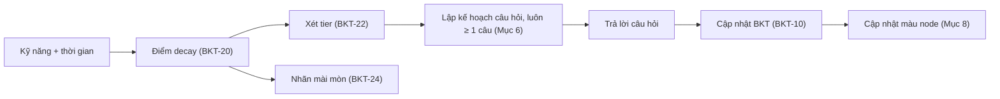
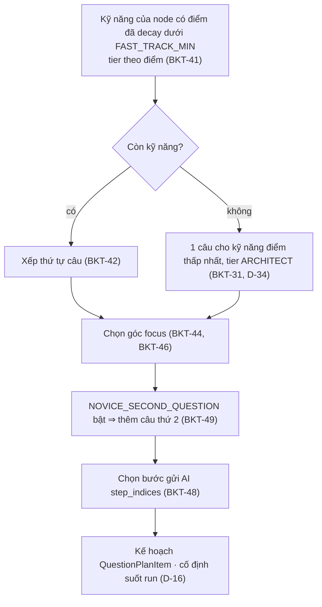

# 22 — BKT, KẾ HOẠCH CÂU HỎI & HÀM THUẦN DÙNG CHUNG

> Kiểu: `02_CONTRACTS.md` (5.3, 6). Hằng số: `CONFIG.*`. Nơi gọi: `03_API_VA_LUU_TRU.md` (5, 6.1–6.6). Luồng: `01_KIEN_TRUC_VA_LUONG.md` (5.3, 6, 7).
> Code: `src/lib/bkt-engine.ts` (BKT, decay, tier, mài mòn, kết quả) và `src/lib/plan.ts` (kế hoạch, màu node) — hàm thuần, dùng chung server và client (hiển thị + Offline, D-02). `src/server/progress.ts` gọi trong transaction. Test: `src/lib/*.test.ts` theo "Test bắt buộc".

## Đọc nhanh

- Lõi adaptive learning: BKT cập nhật `p_mastery` sau mỗi câu hỏi; decay theo thời gian không luyện.
- Hàm thuần: BKT và planner không I/O, không `Date.now()`, tính bằng `number`, chỉ làm tròn khi hiển thị (4 chữ số).
- 1 chế độ `LEARN`: hỏi kỹ năng chưa thạo; không có ôn tập (D-35).
- Không Fast-Track (D-34): mọi kỹ năng của node đã thạo (≥ `CONFIG.FAST_TRACK_MIN`) ⇒ vẫn hỏi 1 câu cho kỹ năng có điểm thấp nhất.
- Mài mòn (D-35, chỉ hiển thị): bậc của điểm đã decay thấp hơn bậc của điểm gốc ⇒ nhãn "đang mài mòn"; thanh kỹ năng nhạt dần liên tục; không có nút ôn.

Luồng thích ứng BKT:



| Mục | Nội dung | Hàm / File chính |
| :-: | :-- | :-- |
| 1–4 | Nguyên tắc, kỹ năng, BKT, decay, tier, mài mòn | `updateSkill`, `getDecayedMastery`, `tierOf`, `isDecaying` |
| 5–8 | Kế hoạch không rỗng, lập kế hoạch câu, kết quả & màu node | `planNodeQuestions`, `nodeStatusFromRuns` |
| 9–10 | Persona & Chữ ký TypeScript | `PERSONAS`, `src/lib/{bkt-engine,plan}.ts` |

---


## 1. Nguyên tắc chung

- **Hàm thuần:** Không I/O, không `Date.now()` / `Math.random()`. `now` truyền vào: server dùng đồng hồ server; client: `Date.now() + server_clock_offset_ms`.
- **Không làm tròn khi lưu (BKT-02):** Tính và lưu bằng `number` (double); `skill_states.p_mastery` là `double precision`. Chỉ làm tròn khi hiển thị (4 chữ số). Test so với kỳ vọng, sai số < 5·10⁻⁵.
- **Kỹ năng chưa có dòng `skill_states` (BKT-03):** đọc là `p_mastery = CONFIG.BKT_P_L0`, `practice_count = 0`, `correct_count = 0`, không decay.
- **Kỹ năng của node = `NodeAnalysis.skills`:** (qua kiểm `21`, giữ thứ tự). Không bảng dấu hiệu bằng code, không `primary_skill`: mỗi **câu** đúng 1 `skill`. Node thiếu phân tích (`analysis_failed`) ⇒ không lập kế hoạch (D-03).
- **Mọi quyết định dùng điểm đã decay tại `now`:** tier, chọn kỹ năng, thứ tự câu. Riêng nhãn mài mòn so bậc của điểm đã decay với bậc của `p_mastery` (BKT-24).

### 1.1. Ai gọi hàm nào

| Hàm | Server | Client |
| :-- | :-- | :-- |
| `planNodeQuestions` | `enrich-node` (`03` 6.1) | Offline |
| `outcomeOf`, `computeSkillChange` (qua `applyBkt`) | `evaluate-feynman`, `reveal` (`03` 6.2, 6.3) | Offline |
| `revertSkillChange` | `report-wrong` (`03` 6.4) | — |
| `nodeStatusFromRuns` | `finalizeRunIfDone`, `report-wrong` (`03` 6.4, 6.6) | Offline |
| `getDecayedMastery`, `tierOf`, `overallTier`, `isDecaying` | `GET /api/me` | Điểm, nhãn tier, mài mòn (`03` 5.2) |

---

## 2. Danh mục 16 kỹ năng (`SWE_SKILLS`, `02` Mục 2)

Chú giải trong prompt `analyze-node` (`20`) và tooltip UI. AI gắn kỹ năng kèm bằng chứng, code kiểm bằng chứng (`21`).

| Mã | Nghĩa |
| :-- | :-- |
| `HTTP_ROUTING` | Ánh xạ URL + HTTP method vào handler/controller; tham số đường dẫn, thứ tự route. |
| `DTO_VALIDATION` | Kiểm tra và ép kiểu dữ liệu đầu vào theo schema trước nghiệp vụ. |
| `AUTH_SECURITY` | Xác thực (ai gọi) và phân quyền (được làm gì): token, session, guard, bảo mật. |
| `DEPENDENCY_INJECTION` | Phụ thuộc truyền từ ngoài vào (constructor, container) thay vì khởi tạo bên trong. |
| `LAYERED_SEPARATION` | Mỗi tầng một trách nhiệm (route → service → repository); tầng trên không làm thay tầng dưới. |
| `DB_OPTIMIZATION` | Số lượng và hình dạng truy vấn: N+1, lặp truy vấn, chỉ mục, thừa cột/dòng. |
| `ASYNC_CONCURRENCY` | Bất đồng bộ và đồng thời: `await`, song song, thứ tự hoàn thành, race condition. |
| `TRANSACTION_INTEGRITY` | Nhiều thao tác ghi cùng thành công hoặc hoàn tác; khóa dòng, đọc-ghi tách rời. |
| `ERROR_HANDLING` | Bắt, chuyển đổi, lan truyền lỗi; mã lỗi trả ra ngoài; không nuốt lỗi. |
| `STATE_MANAGEMENT` | Trạng thái ứng dụng/miền ở đâu, ai được đổi, chuyển trạng thái hợp lệ. |
| `ALGORITHMIC_COMPLEXITY` | Độ phức tạp thời gian/bộ nhớ (Big-O), cấu trúc dữ liệu, tình huống biên. |
| `MEMORY_MANAGEMENT` | Vòng đời bộ nhớ và tài nguyên: stream, buffer, rò rỉ listener/kết nối, dữ liệu lớn. |
| `API_CONTRACT_DESIGN` | Hình dạng request/response, mã HTTP, tính nhất quán và tương thích API. |
| `CACHING_STRATEGY` | Lưu tạm kết quả: khi nào đọc/ghi cache, TTL, mất hiệu lực, dữ liệu cũ. |
| `RATE_LIMIT_RESILIENCE` | Chịu tải và chịu lỗi bên ngoài: giới hạn tần suất, backoff, timeout, circuit breaker. |
| `DATA_SERIALIZATION` | Chuyển đổi đối tượng ⇄ JSON/định dạng truyền: ánh xạ DTO, ẩn trường, kiểu ngày/số. |

---

## 3. Cập nhật BKT

### 3.1. Công thức

**BKT-10 — Quan sát theo `NodeOutcome`:**

| `NodeOutcome` | Quan sát | Guess $G^{*}$ | Transit $T$ |
| :-- | :-- | :-- | :-- |
| `PASS_FIRST` | Correct | `CONFIG.BKT_P_G` | `CONFIG.BKT_P_T_CORRECT` |
| `PASS_AFTER_HINT` | Correct | `CONFIG.BKT_P_G_HINT` | `CONFIG.BKT_P_T_CORRECT` |
| `FAILED` | Incorrect | `CONFIG.BKT_P_G` | `CONFIG.BKT_P_T_INCORRECT` |

**Hậu nghiệm.** Với $p$ = điểm tiên nghiệm (BKT-13), $S$ = `CONFIG.BKT_P_S`, $G$ = `CONFIG.BKT_P_G`:

$$P(L\mid \text{Correct}) = \frac{p\,(1-S)}{p\,(1-S) + (1-p)\,G^{*}} \qquad P(L\mid \text{Incorrect}) = \frac{p\,S}{p\,S + (1-p)\,(1-G)}$$

**Chuyển trạng thái và kẹp:**

$$p' = \operatorname{clamp}\Big(P(L\mid obs) + \big(1 - P(L\mid obs)\big)\,T,\ \ \texttt{BKT\_P\_MIN},\ \texttt{BKT\_P\_MAX}\Big)$$

Mẫu số luôn > 0 vì $S, G^{*} \in (0, 1)$.

### 3.2. `updateSkill`

- **Tiên nghiệm = điểm đã decay (BKT-13):** $p$ = `getDecayedMastery(state, now)`. Bằng chứng mới được tính trên trí nhớ thực tế tại `now`, kết quả ghi vào `p_mastery` gốc.
- **Trường kết quả:** `p_mastery` = $p'$; `last_practiced_at` = `max(state.last_practiced_at, now)` (thiếu state ⇒ `now`); `practice_count` + 1; `correct_count` + 1 nếu outcome là `PASS_*`.
- **1 câu xong = đúng 1 lần cập nhật cho đúng 1 kỹ năng (kỹ năng của câu):** Không cập nhật khi: lượt nộp chưa xong câu; `DROPPED`; phân tích node; đổi persona (`03` Mục 6.8). `practice_count` / `correct_count` đếm **số câu đã xong có cập nhật BKT**, không đếm lượt.

---

## 4. Decay, tier, mài mòn

- **`getDecayedMastery(state, now)` (BKT-20):** thiếu state ⇒ `CONFIG.BKT_P_L0`. Ngược lại, với $F$ = `CONFIG.DECAY_FLOOR`, $h$ = `CONFIG.DECAY_HALF_LIFE_DAYS`, $\Delta t = \max(0,\ now - 	exttt{last\_practiced\_at}) / 	exttt{MS\_PER\_DAY}$: $$\tilde p = \begin{cases} p & p \le F \\ F + (p - F)\cdot 2^{-\Delta t / h} & p > F \end{cases}$$ Điểm ≤ sàn giữ nguyên. Không dùng dạng `max(F, p·2^(−Δt/h))`.
- **Decay chỉ tính khi đọc:** không bao giờ ghi đè `p_mastery`. `p_mastery` chỉ đổi qua `updateSkill` hoặc `revertSkillChange`.
- **`tierOf(p)` (BKT-22):** xác định cho mọi `p`: `p < CONFIG.TIER_PRACTITIONER_MIN` ⇒ `NOVICE`; `p < CONFIG.TIER_ARCHITECT_MIN` ⇒ `PRACTITIONER`; còn lại (kể cả `p ≥ CONFIG.FAST_TRACK_MIN`) ⇒ `ARCHITECT`. Luôn gọi với điểm đã decay.
- **`overallTier(skills, now)` (BKT-23):** (D-20, chỉ hiển thị) = `tierOf` của **trung bình** điểm đã decay trên các kỹ năng có `practice_count > 0`; không có kỹ năng nào ⇒ `NOVICE`. Server tính khi trả `MeResponse`.
- **Mài mòn (BKT-24, D-35 — chỉ hiển thị):** `isDecaying(state, now)` = có state **và** `tierOf(getDecayedMastery(state, now)) < tierOf(state.p_mastery)` (thứ tự `NOVICE < PRACTITIONER < ARCHITECT`; ngưỡng `CONFIG.TIER_*`, không thêm hằng số). Ở bảng kỹ năng (`30`), mỗi kỹ năng có state: thanh kỹ năng vẽ theo điểm đã decay và nhạt dần **liên tục** theo tỉ lệ điểm đã decay / `p_mastery`; `isDecaying` ⇒ nhãn "đang mài mòn". Đã decay nhưng chưa rớt bậc ⇒ chỉ thanh nhạt, không nhãn. Không đổi trạng thái / màu node, không tạo run, không có nút ôn.
- **Hệ quả (BKT-25):** vừa cập nhật thì $\Delta t = 0$ ⇒ điểm decay = điểm gốc ⇒ cùng bậc ⇒ hết nhãn mài mòn. Điểm gốc ≤ `CONFIG.DECAY_FLOOR` không bao giờ mài mòn (BKT-20).
---

## 5. Kế hoạch không rỗng (D-34) & Capstone

- **Không Fast-Track (D-34):** không node nào được miễn thi; node chỉ `COMPLETED` / `FAILED` khi run `LEARN` xong (Mục 8). Mở node không cập nhật BKT.
- **Mọi kỹ năng đã thạo (BKT-31):** mọi kỹ năng của node có điểm đã decay ≥ `CONFIG.FAST_TRACK_MIN` ⇒ đúng 1 câu cho kỹ năng có điểm đã decay thấp nhất của node (hòa ⇒ `practice_count` nhỏ trước, rồi thứ tự phân tích), tier `ARCHITECT` (Mục 6, BKT-41). Áp như nhau cho node thường và Capstone (`is_capstone`, D-12).
- **Nhất quán (BKT-32):** `analysis.skills` khác rỗng ⇒ `planNodeQuestions` trả n ≥ 1 ⇒ `enrich-node` luôn tạo run (`03` Mục 5.3, 6.1).

---

## 6. `planNodeQuestions` — lập kế hoạch câu hỏi

Chạy ở server khi tạo run (D-02); cố định suốt run (D-16). Đầu vào: bản phân tích, `profile.skills`, `now`, `stepCount` (= `node.trace_steps.length`).



### 6.1. Chọn kỹ năng và tier

Ký hiệu: $\tilde p(k)$ = `getDecayedMastery(skills[k], now)`; `weak(k)` = có phần tử `analysis.weak_points` với `skill = k` (≤ 1, D-03); `ev(k)` = `step` của `k` trong `analysis.skills`; `archOk` = `analysis.strengths.length > 0` ∨ có mẫu trong `analysis.architecture.patterns` khác `OTHER`.

- **Chọn kỹ năng (BKT-41):** kỹ năng có $\tilde p < $ `CONFIG.FAST_TRACK_MIN`, tier = `tierOf(`$\tilde p$`)`. Hết kỹ năng ⇒ 1 câu cho kỹ năng nhỏ nhất theo ($\tilde p$ tăng, `practice_count` tăng, thứ tự phân tích), tier `ARCHITECT` (BKT-31, D-34). Không bao giờ trả `[]`.
- **Thứ tự câu (BKT-42):** (1) có điểm dở trước; (2) $\tilde p$ nhỏ trước; (3) `practice_count` nhỏ trước (thiếu = 0); (4) thứ tự trong `analysis.skills`. `question_index` = 1..n theo thứ tự này (câu 2 của BKT-49 nối sau cùng).
- Tier ghi vào kế hoạch là tier lúc lập; câu sau trong cùng run không đổi tier dù câu trước đổi điểm.

### 6.2. Góc hỏi `focus`

**Góc khởi đầu theo tier (BKT-44)** (hàng trên hỏi trước, BKT-42):

| | `NOVICE` | `PRACTITIONER` | `ARCHITECT` |
| :-- | :-- | :-- | :-- |
| Có điểm dở ở node | `WEAKNESS` — chỉ chỗ, đếm | `WEAKNESS` — hậu quả, cách sửa | `WEAKNESS` — tình huống biên |
| Không điểm dở | `FLOW` | `ARCHITECTURE` | `CHANGE` |

Độ sâu theo tier cho **mọi** góc: `NOVICE` = chỉ ra / lần theo cái có sẵn; `PRACTITIONER` = vì sao, hậu quả, cách sửa/dùng lại; `ARCHITECT` = tình huống biên, tải lớn, đồng thời, đánh đổi.

**Nghĩa của góc** (prompt đặt câu hỏi ở `20` dùng bảng này):

| `focus` | Lấy từ bản phân tích | Node lát cắt (`ARCHITECTURAL_DATA_FLOW`) | Node thuật toán (`ALGORITHMIC_CORE`) |
| :-- | :-- | :-- | :-- |
| `FLOW` | `steps` | Dữ liệu qua những hàm, file nào, thứ tự nào | Chạy tay với input nhỏ |
| `ARCHITECTURE` | `architecture` + `strengths` | Dùng lại gì, viết thêm gì, vì sao tách như vậy | Vì sao chọn cấu trúc dữ liệu / cách làm này |
| `WEAKNESS` | `weak_points` (+ `fix` từ `PRACTITIONER`) | Điểm dở của đúng kỹ năng đó | Big-O, tình huống biên |
| `CHANGE` | `steps` + `architecture` | Thay đổi cụ thể sửa file nào, file nào không sửa | Input đổi (cỡ, dạng) thì sao |

- **Chọn góc (BKT-46):** `weak(k)` ⇒ `WEAKNESS` (mỗi câu một điểm dở). Ngược lại đi vòng `FLOW → ARCHITECTURE → CHANGE → FLOW` từ góc khởi đầu theo tier, bỏ `ARCHITECTURE` khi `!archOk`, lấy góc đầu tiên **chưa** được câu không-`WEAKNESS` nào trước đó dùng; hết góc ⇒ lấy góc hợp lệ đầu tiên của vòng (cho phép trùng góc giữa kỹ năng khác nhau). Câu đổi góc vẫn giữ độ sâu theo tier.

### 6.3. Bước gửi AI `step_indices` (BKT-48)

Tập bước, lọc trong `1..stepCount`, bỏ trùng, sắp tăng dần, không bao giờ rỗng:

| `focus` | `step_indices` |
| :-- | :-- |
| `WEAKNESS` | `{ev(k)}` ∪ `{step của điểm dở của k}` |
| `FLOW` | Mọi bước `1..stepCount` |
| `CHANGE` | Mọi bước `1..stepCount` |
| `ARCHITECTURE` | `{1}` ∪ `{ev(k)}` ∪ `{step của mọi phần tử strengths}` |

Snippet các bước này gửi AI khi đặt câu hỏi (`03` 6.1). AI chấm không nhận code (D-36).

### 6.4. Cờ mở rộng

- **`CONFIG.NOVICE_SECOND_QUESTION` (BKT-49):** (mặc định `false`). Khi `true`: sau khi xếp xong câu thứ nhất, mỗi câu tier `NOVICE` thêm 1 câu cùng kỹ năng tier `NOVICE` nối cuối. Góc: từ `FLOW` nếu câu 1 là `WEAKNESS`, ngược lại từ góc kế tiếp trong vòng; bỏ `ARCHITECTURE` khi `!archOk`; khác góc câu 1; ưu tiên góc chưa dùng. Mỗi câu cập nhật BKT riêng; câu sau dùng điểm sau câu trước làm tiên nghiệm (BKT-13). Tối đa = 2 × `CONFIG.ANALYSIS_MAX_SKILLS`. Chỉ bật sau khi đo token thật (D-04).
- **`CONFIG.GAP_TARGETING`:** (mặc định `false`). `false` ⇒ không đọc/ghi dữ liệu dưới đây. Khi bật: (1) ý bắt buộc mang `PointTag` ∈ {`LOCATE`, `QUANTIFY`, `CONSEQUENCE`, `FIX`, `EDGE_CASE`, `FLOW`, `WHY`}; AI trả `must_have_tags` song song `must_have_points` (`21` kiểm); (2) `skill_states.gap_tags`: câu của `k` xong `ended_by = "ANSWER"` ⇒ ghi nhãn ý **chưa** `covered` hợp lệ (D-13) ở lượt cuối (đạt ⇒ rỗng; bỏ qua / `DROPPED` / Báo sai ⇒ giữ nguyên); (3) `QuestionPlanItem.target_tags` = `gap_tags(k)` ∩ nhãn hợp góc (`WEAKNESS`: LOCATE, QUANTIFY, CONSEQUENCE, FIX, EDGE_CASE · `FLOW`: FLOW, LOCATE · `ARCHITECTURE`: WHY, CONSEQUENCE · `CHANGE`: LOCATE, FLOW, CONSEQUENCE), rỗng ⇒ bỏ trường; (4) prompt yêu cầu ≥ 1 ý bắt buộc mang nhãn trong `target_tags`.

### 6.5. Bất biến đầu ra (test phải kiểm)

(a) Mọi `skill` thuộc `analysis.skills`; (b) cặp (`skill`, `focus`) không trùng; (c) câu 1 không trùng kỹ năng; (d) câu 1 `WEAKNESS` trước không-`WEAKNESS`; (e) `ARCHITECTURE` chỉ khi `archOk`; (f) `step_indices` tăng dần, ⊆ `1..stepCount`; (g) `analysis.skills` khác rỗng ⇒ n ≥ 1 (D-34); (h) cùng đầu vào ⇒ cùng đầu ra.

### 6.6. Mã giả

```typescript
const CYCLE: QuestionFocus[] = ["FLOW", "ARCHITECTURE", "CHANGE"];
const START: Record<LearnerTier, QuestionFocus> = { NOVICE: "FLOW", PRACTITIONER: "ARCHITECTURE", ARCHITECT: "CHANGE" };
const from = (f: QuestionFocus) => { const i = CYCLE.indexOf(f); return [...CYCLE.slice(i), ...CYCLE.slice(0, i)]; };

export function planNodeQuestions(analysis, skills, now, stepCount): QuestionPlanItem[] {
  const order = analysis.skills.map(s => s.skill);
  const p = (k: SWESkill) => getDecayedMastery(skills[k], now);
  const pc = (k: SWESkill) => skills[k]?.practice_count ?? 0;
  const weak = (k: SWESkill) => analysis.weak_points.some(w => w.skill === k);
  const archOk = analysis.strengths.length > 0 || analysis.architecture.patterns.some(x => x !== "OTHER");
  const valid = (f: QuestionFocus) => f !== "ARCHITECTURE" || archOk;
  const byWeakest = (a, b) => (p(a) - p(b)) || (pc(a) - pc(b)) || (order.indexOf(a) - order.indexOf(b));
  const byPlan = (a, b) => (Number(!weak(a)) - Number(!weak(b))) || byWeakest(a, b);    // BKT-42

  let picks: Array<{ skill: SWESkill; tier: LearnerTier }>;                              // BKT-41
  const open = order.filter(k => p(k) < CONFIG.FAST_TRACK_MIN);
  if (open.length > 0) picks = open.sort(byPlan).map(k => ({ skill: k, tier: tierOf(p(k)) }));
  else picks = [{ skill: [...order].sort(byWeakest)[0], tier: "ARCHITECT" }];            // BKT-31, D-34

  const items: Array<{ skill: SWESkill; tier: LearnerTier; focus: QuestionFocus }> = [];
  const usedNonWeak = new Set<QuestionFocus>();
  const take = (skill, tier, focus) => { items.push({ skill, tier, focus }); if (focus !== "WEAKNESS") usedNonWeak.add(focus); };
  const firstFree = (c: QuestionFocus[]) => c.find(f => !usedNonWeak.has(f)) ?? c[0];

  for (const { skill, tier } of picks) {
    if (weak(skill)) take(skill, tier, "WEAKNESS");                                        // BKT-46
    else take(skill, tier, firstFree(from(START[tier]).filter(valid)));
  }
  if (CONFIG.NOVICE_SECOND_QUESTION) {                                                     // BKT-49
    for (const first of items.filter(i => i.tier === "NOVICE")) {                         // filter() chụp danh sách trước khi thêm
      const start = first.focus === "WEAKNESS" ? START.NOVICE : from(first.focus as QuestionFocus)[1];
      take(first.skill, "NOVICE", firstFree(from(start).filter(valid).filter(f => f !== first.focus)));
    }
  }
  return items.map((it, i) => ({ question_index: i + 1, ...it, step_indices: stepsFor(it, analysis, stepCount) })); // BKT-48
}
```

---

## 7. Kết quả câu & cập nhật BKT

- **`outcomeOf(isPassed, attemptsUsed)` (BKT-60):** gọi khi câu xong bằng nộp bài (`ended_by = "ANSWER"`); `attemptsUsed` = số lượt tính (kể cả regex chặn, `GIVE_UP`). `!isPassed` ⇒ `FAILED`; `attemptsUsed = 1` ⇒ `PASS_FIRST`; còn lại ⇒ `PASS_AFTER_HINT`. Bỏ qua (`ended_by = "SKIP"`) ⇒ `FAILED`.
- **`computeSkillChange(skill, state, outcome, now)` (BKT-61):** `next = updateSkill(skill, state, outcome, now)`, `change = { skill, p_before: getDecayedMastery(state, now), p_after: next.p_mastery, outcome }`. `p_before` là **tiên nghiệm đã decay** (BKT-13).
- **`applyBkt(tx, userId, skill, outcome, now)` (BKT-62):** (`src/server/progress.ts`, trong transaction `03` Mục 6.2 / 6.3): (1) `insert … on conflict do nothing` mặc định (BKT-03, `last_practiced_at = now`) rồi `select … for update` dòng `(user_id, skill)`; (2) `computeSkillChange`; (3) upsert `next`; (4) trả `change`. Ghi `p_before` / `p_after` vào `RunQuestion` (`03` Mục 3.1).
- **`revertSkillChange(state, change)` (BKT-63):** Báo sai (D-22, `03` Mục 6.4): `Math.abs(state.p_mastery − change.p_after) > 1e-9` ⇒ `null`. Ngược lại `next` = state với `p_mastery = change.p_before`, `practice_count = max(0, practice_count − 1)`; giữ `last_practiced_at` và `correct_count`. Trả `{ next, change: { skill, p_before: change.p_after, p_after: change.p_before, outcome: change.outcome } }`.
- **Offline (D-02):** chạy trên RAM, không ghi Postgres; `now = Date.now() + server_clock_offset_ms`.

**Bảng sự kiện** (lượt tối đa: `CONFIG.MAX_ATTEMPTS_PER_QUESTION`):

| Sự kiện | Kết quả |
| :-- | :-- |
| Đạt ở lượt 1 | `PASS_FIRST` ⇒ BKT |
| Đạt ở lượt ≥ 2 | `PASS_AFTER_HINT` ⇒ BKT |
| Hết lượt | `FAILED` ⇒ BKT |
| "Bỏ qua câu này" (D-03) | `FAILED` ⇒ BKT |
| `DROPPED` | Không BKT |
| Báo sai câu `FAILED` | BKT-63 |

---

## 8. Màu node từ kết quả câu

Thời điểm ghi: `03` Mục 6.6. Hàm thuần `nodeStatusFromRuns(runs)` (chỉ xét run `LEARN` có `finished_at`):

- **Chưa có run `LEARN` xong (BKT-70):** `null` — suy ra theo `03` 5.1.
- **Có run `LEARN` xong ∧ ≥ 1 câu `outcome = "FAILED"`, `disputed = false` (BKT-71):** `FAILED`.
- **Có run `LEARN` xong, còn lại (BKT-72):** `COMPLETED`.

Cùng hàm cho: chốt run `LEARN` và Báo sai (câu 🚩 bỏ qua ⇒ có thể `FAILED → COMPLETED`). Câu `DROPPED` không tính. Không chuyển `FAILED → AVAILABLE` (D-16); không có ôn tập (D-35).

---

## 9. Persona demo (`PERSONAS`, `02` Mục 6; ghi bằng `03` Mục 6.8)

Persona ghi 16 dòng `skill_states` với `practice_count = correct_count = 1`, phá hòa ở BKT-42 về thứ tự phân tích. Giá trị số: T-PER.

| Persona | Điểm đã decay | Tier mọi kỹ năng | Minh họa |
| :-- | :-- | :-- | :-- |
| `NEWBIE` | = `CONFIG.BKT_P_L0` | `NOVICE` | Hỏi mọi kỹ năng: `WEAKNESS` chỉ chỗ / `FLOW` |
| `MID_LEVEL` | = điểm gốc | `PRACTITIONER` | `WEAKNESS` hậu quả + cách sửa / `ARCHITECTURE` |
| `SENIOR_RUSTY` | Dưới `CONFIG.TIER_PRACTITIONER_MIN`, thấp hơn điểm gốc | `NOVICE` | Điểm gốc cao vẫn bị hỏi `NOVICE`; mọi kỹ năng "đang mài mòn" (BKT-24) |

Demo mài mòn (D-35): chọn `SENIOR_RUSTY` ⇒ bảng kỹ năng hiện mọi kỹ năng nhạt dần + nhãn "đang mài mòn"; không có nút ôn, trạng thái node không đổi (`03` Mục 5.4).

---

## 10. Chữ ký TypeScript

```typescript
// ===== src/lib/bkt-engine.ts =====
import { CONFIG } from "@/contracts/config";
import type { SWESkill, LearnerTier, NodeOutcome, CognitiveSkillState,
              LearnerCognitiveProfile, SkillChange } from "@/contracts";
type SkillMap = LearnerCognitiveProfile["skills"];          // bí danh cục bộ
// Đổi mili-giây ⇒ ngày: dùng CONFIG.MS_PER_DAY

export function getDecayedMastery(state: CognitiveSkillState | undefined, now: number): number;                 // BKT-20
export function tierOf(p: number): LearnerTier;                                                                 // BKT-22
export function overallTier(skills: SkillMap, now: number): LearnerTier;                                        // BKT-23
export function updateSkill(skill: SWESkill, state: CognitiveSkillState | undefined,
                            outcome: NodeOutcome, now: number): CognitiveSkillState;                            // BKT-10..14
export function isDecaying(state: CognitiveSkillState | undefined, now: number): boolean;                       // BKT-24
export function outcomeOf(isPassed: boolean, attemptsUsed: number): NodeOutcome;                                // BKT-60
export function computeSkillChange(skill: SWESkill, state: CognitiveSkillState | undefined, outcome: NodeOutcome,
  now: number): { next: CognitiveSkillState; change: SkillChange };                                            // BKT-61
export function revertSkillChange(state: CognitiveSkillState, change: SkillChange):
  { next: CognitiveSkillState; change: SkillChange } | null;                                                    // BKT-63

// ===== src/lib/plan.ts =====
import type { NodeAnalysis, QuestionPlanItem, NodeRunView, QuestionState } from "@/contracts";
type RunLike = Pick<NodeRunView, "mode" | "started_at" | "finished_at"> & {
  questions: Array<Pick<QuestionState, "question_index" | "skill" | "focus" | "outcome" | "ended_by" | "disputed">>;
};                                                            // NodeRunView hoặc dòng node_runs (RunQuestion) đều khớp

export function planNodeQuestions(analysis: NodeAnalysis, skills: SkillMap, now: number,
  stepCount: number): QuestionPlanItem[];                                                                       // Mục 6, luôn ≥ 1 câu (D-34)
export function nodeStatusFromRuns(runs: RunLike[]): "COMPLETED" | "FAILED" | null;                             // BKT-70..72

// ===== src/server/progress.ts (có I/O) =====
export async function applyBkt(tx: DbTx, userId: string, skill: SWESkill, outcome: NodeOutcome,
  now: number): Promise<SkillChange>;                                                                           // BKT-62
```

---

## Test bắt buộc

Quy ước: `T0 = 1_774_000_000_000`; "@d" = `now = T0 + d·86_400_000` với state `last_practiced_at = T0`. CONFIG theo `02` 1 (`BKT_P_L0 = 0.25`, `P_G = 0.25`, `P_G_HINT = 0.50`, `P_S = 0.12`, `P_T_CORRECT = 0.08`, `P_T_INCORRECT = 0.03`, kẹp `[0.01, 0.99]`, `h = 14`, sàn `0.25`, tier `0.45 / 0.75`, đã thạo `0.92`). Sai số < 5·10⁻⁵.

### T-BKT — cập nhật 1 bước

| # | $p$ | `PASS_FIRST` | `PASS_AFTER_HINT` | `FAILED` |
| :-: | :-: | :-: | :-: | :-: |
| 1 | 0.2500 | 0.5399 → **0.5767** | 0.3697 → **0.4202** | 0.0506 → **0.0791** |
| 2 | 0.5767 | 0.8275 → **0.8413** | 0.7057 → **0.7292** | 0.1790 → **0.2036** |
| 3 | 0.8413 | 0.9491 → **0.9532** | 0.9032 → **0.9109** | 0.4589 → **0.4752** |
| 4 | 0.9000 | **0.9718** | **0.9454** | **0.6025** |
| 5 | 0.0791 | **0.2936** | **0.2008** | **0.0432** |
| 6 | 0.4092 | **0.7324** | **0.5854** | **0.1268** |
| 7 | 0.9900 | **0.9900** | **0.9900** | **0.9424** |
| 8 | 0.0100 | **0.1116** | **0.0961** | **0.0316** |

### T-CHAIN — chuỗi từ 0.25, đủ độ chính xác (BKT-02)

| Outcome lặp lại | Lần 1 | Lần 2 | Lần 3 | Lần 4 | Lần 5 |
| :-- | :-: | :-: | :-: | :-: | :-: |
| `PASS_FIRST` | 0.5767 | 0.8413 | 0.9532 | 0.9873 | 0.9900 |
| `PASS_AFTER_HINT` | 0.4202 | 0.5957 | **0.7439** | **0.8495** | 0.9159 |
| `FAILED` | 0.0791 | 0.0432 | 0.0369 | 0.0359 | 0.0357 |

Tier chuỗi `PASS_FIRST`: `NOVICE → PRACTITIONER → ARCHITECT → đã thạo (BKT-31)`. Làm tròn 4 chữ số sau mỗi bước ra 0.7440 / 0.8496 (sai BKT-02).

### T-UPD — `updateSkill` / `computeSkillChange`

| # | Đầu vào | Kỳ vọng |
| :-: | :-- | :-- |
| 1 | `updateSkill("DB_OPTIMIZATION", undefined, "PASS_AFTER_HINT", T0)` | `{ p_mastery: 0.4202, last_practiced_at: T0, practice_count: 1, correct_count: 1 }` |
| 2 | `updateSkill("AUTH_SECURITY", undefined, "FAILED", T0)` | `{ 0.0791, T0, 1, 0 }` |
| 3 | state `{ 0.9532, T0, 3, 3 }`, `PASS_FIRST` @30 | tiên nghiệm 0.4092 ⇒ `{ 0.7324, T0+30d, 4, 4 }` |
| 4 | state `{ 0.25, last_practiced_at: T0+5d, 1, 1 }`, `PASS_FIRST`, `now = T0` (đồng hồ lệch) | Δt = 0 ⇒ `p_mastery 0.5767`, `last_practiced_at = T0+5d` |
| 5 | `computeSkillChange("AUTH_SECURITY", undefined, "FAILED", T0)` | `change = { p_before: 0.2500, p_after: 0.0791, outcome: FAILED }` |
| 6 | state DB `{ 0.9532, T0, 3, 3 }`, `FAILED`, @30 | `p_before 0.4092`, `p_after 0.1268`, `next = { 0.1268, T0+30d, 4, 3 }` |

### T-REV — `revertSkillChange` (D-22)

| # | Đầu vào | Kỳ vọng |
| :-: | :-- | :-- |
| 1 | state `{ 0.0791…(đúng bằng p_after), T0, 1, 0 }`, change `{ p_before 0.25, p_after 0.0791…, FAILED }` | `next = { 0.25, T0, 0, 0 }`; `change = { p_before 0.0791, p_after 0.25 }` |
| 2 | Như #1 nhưng state đã thành 0.2008 (đã cập nhật lại sau đó) | `null` |

### T-DEC — `getDecayedMastery`

| # | `p_mastery` | Δt (ngày) | Kỳ vọng |
| :-: | :-: | :-: | :-: |
| 1 | 0.5767 | 9 | 0.4592 |
| 2 | 0.5767 | 10 | **0.4491** |
| 3 | 0.9532 | 25 | 0.4540 |
| 4 | 0.9532 | 26 | **0.4441** |
| 5 | 0.9532 | 30 | **0.4092** |
| 6 | 0.9500 | 30 | **0.4085** (`SENIOR_RUSTY`) |
| 7 | 0.8413 | 7 | 0.6681 |
| 8 | 0.4202 | 10 | 0.3537 |
| 9 | 0.0791 | 30 | **0.0791** |
| 10 | 0.2500 | 100 | 0.2500 |
| 11 | state thiếu | bất kỳ | 0.2500 |
| 12 | 0.9532 | `now` < `last_practiced_at` | 0.9532 |
### T-TIER — `tierOf` / `overallTier`

| Đầu vào | Kỳ vọng |
| :-- | :-- |
| `tierOf(0.01)`, `tierOf(0.4499)` | `NOVICE` |
| `tierOf(0.45)`, `tierOf(0.7499)` | `PRACTITIONER` |
| `tierOf(0.75)`, `tierOf(0.92)`, `tierOf(0.99)` | `ARCHITECT` |
| `overallTier({}, T0)`; `overallTier({ AUTH: { 0.25, T0, 0, 0 } }, T0)` | `NOVICE` (không có `practice_count > 0`) |
| `overallTier({ DB: 0.4202, LAYERED: 0.5767 } @0, T0)` | trung bình ≈ 0.498 ⇒ `PRACTITIONER` |

### T-MM — `isDecaying` (D-35)

| # | State | Kỳ vọng |
| :-: | :-- | :-- |
| 1 | 0.5767 @0 | `false` |
| 2 | 0.5767 @9 | `false` (đã decay 0.4592, vẫn `PRACTITIONER` — chưa rớt bậc) |
| 3 | 0.5767 @10 | `true` (0.4491: `PRACTITIONER` ⇒ `NOVICE`) |
| 4 | 0.8413 @7 | `true` (0.6681: `ARCHITECT` ⇒ `PRACTITIONER`) |
| 5 | 0.0791 @30 | `false` (≤ sàn) |
| 6 | State thiếu | `false` |

### T-PLAN — `planNodeQuestions` (`now = T0`, hồ sơ @0 trừ khi ghi khác)

Fixture:
- **N3** (`slice-product-list`, `stepCount 3`): skills `[DB_OPTIMIZATION@2, LAYERED_SEPARATION@1]`; weak `[DB_OPTIMIZATION@2]`; strengths `[@1]`; patterns `[LAYERED, REPOSITORY]`.
- **N2** (`slice-profile`, 3): skills `[AUTH_SECURITY@2, HTTP_ROUTING@1]`; weak `[AUTH_SECURITY@2]`; strengths `[@2]`; patterns `[MIDDLEWARE_CHAIN, LAYERED]`.
- **N5** (`slice-order-checkout`, Capstone, 3): skills `[TRANSACTION_INTEGRITY@3, DB_OPTIMIZATION@3, HTTP_ROUTING@1]`; weak `[TRANSACTION_INTEGRITY@3, DB_OPTIMIZATION@3]`; strengths `[@2]`; patterns `[LAYERED, MIDDLEWARE_CHAIN]`.
- **X** (2 bước): skills `[HTTP_ROUTING@1, DTO_VALIDATION@1, ERROR_HANDLING@2]`; weak `[]`; strengths `[@1]`; patterns `[LAYERED]`. **X′** = X với strengths `[]`, patterns `[OTHER]`.

Kết quả ghi `(index, skill, tier, focus, step_indices)`:

| # | Ca | Đầu vào | Kỳ vọng |
| :-: | :-- | :-- | :-- |
| P-A | Trace A | N3, hồ sơ rỗng | `(1, DB_OPTIMIZATION, NOVICE, WEAKNESS, [2])`, `(2, LAYERED_SEPARATION, NOVICE, FLOW, [1,2,3])` |
| P-B | Trace B | N2, `HTTP_ROUTING 0.5767` | `(1, AUTH_SECURITY, NOVICE, WEAKNESS, [2])`, `(2, HTTP_ROUTING, PRACTITIONER, ARCHITECTURE, [1,2])` |
| P-C | Capstone, 2 kỹ năng | N5, HTTP/DTO/AUTH 0.9532, DB 0.8413, TRANSACTION 0.5767 | `(1, TRANSACTION_INTEGRITY, PRACTITIONER, WEAKNESS, [3])`, `(2, DB_OPTIMIZATION, ARCHITECT, WEAKNESS, [3])` |
| P-D | Capstone đã thạo | N5, mọi kỹ năng 0.95, `practice_count 1` | `(1, TRANSACTION_INTEGRITY, ARCHITECT, WEAKNESS, [3])` |
| P-D2 | Kế hoạch rỗng ⇒ 1 câu (D-34) | N3 (node thường), DB 0.96, LAYERED 0.93, `practice_count 1` | `(1, LAYERED_SEPARATION, ARCHITECT, CHANGE, [1,2,3])` — kỹ năng điểm thấp nhất, không phải `[]` |
| P-G1 | Xoay góc | X, cả 3 kỹ năng 0.65 | `(1, HTTP_ROUTING, PRACTITIONER, ARCHITECTURE, [1])`, `(2, DTO_VALIDATION, PRACTITIONER, CHANGE, [1,2])`, `(3, ERROR_HANDLING, PRACTITIONER, FLOW, [1,2])` |
| P-G2 | Thiếu `ARCHITECTURE` | X′, như P-G1 | `(1, HTTP_ROUTING, …, CHANGE, [1,2])`, `(2, DTO_VALIDATION, …, FLOW, [1,2])`, `(3, ERROR_HANDLING, …, CHANGE, [1,2])` |
| P-H | `NOVICE_SECOND_QUESTION = true` | N3, hồ sơ rỗng | `(1, DB, NOVICE, WEAKNESS, [2])`, `(2, LAYERED, NOVICE, FLOW, [1,2,3])`, `(3, DB, NOVICE, ARCHITECTURE, [1,2])`, `(4, LAYERED, NOVICE, CHANGE, [1,2,3])` |

### T-OUT — `outcomeOf`

| `isPassed` | `attemptsUsed` | Kỳ vọng |
| :-: | :-: | :-- |
| true | 1 | `PASS_FIRST` |
| true | 2 | `PASS_AFTER_HINT` |
| true | 3 | `PASS_AFTER_HINT` |
| false | 3 | `FAILED` |

### T-RUN — `nodeStatusFromRuns`

| # | Các run | Trạng thái |
| :-: | :-- | :-- |
| 1 | `LEARN`: [AUTH WEAKNESS `FAILED`/ANSWER, HTTP ARCHITECTURE `PASS_FIRST`] | `FAILED` |
| 2 | #1 với câu AUTH `disputed = true` | `COMPLETED` |
| 3 | `LEARN`: [AUTH WEAKNESS `DROPPED`, HTTP ARCHITECTURE `PASS_FIRST`] | `COMPLETED` |
| 4 | Không có run | `null` |

### T-PER — persona (`now` = lúc ghi persona)

| Persona | Điểm decay | Tier | `isDecaying` | `PASS_FIRST` / `PASS_AFTER_HINT` / `FAILED` | `overallTier` |
| :-- | :-: | :-- | :-: | :-: | :-- |
| `NEWBIE` | 0.2500 | `NOVICE` | false | 0.5767 / 0.4202 / 0.0791 | `NOVICE` |
| `MID_LEVEL` | 0.6500 | `PRACTITIONER` | false | 0.8779 / 0.7845 / 0.2522 | `PRACTITIONER` |
| `SENIOR_RUSTY` | **0.4085** | `NOVICE` | **true** | 0.7319 / 0.5847 / 0.1265 | `NOVICE` |
