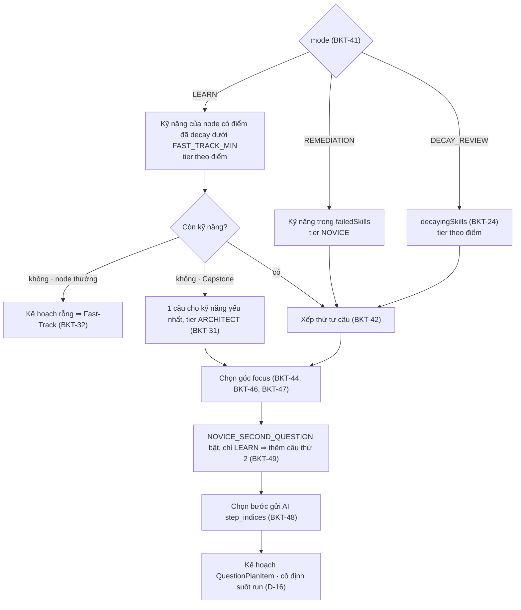

# 22 — BKT, KẾ HOẠCH CÂU HỎI & HÀM THUẦN DÙNG CHUNG

> Kiểu: `02_CONTRACTS.md` (Mục 5.3, 6). Hằng số: `CONFIG.*`. Nơi gọi: `03_API_VA_LUU_TRU.md` Mục 5, 6.1–6.6. Luồng: `01_KIEN_TRUC_VA_LUONG.md` Mục 5.3, 6, 7.
> **Trong repo thi:** `src/lib/bkt-engine.ts` (BKT, decay, tier, Fast-Track, viền cam, kết quả câu) và `src/lib/plan.ts` (kế hoạch câu hỏi, kỹ năng cần ôn, màu node) — **hàm thuần**, dùng chung server và client (hiển thị + Offline, D-02). `src/server/progress.ts` gọi chúng trong transaction. Test: `src/lib/*.test.ts` theo Mục "Test bắt buộc".

---

## 1. Nguyên tắc chung

| ID | Luật |
| :-- | :-- |
| **BKT-01** | **Hàm thuần.** Không I/O, không `Date.now()` / `Math.random()`. `now` (ms Unix) truyền vào: server dùng đồng hồ server; client dùng `Date.now() + server_clock_offset_ms`. |
| **BKT-02** | **Không làm tròn khi lưu.** Tính và lưu bằng `number` (double); `skill_states.p_mastery` là `double precision`. Chỉ làm tròn khi hiển thị (4 chữ số thập phân). Test so với giá trị kỳ vọng, sai số < 5·10⁻⁵. |
| **BKT-03** | **Kỹ năng chưa có dòng `skill_states`** ⇒ đọc là `p_mastery = CONFIG.BKT_P_L0`, `practice_count = 0`, `correct_count = 0`, không decay. |
| **BKT-04** | **Kỹ năng của node = `NodeAnalysis.skills`** (đã qua kiểm ở `21`, giữ nguyên thứ tự). Không có bảng dấu hiệu bằng code, không có `primary_skill` của node: mỗi **câu** có đúng 1 `skill`. Node không có bản phân tích (`analysis_failed`) ⇒ không lập kế hoạch, không Fast-Track, không viền cam (D-03 #20). |
| **BKT-05** | **Mọi quyết định dùng điểm đã decay tại `now`:** tier, Fast-Track, thứ tự câu, Capstone. Riêng vế "điểm gốc" của viền cam dùng `p_mastery`. |

### 1.1. Ai gọi hàm nào

| Hàm | Server | Client |
| :-- | :-- | :-- |
| `planNodeQuestions`, `remediationTargetsOf` | `enrich-node` (`03` Mục 6.1) | Offline |
| `isFastTrack` | `applyFastTrackCascade` (`03` Mục 5.3) | Offline |
| `outcomeOf`, `computeSkillChange` (qua `applyBkt`) | `evaluate-feynman`, `reveal`, `sync/replay` (`03` Mục 6.2, 6.3, 6.5) | Offline |
| `revertSkillChange` | `report-wrong` (`03` Mục 6.4) | — |
| `nodeStatusFromRuns` | `finalizeRunIfDone`, `report-wrong` (`03` Mục 6.4, 6.6) | Offline |
| `getDecayedMastery`, `tierOf`, `overallTier`, `hasDecayWarning` | `GET /api/me`, kiểm mode `DECAY_REVIEW` (`03` Mục 6.1) | Điểm, nhãn tier, viền cam (`03` Mục 5.2) |

---

## 2. Danh mục 16 kỹ năng (`SWE_SKILLS`, `02` Mục 2)

Nghĩa một dòng, dùng làm chú giải trong prompt `analyze-node` (`20`) và tooltip giao diện. AI gắn kỹ năng kèm bằng chứng (bước + tên), code kiểm bằng chứng (`21`).

| Mã | Nghĩa |
| :-- | :-- |
| `HTTP_ROUTING` | Ánh xạ URL + phương thức HTTP vào handler/controller; tham số đường dẫn, thứ tự đăng ký route. |
| `DTO_VALIDATION` | Kiểm tra và ép kiểu dữ liệu đầu vào theo schema trước khi vào nghiệp vụ. |
| `AUTH_SECURITY` | Xác thực (ai đang gọi) và phân quyền (được làm gì): token, session, guard, cách giữ bí mật. |
| `DEPENDENCY_INJECTION` | Phụ thuộc được truyền từ ngoài vào (constructor, container) thay vì tự khởi tạo bên trong. |
| `LAYERED_SEPARATION` | Mỗi tầng một trách nhiệm (route → service → repository); tầng trên không làm việc của tầng dưới. |
| `DB_OPTIMIZATION` | Số lượng và hình dạng truy vấn: N+1, truy vấn trong vòng lặp, chỉ mục, lấy dư cột/dòng. |
| `ASYNC_CONCURRENCY` | Bất đồng bộ và đồng thời: `await`, chạy song song, thứ tự hoàn thành, race condition. |
| `TRANSACTION_INTEGRITY` | Nhiều thao tác ghi cùng thành công hoặc cùng hoàn tác; khóa dòng, đọc-rồi-ghi tách rời. |
| `ERROR_HANDLING` | Bắt, chuyển đổi, lan truyền lỗi; mã lỗi trả ra ngoài; không nuốt lỗi. |
| `STATE_MANAGEMENT` | Trạng thái ứng dụng/miền nằm ở đâu, ai được đổi, chuyển trạng thái nào hợp lệ. |
| `ALGORITHMIC_COMPLEXITY` | Độ phức tạp thời gian/bộ nhớ (Big-O), lựa chọn cấu trúc dữ liệu, tình huống biên của thuật toán. |
| `MEMORY_MANAGEMENT` | Vòng đời bộ nhớ và tài nguyên: stream, buffer, rò rỉ listener/kết nối, dữ liệu lớn. |
| `API_CONTRACT_DESIGN` | Hình dạng request/response, mã trạng thái HTTP, tính nhất quán và tương thích của API. |
| `CACHING_STRATEGY` | Lưu tạm kết quả: khi nào đọc/ghi cache, TTL, làm mất hiệu lực, dữ liệu cũ. |
| `RATE_LIMIT_RESILIENCE` | Chịu tải và chịu lỗi bên ngoài: giới hạn tần suất, thử lại có backoff, timeout, circuit breaker. |
| `DATA_SERIALIZATION` | Chuyển đổi đối tượng ⇄ JSON/định dạng truyền: ánh xạ DTO, ẩn trường, kiểu ngày/số. |

---

## 3. Cập nhật BKT

### 3.1. Công thức

**BKT-10 — Quan sát theo `NodeOutcome`:**

| `NodeOutcome` | Quan sát | Guess $G^{*}$ | Transit $T$ |
| :-- | :-- | :-- | :-- |
| `PASS_FIRST` | Correct | `CONFIG.BKT_P_G` | `CONFIG.BKT_P_T_CORRECT` |
| `PASS_AFTER_HINT` | Correct | `CONFIG.BKT_P_G_HINT` | `CONFIG.BKT_P_T_CORRECT` |
| `FAILED` | Incorrect | `CONFIG.BKT_P_G` | `CONFIG.BKT_P_T_INCORRECT` |

**BKT-11 — Hậu nghiệm.** Với $p$ = điểm tiên nghiệm (BKT-13), $S$ = `CONFIG.BKT_P_S`, $G$ = `CONFIG.BKT_P_G`:

$$P(L\mid \text{Correct}) = \frac{p\,(1-S)}{p\,(1-S) + (1-p)\,G^{*}} \qquad P(L\mid \text{Incorrect}) = \frac{p\,S}{p\,S + (1-p)\,(1-G)}$$

**BKT-12 — Chuyển trạng thái và kẹp:**

$$p' = \operatorname{clamp}\Big(P(L\mid obs) + \big(1 - P(L\mid obs)\big)\,T,\ \ \texttt{BKT\_P\_MIN},\ \texttt{BKT\_P\_MAX}\Big)$$

Mẫu số luôn > 0 vì $S, G^{*} \in (0, 1)$.

### 3.2. `updateSkill`

| ID | Luật |
| :-- | :-- |
| **BKT-13** | **Tiên nghiệm = điểm đã decay:** $p$ = `getDecayedMastery(state, now)`. Bằng chứng mới được tính trên trí nhớ thực tế tại `now`, kết quả ghi vào `p_mastery` gốc. |
| **BKT-14** | **Trường kết quả:** `p_mastery` = $p'$; `last_practiced_at` = `max(state.last_practiced_at, now)` (thiếu state ⇒ `now`); `practice_count` + 1; `correct_count` + 1 nếu outcome là `PASS_*`. |
| **BKT-15** | **1 câu xong = đúng 1 lần cập nhật cho đúng 1 kỹ năng (kỹ năng của câu).** Không cập nhật khi: lượt nộp chưa làm câu xong; câu `DROPPED`; Fast-Track; `REMEDIATION` trượt (Mục 7); phân tích node; đổi persona (ghi thẳng, `03` Mục 6.8). `practice_count` / `correct_count` đếm **số câu đã xong có cập nhật BKT**, không đếm lượt nộp. |

---

## 4. Decay, tier, viền cam

| ID | Luật |
| :-- | :-- |
| **BKT-20** | **`getDecayedMastery(state, now)`** — thiếu state ⇒ `CONFIG.BKT_P_L0`. Ngược lại, với $F$ = `CONFIG.DECAY_FLOOR`, $h$ = `CONFIG.DECAY_HALF_LIFE_DAYS`, $\Delta t = \max(0,\ now - \texttt{last\_practiced\_at}) / \texttt{MS\_PER\_DAY}$: $$\tilde p = \begin{cases} p & p \le F \\ F + (p - F)\cdot 2^{-\Delta t / h} & p > F \end{cases}$$ Điểm ≤ sàn giữ nguyên (thời gian trôi không phải bằng chứng đã hiểu). Không dùng dạng `max(F, p·2^(−Δt/h))`. |
| **BKT-21** | **Decay chỉ tính khi đọc**, không bao giờ ghi đè `p_mastery`. `p_mastery` chỉ đổi qua `updateSkill` hoặc `revertSkillChange`. |
| **BKT-22** | **`tierOf(p)`** xác định cho mọi `p`: `p < CONFIG.TIER_PRACTITIONER_MIN` ⇒ `NOVICE`; `p < CONFIG.TIER_ARCHITECT_MIN` ⇒ `PRACTITIONER`; còn lại (kể cả `p ≥ CONFIG.FAST_TRACK_MIN`) ⇒ `ARCHITECT`. Luôn gọi với điểm đã decay. |
| **BKT-23** | **`overallTier(skills, now)`** (D-20, chỉ hiển thị) = `tierOf` của **trung bình** điểm đã decay trên các kỹ năng có `practice_count > 0`; không có kỹ năng nào ⇒ `NOVICE`. Server tính khi trả `MeResponse`. |
| **BKT-24** | **Kỹ năng "đang cam":** `decayingSkills(nodeSkills, skills, now)` = các kỹ năng `k` của node (giữ thứ tự bản phân tích) có state **và** `p_mastery(k) ≥ CONFIG.DECAY_WARNING_BELOW` **và** `getDecayedMastery(k, now) < CONFIG.DECAY_WARNING_BELOW` (D-03 #19). `hasDecayWarning` = danh sách đó khác rỗng. Người gọi chỉ áp cho node `COMPLETED` (gồm cả `is_auto_mastered`); node khác không có viền cam. |
| **BKT-25** | **Hệ quả (00 Mục 4 dòng #5, D-03 #19):** ngay sau một lần cập nhật, $\Delta t = 0$ ⇒ điểm đã decay = điểm gốc ⇒ kỹ năng đó hết cam. `DECAY_REVIEW` trượt ⇒ điểm gốc tụt dưới `CONFIG.DECAY_WARNING_BELOW` ⇒ viền cam biến mất, node vẫn XANH; kết quả trượt chỉ còn ở Tab 2 (`last_run`) và lịch sử (`mode = "DECAY_REVIEW"`). |

---

## 5. Fast-Track & Capstone

| ID | Luật |
| :-- | :-- |
| **BKT-30** | **`isFastTrack(nodeSkills, skills, now, isCapstone)`** = `!isCapstone` ∧ `nodeSkills.length > 0` ∧ mọi `k` có `getDecayedMastery(k, now) ≥ CONFIG.FAST_TRACK_MIN`. Điều kiện trạng thái node (đang `AVAILABLE`, chưa có run, đã có bản phân tích) do `applyFastTrackCascade` kiểm (`03` Mục 5.3). Fast-Track không cập nhật BKT. |
| **BKT-31** | **Capstone** (`is_capstone`, D-12) không bao giờ Fast-Track. Run `LEARN` của Capstone luôn có ≥ 1 câu: còn kỹ năng < `CONFIG.FAST_TRACK_MIN` ⇒ kế hoạch thường; mọi kỹ năng đều ≥ ngưỡng ⇒ đúng 1 câu cho kỹ năng yếu nhất, tier `ARCHITECT` (Mục 6, BKT-41). |
| **BKT-32** | **Nhất quán:** node không phải Capstone có `planNodeQuestions(…, "LEARN", false, …)` rỗng ⇔ `isFastTrack(…) = true`. `enrich-node` nhận kế hoạch rỗng ở `LEARN` ⇒ chạy Fast-Track (`03` Mục 6.1); kế hoạch rỗng ở `REMEDIATION` / `DECAY_REVIEW` ⇒ `ERR_MODE_NOT_ALLOWED`. |

---

## 6. `planNodeQuestions` — lập kế hoạch câu hỏi

Chạy ở server khi tạo run (D-02); kế hoạch cố định suốt run (D-16). Đầu vào: bản phân tích đã kiểm, `profile.skills`, `now`, `mode`, `node.is_capstone`, `failedSkills` (= `remediationTargetsOf` các run của node; mode khác truyền `[]`), `stepCount` (= `node.trace_steps.length`).



### 6.1. Chọn kỹ năng và tier

| ID | Luật |
| :-- | :-- |
| **BKT-40** | Ký hiệu: $\tilde p(k)$ = `getDecayedMastery(skills[k], now)`; `weak(k)` = có phần tử `analysis.weak_points` với `skill = k` (≤ 1, D-03 #23); `ev(k)` = `step` của `k` trong `analysis.skills` (bước bằng chứng); `archOk` = `analysis.strengths.length > 0` ∨ có mẫu trong `analysis.architecture.patterns` khác `OTHER`. |
| **BKT-41** | **Theo mode:** <br>• `LEARN`: các kỹ năng của node có $\tilde p < $ `CONFIG.FAST_TRACK_MIN`, tier = `tierOf(`$\tilde p$`)`. Không còn kỹ năng nào ⇒ không Capstone: `[]`; Capstone: 1 câu cho kỹ năng nhỏ nhất theo ($\tilde p$ tăng, `practice_count` tăng, thứ tự bản phân tích), tier `ARCHITECT`. <br>• `REMEDIATION` (00 Mục 4 dòng #4): chỉ các kỹ năng trong `failedSkills` (đã trượt ở run `LEARN`, không 🚩, chưa ôn đạt — BKT-51), tier luôn `NOVICE`. <br>• `DECAY_REVIEW` (00 Mục 4 dòng #5): chỉ `decayingSkills(…)` (BKT-24), tier = `tierOf(`$\tilde p$`)`. |
| **BKT-42** | **Thứ tự câu** (so lần lượt, hòa mới xét tiêu chí sau): (1) kỹ năng có điểm dở trước; (2) $\tilde p$ nhỏ trước; (3) `practice_count` nhỏ trước (thiếu state = 0); (4) thứ tự trong `analysis.skills`. `question_index` = 1..n theo thứ tự này (câu thứ 2 của BKT-49 nối sau cùng). |
| **BKT-43** | Tier ghi vào kế hoạch là tier lúc lập kế hoạch; câu sau trong cùng run **không** đổi tier dù câu trước vừa làm đổi điểm. |

### 6.2. Góc hỏi `focus` (00 Mục 4 dòng #26)

**BKT-44 — Góc khởi đầu theo tier** (hàng trên hỏi trước, BKT-42):

| | `NOVICE` | `PRACTITIONER` | `ARCHITECT` |
| :-- | :-- | :-- | :-- |
| Kỹ năng có điểm dở ở node | `WEAKNESS` — chỉ chỗ, đếm | `WEAKNESS` — hậu quả, cách sửa | `WEAKNESS` — tình huống biên |
| Không có điểm dở | `FLOW` | `ARCHITECTURE` | `CHANGE` |

Độ sâu theo tier áp cho **mọi** góc: `NOVICE` = chỉ ra / lần theo cái đang có; `PRACTITIONER` = vì sao, hậu quả, cách sửa hoặc cách dùng lại; `ARCHITECT` = tình huống biên, tải lớn, đồng thời, đánh đổi.

**BKT-45 — Nghĩa của góc** (prompt đặt câu hỏi ở `20` dùng bảng này):

| `focus` | Lấy từ bản phân tích | Node lát cắt (`ARCHITECTURAL_DATA_FLOW`) | Node thuật toán (`ALGORITHMIC_CORE`) |
| :-- | :-- | :-- | :-- |
| `FLOW` | `steps` | Dữ liệu đi qua những hàm, file nào, theo thứ tự nào | Chạy tay với input nhỏ |
| `ARCHITECTURE` | `architecture` + `strengths` | Dùng lại được gì, viết thêm gì, vì sao tách như vậy | Vì sao chọn cấu trúc dữ liệu / cách làm này |
| `WEAKNESS` | `weak_points` (+ `fix` từ `PRACTITIONER`) | Điểm dở của đúng kỹ năng đó | Big-O, tình huống biên |
| `CHANGE` | `steps` + `architecture` | Một thay đổi cụ thể thì sửa file nào, file nào không phải sửa | Input đổi (cỡ, dạng) thì sao |

| ID | Luật |
| :-- | :-- |
| **BKT-46** | **`LEARN` và `DECAY_REVIEW`:** `weak(k)` ⇒ `WEAKNESS` (nhiều câu `WEAKNESS` trong 1 node được phép, mỗi câu một điểm dở). Ngược lại đi vòng `FLOW → ARCHITECTURE → CHANGE → FLOW` bắt đầu từ góc khởi đầu theo tier, bỏ `ARCHITECTURE` khi `!archOk`, lấy góc đầu tiên **chưa** được câu không-`WEAKNESS` nào trước đó trong kế hoạch dùng; hết góc ⇒ lấy góc hợp lệ đầu tiên của vòng (cho phép trùng góc giữa 2 kỹ năng khác nhau). Câu bị đẩy sang góc khác vẫn hỏi ở độ sâu theo tier của nó. |
| **BKT-47** | **`REMEDIATION`:** ứng viên = `[WEAKNESS nếu weak(k)] + [FLOW, ARCHITECTURE, CHANGE]`, bỏ `ARCHITECTURE` khi `!archOk`, **bắt buộc** khác góc của câu gần nhất (`used_focuses` cuối cùng). Chọn: (a) ứng viên đầu tiên không có trong `used_focuses` và (nếu không phải `WEAKNESS`) chưa dùng trong run; nếu không có ⇒ (b) ứng viên đầu tiên không có trong `used_focuses`; nếu không có ⇒ (c) ứng viên đầu tiên. Luôn có ứng viên vì `FLOW` và `CHANGE` luôn hợp lệ. Prompt nhận câu cũ qua `previous_questions` (`20`). |

### 6.3. Bước gửi AI `step_indices`

**BKT-48** — tập bước, lọc trong `1..stepCount`, bỏ trùng, sắp tăng dần, không bao giờ rỗng:

| `focus` | `step_indices` |
| :-- | :-- |
| `WEAKNESS` | `{ev(k)}` ∪ `{step của điểm dở của k}` |
| `FLOW` | Mọi bước `1..stepCount` |
| `CHANGE` | Mọi bước `1..stepCount` |
| `ARCHITECTURE` | `{1}` ∪ `{ev(k)}` ∪ `{step của mọi phần tử strengths}` |

`code_context` của token = snippet các bước này (`03` Mục 6.1).

### 6.4. Cờ mở rộng

| ID | Luật |
| :-- | :-- |
| **BKT-49** | **`CONFIG.NOVICE_SECOND_QUESTION` (00 Mục 4 dòng #27, mặc định `false`).** Khi `true`, chỉ ở `LEARN`: sau khi xếp xong các câu thứ nhất, với mỗi câu thứ nhất có tier `NOVICE` (theo thứ tự kế hoạch) thêm 1 câu cùng kỹ năng, tier `NOVICE`, nối vào cuối. Góc: bắt đầu từ `FLOW` nếu câu thứ nhất là `WEAKNESS`, ngược lại từ góc kế tiếp của câu thứ nhất trong vòng; bỏ `ARCHITECTURE` khi `!archOk`; **bắt buộc** khác góc câu thứ nhất (khác khóa cache); ưu tiên góc chưa được câu không-`WEAKNESS` nào dùng, hết thì lấy ứng viên đầu tiên. Mỗi câu cập nhật BKT riêng; câu sau dùng điểm sau câu trước làm tiên nghiệm (BKT-13). Số câu tối đa = 2 × `CONFIG.ANALYSIS_MAX_SKILLS`. Chỉ bật sau khi đo token thật (D-04). |
| **BKT-50** | **`CONFIG.GAP_TARGETING` (00 Mục 4 dòng #28, mặc định `false`).** `false` ⇒ không đọc/ghi dữ liệu nào dưới đây. Khi bật cần (chưa có trong `02`): (1) mỗi ý bắt buộc mang 1 nhãn `PointTag` ∈ {`LOCATE` chỉ chỗ, `QUANTIFY` định lượng, `CONSEQUENCE` hậu quả, `FIX` cách sửa, `EDGE_CASE` tình huống biên, `FLOW` luồng, `WHY` vì sao}; AI trả `must_have_tags` song song `must_have_points` (`21` kiểm cùng độ dài, thuộc tập); (2) `skill_states.gap_tags`: câu của `k` xong với `ended_by = "ANSWER"` ⇒ ghi nhãn các ý **chưa** `covered` hợp lệ (D-13) ở lượt cuối (đạt ⇒ rỗng); bỏ qua / `DROPPED` / Báo sai ⇒ giữ nguyên; (3) `QuestionPlanItem.target_tags` = `gap_tags(k)` ∩ nhãn hợp góc (`WEAKNESS`: LOCATE, QUANTIFY, CONSEQUENCE, FIX, EDGE_CASE · `FLOW`: FLOW, LOCATE · `ARCHITECTURE`: WHY, CONSEQUENCE · `CHANGE`: LOCATE, FLOW, CONSEQUENCE), rỗng ⇒ bỏ trường, không đổi kỹ năng/tier/góc; (4) prompt yêu cầu ≥ 1 ý bắt buộc mang nhãn trong `target_tags`; khóa cache câu hỏi thêm `target_tags` đã sort. |

### 6.5. Kỹ năng cần ôn — `remediationTargetsOf(runs)`

**BKT-51.** Chỉ xét run có `finished_at`, sắp theo `started_at`:
1. Không có run `LEARN` ⇒ `[]`.
2. Ứng viên = kỹ năng của các câu trong run `LEARN` có `outcome = "FAILED"` và `disputed = false` (theo `question_index`, bỏ trùng). Câu `DROPPED` không phải câu trượt.
3. Bỏ kỹ năng đã có câu `PASS_*` trong một run `REMEDIATION` bất kỳ.
4. Mỗi kỹ năng còn lại ⇒ `RemediationTarget` (`02` Mục 5.3) với `used_focuses` = `focus` của mọi câu kỹ năng đó trong mọi run của node có `ended_by ≠ "DROPPED"`, theo (`started_at`, `question_index`); phần tử cuối = câu gần nhất.

### 6.6. Bất biến đầu ra (test phải kiểm)

**BKT-52.** (a) Mọi `skill` thuộc `analysis.skills`; (b) cặp (`skill`, `focus`) không trùng; (c) câu thứ nhất của các kỹ năng không trùng kỹ năng; (d) câu thứ nhất `WEAKNESS` đứng trước câu thứ nhất không-`WEAKNESS` (trừ `REMEDIATION`, nơi góc theo BKT-47); (e) `ARCHITECTURE` chỉ xuất hiện khi `archOk`; (f) `step_indices` khác rỗng, tăng dần, ⊆ `1..stepCount`; (g) `LEARN` + Capstone ⇒ n ≥ 1; (h) cùng đầu vào ⇒ cùng đầu ra.

### 6.7. Mã giả

```typescript
const CYCLE: QuestionFocus[] = ["FLOW", "ARCHITECTURE", "CHANGE"];
const START: Record<LearnerTier, QuestionFocus> = { NOVICE: "FLOW", PRACTITIONER: "ARCHITECTURE", ARCHITECT: "CHANGE" };
const from = (f: QuestionFocus) => { const i = CYCLE.indexOf(f); return [...CYCLE.slice(i), ...CYCLE.slice(0, i)]; };

export function planNodeQuestions(analysis, skills, now, mode, isCapstone, failedSkills, stepCount): QuestionPlanItem[] {
  const order = analysis.skills.map(s => s.skill);
  const p = (k: SWESkill) => getDecayedMastery(skills[k], now);
  const pc = (k: SWESkill) => skills[k]?.practice_count ?? 0;
  const weak = (k: SWESkill) => analysis.weak_points.some(w => w.skill === k);
  const archOk = analysis.strengths.length > 0 || analysis.architecture.patterns.some(x => x !== "OTHER");
  const valid = (f: QuestionFocus) => f !== "ARCHITECTURE" || archOk;
  const byWeakest = (a, b) => (p(a) - p(b)) || (pc(a) - pc(b)) || (order.indexOf(a) - order.indexOf(b));
  const byPlan = (a, b) => (Number(!weak(a)) - Number(!weak(b))) || byWeakest(a, b);    // BKT-42

  let picks: Array<{ skill: SWESkill; tier: LearnerTier }>;                              // BKT-41
  if (mode === "LEARN") {
    const open = order.filter(k => p(k) < CONFIG.FAST_TRACK_MIN);
    if (open.length > 0) picks = open.sort(byPlan).map(k => ({ skill: k, tier: tierOf(p(k)) }));
    else if (isCapstone) picks = [{ skill: [...order].sort(byWeakest)[0], tier: "ARCHITECT" }];
    else return [];
  } else if (mode === "DECAY_REVIEW") {
    picks = decayingSkills(order, skills, now).sort(byPlan).map(k => ({ skill: k, tier: tierOf(p(k)) }));
  } else {
    picks = failedSkills.map(t => t.skill).filter(k => order.includes(k)).sort(byPlan).map(k => ({ skill: k, tier: "NOVICE" }));
  }

  const items: Array<{ skill: SWESkill; tier: LearnerTier; focus: QuestionFocus }> = [];
  const usedNonWeak = new Set<QuestionFocus>();
  const take = (skill, tier, focus) => { items.push({ skill, tier, focus }); if (focus !== "WEAKNESS") usedNonWeak.add(focus); };
  const firstFree = (c: QuestionFocus[]) => c.find(f => !usedNonWeak.has(f)) ?? c[0];

  for (const { skill, tier } of picks) {
    if (mode === "REMEDIATION") {                                                          // BKT-47
      const used = failedSkills.find(t => t.skill === skill)!.used_focuses;
      const c = [...(weak(skill) ? ["WEAKNESS" as const] : []), ...CYCLE].filter(valid).filter(f => f !== used[used.length - 1]);
      take(skill, tier, c.find(f => !used.includes(f) && (f === "WEAKNESS" || !usedNonWeak.has(f)))
                     ?? c.find(f => !used.includes(f)) ?? c[0]);
    } else if (weak(skill)) take(skill, tier, "WEAKNESS");                                 // BKT-46
    else take(skill, tier, firstFree(from(START[tier]).filter(valid)));
  }
  if (mode === "LEARN" && CONFIG.NOVICE_SECOND_QUESTION) {                                 // BKT-49
    for (const first of items.filter(i => i.tier === "NOVICE")) {                         // filter() chụp danh sách trước khi thêm
      const start = first.focus === "WEAKNESS" ? START.NOVICE : from(first.focus as QuestionFocus)[1];
      take(first.skill, "NOVICE", firstFree(from(start).filter(valid).filter(f => f !== first.focus)));
    }
  }
  return items.map((it, i) => ({ question_index: i + 1, ...it, step_indices: stepsFor(it, analysis, stepCount) })); // BKT-48
}
```

---

## 7. Kết quả câu & cập nhật BKT theo mode

| ID | Luật |
| :-- | :-- |
| **BKT-60** | **`outcomeOf(isPassed, attemptsUsed, mode)`** — gọi khi câu xong bằng nộp bài (`ended_by = "ANSWER"`); `attemptsUsed` = số lượt đã tính, kể cả lượt này (lượt bị regex chặn, `GIVE_UP` đều tính). `!isPassed` ⇒ `FAILED`; `mode = "REMEDIATION"` ⇒ `PASS_AFTER_HINT`; `attemptsUsed = 1` ⇒ `PASS_FIRST`; còn lại ⇒ `PASS_AFTER_HINT`. Bỏ qua (`ended_by = "SKIP"`) ⇒ `FAILED`, không qua hàm này. |
| **BKT-61** | **`computeSkillChange(skill, state, outcome, mode, now)`** — `mode = "REMEDIATION"` ∧ `outcome = "FAILED"` ⇒ `null` (không cập nhật). Ngược lại `next = updateSkill(skill, state, outcome, now)`, `change = { skill, p_before: getDecayedMastery(state, now), p_after: next.p_mastery, outcome }`. `p_before` là **tiên nghiệm đã decay** (BKT-13), không phải `p_mastery` cũ. |
| **BKT-62** | **`applyBkt(tx, userId, skill, outcome, mode, now)`** (`src/server/progress.ts`, trong transaction `03` Mục 6.2 bước 4 / 6.3): (1) `REMEDIATION` ∧ `FAILED` ⇒ trả `null`, không chạm DB; (2) `insert … on conflict do nothing` dòng mặc định (BKT-03, `last_practiced_at = now`) rồi `select … for update` dòng `(user_id, skill)`; (3) `computeSkillChange`; (4) upsert `next`; (5) trả `change`. Người gọi ghi `p_before` / `p_after` vào `RunQuestion` (`03` Mục 3.1). |
| **BKT-63** | **`revertSkillChange(state, change)`** — Báo sai (D-22, `03` Mục 6.4): nếu `Math.abs(state.p_mastery − change.p_after) > 1e-9` ⇒ `null` (đã có cập nhật khác, không hoàn). Ngược lại `next` = state với `p_mastery = change.p_before`, `practice_count = max(0, practice_count − 1)`; **giữ** `last_practiced_at` (đúng vì `p_before` đã là điểm decay tại thời điểm đó) và `correct_count` (chỉ câu `FAILED` được báo sai). Trả `{ next, change: { skill, p_before: change.p_after, p_after: change.p_before, outcome: change.outcome } }`. Câu `REMEDIATION` trượt có `p_before = null` ⇒ chỉ đánh 🚩, không hoàn. |
| **BKT-64** | **Offline (D-02):** client chạy cùng các hàm trên hồ sơ trong RAM, không ghi Postgres; `now = Date.now() + server_clock_offset_ms`. |
| **BKT-65** | **`sync/replay`:** áp lại với `now` = thời điểm server áp biên nhận (không dùng `issued_at`); tiên nghiệm tính trên điểm hiện tại (`03` Mục 6.5). |

**BKT-66 — Bảng theo mode** (lượt tối đa: `CONFIG.MAX_ATTEMPTS_PER_QUESTION`; `REMEDIATION`: `CONFIG.REMEDIATION_MAX_ATTEMPTS`):

| Sự kiện | `LEARN` | `DECAY_REVIEW` | `REMEDIATION` |
| :-- | :-- | :-- | :-- |
| Đạt ở lượt 1 | `PASS_FIRST` ⇒ BKT | `PASS_FIRST` ⇒ BKT | `PASS_AFTER_HINT` ⇒ BKT |
| Đạt ở lượt ≥ 2 | `PASS_AFTER_HINT` ⇒ BKT | `PASS_AFTER_HINT` ⇒ BKT | `PASS_AFTER_HINT` ⇒ BKT |
| Hết lượt | `FAILED` ⇒ BKT | `FAILED` ⇒ BKT | `FAILED`, **không** BKT |
| "Bỏ qua câu này" (D-03 #15) | `FAILED` ⇒ BKT | `FAILED` ⇒ BKT | `FAILED`, **không** BKT |
| `DROPPED` | Không BKT | Không BKT | Không BKT |
| Báo sai câu `FAILED` | BKT-63 | BKT-63 | Chỉ 🚩 |
| Ảnh hưởng màu node | Có (Mục 8) | **Không** | Có (Mục 8) |

---

## 8. Màu node từ kết quả câu

Transaction và thời điểm ghi: `03` Mục 6.6. Hàm thuần `nodeStatusFromRuns(runs)` (chỉ xét run có `finished_at`):

| ID | Điều kiện | Trạng thái |
| :-- | :-- | :-- |
| **BKT-70** | Chưa có run `LEARN` xong | `null` — suy ra theo `03` Mục 5.1 (chưa học, hoặc Fast-Track đã ghi) |
| **BKT-71** | Có run `LEARN` xong ∧ `remediationTargetsOf(runs)` khác rỗng | `FAILED` (≥ 1 câu trượt, không 🚩, chưa ôn đạt) |
| **BKT-72** | Có run `LEARN` xong ∧ `remediationTargetsOf(runs)` rỗng | `COMPLETED` |
| **BKT-73** | Run `DECAY_REVIEW` | Không bao giờ đổi trạng thái (không tạo hay xóa mục tiêu ôn) |

Cùng một hàm cho: chốt run `LEARN`, chốt run `REMEDIATION` (ôn đạt hết kỹ năng đã trượt ⇒ `COMPLETED`; còn ⇒ giữ `FAILED`, BKT không trừ thêm) và Báo sai (câu 🚩 bị bỏ qua ⇒ có thể `FAILED → COMPLETED`). Câu `DROPPED` không tính. Không có chuyển `FAILED → AVAILABLE` (D-16).

---

## 9. Persona demo (`PERSONAS`, `02` Mục 6; ghi bằng `03` Mục 6.8)

**BKT-80.** Persona ghi đủ 16 dòng `skill_states` với `practice_count = correct_count = 1`, nên phá hòa ở BKT-42 rơi về thứ tự bản phân tích. Giá trị số: T-PER.

| Persona | Điểm đã decay | Tier mọi kỹ năng | Fast-Track node thường | Minh họa |
| :-- | :-- | :-- | :-- | :-- |
| `NEWBIE` | = `CONFIG.BKT_P_L0` | `NOVICE` | Không | Hỏi mọi kỹ năng: `WEAKNESS` chỉ chỗ / `FLOW` |
| `MID_LEVEL` | = điểm gốc | `PRACTITIONER` | Không | `WEAKNESS` hậu quả + cách sửa / `ARCHITECTURE` |
| `SENIOR_RUSTY` | Dưới `CONFIG.TIER_PRACTITIONER_MIN` (điểm gốc ≥ `CONFIG.DECAY_WARNING_BELOW`) | `NOVICE` | **Không bao giờ** | Phai trí nhớ: điểm gốc cao vẫn bị hỏi mức `NOVICE`; mọi kỹ năng ở trạng thái cam (BKT-24) |
| `SENIOR_ACTIVE` | = điểm gốc ≥ `CONFIG.FAST_TRACK_MIN` | `ARCHITECT` | **Có**, ngay khi node mở và có bản phân tích | Fast-Track dây chuyền; Capstone vẫn hỏi 1 câu `ARCHITECT` (BKT-31) |

Demo viền cam: `SENIOR_ACTIVE` (node thường Fast-Track ⇒ `COMPLETED`) ⇒ đổi sang `SENIOR_RUSTY` ⇒ `POST /api/ingest { session_id }` (`03` Mục 5.4) ⇒ node `COMPLETED` hiện viền cam ⇒ "Ôn bài" (`DECAY_REVIEW`, `NOVICE`).

---

## 10. Chữ ký TypeScript

```typescript
// ===== src/lib/bkt-engine.ts =====
import { CONFIG } from "@/contracts/config";
import type { SWESkill, LearnerTier, NodeOutcome, RunMode, CognitiveSkillState,
              LearnerCognitiveProfile, SkillChange } from "@/contracts";
type SkillMap = LearnerCognitiveProfile["skills"];          // bí danh cục bộ
// Đổi mili-giây ⇒ ngày: dùng CONFIG.MS_PER_DAY

export function getDecayedMastery(state: CognitiveSkillState | undefined, now: number): number;                 // BKT-20
export function tierOf(p: number): LearnerTier;                                                                 // BKT-22
export function overallTier(skills: SkillMap, now: number): LearnerTier;                                        // BKT-23
export function updateSkill(skill: SWESkill, state: CognitiveSkillState | undefined,
                            outcome: NodeOutcome, now: number): CognitiveSkillState;                            // BKT-10..14
export function decayingSkills(nodeSkills: SWESkill[], skills: SkillMap, now: number): SWESkill[];              // BKT-24
export function hasDecayWarning(nodeSkills: SWESkill[], skills: SkillMap, now: number): boolean;                // BKT-24
export function isFastTrack(nodeSkills: SWESkill[], skills: SkillMap, now: number, isCapstone: boolean): boolean; // BKT-30
export function outcomeOf(isPassed: boolean, attemptsUsed: number, mode: RunMode): NodeOutcome;                 // BKT-60
export function computeSkillChange(skill: SWESkill, state: CognitiveSkillState | undefined, outcome: NodeOutcome,
  mode: RunMode, now: number): { next: CognitiveSkillState; change: SkillChange } | null;                       // BKT-61
export function revertSkillChange(state: CognitiveSkillState, change: SkillChange):
  { next: CognitiveSkillState; change: SkillChange } | null;                                                    // BKT-63

// ===== src/lib/plan.ts =====
import type { NodeAnalysis, QuestionPlanItem, RemediationTarget, NodeRunView, QuestionState } from "@/contracts";
type RunLike = Pick<NodeRunView, "mode" | "started_at" | "finished_at"> & {
  questions: Array<Pick<QuestionState, "question_index" | "skill" | "focus" | "outcome" | "ended_by" | "disputed">>;
};                                                            // NodeRunView hoặc dòng node_runs (RunQuestion) đều khớp

export function planNodeQuestions(analysis: NodeAnalysis, skills: SkillMap, now: number, mode: RunMode,
  isCapstone: boolean, failedSkills: RemediationTarget[], stepCount: number): QuestionPlanItem[];               // Mục 6
export function remediationTargetsOf(runs: RunLike[]): RemediationTarget[];                                     // BKT-51
export function nodeStatusFromRuns(runs: RunLike[]): "COMPLETED" | "FAILED" | null;                             // BKT-70..73

// ===== src/server/progress.ts (có I/O) =====
export async function applyBkt(tx: DbTx, userId: string, skill: SWESkill, outcome: NodeOutcome,
  mode: RunMode, now: number): Promise<SkillChange | null>;                                                     // BKT-62
```

---

## Test bắt buộc

Quy ước: `T0 = 1_774_000_000_000`; "@d" = `now = T0 + d·86_400_000` với state `last_practiced_at = T0`. CONFIG theo `02` Mục 1 (`BKT_P_L0 = 0.25`, `P_G = 0.25`, `P_G_HINT = 0.50`, `P_S = 0.12`, `P_T_CORRECT = 0.08`, `P_T_INCORRECT = 0.03`, kẹp `[0.01, 0.99]`, `h = 14`, sàn `0.25`, tier `0.45 / 0.75`, Fast-Track `0.92`, cam `0.45`). So sánh sai số < 5·10⁻⁵.

### T-BKT — cập nhật 1 bước (tiên nghiệm $p$, Δt = 0)

| # | $p$ | `PASS_FIRST` (hậu nghiệm → kết quả) | `PASS_AFTER_HINT` | `FAILED` |
| :-: | :-: | :-: | :-: | :-: |
| 1 | 0.2500 | 0.5399 → **0.5767** | 0.3697 → **0.4202** | 0.0506 → **0.0791** |
| 2 | 0.5767 | 0.8275 → **0.8413** | 0.7057 → **0.7292** | 0.1790 → **0.2036** |
| 3 | 0.8413 | 0.9491 → **0.9532** | 0.9032 → **0.9109** | 0.4589 → **0.4752** |
| 4 | 0.9000 | **0.9718** | **0.9454** | **0.6025** (sơ suất ở 0.90 chỉ tụt về `PRACTITIONER`) |
| 5 | 0.0791 | **0.2936** | **0.2008** (ôn đạt node đỏ, Trace B5) | **0.0432** |
| 6 | 0.4092 | **0.7324** | **0.5854** | **0.1268** (Trace E) |
| 7 | 0.9900 | **0.9900** (kẹp trên) | **0.9900** (kẹp trên) | **0.9424** |
| 8 | 0.0100 | **0.1116** | **0.0961** | **0.0316** (không chạm kẹp dưới) |

### T-CHAIN — chuỗi từ 0.25, đủ độ chính xác (BKT-02)

| Outcome lặp lại | Lần 1 | Lần 2 | Lần 3 | Lần 4 | Lần 5 |
| :-- | :-: | :-: | :-: | :-: | :-: |
| `PASS_FIRST` | 0.5767 | 0.8413 | 0.9532 | 0.9873 | 0.9900 (kẹp) |
| `PASS_AFTER_HINT` | 0.4202 | 0.5957 | **0.7439** | **0.8495** | 0.9159 |
| `FAILED` | 0.0791 | 0.0432 | 0.0369 | 0.0359 | 0.0357 (điểm bất động 1/28) |

Tier chuỗi `PASS_FIRST`: `NOVICE → PRACTITIONER → ARCHITECT → Fast-Track`. Làm tròn 4 chữ số **sau mỗi bước** ra 0.7440 / 0.8496 — sai BKT-02.

### T-UPD — `updateSkill` / `computeSkillChange`

| # | Đầu vào | Kỳ vọng |
| :-: | :-- | :-- |
| 1 | `updateSkill("DB_OPTIMIZATION", undefined, "PASS_AFTER_HINT", T0)` | `{ p_mastery: 0.4202, last_practiced_at: T0, practice_count: 1, correct_count: 1 }` |
| 2 | `updateSkill("AUTH_SECURITY", undefined, "FAILED", T0)` | `{ 0.0791, T0, 1, 0 }` |
| 3 | state `{ 0.9532, T0, 3, 3 }`, `PASS_FIRST` @30 | tiên nghiệm 0.4092 ⇒ `{ 0.7324, T0+30d, 4, 4 }` |
| 4 | state `{ 0.25, last_practiced_at: T0+5d, 1, 1 }`, `PASS_FIRST`, `now = T0` (đồng hồ lệch) | Δt = 0 ⇒ `p_mastery 0.5767`, `last_practiced_at = T0+5d` |
| 5 | `computeSkillChange("AUTH_SECURITY", undefined, "FAILED", "LEARN", T0)` | `change = { p_before: 0.2500, p_after: 0.0791, outcome: FAILED }` |
| 6 | `computeSkillChange(…, "FAILED", "REMEDIATION", …)` | `null` |
| 7 | state AUTH `{ 0.0791, T0, 1, 0 }`, `PASS_AFTER_HINT`, `REMEDIATION`, @1 | `p_before 0.0791` (≤ sàn, không decay), `p_after 0.2008`, `next = { 0.2008, T0+1d, 2, 1 }` |
| 8 | state DB `{ 0.9532, T0, 3, 3 }`, `FAILED`, `DECAY_REVIEW`, @30 | `p_before 0.4092`, `p_after 0.1268`, `next = { 0.1268, T0+30d, 4, 3 }` |

### T-REV — `revertSkillChange` (D-22)

| # | Đầu vào | Kỳ vọng |
| :-: | :-- | :-- |
| 1 | state `{ 0.0791…(đúng bằng p_after), T0, 1, 0 }`, change `{ p_before 0.25, p_after 0.0791…, FAILED }` | `next = { 0.25, T0, 0, 0 }`; `change = { p_before 0.0791, p_after 0.25 }` |
| 2 | Như #1 nhưng state đã thành 0.2008 (ôn đạt sau đó) | `null` |

### T-DEC — `getDecayedMastery`

| # | `p_mastery` | Δt (ngày) | Kỳ vọng |
| :-: | :-: | :-: | :-: |
| 1 | 0.5767 | 9 | 0.4592 |
| 2 | 0.5767 | 10 | **0.4491** |
| 3 | 0.9532 | 25 | 0.4540 |
| 4 | 0.9532 | 26 | **0.4441** |
| 5 | 0.9532 | 30 | **0.4092** |
| 6 | 0.9500 | 30 | **0.4085** (`SENIOR_RUSTY`) |
| 7 | 0.8413 | 7 | 0.6681 |
| 8 | 0.4202 | 10 | 0.3537 |
| 9 | 0.0791 | 30 | **0.0791** (dưới sàn, giữ nguyên) |
| 10 | 0.2500 | 100 | 0.2500 |
| 11 | state thiếu | bất kỳ | 0.2500 |
| 12 | 0.9532 | `now` < `last_practiced_at` | 0.9532 |
### T-TIER — `tierOf` / `overallTier`

| Đầu vào | Kỳ vọng |
| :-- | :-- |
| `tierOf(0.01)`, `tierOf(0.4499)` | `NOVICE` |
| `tierOf(0.45)`, `tierOf(0.7499)` | `PRACTITIONER` |
| `tierOf(0.75)`, `tierOf(0.92)`, `tierOf(0.99)` | `ARCHITECT` |
| `overallTier({}, T0)`; `overallTier({ AUTH: { 0.25, T0, 0, 0 } }, T0)` | `NOVICE` (không kỹ năng nào `practice_count > 0`) |
| `overallTier({ DB: 0.4202, LAYERED: 0.5767 } @0, T0)` (Lan sau N3) | trung bình ≈ 0.498 ⇒ `PRACTITIONER` |

### T-FT — `isFastTrack`

| # | Node / hồ sơ | Kỳ vọng |
| :-: | :-- | :-- |
| 1 | `[HTTP_ROUTING, DTO_VALIDATION]` đều 0.9532 @0, không Capstone | `true` |
| 2 | Như #1, `isCapstone = true` | `false` |
| 3 | `[HTTP_ROUTING, STATE_MANAGEMENT]`: 0.9532 + state thiếu | `false` |
| 4 | 1 kỹ năng 0.92 @0 | `true` (≥) |
| 5 | Mọi kỹ năng 0.95 @30 (`SENIOR_RUSTY`) | `false` (0.4085) |
| 6 | `nodeSkills = []` | `false` |

### T-WARN — `hasDecayWarning` / `decayingSkills` (node N3: `[DB_OPTIMIZATION, LAYERED_SEPARATION]`)

| # | Hồ sơ | Kỳ vọng |
| :-: | :-- | :-- |
| 1 | Lan vừa học xong: DB 0.4202 @0, LAYERED 0.5767 @0 | `false` (DB gốc < 0.45; LAYERED chưa phai) |
| 2 | Như #1, @9 | `false` (LAYERED 0.4592) |
| 3 | Như #1, @10 | `true`, `decayingSkills = [LAYERED_SEPARATION]` (0.4491; DB 0.3537 nhưng gốc < 0.45 ⇒ không tính) |
| 4 | Huy: DB 0.9532 @30, LAYERED 0.8413 @7 | `true`, `[DB_OPTIMIZATION]` (0.4092; LAYERED 0.6681) |
| 5 | #4 sau `DECAY_REVIEW` trượt: DB `{0.1268, now}` | `false` — viền cam biến mất, node vẫn XANH (BKT-25) |
| 6 | #4 sau `DECAY_REVIEW` đạt ngay: DB `{0.7324, now}` | `false` |
| 7 | DB 0.45 @0 | `false` |
| 8 | State thiếu cả 2 | `false` |

### T-PLAN — `planNodeQuestions` (`now = T0`, hồ sơ @0 trừ khi ghi khác)

Fixture (chỉ trường planner đọc):
- **N3** (`slice-product-list`, `stepCount 3`): skills `[DB_OPTIMIZATION@2, LAYERED_SEPARATION@1]`; weak `[DB_OPTIMIZATION@2]`; strengths `[@1]`; patterns `[LAYERED, REPOSITORY]`.
- **N2** (`slice-profile`, 3): skills `[AUTH_SECURITY@2, HTTP_ROUTING@1]`; weak `[AUTH_SECURITY@2]`; strengths `[@2]`; patterns `[MIDDLEWARE_CHAIN, LAYERED]`.
- **N5** (`slice-order-checkout`, Capstone, 3): skills `[TRANSACTION_INTEGRITY@3, DB_OPTIMIZATION@3, HTTP_ROUTING@1]`; weak `[TRANSACTION_INTEGRITY@3, DB_OPTIMIZATION@3]`; strengths `[@2]`; patterns `[LAYERED, MIDDLEWARE_CHAIN]`.
- **X** (2 bước): skills `[HTTP_ROUTING@1, DTO_VALIDATION@1, ERROR_HANDLING@2]`; weak `[]`; strengths `[@1]`; patterns `[LAYERED]`. **X′** = X với strengths `[]`, patterns `[OTHER]`.

Kết quả ghi `(index, skill, tier, focus, step_indices)`:

| # | Ca | Đầu vào | Kỳ vọng |
| :-: | :-- | :-- | :-- |
| P-A | Trace A | N3, hồ sơ rỗng, `LEARN` | `(1, DB_OPTIMIZATION, NOVICE, WEAKNESS, [2])`, `(2, LAYERED_SEPARATION, NOVICE, FLOW, [1,2,3])` |
| P-B | Trace B | N2, `HTTP_ROUTING 0.5767`, `LEARN` | `(1, AUTH_SECURITY, NOVICE, WEAKNESS, [2])`, `(2, HTTP_ROUTING, PRACTITIONER, ARCHITECTURE, [1,2])` |
| P-C | Capstone, 2 kỹ năng chưa thạo | N5, HTTP/DTO/AUTH 0.9532, DB 0.8413, TRANSACTION 0.5767, `LEARN` | `(1, TRANSACTION_INTEGRITY, PRACTITIONER, WEAKNESS, [3])`, `(2, DB_OPTIMIZATION, ARCHITECT, WEAKNESS, [3])` — bỏ `HTTP_ROUTING` |
| P-D | Capstone đã thạo hết | N5, `SENIOR_ACTIVE` (mọi kỹ năng 0.95, `practice_count 1`) | `(1, TRANSACTION_INTEGRITY, ARCHITECT, WEAKNESS, [3])` |
| P-D2 | Node thường đã thạo | N3 với `isCapstone = false`, `SENIOR_ACTIVE` | `[]` (= `isFastTrack` `true`) |
| P-E1 | Ôn node đỏ lần 1 | N2, AUTH 0.0791, HTTP 0.8413, `REMEDIATION`, `failedSkills = [{AUTH_SECURITY, used_focuses: [WEAKNESS]}]` | `(1, AUTH_SECURITY, NOVICE, FLOW, [1,2,3])` |
| P-E2 | Ôn node đỏ lần 2 | Như P-E1, `used_focuses: [WEAKNESS, FLOW]` | `(1, AUTH_SECURITY, NOVICE, ARCHITECTURE, [1,2])` |
| P-F1 | Ôn khi phai (Huy) | N3, DB 0.9532 @30, LAYERED 0.8413 @7, `DECAY_REVIEW` | `(1, DB_OPTIMIZATION, NOVICE, WEAKNESS, [2])` |
| P-F2 | Ôn khi phai (Lan) | N3, DB 0.4202 @10, LAYERED 0.5767 @10, `DECAY_REVIEW` | `(1, LAYERED_SEPARATION, NOVICE, FLOW, [1,2,3])` |
| P-G1 | Xoay góc | X, cả 3 kỹ năng 0.65, `LEARN` | `(1, HTTP_ROUTING, PRACTITIONER, ARCHITECTURE, [1])`, `(2, DTO_VALIDATION, PRACTITIONER, CHANGE, [1,2])`, `(3, ERROR_HANDLING, PRACTITIONER, FLOW, [1,2])` |
| P-G2 | Thiếu điều kiện `ARCHITECTURE` | X′, như P-G1 | `(1, HTTP_ROUTING, …, CHANGE, [1,2])`, `(2, DTO_VALIDATION, …, FLOW, [1,2])`, `(3, ERROR_HANDLING, …, CHANGE, [1,2])` |
| P-H | `NOVICE_SECOND_QUESTION = true` | N3, hồ sơ rỗng, `LEARN` | `(1, DB, NOVICE, WEAKNESS, [2])`, `(2, LAYERED, NOVICE, FLOW, [1,2,3])`, `(3, DB, NOVICE, ARCHITECTURE, [1,2])`, `(4, LAYERED, NOVICE, CHANGE, [1,2,3])` |

### T-OUT — `outcomeOf`

| `isPassed` | `attemptsUsed` | `mode` | Kỳ vọng |
| :-: | :-: | :-- | :-- |
| true | 1 | `LEARN` | `PASS_FIRST` |
| true | 2 | `LEARN` | `PASS_AFTER_HINT` |
| true | 3 | `DECAY_REVIEW` | `PASS_AFTER_HINT` |
| true | 1 | `REMEDIATION` | `PASS_AFTER_HINT` |
| false | 3 | `LEARN` | `FAILED` |
| false | 2 | `REMEDIATION` | `FAILED` |

### T-RUN — `remediationTargetsOf` / `nodeStatusFromRuns` (node N2, mọi run đã xong)

| # | Các run | Mục tiêu ôn | Trạng thái |
| :-: | :-- | :-- | :-- |
| 1 | `LEARN`: [AUTH WEAKNESS `FAILED`/ANSWER, HTTP ARCHITECTURE `PASS_FIRST`] | `[{AUTH_SECURITY, [WEAKNESS]}]` | `FAILED` |
| 2 | #1 + `REMEDIATION`: [AUTH FLOW `PASS_AFTER_HINT`] | `[]` | `COMPLETED` |
| 3 | #1 + `REMEDIATION`: [AUTH FLOW `FAILED`] | `[{AUTH_SECURITY, [WEAKNESS, FLOW]}]` | `FAILED` |
| 4 | #1 với câu AUTH `disputed = true` | `[]` | `COMPLETED` |
| 5 | `LEARN`: [AUTH WEAKNESS `DROPPED`, HTTP ARCHITECTURE `PASS_FIRST`] | `[]` | `COMPLETED` |
| 6 | #2 + `DECAY_REVIEW`: [AUTH … `FAILED`] | `[]` | `COMPLETED` |
| 7 | Không có run | `[]` | `null` |

### T-PER — persona (`now` = lúc ghi persona)

| Persona | Điểm đã decay | Tier | `isFastTrack` (node thường) | Kết quả câu tiếp theo `PASS_FIRST` / `PASS_AFTER_HINT` / `FAILED` | `overallTier` |
| :-- | :-: | :-- | :-: | :-: | :-- |
| `NEWBIE` | 0.2500 | `NOVICE` | false | 0.5767 / 0.4202 / 0.0791 | `NOVICE` |
| `MID_LEVEL` | 0.6500 | `PRACTITIONER` | false | 0.8779 / 0.7845 / 0.2522 | `PRACTITIONER` |
| `SENIOR_RUSTY` | **0.4085** | `NOVICE` | false (mọi kỹ năng đang cam) | 0.7319 / 0.5847 / 0.1265 | `NOVICE` |
| `SENIOR_ACTIVE` | 0.9500 | `ARCHITECT` | **true** (Capstone: 1 câu, P-D) | 0.9864 / 0.9733 / 0.7599 | `ARCHITECT` |
