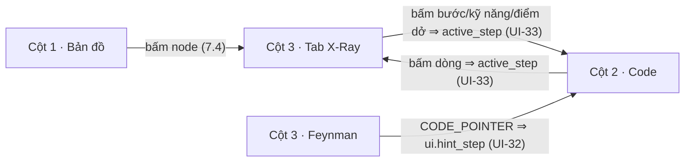

# 30 — GIAO DIỆN: BUỒNG LÁI 3 CỘT

> Bố cục 3 cột, tương tác đồng bộ, hiển thị bản đồ / code / cockpit, offline và lỗi · đọc: Người 1.
> Code repo thi: `src/app/layout.tsx` (font, token, provider Supabase) · `src/app/page.tsx` (`result = null` ⇒ `<Landing/>`, ngược lại `<Workbench/>`) · `src/app/history/page.tsx` · `src/store/workbench.ts` (Zustand) · `src/components/{landing,header,canvas,code,cockpit}/*` · `src/lib/api.ts` (trả response hoặc `ApiError`, không throw) · `src/lib/{bkt-engine,plan,derive,similarity}.ts` (hàm thuần client/server, hiển thị và Offline) · `src/lib/offline.ts` · `src/lib/messages.ts` (Mục 10) · `public/demo/mock_bundle.json`.
> Kiểu: `02` · hằng số: `CONFIG.*` (`CONFIG.UI_PANE_WIDTHS_PCT`, `CONFIG.UI_PRESENTATION_FOCUS_PCT`, `CONFIG.UI_PRESENTATION_FONT_SCALE`, `CONFIG.REPORT_NOTE_MAX_CHARS`) · bất biến: `01` (INV-05, INV-06, INV-07, INV-11) · endpoint: `03` (`GET /api/sessions/{id}/progress` → `ProgressResponse`, `QuestionState.feynman_question`, `ERR_CLIENT_NETWORK`, `NEXT_PUBLIC_DEMO_MODE`) · BKT: `22`.

## Đọc nhanh

- Buồng lái 3 cột: Bản đồ (ReactFlow), Code (Monaco, chỉ đọc), Cockpit (X-Ray / Feynman / Tổng quan).
- Bản sao chỉ đọc: Store chỉ nhận dữ liệu server; không tự tính BKT, trạng thái, mở khóa, số lượt, đáp án (D-02).
- Không tải ngầm: `enrich-node` chỉ cho node đang mở; `analyze-node` chạy nền cho mọi node (D-03).
- Nhãn nguồn: "Nhận định của AI", "Đáp án tham khảo do AI viết"; không claim chặn 100% ảo giác.
- Offline: `public/demo/mock_bundle.json`, 0 API, nhãn cảnh báo cố định.

Các cột điều khiển nhau:



| Mục | Nội dung | File chính |
| :-: | :-- | :-- |
| 1–3 | Nguyên tắc, màn hình, component | `workbench.ts`, `page.tsx`, `src/components/*` |
| 4–6 | Bản đồ, Code, Buồng lái | `canvas/*`, `code/*`, `cockpit/*` |
| 7–9 | Luồng API, Offline, Persona | `api.ts`, `offline.ts`, `PersonaMenu.tsx` |
| 10–11 | Bảng lỗi, token | `messages.ts`, `layout.tsx`, `tailwind.config.ts` |

---

## 1. Nguyên tắc

- **Bản sao chỉ đọc (D-02):** Store chỉ *thay* dữ liệu server; không tự tính BKT, trạng thái, mở khóa, số lượt, đáp án. `derive`, `bkt-engine`, `plan` chỉ hiển thị và Offline.
- **Không tải ngầm (D-03):** `enrich-node` chỉ cho node đang mở; `analyze-node` chạy cho mọi node.
- **Đáp án:** Lấy từ `QuestionState.reveal`; câu chưa xong không có đáp án ở client (D-36).
- **Chữ thuần:** Văn bản AI là chữ thuần (không `dangerouslySetInnerHTML`, không Markdown); trong `` ` `` hiện mã nội dòng.
- **Nhãn nguồn:** Điểm dở "Nhận định của AI"; tổng quan "Nhận định của AI — có thể chưa chính xác"; đáp án "Đáp án tham khảo do AI viết".
- **Số liệu:** Lấy từ `CONFIG` hoặc response; chỉ hiện số thật, không hiện mục tiêu `02` Mục 1.1.
- **Màu sắc:** Kèm biểu tượng + chữ, không dùng màu đơn lẻ.
- **Lưu trữ:** `localStorage` chỉ chứa `sf.last_session`, `sf.prefs`; bọc `try/catch`. Cắt tính năng `40` Mục 6 ⇒ ẩn nút.

---

## 2. Màn hình & bố cục

### 2.1. Màn hình trống (`result = null`)

- Ô link + "Quét repo" ⇒ `POST /api/ingest { repo_url }`; client chỉ chặn ô rỗng. Chỉ nhận link gốc repo (D-38): dưới ô luôn có ghi chú "Chỉ hỗ trợ nhánh mặc định"; link có `/tree/…`, `/blob/…` ⇒ vẫn quét (server cắt về gốc repo); client tự nhận `/tree/…`, `/blob/…` trong ô link ⇒ ghi chú tô `--amber`; link sai dạng ⇒ `ERR_INVALID_GITHUB_URL` (Mục 10).
- Vùng thả nhận `.zip` ≤ `CONFIG.MAX_UPLOAD_BYTES` (D-27), kiểm ở client trước khi gửi (sai đuôi/quá cỡ ⇒ `ERR_UPLOAD_INVALID` / `ERR_STREAM_QUOTA_EXCEEDED`, thông điệp "Upload" ở Mục 10) ⇒ multipart trường `archive` (UI-11).
- **"Tiếp tục học":** `GET /api/sessions` (mới nhất trước), dòng "shop-api · main @ 5be1c2a · 3/7 node (1 ✗) · 2h": `repo_name`, `ref_label`, `snapshot_id` (7 ký tự, `ARCHIVE_HASH` thêm "zip"), `subdir`, `completed_count / total_nodes`, `failed_count`. "Lịch sử" ⇒ `/history?session={id}` (`AttemptHistoryItem`, xem `student_answer`).

| `can_resume` / `resume_blocker` | Nút chính |
| :-- | :-- |
| `true` | "Học tiếp" ⇒ `POST /api/ingest { session_id }`; "Học lại từ đầu" (D-42) ⇒ xác nhận "Mở phiên mới cho repo này: tiến độ node làm lại, điểm kỹ năng giữ nguyên, câu hỏi sinh mới." ⇒ `POST /api/ingest { session_id, restart: true }` |
| `ZIP_SOURCE` (chỉ nguồn `ZIP`, `03` Mục 2) | Dòng "Phiên upload không mở lại được — hãy upload lại file .zip." + vùng thả "Kéo thả lại {repo_key}" (UI-11, best-effort Q-12); `session_id` đổi ⇒ toast "File khác bản cũ — đã mở phiên mới" |
| `ENGINE_UPDATED` | Chỉ "Xem lịch sử" |

- Khách: "Đã lưu tiến độ bằng GitHub? Đăng nhập" ⇒ `supabase.auth.signInWithOAuth({ provider: "github" })`.
- **Đang quét:** Lớp phủ vòng quét + đồng hồ thật; khóa ô link / vùng thả. Xong ⇒ `active_tab = "OVERVIEW"`, `active_node_id = null`, ghi `sf.last_session`; `resumed` ⇒ toast "Đã mở lại {repo_name} — {completed}/{total} node".

### 2.2. Buồng lái 3 cột

- Header cố định; cột 1 Bản đồ (ReactFlow), cột 2 Code (Monaco), cột 3 tab X-Ray / Feynman / Tổng quan, theo `CONFIG.UI_PANE_WIDTHS_PCT`, cuộn riêng, không cuộn ngang.
- **Trình chiếu:** Nút ⤢ đầu cột ⇒ cột rộng `CONFIG.UI_PRESENTATION_FOCUS_PCT` (2 cột còn lại chia đều), cỡ chữ (cả Monaco) × `CONFIG.UI_PRESENTATION_FONT_SCALE`; `Esc` / bấm lại ⇒ thoát. Không ẩn cột; header và nhãn Offline luôn hiện.

### 2.3. Header

| Phần tử | Nguồn ⇒ hiển thị / hành vi |
| :-- | :-- |
| Repo | `repo_name · ref_label @ sha7`; "Repo khác" ⇒ xóa phiên + `sf.last_session` (giữ `profile`) |
| Vân tay | Chip `archetype`, `detected_framework`; `is_monorepo` ⇒ "Monorepo · {root_dir_offset}" + "Đổi thư mục" ⇒ `POST /api/ingest { repo_url, subdir_override }` |
| Đo | "Bản đồ {ingest_ms + engine_ms} ms · 0 token"; bấm ⇒ `ui.metrics` |
| Token | "{progress.token_used} / {CONFIG.SESSION_TOKEN_QUOTA}"; ≥ quota ⇒ đỏ; Offline ⇒ "0 token" |
| Tài khoản | Khách ⇒ "Khách" + "Lưu tiến độ bằng GitHub"; đã liên kết ⇒ avatar (`user_metadata.avatar_url`) + `display_name`. Menu: "Lịch sử học phiên này", "Xóa tài khoản và dữ liệu" |

Nhãn Offline: UI-60. Persona: Mục 9.

- "Lưu tiến độ bằng GitHub" ⇒ `supabase.auth.linkIdentity({ provider: "github" })` ⇒ gọi lại `GET /api/me` (7.2). Trùng tài khoản ⇒ "Tài khoản GitHub này đã có tiến độ riêng; tiến độ khách hiện tại không gộp được."
- **Xóa tài khoản:** "Xóa toàn bộ điểm kỹ năng, phiên học, câu trả lời. Không hoàn tác." ⇒ `DELETE /api/me` ⇒ xóa `sf.*` ⇒ `signOut()` ⇒ tải lại.

---

## 3. Cây component

| Component | Props (kiểu `02`) | Đọc store |
| :-- | :-- | :-- |
| `landing/*`: `Landing`, `RepoInput`, `ZipDropzone`, `ResumeList`, `IngestOverlay` | `ResumeList { sessions: LearningSessionSummary[] }` | `profile`, `ui.sessions`, `ui.pending` |
| `header/*`: `AppHeader`, `TokenMeter`, `AccountMenu`, `PersonaMenu` | `AccountMenu { profile: LearnerCognitiveProfile }`, `PersonaMenu { current: PersonaMode \| null }` | `result`, `progress.token_used`, `profile`, `is_offline_mode`, `ui.metrics` |
| `canvas/DagCanvas`, `CanvasToolbar` | `CanvasToolbar { fingerprint: ProjectFingerprint; report: ClientStaticEngineResult["ingestion_report"] }` | `result`, `progress.nodes`, `analyses`, `active_node_id` |
| `canvas/GraphNodeCard` | `node: HybridArchitecturalNode; state?: NodeStateView; analysis?: NodeAnalysisView \| "PENDING" \| "FAILED"; active: boolean` | — |
| `code/CodePane` | — | node đang mở, `active_step`, `analyses[active]`, `ui.hint_step` |
| `cockpit/XRayTab` (+ `SkillChips`, `StepList`, `AlgoStepper`) | `node; analysis; state: NodeStateView` | `active_step`, `profile`, `server_clock_offset_ms`, `runs[node.id]` |
| `cockpit/FeynmanTab`, `QuestionCard`, `AnswerBox`, `HintCard`, `RevealPanel`, `SkillChangeChip`, `RunSummary`, `ReportWrongDialog` | `QuestionCard { text: string; state: QuestionState; runId: string; mode: RunMode }`, `HintCard { followUp: FollowUp }`, `RevealPanel { reveal: QuestionReveal; pointsCovered: boolean[] \| null }`, `SkillChangeChip { change: SkillChange }`, `RunSummary { run: NodeRunView; state: NodeStateView }` | `runs`, `progress.nodes`, `active_question_index`, `last_failed_answers`, `ui.last_evaluations`, `ui.drafts` |
| `cockpit/Cockpit`, `OverviewTab` | — | `active_tab`, `active_node_id`, `overview`, `result`, `analyses` |

---

## 4. Cột 1 — Bản đồ

- ReactFlow dùng `node.position` từ engine (INV-10); `fitView` khi tải; `nodesDraggable = false`, `nodesConnectable = false`; có Controls.
- **Màu theo `status` (INV-11):** `LOCKED` viền `--locked` đứt mờ, 🔒 "Chưa mở" · `AVAILABLE` `--amber` nhịp sáng, ● "Sẵn sàng" · `COMPLETED` `--green`, ✓ "Hoàn thành" · `FAILED` `--red`, ✗ "Chưa đạt" (giữ đỏ, không ôn — D-35).
- **Lớp hiển thị:**
  - `has_warning` ⇒ ⚠ trên trái, tooltip "Node trước chưa vững: {node cha FAILED / phân tích lỗi}".
  - `"PENDING"` ⇒ xoay + "đang phân tích…"; `analysis_failed` / `"FAILED"` ⇒ "Chưa phân tích được" + "Thử lại phân tích" (UI-73).
  - `is_capstone` ⇒ ★ "Capstone" ; `ALGORITHMIC_CORE` ⇒ "Thuật toán" `--violet`; node đang mở viền ngoài trắng.
- **Tên:** `title_source ∈ {DOMAIN_TERMS, DIRECTORY, FILE_BASENAME}` ⇒ tiền tố "~"; dài quá `CONFIG.TITLE_MAX_CHARS` ⇒ cắt + "…". Tooltip: tên đủ + `title_evidence` + "Tên suy ra — gần đúng"; `VIRTUAL` ⇒ "Node gom nhóm do engine tạo". Dòng phụ "{files.length} file · {languages}".
- **Cạnh:** `RESOLVED` nét liền; `INFERRED` nét đứt + tooltip "Cạnh suy luận — chưa bảo đảm 100%". Màu theo nguồn khi `COMPLETED` / `FAILED`, còn lại xám. Không dùng `animated`.
- **Thanh canvas:** `graph_confidence` (xanh/vàng/đỏ); chip `language_breakdown` "{language} {% code_bytes}" + "suy luận" nếu `STRUCTURAL`; "{n} node"; `degraded_mode` ⇒ "Repo tuần tự" / "Tập thuật toán"; "Đã che {redacted_secret_count} bí mật"; `truncated` / `warnings` ⇒ cảnh báo (`LOW` không đóng được); popover `skipped`.
- **Node `LOCKED`:** Bấm/Enter không làm gì (0 request, `cursor: not-allowed`, `aria-disabled`), tooltip "Hoàn thành trước: {node cha chưa thông}".
- Chú giải: 4 màu, ⚠, cạnh nét đứt.

---

## 5. Cột 2 — Code (Monaco, chỉ đọc)

- Model node: Các bước nối tiếp, mỗi bước 1 tiêu đề + `snippet`, cách dòng trống: `// ── Bước 2 · BUSINESS_LOGIC · src/services/product.service.ts · listProducts [· origin_note]` (`#` với Python). Cuối: "Kiểu dữ liệu" = `dto_snippet` (bỏ nếu rỗng). `buildSliceModel(node) → { text, lineMap, stepRanges }` ở `src/components/code/slice-model.ts`.
- **Số dòng gốc (UI-31):** `lineNumbers: n => lineMap[n-1] > 0 ? String(lineMap[n-1]) : ""` (từ `lineMap`, `snippet_line_map`); tiêu đề, dòng trống, marker (`0`) và kiểu dữ liệu không số; marker mờ.
- **Tô sáng (UI-32):** Bước chọn (`stepRanges[active_step]`) nền vàng nhạt + vạch `--amber`; bước trong `analysis.weak_points` vạch `--red` + glyph ⚠ ở tiêu đề, hover "Nhận định của AI: {what}"; gợi ý `CODE_POINTER` (`ui.hint_step`) vạch `--violet` + glyph 💡, cuộn tới.
- **Đồng bộ 2 chiều (UI-33):** Bấm bước/kỹ năng/điểm dở ở Tab 1 hoặc chip bước editor ⇒ `active_step = k` ⇒ `revealLinesInCenter`. Bấm editor ⇒ `active_step` = bước chứa dòng đó ⇒ Tab 1 tô bước đó. Không đồng bộ theo cuộn.
- `readOnly`, `domReadOnly`, `glyphMargin`; tắt `minimap`, `contextmenu`, `scrollBeyondLastLine`; theme theo Mục 11. Map `node.languages[0]` (`TSX` ⇒ `typescript`, `JSX` ⇒ `javascript`, `PYTHON` ⇒ `python`…; lạ ⇒ `plaintext`).
- Đầu cột: "Bước {k}/{n} · {layer} · {file_path} · {function_name}" + `origin_note`; hàng chip bước (⚠ bước có điểm dở). Chưa chọn node ⇒ "Chọn một node — mỗi node là một lát cắt xuyên file". Không `trace_steps` ⇒ "Node gom nhóm — không có code riêng" + `files`.

---

## 6. Cột 3 — Buồng lái

Tab **X-Ray** · **Feynman** · **Tổng quan**. Chưa chọn node ⇒ chỉ Tổng quan. Chọn node ⇒ mở X-Ray. Feynman bật khi `analyses[id]` là bản phân tích; đang chờ `enrich-node` ⇒ xoay; tắt ⇒ tooltip "Cần bản phân tích trước khi đặt câu hỏi".

### 6.1. Tab X-Ray

- Thứ tự: Đầu node (tên đủ, `title_evidence`, ★/⚠/Thuật toán, `support_tier`) → Kỹ năng → Kiến trúc → Luồng → Điểm hay → Điểm dở → Liên quan → Chỉ số → nút.
- Kỹ năng (bảng kỹ năng): Chip `skills[i]` gồm mã, điểm decay (`getDecayedMastery`, 4 chữ số), `tierOf`. Hover: "Vì: {reason} — bước {step} · `{symbol}` · {file_path} dòng {line_start}–{line_end}"; bấm ⇒ `active_step = step`.
- **Mài mòn kiểu Duolingo (D-35, `22` BKT-24, chỉ hiển thị):** mỗi chip có thanh dài theo điểm đã decay (`now = Date.now() + server_clock_offset_ms`), độ đậm tỉ lệ `điểm đã decay / p_mastery` (nhạt dần liên tục khi lâu không luyện); `isDecaying` (bậc `tierOf` của điểm đã decay thấp hơn bậc của `p_mastery`) ⇒ nhãn "đang mài mòn"; đã decay mà chưa rớt bậc ⇒ chỉ thanh nhạt, không nhãn + tooltip "Điểm gốc {p_mastery} — đã giảm còn {điểm đã decay} vì lâu chưa luyện". Không có nút ôn, không đổi màu node. Tính lại khi `profile` đổi.
- Kiến trúc: `patterns` (đầu là chính) + `summary`. Nhãn: `LAYERED` Tách tầng · `MIDDLEWARE_CHAIN` Chuỗi middleware · `DEPENDENCY_INJECTION` Tiêm phụ thuộc · `OBSERVER_EVENT` Observer · `PIPELINE` Chuỗi xử lý · `ALGORITHMIC` Thuật toán · `PROCEDURAL` Tuần tự · `OTHER` Khác; còn lại giữ tiếng Anh.
- Luồng: Mỗi `steps[i]`: số, `layer`, file, "dòng {line_start}–{line_end}", `function_name` (`trace_steps`), `text` (`null` ⇒ bỏ). Bước chọn tô vàng, bấm ⇒ `active_step`; điểm dở mang ⚠.
- `ALGORITHMIC_CORE`: Stepper `ALGO_SETUP` "Khởi tạo" → `ALGO_EXECUTION` "Vòng lặp chính" → `ALGO_TERMINATION` "Điều kiện dừng"; chặng trống mờ.
- Điểm hay/dở: "✅ (bước {step}) {text}". Điểm dở: viền đỏ, tiêu đề **"Điểm dở — Nhận định của AI"** + "{file_path} dòng {line_start}–{line_end}" + kỹ năng; thân `what` + "Hậu quả: {consequence}". Cấm hiện cách sửa, con số tình huống, biên (INV-06); không ghép nguồn khác.
- Khác: `shared_files` ⇒ "Liên quan: dùng chung {basename} với {chip node}". Chỉ số: `uncle_bob` I · A · D + `diagnosis` (`is_exempt` ⇒ "Miễn trừ") + `cognitive_complexity`. `skeleton_only` ⇒ "AI chưa giải thích được node này — chỉ hiện khung do code dựng". `"PENDING"` ⇒ khung từ `trace_steps` + shimmer "đang phân tích…"; `"FAILED"` ⇒ "Chưa phân tích được" + "Thử lại phân tích".
- **Nút cuối Tab 1 (UI-47):** `AVAILABLE` chưa xong run ⇒ "Bắt đầu trả lời ({số câu chưa xong, trừ DROPPED})" ⇒ tab Feynman (chờ enrich ⇒ "Đang chuẩn bị câu hỏi…"; lỗi ⇒ "Thử lại"). `COMPLETED` / `FAILED` ⇒ không có nút (không ôn tập — D-35).

### 6.2. Tab Feynman

```
Câu 1/2 · DB_OPTIMIZATION · NOVICE  lượt ●●○ ✍  │ Độ chính xác ██████░░│  Ý bắt buộc ● ○  │ 💡 Gợi ý: "…"
[ô trả lời …………………………… 33/{max}]  [Nộp]  [Bỏ qua câu này]        Câu 2/2 · LAYERED_SEPARATION ⏳
```

- Danh sách: `runs[nodeId].questions`; thiếu ⇒ `last_run.questions`, text = `QuestionState.feynman_question`. "Câu {k}/{n} · {skill} · {tier}" + ⏳ · ✍ · ✅ `PASS_*` · ❌ · 🚩 `disputed` · ⊘ "AI không đặt được câu này — không tính" (`DROPPED`). Mở = `active_question_index` (câu chưa xong đầu).
- Lượt: `attempts_used` / `CONFIG.MAX_ATTEMPTS_PER_QUESTION`, từ `state`.
- **Kiểm trước khi gửi (UI-52):** Trượt ⇒ báo dưới ô, 0 request, không tính lượt: Ký tự không khoảng trắng < `CONFIG.ANSWER_MIN_CHARS` (`similarity.ts`) ⇒ `ERR_ANSWER_TOO_SHORT`; `maxLength = CONFIG.ANSWER_MAX_CHARS` + đếm ký tự; `similarity(answer, last_failed_answers[\`${run_id}:${question_index}\`]) ≥ CONFIG.ANSWER_DUPLICATE_SIMILARITY` ⇒ `ERR_ANSWER_DUPLICATE`; Nộp ⇒ nút tắt ("Đang chấm…") tới khi response về **và** qua `CONFIG.SUBMIT_DEBOUNCE_MS`; `progress.token_used ≥ CONFIG.SESSION_TOKEN_QUOTA` ⇒ ô và Nộp tắt, "Hết hạn mức AI của phiên — không chấm được bài mới". `Ctrl+Enter` = Nộp; giữ nháp theo câu (`ui.drafts`).
- Kết quả nộp (`ui.last_evaluations[\`${run_id}:${question_index}\`]`): `core_accuracy` vạch ở `CONFIG.PASS_CORE_ACCURACY`; `simplicity` nhỏ ("không ảnh hưởng Đạt"); `feedback`; `detected_jargons`; `points_covered` ⇒ "Ý bắt buộc: ● ○". `follow_up` ⇒ thẻ tím "Gợi ý"; `CODE_POINTER` thêm "Xem bước {step_index}", gán `active_step = ui.hint_step = step_index`. `OFF_TOPIC` không gợi ý ⇒ "Câu trả lời bị coi là lạc đề — mất 1 lượt, không có gợi ý."; `GIVE_UP` ⇒ "Đã tính 1 lượt chưa đạt."; lưu `last_failed_answers`, ô rung nhẹ.
- **Câu xong (UI-54):** Ẩn ô; `RevealPanel` từ `question.reveal`: "Đáp án tham khảo do AI viết" (`reference_answer`), "Ý bắt buộc" (`must_have_points`, ✓ / ✗ theo `points_covered` lần cuối nếu có), "Cách sửa" (`fix`). `skill_change` ⇒ chip "{skill}: {p_before} → {p_after}" (4 chữ số) + tier trước → sau. Nút "Câu tiếp theo".
- "Bỏ qua câu này" (chưa xong, kể cả hết quota): Xác nhận "Câu này sẽ tính là CHƯA ĐẠT cho {skill} và hiện đáp án." ⇒ `POST /api/reveal`.
- "Báo sai" chỉ khi `outcome = "FAILED"` ∧ `ended_by = "ANSWER"` ∧ `!disputed` (D-22): Ghi chú ≤ `CONFIG.REPORT_NOTE_MAX_CHARS` ⇒ `POST /api/report-wrong` ⇒ 🚩; `skill_change` ⇒ "Đã hoàn lại điểm {skill}: {p_before} → {p_after}"; toast "Đã ghi nhận — nhóm sẽ xem lại câu này". Offline: tắt nút.
- **Tổng kết run (UI-57):** "✅ {skill} · ❌ {skill} · 🚩 {skill}" (bỏ DROPPED) + băng theo `node_state.status`: xanh "Hoàn thành node. Vừa mở: {chip unlocked_node_ids}" · đỏ "Chưa đạt — các node sau vẫn mở, kèm ⚠".
- **Node đã xong (UI-58):** Run cuối chỉ đọc (câu, kết quả, đáp án, "Báo sai"). Không có node miễn thi: mọi node có bản phân tích đều có ≥ 1 câu (D-34).

### 6.3. Tab Tổng quan

- Chưa có `overview` ⇒ từ `result` (`archetype`, framework, `tech_stack`, "Bắt đầu từ" = node gốc) + "Nhận định của AI sẽ hiện khi mọi node phân tích xong ({xong}/{tổng})". Có `overview` ⇒ `overview.facts` + "Luồng chính" (`main_path_node_ids`). `overview.ai` trong khung **"Nhận định của AI — có thể chưa chính xác"** (`architecture_style`, `summary`, `main_flow`, `layers`, `notes`); `ai = null` ⇒ không có khung. Node nhắc tới là chip bấm được (trừ `LOCKED`).

---

## 7. Trạng thái & luồng gọi API

### 7.1. Store

`ClientWorkbenchState` theo 7.3–7.6; đổi phiên ⇒ reset phiên. `last_failed_answers` mất khi tải lại. `server_clock_offset_ms` = `server_now − Date.now()` ở mỗi `MeResponse`. Slice `ui` (tạm): `pending` (VD `enrich:{node_id}`), `errors`, `last_evaluations`, `drafts`, `sessions`, `metrics`, `presentation_pane`, `hint_step`, `offline_persona`. Bỏ response mang `session_id` khác phiên hiện tại.

### 7.2. Khởi động

1. `?offline=1` ⇒ Mục 8, dừng.
2. `supabase.auth.getSession()`; chưa có ⇒ `signInAnonymously()`.
3. `GET /api/me` ⇒ `profile`, `server_clock_offset_ms`.
4. `GET /api/sessions` ⇒ "Tiếp tục học".
5. `sf.last_session` có và `can_resume` ⇒ `POST /api/ingest { session_id }`; lỗi ⇒ xóa `sf.last_session`, về màn hình trống, báo 10. Lỗi mạng bước 2–3 ⇒ "Không kết nối được máy chủ" + "Thử lại" + "Mở bản demo Offline".

### 7.3. Hàng đợi phân tích & tổng quan

- Ingest xong ⇒ thay `session_id`, `result`, `progress`, `analyses`; `runs = {}`, `overview = null`.
- Node chưa phân tích ⇒ `"PENDING"`, xếp hàng tô-pô (hòa ⇒ `id` tăng), tối đa `CONFIG.ANALYZE_CONCURRENCY` gọi `analyze-node` đồng thời. Bấm node chờ ⇒ lên đầu hàng.
- Response: `analysis` ⇒ `analyses[id]`, `null` ⇒ `"FAILED"`; áp 7.5. `ERR_TOKEN_QUOTA_EXCEEDED` ⇒ dừng hàng, node chờ ⇒ `"FAILED"`. Lỗi khác ⇒ `"FAILED"` node đó, hàng chạy tiếp.
- "Thử lại phân tích" ⇒ `"PENDING"` + đầu hàng (UI-73).
- Mọi node có bản phân tích hoặc `analysis_failed` (theo server) ⇒ `POST /api/analyze-overview` đúng 1 lần (UI-74). `ERR_OVERVIEW_NOT_READY` ⇒ im lặng, gọi lại sau phân tích kế tiếp.

### 7.4. Bấm node (không `LOCKED`)

1. `active_node_id = id`, `active_tab = "XRAY"`, `active_step = 1`, `active_question_index = null`, `ui.hint_step = null`. Tab 1 hiện ngay; `"PENDING"` ⇒ đầu hàng.
2. Gọi nền `enrich-node` (`LEARN`) khi có phân tích, `runs[id]` không có run chưa xong, không có `ui.pending["enrich:"+id]`, và: `AVAILABLE` ∧ chưa run; hoặc `last_run.finished_at = null` (server trả đúng run đang mở). Phân tích về sau ⇒ gọi nếu node mở.
3. Response ⇒ `runs[id]`, áp 7.5, `active_question_index` = câu chưa xong đầu; không tự chuyển tab.

### 7.5. Áp response

- `node_state` ⇒ `progress.nodes[node_id]`; `token_used` ⇒ `progress.token_used`; `question` ⇒ `runs[node].questions[k].state`.
- `skill_change ≠ null` ⇒ chip (UI-54) rồi `GET /api/me`. `profile` chỉ thay bằng `MeResponse`, `PersonaResponse`.
- `unlocked_node_ids` khác rỗng **hoặc** `node_state.status` vừa đổi ⇒ `GET /api/sessions/{id}/progress` ⇒ thay `progress` (mở khóa, `has_warning` node khác) (UI-76); node vừa mở hiệu ứng.
- **Lỗi khi nộp / bỏ qua / báo sai (UI-77):** `ERR_ATTEMPT_OUT_OF_SYNC` / `ERR_QUESTION_FINISHED` ⇒ im lặng `enrich-node` (lỗi `NODE` ⇒ UI-76) + toast "Câu này vừa được nộp ở tab khác", giữ nội dung ô. `ERR_PERSISTENCE_UNAVAILABLE` ⇒ không lưu tạm ở client, giữ nội dung ô + "Thử lại" (D-40).

---

## 8. Chế độ Offline

- **Nhãn Offline (UI-60):** Bật/tắt: `Ctrl+Shift+D` (`preventDefault`), `?offline=1`, hoặc nút lỗi mạng. Header luôn hiện: **"Chế độ Offline — dữ liệu ghi lại, không lưu tiến độ"**; tooltip `recorded_from`.
- `public/demo/mock_bundle.json` (`OfflineMockBundle`) ⇒ `is_offline_mode = true`; 0 API, 0 Supabase; `session_id`, `result`, `analyses`, `overview` lấy từ bundle. Bundle hỏng ⇒ báo, giữ chế độ.
- `profile` dựng từ `PERSONAS[ui.offline_persona]` (mặc định `NEWBIE`): 16 kỹ năng, `p_mastery = initial_p_mastery`, `last_practiced_at = now − days_idle` ngày (UI-62). `progress` = `deriveNodeStates` (`derive.ts`).
- `src/lib/offline.ts` cùng chữ ký `api.ts`, dùng khóa `OfflineMockBundle` (`02` Mục 10): `enrich-node` ⇒ `enrich[R]` với `R = ${node_id}:${mode}:${ui.offline_persona}` (thiếu ⇒ "Kịch bản offline không có câu hỏi cho node / persona này"); `evaluate-feynman` ⇒ kiểm UI-52, chọn trong `scripted_answers[${R}:${question_index}:${attempt_number}]` mục có `similarity` cao nhất và ≥ `CONFIG.ANSWER_DUPLICATE_SIMILARITY`, dùng phần chấm `response` (không khớp ⇒ "Chế độ offline chỉ chấm được câu trả lời trong kịch bản", không tính lượt); `reveal` ⇒ `reveals[${R}:${question_index}]`; `analyze-*` không gọi; `report-wrong`, persona API, lịch sử ⇒ tắt.
- Câu xong ⇒ `computeSkillChange` (`bkt-engine`) theo `outcome`, cập nhật `profile` tại chỗ (bỏ `skill_change` / `node_state` trong bundle). Run xong ⇒ `nodeStatusFromRuns` (`plan.ts`), `deriveNodeStates`. Không ghi Postgres; `localStorage` chỉ `sf.prefs`.
- Tắt Offline ⇒ xóa store, chạy lại Mục 7.2.

---

## 9. Persona

- Menu hiện khi `NEXT_PUBLIC_DEMO_MODE = "true"` hoặc đang Offline; mục = `PERSONAS` (hiện `label`).
- **Online:** `POST /api/demo/persona` ⇒ thay `profile`, `server_clock_offset_ms`; trạng thái node không đổi, không gọi lại `ingest` (`03` Mục 5.4); bảng kỹ năng vẽ lại (mài mòn, Mục 6.1). Tiến độ đã học giữ nguyên (bắt đầu sạch ⇒ "Xóa tài khoản"). `ERR_DEMO_MODE_DISABLED` ⇒ ẩn menu.
- **Offline:** đổi `ui.offline_persona` ⇒ dựng lại `profile`, `progress` (UI-62), `runs = {}`; chỉ liệt kê persona có ≥ 1 khóa `enrich`.

---

## 10. Bảng lỗi

`src/lib/messages.ts` export `ERROR_MESSAGES: Record<ErrorCode, …>` (thiếu mã ⇒ lỗi biên dịch). Client hiện `ApiError.message`, tra bảng khi client tự sinh. `{x}` từ `details` / `CONFIG`. Ingest báo dưới ô; nộp bài trong Tab 2 (`aria-live`); còn lại toast. Thử lại = gửi lại request; im lặng = không hiện.

| Mã | Thông điệp | Hành động UI |
| :-- | :-- | :-- |
| `ERR_INVALID_GITHUB_URL` | Vui lòng nhập đúng đường dẫn repo GitHub (VD: https://github.com/facebook/react). | Tô đỏ ô link |
| `ERR_PREFLIGHT_404_OR_PRIVATE` | Không tìm thấy repo này. Kiểm tra chính tả và bảo đảm repo đang Công khai (Public) — repo riêng tư thì nén thành .zip rồi kéo thả vào đây. | Mở vùng thả |
| `ERR_NETWORK_TIMEOUT` | Kết nối tới GitHub đang chậm. Repo có thể vẫn tồn tại — vui lòng thử lại sau vài giây. | Thử lại |
| `ERR_BRANCH_NOT_FOUND` | Không tải được nhánh mặc định của repo. Repo có thể đang trống hoặc vừa đổi nhánh mặc định — vui lòng thử lại sau. | — |
| `ERR_EMPTY_REPOSITORY` | Repo này đang trống (chưa có commit). Hãy đẩy mã nguồn lên rồi thử lại. | — |
| `ERR_REPO_UNAVAILABLE_451` | Repo này đã bị GitHub hạn chế truy cập. | — |
| `ERR_GITHUB_RATE_LIMIT_CDN` | GitHub đang tạm hạn chế lưu lượng. Đợi một lát rồi thử lại, hoặc kéo thả file .zip của repo. | Thử lại, mở vùng thả |
| `ERR_STREAM_TIMEOUT` | Đường truyền tới GitHub bị chậm. Vui lòng thử lại, hoặc kéo thả file .zip của repo. | Thử lại |
| `ERR_STREAM_CORRUPTED` | Dữ liệu tải về bị gián đoạn hoặc file .zip bị hỏng. Vui lòng thử lại. | Thử lại |
| `ERR_STREAM_QUOTA_EXCEEDED` | Repo quá lớn (vượt {CONFIG.MAX_STREAM_BYTES đổi ra MB} MB nén). Hãy nén riêng thư mục mã nguồn chính (VD `server/`) thành .zip rồi kéo thả vào đây. · Upload (D-27, client tự chặn): "File .zip vượt {CONFIG.MAX_UPLOAD_BYTES đổi ra MB} MB — giới hạn tải lên của máy chủ. Hãy nén riêng thư mục mã nguồn chính, hoặc dán link GitHub (không bị giới hạn này)." | Mở vùng thả. **Không** khuyên dán link `/tree/…` (codeload luôn tải cả repo) |
| `ERR_UNSUPPORTED_LANGUAGE` | Repo chủ yếu viết bằng {details.language}. SimpliFey chưa có bộ phân tích cú pháp cho ngôn ngữ này nên chưa dựng được bản đồ. | — |
| `ERR_NO_SOURCE_FILES_FOUND` | Không tìm thấy file mã nguồn nào đọc được (repo chỉ có tài liệu, cấu hình hoặc file nhị phân). {details.hint} | — |
| `ERR_NO_ARCHITECTURAL_SLICE` | Đọc được code nhưng không dựng được lát cắt nào (không thấy hàm entry). Hãy thử repo hoặc thư mục khác. | — |
| `ERR_UPLOAD_INVALID` | File tải lên không phải .zip hợp lệ. | Mở vùng thả |
| `ERR_SERVER_BUSY` | Máy chủ đang xử lý nhiều repo cùng lúc. Vui lòng thử lại sau vài giây. | Thử lại |
| `ERR_NODE_NOT_AVAILABLE` | Node này chưa mở hoặc đã học xong. | UI-76 |
| `ERR_ANALYSIS_NOT_READY` | — | Im lặng: node lên đầu hàng phân tích; có bản phân tích ⇒ gọi lại `enrich-node` |
| `ERR_OVERVIEW_NOT_READY` | — | Im lặng (UI-74) |
| `ERR_QUESTION_FINISHED` | Câu này đã kết thúc. | Im lặng tải lại run (UI-77) + toast |
| `ERR_ATTEMPT_OUT_OF_SYNC` | Câu này vừa được nộp ở tab khác. | Im lặng tải lại run (UI-77) + toast; giữ nội dung ô |
| `ERR_ANSWER_TOO_SHORT` | Câu trả lời quá ngắn — viết ít nhất {CONFIG.ANSWER_MIN_CHARS} ký tự (không tính khoảng trắng). | Dưới ô; không tính lượt |
| `ERR_ANSWER_TOO_LONG` | Câu trả lời dài quá {CONFIG.ANSWER_MAX_CHARS} ký tự. | Dưới ô |
| `ERR_ANSWER_DUPLICATE` | Bạn chưa bổ sung ý mới so với lần trước — hãy diễn giải khác hoặc chi tiết hơn. | Dưới ô |
| `ERR_REPORT_NOT_ALLOWED` | Chỉ báo sai được câu bị chấm trượt, mỗi câu một lần. | Tải lại run, ẩn nút |
| `ERR_AI_UNAVAILABLE` | Chấm: "AI chấm bài đang bận — bài chưa được chấm, không tính lượt." · Đặt câu hỏi: "AI chưa đặt được câu hỏi lúc này." · Phân tích: node "Chưa phân tích được". | Thử lại (chấm: cùng câu trả lời, cùng `attempt_number`) |
| `ERR_AI_REJECTED` | AI chưa đặt được câu hỏi hợp lệ cho node này. | Thử lại `enrich-node` |
| `ERR_TOKEN_QUOTA_EXCEEDED` | Phiên này đã dùng hết hạn mức AI: vẫn đọc được bản phân tích đã có và bỏ qua câu để xem đáp án, nhưng không chấm được bài mới. | Thanh token đỏ; tắt Nộp; dừng hàng phân tích |
| `ERR_UNAUTHENTICATED` | Phiên đăng nhập đã hết hạn. | `refreshSession()` + gửi lại 1 lần; vẫn lỗi ⇒ nút "Đăng nhập lại" (khách: báo sẽ thành khách mới; GitHub: OAuth) |
| `ERR_SESSION_NOT_FOUND` | Không tìm thấy phiên học này. · Phiên nguồn `ZIP` mất bản đồ (Q-12): "Phiên upload không mở lại được — hãy upload lại file .zip." | Xóa `sf.last_session`, về màn hình trống, tải lại danh sách |
| `ERR_SESSION_ENGINE_OUTDATED` | Phiên này tạo bằng phiên bản engine cũ — chỉ xem lại lịch sử. Quét lại repo để học bằng bản mới. | "Xem lịch sử", "Quét lại" |
| `ERR_PERSISTENCE_UNAVAILABLE` | Máy chủ lưu tiến độ đang gặp sự cố — thao tác chưa thực hiện, bạn không mất lượt. | Thử lại |
| `ERR_DEMO_MODE_DISABLED` | Chế độ đổi persona đang tắt trên máy chủ. | Ẩn menu persona |
| `ERR_CLIENT_NETWORK` | Mất kết nối tới máy chủ SimpliFey. | Thử lại; lúc khởi động thêm "Mở bản demo Offline" |

---

## 11. Truy cập, responsive, token thiết kế, hiệu ứng

**Token** (CSS var, map vào `tailwind.config.ts`): `--bg #0F172A` (INV-11) · `--panel #111B31` / `--panel-2 #0D1629` · `--line rgba(148,163,184,.14)` · `--text #E2E8F0` / `--muted #94A3B8` · `--amber #F59E0B` · `--green #10B981` · `--red #EF4444` · `--locked #475569` · `--violet #A78BFA` · `--blue #38BDF8`. Font: Plus Jakarta Sans, JetBrains Mono qua `next/font/google`. Kính mờ: `--panel` + `backdrop-blur` cho toast, popover, hộp thoại; cột, thẻ nền đặc.

- **Bàn phím:** Focus theo tô-pô, Enter/Space mở; `Ctrl+Enter` nộp, `Esc` thoát trình chiếu/hộp thoại; viền `--amber` luôn thấy.
- **Đọc màn hình:** `aria-label` node = "{tên} — {trạng thái}[, có cảnh báo][, đang phân tích]"; kết quả chấm, lỗi, toast trong `aria-live="polite"`; tab `role="tablist"`.
- **Độ tương phản:** WCAG AA trên `--bg` / `--panel`; chữ trên `--amber` tối.
- **Responsive:** Breakpoint `lg` Tailwind ⇒ 3 cột; nhỏ hơn ⇒ 1 cột + chuyển "Bản đồ · Code · Học"; header xuống dòng; không cuộn ngang.
- **Hiệu ứng (CSS thuần):** Nhịp sáng `AVAILABLE`; `transition-colors` khi đổi màu; node vừa mở khóa phóng nhẹ 1 lần; shimmer khung chờ; thanh điểm chạy chiều rộng; toast trượt vào; ô trả lời rung khi chưa đạt. `prefers-reduced-motion: reduce` ⇒ tắt hết, chỉ đổi màu.

---

## Test bắt buộc

Repo demo `shop-api` (`50` 1). Hàm thuần / component: vitest, tên bắt đầu bằng mã luật (VD `UI-31 số dòng gốc`); còn lại kiểm qua DevTools (Network).

| # | Thao tác | Kỳ vọng |
| :-: | :-- | :-- |
| T1 | Bấm / Enter trên node `LOCKED` (N5 khi N4 chưa xong) | 0 request; tab không đổi; tooltip "Hoàn thành trước: Giỏ hàng" |
| T2 | NEWBIE, N2: Q1 trượt 3 lần, Q2 đạt | N2 đỏ ✗; N4 vàng + ⚠ (tooltip nêu "Xem hồ sơ"); tổng kết "❌ AUTH_SECURITY · ✅ HTTP_ROUTING"; Q1 có "Báo sai" |
| T4 | NEWBIE, N3: Q1 sai ⇒ gợi ý ⇒ đúng; Q2 đúng ngay | Chip "DB_OPTIMIZATION: 0.2500 → 0.4202", "LAYERED_SEPARATION: 0.2500 → 0.5767"; N3 xanh; 2 kỹ năng **không** "đang mài mòn" (Δt = 0 ⇒ không rớt bậc) |
| T5 | Học xong N3 bằng `MID_LEVEL` ⇒ đổi sang `SENIOR_RUSTY` | `POST /api/demo/persona`, không gọi `ingest`; N3 vẫn xanh, không nút ôn; Tab 1 N3: thanh kỹ năng nhạt + "đang mài mòn" (0.95 sau 30 ngày ⇒ 0.4085, `ARCHITECT` ⇒ `NOVICE`) |
| T6 | N3 Q1 nộp "200 truy vấn, vì có 200 sản phẩm." (trượt) ⇒ nộp "200 truy vấn vì có 200 sản phẩm"; nộp "ok" | Lần lượt `ERR_ANSWER_DUPLICATE`, `ERR_ANSWER_TOO_SHORT`; 0 request; lượt vẫn ●○○ |
| T8 | Bấm Nộp 2 lần liền | Đúng 1 request `evaluate-feynman` |
| T9 | Lượt 1 trượt ⇒ lượt 2 trượt | Lượt 1: thẻ gợi ý, không tô bước. Lượt 2 (`CODE_POINTER`): Monaco cuộn tới `step_index`, vạch tím |
| T10 | Tìm `reference_answer` trong store / Network trước khi câu xong | Không có; xong ⇒ `RevealPanel` đủ 3 phần |
| T11 | "Bỏ qua câu này" ở Q1/2 | Xác nhận ⇒ `POST /api/reveal` ⇒ Q1 ❌ + đáp án + chip điểm; Q2 làm tiếp; Q1 không có "Báo sai" |
| T12 | "Báo sai" Q1 của T2 | Q1 🚩; `AUTH_SECURITY` về 0.2500; N2 xanh; có `GET …/progress`; N4 hết ⚠ |
| T13 | Tải trang, bấm ngay node "đang phân tích…" | Tab 1 khung chờ, Feynman tắt; `analyze-node` kế tiếp là của node đó; số lời gọi đồng thời ≤ `CONFIG.ANALYZE_CONCURRENCY` |
| T14 | Fixture D2 của `50` (phân tích N6 lỗi) | N6 vàng + "Thử lại phân tích"; node con kèm ⚠; tổng quan vẫn gọi |
| T16 | Hai tab cùng câu: nộp tab A rồi tab B | Tab B toast "Câu này vừa được nộp ở tab khác", cập nhật lượt, giữ nội dung ô |
| T17 | Giả lập DB lỗi bước ghi | `ERR_PERSISTENCE_UNAVAILABLE` + "Thử lại"; lượt không đổi; `localStorage` không có biên nhận. Khôi phục DB, "Thử lại" ⇒ chấm bình thường |
| T18 | `Ctrl+Shift+D` ở màn hình trống, workbench, trình chiếu | Nhãn Offline luôn hiện; 0 request `/api/*`, Supabase; "0 token"; chạy hết kịch bản demo (X-06 của `50`) |
| T19 | Offline: gõ câu ngoài kịch bản | "Chế độ offline chỉ chấm được câu trả lời trong kịch bản"; lượt giữ nguyên |
| T20 | Node `title_source = DIRECTORY`, tên dài hơn `CONFIG.TITLE_MAX_CHARS`; cạnh `INFERRED` | "~…" cắt "…", tooltip tên đủ + `title_evidence` + "Tên suy ra — gần đúng"; cạnh `INFERRED` đứt, `RESOLVED` liền |
| T22 | `buildSliceModel` với N3 | Đầu snippet bước 2 có số 14; tiêu đề / marker không số; bấm dòng 16 ⇒ Tab 1 tô bước 2 |
| T23 | Tab 1 của N3; fixture `overview.ai = null` | Có "Điểm dở — Nhận định của AI · product.service.ts dòng 14–20", không cách sửa ("relations") hay con số tình huống. Tổng quan chỉ có facts |
| T25 | `progress.token_used ≥ CONFIG.SESSION_TOKEN_QUOTA` | Thanh đỏ; ô + Nộp tắt; "Bỏ qua câu này" vẫn chạy |
| T26 | Link private / sai cú pháp / repo rỗng / zip > `CONFIG.MAX_UPLOAD_BYTES`; link `…/tree/main/src` | Đúng thông điệp Mục 10; zip quá cỡ chặn trước upload, thông điệp "Upload"; không thông điệp nào khuyên dán `/tree/…`; link `/tree/…` vẫn quét, ghi chú "Chỉ hỗ trợ nhánh mặc định" tô vàng |
| T27 | Biên dịch `ERROR_MESSAGES` | Đủ mã `02` Mục 9 + `ERR_CLIENT_NETWORK` |
| T28 | Tải lại trang khi N3 Q1 đã trượt 1 lần | Tự mở lại phiên; bấm N3 ⇒ `enrich-node` trả cùng `run_id`; Q1 hiện ●○○, có văn bản |
| T29 | Chỉ dùng bàn phím: chọn node, đọc Tab 1, trả lời, nộp; bật `prefers-reduced-motion` | Làm được hết, viền focus luôn thấy; không còn nhịp sáng / rung |
| T30 | Sau T2, "Học lại từ đầu" ở "Tiếp tục học" | `POST /api/ingest { session_id, restart: true }`; `session_id` mới; mọi node về `LOCKED` / `AVAILABLE`; `AUTH_SECURITY` giữ điểm; N2 hỏi câu mới (D-42) |
