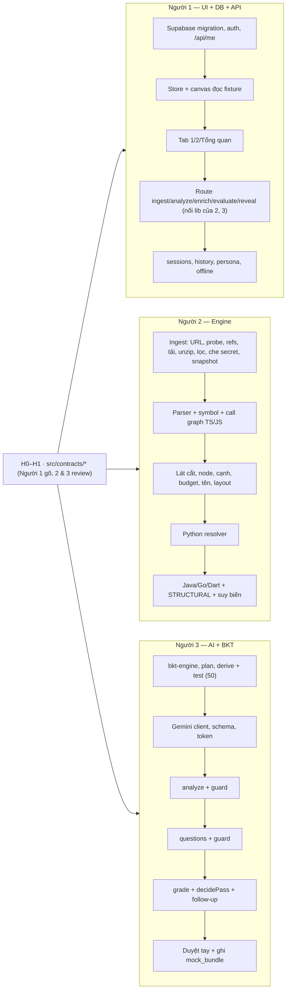

# 40 — KẾ HOẠCH CODE 21 GIỜ (12g00 31/10 → 09g00 01/11/2026)

> Kế hoạch 21 giờ thi cho cả nhóm (phạm vi: D-04, toàn bộ spec). Đọc cùng `references/thele.md` (luật thi) và `00_QUYET_DINH.md` (câu hỏi mở Q-xx).

## Đọc nhanh

- **Luật thi (Mục 8):** repo thi **trống** lúc bắt đầu, BTC chỉ nhận commit trong giờ thi, **cấm bulk-commit code viết sẵn**, **mọi thành viên phải có commit**; spec là tài liệu đọc, không phải code: không chép nguyên khối vào repo thi trong một commit.
- **Trước giờ thi (Mục 1):** hạn 30/10 cho Q-xx, Supabase, host, `GEMINI_API_KEY`, repo demo; repo thi public, trống: nộp link cho BTC trước giờ thi theo BTC.
- **Mốc chính (Mục 5):** H+1 13:00 `contracts/*`; H+8 20:00 lát dọc 1; H+12 00:00 CN lát dọc 2; H+17 05:00 đóng băng tính năng, kiểm Definition of Done (Mục 7); H+21 09:00 ngừng code.
- **Trễ mốc ≥ 1 giờ (Mục 6):** cắt từ trên xuống theo thứ tự ở Mục 6; danh sách không bao giờ cắt nằm cuối Mục 6.



| Mục | Nói về | Code (file / hàm chính) |
| :-- | :-- | :-- |
| 1 | Việc phải xong trước giờ thi | — |
| 2 | Cây thư mục repo thi | — |
| 3 | Công nghệ, phiên bản, grammar `.wasm` | `package.json` |
| 4 | Ba luồng song song, điểm nối | `src/contracts/*`, `src/lib/*` |
| 5 | Mốc giờ | — |
| 6 | Thứ tự cắt khi trễ | — |
| 7 | Definition of Done | `npx vitest run` |
| 8 | Quy ước commit | — |
| 9 | Sản phẩm nộp kèm | — |
| 10 | Rủi ro chính | — |

---

## 1. Việc phải xong TRƯỚC giờ thi (tài liệu & tài khoản — không phải code)

| Việc | Người | Hạn |
| :-- | :-- | :-- |
| Trả lời mọi Q-xx trong `00_QUYET_DINH.md` Mục 3 | Như bảng Q | 30/10 |
| Hỏi BTC 4 câu Q-02 ở buổi họp online | Người 1 | 30/10 |
| Tạo repo GitHub **public, trống**, thêm đủ thành viên làm collaborator, nộp link cho BTC | Người 1 | Trước giờ thi theo BTC |
| Tạo project Supabase (vùng Singapore), bật Anonymous Sign-in + GitHub provider (cho phép manual linking) | Người 1 | 30/10 |
| Lấy `GEMINI_API_KEY`, đo free tier của model ứng viên (Q-01) | Người 3 | 30/10 |
| Tạo tài khoản Vercel (gói free), nối repo thi, chọn region `sin1` (D-27) | Người 1 | 30/10 |
| Chọn repo demo (Q-03) và đẩy lên GitHub nếu dùng repo tự viết | Cả nhóm | 30/10 |
| Mỗi người đọc: `01`, `02`, `03` + file module của mình | Cả nhóm | 30/10 |

---

## 2. Cây thư mục repo thi

```
.
├── package.json · tsconfig.json · next.config.ts · tailwind.config.ts · .env.example
├── supabase/migrations/0001_init.sql            # 03 Mục 3
├── scripts/{review-run,record-bundle}.ts        # Duyệt tay output AI + ghi mock_bundle (21)
├── review/                                      # Bảng kiểm & kết quả duyệt tay (21) — không chứa code repo demo
├── queries/<language>.scm                       # Truy vấn Tree-sitter (11)
├── public/
│   ├── grammars/*.wasm                          # Grammar Tree-sitter (10, 11)
│   └── demo/mock_bundle.json                    # OfflineMockBundle (ghi lại ở giờ H+17)
└── src/
    ├── contracts/{config,…}.ts · contracts/index.ts   # 02 — config.ts = Mục 1, mỗi Mục 2–10 một file, index.ts re-export; viết đầu tiên
    ├── app/
    │   ├── layout.tsx · page.tsx · history/page.tsx   # 30
    │   └── api/
    │       ├── me/route.ts                      # GET, DELETE
    │       ├── sessions/route.ts · sessions/[id]/history/route.ts · sessions/[id]/progress/route.ts
    │       ├── ingest/route.ts · analyze-node/route.ts · analyze-overview/route.ts
    │       ├── enrich-node/route.ts · evaluate-feynman/route.ts · reveal/route.ts
    │       ├── report-wrong/route.ts · demo/persona/route.ts
    ├── server/
    │   ├── auth.ts · db.ts · errors.ts · session.ts · cache.ts · quota.ts · log.ts   # log.ts: pino (04)
    │   ├── progress.ts                          # deriveNodeStates (gọi lib), finalizeRunIfDone
    │   ├── enrich.ts · evaluate.ts · reveal.ts · report.ts · persona.ts
    │   ├── engine/index.ts                      # runEngine()
    │   ├── engine/ingest/*.ts                   # 10
    │   ├── engine/graph/*.ts · engine/graph/resolvers/*.ts   # 11
    │   ├── ai/{gemini,analyze,overview,questions,grade}.ts · ai/prompts/*.ts · ai/schemas.ts      # 20
    │   └── ai/guard/{text,names,forbidden,lines,analysis,overview,questions,followup,injection}.ts  # 21
    ├── lib/{bkt-engine,plan,derive,similarity}.ts   # 22 — hàm thuần dùng chung server + client
    ├── lib/{api,offline,messages}.ts            # Client gọi API có kiểu · bản Offline cùng chữ ký · bảng thông điệp lỗi (30)
    ├── store/workbench.ts                       # Zustand (30)
    └── components/{landing,header,canvas,code,cockpit}/*.tsx  # 30
```

---

## 3. Công nghệ & phiên bản

> Chi tiết kiến trúc triển khai, host Vercel, chuẩn logging Pino, CI/CD và bảo mật vận hành: xem [`04_KIEN_TRUC_TRIEN_KHAI.md`](04_KIEN_TRUC_TRIEN_KHAI.md).

Chốt **phiên bản chính xác ở giờ H+0** bằng lệnh cài đặt, ghi vào `package.json` (không dùng `latest`). Dòng khuyến nghị:

| Gói | Dòng | Dùng cho |
| :-- | :-- | :-- |
| `next`, `react`, `react-dom` | Next 15 App Router, React 19 | Khung |
| `typescript` | 5.x, `strict: true` | Không `any` |
| `@xyflow/react` | 12.x (ReactFlow) | Canvas |
| `@dagrejs/dagre` | 1.x | Layout |
| `@monaco-editor/react` | 4.x | Code viewer (read-only) |
| `zustand` | 5.x | Store |
| `tailwindcss` | 3.4 hoặc 4.x | Giao diện |
| `web-tree-sitter` + file `.wasm` của từng grammar | Cùng ABI với grammar | Parser |
| `fflate` | 0.8.x | Giải nén zip trong RAM |
| `@google/genai` | 1.x | Gemini, structured output |
| `@supabase/supabase-js`, `@supabase/ssr` | 2.x | Auth + DB |
| `pino` | 9.x | Log JSON 1 dòng ra stdout (`04` Mục 9, D-28) |
| `vitest` | 2.x hoặc 3.x | Test hàm thuần (`50`) |

**Nguồn grammar `.wasm`** (`public/grammars/`, tên file theo `LanguageAdapter.wasm_grammar`): ưu tiên `.wasm` phát hành sẵn của grammar chính thức (`tree-sitter-typescript`, `tree-sitter-python`, …) hoặc gói npm `tree-sitter-wasms`; không có ⇒ tự build bằng `npx tree-sitter build --wasm` (cần Emscripten hoặc Docker). Mọi grammar phải cùng ABI với bản `web-tree-sitter` đã pin.
> ⚠️ **Phải kiểm chứng ở H+1:** nạp được grammar TS/JS + Python bằng `initParsers()` (`11` ENG-11). **Fallback (D-32):** lệch ABI ⇒ đổi bản `web-tree-sitter` trong `package.json` cho khớp với grammar `.wasm` đã có sẵn, không tự build lại grammar.

---

## 4. Ba luồng song song & điểm nối

Sơ đồ ba luồng: phần Đọc nhanh. Điểm nối để không ai phải chờ:
- **Fixture `StaticEngineResult`:** Người 1 và 3 dùng bản viết tay từ repo mẫu (`50` Mục 1), đặt ở `src/server/engine/__fixtures__/shop-api.json`, gõ ở H+1; engine thật thay vào lúc H+8.
- **Fixture phản hồi AI:** Người 1 dựng UI Tab 1/2 bằng JSON mẫu của `50` Mục 2 cho tới khi Người 3 có lời gọi thật.
- **Hàm thuần `src/lib/*`** (Người 3) không phụ thuộc gì, viết + test trước, Người 1 gọi trong transaction.

---

## 5. Mốc giờ

| Mốc | Giờ | Phải chạy được (Definition of Done của mốc) |
| :-- | :-- | :-- |
| **H+0** | 12:00 T7 | `create-next-app`, cài gói, `.env.local`, migration chạy trên Supabase; mỗi người commit ≥ 1 lần |
| **H+1** | 13:00 | `contracts/*` xong; fixture shop-api; kiểm 3 giả định ⚠️ của `10` (codeload trả đúng mã cho `HEAD`, `archive/HEAD.zip` chuyển hướng tới nhánh mặc định, comment EOCD có commit SHA); model Gemini trả lời (Q-01); nạp được grammar `.wasm` (Mục 3) |
| **H+4** | 16:00 | UI hiện bản đồ từ fixture; `bkt-engine` + `plan` + `derive` qua test `50`; ingest tải + lọc repo demo trong RAM |
| **H+8** | 20:00 | **Lát dọc 1:** dán link repo demo ⇒ engine thật ⇒ bản đồ thật ⇒ bấm node ⇒ Tab 1 từ `analyze-node` thật |
| **H+12** | 00:00 CN | **Lát dọc 2:** enrich ⇒ nộp ⇒ chấm ⇒ gợi ý ⇒ BKT ⇒ đổi màu ⇒ mở khóa, ghi Postgres; mài mòn ở bảng kỹ năng (D-35) |
| **H+15** | 03:00 | Mọi endpoint của `03` chạy; mở lại phiên; offline mode; persona; tổng quan; Python resolver |
| **H+17** | 05:00 | **Đóng băng tính năng.** Duyệt tay output AI repo demo (`21` Mục duyệt tay) ⇒ ghi `mock_bundle.json`; deploy bản chạy thật |
| **H+19** | 07:00 | Sửa lỗi từ buổi tập demo; chạy 3 lần mỗi câu trả lời trong kịch bản; quay video dự phòng |
| **H+19.5** | 07:30 | Slide xong (dựa `pitch/`) |
| **H+21** | 09:00 | Ngừng code. Commit cuối của cả 3 người |
| — | trước 09:30 | Nộp file thuyết trình |
| — | 10:00–11:30 | Thuyết trình + chạy thử + phản biện |

---

## 6. Thứ tự cắt dự phòng (chỉ khi trễ mốc ≥ 1 giờ)

Cắt từ trên xuống. Mỗi mục cắt phải ghi lại vào `00_QUYET_DINH.md` sau cuộc thi.

1. Resolver Java / Go / Dart và tầng `STRUCTURAL` (giữ TS/JS + Python; INV-09 vẫn đúng vì chỉ hai ngôn ngữ này được tuyên bố đã kiểm chứng).
2. `report-wrong` (ẩn nút "Báo sai").
3. Màn hình lịch sử học (`/history`).
4. Phần AI của tổng quan (chỉ hiện `facts`).
5. Liên kết GitHub (giữ tài khoản khách).

Không bao giờ cắt: bản đồ tất định, Tab 1, câu hỏi + chấm + gợi ý, BKT ở server, offline mode, cổng gác.

---

## 7. Definition of Done toàn sản phẩm (kiểm ở H+17)

- [ ] Dán link repo demo ⇒ bản đồ 6–8 node; đồng hồ đo hiện `ingest_ms + engine_ms` thật.
- [ ] Cùng link chạy 2 lần ⇒ cùng `node_id`, cùng tọa độ (INV-10).
- [ ] Repo private / sai link / repo rỗng / quá lớn ⇒ đúng mã lỗi và thông điệp của `30`.
- [ ] Mọi node xong phân tích; Tab 1 có điểm hay + điểm dở "Nhận định của AI"; không có tên bịa (kiểm tay 3 node).
- [ ] Persona `NEWBIE`: chạy đúng kịch bản A của `50` (A3 → A7): sai ⇒ gợi ý `CONCEPT` ⇒ đúng ⇒ `PASS_AFTER_HINT`, điểm kỹ năng khớp bảng; node xanh, node con mở.
- [ ] "Bỏ qua câu này" ⇒ câu ❌, hiện đáp án; node đỏ khi run xong, node con mở kèm tam giác.
- [ ] Mọi kỹ năng của node đã thạo ⇒ vẫn hỏi 1 câu cho kỹ năng điểm thấp nhất (D-34).
- [ ] Persona `SENIOR_RUSTY` ⇒ bảng kỹ năng hiện thanh nhạt dần + nhãn "đang mài mòn"; không có nút ôn, màu node không đổi (D-35).
- [ ] Tải lại trang ⇒ tiến độ còn nguyên (Postgres); mở lại phiên từ "Tiếp tục học".
- [ ] DevTools: response không chứa `misconception`, `reference_answer` của câu chưa xong, `suspicious_instruction_files`, `symbol_whitelist`.
- [ ] Sửa `attempt_number` trong request ⇒ `ERR_ATTEMPT_OUT_OF_SYNC`, không lộ đáp án.
- [ ] `Ctrl+Shift+D` ⇒ chế độ offline chạy hết kịch bản demo, nhãn offline luôn hiện.
- [ ] Mọi test `50` xanh (`npx vitest run`).
- [ ] Repo thi có test tên bắt đầu bằng `GUARD-04` (`21` Test bắt buộc, `50` Mục 2.1), chạy xanh (`npx vitest run -t "GUARD-04"` — dùng cho demo cổng gác).

---

## 8. Quy ước commit & làm việc

- Mỗi người commit **phần của mình**, nhỏ và thường xuyên (mục tiêu ≤ ~200 dòng / commit), message dạng `feat(engine): cắt link về gốc repo` / `fix(ai): …`.
- Không dán nguyên một file lớn từ spec vào một commit; code được gõ hoặc sinh trong giờ thi theo spec rồi chỉnh.
- Không commit thư mục `spec/` hay `pitch/` vào repo thi (giữ ở repo tài liệu này) — trừ khi BTC trả lời Q-02(c) cho phép.
- Nhánh: làm trực tiếp trên `main` với pull trước khi push, hoặc nhánh theo người + merge nhanh; không để ai giữ code chưa push quá 2 giờ.
- Không commit `.env*` (chỉ `.env.example`).

---

## 9. Sản phẩm nộp kèm

| Thứ | Hạn | Nguồn |
| :-- | :-- | :-- |
| Slide thuyết trình | trước 09g30 01/11 | `pitch/KICH_BAN_DEMO.md`, `pitch/PHAN_BIEN_BGK.md` |
| Kịch bản demo + câu trả lời đã chạy thử | H+19 | `pitch/KICH_BAN_DEMO.md` |
| Video demo dự phòng | H+19 | Quay màn hình chế độ thật + offline |
| Áp phích (10% điểm vòng thử thách theo lượt tương tác) | Theo lịch BTC | Cần làm riêng — chưa có trong tài liệu |

---

## 10. Rủi ro chính

| Rủi ro | Dấu hiệu sớm | Ứng phó |
| :-- | :-- | :-- |
| Model AI không dùng được / free tier cạn | Lỗi 404 / 429 ở H+1 | Đổi `CONFIG.LLM_MODEL` (Q-01); demo bằng offline |
| Comment EOCD không có commit SHA | Kiểm H+1 thất bại | Dùng `ARCHIVE_HASH`; phiên không dựng lại được khi trượt cache RAM trên Vercel (Q-12, ghi vào `00`) |
| Engine trễ | Không có lát dọc 1 ở H+8 | Người 1, 3 tiếp tục trên fixture; cắt theo Mục 6 bước 1 |
| Tree-sitter WASM lệch ABI | Parser lỗi khi nạp grammar | Đổi phiên bản `web-tree-sitter` trong `package.json` cho khớp grammar có sẵn, không tự build lại (D-32) |
| Postgres / mạng hội trường chập chờn | Lỗi khi tập demo | Mạng di động riêng (thể lệ khuyến khích); offline mode |
| Câu trả lời trên sân khấu bị chấm khác lần tập | Lệch trong 3 lần chạy thử | Chỉ dùng câu đã ổn định 3/3; còn lại dùng offline |
